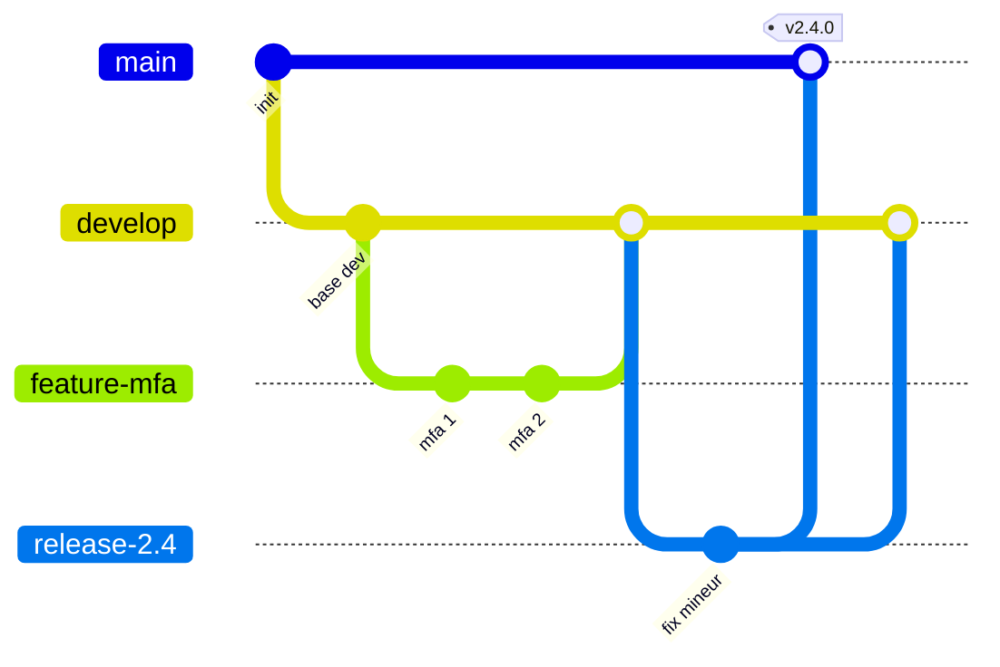
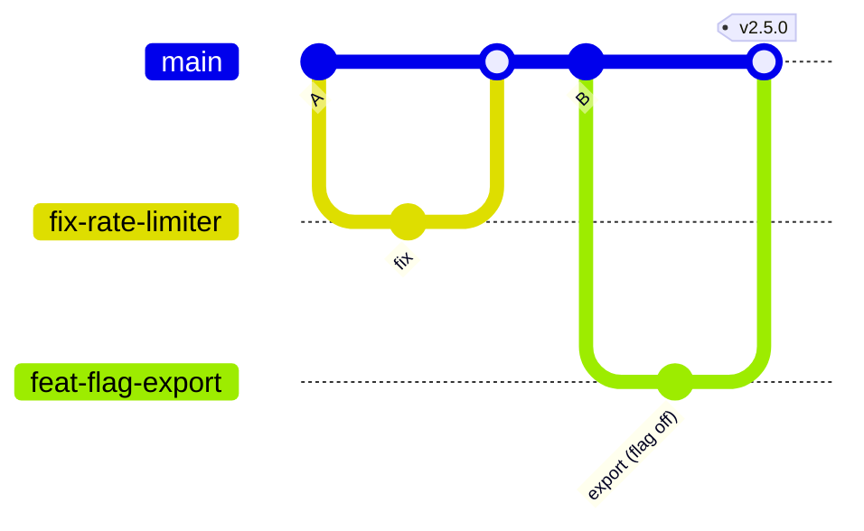

## Introduction

Un dépôt Git bien maîtrisé n'est pas seulement un outil de sauvegarde de code : c'est la colonne vertébrale de toute la collaboration d'une équipe DevOps, et souvent le premier maillon d'une chaîne CI/CD. Un historique confus, des conflits mal résolus ou un secret commité par erreur peuvent ralentir une équipe entière ou déclencher un incident de sécurité. Ce chapitre va au-delà des commandes de base (`add`, `commit`, `push`) pour t'outiller sur les décisions structurantes : comment réécrire proprement un historique avec `rebase`, quel workflow de branches adopter selon la taille et la maturité d'une équipe, comment automatiser des garde-fous avec les git hooks — notamment contre les fuites de secrets, une cause fréquente de compromission — et comment résoudre un conflit de fusion sans paniquer. Tu verras aussi comment le versionnage sémantique (semver) donne un sens explicite à chaque tag de release, ce qui est indispensable dès qu'un pipeline CI/CD ou un package est consommé par d'autres services. Ces compétences sont directement transférables à n'importe quelle certification ou poste impliquant de l'intégration continue, de l'audit de code ou de la gestion d'incidents liés à des dépôts mal configurés.

### Une remarque sur les commandes modernes

Depuis Git 2.23, deux commandes plus claires remplacent les usages multiples de `git checkout` : `git switch` change de branche (`git switch main`, ou `git switch -c feature/login` pour créer et basculer) et `git restore` restaure des fichiers (`git restore fichier.py` annule les modifications non indexées, `git restore --staged fichier.py` retire un fichier de l'index). `git checkout` fonctionne toujours et tu le croiseras dans d'innombrables documentations, y compris dans ce chapitre, mais les nouvelles commandes évitent les confusions entre « changer de branche » et « écraser un fichier ».

## Rebase vs Merge : deux philosophies d'historique

`git merge` combine deux branches en créant un nouveau commit de fusion qui a deux parents. L'historique complet, y compris les détours, est préservé tel quel.

```bash
git checkout main
git merge feature/login
# Crée un commit de merge : "Merge branch 'feature/login' into main"
```

```text
Avant merge :
main:     A---B---C
                    \
feature:             D---E

Après merge :
main:     A---B---C-------M
                    \     /
feature:             D---E
```

`git rebase` rejoue les commits d'une branche sur une nouvelle base, produisant un historique linéaire, sans commit de fusion.

```bash
git checkout feature/login
git rebase main
# Les commits D et E sont "rejoués" après C

git checkout main
git merge feature/login   # fast-forward, aucun commit de merge créé
```

```text
Avant rebase :
main:     A---B---C
                    \
feature:             D---E

Après rebase :
main:     A---B---C
                    \
feature:             D'---E' (nouveaux hashes)
```

<WarningCallout>
Ne rebase jamais une branche déjà partagée et poussée sur laquelle d'autres personnes travaillent : `rebase` réécrit les hashes de commits, ce qui force un `push --force` et peut détruire le travail des autres si ce n'est pas coordonné. Règle d'or : rebase en local, merge en public.
</WarningCallout>

Quand tu dois malgré tout pousser une branche rebasée (par exemple ta propre branche de pull request, sur laquelle personne d'autre ne travaille), préfère `git push --force-with-lease` à `git push --force`. L'option `--force-with-lease` refuse d'écraser la branche distante si quelqu'un y a poussé des commits que tu n'as pas encore récupérés : c'est un filet de sécurité qui transforme une destruction silencieuse en simple erreur.

```bash
git switch feature/login
git fetch origin
git rebase origin/main
git push --force-with-lease
```

```text
To github.com:acme/app.git
 ! [rejected]        feature/login -> feature/login (stale info)
error: failed to push some refs to 'github.com:acme/app.git'
```

Ce rejet signifie qu'un collègue a poussé sur ta branche entre-temps : récupère son travail avant de recommencer.

`git rebase -i` (interactif) permet en plus de réorganiser, fusionner (`squash`) ou reformuler des commits avant de les intégrer :

```bash
# Nettoyer les 4 derniers commits avant d'ouvrir une pull request
git rebase -i HEAD~4
```

```text
pick a1b2c3d Ajoute le formulaire de login
squash e4f5g6h Corrige un typo
squash h7i8j9k Corrige un autre typo
reword k0l1m2n Ajoute la validation du mot de passe
```

<TipCallout>
`git cherry-pick <hash>` applique un commit précis d'une autre branche sans fusionner tout son historique — pratique pour porter un correctif de sécurité urgent d'une branche de release vers `main` sans embarquer des changements non liés.
</TipCallout>

<CompareTable
  titleA="git merge"
  titleB="git rebase"
  rows={[
    { a: "Historique complet préservé, avec commits de fusion", b: "Historique linéaire, sans commit de fusion" },
    { a: "Sûr sur des branches déjà partagées", b: "Réécrit les hashes — dangereux sur des branches partagées" },
    { a: "Traçabilité exacte de quand une branche a divergé", b: "Historique plus lisible, idéal pour une revue de code" },
    { a: "Peut nécessiter un seul gros conflit à la fusion", b: "Peut nécessiter de résoudre le même conflit à chaque commit rejoué" },
  ]}
/>

## GitFlow vs Trunk-Based Development

Le choix d'un workflow de branches structure tout le cycle de vie d'une fonctionnalité, de son développement à sa mise en production.

**GitFlow** repose sur des branches longues et spécialisées : `main` (production), `develop` (intégration), `feature/*`, `release/*` et `hotfix/*`. Chaque fonctionnalité vit dans sa propre branche jusqu'à sa fusion dans `develop`, puis une branche `release/*` prépare la mise en production.

```bash
git checkout -b feature/mfa develop
# ... développement ...
git checkout develop
git merge --no-ff feature/mfa

git checkout -b release/2.4.0 develop
# tests finaux, corrections mineures
git checkout main
git merge --no-ff release/2.4.0
git tag -a v2.4.0 -m "Release 2.4.0"
```

**Trunk-based development** privilégie une seule branche principale (`main`/`trunk`) sur laquelle tout le monde fusionne fréquemment, via des branches courtes (quelques heures à quelques jours) et des feature flags pour masquer le code incomplet en production.

```bash
git checkout -b fix/rate-limiter main
# petit changement, quelques heures
git checkout main
git merge fix/rate-limiter
git branch -d fix/rate-limiter
```

Les deux graphes suivants montrent la différence de forme. GitFlow multiplie les branches longues ; le trunk-based development garde une ligne principale presque droite avec des branches très courtes.





<CompareTable
  titleA="GitFlow"
  titleB="Trunk-Based Development"
  rows={[
    { a: "Branches longues (feature, release, hotfix)", b: "Branches courtes fusionnées en moins de 1-2 jours" },
    { a: "Adapté aux cycles de release planifiés et versionnés", b: "Adapté au déploiement continu (CI/CD) plusieurs fois par jour" },
    { a: "Isolation forte, mais risque de conflits massifs à la fusion", b: "Conflits réduits car les branches vivent peu de temps" },
    { a: "Nécessite une discipline de merge et de tags de release", b: "Nécessite des feature flags et une suite de tests solide" },
  ]}
/>

<CehCallout>
En audit de sécurité applicative, la stratégie de branching influence directement la surface d'attaque : un GitFlow mal maintenu peut laisser des branches `hotfix` oubliées contenant des correctifs de vulnérabilités non encore fusionnés dans `main`, créant une fenêtre d'exposition invisible dans le dépôt.
</CehCallout>

## Pull requests et code review

Une pull request (PR) n'est pas qu'une formalité avant de fusionner : c'est le principal point de contrôle qualité et sécurité avant que du code n'atteigne une branche protégée.

Bonnes pratiques essentielles :

- **Petites PR** : une PR de moins de 400 lignes modifiées se relit correctement ; au-delà, la qualité de la revue chute fortement.
- **Description claire** : contexte, changement apporté, comment tester — pas seulement "fix bug".
- **CI obligatoire avant merge** : tests, lint et scan de sécurité (SAST) doivent passer avant que le bouton de fusion ne soit actif.
- **Au moins une revue approuvée** : jamais de auto-merge sans second regard, en particulier sur du code touchant l'authentification ou les permissions.
- **Résolution des commentaires bloquants uniquement** : distinguer une remarque de style d'un problème de sécurité ou de logique.

```bash
# Créer une branche dédiée et pousser pour ouvrir une PR
git checkout -b feature/api-rate-limit
git push -u origin feature/api-rate-limit
```

### Imposer les règles côté serveur : protection de branche, rulesets et merge queue

Les bonnes pratiques ci-dessus ne valent que si la plateforme les impose. Sur GitHub, les **branch protection rules** historiques sont progressivement complétées par les **rulesets**, qui s'appliquent à plusieurs branches ou tags par motif (`main`, `release/*`, `v*`), peuvent être définis au niveau de l'organisation et proposent un mode « évaluation » pour tester une règle sans bloquer. GitLab propose l'équivalent avec les **protected branches** et les **merge request approval rules**. Les réglages essentiels sont toujours les mêmes : interdire le push direct et le force push sur la branche principale, exiger au moins une approbation, exiger que les checks CI passent, et invalider les approbations quand de nouveaux commits sont poussés.

Le fichier `CODEOWNERS` (à la racine, dans `.github/` ou `docs/`) associe des chemins à des équipes responsables, qui deviennent relecteurs obligatoires si la règle correspondante est activée :

```text
# .github/CODEOWNERS
*                       @acme/dev-team
/infra/                 @acme/platform
/.github/workflows/     @acme/platform @acme/security
/src/auth/              @acme/security
```

Sur un dépôt très actif, une **merge queue** (file de fusion, disponible sur GitHub et sous le nom de merge trains sur GitLab) résout un problème subtil : deux PR vertes séparément peuvent casser `main` une fois combinées. La file teste chaque PR rebasée sur le résultat des PR qui la précèdent avant de fusionner réellement.

<AuditCallout>
ISO 27001 (contrôle A.8.28 — sécurité dans le développement) recommande explicitement une revue de code obligatoire avant toute mise en production, avec traçabilité de l'approbateur — les règles de protection de branche (`branch protection rules`) sur GitHub/GitLab permettent d'imposer cette exigence techniquement, pas seulement par la procédure.
</AuditCallout>

## Git hooks : automatiser les garde-fous

Les hooks Git sont des scripts exécutés automatiquement à certaines étapes du cycle de vie d'un commit ou d'un push. Ils vivent dans `.git/hooks/` (non versionnés par défaut, d'où l'intérêt d'outils comme `husky` pour les partager via le dépôt).

```bash
#!/bin/sh
# .git/hooks/pre-commit — bloque un commit contenant un motif de secret évident
if git diff --cached | grep -EiI '(aws_secret_access_key|api[_-]?key\s*=|-----BEGIN (RSA|OPENSSH) PRIVATE KEY-----)'; then
  echo "❌ Commit bloqué : un secret potentiel a été détecté dans les changements."
  echo "   Retire-le et utilise une variable d'environnement ou un coffre-fort (Vault, SOPS)."
  exit 1
fi
```

```bash
chmod +x .git/hooks/pre-commit
```

```bash
#!/bin/sh
# .git/hooks/pre-push — refuse de pousser si les tests échouent
npm test || {
  echo "❌ Push refusé : les tests unitaires échouent."
  exit 1
}
```

<CehCallout>
Un secret commité (clé API, mot de passe, clé privée) reste dans l'historique Git même après suppression du fichier — un attaquant ayant un accès en lecture au dépôt peut le retrouver via `git log -p` ou `git grep` sur l'ensemble de l'historique. Un hook `pre-commit` anti-secret est une prévention essentielle, mais en cas de fuite déjà commitée, seule une réécriture d'historique (`git filter-repo`) suivie d'une rotation immédiate du secret compromis résout réellement le problème.
</CehCallout>

### Partager les hooks avec le framework pre-commit

Un hook placé dans `.git/hooks/` n'est pas versionné : chaque développeur doit l'installer lui-même. Le framework **pre-commit** (outil Python, `pipx install pre-commit`) résout ce problème : la configuration vit dans le dépôt, et une seule commande installe les hooks. Dans l'écosystème JavaScript, `husky` joue un rôle similaire.

```yaml
# .pre-commit-config.yaml
repos:
  - repo: https://github.com/pre-commit/pre-commit-hooks
    rev: v4.6.0
    hooks:
      - id: check-merge-conflict      # refuse les marqueurs <<<<<<< oubliés
      - id: check-added-large-files   # bloque les gros binaires
      - id: detect-private-key
  - repo: https://github.com/gitleaks/gitleaks
    rev: v8.21.2
    hooks:
      - id: gitleaks
```

```bash
pre-commit install          # écrit le hook dans .git/hooks/pre-commit
pre-commit run --all-files  # exécute tous les hooks sur tout le dépôt
pre-commit autoupdate       # met à jour les versions épinglées (rev)
```

```text
check for merge conflicts................................................Passed
check for added large files..............................................Passed
detect private key.......................................................Failed
- hook id: detect-private-key
- exit code: 1

Private key found: deploy/id_ed25519
Detect hardcoded secrets.................................................Passed
```

<WarningCallout>
Un hook local se contourne en une seconde avec `git commit --no-verify`. Il protège le développeur de ses propres erreurs, mais ne constitue pas un contrôle de sécurité : la même détection doit être rejouée côté serveur, dans la CI ou via la protection contre les pushs de secrets de la plateforme (push protection de GitHub, secret detection de GitLab).
</WarningCallout>

<TipCallout>
Des outils comme `gitleaks` ou `git-secrets` industrialisent cette détection avec des dizaines de motifs déjà prêts (clés AWS, tokens GitHub, certificats privés) — bien plus fiable qu'une seule expression régulière maison en production.
</TipCallout>

## Résoudre un conflit de merge pas à pas

Un conflit survient quand deux branches modifient la même ligne d'un fichier de façon incompatible.

```bash
git checkout main
git merge feature/pricing
```

```text
Auto-merging config.py
CONFLICT (content): Merge conflict in config.py
Automatic merge failed; fix conflicts and then commit the result.
```

```python
<<<<<<< HEAD
TAX_RATE = 0.20
=======
TAX_RATE = 0.18
>>>>>>> feature/pricing
```

<Steps steps={[
  { title: "Identifier les fichiers en conflit", description: "Liste les fichiers marqués comme conflictuels par Git.", code: "git status" },
  { title: "Ouvrir et arbitrer chaque conflit", description: "Choisis ou combine manuellement le contenu entre les marqueurs <<<<<<<, ======= et >>>>>>>, puis supprime ces marqueurs.", code: "code config.py" },
  { title: "Marquer le fichier comme résolu", description: "Une fois le conflit corrigé dans le fichier, indique à Git que la résolution est prête.", code: "git add config.py" },
  { title: "Finaliser la fusion", description: "Termine le merge avec un commit de fusion (le message par défaut suffit généralement).", code: "git commit" },
  { title: "En cas d'erreur, annuler proprement", description: "Si la résolution part dans le mauvais sens, abandonne le merge en cours et repars de l'état d'avant.", code: "git merge --abort" },
]} />

<WarningCallout>
`git merge --abort` ne fonctionne que si aucun commit de fusion n'a encore été créé. Si tu as déjà validé un mauvais merge, utilise `git reset --hard ORIG_HEAD` pour revenir à l'état précédent (uniquement sur une branche non encore poussée, sous peine de forcer un `push --force` risqué).
</WarningCallout>

Pour les conflits récurrents ou complexes, `git rerere` (reuse recorded resolution) mémorise comment un conflit a déjà été résolu et réapplique automatiquement la même résolution si le motif se reproduit :

```bash
git config --global rerere.enabled true
```

`git bisect` est un autre outil précieux, non pour les conflits mais pour localiser le commit exact ayant introduit une régression, par recherche dichotomique :

```bash
git bisect start
git bisect bad                # le commit actuel est cassé
git bisect good v2.3.0        # cette version fonctionnait
# Git checkout un commit intermédiaire à chaque étape
git bisect run npm test       # automatise le test bon/mauvais
git bisect reset              # termine et revient à HEAD
```

## Tags et versionnage sémantique (semver)

Un tag Git marque un point précis de l'historique, typiquement une release. Le semantic versioning donne un format standard `MAJEUR.MINEUR.CORRECTIF` (ex: `2.4.1`) dont chaque incrément a une signification précise :

- **MAJEUR** : changement non rétrocompatible (breaking change) de l'API ou du comportement.
- **MINEUR** : ajout de fonctionnalité rétrocompatible.
- **CORRECTIF** (patch) : correction de bug rétrocompatible, y compris les correctifs de sécurité.

```bash
# Tag annoté (recommandé — inclut auteur, date et message)
git tag -a v2.4.1 -m "Correctif de sécurité : validation des tokens JWT"
git push origin v2.4.1

# Lister les tags existants
git tag -l "v2.*"

# Revenir consulter le code d'une version taguée sans changer de branche
git checkout v2.4.1
```

Quelques précisions de la spécification Semantic Versioning 2.0.0 sont souvent oubliées. Une version **0.y.z** signale un développement initial : tout peut changer à tout moment, et l'API ne doit pas être considérée comme stable. Une **pré-version** s'écrit avec un tiret (`2.0.0-rc.1`, `2.0.0-beta.3`) et a une priorité inférieure à la version finale. Des **métadonnées de build** peuvent suivre un signe plus (`2.0.0+20260314`) et sont ignorées pour comparer deux versions.

### Automatiser les versions avec les Conventional Commits

La spécification **Conventional Commits** impose un format de message de commit lisible par une machine : un type (`feat`, `fix`, `docs`, `refactor`, `chore`…), une portée facultative et une description. Un `!` après le type, ou une ligne `BREAKING CHANGE:` dans le corps, signale une rupture de compatibilité.

```text
feat(auth): ajoute la connexion par passkey
fix(api): corrige la validation des tokens JWT expirés
feat(api)!: supprime l'endpoint /v1/users
```

Des outils comme `semantic-release` ou `release-please` lisent ces messages pour calculer automatiquement la prochaine version : un `fix` incrémente le correctif, un `feat` le mineur, une rupture le majeur. Ils génèrent aussi le changelog et le tag. Le lien entre historique Git et numéro de version devient ainsi mécanique et vérifiable, au lieu de dépendre de la mémoire de la personne qui publie.

<AuditCallout>
Un tag de sécurité (ex: correctif CVE) devrait toujours incrémenter au minimum le CORRECTIF, jamais silencieusement fusionné dans un tag MINEUR — les équipes en aval qui scannent les changelogs pour évaluer leur exposition à une CVE dépendent de cette convention pour prioriser leurs mises à jour.
</AuditCallout>

## Erreurs fréquentes

Beaucoup d'incidents Git viennent des mêmes réflexes. Le premier est le **force push sur une branche partagée**, souvent après un rebase : utilise `--force-with-lease`, et interdis le force push sur `main` par une règle serveur. Le deuxième est de **supprimer un secret dans un nouveau commit** en croyant le problème réglé : le secret reste dans l'historique, dans les forks et dans les caches ; il faut le révoquer immédiatement, puis éventuellement réécrire l'historique. Le troisième est la **PR géante** de plusieurs milliers de lignes, que personne ne relit vraiment et qui est approuvée par lassitude.

On voit aussi souvent des **branches longues qui divergent pendant des semaines**, au point que la fusion devient un projet en soi : intègre `main` régulièrement, ou découpe le travail derrière un feature flag. Autre classique, **committer des marqueurs de conflit** oubliés dans un fichier, ce que le hook `check-merge-conflict` empêche. Enfin, beaucoup d'équipes **se fient aux hooks locaux comme à un contrôle de sécurité**, alors qu'un simple `--no-verify` les désactive.

## Lab — Mise en Pratique

**Environnement** : terminal Nyx Shell (Git installé), dépôt local d'entraînement

<Steps steps={[
  { title: "Créer un historique divergent", description: "Initialise un dépôt et crée deux branches avec des commits différents pour préparer un conflit.", code: "git init lab-git && cd lab-git && git commit --allow-empty -m \"init\"" },
  { title: "Provoquer puis résoudre un conflit", description: "Crée deux branches modifiant la même ligne d'un fichier, fusionne-les, résous le conflit avec git add puis git commit." },
  { title: "Installer un hook anti-secret", description: "Ajoute le script pre-commit vu plus haut dans .git/hooks/pre-commit et rends-le exécutable.", code: "chmod +x .git/hooks/pre-commit" },
  { title: "Vérifier que le hook bloque bien un secret", description: "Ajoute une fausse clé AWS dans un fichier, commit, et observe le refus du hook.", code: "echo 'aws_secret_access_key=AKIAFAKEEXAMPLE' > secret.txt && git add secret.txt && git commit -m \"test\"" },
  { title: "Nettoyer un historique avec rebase interactif", description: "Crée trois petits commits successifs sur une branche, puis fusionne-les en un seul avec squash. Observe avec git log --oneline que l'historique ne contient plus qu'un commit.", code: "git switch -c feature/demo\nfor i in 1 2 3; do echo $i >> demo.txt; git add demo.txt; git commit -m \"wip $i\"; done\ngit rebase -i HEAD~3\ngit log --oneline" },
  { title: "Installer pre-commit avec gitleaks", description: "Crée le fichier .pre-commit-config.yaml vu dans le chapitre, installe les hooks puis exécute-les sur tout le dépôt. Vérifie que la fausse clé est détectée par gitleaks.", code: "pipx install pre-commit\npre-commit install\npre-commit run --all-files" },
  { title: "Localiser une régression avec git bisect", description: "Ajoute dix commits dont l'un introduit le mot BUG dans un fichier, puis laisse git bisect run trouver automatiquement le commit fautif.", code: "git bisect start HEAD HEAD~10\ngit bisect run sh -c '! grep -q BUG demo.txt'\ngit bisect reset" },
  { title: "Tagger une release en semver", description: "Crée un tag annoté suivant le format MAJEUR.MINEUR.CORRECTIF.", code: "git tag -a v1.0.0 -m \"Première release stable\"" },
]} />

## À retenir

- `git merge` préserve l'historique complet avec un commit de fusion ; `git rebase` produit un historique linéaire mais réécrit les hashes — à réserver aux branches locales non partagées.
- GitFlow convient aux cycles de release planifiés avec des branches longues ; le trunk-based development convient au déploiement continu avec des branches courtes et des feature flags.
- Les pull requests doivent rester petites, passer la CI (tests + SAST) et recevoir au moins une approbation avant fusion, en particulier sur du code sensible.
- Les git hooks (`pre-commit`, `pre-push`) automatisent des garde-fous, notamment la détection de secrets avant qu'ils n'entrent dans l'historique — une fuite déjà commitée exige une réécriture d'historique et une rotation du secret.
- Un conflit de merge se résout en éditant les marqueurs `<<<<<<<`/`=======`/`>>>>>>>`, puis `git add` et `git commit` ; `git bisect` localise une régression par recherche dichotomique.
- Le semantic versioning (`MAJEUR.MINEUR.CORRECTIF`) donne un sens explicite à chaque tag de release, essentiel pour les correctifs de sécurité consommés par des systèmes en aval ; les Conventional Commits permettent de l'automatiser.
- Un hook local se contourne avec `--no-verify` : les garde-fous qui comptent vivent côté serveur (rulesets, CODEOWNERS, checks obligatoires, push protection).
- `git push --force-with-lease` remplace `--force` quand une réécriture est vraiment nécessaire.

## Questions de Révision

1. Pourquoi ne faut-il jamais rebaser une branche déjà poussée et partagée avec d'autres personnes ?
2. Quelle est la différence de résultat visuel dans l'historique entre `git merge --no-ff` et un rebase suivi d'un fast-forward ?
3. Dans quel contexte le trunk-based development est-il préférable à GitFlow, et quelle pratique de développement devient alors indispensable ?
4. Que fait concrètement un hook `pre-commit` conçu pour bloquer les secrets, et pourquoi ne suffit-il pas si un secret a déjà été commité par le passé ?
5. Quelles sont les trois étapes pour résoudre un conflit de merge une fois les marqueurs de conflit identifiés dans un fichier ?
6. Pourquoi un correctif de sécurité doit-il au minimum incrémenter le numéro de CORRECTIF (patch) en semver, et jamais être fusionné silencieusement ailleurs ?
7. Quelle protection apporte `--force-with-lease` par rapport à `--force`, et dans quel cas reste-t-il malgré tout dangereux ?
8. Pourquoi un hook pre-commit ne peut-il pas être considéré comme un contrôle de sécurité, et quels mécanismes côté serveur le complètent ?
9. À partir des messages `fix(api): …`, `feat(ui): …` et `feat(api)!: …` commités depuis la version 1.4.2, quelle sera la prochaine version calculée par un outil comme semantic-release ?
