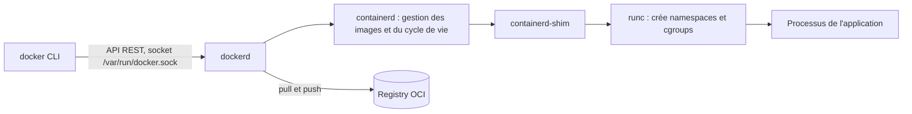

## Introduction

Avant Docker, déployer une application impliquait de reproduire manuellement un environnement système complet — versions de langage, dépendances, variables d'environnement — avec le risque permanent du fameux « ça marche sur ma machine ». La conteneurisation résout ce problème en empaquetant une application avec tout ce dont elle a besoin pour s'exécuter, de façon identique du poste du développeur jusqu'à la production.

Ce chapitre pose les bases pratiques de Docker : comment écrire un Dockerfile propre, comment fonctionne le système de layers qui rend les builds rapides, comment réduire drastiquement la taille d'une image grâce aux multi-stage builds, comment distribuer une image via un registry, et comment orchestrer plusieurs conteneurs ensemble avec docker-compose. C'est un prérequis direct pour les chapitres suivants sur l'intégration continue et le déploiement — un pipeline CI/CD construit et pousse des images Docker à chaque étape.

<TipCallout>
Docker n'est pas une machine virtuelle : les conteneurs partagent le noyau de l'hôte et n'embarquent qu'un système de fichiers applicatif isolé. C'est ce qui les rend légers (démarrage en millisecondes) et denses (des dizaines de conteneurs par hôte), contrairement à une VM qui virtualise du matériel complet.
</TipCallout>

## Ce qu'est vraiment un conteneur

Un conteneur n'est pas un objet magique : c'est un **processus Linux ordinaire** auquel le noyau applique deux mécanismes d'isolation. Les **namespaces** limitent ce que le processus *voit* : son propre arbre de processus (namespace PID, où il se croit le processus 1), sa propre pile réseau (namespace net), ses propres points de montage (mnt), son nom d'hôte (uts), ses identifiants utilisateurs (user) et ses files de communication (ipc). Les **cgroups** (control groups) limitent ce que le processus *consomme* : mémoire, CPU, nombre de processus, entrées-sorties disque.

Le format des images et l'interface d'exécution sont standardisés par l'**OCI** (Open Container Initiative). Une image construite avec Docker peut donc être exécutée par Podman, containerd ou Kubernetes, et inversement. Quand tu tapes `docker run`, la chaîne d'appels est la suivante :



Tu peux le vérifier toi-même : un conteneur lancé apparaît comme un simple processus dans la liste de l'hôte.

```bash
docker run -d --name demo --memory 256m nginx:1.27
docker top demo                       # processus vus depuis l'hôte
docker inspect demo --format '{{.State.Pid}} {{.HostConfig.Memory}}'
```

```text
UID     PID     PPID    C   STIME   TTY   TIME       CMD
root    48213   48190   0   10:02   ?     00:00:00   nginx: master process nginx -g daemon off;
101     48260   48213   0   10:02   ?     00:00:00   nginx: worker process
48213 268435456
```

La valeur `268435456` correspond aux 256 Mo de limite mémoire, appliqués par un cgroup. Cette vision explique aussi la principale limite de sécurité des conteneurs : ils partagent le **même noyau** que l'hôte, donc une faille du noyau peut permettre une évasion. Le cours DevSecOps reviendra en détail sur ce point.

## Image vs conteneur : la classe et l'instance

La distinction entre image et conteneur est la même que celle entre une classe et une instance en programmation orientée objet. Une **image** est un modèle immuable, en lecture seule, décrivant un système de fichiers et une configuration de démarrage. Un **conteneur** est une instance en cours d'exécution de cette image, avec sa propre couche d'écriture éphémère et son propre état runtime (processus, réseau, mémoire).

```bash
# L'image ne bouge pas — elle sert de modèle
docker image ls

# Chaque exécution crée un conteneur distinct de la même image
docker run --name web-1 -d nginx:1.27
docker run --name web-2 -d nginx:1.27
docker ps
```

Deux conteneurs lancés depuis la même image `nginx:1.27` sont totalement indépendants : arrêter ou supprimer `web-1` n'affecte en rien `web-2`, exactement comme modifier un objet n'affecte pas les autres instances de sa classe. Les modifications effectuées dans un conteneur en cours d'exécution (fichiers créés, packages installés à chaud) vivent dans sa couche d'écriture et disparaissent avec `docker rm`, sauf si elles sont explicitement persistées via un volume.

## Anatomie d'un Dockerfile

Un Dockerfile décrit, instruction par instruction, comment construire une image. Voici un exemple pour une API Node.js simple :

```dockerfile
FROM node:22-alpine

WORKDIR /app

COPY package*.json ./
RUN npm ci --omit=dev

COPY . .

CMD ["node", "server.js"]
```

- **`FROM`** — définit l'image de base sur laquelle construire. `node:22-alpine` fournit déjà Node.js 22 sur une distribution Linux minimale (Alpine, ~5 Mo).
- **`WORKDIR`** — fixe le répertoire de travail pour toutes les instructions suivantes ; le crée s'il n'existe pas.
- **`COPY`** — copie des fichiers du contexte de build (la machine hôte) vers le système de fichiers de l'image.
- **`RUN`** — exécute une commande **au moment du build** et fige son résultat dans l'image (installation de dépendances, compilation).
- **`CMD` / `ENTRYPOINT`** — définissent ce qui s'exécute **au démarrage du conteneur**.

D'autres instructions reviennent souvent : `ENV` définit une variable d'environnement persistée dans l'image, `ARG` une variable disponible uniquement pendant le build, `EXPOSE` documente le port écouté (sans rien publier), `USER` change l'utilisateur d'exécution, et `HEALTHCHECK` indique à Docker comment vérifier que l'application répond. Préfère toujours la **forme exec** en tableau JSON (`CMD ["node", "server.js"]`) à la forme shell (`CMD node server.js`) : avec la forme shell, le processus est lancé par `/bin/sh -c`, qui devient le processus 1 et ne relaie pas correctement le signal d'arrêt `SIGTERM`, ce qui retarde les arrêts propres.

<WarningCallout>
`CMD` et `ENTRYPOINT` sont fréquemment confondus. `CMD` fournit une commande par défaut, entièrement remplaçable au lancement (`docker run monimage autre-commande`). `ENTRYPOINT` fixe le programme principal exécuté à chaque démarrage — les arguments passés à `docker run` lui sont ajoutés plutôt que de le remplacer. Combiner les deux (`ENTRYPOINT ["node"]` + `CMD ["server.js"]`) donne un binaire fixe avec un argument par défaut modifiable, un pattern courant pour les images d'outils en ligne de commande.
</WarningCallout>

```dockerfile
# ENTRYPOINT fixe, CMD comme argument par défaut modifiable
ENTRYPOINT ["node"]
CMD ["server.js"]
```

```bash
docker run monimage              # exécute : node server.js
docker run monimage worker.js    # exécute : node worker.js (CMD remplacé, ENTRYPOINT conservé)
```

## Layers et cache de build

Chaque instruction d'un Dockerfile produit un **layer** (une couche) empilée sur les précédentes. Docker met en cache chaque layer : si une instruction et son contexte n'ont pas changé depuis le dernier build, la couche est réutilisée sans être ré-exécutée. C'est pourquoi l'**ordre** des instructions est déterminant pour la vitesse de build.

```dockerfile
# ❌ Mauvais ordre : le moindre changement de code invalide le cache de npm ci
FROM node:22-alpine
WORKDIR /app
COPY . .
RUN npm ci --omit=dev
CMD ["node", "server.js"]
```

```dockerfile
# ✅ Bon ordre : les dépendances ne sont réinstallées que si package.json change
FROM node:22-alpine
WORKDIR /app
COPY package*.json ./
RUN npm ci --omit=dev
COPY . .
CMD ["node", "server.js"]
```

Dans la seconde version, copier `package*.json` avant `COPY . .` isole l'installation des dépendances du reste du code source. Tant que `package.json` et `package-lock.json` ne changent pas, Docker réutilise le layer contenant `node_modules` même si tu modifies dix fichiers source — le build passe de plusieurs dizaines de secondes à quelques millisecondes.

### BuildKit : le moteur de build moderne

Depuis Docker Engine 23, le moteur de build par défaut est **BuildKit**, piloté par la commande `docker buildx`. Il construit les stages indépendants en parallèle, ignore les stages inutiles à la cible demandée et apporte des fonctionnalités introuvables avec l'ancien moteur. La plus utile est le **cache mount**, qui conserve un répertoire de cache entre deux builds sans l'inclure dans l'image :

```dockerfile
# syntax=docker/dockerfile:1
FROM node:22-alpine
WORKDIR /app
COPY package*.json ./
RUN --mount=type=cache,target=/root/.npm npm ci --omit=dev
COPY . .
CMD ["node", "server.js"]
```

BuildKit sait aussi construire pour plusieurs architectures en une commande, ce qui est devenu indispensable avec la généralisation des processeurs ARM (Mac Apple Silicon, instances cloud Graviton) :

```bash
docker buildx build --platform linux/amd64,linux/arm64 \
  -t ghcr.io/mon-org/mon-api:1.4.0 --push .
```

Enfin, `RUN --mount=type=secret` permet d'utiliser un secret pendant le build (un jeton de registre npm privé, par exemple) sans qu'il soit écrit dans un layer, contrairement à un `ARG` ou un `ENV` qui restent lisibles avec `docker history`.

<TipCallout>
Vérifie le cache en observant la sortie de `docker build` : une ligne marquée `CACHED` signifie que le layer n'a pas été reconstruit. Un `.dockerignore` (équivalent de `.gitignore`) évitant de copier `node_modules`, `.git` ou des fichiers volumineux inutiles réduit aussi le contexte envoyé au démon Docker et accélère chaque build.
</TipCallout>

## Multi-stage builds : réduire drastiquement la taille des images

Un multi-stage build utilise plusieurs instructions `FROM` dans un seul Dockerfile, chaque étape (`stage`) pouvant récupérer sélectivement des artefacts de l'étape précédente. Cela permet de séparer l'environnement de **build** (compilateurs, dépendances de développement) de l'environnement d'**exécution**, qui n'a besoin que du résultat final.

```dockerfile
# --- Stage 1 : build ---
FROM node:22-alpine AS builder
WORKDIR /app
COPY package*.json ./
RUN npm ci
COPY . .
RUN npm run build

# --- Stage 2 : exécution ---
FROM node:22-alpine AS runner
WORKDIR /app
ENV NODE_ENV=production
COPY package*.json ./
RUN npm ci --omit=dev
COPY --from=builder /app/dist ./dist

CMD ["node", "dist/server.js"]
```

L'image finale (`runner`) ne contient ni le code source TypeScript, ni les dépendances de développement (linters, bundlers, types), ni les caches de build — seulement le JavaScript compilé et les dépendances de production. Sur un projet Node.js typique, ce pattern fait souvent passer une image de plus de 1 Go (avec toute la toolchain de build) à moins de 150 Mo.

<CompareTable
  titleA="Approche"
  titleB="Conséquence"
  rows={[
    { a: "Build mono-stage", b: "L'image finale contient compilateurs, devDependencies et fichiers sources — poids et surface d'attaque inutilement élevés" },
    { a: "Multi-stage build", b: "Seuls les artefacts nécessaires à l'exécution sont copiés dans l'image finale — image plus légère, démarrage plus rapide, moins de composants à sécuriser" },
  ]}
/>

Le même principe s'applique à Python avec des wheels précompilés dans un stage de build, copiés ensuite dans une image `python:3.12-slim` allégée pour l'exécution.

## Registries et tagging d'images

Une image construite localement doit être publiée sur un **registry** pour être déployée ailleurs (serveur de production, cluster Kubernetes, pipeline CI). Les registries les plus courants sont Docker Hub (public par défaut), Amazon ECR, et GitHub Container Registry (GHCR), souvent choisi quand le code source est déjà hébergé sur GitHub.

```bash
# Tagger une image locale pour un registry précis avant de la pousser
docker build -t ghcr.io/mon-org/mon-api:1.4.0 .
docker tag ghcr.io/mon-org/mon-api:1.4.0 ghcr.io/mon-org/mon-api:latest

# S'authentifier puis pousser l'image
docker login ghcr.io
docker push ghcr.io/mon-org/mon-api:1.4.0
docker push ghcr.io/mon-org/mon-api:latest
```

Le tag suit le format `<registry>/<organisation>/<image>:<version>`. Utiliser une version sémantique explicite (`1.4.0`) plutôt que de dépendre uniquement de `latest` garantit qu'un déploiement pointe toujours vers une version connue et reproductible — un rollback devient trivial (`docker run image:1.3.2`) alors que `latest` change de contenu à chaque nouveau build.

Un tag est une **étiquette mobile** : rien n'empêche de pousser une nouvelle image sous le même tag `1.4.0`. La seule référence immuable est le **digest**, l'empreinte SHA-256 du manifeste de l'image. En production, et en particulier dans les manifestes Kubernetes, on référence souvent les images par digest, éventuellement accompagné du tag pour la lisibilité.

```bash
docker buildx imagetools inspect ghcr.io/mon-org/mon-api:1.4.0 | head -3
```

```text
Name:      ghcr.io/mon-org/mon-api:1.4.0
MediaType: application/vnd.oci.image.index.v1+json
Digest:    sha256:9f2c1b7e4a0d...c41e
```

```dockerfile
FROM node:22-alpine@sha256:<digest-de-l-image-de-base>
```

Beaucoup de registries (ECR, Harbor, GitLab) proposent aussi des **tags immuables**, qui interdisent d'écraser un tag existant.

<AuditCallout>
Une politique de tagging cohérente (versions sémantiques, tag immuable par commit ou par build CI) est un prérequis pour la traçabilité en production : en cas d'incident, l'équipe doit pouvoir identifier précisément quelle image tourne et depuis quel commit elle a été construite.
</AuditCallout>

## Docker Compose : orchestrer un environnement multi-services

La plupart des applications réelles ne sont pas un seul conteneur isolé mais un ensemble de services coordonnés — une API, une base de données, un cache. Docker Compose décrit cet ensemble dans un unique fichier YAML et le démarre en une seule commande.

<WarningCallout>
Attention aux documentations anciennes. L'outil Python historique `docker-compose` (avec un tiret, « Compose v1 ») n'est plus maintenu depuis 2023. La version actuelle, **Compose v2**, est un plugin de la CLI Docker qui s'invoque avec `docker compose` (avec une espace). Le fichier suit la **Compose Specification** : la clé `version:` en tête de fichier est obsolète et simplement ignorée, et le nom de fichier recommandé est `compose.yaml`, même si `docker-compose.yml` reste reconnu.
</WarningCallout>

```yaml
# compose.yaml (docker-compose.yml reste reconnu)
services:
  api:
    build: .
    ports:
      - "3000:3000"
    environment:
      - DATABASE_URL=postgresql://app:app@db:5432/app
    depends_on:
      db:
        condition: service_healthy

  db:
    image: postgres:16-alpine
    environment:
      POSTGRES_DB: app
      POSTGRES_USER: app
      POSTGRES_PASSWORD: app
    volumes:
      - db_data:/var/lib/postgresql/data
    healthcheck:
      test: ["CMD-SHELL", "pg_isready -U app"]
      interval: 5s
      retries: 5

volumes:
  db_data:
```

```bash
docker compose up -d      # démarre tous les services en arrière-plan
docker compose logs -f api
docker compose down       # arrête et supprime les conteneurs (les volumes persistent)
```

Quelques fonctionnalités de Compose v2 méritent d'être connues. Les **profils** (`profiles: [debug]` sur un service) permettent de ne démarrer certains services qu'à la demande, avec `docker compose --profile debug up`. Un fichier `.env` placé à côté de `compose.yaml` fournit les valeurs des variables `${VAR}` utilisées dans le fichier. La commande `docker compose watch`, associée à une section `develop.watch`, synchronise ou reconstruit automatiquement un service quand tu modifies le code. Enfin, `docker compose config` affiche la configuration finale, une fois les variables et fichiers d'override fusionnés : c'est le premier réflexe quand un service ne prend pas la configuration attendue.

Il faut aussi distinguer deux façons de persister des données. Un **volume nommé** (`db_data:/var/lib/postgresql/data`) est géré par Docker, portable et adapté aux données applicatives. Un **bind mount** (`./src:/app/src`) monte un répertoire précis de l'hôte, pratique en développement pour le rechargement à chaud, mais qui couple le conteneur à l'arborescence de la machine.

Docker Compose crée automatiquement un réseau privé partagé entre les services : le conteneur `api` peut joindre la base de données simplement via le nom de service `db` comme s'il s'agissait d'un nom d'hôte DNS, sans configuration réseau manuelle. Le `depends_on` avec `condition: service_healthy` garantit que l'API n'accepte du trafic qu'une fois la base réellement prête à répondre, pas seulement démarrée.

<CehCallout>
Les mauvaises pratiques de sécurité autour des conteneurs — exécuter en root, dépendre du tag `latest` en production, ou embarquer des secrets en dur dans une image — ne sont volontairement qu'évoquées ici : elles seront traitées en profondeur, avec leurs contre-mesures, dans le cours « DevSecOps Avancé ».
</CehCallout>

## Bonnes pratiques

- Privilégier des images de base minimales (`alpine`, `slim`) pour réduire la surface et le poids.
- Ordonner les instructions du Dockerfile du moins au plus volatile pour maximiser le cache.
- Toujours utiliser un multi-stage build dès qu'une étape de compilation ou de build est nécessaire.
- Nommer chaque image poussée avec une version explicite, jamais uniquement `latest`.
- Décrire l'environnement de développement complet (services dépendants inclus) dans un `docker-compose.yml` versionné avec le code.

## Erreurs fréquentes

La première erreur est d'**oublier le fichier `.dockerignore`** : le dossier `.git`, les `node_modules` locaux ou un fichier `.env` contenant des secrets sont alors copiés dans l'image par `COPY . .`. La deuxième est de **croire qu'un `rm` dans un layer suivant supprime un fichier** : le fichier reste présent dans le layer précédent et récupérable par quiconque télécharge l'image. Pour qu'un fichier temporaire ne laisse pas de trace, il doit être créé et supprimé dans la même instruction `RUN`, ou mieux, rester dans un stage de build.

On voit aussi souvent la **forme shell de `CMD`**, qui empêche l'application de recevoir `SIGTERM` et transforme chaque `docker stop` en attente de dix secondes suivie d'un `SIGKILL`. Autre classique, **utiliser `localhost` pour joindre un autre service Compose** : à l'intérieur d'un conteneur, `localhost` désigne le conteneur lui-même, il faut utiliser le nom du service. Enfin, beaucoup confondent `docker compose down` et `docker compose down -v` : la seconde commande supprime aussi les volumes, donc les données de la base.

## Lab — Mise en Pratique

**Environnement** : Kali Linux (terminal Nyx Shell) avec Docker installé

<Steps steps={[
  { title: "Construire une image simple", description: "Écris un Dockerfile minimal pour une petite API Node.js et construis l'image.", code: "docker build -t mon-api:1.0.0 ." },
  { title: "Observer le cache de build", description: "Modifie un fichier source (pas package.json) et reconstruis pour vérifier que l'installation des dépendances reste en cache.", code: "docker build -t mon-api:1.0.1 ." },
  { title: "Inspecter les layers", description: "Affiche l'historique de l'image : chaque ligne correspond à une instruction et à la taille du layer produit. Repère le layer le plus lourd.", code: "docker history mon-api:1.0.1\ndocker image inspect mon-api:1.0.1 --format '{{.Size}}'" },
  { title: "Convertir en multi-stage build", description: "Ajoute un stage de build séparé du stage d'exécution et compare la taille des images.", code: "docker images | grep mon-api" },
  { title: "Orchestrer avec docker-compose", description: "Écris un docker-compose.yml avec l'API et une base PostgreSQL, puis démarre l'ensemble.", code: "docker compose up -d" },
  { title: "Vérifier la communication inter-services", description: "Depuis le conteneur de l'API, confirme que le service db est joignable par son nom (la résolution DNS interne de Compose renvoie l'IP du conteneur db).", code: "docker compose exec api ping -c 2 db" },
  { title: "Contrôler la configuration finale et les limites", description: "Affiche la configuration fusionnée par Compose, puis observe la consommation des conteneurs en temps réel.", code: "docker compose config\ndocker stats --no-stream" },
]} />

## À retenir

- Une image est un modèle immuable, un conteneur en est une instance en cours d'exécution — comme une classe et ses objets.
- `RUN` s'exécute au build et fige le résultat dans l'image ; `CMD`/`ENTRYPOINT` définissent le comportement au démarrage du conteneur, `ENTRYPOINT` étant le programme fixe et `CMD` ses arguments par défaut remplaçables.
- Chaque instruction du Dockerfile crée un layer mis en cache ; ordonner les instructions du moins au plus volatile accélère fortement les builds.
- Les multi-stage builds séparent l'environnement de build de l'environnement d'exécution, réduisant drastiquement la taille et la surface d'attaque de l'image finale.
- Les registries (Docker Hub, ECR, GHCR) distribuent les images ; un tagging par version sémantique explicite est essentiel pour la traçabilité et le rollback.
- Docker Compose v2 (`docker compose`, fichier `compose.yaml` sans clé `version`) orchestre plusieurs services locaux dans un réseau partagé, avec des dépendances de démarrage contrôlées via `depends_on` et `healthcheck`.
- Un conteneur est un processus isolé par les namespaces et limité par les cgroups ; il partage le noyau de l'hôte.
- Seul le digest SHA-256 identifie une image de façon immuable ; BuildKit apporte cache mounts, secrets de build et images multi-architectures.

## Questions de Révision

1. En quoi la différence entre image et conteneur est-elle analogue à celle entre une classe et une instance ?
2. Quelle est la différence de comportement entre `CMD` et `ENTRYPOINT` lorsqu'on passe une commande à `docker run` ?
3. Pourquoi copier `package.json` avant le reste du code source améliore-t-il l'utilisation du cache de build ?
4. Que permet un multi-stage build que ne permet pas un Dockerfile mono-stage ?
5. Pourquoi dépendre uniquement du tag `latest` en production complique-t-il un rollback ?
6. Que garantit `depends_on` avec `condition: service_healthy` dans un fichier docker-compose ?
7. Quels mécanismes du noyau Linux isolent un conteneur, et lequel limite sa consommation mémoire ?
8. Pourquoi un fichier supprimé par une instruction `RUN rm` dans un layer ultérieur reste-t-il récupérable dans l'image ?
9. Quelle est la différence entre un tag et un digest, et lequel utiliserais-tu dans un manifeste de production ?
