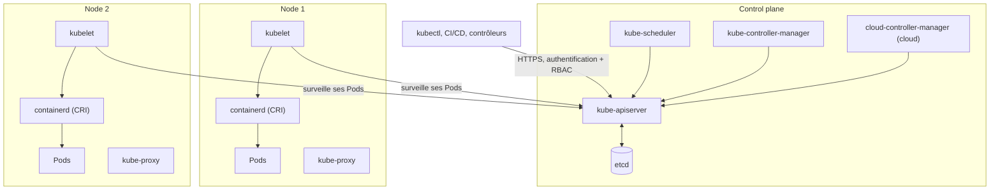
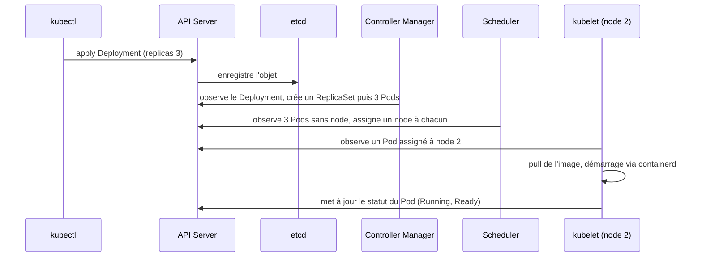

## Introduction

Docker Compose suffit tant qu'une application tourne sur une seule machine. Mais dès qu'il faut répartir des conteneurs sur plusieurs serveurs, remplacer automatiquement un conteneur qui plante, ou faire évoluer le nombre de répliques d'un service en fonction de la charge, docker-compose atteint ses limites : il n'a aucune notion de cluster, de nœuds multiples, ni de réconciliation automatique de l'état désiré.

Kubernetes (souvent abrégé K8s) répond à ce problème : c'est un orchestrateur de conteneurs qui gère un cluster de machines, distribue les charges de travail, redémarre ce qui échoue, et expose des mécanismes déclaratifs pour décrire l'état voulu de l'infrastructure plutôt que la suite d'actions pour y parvenir. Ce chapitre pose les bases indispensables avant d'aborder, dans les chapitres suivants, le déploiement continu vers un cluster.

Nous allons voir pourquoi orchestrer, comment un cluster Kubernetes est structuré, les objets qu'on manipule au quotidien (Pod, Deployment, Service, Namespace), les commandes `kubectl` essentielles, la gestion de la configuration et des secrets, et enfin comment Kubernetes assure le scaling horizontal et l'auto-réparation (self-healing) des applications.

## Pourquoi orchestrer au-delà de docker-compose

`docker-compose` décrit et démarre un ensemble de conteneurs sur **une seule machine**. Cela fonctionne très bien en développement ou pour un petit projet, mais pose plusieurs problèmes à l'échelle d'une production sérieuse :

<CompareTable
  titleA="Limite de docker-compose"
  titleB="Besoin réel en production"
  rows={[
    { a: "Un seul hôte Docker", b: "Répartir les conteneurs sur plusieurs machines (nœuds) pour la capacité et la résilience" },
    { a: "Pas de redémarrage intelligent en cas de panne d'un nœud entier", b: "Reprogrammer automatiquement les conteneurs sur un autre nœud disponible" },
    { a: "Scaling manuel via `docker-compose up --scale`", b: "Scaling automatique basé sur la charge (CPU, mémoire, métriques custom)" },
    { a: "Pas de mise à jour progressive native", b: "Rolling updates sans interruption de service, avec rollback automatique en cas d'échec" },
  ]}
/>

Kubernetes répond à chacun de ces besoins grâce à une **boucle de réconciliation** : on décrit l'état désiré (ex: « 3 répliques de mon API doivent tourner »), et le cluster travaille en permanence pour que la réalité corresponde à cette déclaration — si un conteneur meurt, un autre est recréé automatiquement, sans intervention humaine.

<TipCallout>
Kubernetes n'est pas un remplaçant des images Docker : une image construite avec `docker build` tourne telle quelle sur Kubernetes, car elle respecte le standard OCI. En revanche, depuis Kubernetes 1.24, le moteur Docker n'est plus utilisé directement sur les nœuds (le composant « dockershim » a été retiré) : le kubelet dialogue avec un runtime compatible CRI (Container Runtime Interface), le plus souvent containerd ou CRI-O. Kubernetes est la couche qui orchestre *où* et *combien* de conteneurs tournent.
</TipCallout>

## Architecture d'un cluster Kubernetes

Un cluster Kubernetes se divise en deux grandes catégories de machines : le **control plane** (le cerveau) et les **nodes** (les muscles, qui exécutent réellement les conteneurs).



- **API Server** : point d'entrée unique du cluster — toutes les commandes (y compris `kubectl`) transitent par lui.
- **etcd** : base de données clé-valeur distribuée qui stocke l'état complet et unique de vérité du cluster (quels objets existent, leur configuration).
- **Scheduler** : décide sur quel nœud placer chaque nouveau Pod, selon les ressources disponibles et les contraintes définies.
- **Controller Manager** : fait tourner en continu les boucles de réconciliation (ex: si un Deployment demande 3 répliques et qu'il n'y en a que 2, il en recrée une).
- **kubelet** : agent présent sur chaque node, qui reçoit les instructions du control plane et démarre/arrête réellement les conteneurs via le runtime.
- **Container runtime** : logiciel compatible CRI (containerd, CRI-O) qui télécharge les images et crée les conteneurs à la demande du kubelet.
- **kube-proxy** : programme sur chaque node les règles réseau (iptables, IPVS ou nftables) qui font fonctionner les Services ; certains plugins réseau comme Cilium le remplacent par eBPF.
- **cloud-controller-manager** : présent sur les clusters gérés (EKS, GKE, AKS), il relie le cluster au fournisseur cloud, par exemple pour créer un load balancer quand un Service de type `LoadBalancer` apparaît.

Un point fondamental : **aucun composant ne donne d'ordre direct à un autre**. Tous lisent et écrivent dans l'API Server, et chacun réagit aux changements qui le concernent. La séquence suivante montre ce qui se passe réellement après un `kubectl apply` d'un Deployment.



Cette architecture explique pourquoi Kubernetes est **déclaratif** et résilient : si un composant redémarre, il relit l'état dans l'API Server et reprend la réconciliation là où elle en était.

<CehCallout>
En pentest cloud-native, l'API Server exposé sans authentification correcte (ou un `kubeconfig` volé) donne un contrôle quasi total du cluster — c'est une cible de choix, au même titre qu'un contrôleur de domaine Active Directory dans un environnement Windows.
</CehCallout>

## Les objets clés : Pod, Deployment, Service, Namespace

Kubernetes ne manipule jamais directement des conteneurs Docker — tout passe par des **objets** décrits en YAML et envoyés à l'API Server.

<CompareTable
  titleA="Objet"
  titleB="Rôle"
  rows={[
    { a: "Pod", b: "Plus petite unité déployable — un ou plusieurs conteneurs qui partagent le même réseau et le même stockage" },
    { a: "Deployment", b: "Gère un ensemble de Pods identiques (répliques), leur mise à jour progressive et leur remplacement automatique" },
    { a: "Service", b: "Adresse réseau stable et répartition de charge vers un groupe de Pods, même quand ceux-ci sont recréés avec de nouvelles IP" },
    { a: "Namespace", b: "Espace de noms virtuel qui isole logiquement des ressources (ex: `dev`, `staging`, `prod` dans le même cluster)" },
  ]}
/>

Voici un manifeste de Deployment commenté, exposant une API via un Service :

```yaml
apiVersion: apps/v1
kind: Deployment
metadata:
  name: nyx-api            # Nom du Deployment
  namespace: production    # Namespace cible
spec:
  replicas: 3               # Nombre de Pods identiques à maintenir en permanence
  selector:
    matchLabels:
      app: nyx-api          # Le Deployment gère les Pods portant ce label
  template:                 # Modèle utilisé pour créer chaque Pod
    metadata:
      labels:
        app: nyx-api
    spec:
      containers:
        - name: api
          image: nyx/api:1.4.0
          ports:
            - containerPort: 3000
          resources:         # Limites de ressources — équivalent K8s de --memory/--cpus
            requests:
              memory: "256Mi"
              cpu: "250m"
            limits:
              memory: "512Mi"
              cpu: "500m"
---
apiVersion: v1
kind: Service
metadata:
  name: nyx-api-svc
  namespace: production
spec:
  selector:
    app: nyx-api             # Cible tous les Pods portant ce label
  ports:
    - port: 80
      targetPort: 3000
  type: ClusterIP             # Adresse stable interne au cluster
```

Note qu'un Deployment ne gère pas directement ses Pods : il crée un **ReplicaSet** par version du template, et c'est le ReplicaSet qui maintient le nombre de répliques. Lors d'une mise à jour, le Deployment crée un nouveau ReplicaSet et transfère progressivement les répliques de l'ancien vers le nouveau ; l'ancien ReplicaSet est conservé à zéro réplique, ce qui rend possible `kubectl rollout undo`.

Les **requests** et les **limits** n'ont pas le même rôle. Les requests sont une réservation : le scheduler ne place un Pod que sur un node qui dispose de la somme des requests demandées. Les limits sont un plafond : un conteneur qui dépasse sa limite mémoire est tué par le noyau (statut `OOMKilled`), tandis qu'un conteneur qui atteint sa limite CPU est simplement ralenti (throttling). L'unité `250m` signifie 250 millicores, soit un quart de cœur ; `256Mi` signifie 256 mébioctets.

### Les autres contrôleurs de charge de travail

Le Deployment convient aux applications sans état, mais Kubernetes propose d'autres contrôleurs pour d'autres besoins.

<CompareTable
  titleA="Contrôleur"
  titleB="Cas d'usage"
  rows={[
    { a: "StatefulSet", b: "Applications avec état (bases de données, Kafka) : identité stable par Pod (db-0, db-1) et volume persistant dédié à chacun" },
    { a: "DaemonSet", b: "Un Pod par node : agent de collecte de logs, exporteur de métriques, plugin réseau" },
    { a: "Job", b: "Tâche qui s'exécute jusqu'à son terme, par exemple une migration de base de données" },
    { a: "CronJob", b: "Job planifié selon une expression cron, par exemple une sauvegarde nocturne" },
  ]}
/>

<WarningCallout>
Sans `resources.limits`, un conteneur défaillant peut consommer toute la mémoire ou le CPU d'un nœud et affecter les autres Pods qui y tournent — définir des limites est une pratique de base, pas une option.
</WarningCallout>

### Exposer l'application : types de Service, Ingress et Gateway API

Le type de Service détermine la portée de l'adresse. Un Service **ClusterIP** (défaut) n'est joignable que depuis le cluster, par son nom DNS interne `nyx-api-svc.production.svc.cluster.local`. Un Service **NodePort** ouvre un port (par défaut entre 30000 et 32767) sur chaque node. Un Service **LoadBalancer** demande au fournisseur cloud de créer un répartiteur de charge externe.

Pour exposer plusieurs applications HTTP derrière une seule adresse, avec routage par nom d'hôte ou par chemin et terminaison TLS, on utilise historiquement un objet **Ingress**, interprété par un contrôleur (NGINX, Traefik, HAProxy…). Son successeur est la **Gateway API**, stable depuis sa version 1.0 (octobre 2023). Elle sépare les responsabilités : l'équipe plateforme gère la `Gateway` (le point d'entrée, les certificats), les équipes applicatives gèrent leurs `HTTPRoute`.

```yaml
apiVersion: gateway.networking.k8s.io/v1
kind: HTTPRoute
metadata:
  name: nyx-api
  namespace: production
spec:
  parentRefs:
    - name: public-gateway          # Gateway gérée par l'équipe plateforme
      namespace: infra
  hostnames: ["api.nyx.example"]
  rules:
    - matches:
        - path: { type: PathPrefix, value: /v1 }
      backendRefs:
        - name: nyx-api-svc
          port: 80
```

<TipCallout>
Le contrôleur communautaire Ingress-NGINX, longtemps le plus répandu, a fait l'objet d'une annonce de mise à la retraite par le projet Kubernetes fin 2025. Pour un nouveau cluster, privilégie une implémentation de la Gateway API ; pour un cluster existant, planifie la migration.
</TipCallout>

## Les commandes kubectl essentielles

`kubectl` est le client en ligne de commande qui dialogue avec l'API Server.

```bash
# Lister les objets d'un type donné
kubectl get pods -n production
kubectl get deployments -n production
kubectl get services -n production

# Obtenir le détail complet d'un objet (événements, erreurs, config)
kubectl describe pod nyx-api-7d9f8c-x2k9p -n production

# Consulter les logs d'un conteneur dans un Pod
kubectl logs nyx-api-7d9f8c-x2k9p -n production

# Ouvrir un shell interactif dans un conteneur en cours d'exécution
kubectl exec -it nyx-api-7d9f8c-x2k9p -n production -- /bin/sh

# Appliquer (créer ou mettre à jour) un manifeste YAML
kubectl apply -f deployment.yaml

# Augmenter manuellement le nombre de répliques
kubectl scale deployment nyx-api --replicas=5 -n production

# Suivre un déploiement et consulter les événements récents
kubectl rollout status deployment/nyx-api -n production
kubectl get events -n production --sort-by=.lastTimestamp

# Ajouter un conteneur de debug éphémère à un Pod sans shell (image distroless)
kubectl debug -it nyx-api-7d9f8c-x2k9p -n production --image=busybox:1.36 --target=api

# Prévisualiser l'effet d'un manifeste avant de l'appliquer
kubectl diff -f deployment.yaml
```

Voici l'extrait typique de `kubectl describe` pour un Pod qui ne démarre pas :

```text
Events:
  Type     Reason     Age                From               Message
  ----     ------     ----               ----               -------
  Normal   Scheduled  2m                 default-scheduler  Successfully assigned production/nyx-api-7d9f8c-x2k9p to node-2
  Normal   Pulling    2m (x4 over 2m)    kubelet            Pulling image "nyx/api:1.4.1"
  Warning  Failed     2m (x4 over 2m)    kubelet            Failed to pull image "nyx/api:1.4.1": not found
  Warning  Failed     2m (x4 over 2m)    kubelet            Error: ErrImagePull
  Normal   BackOff    30s (x6 over 2m)   kubelet            Back-off pulling image "nyx/api:1.4.1"
```

Le diagnostic est immédiat : le tag `1.4.1` n'existe pas dans le registry. Les états les plus fréquents à reconnaître sont `Pending` (aucun node n'a assez de ressources, ou un volume ne peut pas être attaché), `ImagePullBackOff` (image introuvable ou authentification au registry manquante), `CrashLoopBackOff` (le conteneur démarre puis s'arrête en boucle : regarde `kubectl logs --previous`) et `OOMKilled` (limite mémoire dépassée).

<TipCallout>
`kubectl describe` est souvent le premier réflexe de debug : la section `Events` en bas de sa sortie explique presque toujours pourquoi un Pod reste bloqué en `Pending` ou en `CrashLoopBackOff` (image introuvable, ressources insuffisantes, probe qui échoue…).
</TipCallout>

## ConfigMaps et Secrets

Séparer la configuration du code est une pratique fondamentale (voir le chapitre sur les variables d'environnement) — Kubernetes fournit deux objets dédiés :

```yaml
apiVersion: v1
kind: ConfigMap
metadata:
  name: nyx-api-config
data:
  LOG_LEVEL: "info"
  API_TIMEOUT: "30s"
---
apiVersion: v1
kind: Secret
metadata:
  name: nyx-api-secret
type: Opaque
data:
  DATABASE_PASSWORD: bnl4X2Rldl9zZWNyZXQ=   # base64 de "nyx_dev_secret"
```

<LegalCallout>
Un objet `Secret` Kubernetes n'est **chiffré ni au repos ni en mémoire par défaut** : la valeur est simplement encodée en base64, ce qui est trivialement réversible (`echo bnl4X2Rldl9zZWNyZXQ= | base64 -d`). Ce n'est pas un mécanisme de protection contre un attaquant ayant accès à `etcd` ou aux droits `get` sur le Secret dans le cluster — c'est un simple formatage. Le chiffrement au repos, la rotation et l'intégration à un coffre-fort externe (Vault, KMS) seront traités en détail dans le cours **DevSecOps Avancé**.
</LegalCallout>

Pour éviter d'encoder à la main, la clé `stringData` accepte des valeurs en clair, que l'API Server encode lui-même ; et la commande `kubectl create secret generic nyx-api-secret --from-literal=DATABASE_PASSWORD=... --dry-run=client -o yaml` génère le manifeste. Dans tous les cas, un Secret ne doit jamais être commité tel quel dans Git : on utilise des outils comme Sealed Secrets, SOPS ou External Secrets Operator, abordés dans le cours DevSecOps.

Un ConfigMap ou un Secret peut être injecté dans un Pod comme variable d'environnement ou comme fichier monté, ce qui évite de coder en dur des valeurs sensibles dans l'image du conteneur.

## Scaling horizontal et self-healing

Le **scaling horizontal** consiste à ajouter ou retirer des répliques d'un Pod plutôt que d'augmenter les ressources d'une seule instance (scaling vertical). Un Deployment peut être mis à l'échelle manuellement (`kubectl scale`) ou automatiquement via un `HorizontalPodAutoscaler` basé sur des métriques comme l'usage CPU.

Le **self-healing** repose sur deux types de sondes (probes) que l'on déclare dans le manifeste du conteneur :

```yaml
livenessProbe:
  httpGet:
    path: /health
    port: 3000
  initialDelaySeconds: 10
  periodSeconds: 15
readinessProbe:
  httpGet:
    path: /ready
    port: 3000
  initialDelaySeconds: 5
  periodSeconds: 10
```

- **livenessProbe** : si elle échoue de façon répétée, Kubernetes considère le conteneur comme bloqué et le redémarre automatiquement.
- **readinessProbe** : si elle échoue, le Pod reste en vie mais est retiré temporairement du Service — il ne reçoit plus de trafic tant qu'il n'est pas de nouveau prêt (utile pendant un démarrage lent ou une surcharge temporaire).
- **startupProbe** : réservée aux applications à démarrage lent ; tant qu'elle n'a pas réussi, les deux autres sondes sont suspendues, ce qui évite qu'une liveness trop pressée tue un conteneur encore en initialisation.

### Le HorizontalPodAutoscaler

Le HPA ajuste automatiquement le nombre de répliques d'un Deployment pour viser une utilisation cible. Il s'appuie sur le **metrics-server**, qui doit être installé dans le cluster, et calcule les répliques souhaitées avec la formule `ceil(répliques actuelles × utilisation actuelle / utilisation cible)`. L'utilisation CPU est exprimée en pourcentage des **requests**, d'où l'importance de les définir.

```yaml
apiVersion: autoscaling/v2
kind: HorizontalPodAutoscaler
metadata:
  name: nyx-api
  namespace: production
spec:
  scaleTargetRef:
    apiVersion: apps/v1
    kind: Deployment
    name: nyx-api
  minReplicas: 3
  maxReplicas: 10
  metrics:
    - type: Resource
      resource:
        name: cpu
        target:
          type: Utilization
          averageUtilization: 70
```

Exemple chiffré : 3 répliques consomment en moyenne 140 % de leur request CPU, pour une cible de 70 %. Le HPA calcule `ceil(3 × 140 / 70) = 6` répliques. Si la charge retombe à 35 %, il calcule `ceil(6 × 35 / 70) = 3`, mais attend une fenêtre de stabilisation (5 minutes par défaut pour la réduction) avant de supprimer des Pods, afin d'éviter les oscillations.

### Packager ses manifestes : Helm et Kustomize

Copier les mêmes YAML pour dev, staging et production devient vite ingérable. **Kustomize**, intégré à kubectl (`kubectl apply -k overlays/production`), part d'une base commune et applique des correctifs par environnement, sans langage de template. **Helm**, le gestionnaire de paquets de Kubernetes, regroupe des manifestes paramétrables dans un **chart** et gère les versions installées (`helm install`, `helm upgrade`, `helm rollback`). Helm 4, publié fin 2025, a succédé à Helm 3 ; les commandes de base restent les mêmes.

<AuditCallout>
L'absence de `readinessProbe` est une cause fréquente d'incidents en production : un Pod qui redémarre reçoit du trafic avant d'être réellement prêt (connexion base de données non établie, cache non chargé), ce qui génère des erreurs 5xx visibles par les utilisateurs pendant un déploiement pourtant censé être transparent.
</AuditCallout>

## Erreurs fréquentes

La première erreur est de **déployer sans requests**. Le scheduler place alors les Pods à l'aveugle, des nodes saturent et le HPA ne peut pas calculer de pourcentage d'utilisation. La deuxième est une **livenessProbe qui vérifie les dépendances** (base de données, API externe) : si la base ralentit, toutes les répliques sont redémarrées en même temps et l'incident s'aggrave. La liveness doit seulement vérifier que le processus lui-même répond ; la vérification des dépendances relève de la readiness.

On voit aussi souvent un **selector qui ne correspond pas aux labels du template**, ce qui fait que le Service ne trouve aucun Pod : `kubectl get endpointslices -n production` montre alors une liste vide. Autre classique, **le tag `latest`** associé à `imagePullPolicy: IfNotPresent`, qui produit des nodes exécutant des versions différentes de la « même » image. Enfin, beaucoup d'équipes **commitent des Secrets encodés en base64 dans Git**, en confondant encodage et chiffrement.

## Lab — Mise en Pratique

**Environnement** : cluster Kubernetes local (minikube ou kind) accessible depuis le terminal Nyx Shell

<Steps steps={[
  { title: "Créer un cluster local et le namespace", description: "Crée un cluster kind, vérifie que le node est Ready, puis crée le namespace production utilisé par les manifestes.", code: "kind create cluster --name nyx-lab\nkubectl get nodes\nkubectl create namespace production" },
  { title: "Déployer l'application", description: "Applique le manifeste de Deployment et de Service créé plus haut.", code: "kubectl apply -f deployment.yaml" },
  { title: "Observer les Pods créés", description: "Liste les Pods du namespace et vérifie qu'il y en a bien 3.", code: "kubectl get pods -n production" },
  { title: "Inspecter un Pod en détail", description: "Consulte les événements pour comprendre son cycle de vie.", code: "kubectl describe pod <nom-du-pod> -n production" },
  { title: "Tester le scaling horizontal", description: "Passe de 3 à 6 répliques et observe les nouveaux Pods apparaître.", code: "kubectl scale deployment nyx-api --replicas=6 -n production" },
  { title: "Observer le self-healing", description: "Supprime un Pod et observe le ReplicaSet en recréer un immédiatement avec un nouveau nom.", code: "kubectl delete pod -n production -l app=nyx-api --wait=false\nkubectl get pods -n production -w" },
  { title: "Provoquer et diagnostiquer une erreur", description: "Change l'image pour un tag inexistant, observe l'état ImagePullBackOff, lis les événements, puis reviens à la version précédente.", code: "kubectl set image deployment/nyx-api api=nyx/api:9.9.9 -n production\nkubectl get pods -n production\nkubectl rollout undo deployment/nyx-api -n production" },
  { title: "Décoder un Secret (à des fins pédagogiques)", description: "Vérifie par toi-même que le Secret n'est pas chiffré, juste encodé.", code: "kubectl get secret nyx-api-secret -n production -o jsonpath='{.data.DATABASE_PASSWORD}' | base64 -d" },
]} />

## À retenir

- Docker Compose ne suffit plus dès qu'il faut répartir des conteneurs sur plusieurs machines, s'auto-réparer ou scaler automatiquement — c'est le rôle de Kubernetes.
- Le control plane (API Server, etcd, Scheduler, Controller Manager) décide et mémorise l'état désiré ; les nodes, via le kubelet, exécutent réellement les conteneurs.
- Les objets fondamentaux sont le Pod (unité de base), le Deployment (gestion des répliques), le Service (adresse réseau stable) et le Namespace (isolation logique).
- `kubectl get/describe/logs/exec/apply` couvrent l'essentiel du travail quotidien avec un cluster.
- Les ConfigMaps stockent la configuration non sensible ; les Secrets ne sont encodés en base64 que par défaut — **ce n'est pas du chiffrement**, un sujet approfondi dans le cours DevSecOps Avancé.
- Le scaling horizontal ajoute des répliques ; le self-healing repose sur les `livenessProbe` (redémarrage) et `readinessProbe` (retrait temporaire du trafic).
- Tous les composants passent par l'API Server ; le kubelet pilote un runtime CRI (containerd, CRI-O) depuis le retrait de dockershim en 1.24.
- Le HPA (`autoscaling/v2`) calcule les répliques à partir de l'utilisation rapportée aux requests ; Gateway API succède progressivement à Ingress pour l'exposition HTTP.
- Les événements de `kubectl describe` et les états `Pending`, `ImagePullBackOff`, `CrashLoopBackOff` et `OOMKilled` orientent le diagnostic.
- La sécurité approfondie de Kubernetes (RBAC, network policies, durcissement de l'API Server) fait l'objet d'un chapitre dédié du cours **DevSecOps Avancé**.

## Questions de Révision

1. Pourquoi docker-compose devient-il insuffisant dès qu'une application doit tourner sur plusieurs machines ?
2. Quel composant du control plane stocke l'état complet et unique de vérité du cluster ?
3. Quelle est la différence de rôle entre un Pod et un Deployment ?
4. Pourquoi un Secret Kubernetes ne doit-il jamais être considéré comme une donnée chiffrée par défaut ?
5. Que se passe-t-il concrètement quand une `readinessProbe` échoue, par opposition à une `livenessProbe` ?
6. Quelle commande permettrait de savoir pourquoi un Pod reste bloqué en état `Pending` ?
7. Un HPA vise 60 % d'utilisation CPU ; 4 répliques sont à 90 %. Combien de répliques le HPA va-t-il demander, et pourquoi les requests sont-elles indispensables à ce calcul ?
8. Pourquoi une livenessProbe ne doit-elle pas vérifier la disponibilité de la base de données ?
9. Quelle différence fais-tu entre un Service de type ClusterIP, un Service LoadBalancer et une HTTPRoute de la Gateway API ?
