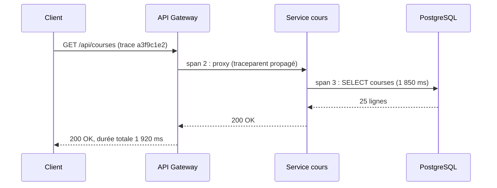
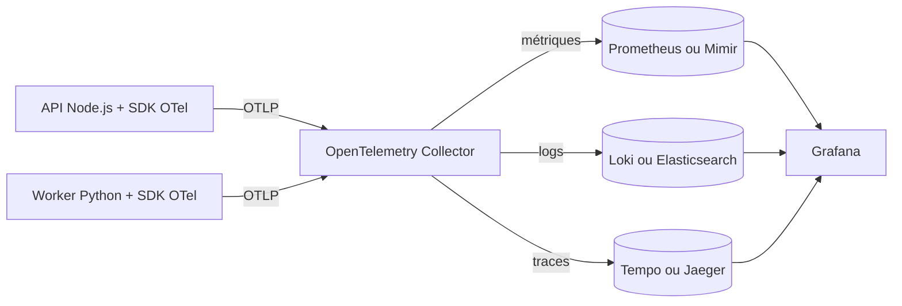
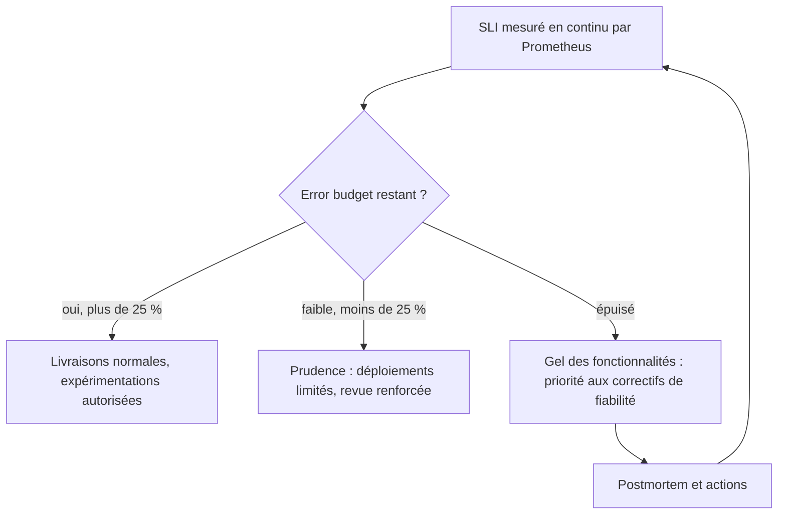

## Introduction

Un système en production ne se contente pas de fonctionner ou de tomber en panne : il traverse un continuum d'états dégradés, souvent invisibles tant qu'on ne les mesure pas. Le monitoring traditionnel répond à des questions qu'on a pensé à poser à l'avance ("le CPU dépasse-t-il 90 % ?"), via des seuils fixes sur des métriques connues. L'observabilité va plus loin : elle vise à pouvoir répondre à des questions qu'on n'avait **pas** anticipées ("pourquoi la latence a-t-elle doublé pour les utilisateurs du Brésil entre 14h02 et 14h07 ?"), en s'appuyant sur des données riches et corrélables.

Ce chapitre présente les trois piliers classiques de l'observabilité — logs, métriques et traces — puis les deux outils qui dominent l'écosystème DevOps moderne : Prometheus pour la collecte de métriques et Grafana pour leur visualisation, complétés par une stack ELK/EFK pour la centralisation des logs. Il introduit ensuite le vocabulaire SRE (Site Reliability Engineering) — SLI, SLO, error budget — qui permet de transformer une intuition ("ça doit être fiable") en objectif mesurable et négociable. Enfin, il aborde un piège fréquent des équipes qui débutent en observabilité : une alerting mal calibré, qui noie les signaux utiles sous un bruit permanent.

Ces compétences sont transversales : une architecture observable est aussi une architecture plus facile à sécuriser, puisque les mêmes logs et métriques servent de matière première à la détection d'incidents, comme tu le verras en résonance avec le cours SOC Analysis.

## Les trois piliers de l'observabilité

<CompareTable
  titleA="Pilier"
  titleB="Ce qu'il répond"
  rows={[
    { a: "Logs", b: "Que s'est-il passé, précisément, à un instant donné ? (événements discrets, souvent horodatés et structurés en JSON)" },
    { a: "Métriques", b: "Quelle est la tendance dans le temps ? (séries temporelles agrégées : latence moyenne, taux d'erreur, nombre de requêtes/seconde)" },
    { a: "Traces", b: "Par où une requête est-elle passée, et où a-t-elle perdu du temps ? (suivi de bout en bout à travers plusieurs microservices)" },
  ]}
/>

Le monitoring traditionnel se limite le plus souvent à quelques métriques système (CPU, RAM, disque) surveillées via des seuils statiques : utile pour détecter une panne connue, mais aveugle face à un problème émergent et jamais vu auparavant — typiquement une régression de performance causée par l'interaction entre deux services dans une architecture distribuée. L'observabilité part du principe qu'on ne peut pas prévoir toutes les questions à l'avance : elle capitalise sur des données suffisamment granulaires et corrélées (logs structurés, métriques finement labellisées, traces distribuées) pour permettre l'exploration ad hoc au moment de l'incident, plutôt que de se limiter à des dashboards figés.

### Les traces distribuées en pratique

Une **trace** représente le parcours complet d'une requête. Elle est composée de **spans**, chacun correspondant à une opération (un appel HTTP, une requête SQL) avec son heure de début, sa durée et ses attributs. Un identifiant de trace, propagé d'un service à l'autre dans l'en-tête HTTP standard `traceparent` (spécification W3C Trace Context), permet de recoller les morceaux. Voici à quoi ressemble une trace lente, vue sous forme de séquence :



La trace montre immédiatement que 1 850 des 1 920 millisecondes sont passées dans la requête SQL : inutile de chercher ailleurs. Et en ajoutant ce même `trace_id` dans chaque ligne de log, on passe en un clic d'une métrique anormale à la trace, puis aux logs exacts de la requête.

### OpenTelemetry : le standard d'instrumentation

Pendant longtemps, chaque outil imposait sa propre bibliothèque d'instrumentation. **OpenTelemetry** (OTel), projet de la CNCF né de la fusion d'OpenTracing et d'OpenCensus, standardise désormais la production des trois signaux : des SDK pour chaque langage, un protocole d'échange (**OTLP**) et un **Collector** qui reçoit, transforme et route les données vers n'importe quel backend. L'intérêt est stratégique : tu instrumentes une seule fois, puis tu changes de backend (Grafana, Elastic, Datadog, Jaeger) sans toucher au code.



En Node.js, l'instrumentation automatique tient en quelques lignes et capture sans modification du code les requêtes HTTP, les appels de base de données et les frameworks courants :

```bash
npm install @opentelemetry/sdk-node @opentelemetry/auto-instrumentations-node
export OTEL_SERVICE_NAME=api-backend
export OTEL_EXPORTER_OTLP_ENDPOINT=http://otel-collector:4318
node --require @opentelemetry/auto-instrumentations-node/register server.js
```

<TipCallout>
Une bonne heuristique : le monitoring te dit **que** quelque chose ne va pas ; l'observabilité t'aide à comprendre **pourquoi**, sans avoir eu besoin d'anticiper la panne exacte au moment de l'instrumentation.
</TipCallout>

## Prometheus — collecte de métriques en mode pull

Contrairement à beaucoup d'outils de monitoring qui reçoivent passivement des métriques poussées par les applications (modèle push), Prometheus fonctionne en **pull** : il interroge lui-même, à intervalle régulier (le *scrape interval*, souvent 15s ou 30s), un endpoint HTTP `/metrics` exposé par chaque application ou *exporter*.

```yaml
# prometheus.yml — configuration minimale
global:
  scrape_interval: 15s

scrape_configs:
  - job_name: 'api-backend'
    static_configs:
      - targets: ['api-backend:8080']

  - job_name: 'node-exporter'
    static_configs:
      - targets: ['node-exporter:9100']
```

Chaque métrique exposée suit un format texte simple, avec un nom, des labels (paires clé-valeur qui permettent le filtrage) et une valeur :

```text
http_requests_total{method="GET", status="200", route="/api/courses"} 15234
http_requests_total{method="GET", status="500", route="/api/courses"} 12
```

Prometheus distingue quatre types de métriques, et choisir le bon type conditionne les requêtes possibles. Un **compteur** (counter) ne fait qu'augmenter, comme le nombre total de requêtes ; on l'exploite toujours avec `rate()`. Une **jauge** (gauge) monte et descend, comme la mémoire utilisée ou le nombre de connexions ouvertes. Un **histogramme** (histogram) range les observations dans des intervalles (buckets), par exemple les durées de requêtes, et permet de calculer des percentiles côté serveur. Un **résumé** (summary) calcule les percentiles côté client, mais ne peut pas être agrégé entre plusieurs instances, ce qui le rend moins utile dans un cluster.

PromQL, le langage de requête de Prometheus, permet d'agréger et de transformer ces séries temporelles :

```promql
# Taux d'erreurs HTTP 5xx par seconde, moyenné sur les 5 dernières minutes
sum(rate(http_requests_total{status=~"5.."}[5m])) by (route)
```

Cette requête calcule, pour chaque route, le taux de requêtes en erreur serveur par seconde — la fonction `rate()` gère automatiquement les compteurs qui redémarrent (ex: après un redéploiement), ce qu'un simple calcul de différence ne ferait pas correctement.

Pour la latence, on ne regarde jamais la moyenne, qui masque les utilisateurs les plus pénalisés, mais un **percentile** calculé à partir d'un histogramme :

```promql
# Latence au 99e percentile, par route, sur 5 minutes
histogram_quantile(0.99, sum(rate(http_request_duration_seconds_bucket[5m])) by (le, route))
```

Un p99 de 1,2 seconde signifie que 99 % des requêtes répondent en moins de 1,2 seconde et que 1 % sont plus lentes. Sur un million de requêtes par jour, ce 1 % représente tout de même dix mille utilisateurs mécontents.

### Que mesurer : golden signals, RED et USE

Face à des milliers de métriques possibles, trois grilles de lecture évitent de se perdre. Les **quatre signaux d'or** du livre SRE de Google sont la latence, le trafic, les erreurs et la saturation. La méthode **RED** (Rate, Errors, Duration), adaptée aux services qui traitent des requêtes, mesure le débit, le taux d'erreur et la durée. La méthode **USE** (Utilization, Saturation, Errors), formalisée par Brendan Gregg pour les ressources matérielles, mesure l'utilisation, la saturation et les erreurs de chaque ressource : CPU, mémoire, disque, réseau. En pratique, on applique RED à chaque service et USE à chaque machine ou node.

Prometheus 3.0, sorti fin 2024, a apporté une nouvelle interface, la réception native de métriques au format OTLP et une meilleure prise en charge des histogrammes natifs. Pour une rétention longue ou une haute disponibilité, on lui adjoint souvent Thanos ou Grafana Mimir.

<CehCallout>
Un endpoint `/metrics` mal protégé (accessible sans authentification depuis l'extérieur) peut fuiter des informations sensibles sur l'architecture interne — noms de routes, volumes de trafic par client, versions de dépendances. Il doit être restreint au réseau interne ou au scraper Prometheus uniquement.
</CehCallout>

## Grafana — visualiser et corréler

Grafana se branche sur Prometheus (et sur de nombreuses autres sources : Elasticsearch, Loki, InfluxDB) pour construire des dashboards. Sa valeur ajoutée n'est pas seulement esthétique : elle permet de corréler visuellement plusieurs métriques sur une même timeline pendant un incident (latence, taux d'erreur, nombre de pods actifs), et de définir des *alert rules* directement sur les panels.

Les dashboards se construisent dans l'interface, mais une équipe mature les **versionne** : Grafana sait charger au démarrage des sources de données et des dashboards décrits dans des fichiers (provisioning), et des outils comme Terraform ou Grafonnet permettent de les générer. Un dashboard modifié à la main en production et jamais sauvegardé disparaît au premier incident de l'instance Grafana.

```yaml
# grafana/provisioning/datasources/prometheus.yaml
apiVersion: 1
datasources:
  - name: Prometheus
    type: prometheus
    url: http://prometheus:9090
    isDefault: true
```

<TipCallout>
Un dashboard Grafana efficace suit la règle des trois niveaux : une vue "santé globale" (SLO, taux d'erreur global), une vue "par service" pour localiser le problème, et une vue "détail" (logs, traces) pour l'investigation fine — évite de tout entasser sur un seul écran.
</TipCallout>

## Centraliser les logs avec ELK/EFK et Loki

Les logs, produits en continu par des dizaines de conteneurs éphémères, doivent être centralisés pour rester exploitables. La stack ELK (Elasticsearch, Logstash, Kibana) — ou sa variante EFK (avec Fluentd/Fluent Bit à la place de Logstash, plus légère en environnement Kubernetes) — répond à ce besoin :

<Steps steps={[
  { title: "Collecte", description: "Fluent Bit (ou Filebeat) tourne en agent sur chaque nœud et lit les fichiers de logs des conteneurs.", code: "" },
  { title: "Transport et transformation", description: "Les logs bruts sont parsés en JSON structuré (extraction du niveau, du service, du trace ID) et envoyés vers Elasticsearch.", code: "" },
  { title: "Indexation", description: "Elasticsearch indexe les logs pour permettre une recherche full-text rapide, même sur des volumes de plusieurs To.", code: "" },
  { title: "Visualisation", description: "Kibana permet de rechercher, filtrer et construire des dashboards de logs, souvent en complément de Grafana pour les métriques.", code: "" },
]} />

```json
// Exemple de log structuré (bien préférable aux logs texte brut)
{
  "timestamp": "2026-08-04T09:12:31Z",
  "level": "error",
  "service": "api-backend",
  "trace_id": "a3f9c1e2",
  "message": "Database connection timeout",
  "route": "/api/courses"
}
```

Deux alternatives sont aujourd'hui très répandues. **OpenSearch** est le fork open source d'Elasticsearch et de Kibana créé en 2021 après un changement de licence d'Elastic, et désormais hébergé par la Linux Foundation ; Elastic a de son côté réintroduit une option de licence open source (AGPL) en 2024. **Grafana Loki** adopte une approche différente : il n'indexe que les labels (service, namespace, niveau), pas le contenu complet des messages, ce qui le rend beaucoup moins coûteux en stockage, au prix de recherches plein texte plus lentes. Loki s'interroge avec LogQL, un langage proche de PromQL :

```text
{namespace="production", app="api-backend"} |= "timeout" | json | level="error"
```

<WarningCallout>
Logger des informations sensibles (mots de passe, tokens, données personnelles) en clair dans une stack centralisée transforme ton système de logs en cible de choix : il concentre en un seul endroit ce qu'un attaquant chercherait autrement dans plusieurs bases. Toujours masquer (`***`) ou hacher ces champs avant l'indexation.
</WarningCallout>

## SLI, SLO et error budget

Une fois les données collectées, encore faut-il définir ce que "fiable" signifie concrètement. C'est le rôle du triptyque SRE :

- **SLI** (Service Level Indicator) : une mesure concrète, ex. le pourcentage de requêtes HTTP réussies (`status < 500`).
- **SLO** (Service Level Objective) : un objectif chiffré sur ce SLI, ex. "99.9 % de disponibilité sur 30 jours".
- **Error budget** : la marge d'erreur tolérée par le SLO — ce qu'il te reste "le droit" de casser.

```text
SLO de disponibilité : 99.9 % sur 30 jours (43 200 minutes)

Error budget = 100% - 99.9% = 0.1%
            = 0.001 × 43 200 minutes
            = 43,2 minutes d'indisponibilité tolérée sur le mois
```

Si une panne de 20 minutes survient en semaine 1, il reste 23,2 minutes d'error budget pour le reste du mois : ce chiffre objective la conversation entre équipes produit (qui veulent livrer vite) et équipes ops (qui veulent la stabilité), sans dépendre du ressenti de chacun.

<AuditCallout>
Un SLO n'a de sens que s'il est mesuré automatiquement via les métriques Prometheus (ex: `sum(rate(http_requests_total{status!~"5.."}[30d])) / sum(rate(http_requests_total[30d]))`) et revu périodiquement — un SLO jamais consulté est un SLO mort.
</AuditCallout>

Le schéma ci-dessous résume la logique de pilotage par l'error budget : tant qu'il reste du budget, l'équipe livre normalement ; quand il est épuisé, la priorité bascule vers la fiabilité.



Les seuils de 25 % sont un exemple : chaque organisation définit sa propre **politique d'error budget**, idéalement écrite et validée par le produit comme par l'exploitation.

## Calibrer l'alerting : éviter l'alert fatigue

Une alerte doit toujours être **actionnable** : si elle ne déclenche aucune action possible côté humain, elle ne devrait pas exister en tant que page (elle peut rester un simple indicateur sur un dashboard). Un service qui envoie 200 notifications par jour, dont 195 sans conséquence réelle, produit de l'*alert fatigue* : les opérateurs finissent par ignorer ou couper les notifications, y compris la 200ᵉ qui, elle, annonçait un incident critique. C'est exactement le même phénomène observé côté SOC (cours SOC Analysis) avec la saturation d'alertes de sécurité peu pertinentes, qui masque les véritables intrusions.

<AttackDefenseTable rows={[
  { phase: "Symptôme", attack: "Alertes basées sur des seuils bruts et instantanés (ex: CPU > 80% pendant 1 seconde)", defense: "Alerter sur des tendances soutenues (`for: 10m`) et sur l'impact utilisateur (taux d'erreur, latence perçue), pas sur des métriques internes volatiles" },
  { phase: "Volume", attack: "Une alerte par métrique et par instance, sans agrégation", defense: "Grouper les alertes par service et par cause probable (regroupement Alertmanager), avec une seule notification consolidée" },
  { phase: "Priorisation", attack: "Toutes les alertes ont la même sévérité et le même canal de notification", defense: "Distinguer page (réveille quelqu'un la nuit, lié à l'error budget) et notification (email/ticket, non urgent)" },
]} />

### Alerter sur la consommation de l'error budget

La méthode recommandée par le *SRE Workbook* de Google est d'alerter sur le **taux de consommation** (burn rate) de l'error budget plutôt que sur un seuil brut. Un burn rate de 1 signifie que le budget sera exactement épuisé à la fin de la fenêtre de 30 jours. Un burn rate de 14,4 maintenu pendant une heure consomme 2 % du budget mensuel en une heure, car 14,4 × 1 h / 720 h = 0,02 : c'est un incident grave qui mérite de réveiller quelqu'un. On combine une fenêtre longue (1 heure) pour la fiabilité et une fenêtre courte (5 minutes) pour que l'alerte s'arrête vite une fois le problème résolu.

```yaml
# rules/slo-api.yml — chargé par Prometheus via rule_files
groups:
  - name: slo-api-backend
    rules:
      - alert: ErrorBudgetBurnFast
        expr: |
          (
            sum(rate(http_requests_total{job="api-backend",status=~"5.."}[1h]))
            / sum(rate(http_requests_total{job="api-backend"}[1h]))
          ) > (14.4 * 0.001)
          and
          (
            sum(rate(http_requests_total{job="api-backend",status=~"5.."}[5m]))
            / sum(rate(http_requests_total{job="api-backend"}[5m]))
          ) > (14.4 * 0.001)
        labels:
          severity: page
        annotations:
          summary: "API backend : error budget consommé 14x trop vite"
          runbook_url: "https://wiki.example/runbooks/api-backend-5xx"
```

La valeur `0.001` correspond aux 0,1 % d'erreurs tolérées par un SLO de 99,9 %. Les alertes sont ensuite envoyées à **Alertmanager**, qui les regroupe, les déduplique, applique des silences pendant une maintenance et les route vers le bon canal selon le label `severity` : PagerDuty ou Opsgenie pour une page, Slack ou un ticket pour une simple notification. Chaque alerte de type page doit pointer vers un **runbook**, la procédure qui dit quoi vérifier et quoi faire.

<WarningCallout>
Une alerte qui se déclenche systématiquement et qu'on désactive "temporairement" reste désactivée des mois plus tard, dans neuf cas sur dix — traite chaque alerte bruyante comme un bug à corriger (ajuster le seuil, la durée, ou la métrique) plutôt qu'un signal à faire taire.
</WarningCallout>

## Erreurs fréquentes

L'erreur la plus coûteuse est l'**explosion de cardinalité** : ajouter un label dont les valeurs sont illimitées, comme un identifiant d'utilisateur, une adresse IP ou une URL complète avec paramètres. Chaque combinaison de labels crée une nouvelle série temporelle, et Prometheus peut se retrouver avec des millions de séries qui saturent sa mémoire. Les identifiants uniques ont leur place dans les logs et les traces, pas dans les labels de métriques.

La deuxième erreur est de **surveiller des moyennes** au lieu de percentiles, ce qui cache les pires expériences utilisateur. La troisième est d'**alerter sur les causes plutôt que sur les symptômes** : un CPU à 90 % n'est pas un problème si les utilisateurs sont servis rapidement, alors qu'un taux d'erreur de 5 % en est un, quelle qu'en soit la cause. On voit aussi des **logs non structurés**, impossibles à filtrer, et des **données personnelles dans les logs**, ce qui pose un problème de conformité au RGPD en plus du risque de sécurité. Enfin, beaucoup d'équipes **n'ont aucun runbook** : l'astreinte reçoit une alerte à trois heures du matin sans savoir par où commencer.

## Lab — Mise en Pratique

**Environnement** : conteneurs Docker (Prometheus, Grafana, un exporter d'exemple) — terminal Nyx Shell

Crée d'abord ce fichier `compose.yaml`, à côté du `prometheus.yml` présenté plus haut :

```yaml
services:
  prometheus:
    image: prom/prometheus:v3.1.0
    volumes:
      - ./prometheus.yml:/etc/prometheus/prometheus.yml:ro
    ports: ["9090:9090"]
  node-exporter:
    image: prom/node-exporter:v1.8.2
  grafana:
    image: grafana/grafana:11.4.0
    ports: ["3000:3000"]
```

<Steps steps={[
  { title: "Démarrer la stack d'observabilité", description: "Lance Prometheus et Grafana via Docker Compose.", code: "docker compose up -d prometheus grafana node-exporter" },
  { title: "Vérifier la collecte de métriques", description: "Consulte les cibles scrapées par Prometheus pour confirmer qu'elles sont UP.", code: "curl -s http://localhost:9090/api/v1/targets | jq '.data.activeTargets[].health'" },
  { title: "Exécuter une requête PromQL", description: "Interroge le taux d'utilisation CPU moyen sur 5 minutes directement via l'API.", code: "curl -s 'http://localhost:9090/api/v1/query?query=rate(node_cpu_seconds_total{mode=\"idle\"}[5m])'" },
  { title: "Construire un dashboard Grafana", description: "Connecte-toi à Grafana (localhost:3000), ajoute Prometheus comme source de données, puis crée un panel affichant le taux d'erreurs 5xx.", code: "" },
  { title: "Calculer un error budget", description: "En te basant sur un SLO de disponibilité de 99.9% sur 30 jours, calcule combien de minutes d'indisponibilité restent tolérées si le service a déjà subi une panne de 15 minutes ce mois-ci.", code: "" },
  { title: "Observer la saturation mémoire", description: "Interroge la mémoire disponible du node avec une jauge, puis compare-la à la mémoire totale pour obtenir un pourcentage d'utilisation (méthode USE).", code: "curl -s 'http://localhost:9090/api/v1/query' --data-urlencode 'query=1 - node_memory_MemAvailable_bytes / node_memory_MemTotal_bytes' | jq '.data.result[0].value'" },
  { title: "Ajouter une règle d'alerte", description: "Écris une règle simple qui se déclenche quand une cible est DOWN depuis 1 minute (expression up == 0), référence-la dans rule_files, redémarre Prometheus puis arrête node-exporter et observe l'alerte passer de pending à firing dans l'onglet Alerts.", code: "docker compose stop node-exporter" },
]} />

## À retenir

- Les trois piliers de l'observabilité — logs, métriques, traces — permettent de répondre à des questions imprévues, contrairement au monitoring traditionnel basé sur des seuils fixes connus à l'avance.
- Prometheus collecte des métriques en mode **pull** via un endpoint `/metrics`, interrogé à intervalle régulier ; PromQL permet d'agréger ces séries temporelles (ex: `rate()`, `sum() by()`).
- Grafana visualise ces métriques en dashboards corrélés et permet de définir des règles d'alerte directement sur les panels.
- La stack ELK/EFK centralise les logs structurés (JSON) de tous les conteneurs pour une recherche full-text rapide, à protéger des données sensibles en clair.
- Un SLO chiffré (ex: 99.9 % de disponibilité) définit un error budget concret — ex. 43,2 minutes tolérées sur 30 jours — qui objective les décisions entre vitesse de livraison et fiabilité.
- OpenTelemetry standardise l'instrumentation des trois signaux (SDK, protocole OTLP, Collector) et rend l'équipe indépendante du backend choisi.
- On mesure la latence en percentiles via des histogrammes, on évite les labels à cardinalité illimitée, et on applique RED aux services et USE aux ressources.
- Les alertes de type page reposent idéalement sur le burn rate de l'error budget, sur deux fenêtres, avec un runbook associé.
- Un alerting bien calibré n'alerte que sur des signaux actionnables et soutenus dans le temps ; sinon, l'alert fatigue fait ignorer l'alerte qui comptait vraiment — un risque partagé avec la saturation d'alertes en SOC.

## Questions de Révision

1. En quoi l'observabilité diffère-t-elle du monitoring traditionnel basé sur des seuils fixes ?
2. Pourquoi Prometheus utilise-t-il un modèle pull plutôt qu'un modèle push, et quel est le rôle du `scrape_interval` ?
3. Que calcule la requête PromQL `sum(rate(http_requests_total{status=~"5.."}[5m])) by (route)` ?
4. Pour un SLO de disponibilité de 99.95 % sur 30 jours, combien de minutes d'indisponibilité l'error budget tolère-t-il ?
5. Pourquoi logger des tokens ou mots de passe en clair dans une stack ELK/EFK est-il particulièrement risqué ?
6. Quelles sont deux techniques concrètes pour réduire l'alert fatigue sans perdre en capacité de détection ?
7. Pourquoi ajouter un label `user_id` à une métrique Prometheus est-il une mauvaise idée, et où placer cette information à la place ?
8. Explique pourquoi un burn rate de 14,4 pendant une heure correspond à 2 % de l'error budget mensuel.
9. Quel problème OpenTelemetry résout-il, et quel est le rôle du Collector dans son architecture ?
