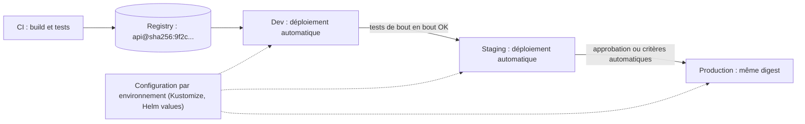
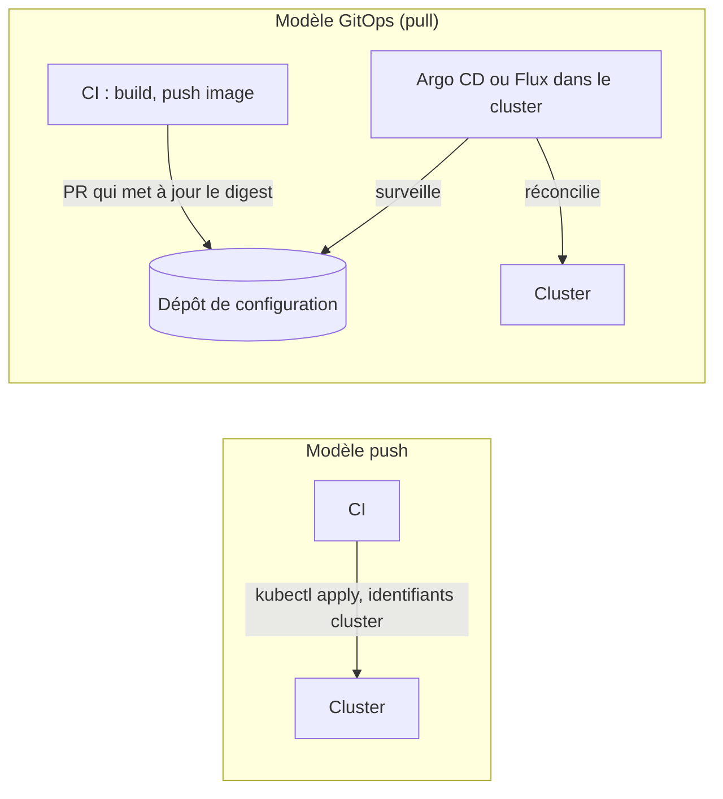
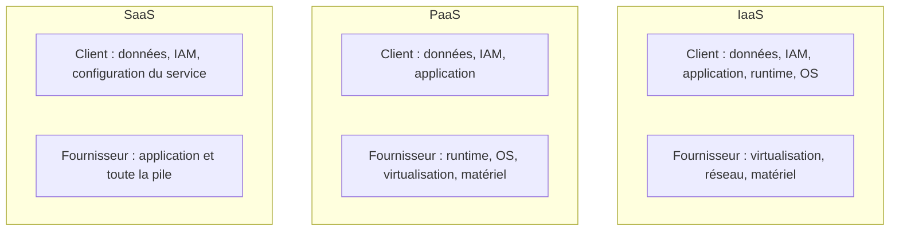

## Introduction

Ce chapitre clôt le cours DevOps Fondamentaux. Après avoir construit une culture de collaboration, versionné le code avec Git, automatisé les tests avec l'intégration continue, containerisé les applications avec Docker, orchestré leur exécution avec Kubernetes, décrit l'infrastructure en code, et instrumenté le tout avec l'observabilité, il reste une dernière étape : livrer ce logiciel en production, de façon fiable et répétable, puis choisir où l'héberger.

Le déploiement continu est souvent perçu comme un simple bouton "déployer" au bout d'un pipeline CI. En réalité, c'est une discipline à part entière : elle définit *comment* une nouvelle version atteint les utilisateurs (d'un coup, progressivement, en parallèle de l'ancienne) et *que faire* si quelque chose se passe mal. Une stratégie de déploiement mal choisie transforme une mise à jour mineure en incident majeur ; une stratégie de rollback absente transforme un bug en crise prolongée.

Nous verrons également que la question "comment déployer" est indissociable de la question "où déployer" : le choix entre IaaS, PaaS et SaaS, et entre les grands fournisseurs cloud, conditionne directement les stratégies de déploiement disponibles et leur complexité opérationnelle.

Ce chapitre est un chapitre de synthèse : il termine le cours DevOps Fondamentaux et prépare la transition vers le cours suivant, DevSecOps Avancé, qui reprendra chacune de ces briques pour y intégrer la sécurité à chaque étape.

## Continuous delivery vs continuous deployment

Ces deux termes sont fréquemment confondus alors qu'ils désignent des niveaux d'automatisation différents, tous deux situés après l'intégration continue (CI) dans le pipeline.

<CompareTable
  titleA="Continuous Delivery"
  titleB="Continuous Deployment"
  rows={[
    { a: "Chaque changement validé par la CI produit un artefact déployable en production", b: "Chaque changement validé par la CI est automatiquement déployé en production" },
    { a: "Le déclenchement du déploiement reste une action humaine (bouton, approbation)", b: "Aucune intervention humaine entre le merge et la production" },
    { a: "Adapté aux environnements réglementés nécessitant une validation métier", b: "Adapté aux équipes matures avec une suite de tests et un monitoring très fiables" },
    { a: "Réduit le risque en gardant un point de contrôle", b: "Réduit le délai entre développement et valeur livrée à l'utilisateur" },
  ]}
/>

<TipCallout>
En français, "livraison continue" (delivery) et "déploiement continu" (deployment) se traduisent presque à l'identique — c'est la présence ou l'absence de l'approbation manuelle avant la mise en production qui fait toute la différence, pas le vocabulaire.
</TipCallout>

```yaml
# Extrait de .gitlab-ci.yml — étape de delivery (approbation manuelle)
deploy-production:
  stage: deploy
  script:
    - kubectl apply -f k8s/production/
  environment: production
  when: manual   # ← nécessite un clic humain : continuous DELIVERY

# Variante continuous deployment : suppression du "when: manual"
deploy-production-auto:
  stage: deploy
  script:
    - kubectl apply -f k8s/production/
  environment: production
  # aucune étape manuelle : le pipeline déploie seul après la CI
```

Sur GitHub Actions, l'équivalent du `when: manual` est un **environnement protégé** : on déclare `environment: production` dans le job, et on configure dans les paramètres du dépôt des relecteurs obligatoires (required reviewers), un délai d'attente ou une restriction aux seules branches protégées. Le job attend alors l'approbation avant de s'exécuter, et chaque déploiement est tracé dans l'historique de l'environnement. Pour s'authentifier auprès du cloud, le pipeline utilise de préférence une fédération d'identité OIDC plutôt qu'une clé statique stockée en secret, un point détaillé dans le cours DevSecOps.

```yaml
# .github/workflows/deploy.yml (extrait)
jobs:
  deploy:
    runs-on: ubuntu-latest
    environment: production          # approbation exigée par les règles de l'environnement
    permissions:
      id-token: write                # nécessaire pour obtenir un jeton OIDC
      contents: read
    steps:
      - uses: aws-actions/configure-aws-credentials@v4
        with:
          role-to-assume: arn:aws:iam::123456789012:role/deploy-prod
          aws-region: eu-west-3
      - run: kubectl apply -k k8s/overlays/production
```

### Construire une fois, promouvoir partout

Un principe fondamental de la livraison continue est de **construire l'artefact une seule fois** puis de promouvoir exactement le même artefact, identifié par son digest, d'environnement en environnement. Seule la configuration change entre staging et production. Reconstruire l'image pour la production introduirait le risque qu'elle diffère de celle qui a été testée : une dépendance mise à jour entre-temps, une image de base différente.



La plupart des organisations ne pratiquent pas le "tout ou rien" : les environnements de test et de préproduction sont souvent en continuous deployment (déploiement automatique dès qu'un test passe), tandis que la production reste en continuous delivery avec une validation finale.

## Les stratégies de déploiement

Une fois l'artefact prêt, encore faut-il décider *comment* il remplace la version en cours d'exécution sans interrompre le service. Trois stratégies dominent en environnement conteneurisé/Kubernetes.

<CompareTable
  titleA="Stratégie"
  titleB="Principe, avantages et risques"
  rows={[
    { a: "Rolling update", b: "Remplace les instances de l'ancienne version par la nouvelle progressivement, une par une. Avantage : aucune infrastructure supplémentaire requise, mécanisme natif de Kubernetes. Risque : les deux versions cohabitent pendant la transition — nécessite une compatibilité ascendante du schéma de données et de l'API." },
    { a: "Blue-Green", b: "Deux environnements identiques (bleu = actuel, vert = nouveau) tournent en parallèle ; le trafic bascule d'un coup du bleu vers le vert. Avantage : rollback instantané (rebasculer le trafic). Risque : coût double de l'infrastructure pendant la transition, et bascule brutale qui expose immédiatement 100% du trafic à un éventuel bug." },
    { a: "Canary", b: "La nouvelle version ne reçoit d'abord qu'un faible pourcentage du trafic réel (ex: 5%), puis la proportion augmente progressivement si aucun signal d'alerte n'apparaît. Avantage : détecte un bug en conditions réelles avant l'exposition totale, risque limité au sous-ensemble de trafic initial. Risque : nécessite un monitoring fin et automatisé pour décider d'augmenter ou d'annuler la bascule, et gère mal les changements de schéma de données incompatibles." },
  ]}
/>

```yaml
# Exemple simplifié de rolling update — Kubernetes Deployment
spec:
  replicas: 6
  strategy:
    type: RollingUpdate
    rollingUpdate:
      maxUnavailable: 1   # au plus 1 pod indisponible à la fois
      maxSurge: 1         # au plus 1 pod supplémentaire pendant la transition
```

```bash
# Exemple de canary avec un service mesh — bascule progressive du trafic
# 95% vers la version stable, 5% vers la nouvelle version (canary)
kubectl apply -f canary-virtualservice.yaml
# ... surveillance des métriques (taux d'erreur, latence) ...
# Si tout est vert : augmenter progressivement à 25%, 50%, 100%
# Si anomalie détectée : rollback immédiat vers 100% stable
```

Avec `maxUnavailable: 1` et `maxSurge: 1` sur 6 répliques, Kubernetes peut créer un septième Pod de la nouvelle version, attendre qu'il soit prêt (readinessProbe), puis supprimer un Pod de l'ancienne version, et ainsi de suite. À tout moment, au moins 5 Pods servent le trafic. Sans readinessProbe, Kubernetes considérerait chaque nouveau Pod comme prêt dès son démarrage, et le rolling update enverrait du trafic à des instances encore en initialisation.

### Automatiser le canary : la livraison progressive

Piloter un canary à la main, en surveillant des dashboards et en modifiant des pourcentages, est fastidieux et sujet à l'erreur. Des contrôleurs comme **Argo Rollouts** ou **Flagger** automatisent cette **livraison progressive** (progressive delivery) : ils augmentent le pourcentage de trafic par paliers, interrogent Prometheus à chaque étape et annulent automatiquement si un indicateur se dégrade.

```yaml
apiVersion: argoproj.io/v1alpha1
kind: Rollout
metadata:
  name: api-app
spec:
  replicas: 10
  strategy:
    canary:
      steps:
        - setWeight: 10          # 10 % du trafic vers la nouvelle version
        - pause: { duration: 5m }
        - analysis:              # vérification automatique via Prometheus
            templates:
              - templateName: error-rate-below-1pct
        - setWeight: 50
        - pause: { duration: 10m }
        - setWeight: 100
  # selector et template identiques à ceux d'un Deployment
```

Le modèle d'analyse (`AnalysisTemplate`) contient une requête PromQL, comme le taux d'erreurs 5xx de la version canary, et une condition de succès. Si la condition échoue, le Rollout revient automatiquement à 100 % sur la version stable, sans intervention humaine.

<CehCallout>
Ces trois stratégies ne sont pas propres au déploiement applicatif classique : en sécurité offensive, comprendre qu'une organisation déploie en canary permet d'anticiper qu'une vulnérabilité introduite par une mise à jour ne touchera d'abord qu'un sous-ensemble d'utilisateurs — un détail utile lors d'un test d'intrusion ciblant une fenêtre de déploiement.
</CehCallout>

## GitOps : le dépôt Git comme source de vérité du déploiement

Dans un pipeline classique, dit **push**, c'est la CI qui exécute `kubectl apply` vers le cluster, ce qui l'oblige à détenir des identifiants d'administration du cluster. Le modèle **GitOps** inverse le sens : un agent installé dans le cluster, comme **Argo CD** ou **Flux** (deux projets diplômés de la CNCF), surveille un dépôt Git contenant les manifestes et applique lui-même tout changement. Pour déployer, on ne lance plus de commande : on fusionne une pull request qui modifie le tag ou le digest de l'image.



Le projet OpenGitOps formalise quatre principes : l'état désiré est **déclaratif**, il est **versionné et immuable** (dans Git), il est **récupéré automatiquement** par l'agent, et il est **réconcilié en continu**. Ce dernier point est essentiel : si quelqu'un modifie un Deployment à la main avec `kubectl edit`, l'agent détecte la dérive et peut restaurer l'état décrit dans Git. Le rollback devient un simple `git revert`, et l'historique Git constitue un journal d'audit complet de qui a déployé quoi et quand.

## Les modèles cloud : IaaS, PaaS, SaaS

Le choix d'une stratégie de déploiement dépend fortement du niveau d'abstraction cloud choisi : plus l'abstraction est élevée, moins l'équipe gère d'infrastructure, mais moins elle a de contrôle fin sur le processus de bascule.

<CompareTable
  titleA="Modèle"
  titleB="Ce que le fournisseur gère vs ce que l'équipe gère"
  rows={[
    { a: "IaaS (Infrastructure as a Service)", b: "Le fournisseur gère le matériel physique, le réseau et la virtualisation. L'équipe gère l'OS, le runtime, les middlewares et le déploiement lui-même (ex: machines virtuelles brutes, Kubernetes auto-géré)." },
    { a: "PaaS (Platform as a Service)", b: "Le fournisseur gère en plus l'OS et le runtime applicatif. L'équipe se concentre sur le code et sa configuration (ex: plateformes d'exécution managées, bases de données managées)." },
    { a: "SaaS (Software as a Service)", b: "Le fournisseur gère l'application entière. L'équipe consomme un service fini via une interface ou une API (ex: outils de messagerie, CRM en ligne) — aucun déploiement applicatif de son côté." },
  ]}
/>

Les trois grands fournisseurs cloud (AWS, Azure, GCP) proposent les trois modèles, avec des services équivalents mais des noms et des philosophies différentes :

```text
IaaS  : machines virtuelles brutes, réseaux virtuels, stockage bloc
PaaS  : services d'exécution managés, bases de données managées, orchestrateurs Kubernetes managés
SaaS  : offres complètes (analytics, IA, collaboration) consommées via API ou console web
```

| Besoin | AWS | Azure | Google Cloud |
| --- | --- | --- | --- |
| Machines virtuelles (IaaS) | EC2 | Virtual Machines | Compute Engine |
| Kubernetes managé | EKS | AKS | GKE |
| Conteneurs sans gérer de cluster | ECS avec Fargate, App Runner | Container Apps | Cloud Run |
| Fonctions (FaaS, serverless) | Lambda | Azure Functions | Cloud Run functions |
| Base PostgreSQL managée | RDS, Aurora | Azure Database for PostgreSQL | Cloud SQL, AlloyDB |
| Stockage objet | S3 | Blob Storage | Cloud Storage |

Entre PaaS et IaaS se sont installés deux modèles très utilisés en DevOps : le **CaaS** (Containers as a Service), où l'on fournit une image de conteneur et le fournisseur gère son exécution et sa mise à l'échelle, et le **FaaS** (Functions as a Service, ou serverless), où l'on fournit une simple fonction déclenchée par un événement et facturée à l'exécution.

### Le modèle de responsabilité partagée

Quel que soit le modèle, la sécurité est une **responsabilité partagée**. Le fournisseur est responsable de la sécurité *du* cloud : centres de données, matériel, hyperviseur. Le client reste responsable de la sécurité *dans* le cloud : ses identités et permissions IAM, ses données, la configuration de ses ressources. La frontière se déplace selon le modèle : en IaaS, le client doit appliquer les correctifs de l'OS ; en PaaS, le fournisseur s'en charge ; mais dans tous les cas, un bucket rendu public par erreur reste la faute du client. La grande majorité des incidents cloud médiatisés proviennent de mauvaises configurations côté client, pas de failles du fournisseur.



<WarningCallout>
Aucun des trois grands fournisseurs n'est objectivement "meilleur" dans l'absolu — le choix dépend du contexte : compétences existantes de l'équipe, écosystème déjà en place, contraintes de conformité (souveraineté des données, certifications sectorielles) et coût réel constaté sur la charge de travail concernée. Se méfier de tout discours qui présente un fournisseur comme universellement supérieur.
</WarningCallout>

<AuditCallout>
Quel que soit le fournisseur retenu, un audit de conformité (ISO 27001, SecNumCloud, etc.) portera sur les mêmes points : localisation des données, gestion des identités et accès (IAM), chiffrement au repos et en transit, et traçabilité des actions administratives — des exigences indépendantes du nom du fournisseur.
</AuditCallout>

## Stratégie de rollback

Aucune stratégie de déploiement n'est complète sans un plan de retour arrière testé et rapide à exécuter — un rollback improvisé en pleine incident est une source majeure d'aggravation.

<AttackDefenseTable rows={[
  { phase: "Détection", attack: "Un bug critique passe inaperçu car aucune métrique n'est surveillée après déploiement", defense: "Alertes automatiques sur le taux d'erreur, la latence et les logs applicatifs immédiatement après chaque déploiement" },
  { phase: "Décision", attack: "Le rollback est décidé manuellement, avec retard, faute de seuils clairs", defense: "Seuils prédéfinis (ex: taux d'erreur > 5% pendant 2 minutes) déclenchant un rollback automatique" },
  { phase: "Exécution", attack: "Le rollback nécessite un rebuild complet, prenant de longues minutes", defense: "Conserver l'ancienne version déployée (blue-green) ou versionner les artefacts pour un retour instantané à l'image précédente" },
  { phase: "Données", attack: "Une migration de schéma incompatible bloque le retour à l'ancienne version", defense: "Migrations de base de données rétrocompatibles (expand/contract pattern) qui tolèrent l'ancienne et la nouvelle version simultanément" },
]} />

### Les migrations de base de données : le pattern expand/contract

Le rollback de code est facile ; celui des données ne l'est pas. Supposons qu'on veuille renommer la colonne `name` en `full_name`. Un simple `ALTER TABLE ... RENAME COLUMN` casserait immédiatement l'ancienne version encore en service pendant le rolling update, et rendrait tout rollback impossible. Le pattern **expand/contract** découpe le changement en étapes compatibles :

```text
Étape 1 (expand)   : ajouter la colonne full_name, sans supprimer name
Étape 2            : déployer v2, qui écrit dans les deux colonnes et lit full_name
Étape 3            : copier les anciennes valeurs (backfill) de name vers full_name
Étape 4            : déployer v3, qui n'utilise plus que full_name
Étape 5 (contract) : supprimer la colonne name, une fois v3 stabilisée
```

À chaque étape, la version précédente de l'application fonctionne encore avec le schéma courant : un rollback reste donc possible à tout moment. Le prix à payer est un changement étalé sur plusieurs déploiements.

```bash
# Rollback Kubernetes — retour à la révision précédente d'un Deployment
kubectl rollout undo deployment/api-app

# Retour à une révision spécifique
kubectl rollout undo deployment/api-app --to-revision=3

# Suivre l'historique des révisions disponibles
kubectl rollout history deployment/api-app
```

<TipCallout>
Un rollback n'est fiable que s'il a déjà été testé au moins une fois en conditions réalistes — une procédure de retour arrière jamais exécutée avant l'incident est une hypothèse, pas un plan.
</TipCallout>

## Bonnes pratiques de mise en production

- Toujours déployer derrière un health check applicatif : un orchestrateur ne doit router du trafic vers une nouvelle instance que si elle répond correctement.
- Découpler le déploiement du code de l'activation d'une fonctionnalité grâce aux feature flags — cela permet de déployer sans exposer immédiatement un changement risqué. Le standard OpenFeature, projet de la CNCF, fournit une API commune indépendante du fournisseur de flags.
- Automatiser la décision de rollback sur des métriques objectives plutôt que de compter sur une intervention humaine sous pression.
- Documenter et répéter (à froid, hors incident) la procédure de rollback pour chaque service critique.
- Choisir la stratégie de déploiement en fonction de la criticité du service, pas par habitude : un rolling update suffit souvent pour un service interne peu sensible, un canary est préférable pour un service exposé à fort trafic.

## Erreurs fréquentes

La première erreur est de **reconstruire l'image pour chaque environnement**, ce qui signifie que la production exécute un artefact qui n'a jamais été testé. La deuxième est de **déployer le vendredi soir sans observabilité** : un déploiement n'est terminé que lorsque les métriques confirment que la nouvelle version se comporte bien, et quelqu'un doit être disponible pour réagir.

On voit aussi souvent des **migrations de schéma destructives couplées au déploiement du code**, qui rendent tout rollback impossible ; le pattern expand/contract existe précisément pour cela. Autre classique, **un canary sans critères d'arrêt définis à l'avance** : sans seuil objectif, personne n'ose interrompre la bascule. En GitOps, l'erreur courante est de **modifier le cluster à la main** pendant un incident, puis de voir l'agent annuler la correction parce que Git n'a pas été mis à jour. Enfin, les **feature flags jamais nettoyés** finissent par former une dette technique : chaque flag doit avoir une date de retrait.

## Lab — Mise en Pratique

**Environnement** : Kali Linux (terminal Nyx Shell) — cluster Kubernetes de lab

<Steps steps={[
  { title: "Déployer une version initiale", description: "Crée un Deployment avec 4 réplicas de la version 1 de l'application.", code: "kubectl apply -f app-v1-deployment.yaml && kubectl get pods -w" },
  { title: "Lancer un rolling update", description: "Met à jour l'image vers la version 2 et observe le remplacement progressif des pods.", code: "kubectl set image deployment/api-app api-app=registry.local/api-app:v2 && kubectl rollout status deployment/api-app" },
  { title: "Simuler un incident et effectuer un rollback", description: "Provoque volontairement une erreur (image cassée) puis reviens à la version stable.", code: "kubectl rollout undo deployment/api-app" },
  { title: "Consulter l'historique des révisions", description: "Affiche l'historique du Deployment et le détail d'une révision. Ajoute une annotation kubernetes.io/change-cause lors de tes mises à jour pour que la colonne CHANGE-CAUSE soit renseignée.", code: "kubectl annotate deployment/api-app kubernetes.io/change-cause='passage en v2'\nkubectl rollout history deployment/api-app\nkubectl rollout history deployment/api-app --revision=2" },
  { title: "Installer Argo CD et synchroniser une application", description: "Installe Argo CD dans le cluster de lab, puis déclare une application pointant vers un dépôt Git de manifestes. Modifie le nombre de répliques dans Git et observe Argo CD resynchroniser le cluster.", code: "kubectl create namespace argocd\nkubectl apply -n argocd -f https://raw.githubusercontent.com/argoproj/argo-cd/stable/manifests/install.yaml\nkubectl get pods -n argocd" },
  { title: "Réfléchir à une stratégie canary", description: "Sans l'exécuter, décris par écrit comment tu limiterais l'exposition d'une v3 à 10% du trafic avant généralisation, et quelles métriques déclencheraient un arrêt automatique de la bascule." },
  { title: "Planifier une migration expand/contract", description: "Sur papier, découpe le changement « séparer la colonne address en street et city » en étapes compatibles, en précisant à chaque étape quelle version de l'application est déployée et si un rollback est encore possible." },
]} />

## À retenir

- La livraison continue garde une approbation humaine avant la production ; le déploiement continu n'en a aucune. Sur GitHub, les environnements protégés matérialisent cette approbation.
- On construit l'artefact une fois et on promeut le même digest d'environnement en environnement ; seule la configuration change.
- Rolling update, blue-green et canary se choisissent selon la criticité ; Argo Rollouts ou Flagger automatisent le canary à partir des métriques.
- GitOps (Argo CD, Flux) fait du dépôt Git la source de vérité : un agent dans le cluster tire et réconcilie l'état désiré, et le rollback devient un `git revert`.
- Le modèle de responsabilité partagée laisse toujours au client ses identités, ses données et sa configuration, quel que soit le modèle IaaS, PaaS ou SaaS.
- Les migrations de schéma suivent le pattern expand/contract pour que le rollback reste possible.

## Synthèse du cours

Ce chapitre — et ce cours — se referment sur la synthèse suivante :

- **Chapitre 1 — Culture DevOps** : rapprocher développement et exploitation autour d'objectifs partagés, de la collaboration et de l'amélioration continue.
- **Chapitre 2 — Git** : versionner le code de façon collaborative, condition préalable à tout pipeline automatisé.
- **Chapitre 3 — Intégration continue (CI)** : valider automatiquement chaque changement (tests, build) avant qu'il ne progresse dans le pipeline.
- **Chapitre 4 — Docker** : empaqueter une application et ses dépendances dans un artefact portable et reproductible.
- **Chapitre 5 — Kubernetes** : orchestrer l'exécution, la mise à l'échelle et la résilience de ces conteneurs en production.
- **Chapitre 6 — Infrastructure as Code (IaC)** : décrire l'infrastructure elle-même comme du code versionné, reproductible et auditable.
- **Chapitre 7 — Observabilité** : savoir ce qui se passe réellement en production via logs, métriques et traces.
- **Chapitre 8 — Déploiement continu et cloud** (ce chapitre) : livrer ces artefacts en production de façon fiable, avec une stratégie de bascule et de rollback adaptée, sur un modèle cloud choisi en connaissance de cause.

Ces huit briques forment la base opérationnelle complète d'une équipe DevOps moderne. Le cours suivant, **DevSecOps Avancé**, reprend exactement cette même chaîne — culture, Git, CI, conteneurs, orchestration, IaC, observabilité, déploiement — pour y intégrer la sécurité à chaque étape : scan de dépendances dans la CI, durcissement des images Docker, politiques réseau Kubernetes, détection de secrets dans l'IaC, et supervision de sécurité au moment du déploiement.

## Questions de Révision

1. Quelle est la différence exacte entre continuous delivery et continuous deployment ?
2. Pourquoi un rolling update impose-t-il une contrainte de compatibilité ascendante que le blue-green n'impose pas de la même façon ?
3. Dans quel cas une stratégie canary serait-elle préférable à un blue-green, et inversement ?
4. Quelle est la différence fondamentale entre IaaS, PaaS et SaaS en termes de responsabilité partagée ?
5. Pourquoi une procédure de rollback jamais testée ne peut-elle pas être considérée comme un plan fiable ?
6. En quoi le choix du modèle cloud (IaaS/PaaS/SaaS) influence-t-il les stratégies de déploiement disponibles pour une équipe ?
7. Quels avantages de sécurité apporte le modèle GitOps pull par rapport à une CI qui exécute `kubectl apply` ?
8. Pourquoi faut-il promouvoir le même digest d'image entre staging et production plutôt que reconstruire l'image ?
9. Dans le modèle de responsabilité partagée, qui est responsable d'un bucket de stockage rendu public par erreur, et pourquoi ?
