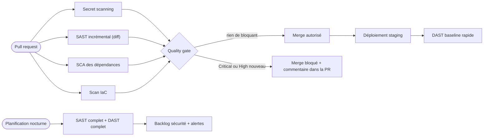
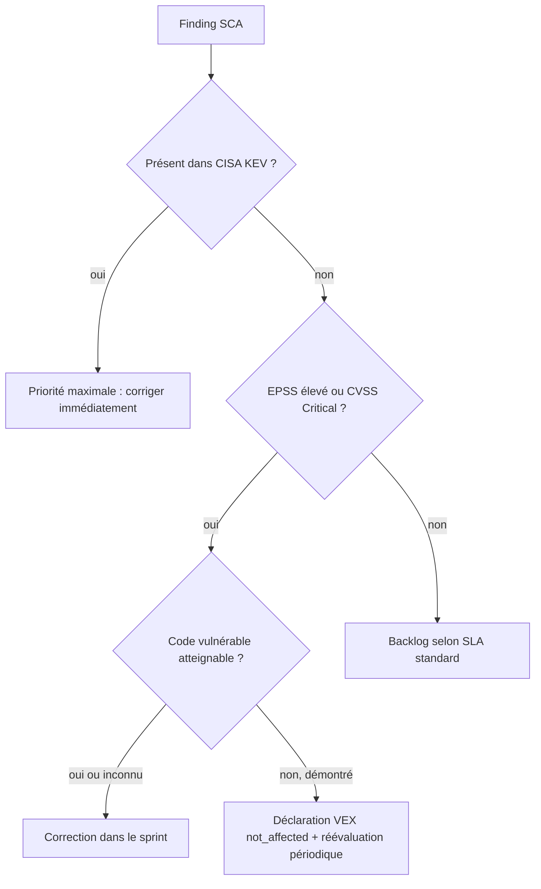

## Introduction

SAST (analyse du code source sans exécution), DAST (attaque de l'application en cours d'exécution) et SCA (analyse des dépendances tierces contre les CVE connues) sont les trois piliers des tests de sécurité automatisés — trois approches complémentaires, chacune couvrant une catégorie de risques que les deux autres ne voient pas. Ce chapitre ne revient pas sur ces définitions : il s'attaque à la question opérationnelle qui détermine si ces outils protègent réellement un produit ou finissent ignorés dans un coin de la CI — comment les câbler comme de véritables portes de qualité (quality gates) dans un pipeline, avec une politique de sévérité qui bloque ce qui doit l'être sans paralyser les équipes.

Avant d'entrer dans le câblage, rappelons en un tableau ce que chaque famille d'outils voit et ne voit pas, avec des outils maintenus et largement utilisés en 2026.

| Famille | Ce qu'elle analyse | Exemples d'outils | Angle mort typique |
| --- | --- | --- | --- |
| SAST | Le code source, sans l'exécuter | Semgrep, CodeQL, SonarQube, Bandit (Python) | Problèmes de configuration à l'exécution, logique métier |
| SCA | Les dépendances déclarées et leurs CVE | Trivy, Grype, OSV-Scanner, Dependabot, Snyk | Code maison, vulnérabilités non encore publiées |
| DAST | L'application en fonctionnement, depuis l'extérieur | OWASP ZAP, Nuclei, Burp Suite Enterprise | Code non atteignable par les requêtes testées |
| Secret scanning | Le code et l'historique Git | gitleaks, trufflehog, push protection | Secrets chiffrés ou fragmentés |
| IaC scanning | Terraform, Kubernetes, Dockerfile | Trivy config, Checkov, KICS | Dérive entre code et réalité |

Le schéma suivant montre où chacun s'insère dans un pipeline et lesquels forment le gate bloquant.



## Un scan qui ne bloque rien ne sert à rien

Un pipeline qui exécute un scan SAST et se contente d'afficher un rapport dans les logs est un pipeline décoratif : personne ne lit un rapport de 400 lignes noyé dans la sortie CI d'un job qui se termine en vert de toute façon. Pour qu'un scan de sécurité ait un effet réel, il doit pouvoir **faire échouer le build** — c'est-à-dire renvoyer un code de sortie non nul quand un seuil de sévérité est dépassé, et faire de ce job une étape requise avant de pouvoir merger ou déployer.

```yaml
# .github/workflows/security.yml
name: Security Gate

on:
  pull_request:
    branches: [main]

jobs:
  sast:
    runs-on: ubuntu-latest
    steps:
      - uses: actions/checkout@v4

      - name: Installer Semgrep
        run: pipx install semgrep

      - name: Fail on high/critical findings
        run: |
          semgrep --config p/owasp-top-ten --error \
            --severity ERROR --json --output findings.json .
          CRITICAL_COUNT=$(jq '[.results[] | select(.extra.severity=="ERROR")] | length' findings.json)
          if [ "$CRITICAL_COUNT" -gt 0 ]; then
            echo "::error::$CRITICAL_COUNT vulnérabilité(s) critique(s)/haute(s) détectée(s)"
            exit 1
          fi
```

L'ancienne action `semgrep/semgrep-action` est dépréciée : la méthode recommandée est d'installer la CLI (ou d'exécuter le job dans l'image `semgrep/semgrep`) puis d'appeler `semgrep scan`, ou `semgrep ci` si tu utilises la plateforme Semgrep. Le principe ne change pas : c'est le code de sortie qui compte.

<CehCallout>
Le flag `--error` de Semgrep (et son équivalent dans la plupart des scanners SAST) fait exactement ce qui manque à un simple rapport : il propage un code de sortie non nul au shell, que GitHub Actions traduit automatiquement en échec de job — c'est ce mécanisme, pas l'existence du scan lui-même, qui transforme un outil de reporting en véritable gate.
</CehCallout>

Sur la branche protégée `main`, ce job `sast` est ensuite déclaré comme **check requis** dans les règles de protection de branche : tant qu'il échoue, le bouton de merge reste grisé, quel que soit le nombre d'approbations humaines obtenues sur la pull request.

## La notion de quality gate et de politique de sévérité

Un quality gate n'est pas un scanner : c'est une **décision** — bloquer ou laisser passer — construite à partir des résultats d'un ou plusieurs scanners, selon des règles explicites. La règle la plus courante et la plus robuste en pratique est une politique de sévérité graduée.

<CompareTable
  titleA="Sévérité"
  titleB="Action du pipeline"
  rows={[
    { a: "Critical", b: "Bloque le build immédiatement — aucun override possible sans validation manuelle explicite" },
    { a: "High", b: "Bloque le build — override possible via une exception documentée et limitée dans le temps" },
    { a: "Medium", b: "N'échoue pas le build — logué et remonté dans un backlog de sécurité pour traitement priorisé" },
    { a: "Low / Info", b: "N'échoue pas le build — visible uniquement dans le rapport complet, pour audit ou tendance" },
  ]}
/>

<WarningCallout>
Une politique qui bloque au moindre finding, y compris les medium et low, produit l'effet inverse de celui recherché : sous pression de livraison, les équipes finissent par contourner le gate (skip du job, merge forcé par un admin) plutôt que de corriger — un gate crédible est un gate qui ne bloque que ce qui mérite vraiment de l'être.
</WarningCallout>

Cette politique se configure directement dans l'outil ou dans le script CI qui interprète ses résultats :

Avec Trivy, la forme la plus simple d'un gate SCA tient en une ligne : l'option `--exit-code 1` combinée à `--severity` fait échouer la commande uniquement pour les sévérités listées, et `--ignore-unfixed` écarte les vulnérabilités pour lesquelles aucun correctif n'existe encore.

```bash
trivy fs --scanners vuln --severity CRITICAL,HIGH --ignore-unfixed --exit-code 1 .
```

Quand la décision est plus fine, par exemple des seuils différents pour Critical et High, on l'écrit dans un script qui lit le rapport JSON :

```yaml
      - name: Évaluer le quality gate SCA
        run: |
          trivy fs --format json --output sca-report.json .
          CRITICAL=$(jq '[.Results[].Vulnerabilities[]? | select(.Severity=="CRITICAL")] | length' sca-report.json)
          HIGH=$(jq '[.Results[].Vulnerabilities[]? | select(.Severity=="HIGH")] | length' sca-report.json)
          echo "Critical: $CRITICAL | High: $HIGH"
          if [ "$CRITICAL" -gt 0 ] || [ "$HIGH" -gt 0 ]; then
            exit 1
          fi
```

<AuditCallout>
Documenter la politique de sévérité dans un fichier versionné (un `SECURITY_GATE.md` ou directement les seuils en dur dans le workflow) plutôt que dans la tête d'un ingénieur permet de justifier objectivement, lors d'un audit ISO 27001 ou SOC 2, que le processus de développement applique un contrôle de sécurité systématique et reproductible.
</AuditCallout>

## Prioriser au-delà de la sévérité : CVSS, EPSS, KEV et atteignabilité

La sévérité affichée par un scanner est le plus souvent dérivée du score **CVSS** (Common Vulnerability Scoring System). La version 4.0, publiée par le FIRST en novembre 2023, remplace progressivement la 3.1 ; elle distingue mieux les métriques de base, de menace et d'environnement, et introduit des notations comme CVSS-BT (base et menace). Mais un score CVSS mesure la gravité *potentielle*, pas la probabilité d'exploitation. Sur des centaines de findings High, il faut d'autres signaux pour décider quoi corriger en premier.

L'**EPSS** (Exploit Prediction Scoring System), également maintenu par le FIRST, estime la probabilité qu'une CVE soit exploitée dans les 30 jours, à partir d'observations réelles. Le catalogue **CISA KEV** (Known Exploited Vulnerabilities) liste les vulnérabilités dont l'exploitation active est avérée. Enfin, l'**atteignabilité** (reachability) indique si le code vulnérable de la dépendance est réellement appelé par ton application. Un document **VEX** (Vulnerability Exploitability eXchange) permet de déclarer formellement qu'une CVE ne t'affecte pas, avec une justification, pour que les scanners l'écartent.



```bash
# Interroger l'API EPSS du FIRST pour une CVE
curl -s "https://api.first.org/data/v1/epss?cve=CVE-2021-44228" | jq '.data[0]'
```

```text
{
  "cve": "CVE-2021-44228",
  "epss": "0.944...",
  "percentile": "0.999...",
  "date": "2026-11-08"
}
```

Une probabilité proche de 0,94 et un percentile de 0,999 signifient que Log4Shell fait partie des vulnérabilités les plus exploitées au monde, ce qui confirme une priorité absolue. Les valeurs exactes évoluent chaque jour, d'où l'intérêt de les interroger automatiquement.

## Faux positifs et gestion de la baseline

Aucun outil SAST ou SCA n'est parfait : un scan sur un projet existant de plusieurs années remonte presque toujours des centaines de findings, dont une partie de faux positifs et une partie de dette de sécurité déjà connue et acceptée temporairement. Bloquer systématiquement chaque nouveau build tant que cette dette existe rendrait le pipeline inutilisable dès le premier scan.

La solution standard est la **baseline** : un instantané des findings existants au moment de l'activation du gate, contre lequel chaque nouveau scan est comparé. Le gate ne bloque alors que les **nouvelles** vulnérabilités introduites après la baseline, pas celles déjà présentes.

```bash
# Générer une baseline au moment de l'activation du gate (une seule fois)
semgrep --config p/owasp-top-ten --json --output baseline.json .

# À chaque exécution suivante, ne signaler que les nouveaux findings
semgrep --config p/owasp-top-ten --baseline-commit main --json --output diff.json .
```

<TipCallout>
Semgrep (`--baseline-commit`) et la plupart des plateformes SAST du marché savent comparer directement contre un commit de référence — c'est presque toujours préférable à un fichier de baseline statique, car il évite que la baseline se désynchronise du code réel au fil des refactorings. Pour la SCA, Trivy n'a pas de mode baseline : on gère la dette connue avec un fichier `.trivyignore` commenté et daté, ou mieux, avec un document VEX passé via l'option `--vex`.
</TipCallout>

Pour les faux positifs individuels identifiés manuellement (une règle SAST qui déclenche à tort sur un pattern sûr dans le contexte précis du projet), la pratique correcte est une suppression **explicite et commentée** dans le code ou la configuration de l'outil — jamais un ajustement global du seuil de sévérité qui masquerait aussi de vrais positifs futurs.

```python
# nosemgrep: python.lang.security.audit.subprocess-shell-true
# Justification : commande statique sans entrée utilisateur, revue le 2026-01-15 par @aure
subprocess.run("systemctl status nginx", shell=True)
```

<WarningCallout>
Une suppression de finding sans justification écrite ni date de revue est une dette invisible qui s'accumule silencieusement — exiger un commentaire de justification à chaque `nosemgrep`, `# nosec` ou équivalent est une règle simple qui évite qu'un projet se retrouve, deux ans plus tard, avec des centaines de suppressions dont plus personne ne connaît la raison.
</WarningCallout>

### Écrire ses propres règles SAST

Les règles génériques ne connaissent pas les conventions de ton projet. Semgrep permet d'écrire des règles dans une syntaxe qui ressemble au code ciblé, ce qui les rend accessibles à toute l'équipe. Par exemple, pour interdire les requêtes SQL construites par f-string dans un projet Python :

```yaml
# .semgrep/sql-fstring.yml
rules:
  - id: no-sql-fstring
    languages: [python]
    severity: ERROR
    message: >
      Requête SQL construite par f-string : risque d'injection SQL.
      Utilise une requête paramétrée, par exemple cursor.execute(sql, params).
    pattern: $CURSOR.execute(f"...")
```

```bash
semgrep --config .semgrep/ --error .
```

```text
┌─────────────────┐
│ 1 Code Finding  │
└─────────────────┘

    app/repository.py
   ❯❱ no-sql-fstring
          Requête SQL construite par f-string : risque d'injection SQL.
          Utilise une requête paramétrée, par exemple cursor.execute(sql, params).

           42┆ cur.execute(f"SELECT * FROM users WHERE email = '{email}'")
```

Le message de la règle explique la correction : c'est ce qui rend un gate acceptable pour les développeurs. **CodeQL**, le moteur de GitHub, va plus loin avec une analyse de flux de données inter-procédurale (suivre une entrée utilisateur jusqu'à une fonction dangereuse), au prix d'un temps d'analyse plus long ; il est gratuit pour les dépôts publics.

### Centraliser les résultats avec SARIF

Chaque outil a son propre format de rapport, ce qui rend la consolidation pénible. Le format standard **SARIF** (Static Analysis Results Interchange Format, norme OASIS) résout ce problème : Semgrep, Trivy, CodeQL, Checkov et bien d'autres savent l'exporter. Sur GitHub, un fichier SARIF envoyé avec l'action `github/codeql-action/upload-sarif` apparaît dans l'onglet *Security → Code scanning* et sous forme d'annotations directement sur les lignes de la pull request.

```yaml
      - run: semgrep scan --config p/owasp-top-ten --sarif --output semgrep.sarif .
      - uses: github/codeql-action/upload-sarif@v3
        if: always()                         # publier même si le scan a échoué
        with:
          sarif_file: semgrep.sarif
```

Le job doit disposer de la permission `security-events: write`. GitLab propose l'équivalent avec ses rapports de sécurité (`artifacts: reports: sast`) affichés dans la merge request.

## Scan à chaque commit ou scan nocturne complet ?

Tous les scans n'ont pas la même vitesse d'exécution, ce qui impose un arbitrage entre rapidité de feedback et exhaustivité de la couverture.

<CompareTable
  titleA="Scan à chaque commit / PR"
  titleB="Scan nocturne complet"
  rows={[
    { a: "Feedback en quelques minutes, directement dans la pull request", b: "Feedback différé de plusieurs heures, hors du cycle de développement immédiat" },
    { a: "Scope réduit — souvent limité au diff ou aux règles rapides (SAST incrémental, SCA sur les dépendances modifiées)", b: "Scope complet — base de code entière, toutes les règles, DAST sur l'ensemble des endpoints" },
    { a: "Adapté au SAST incrémental et au SCA (rapides, quelques secondes à minutes)", b: "Adapté au DAST complet et aux scans SAST exhaustifs (souvent 30 minutes à plusieurs heures)" },
    { a: "Bloque le merge — fait partie du quality gate", b: "N'bloque rien en temps réel — alimente un backlog de sécurité et des alertes" },
  ]}
/>

En pratique, la plupart des équipes matures combinent les deux : un scan rapide et ciblé à chaque commit pour bloquer l'introduction de nouvelles vulnérabilités critiques, et un scan complet planifié la nuit (ou hebdomadaire) pour rattraper ce que la rapidité du scan par commit ne peut pas couvrir.

```yaml
# Scan nocturne complet — n'impacte jamais un développeur en attente de son build
on:
  schedule:
    - cron: '0 2 * * *'   # tous les jours à 2h du matin

jobs:
  full-dast-scan:
    runs-on: ubuntu-latest
    steps:
      - name: Full OWASP ZAP scan
        uses: zaproxy/action-full-scan@v0.12.0
        with:
          target: 'https://staging.example.com'
          # Scan complet, tous les endpoints, toutes les règles actives
```

Un DAST efficace doit être **authentifié** : un scan qui reste sur la page de connexion ne teste qu'une infime partie de l'application. Le **ZAP Automation Framework** permet de décrire dans un fichier YAML le contexte, la méthode d'authentification, l'import d'une spécification OpenAPI pour découvrir les endpoints d'API, puis les étapes de scan. Pour les vérifications ciblées sur des vulnérabilités connues, **Nuclei** (ProjectDiscovery) exécute des milliers de modèles communautaires en quelques minutes.

<WarningCallout>
Un DAST actif envoie de vraies charges d'attaque (injections, fuzzing) : ne le lance que sur un environnement dont tu as la propriété ou une autorisation écrite, idéalement un staging dédié avec des données factices. Un scan actif contre la production peut créer des données parasites, déclencher des envois d'e-mails ou dégrader le service.
</WarningCallout>

<CehCallout>
Un DAST "full scan" avec OWASP ZAP ou équivalent peut prendre plusieurs heures sur une application riche en endpoints — l'exécuter à chaque commit bloquerait toute l'équipe pendant des heures pour chaque pull request, alors qu'un scan baseline rapide (quelques minutes, règles passives uniquement) suffit à détecter les régressions les plus flagrantes en continu.
</CehCallout>

## Exemple de rapport SCA et décision associée

Voici un extrait typique de sortie d'un scanner SCA (Trivy, Snyk ou équivalent) sur un projet Node.js :

```text
Package        : lodash
Version        : 4.17.15
Fixed Version  : 4.17.21
CVE            : CVE-2020-8203
Severity       : HIGH
Description    : Prototype pollution dans la fonction zipObjectDeep,
                 exploitable si une entrée utilisateur non fiable
                 atteint la fonction sans validation.

Package        : minimist
Version        : 1.2.0
Fixed Version  : 1.2.6
CVE            : CVE-2021-44906
Severity       : CRITICAL
Description     : Prototype pollution permettant potentiellement
                 une exécution de code arbitraire selon le contexte
                 d'usage du package.
```

Face à ce rapport, la décision découle directement de la politique de sévérité définie plus haut : le finding CRITICAL sur `minimist` bloque immédiatement le build — aucun merge possible tant que la dépendance n'est pas mise à jour vers `1.2.6` ou une version supérieure. Le finding HIGH sur `lodash` bloque également le build, mais une équipe pressée par une livraison critique pourrait légitimement demander une exception documentée et limitée dans le temps (par exemple 48 heures, avec ticket de suivi assigné) si `zipObjectDeep` n'est démontrablement jamais appelée avec une entrée utilisateur dans ce projet précis.

<AuditCallout>
Toute exception à un quality gate (bypass d'un finding HIGH ou CRITICAL) devrait être tracée dans un système de tickets avec une date d'expiration explicite — un audit de sécurité qui découvre des dizaines d'exceptions permanentes sans date de fin est un signal fort que le processus de gate a été vidé de sa substance.
</AuditCallout>

## Erreurs fréquentes

La première erreur est le **gate décoratif** : un scan en `continue-on-error: true` ou dont le job n'est pas déclaré comme check requis. La deuxième est inverse : **bloquer sur tout**, y compris les Medium et les vulnérabilités sans correctif disponible, ce qui pousse les équipes à désactiver le scan. Utilise `--ignore-unfixed` et une politique graduée.

On voit aussi des équipes qui **activent dix outils redondants** produisant chacun le même finding sous un identifiant différent : mieux vaut peu d'outils, bien réglés, dont les résultats sont centralisés en SARIF. Autre classique, **prioriser uniquement au score CVSS**, alors qu'une CVE Medium présente dans le catalogue KEV est bien plus urgente qu'une Critical jamais exploitée et inatteignable. Enfin, les **suppressions sans justification ni date** et les **DAST non authentifiés** donnent un faux sentiment de couverture.

## Lab — Mise en Pratique

**Environnement** : Réflexion guidée + terminal Nyx Shell (dry-run de configuration CI)

<Steps steps={[
  { title: "Écrire un job SAST bloquant", description: "Dans un fichier workflow local, écris un job qui échoue explicitement (exit 1) si un scan Semgrep détecte un finding de sévérité ERROR — vérifie que le code de sortie se propage correctement.", code: "semgrep --config p/owasp-top-ten --error --severity ERROR ." },
  { title: "Générer une baseline SCA", description: "Lance un scan Trivy sur un projet de test et génère un rapport JSON de référence, en simulant l'activation d'un nouveau gate sur un projet existant.", code: "trivy fs --format json --output baseline-sca.json ." },
  { title: "Comparer un nouveau scan à la baseline", description: "Relance le scan après avoir ajouté une dépendance fictive vulnérable, et identifie manuellement les findings absents de la baseline initiale — ce sont les seuls qui devraient bloquer le build.", code: "trivy fs --format json --output new-scan.json . && diff <(jq -r '[.Results[].Vulnerabilities[]?.VulnerabilityID] | sort[]' baseline-sca.json) <(jq -r '[.Results[].Vulnerabilities[]?.VulnerabilityID] | sort[]' new-scan.json)" },
  { title: "Écrire et tester une règle Semgrep", description: "Crée la règle no-sql-fstring du chapitre et un petit fichier Python contenant une requête vulnérable et une requête paramétrée. Vérifie que seule la première est signalée et que le code de sortie vaut 1.", code: "semgrep --config .semgrep/ --error . ; echo \"exit=$?\"" },
  { title: "Prioriser avec EPSS et KEV", description: "Pour chaque CVE du rapport SCA d'exemple (CVE-2020-8203 et CVE-2021-44906), récupère le score EPSS via l'API du FIRST et vérifie si elle figure dans le catalogue KEV de la CISA. L'ordre de priorité change-t-il par rapport au seul score CVSS ?", code: "curl -s 'https://api.first.org/data/v1/epss?cve=CVE-2020-8203,CVE-2021-44906' | jq '.data'\ncurl -s https://www.cisa.gov/sites/default/files/feeds/known_exploited_vulnerabilities.json | jq '.vulnerabilities[] | select(.cveID==\"CVE-2021-44906\")'" },
  { title: "Décider d'une cadence de scan", description: "Pour un projet avec 40 endpoints API et un DAST complet qui dure 90 minutes, propose une répartition entre ce qui doit s'exécuter à chaque commit et ce qui doit rester nocturne, et justifie ton choix." },
]} />

## À retenir

- Un scan de sécurité n'a d'effet réel que s'il peut faire échouer le build via un code de sortie non nul, intégré comme check requis sur la branche protégée.
- Une politique de sévérité graduée (bloquer critical/high, loguer medium/low) est indispensable pour qu'un quality gate reste respecté plutôt que contourné sous pression de livraison.
- La baseline permet d'activer un gate sur un projet existant sans bloquer tous les builds futurs à cause d'une dette de sécurité déjà connue — seuls les nouveaux findings par rapport à la baseline doivent bloquer.
- Les faux positifs se suppriment individuellement et explicitement (commentaire justifié, jamais un ajustement global du seuil).
- Le scan à chaque commit privilégie la vitesse de feedback sur un scope réduit ; le scan nocturne complet privilégie l'exhaustivité (DAST complet, SAST exhaustif) sans bloquer les développeurs en temps réel.
- Un rapport SCA typique associe package, version, CVE et sévérité — la décision (bloquer, exception documentée, ou ignorer) découle directement de la politique de sévérité définie en amont.
- CVSS 4.0 mesure la gravité, EPSS la probabilité d'exploitation, le catalogue KEV l'exploitation avérée ; l'atteignabilité et les documents VEX évitent de corriger ce qui ne t'affecte pas.
- Le format SARIF centralise les résultats de tous les outils et les affiche directement dans la pull request ; des règles Semgrep maison encodent les conventions du projet.
- Un DAST doit être authentifié et ne viser qu'un environnement autorisé.

## Questions de Révision

1. Pourquoi un scan de sécurité qui se contente d'afficher un rapport dans les logs CI, sans faire échouer le job, a-t-il en pratique un effet quasi nul ?
2. Qu'est-ce qu'une baseline dans le contexte d'un quality gate de sécurité, et pourquoi est-elle indispensable pour activer un gate sur un projet existant ?
3. Pourquoi une suppression de faux positif doit-elle toujours être individuelle et justifiée, plutôt que réalisée en relevant globalement le seuil de sévérité ?
4. Pour quel type de scan (SAST rapide, SCA, DAST complet) un scan à chaque commit est-il le plus adapté, et pourquoi ?
5. Dans l'exemple de rapport SCA du chapitre, pourquoi le finding sur `minimist` doit-il bloquer le build immédiatement alors que celui sur `lodash` pourrait éventuellement faire l'objet d'une exception documentée ?
6. Pourquoi une exception de quality gate sans date d'expiration explicite est-elle considérée comme un signal d'alerte lors d'un audit de sécurité ?
7. Une CVE notée Medium en CVSS figure dans le catalogue KEV, une autre est notée Critical avec un EPSS très faible et du code inatteignable. Laquelle corriges-tu en premier, et pourquoi ?
8. Quel est l'intérêt du format SARIF dans une chaîne qui combine Semgrep, Trivy et CodeQL ?
9. Pourquoi un DAST non authentifié donne-t-il une fausse impression de couverture, et comment y remédier avec ZAP ?
