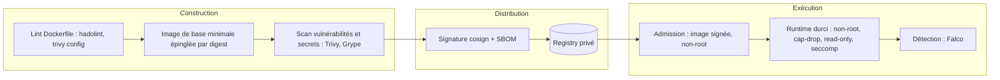

## Introduction

Tu sais déjà construire et faire tourner des conteneurs Docker. Ce chapitre change de focale : il ne s'agit plus de faire fonctionner un conteneur, mais de le sécuriser à chaque étape de son cycle de vie, de l'image de base jusqu'à l'exécution en production. Un conteneur mal configuré n'est pas juste une mauvaise pratique — c'est une porte d'entrée directe vers l'hôte qui l'exécute.

Trois angles structurent ce chapitre : d'abord la surface d'attaque de l'**image** elle-même (vulnérabilités connues dans les paquets embarqués, taille inutile, contenu superflu) ; ensuite les erreurs de **configuration du Dockerfile** qui transforment un conteneur inoffensif en cible facile (exécution root, récupération de fichiers distants non vérifiés) ; enfin les risques liés à l'**exécution** du conteneur sur l'hôte (privilèges excessifs, évasion vers le système hôte). Tu verras aussi une introduction à la signature d'images avec cosign, sujet qui sera approfondi au chapitre 6 sur la sécurité de la chaîne d'approvisionnement (supply chain).

L'objectif n'est pas de mémoriser une liste d'outils, mais de comprendre pourquoi chaque recommandation existe — pour pouvoir l'appliquer même face à un cas que ce chapitre ne couvre pas explicitement.

Le schéma suivant résume les couches de défense abordées : chacune compense les failles possibles des autres.



## Scanner une image avec Trivy

Une image Docker embarque un système d'exploitation minimal et des bibliothèques — chacune peut contenir des CVE connues. Un scanner de vulnérabilités compare le contenu de l'image à des bases de données publiques (NVD, GitHub Security Advisories, etc.) pour détecter ces failles avant le déploiement.

```bash
# Scanner une image locale ou distante
trivy image nginx:1.21.0

# Ne remonter que les vulnérabilités HIGH et CRITICAL
trivy image --severity HIGH,CRITICAL nginx:1.21.0

# Générer un rapport exploitable en CI (JSON)
trivy image --format json --output report.json nginx:1.21.0
```

```text
nginx:1.21.0 (debian 11.3)
=========================
Total: 102 (HIGH: 18, CRITICAL: 4)

┌────────────┬────────────────┬──────────┬───────────────────┬───────────────┬──────────────────────────────┐
│  Library   │ Vulnerability  │ Severity │ Installed Version │ Fixed Version │             Title             │
├────────────┼────────────────┼──────────┼───────────────────┼───────────────┼──────────────────────────────┤
│ libssl1.1  │ CVE-2022-0778  │ CRITICAL │ 1.1.1n-0+deb11u1  │ 1.1.1n-0+deb11u3 │ openssl: Infinite loop in BN_mod_sqrt() │
│ zlib1g     │ CVE-2022-37434 │ HIGH     │ 1:1.2.11.dfsg-2   │ 1:1.2.11.dfsg-2+deb11u2 │ zlib: heap-based buffer over-read │
└────────────┴────────────────┴──────────┴───────────────────┴───────────────┴──────────────────────────────┘
```

Trivy ne se limite pas aux CVE. Avec l'option `--scanners`, il détecte aussi les **secrets** oubliés dans les layers et les **mauvaises configurations** de Dockerfile, de manifestes Kubernetes ou de Terraform :

```bash
# Secrets oubliés dans les layers (clés privées, jetons d'API)
trivy image --scanners secret registry.example.com/app:v2.4.1

# Mauvaises configurations du Dockerfile et des manifestes
trivy config .

# Gate CI : échoue uniquement sur des vulnérabilités corrigeables HIGH ou CRITICAL
trivy image --severity HIGH,CRITICAL --ignore-unfixed --exit-code 1 registry.example.com/app:v2.4.1
```

La colonne **Fixed Version** est la plus actionnable du rapport : si elle est renseignée, la remédiation consiste simplement à reconstruire l'image sur une base plus récente ou à mettre à jour le paquet concerné.

Pour le Dockerfile lui-même, **hadolint** est le linter de référence : il signale les mauvaises pratiques avant même le build, comme une image de base non versionnée, un `ADD` à la place de `COPY` ou des paquets installés sans version figée.

```bash
docker run --rm -i hadolint/hadolint < Dockerfile
```

```text
-:1 DL3007 warning: Using latest is prone to errors if the image will ever update. Pin the version explicitly to a release tag
-:2 DL3008 warning: Pin versions in apt get install. Instead of `apt-get install <package>` use `apt-get install <package>=<version>`
-:2 DL3009 info: Delete the apt-get lists after installing something
-:3 DL3020 error: Use COPY instead of ADD for files and folders
```

<TipCallout>
Grype (Anchore) suit une logique équivalente à Trivy et s'utilise de façon très similaire (`grype nginx:1.21.0`) — les deux outils sont couramment combinés en CI pour croiser leurs bases de vulnérabilités, car aucune base unique n'est exhaustive.
</TipCallout>

<CehCallout>
Un scan d'image en `--exit-code 1` combiné aux severities HIGH/CRITICAL est l'intégration CI la plus courante : le pipeline échoue automatiquement si une image contient une vulnérabilité critique corrigeable, avant même d'atteindre l'environnement de staging.
</CehCallout>

## Réduire la surface d'attaque : images distroless

Chaque paquet présent dans une image est une surface d'attaque potentielle : un shell, un gestionnaire de paquets ou un compilateur inutiles à l'exécution de l'application sont autant d'outils qu'un attaquant pourra détourner après une compromission initiale. Les images **distroless** (projet Google) poussent cette logique à l'extrême : elles ne contiennent que le runtime strictement nécessaire à l'application (ex: la libc et le runtime Node.js), sans shell, sans gestionnaire de paquets, sans utilitaires système.

<CompareTable
  titleA="Ubuntu complet (ubuntu:22.04)"
  titleB="Distroless (gcr.io/distroless/nodejs20)"
  rows={[
    { a: "Taille de l'image : ~77 Mo de base, souvent 300+ Mo avec les dépendances", b: "Taille de l'image : ~40-60 Mo, runtime applicatif inclus" },
    { a: "Shell (bash/sh) présent — utilisable par un attaquant pour explorer le système", b: "Aucun shell — un attaquant qui exploite l'application ne peut pas obtenir de shell interactif" },
    { a: "Gestionnaire de paquets (apt) présent — permet d'installer des outils post-compromission", b: "Aucun gestionnaire de paquets — impossible d'installer quoi que ce soit dans le conteneur en cours d'exécution" },
    { a: "Centaines de paquets système = surface CVE large", b: "Dizaines de paquets seulement = surface CVE fortement réduite" },
    { a: "Débogage facile (on peut entrer avec `docker exec -it ... bash`)", b: "Débogage plus difficile — nécessite une image de debug dédiée (`:debug` tag) en développement" },
  ]}
/>

```dockerfile
# Build multi-stage : compiler avec une image complète, exécuter avec distroless
FROM node:22 AS builder
WORKDIR /app
COPY package*.json ./
RUN npm ci
COPY . .
RUN npm run build && npm prune --omit=dev

# Variante :nonroot = utilisateur 65532 par défaut, sans shell ni apt
FROM gcr.io/distroless/nodejs22-debian12:nonroot
WORKDIR /app
COPY --from=builder /app/dist ./dist
COPY --from=builder /app/node_modules ./node_modules
CMD ["dist/server.js"]
```

Distroless n'est pas la seule option. Les images **Chainguard**, construites sur la distribution minimaliste **Wolfi**, visent zéro CVE connue et sont reconstruites en continu ; Docker propose depuis 2025 ses **Docker Hardened Images** ; et les images `-slim` ou `alpine` restent un bon compromis quand un shell est nécessaire. Pour déboguer un conteneur sans shell, on n'ajoute pas de shell à l'image de production : on utilise un conteneur éphémère attaché, comme `kubectl debug` sur Kubernetes.

<WarningCallout>
L'absence de shell dans une image distroless n'est pas qu'un confort de sécurité en cas d'intrusion : elle empêche aussi certaines techniques de post-exploitation classiques (téléchargement d'un reverse shell, énumération manuelle) qui supposent un interpréteur de commandes disponible dans le conteneur compromis.
</WarningCallout>

## Exécution non-root dans le Dockerfile

Par défaut, un conteneur Docker s'exécute avec l'utilisateur `root` si aucun `USER` n'est spécifié dans le Dockerfile. Si l'application est compromise (ex: exécution de code arbitraire via une dépendance vulnérable), le processus de l'attaquant hérite des privilèges root **à l'intérieur du conteneur** — ce qui facilite grandement une éventuelle évasion vers l'hôte.

```dockerfile
# ❌ Dockerfile vulnérable — root implicite, aucune restriction
FROM ubuntu:latest
RUN apt-get update && apt-get install -y curl
ADD http://example.com/app-latest.tar.gz /app/
WORKDIR /app
RUN tar -xzf app-latest.tar.gz
CMD ["./app"]
```

```dockerfile
# ✅ Version corrigée — image versionnée, utilisateur dédié, COPY local
FROM ubuntu:24.04

RUN groupadd -r appgroup && useradd -r -g appgroup -d /app appuser

COPY ./app-latest.tar.gz /app/app-latest.tar.gz
WORKDIR /app
RUN tar -xzf app-latest.tar.gz && \
    chown -R appuser:appgroup /app

USER appuser
CMD ["./app"]
```

La directive `USER appuser` doit apparaître **après** toutes les instructions nécessitant des privilèges élevés (installation de paquets, changement de propriétaire de fichiers) et avant le `CMD`/`ENTRYPOINT` final : c'est l'utilisateur actif au moment du `USER` qui s'applique à toutes les instructions suivantes et à l'exécution du conteneur.

Au lancement, on peut aussi forcer un utilisateur avec `docker run --user 10001:10001`, mais la bonne pratique reste de le déclarer dans l'image. Préfère un **UID numérique** (`USER 10001`) à un nom : Kubernetes ne peut vérifier la contrainte `runAsNonRoot` que si l'utilisateur est numérique, comme tu le verras au chapitre suivant.

<AuditCallout>
Le contrôle CIS Docker Benchmark 4.1 ("Ensure a user for the container has been created") est l'un des contrôles les plus fréquemment échoués en audit — de nombreuses images publiques du Docker Hub tournent encore root par défaut, ce qu'un simple `docker inspect --format '{{.Config.User}}' <image>` permet de vérifier avant déploiement.
</AuditCallout>

## ADD distant vs COPY : un risque souvent ignoré

La différence entre `ADD` et `COPY` semble anodine, mais elle a une conséquence de sécurité directe : `ADD` peut récupérer un fichier depuis une URL distante et l'extraire automatiquement s'il s'agit d'une archive, alors que `COPY` ne fait que copier un fichier local du contexte de build.

```dockerfile
# ❌ Dangereux : téléchargement non vérifié, exécuté à chaque build
ADD http://example.com/app-latest.tar.gz /app/
```

Ce pattern pose trois problèmes concrets :

1. **Aucune intégrité vérifiée** — si le serveur distant est compromis ou si la connexion est interceptée (absence de TLS, certificat non validé), le contenu injecté dans l'image peut être arbitraire.
2. **Non-reproductibilité** — le tag `latest` de l'URL signifie que deux builds à des dates différentes peuvent produire des images différentes, rendant les scans et audits incohérents dans le temps.
3. **Extraction automatique non maîtrisée** — `ADD` décompresse automatiquement les archives reconnues (`.tar.gz`, `.zip`), un comportement surprenant qui peut écraser des fichiers existants dans l'image de façon inattendue.

```dockerfile
# ✅ Correct : fichier local versionné, intégrité vérifiable en amont (checksum en CI)
COPY ./dist/app-v2.4.1.tar.gz /app/app.tar.gz
RUN tar -xzf /app/app.tar.gz -C /app --strip-components=1 && rm /app/app.tar.gz
```

<TipCallout>
Réserve `ADD` au seul cas où son comportement d'extraction automatique d'une archive locale est explicitement souhaité — dans tous les autres cas (fichiers locaux, récupération distante), `COPY` associé à une étape de téléchargement vérifiée en amont (checksum SHA-256 comparé) est la pratique recommandée.
</TipCallout>

## Container escape : --privileged et capabilities Linux

Un conteneur partage le noyau de la machine hôte — contrairement à une machine virtuelle, il n'y a pas d'hyperviseur qui isole complètement l'exécution. L'isolation repose sur des mécanismes du noyau Linux (namespaces, cgroups, capabilities), qui peuvent être affaiblis par une mauvaise configuration au lancement du conteneur.

```bash
# ❌ Extrêmement dangereux : désactive quasiment toute l'isolation du conteneur
docker run --privileged -v /:/host maligne-image
```

Le flag `--privileged` donne au conteneur l'accès à **tous** les périphériques de l'hôte et désactive la plupart des restrictions de sécurité normalement appliquées — un attaquant qui obtient l'exécution de code dans un tel conteneur peut typiquement monter le système de fichiers de l'hôte et en prendre le contrôle total.

Les **capabilities Linux** offrent une alternative bien plus fine : au lieu du tout-ou-rien de root, elles découpent les privilèges root en unités indépendantes (`CAP_NET_ADMIN` pour la configuration réseau, `CAP_SYS_ADMIN` pour des opérations d'administration système, etc.).

```bash
# ✅ N'accorder que les capabilities strictement nécessaires
docker run --cap-drop=ALL --cap-add=NET_BIND_SERVICE mon-image
```

<AttackDefenseTable rows={[
  { phase: "Lancement du conteneur", attack: "`--privileged` ou montage de `/var/run/docker.sock` dans le conteneur", defense: "`--cap-drop=ALL` puis ajout ciblé des seules capabilities requises" },
  { phase: "Exécution applicative", attack: "Processus applicatif tournant en root dans le conteneur", defense: "Directive `USER` non-root dans le Dockerfile + `--security-opt=no-new-privileges`" },
  { phase: "Construction de l'image", attack: "`ADD` d'une archive distante non vérifiée, image de base `latest` non figée", defense: "`COPY` de fichiers locaux vérifiés (checksum), tag de version explicite et figé" },
  { phase: "Distribution / déploiement", attack: "Image non signée, provenance non vérifiable, tirée de n'importe quel registre", defense: "Signature cosign/Sigstore + politique d'admission qui rejette les images non signées" },
]} />

### Pourquoi --privileged mène à l'évasion : démonstration

Dans un conteneur privilégié, les disques de l'hôte sont visibles dans `/dev` et la capability `CAP_SYS_ADMIN` autorise le montage. L'évasion tient en trois commandes, à ne reproduire que dans un lab jetable :

```bash
docker run --rm -it --privileged ubuntu:24.04 bash
# à l'intérieur du conteneur :
lsblk                                  # les disques de l'hôte apparaissent
mount /dev/sda1 /mnt                   # montage du système de fichiers racine de l'hôte
chroot /mnt /bin/bash                  # shell avec la vue complète de l'hôte
```

Comparer les capabilities effectives d'un conteneur normal et d'un conteneur privilégié rend la différence tangible :

```bash
docker run --rm ubuntu:24.04 grep CapEff /proc/self/status
docker run --rm --privileged ubuntu:24.04 grep CapEff /proc/self/status
```

```text
CapEff: 00000000a80425fb
CapEff: 000001ffffffffff
```

Le premier masque correspond au jeu réduit de capabilities accordé par défaut par Docker ; le second les accorde toutes.

Même sans mauvaise configuration, le runtime peut avoir des failles. **CVE-2019-5736** permettait à un conteneur malveillant d'écraser le binaire `runc` de l'hôte, et **CVE-2024-21626** (« Leaky Vessels ») exploitait un descripteur de fichier laissé ouvert par runc pour accéder au système de fichiers de l'hôte via la directive `WORKDIR`. D'où l'importance de maintenir à jour Docker, containerd et runc, et de cumuler les protections.

### Durcir l'exécution : les options à connaître

Au-delà de `USER` et des capabilities, plusieurs options réduisent fortement ce qu'un attaquant peut faire dans un conteneur compromis :

```bash
docker run -d \
  --user 10001:10001 \
  --cap-drop=ALL \
  --security-opt=no-new-privileges \
  --read-only --tmpfs /tmp \
  --memory 256m --pids-limit 100 \
  registry.example.com/app@sha256:<digest>
```

L'option `--read-only` rend le système de fichiers racine non inscriptible, ce qui empêche de déposer un outil ou de modifier un binaire ; `--tmpfs /tmp` fournit un répertoire temporaire en mémoire pour les applications qui en ont besoin. `no-new-privileges` empêche un processus de gagner des privilèges via un binaire setuid. `--pids-limit` bloque les fork bombs. Docker applique aussi par défaut un **profil seccomp**, qui interdit plusieurs dizaines d'appels système dangereux, et un profil **AppArmor** sur les distributions qui le prennent en charge : ne les désactive jamais avec `--security-opt seccomp=unconfined` sans raison documentée. Enfin, le **mode rootless** de Docker ou Podman exécute le démon lui-même sans privilèges root, de sorte qu'une évasion n'aboutit qu'à un utilisateur non privilégié de l'hôte.

<WarningCallout>
Monter `/var/run/docker.sock` à l'intérieur d'un conteneur (pratique courante pour des outils de CI "Docker-in-Docker") équivaut presque à `--privileged` : ce socket donne un accès complet à l'API Docker de l'hôte, permettant de créer un nouveau conteneur monté sur `/` et d'en sortir trivialement.
</WarningCallout>

## Signer ses images avec cosign (introduction)

Scanner et durcir une image ne garantit pas qu'au moment du déploiement, l'image réellement récupérée depuis le registre est bien celle qui a été construite et validée — un registre compromis ou une attaque de type *tag mutation* peut substituer une image malveillante portant le même tag. **cosign**, projet du framework Sigstore, répond à ce problème par la signature cryptographique des images.

```bash
# Signer une image après le build (clé locale ici ; le mode keyless via OIDC est vu au chapitre 6)
cosign generate-key-pair
cosign sign --key cosign.key registry.example.com/app@sha256:<digest>

# Vérifier la signature avant déploiement
cosign verify --key cosign.pub registry.example.com/app@sha256:<digest>
```

On signe toujours le **digest** de l'image et non un tag : un tag étant mobile, signer `app:v2.4.1` reviendrait à signer ce vers quoi le tag pointe à cet instant, et cosign affiche d'ailleurs un avertissement dans ce cas.

Ce mécanisme garantit l'**intégrité** (l'image n'a pas été modifiée après signature) et la **provenance** (l'image provient bien du pipeline de build attendu) — deux propriétés qu'un simple scan de vulnérabilités ne peut pas fournir. Ce sujet sera repris en profondeur au chapitre 6, consacré à la sécurité de la chaîne d'approvisionnement logicielle (supply chain), avec l'intégration en CI/CD et les politiques d'admission Kubernetes qui rejettent automatiquement les images non signées.

## Détecter les comportements anormaux à l'exécution avec Falco

Toutes les mesures précédentes sont préventives. **Falco**, projet diplômé de la CNCF, ajoute une couche de détection : il observe les appels système de l'hôte (via un module eBPF) et déclenche des alertes selon des règles, par exemple un shell ouvert dans un conteneur, une écriture dans `/etc` ou une lecture de `/etc/shadow`.

```yaml
- rule: Terminal shell in container
  desc: Un shell interactif a été lancé dans un conteneur
  condition: >
    spawned_process and container and proc.name in (bash, sh, zsh)
    and proc.tty != 0
  output: >
    Shell ouvert dans un conteneur (user=%user.name container=%container.name
    image=%container.image.repository cmd=%proc.cmdline)
  priority: WARNING
```

```text
14:02:31.512 Warning Shell ouvert dans un conteneur (user=root container=web-1 image=nginx cmd=bash)
```

Dans MITRE ATT&CK, ce type d'activité correspond notamment à **T1609 — Container Administration Command** (exécution via `docker exec` ou `kubectl exec`) et l'évasion vers l'hôte à **T1611 — Escape to Host**. Sur une image distroless, une telle alerte est d'autant plus significative qu'aucun shell n'est censé exister.

## Erreurs fréquentes

La première erreur est de **scanner une fois et d'oublier** : une image sans CVE aujourd'hui en aura demain, puisque de nouvelles vulnérabilités sont publiées chaque jour. Il faut rescanner régulièrement les images déployées et reconstruire sur des bases à jour. La deuxième est de **croire qu'une image alpine est automatiquement sûre** : elle est petite, mais un `USER` absent ou une capability superflue annulent ce bénéfice.

On voit aussi des **secrets passés en `ARG` ou `ENV`** pendant le build, qui restent lisibles dans les métadonnées de l'image ; il faut utiliser `RUN --mount=type=secret`. Autre classique, **monter le socket Docker dans un runner CI** pour construire des images ; des outils sans démon comme BuildKit en mode rootless, Kaniko ou Buildah évitent cette exposition. Enfin, beaucoup **désactivent seccomp ou ajoutent `SYS_ADMIN`** pour « faire marcher » un outil, sans mesurer que cela rouvre la porte à l'évasion.

## Lab — Mise en Pratique

**Environnement** : Kali Linux (terminal Nyx Shell) + Docker local

<Steps steps={[
  { title: "Scanner une image vulnérable", description: "Lance un scan Trivy sur une ancienne image nginx et identifie les CVE critiques.", code: "trivy image --severity HIGH,CRITICAL nginx:1.21.0" },
  { title: "Corriger le Dockerfile fourni", description: "Récupère le Dockerfile du dossier lab (FROM ubuntu:latest, ADD distant, pas de USER) et corrige les trois problèmes : image versionnée, COPY local, utilisateur non-root.", code: "docker build -t app-corrigee:1.0 ." },
  { title: "Vérifier l'utilisateur d'exécution", description: "Confirme que l'image corrigée ne tourne pas root.", code: "docker inspect --format '{{.Config.User}}' app-corrigee:1.0" },
  { title: "Linter le Dockerfile", description: "Passe le Dockerfile vulnérable puis le Dockerfile corrigé à hadolint et compare les avertissements (DL3007, DL3020…).", code: "docker run --rm -i hadolint/hadolint < Dockerfile" },
  { title: "Comparer les tailles d'image", description: "Compare la taille de l'image Ubuntu complète à une version distroless équivalente.", code: "docker pull gcr.io/distroless/nodejs22-debian12:nonroot\ndocker images | grep -E 'ubuntu|distroless'" },
  { title: "Observer les capabilities", description: "Compare le masque CapEff d'un conteneur par défaut, d'un conteneur avec --cap-drop=ALL et d'un conteneur --privileged. Décode-les avec capsh si disponible.", code: "for o in '' '--cap-drop=ALL' '--privileged'; do docker run --rm $o ubuntu:24.04 grep CapEff /proc/self/status; done\ncapsh --decode=00000000a80425fb" },
  { title: "Tester un conteneur en lecture seule", description: "Lance un conteneur en --read-only et tente d'écrire dans /etc puis dans /tmp monté en tmpfs. Observe l'erreur Read-only file system.", code: "docker run --rm --read-only --tmpfs /tmp ubuntu:24.04 sh -c 'touch /etc/x; touch /tmp/ok && echo tmp OK'" },
  { title: "Aller plus loin (optionnel)", description: "Recherche si l'image publique que tu utilises le plus souvent en développement est disponible en variante distroless, et évalue ce qu'il faudrait adapter dans ton workflow de debug si elle n'a plus de shell." },
]} />

## À retenir

- Trivy et Grype scannent une image pour détecter des CVE connues dans ses paquets ; la colonne "Fixed Version" du rapport indique directement l'action de remédiation.
- Les images distroless suppriment shell et gestionnaire de paquets, réduisant fortement la surface d'attaque et les possibilités de post-exploitation en cas de compromission de l'application.
- La directive `USER` dans un Dockerfile doit être placée juste avant le `CMD`/`ENTRYPOINT`, après toutes les opérations nécessitant des privilèges élevés.
- `ADD` depuis une URL distante contourne toute vérification d'intégrité et casse la reproductibilité du build — `COPY` associé à une vérification de checksum en amont est la pratique recommandée.
- `--privileged` désactive quasiment toute l'isolation du conteneur ; les capabilities Linux (`--cap-drop=ALL` + ajout ciblé) offrent un contrôle beaucoup plus fin des privilèges réellement nécessaires.
- hadolint et `trivy config` détectent les mauvaises pratiques du Dockerfile avant le build ; `trivy image --scanners secret` repère les secrets oubliés dans les layers.
- L'exécution se durcit avec un UID numérique non-root, `--cap-drop=ALL`, `no-new-privileges`, `--read-only`, des limites de ressources et le profil seccomp par défaut ; le mode rootless limite l'impact d'une évasion.
- Falco détecte à l'exécution les comportements anormaux (shell dans un conteneur, écriture dans `/etc`), en complément des contrôles préventifs.
- cosign/Sigstore permet de signer et vérifier la provenance d'une image, un sujet approfondi au chapitre 6 sur la sécurité de la chaîne d'approvisionnement.

## Questions de Révision

1. Pourquoi la colonne "Fixed Version" d'un rapport Trivy est-elle l'information la plus actionnable pour la remédiation ?
2. Quels sont les deux éléments absents d'une image distroless qui limitent concrètement la post-exploitation après une compromission applicative ?
3. Où doit être placée la directive `USER` dans un Dockerfile, et pourquoi son emplacement compte-t-il ?
4. Quels sont les deux risques concrets d'utiliser `ADD` avec une URL distante plutôt que `COPY` avec un fichier local vérifié ?
5. En quoi monter `/var/run/docker.sock` dans un conteneur est-il presque équivalent à lancer ce conteneur en `--privileged` ?
6. Quelles deux propriétés la signature cosign d'une image apporte-t-elle qu'un simple scan de vulnérabilités ne garantit pas ?
7. Pourquoi faut-il signer et déployer une image par digest plutôt que par tag ?
8. Quelles options `docker run` combinerais-tu pour qu'un attaquant ayant obtenu une exécution de code dans le conteneur ne puisse ni écrire de fichier, ni gagner de privilèges, ni lancer une fork bomb ?
9. Quelle complémentarité existe-t-il entre une image distroless et une règle Falco qui détecte l'ouverture d'un shell ?
