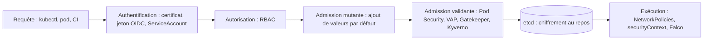

## Introduction

Un cluster Kubernetes correctement déployé (tu maîtrises déjà Pods, Deployments et Services depuis le cours DevOps Fondamentaux) n'est pas pour autant un cluster sécurisé. Par défaut, Kubernetes est permissif : un pod compromis peut souvent contacter n'importe quel autre pod du cluster, un compte de service mal scopé peut lister des secrets dans tous les namespaces, et rien n'empêche a priori un manifeste de démarrer un conteneur en mode `privileged`. Ce chapitre couvre les quatre piliers qui transforment un cluster « qui fonctionne » en cluster « qui résiste à une compromission partielle » : le contrôle d'accès (RBAC), l'isolation réseau (NetworkPolicies), les standards de sécurité des pods (Pod Security Standards) et les contrôleurs d'admission qui appliquent des politiques avant même qu'un objet soit créé.

Le fil conducteur est le principe du moindre privilège, décliné à chaque couche : un compte de service ne doit voir que son namespace, un pod ne doit parler qu'aux pods dont il a réellement besoin, un conteneur ne doit jamais tourner en root s'il peut faire autrement, et un secret ne doit jamais rester en clair au repos. Chacune de ces couches est une ligne de défense indépendante : si une seule échoue, les autres limitent quand même le rayon d'action d'un attaquant.

Toute requête vers l'API Server traverse la même chaîne de contrôles, et chaque section de ce chapitre durcit l'un de ses maillons :



## RBAC — Role, RoleBinding et ClusterRole

Le RBAC (Role-Based Access Control) de Kubernetes répond à une question simple : *qui a le droit de faire quoi, sur quelles ressources, dans quel namespace ?* Un `Role` définit un ensemble de permissions **limité à un namespace** ; un `ClusterRole` définit les mêmes permissions mais à l'échelle du cluster entier (ou pour des ressources non namespacées comme les `Node`). Un `RoleBinding` (ou `ClusterRoleBinding`) associe ensuite ce rôle à un utilisateur, un groupe ou un compte de service (`ServiceAccount`).

```yaml
# role.yaml — un compte de service ne peut lire que les Pods et ConfigMaps
# du namespace "billing", rien d'autre
apiVersion: rbac.authorization.k8s.io/v1
kind: Role
metadata:
  namespace: billing
  name: billing-app-reader
rules:
  - apiGroups: [""]
    resources: ["pods", "configmaps"]
    verbs: ["get", "list", "watch"]
---
apiVersion: v1
kind: ServiceAccount
metadata:
  name: billing-app-sa
  namespace: billing
---
apiVersion: rbac.authorization.k8s.io/v1
kind: RoleBinding
metadata:
  name: billing-app-binding
  namespace: billing
subjects:
  - kind: ServiceAccount
    name: billing-app-sa
    namespace: billing
roleRef:
  kind: Role
  name: billing-app-reader
  apiGroup: rbac.authorization.k8s.io
```

<WarningCallout>
L'erreur la plus fréquente est d'utiliser un `ClusterRoleBinding` « parce que ça marche partout » — c'est exactement ce qu'il faut éviter. Un `ClusterRoleBinding` donne les permissions **dans tous les namespaces**, y compris ceux qui contiennent des secrets sensibles (`kube-system`, `billing`, etc.). Toujours préférer un `Role` + `RoleBinding` scopé, et ne réserver les `ClusterRole` qu'aux besoins réellement transverses (ex: un opérateur de monitoring).
</WarningCallout>

```bash
# Vérifier concrètement ce qu'un compte de service peut faire
kubectl auth can-i list secrets --as=system:serviceaccount:billing:billing-app-sa -n billing
kubectl auth can-i list secrets --as=system:serviceaccount:billing:billing-app-sa --all-namespaces
```

Certains droits sont bien plus dangereux qu'ils n'en ont l'air, car ils permettent d'obtenir indirectement d'autres privilèges. Le droit de **créer des Pods** dans un namespace permet de monter n'importe quel Secret ou ServiceAccount de ce namespace dans un Pod contrôlé par l'attaquant. Les verbes `escalate` et `bind` permettent de s'attribuer des rôles plus puissants, `impersonate` de se faire passer pour un autre utilisateur, et l'accès à la sous-ressource `nodes/proxy` donne accès à l'API du kubelet. Le droit `list` sur les secrets suffit à lire leur contenu, contrairement à une idée reçue qui le croit limité aux noms.

### Les jetons de ServiceAccount

Chaque Pod reçoit par défaut un jeton de son ServiceAccount, monté dans `/var/run/secrets/kubernetes.io/serviceaccount/token`. Depuis Kubernetes 1.22, ce jeton est **lié** (bound token) : il a une durée de vie limitée, une audience et il est invalidé à la suppression du Pod. Depuis la version 1.24, Kubernetes ne crée plus automatiquement de Secret contenant un jeton permanent pour chaque ServiceAccount. Si l'application n'appelle jamais l'API Kubernetes, le plus sûr reste de ne pas monter de jeton du tout :

```yaml
apiVersion: v1
kind: ServiceAccount
metadata:
  name: billing-app-sa
  namespace: billing
automountServiceAccountToken: false
```

<CehCallout>
Lors d'un audit ou d'un pentest de cluster, `kubectl auth can-i --list --as=system:serviceaccount:<ns>:<sa>` est la première commande à lancer une fois un token de compte de service récupéré (souvent monté automatiquement dans `/var/run/secrets/kubernetes.io/serviceaccount/token` à l'intérieur d'un pod compromis) — elle révèle immédiatement le rayon d'action réel de ce token.
</CehCallout>

## NetworkPolicies — isoler le trafic pod-à-pod

Sans NetworkPolicy, tous les pods d'un cluster peuvent communiquer librement entre eux, quel que soit leur namespace — c'est un réseau plat par défaut. Une NetworkPolicy fonctionne comme un firewall applicatif niveau pod : elle sélectionne des pods via un `podSelector` et définit les flux entrants (`ingress`) et sortants (`egress`) autorisés. Dès qu'une NetworkPolicy s'applique à un pod, **tout ce qui n'est pas explicitement autorisé est bloqué**.

```yaml
# deny-all.yaml — bloque tout le trafic entrant et sortant du namespace "billing"
apiVersion: networking.k8s.io/v1
kind: NetworkPolicy
metadata:
  name: default-deny-all
  namespace: billing
spec:
  podSelector: {}
  policyTypes:
    - Ingress
    - Egress
```

Cette politique « deny all » est le point de départ recommandé sur tout namespace sensible. On ajoute ensuite des exceptions ciblées pour les flux réellement nécessaires :

```yaml
# allow-frontend-to-api.yaml — exception : le frontend peut appeler l'API sur le port 8080
apiVersion: networking.k8s.io/v1
kind: NetworkPolicy
metadata:
  name: allow-frontend-to-api
  namespace: billing
spec:
  podSelector:
    matchLabels:
      app: billing-api
  policyTypes:
    - Ingress
  ingress:
    - from:
        - podSelector:
            matchLabels:
              app: billing-frontend
      ports:
        - protocol: TCP
          port: 8080
```

Attention au piège classique du « deny all » en egress : il bloque aussi les requêtes DNS, et plus aucun pod du namespace ne résout de nom. Il faut donc toujours l'accompagner d'une exception vers le DNS du cluster :

```yaml
# allow-dns.yaml — autorise tous les pods du namespace à joindre CoreDNS
apiVersion: networking.k8s.io/v1
kind: NetworkPolicy
metadata:
  name: allow-dns-egress
  namespace: billing
spec:
  podSelector: {}
  policyTypes: [Egress]
  egress:
    - to:
        - namespaceSelector:
            matchLabels:
              kubernetes.io/metadata.name: kube-system
          podSelector:
            matchLabels:
              k8s-app: kube-dns
      ports:
        - { protocol: UDP, port: 53 }
        - { protocol: TCP, port: 53 }
```

Le label `kubernetes.io/metadata.name` est ajouté automatiquement à chaque namespace depuis Kubernetes 1.22, ce qui permet de le cibler de façon fiable. Bloquer l'egress a aussi un intérêt offensif direct : un pod compromis ne peut plus joindre l'endpoint de métadonnées du cloud (`169.254.169.254`), ni télécharger d'outils, ni exfiltrer de données vers Internet.

<TipCallout>
Une NetworkPolicy ne fonctionne que si le CNI (Container Network Interface) du cluster l'implémente — Calico, Cilium ou Weave Net le font, mais le plugin réseau par défaut de certains clusters managés ne l'applique pas sans configuration additionnelle. Vérifie toujours que la politique est effectivement appliquée avant de t'y fier.
</TipCallout>

## Pod Security Standards — privileged, baseline, restricted

Kubernetes définit trois niveaux de Pod Security Standards, appliqués via l'admission controller `PodSecurity` intégré : **privileged** (aucune restriction — usage réservé aux composants système), **baseline** (bloque les escalades de privilèges les plus évidentes) et **restricted** (applique les meilleures pratiques de durcissement, recommandé pour toute charge applicative).

Ce mécanisme, appelé **Pod Security Admission**, est stable depuis Kubernetes 1.25, version qui a supprimé l'ancien mécanisme PodSecurityPolicy (PSP) : si tu rencontres encore des PSP dans une documentation, elle est obsolète. Il se configure simplement par des labels sur le namespace, avec trois modes : `enforce` rejette les pods non conformes, `audit` les inscrit dans le journal d'audit, `warn` affiche un avertissement à l'utilisateur.

```bash
kubectl label namespace billing \
  pod-security.kubernetes.io/enforce=restricted \
  pod-security.kubernetes.io/enforce-version=latest \
  pod-security.kubernetes.io/warn=restricted
```

```text
Error from server (Forbidden): error when creating "pod.yaml": pods "debug" is forbidden:
violates PodSecurity "restricted:latest": privileged (container "app" must not set
securityContext.privileged=true), allowPrivilegeEscalation != false, unrestricted
capabilities, runAsNonRoot != true, seccompProfile (pod or container "app" must set
securityContext.seccompProfile.type to "RuntimeDefault" or "Localhost")
```

Une bonne pratique de migration consiste à poser d'abord les labels `warn` et `audit` pour mesurer ce qui casserait, puis à passer en `enforce` une fois les manifestes corrigés.

Trois réglages du `securityContext` d'un pod, combinés, constituent l'une des configurations les plus dangereuses qu'un cluster puisse héberger — c'est d'ailleurs exactement ce que tu dois repérer dans le lab **Le Pipeline Compromis** :

<AttackDefenseTable rows={[
  { phase: "privileged: true", attack: "Le conteneur a un accès quasi total au noyau de l'hôte — capacités désactivées par défaut réactivées, accès direct aux périphériques", defense: "Ne jamais activer `privileged: true` en production ; utiliser des capacités Linux (`capabilities.add`) ciblées si un accès spécifique est réellement nécessaire" },
  { phase: "runAsUser: 0", attack: "Le processus dans le conteneur tourne en root — une évasion de conteneur (container breakout) donne alors un accès root direct sur le nœud hôte", defense: "Forcer `runAsNonRoot: true` et définir un `runAsUser` non-zéro dans le `securityContext`, au niveau pod ou conteneur" },
  { phase: "hostNetwork: true", attack: "Le pod partage directement la pile réseau de l'hôte — il contourne toutes les NetworkPolicies et voit le trafic réseau du nœud", defense: "Ne jamais utiliser `hostNetwork: true` pour une charge applicative standard ; réserver ce réglage aux composants réseau système explicitement validés" },
]} />

```yaml
# Extrait dangereux — les trois misconfigurations combinées
spec:
  hostNetwork: true
  containers:
    - name: app
      image: app:latest
      securityContext:
        privileged: true
        runAsUser: 0
```

```yaml
# Version durcie équivalente — profil "restricted"
spec:
  hostNetwork: false
  containers:
    - name: app
      image: app:latest
      securityContext:
        privileged: false
        runAsNonRoot: true
        runAsUser: 10001
        allowPrivilegeEscalation: false
        capabilities:
          drop: ["ALL"]
        readOnlyRootFilesystem: true
        seccompProfile:
          type: RuntimeDefault    # exigé par le profil restricted
```

Note le champ `seccompProfile` : le profil restricted l'exige, et c'est l'oubli le plus fréquent lors d'une première mise en conformité.

<AuditCallout>
ISO 27001 (contrôle A.8.9 — configuration management) et le CIS Kubernetes Benchmark exigent que les charges applicatives ne tournent jamais en `privileged` ni en root sans justification documentée et validée. En audit, la présence d'un seul pod combinant les trois réglages ci-dessus dans un namespace applicatif doit être traitée comme une non-conformité critique.
</AuditCallout>

## Admission controllers — OPA/Gatekeeper

Un admission controller intercepte chaque requête de création ou modification d'objet **avant** qu'elle soit persistée dans etcd, et peut la valider, la modifier ou la rejeter. Le `PodSecurity` mentionné plus haut en est un exemple natif ; **OPA Gatekeeper** (Open Policy Agent) permet d'écrire des politiques personnalisées, arbitrairement riches, appliquées à l'admission de n'importe quel objet Kubernetes.

Le principe : une `ConstraintTemplate` définit une règle en langage Rego (le langage de policy d'OPA), puis une `Constraint` applique cette règle à un périmètre précis (namespaces, types de ressources).

```yaml
# Exemple conceptuel — rejeter tout pod sans limites de ressources définies
apiVersion: constraints.gatekeeper.sh/v1beta1
kind: K8sRequiredResources
metadata:
  name: require-resource-limits
spec:
  match:
    kinds:
      - apiGroups: [""]
        kinds: ["Pod"]
  parameters:
    limits: ["cpu", "memory"]
```

### ValidatingAdmissionPolicy et Kyverno : les alternatives modernes

Depuis Kubernetes 1.30, la **ValidatingAdmissionPolicy** est stable : elle permet d'écrire des règles d'admission directement dans l'API Server, en langage **CEL** (Common Expression Language), sans installer de webhook externe. Pour des règles simples, c'est désormais l'option la plus légère :

```yaml
apiVersion: admissionregistration.k8s.io/v1
kind: ValidatingAdmissionPolicy
metadata:
  name: deny-host-network
spec:
  failurePolicy: Fail
  matchConstraints:
    resourceRules:
      - apiGroups: ["apps"]
        apiVersions: ["v1"]
        operations: ["CREATE", "UPDATE"]
        resources: ["deployments"]
  validations:
    - expression: "!has(object.spec.template.spec.hostNetwork) || object.spec.template.spec.hostNetwork == false"
      message: "hostNetwork est interdit pour les charges applicatives."
---
apiVersion: admissionregistration.k8s.io/v1
kind: ValidatingAdmissionPolicyBinding
metadata:
  name: deny-host-network-binding
spec:
  policyName: deny-host-network
  validationActions: [Deny]
```

**Kyverno**, autre projet de la CNCF, propose des politiques écrites en YAML plutôt qu'en Rego, et sait aussi muter des objets, générer des ressources (par exemple une NetworkPolicy par défaut à chaque nouveau namespace) et vérifier les signatures d'images cosign, ce qui le rend très populaire.

<CompareTable
  titleA="Mécanisme"
  titleB="Points forts et limites"
  rows={[
    { a: "Pod Security Admission", b: "Intégré, configuré par labels, mais limité aux trois profils standard, sans règle personnalisée" },
    { a: "ValidatingAdmissionPolicy (CEL)", b: "Intégrée à l'API Server, sans webhook ; idéale pour des règles simples, pas de mutation" },
    { a: "OPA Gatekeeper (Rego)", b: "Très expressif, partage le langage Rego avec conftest en CI ; demande d'apprendre Rego" },
    { a: "Kyverno (YAML)", b: "Politiques en YAML, mutation, génération, vérification de signatures d'images ; webhook à opérer" },
  ]}
/>

Contrairement aux NetworkPolicies (appliquées au runtime réseau) ou au RBAC (appliqué à l'exécution des appels API), un admission controller agit **au moment du déploiement** : un manifeste non conforme n'est même jamais créé dans le cluster. C'est la couche idéale pour interdire `privileged: true` ou `hostNetwork: true` de façon systématique, plutôt que de compter sur la vigilance de chaque développeur.

## Secrets Kubernetes — une fausse impression de sécurité

Un objet `Secret` Kubernetes n'est, par défaut, **encodé en base64, pas chiffré**. N'importe qui disposant d'un accès `get` sur les secrets d'un namespace (via RBAC insuffisamment restreint) peut les décoder instantanément.

```bash
# Décoder un secret Kubernetes — trivial si l'accès RBAC le permet
kubectl get secret db-credentials -n billing -o jsonpath='{.data.password}' | base64 -d
```

Le chiffrement au repos se configure côté API Server avec un fichier `EncryptionConfiguration`, passé via l'option `--encryption-provider-config`. Le fournisseur recommandé est **KMS v2** (stable depuis Kubernetes 1.29), qui délègue la clé maîtresse à un service de gestion de clés externe ; à défaut, `aescbc` ou `secretbox` utilisent une clé locale stockée sur le control plane.

```yaml
apiVersion: apiserver.config.k8s.io/v1
kind: EncryptionConfiguration
resources:
  - resources: ["secrets"]
    providers:
      - kms:
          apiVersion: v2
          name: cloud-kms
          endpoint: unix:///var/run/kmsplugin/socket.sock
      - identity: {}     # permet encore de lire les anciens secrets non chiffrés
```

Après activation, les secrets existants ne sont chiffrés qu'à leur prochaine écriture : il faut les réécrire tous avec `kubectl get secrets -A -o json | kubectl replace -f -`. Sur les clusters managés (EKS, GKE, AKS), cette option s'active dans la configuration du fournisseur.

<WarningCallout>
Le base64 n'est pas du chiffrement — c'est un simple encodage réversible sans clé. Un Secret Kubernetes non protégé davantage offre une sécurité illusoire : la vraie protection vient du RBAC qui restreint qui peut le lire, et idéalement du chiffrement au repos dans etcd (`EncryptionConfiguration`) ou d'un coffre-fort externe (HashiCorp Vault, AWS Secrets Manager via un opérateur comme External Secrets).
</WarningCallout>

## Auditer un cluster et détecter les attaques

Plusieurs outils open source automatisent l'audit de configuration. **kube-bench** (Aqua Security) vérifie les nœuds et le control plane contre le CIS Kubernetes Benchmark. **Kubescape** (projet CNCF) évalue le cluster selon plusieurs référentiels, dont les recommandations NSA/CISA de durcissement de Kubernetes et le MITRE ATT&CK. `trivy k8s` scanne à la fois les images et les configurations des ressources déployées.

```bash
kube-bench run --targets node
kubescape scan framework nsa
trivy k8s --report summary
```

```text
[FAIL] 4.2.1 Ensure that the --anonymous-auth argument is set to false (Automated)
[PASS] 4.2.2 Ensure that the --authorization-mode argument is not set to AlwaysAllow (Automated)
[PASS] 4.2.3 Ensure that the --client-ca-file argument is set as appropriate (Automated)
```

Côté détection, le **journal d'audit** de l'API Server (configuré par une `audit-policy`) enregistre qui a fait quoi : il permet de repérer une lecture massive de secrets ou la création d'un ClusterRoleBinding inattendu. À l'exécution, **Falco** détecte les comportements anormaux dans les pods, comme vu au chapitre précédent.

<AttackDefenseTable rows={[
  { phase: "Accès initial", attack: "Exploitation d'une application exposée, puis lecture du jeton de ServiceAccount monté dans le pod", defense: "automountServiceAccountToken: false, image distroless, NetworkPolicy egress" },
  { phase: "Découverte", attack: "kubectl auth can-i --list avec le jeton volé, interrogation de 169.254.169.254", defense: "RBAC minimal, blocage egress vers les métadonnées cloud, journal d'audit" },
  { phase: "Élévation de privilèges", attack: "Création d'un pod privileged avec hostPath / pour s'évader vers le nœud (ATT&CK T1611)", defense: "Pod Security Admission restricted, interdiction de la création de pods par les comptes applicatifs" },
  { phase: "Accès aux identifiants", attack: "Lecture des Secrets du namespace ou de etcd", defense: "RBAC sur les secrets, chiffrement KMS v2, coffre-fort externe" },
]} />

## Erreurs fréquentes

La première erreur est de **donner `cluster-admin` à la CI** ou à un opérateur tiers parce que c'est plus simple : la compromission d'un seul pipeline donne alors tout le cluster. La deuxième est de **poser un deny-all egress sans exception DNS**, ce qui casse toute l'application et pousse l'équipe à supprimer la politique au lieu de la corriger.

On voit aussi des **politiques d'admission en `failurePolicy: Ignore`** : si le webhook tombe, tout passe sans contrôle. Autre classique, **croire que le namespace est une frontière de sécurité** : sans NetworkPolicy, sans RBAC et sans Pod Security, deux namespaces partagent le même réseau et les mêmes nœuds. Enfin, beaucoup d'équipes **activent le chiffrement au repos sans réécrire les secrets existants**, qui restent alors en clair dans etcd.

## Lab — Mise en Pratique

**Environnement** : Kali Linux (terminal Nyx Shell) — lab devops-001, « Le Pipeline Compromis »

<Steps steps={[
  { title: "Explorer les manifestes du cluster", description: "Liste les Deployments du namespace ciblé par le lab pour repérer les fichiers YAML suspects.", code: "kubectl get deployments -n <namespace> -o yaml > deployments.yaml" },
  { title: "Repérer les réglages de sécurité dangereux", description: "Recherche les trois marqueurs vus dans ce chapitre au milieu des déploiements correctement durcis.", code: "grep -E \"privileged: true|runAsUser: 0|hostNetwork: true\" deployments.yaml" },
  { title: "Confirmer la combinaison complète", description: "Isole le Deployment qui combine les trois réglages en même temps — c'est celui-ci qui contient le second flag du lab.", code: "kubectl describe deployment <nom-suspect> -n <namespace>" },
  { title: "Documenter la remédiation", description: "Pour valider ta compréhension, réécris mentalement (ou dans tes notes) le `securityContext` de ce Deployment selon le profil « restricted » présenté plus haut, avant de soumettre le flag." },
  { title: "Bonus : appliquer Pod Security Admission sur un cluster kind", description: "Sur un cluster local, crée un namespace étiqueté enforce=restricted et tente d'y créer un pod privilégié. Lis le message de refus et corrige le manifeste jusqu'à ce qu'il soit accepté.", code: "kubectl create namespace demo\nkubectl label namespace demo pod-security.kubernetes.io/enforce=restricted\nkubectl run test --image=nginx:1.27 -n demo --privileged" },
  { title: "Bonus : vérifier le rayon d'action d'un ServiceAccount", description: "Liste toutes les permissions du compte de service par défaut d'un namespace, puis celles d'un compte lié à un ClusterRole. Compare les deux listes.", code: "kubectl auth can-i --list --as=system:serviceaccount:demo:default -n demo" },
  { title: "Bonus : tester une politique deny-all", description: "Applique default-deny-all dans le namespace demo, lance un pod et vérifie que la résolution DNS échoue, puis ajoute allow-dns-egress et vérifie qu'elle fonctionne à nouveau (nécessite un CNI qui applique les NetworkPolicies, comme Calico ou Cilium).", code: "kubectl run dns-test -n demo --rm -it --image=busybox:1.36 --restart=Never -- nslookup kubernetes.default" },
]} />

## À retenir

- RBAC (`Role`/`RoleBinding` namespacés, `ClusterRole`/`ClusterRoleBinding` pour les besoins transverses) applique le moindre privilège aux comptes de service — `kubectl auth can-i` permet de vérifier concrètement les permissions effectives.
- Les NetworkPolicies transforment le réseau plat par défaut de Kubernetes en réseau segmenté : une politique « deny all » par namespace, complétée par des exceptions ciblées, limite la propagation latérale en cas de compromission d'un pod.
- La combinaison `privileged: true` + `runAsUser: 0` + `hostNetwork: true` est l'une des configurations les plus dangereuses d'un cluster — elle donne un accès quasi total à l'hôte et contourne les NetworkPolicies.
- Les admission controllers (OPA/Gatekeeper) rejettent les manifestes non conformes avant même leur création, complétant le RBAC et les NetworkPolicies par un contrôle au moment du déploiement.
- Un Secret Kubernetes n'est que du base64 par défaut — la protection réelle vient du RBAC restrictif, du chiffrement au repos dans etcd (KMS v2), ou d'un coffre-fort externe.
- Pod Security Admission (labels `enforce`, `audit`, `warn`) remplace PodSecurityPolicy, supprimée en 1.25 ; le profil restricted exige aussi `seccompProfile: RuntimeDefault`.
- ValidatingAdmissionPolicy (CEL, stable en 1.30), Gatekeeper (Rego) et Kyverno (YAML) permettent des règles d'admission personnalisées.
- Un deny-all egress doit toujours autoriser le DNS ; `automountServiceAccountToken: false` supprime le jeton inutile ; kube-bench, Kubescape et trivy k8s automatisent l'audit.

## Questions de Révision

1. Pourquoi un `ClusterRoleBinding` est-il souvent une erreur quand un simple `Role` + `RoleBinding` namespacé suffirait ?
2. Que se passe-t-il par défaut sur le trafic pod-à-pod tant qu'aucune NetworkPolicy n'a été appliquée à un namespace ?
3. En quoi la combinaison `privileged: true`, `runAsUser: 0` et `hostNetwork: true` est-elle particulièrement dangereuse par rapport à chacun de ces réglages pris isolément ?
4. Quelle est la différence fondamentale entre une NetworkPolicy et un admission controller comme OPA Gatekeeper, en termes de moment où la politique s'applique ?
5. Pourquoi un objet Secret Kubernetes ne doit-il jamais être considéré comme suffisamment sécurisé par lui-même ?
6. Pourquoi le droit de créer des Pods dans un namespace équivaut-il presque à pouvoir lire tous ses Secrets ?
7. Après avoir appliqué une politique deny-all en egress, plus aucun pod ne résout de nom. Explique pourquoi et corrige la situation.
8. Quelle démarche suivrais-tu pour passer un namespace existant au profil restricted sans casser la production ?
9. Dans quel cas choisirais-tu une ValidatingAdmissionPolicy plutôt qu'OPA Gatekeeper ou Kyverno ?
