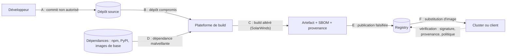
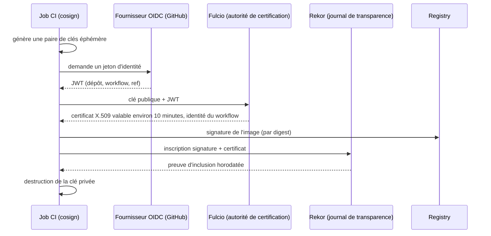

## Introduction

Un chapitre précédent de la sécurité des applications a évoqué la vérification des dépendances applicatives — audit de `package.json` ou `requirements.txt` avant de merger. Ce chapitre change d'échelle : il ne s'agit plus de savoir *quelles bibliothèques* un développeur a choisi d'importer, mais de savoir *ce qui compose réellement* un artefact au moment où il quitte le pipeline de build — jusqu'aux dépendances transitives, aux images de base, aux binaires vendus, et à la provenance de chaque étape de compilation.

Le 9 décembre 2021, la faille Log4Shell (CVE-2021-44228) a explosé sur des dizaines de milliers de systèmes en quelques heures. Les équipes qui possédaient un inventaire précis de leurs composants ont pu répondre en quelques minutes : « nous utilisons Log4j 2.14.1 dans ces douze services, patch en cours ». Celles qui ne l'avaient pas ont passé des jours, parfois des semaines, à grep des JAR sur des milliers de serveurs pour savoir si elles étaient exposées. Cette différence de vélocité — minutes contre jours — est exactement ce que ce chapitre vise à construire : un inventaire fiable (SBOM), une chaîne de confiance vérifiable (signature), et un cadre pour mesurer la maturité de ta chaîne de build (SLSA).

Le modèle de menaces de SLSA découpe la chaîne d'approvisionnement en points d'attaque, que l'on retrouve tout au long de ce chapitre :



Chaque lettre correspond à une famille de menaces : les contrôles de source (revue, protection de branche) couvrent A et B, la sécurité du build et la provenance couvrent C, l'analyse des dépendances couvre D, la signature et la vérification à l'admission couvrent E et F.

## Le SBOM : l'inventaire vérifiable d'un artefact

Un SBOM (Software Bill of Materials) est une liste structurée, lisible par une machine, de tous les composants qui entrent dans la fabrication d'un artefact logiciel — bibliothèques directes et transitives, versions exactes, licences, hashes cryptographiques, et parfois relations de dépendance entre composants.

Deux formats dominent le paysage, normalisés et interopérables avec l'outillage de sécurité moderne :

<CompareTable
  titleA="CycloneDX"
  titleB="SPDX"
  rows={[
    { a: "Porté par l'OWASP, orienté sécurité applicative (vulnérabilités, VEX)", b: "Porté par la Linux Foundation, orienté conformité licence et audit légal" },
    { a: "Format natif JSON/XML, léger, facile à générer en CI", b: "Format tabulaire historique (tag-value), plus verbeux, aussi disponible en JSON" },
    { a: "Standard de facto pour l'écosystème DevSecOps (Dependency-Track, Grype) ; version 1.6 normalisée par Ecma sous la référence ECMA-424", b: "Standard ISO/IEC 5962:2021 (SPDX 2.2.1) ; SPDX 3.0, publié en 2024, ajoute des profils sécurité, IA et données" },
  ]}
/>

Les deux formats identifient chaque composant par un **purl** (Package URL), comme `pkg:npm/lodash@4.17.21` ou `pkg:maven/org.apache.logging.log4j/log4j-core@2.14.1`. Cet identifiant normalisé est ce qui permet à un scanner de rapprocher un composant d'une base de vulnérabilités, quel que soit l'outil qui a produit le SBOM. Aux États-Unis, l'agence CISA publie les éléments minimaux attendus d'un SBOM ; en Europe, le Cyber Resilience Act impose aux fabricants de documenter les composants de leurs produits, ce qui fait du SBOM une pièce de conformité.

```json
// Extrait d'un SBOM CycloneDX (format JSON simplifié)
{
  "bomFormat": "CycloneDX",
  "specVersion": "1.6",
  "components": [
    {
      "type": "library",
      "name": "log4j-core",
      "version": "2.14.1",
      "purl": "pkg:maven/org.apache.logging.log4j/log4j-core@2.14.1",
      "hashes": [{ "alg": "SHA-256", "content": "a1b2c3..." }],
      "licenses": [{ "license": { "id": "Apache-2.0" } }]
    }
  ]
}
```

### Générer un SBOM automatiquement en CI

La génération manuelle n'a aucun intérêt : le SBOM doit être produit à chaque build, sans intervention humaine, et archivé aux côtés de l'artefact.

```yaml
# Extrait d'un pipeline GitLab CI / GitHub Actions
generate-sbom:
  stage: build
  script:
    # Syft génère un SBOM à partir du code source OU d'une image Docker
    - syft dir:. -o cyclonedx-json=sbom.cdx.json
    - syft myapp:${CI_COMMIT_SHA} -o cyclonedx-json=sbom-image.cdx.json
  artifacts:
    paths:
      - sbom.cdx.json
      - sbom-image.cdx.json
```

La sous-commande `syft packages`, encore présente dans de nombreux tutoriels, est dépréciée : on passe directement la source à `syft` (ou à `syft scan`). Trivy sait aussi produire un SBOM (`trivy image --format cyclonedx --output sbom.cdx.json myapp:tag`), et BuildKit peut en générer un pendant le build avec `docker buildx build --sbom=true`, attaché à l'image dans le registry.

```text
$ syft myapp:1.4.0 -o table | head -6
NAME                 VERSION     TYPE
alpine-baselayout    3.6.8-r1    apk
busybox              1.37.0-r12  apk
express              4.21.2      npm
log4js               6.9.1       npm
lodash               4.17.15     npm
```

Une fois généré, le SBOM doit être **exploité** : un serveur comme **OWASP Dependency-Track** importe les SBOM de tous les projets, les réévalue en continu contre les bases de vulnérabilités, et répond instantanément à la question « quels projets embarquent tel composant ? ». C'est cette réévaluation continue qui fait la différence : le SBOM est figé au moment du build, mais les vulnérabilités connues, elles, évoluent chaque jour.

<TipCallout>
Génère toujours deux SBOM distincts quand c'est possible : un pour le code source (dépendances déclarées) et un pour l'image finale (ce qui est réellement embarqué, y compris les paquets système de l'image de base) — les deux divergent souvent, et c'est le second qui compte en cas d'incident.
</TipCallout>

### Le SBOM à l'épreuve d'un incident

<CompareTable
  titleA="Sans SBOM ni signature"
  titleB="Avec SBOM à jour et signature"
  rows={[
    { a: "Identifier les services touchés par une CVE : SSH sur chaque serveur, grep manuel, plusieurs jours", b: "Requête sur l'inventaire centralisé (ex: Dependency-Track) : réponse en quelques minutes" },
    { a: "Aucune certitude que le binaire déployé correspond au code audité", b: "Vérification cryptographique immédiate de la provenance avant tout rollback ou patch" },
    { a: "Communication de crise basée sur des estimations approximatives", b: "Rapport précis et daté à fournir aux clients ou régulateurs dans l'heure" },
    { a: "Risque de re-déployer une image compromise sans le savoir", b: "Rejet automatique par la politique d'admission si la signature ou le SBOM est absent" },
  ]}
/>

<CehCallout>
Log4Shell reste le cas d'école cité dans toutes les formations DevSecOps : les organisations dotées d'un SBOM à jour ont pu circonscrire l'incident en interrogeant leur inventaire, quand d'autres ont dû mener un audit manuel à l'échelle de leur parc entier.
</CehCallout>

## Dependency confusion et typosquatting

Le SBOM répond à « que possédons-nous ? » — mais une autre classe d'attaques exploite directement la manière dont les gestionnaires de paquets résolvent les noms de dépendances.

**Dependency confusion** : un attaquant publie sur un registre public (npm, PyPI) un paquet portant le même nom qu'un paquet interne d'une entreprise, avec un numéro de version supérieur. Si la configuration du gestionnaire de paquets ne force pas la priorité au registre privé, l'installation récupère silencieusement la version malveillante publique. En 2021, le chercheur Alex Birsan a démontré cette technique contre plus de 35 entreprises (Apple, Microsoft, Tesla, PayPal, Uber...), en publiant des paquets homonymes sur npm et PyPI qui exécutaient du code exfiltrant des informations dès l'installation — le tout de façon totalement légale, chaque entreprise ayant ensuite versé une prime via son programme de bug bounty.

**Typosquatting** : l'attaquant publie un paquet dont le nom est une faute de frappe plausible d'un paquet populaire (`reqeusts` au lieu de `requests`, `crossenv` au lieu de `cross-env`). Un développeur pressé qui tape mal la commande d'installation récupère le paquet malveillant. Le paquet `event-stream` compromis en 2018 illustre une variante plus insidieuse : un mainteneur légitime mais épuisé a transféré la maintenance à un inconnu, qui a ensuite injecté une dépendance malveillante ciblant spécifiquement les wallets de cryptomonnaie d'une application utilisant ce paquet.

Les attaques ont continué de s'industrialiser. En septembre 2025, plusieurs paquets npm extrêmement populaires (dont `chalk` et `debug`) ont été republiés avec un code malveillant après le hameçonnage du compte de leur mainteneur, et quelques jours plus tard un ver baptisé Shai-Hulud s'est propagé dans l'écosystème npm en volant des jetons de publication pour infecter d'autres paquets. Dans ces cas, le nom du paquet est correct : c'est le compte de publication légitime qui est compromis. D'où l'intérêt des mécanismes de **publication de confiance** (trusted publishing), proposés par PyPI depuis 2023 puis par npm, qui remplacent les jetons de publication à longue durée de vie par une identité OIDC du pipeline, et de la **provenance npm** (`npm publish --provenance`), qui relie publiquement un paquet au dépôt et au workflow qui l'ont construit.

<WarningCallout>
Ces deux attaques contournent tout audit de licence ou de qualité de code classique : le paquet malveillant n'est visible dans aucun diff de code applicatif, car il n'a jamais été ajouté intentionnellement — c'est la résolution de nom elle-même qui est piégée.
</WarningCallout>

Contre-mesures concrètes : retarder l'adoption des nouvelles versions de quelques jours quand l'outillage le permet (Renovate propose un délai minimal de publication), désactiver l'exécution des scripts d'installation quand ils ne sont pas nécessaires (`npm ci --ignore-scripts`), scoper les paquets internes (`@monentreprise/paquet-interne`), configurer les registres pour interdire explicitement la résolution externe des scopes privés, verrouiller les versions avec des lockfiles (`package-lock.json`, `poetry.lock`) et vérifier leurs hashes, et scanner les nouvelles dépendances avec des outils dédiés (ex: Socket.dev, OSV-Scanner) qui détectent les comportements suspects à l'installation (accès réseau, lecture de variables d'environnement).

### Évaluer une dépendance avant de l'adopter avec OpenSSF Scorecard

Avant d'ajouter une dépendance, encore faut-il savoir si le projet est sainement maintenu. **OpenSSF Scorecard**, projet de l'Open Source Security Foundation, analyse automatiquement un dépôt public et note de 0 à 10 une série de contrôles : branches protégées (Branch-Protection), revue de code (Code-Review), workflows dangereux (Dangerous-Workflow), dépendances épinglées (Pinned-Dependencies), permissions minimales des jetons (Token-Permissions), releases signées (Signed-Releases), activité de maintenance (Maintained), présence d'une politique de sécurité (Security-Policy), outils SAST ou fuzzing, entre autres.

```bash
export GITHUB_AUTH_TOKEN=<jeton en lecture seule>
scorecard --repo=github.com/expressjs/express --show-details
```

```text
Aggregate score: 6.8 / 10

|  SCORE  |          NAME          |                     REASON                       |
|---------|------------------------|--------------------------------------------------|
| 10 / 10 | Maintained             | 30 commit(s) and 12 issue activity found         |
|  8 / 10 | Code-Review            | Found 24/30 approved changesets                  |
|  0 / 10 | Pinned-Dependencies    | dependency not pinned by hash detected           |
| 10 / 10 | Dangerous-Workflow     | no dangerous workflow patterns detected          |
|  0 / 10 | Signed-Releases        | 0 out of 5 artifacts are signed or have provenance |
```

Les valeurs ci-dessus sont illustratives : le score d'un projet évolue avec ses pratiques. Le service **deps.dev** de Google affiche ces scores pour des millions de paquets. Tu peux aussi exécuter Scorecard sur tes propres dépôts avec l'action `ossf/scorecard-action`, qui publie ses résultats en SARIF dans l'onglet Code scanning : c'est un excellent tableau de bord de l'hygiène de ta propre chaîne, et un bon moyen de vérifier les mesures du chapitre 2.

## Signer les artefacts avec Sigstore et cosign

Un SBOM dit ce qu'un artefact contient ; une signature prouve *qui* l'a produit et *qu'il n'a pas été altéré* depuis. Historiquement, signer des artefacts impliquait de gérer des clés privées à vie longue — un fardeau opérationnel (rotation, révocation, stockage sécurisé) que peu d'équipes géraient correctement.

Sigstore résout ce problème avec le **keyless signing** : plutôt qu'une clé privée statique, chaque signature utilise une clé éphémère générée à la volée, certifiée via OpenID Connect (l'identité du pipeline CI, ex: un compte GitHub Actions), puis journalisée dans un registre public et immuable (Rekor, un log transparent basé sur un arbre de Merkle). La clé n'existe que le temps de la signature — impossible à voler ou à faire fuiter, car elle n'est jamais stockée.



```bash
# Signer une image de conteneur en keyless signing (identité OIDC du pipeline CI)
# cosign 2.x : le mode keyless est le comportement par défaut ; --yes évite la confirmation interactive
cosign sign --yes myregistry.io/myapp@${IMAGE_DIGEST}

# Vérifier la signature avant déploiement : on exige une identité précise, pas n'importe laquelle
cosign verify myregistry.io/myapp@${IMAGE_DIGEST} \
  --certificate-identity "https://github.com/myorg/myapp/.github/workflows/release.yml@refs/heads/main" \
  --certificate-oidc-issuer "https://token.actions.githubusercontent.com"

# Attacher le SBOM à l'image comme attestation signée
cosign attest --yes --predicate sbom-image.cdx.json --type cyclonedx myregistry.io/myapp@${IMAGE_DIGEST}

# Vérifier l'attestation et extraire le SBOM
cosign verify-attestation --type cyclonedx myregistry.io/myapp@${IMAGE_DIGEST} \
  --certificate-identity-regexp "^https://github.com/myorg/myapp/" \
  --certificate-oidc-issuer "https://token.actions.githubusercontent.com"
```

Le point délicat est la **vérification** : une signature keyless prouve seulement que *quelqu'un* disposant d'une identité OIDC a signé. Sans contrainte sur l'identité (`--certificate-identity`) et l'émetteur (`--certificate-oidc-issuer`), n'importe qui possédant un compte GitHub pourrait produire une signature valide. On signe et on vérifie toujours par **digest**, pour les raisons vues au chapitre 4.

<TipCallout>
`cosign attest` ne se contente pas de stocker le SBOM à côté de l'image : il produit une attestation signée cryptographiquement liant le SBOM à ce hash d'image précis — un outil de vérification peut ainsi refuser un déploiement si le SBOM attaché ne correspond pas exactement à l'artefact.
</TipCallout>

## Le framework SLSA

SLSA (Supply-chain Levels for Software Artifacts, prononcé « salsa »), projet de l'OpenSSF, définit des niveaux de maturité croissante pour la sécurité d'une chaîne de build. Attention aux sources anciennes : la version 0.1 du référentiel comptait quatre niveaux numérotés de 1 à 4. La **version 1.0** (avril 2023) a réorganisé le modèle en « tracks » et le **Build track** compte quatre niveaux, de 0 à 3, décrits ci-dessous ; les révisions suivantes du référentiel enrichissent progressivement le modèle, notamment avec un track consacré au code source.

<AttackDefenseTable rows={[
  { phase: "Niveau 0", attack: "Aucune garantie — build manuel ou non tracé, artefact modifiable sans trace", defense: "Aucune exigence — point de départ implicite de tout projet non instrumenté" },
  { phase: "Niveau 1", attack: "Provenance existante mais facilement falsifiable : rien ne prouve qu'elle décrit le vrai build", defense: "Processus de build cohérent et automatisé, provenance générée et distribuée (même non signée)" },
  { phase: "Niveau 2", attack: "Provenance falsifiable par du code exécuté pendant le build, qui peut accéder à la clé de signature", defense: "Build sur une plateforme hébergée, provenance générée et signée par la plateforme elle-même" },
  { phase: "Niveau 3", attack: "Compromission résiduelle via la plateforme de build elle-même, que l'on doit croire sur parole", defense: "Plateforme durcie : builds isolés les uns des autres, clé de signature de la provenance inaccessible aux étapes définies par l'utilisateur, donc provenance non falsifiable par le projet lui-même" },
]} />

La **provenance** est une attestation, au format in-toto, qui décrit comment un artefact a été produit : quel dépôt et quel commit, quel workflow, quelle plateforme, quels paramètres. Sur GitHub, l'action officielle `actions/attest-build-provenance` génère et signe cette provenance avec Sigstore en quelques lignes, et la CLI `gh` permet de la vérifier :

```yaml
permissions:
  id-token: write        # identité OIDC pour la signature Sigstore
  attestations: write    # stockage de l'attestation
  contents: read
steps:
  - uses: actions/attest-build-provenance@v2
    with:
      subject-name: ghcr.io/myorg/myapp
      subject-digest: ${{ steps.push.outputs.digest }}
      push-to-registry: true
```

```bash
gh attestation verify oci://ghcr.io/myorg/myapp@sha256:<digest> --owner myorg
```

Le projet `slsa-framework/slsa-github-generator` fournit des workflows réutilisables qui produisent une provenance de niveau 3, vérifiable avec l'outil `slsa-verifier`.

<AuditCallout>
Atteindre SLSA niveau 3 exige une plateforme de build qui génère elle-même la provenance de façon isolée du code utilisateur (ex: GitHub Actions avec des workflows réutilisables signés, ou des builders dédiés comme ceux du projet SLSA) — un simple ajout de `cosign sign` en fin de pipeline ne suffit pas à lui seul à atteindre ce niveau.
</AuditCallout>

## Fermer la boucle : vérifier à l'admission

Signer sans vérifier ne sert à rien. La dernière étape consiste à refuser, dans le cluster, toute image dont la signature ou l'attestation ne correspond pas à l'identité attendue. Kyverno (vu au chapitre 5) le fait avec une règle `verifyImages`, et le projet Sigstore fournit son propre contrôleur d'admission, **policy-controller**.

```yaml
apiVersion: kyverno.io/v1
kind: ClusterPolicy
metadata:
  name: verify-signed-images
spec:
  validationFailureAction: Enforce
  rules:
    - name: require-cosign-keyless
      match:
        any:
          - resources:
              kinds: [Pod]
      verifyImages:
        - imageReferences: ["ghcr.io/myorg/*"]
          attestors:
            - entries:
                - keyless:
                    issuer: "https://token.actions.githubusercontent.com"
                    subject: "https://github.com/myorg/*"
                    rekor:
                      url: https://rekor.sigstore.dev
```

Une image construite hors du pipeline officiel, poussée par un attaquant ayant volé un jeton du registry, sera alors rejetée au déploiement, même si elle porte le bon nom et le bon tag.

## Erreurs fréquentes

La première erreur est de **générer un SBOM et de ne jamais l'exploiter** : un fichier JSON archivé dans les artefacts de CI ne sert à rien s'il n'est pas importé dans un outil qui le réévalue en continu. La deuxième est de **vérifier une signature keyless sans contraindre l'identité**, avec des expressions régulières comme `.*` : la vérification devient alors purement décorative.

On voit aussi des équipes qui **signent un tag au lieu d'un digest**, ou qui **signent mais ne vérifient nulle part**, ni en CI ni à l'admission. Autre confusion fréquente, **croire qu'une signature garantit l'absence de vulnérabilité** : elle prouve la provenance et l'intégrité, pas la qualité du contenu, ce qui explique qu'on combine signature, SBOM et scan. Enfin, beaucoup **citent encore SLSA niveau 4** ou les anciennes définitions de la version 0.1, qui ne correspondent plus au référentiel actuel.

## Lab — Mise en Pratique

**Environnement** : Kali Linux (terminal Nyx Shell) — image applicative de démonstration avec dépendances vulnérables connues

<Steps steps={[
  { title: "Préparer un registry local", description: "cosign signe des images stockées dans un registry, pas des images locales. Lance un registry de lab, pousse l'image et récupère son digest.", code: "docker run -d -p 5000:5000 --name registry registry:2\ndocker tag myapp:latest localhost:5000/myapp:1.0\ndocker push localhost:5000/myapp:1.0\nDIGEST=$(docker buildx imagetools inspect localhost:5000/myapp:1.0 --format '{{json .Manifest.Digest}}' | tr -d '\"')" },
  { title: "Générer un SBOM de l'image", description: "Produis un SBOM CycloneDX à partir de l'image.", code: "syft localhost:5000/myapp:1.0 -o cyclonedx-json=sbom.cdx.json" },
  { title: "Scanner le SBOM pour des vulnérabilités connues", description: "Utilise le SBOM généré pour détecter des CVE sans re-scanner l'image entière.", code: "grype sbom:sbom.cdx.json" },
  { title: "Simuler la détection Log4Shell", description: "Cherche instantanément si log4j-core est présent et dans quelle version, via le SBOM plutôt que par accès SSH.", code: "cat sbom.cdx.json | jq '.components[] | select(.name==\"log4j-core\")'" },
  { title: "Signer l'image en keyless signing", description: "Signe l'image par son digest avec cosign en t'authentifiant via ton identité OIDC (navigateur). Note l'index Rekor affiché : la signature est désormais publique dans le journal de transparence.", code: "cosign sign localhost:5000/myapp@$DIGEST" },
  { title: "Vérifier la signature", description: "Vérifie que la signature correspond bien à ton identité exacte (ton adresse e-mail et l'émetteur utilisé), puis relance la vérification avec une autre adresse et observe l'échec.", code: "cosign verify localhost:5000/myapp@$DIGEST --certificate-identity ton.email@example.com --certificate-oidc-issuer https://github.com/login/oauth" },
  { title: "Attacher et vérifier le SBOM", description: "Attache le SBOM comme attestation signée, puis vérifie-la et extrais le type de prédicat.", code: "cosign attest --predicate sbom.cdx.json --type cyclonedx localhost:5000/myapp@$DIGEST\ncosign verify-attestation --type cyclonedx localhost:5000/myapp@$DIGEST --certificate-identity ton.email@example.com --certificate-oidc-issuer https://github.com/login/oauth | jq -r '.payload' | base64 -d | jq '.predicateType'" },
  { title: "Évaluer une dépendance avec Scorecard", description: "Choisis une dépendance importante d'un de tes projets et lance Scorecard sur son dépôt. Repère les deux contrôles les plus faibles et explique le risque qu'ils représentent pour toi.", code: "scorecard --repo=github.com/<organisation>/<projet> --show-details" },
]} />

## À retenir

- Un SBOM (CycloneDX ou SPDX) est un inventaire structuré et généré automatiquement en CI, indispensable pour répondre en minutes plutôt qu'en jours à une CVE critique comme Log4Shell.
- La dependency confusion (paquets internes homonymes publiés publiquement) et le typosquatting (fautes de frappe de noms populaires) contournent les audits de code classiques en piégeant la résolution de noms elle-même.
- Sigstore/cosign permet le keyless signing : signature via identité OIDC éphémère et log de transparence public (Rekor), sans gestion de clé privée à vie longue.
- Un SBOM peut être attaché à une image comme attestation signée (`cosign attest`), liant cryptographiquement l'inventaire à l'artefact exact.
- SLSA v1.0 définit, dans son Build track, quatre niveaux (0 à 3) pour la provenance d'un build, du build non tracé jusqu'à une provenance signée par une plateforme durcie et non falsifiable par le projet lui-même ; l'ancien niveau 4 n'existe plus.
- Syft (`syft <source>`), Trivy ou BuildKit génèrent le SBOM ; Dependency-Track le réévalue en continu.
- Une signature keyless n'a de valeur que si la vérification contraint l'identité et l'émetteur, idéalement à l'admission (Kyverno `verifyImages`, policy-controller).
- OpenSSF Scorecard note l'hygiène d'un projet open source (Pinned-Dependencies, Token-Permissions, Signed-Releases…) et s'applique aussi à tes propres dépôts.
- Le trusted publishing (OIDC) et la provenance npm réduisent le risque de compromission des comptes de publication, cause des incidents npm de 2025.

## Questions de Révision

1. Pourquoi un SBOM permet-il de répondre en quelques minutes à une CVE comme Log4Shell, là où son absence peut demander plusieurs jours ?
2. Quelle est la différence d'usage principale entre les formats CycloneDX et SPDX ?
3. En quoi la dependency confusion exploite-t-elle la configuration du gestionnaire de paquets plutôt qu'une faille de code ?
4. Qu'apporte le keyless signing de Sigstore par rapport à une signature classique basée sur une clé privée à vie longue ?
5. Que garantit une attestation produite par `cosign attest` que le SBOM seul ne garantit pas ?
6. Que faut-il en plus d'une simple signature de fin de pipeline pour atteindre le niveau SLSA 3 ?
7. Pourquoi la commande `cosign verify --certificate-identity-regexp ".*" --certificate-oidc-issuer ".*"` n'apporte-t-elle aucune garantie ?
8. Quels contrôles OpenSSF Scorecard regarderais-tu en priorité avant d'adopter une nouvelle dépendance, et pourquoi ?
9. Comment Fulcio et Rekor permettent-ils de faire confiance à une signature produite avec une clé qui n'existe plus ?
