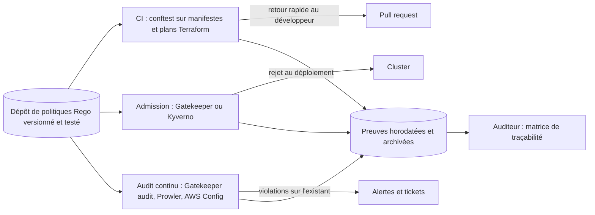

## Introduction

Les six chapitres précédents ont sécurisé chaque étape technique du pipeline : le code (SAST/SCA), le pipeline lui-même (secrets, runners), les images de conteneurs, le cluster Kubernetes et la chaîne d'approvisionnement (SBOM, signature). Il manque une dernière pièce, transversale à toutes les autres : comment prouver, en continu et de façon vérifiable, que ces contrôles sont réellement appliqués — pas seulement documentés dans un classeur d'audit consulté une fois par an ?

C'est le rôle de la conformité as code. Une exigence réglementaire (« les conteneurs doivent limiter leur consommation mémoire », « le chiffrement au repos est obligatoire », « les accès administrateur sont journalisés ») cesse d'être une phrase dans un document PDF pour devenir une règle exécutable, évaluée automatiquement à chaque déploiement, avec un résultat binaire : conforme ou rejeté. Ce chapitre introduit Open Policy Agent (OPA) et son langage Rego comme moteur de policy as code, montre comment traduire des référentiels comme ISO 27001 ou PCI-DSS en contrôles automatisés, puis referme la boucle : où se situe une organisation sur l'échelle de maturité DevSecOps, et qu'est-ce que ce cours de sept chapitres a réellement construit depuis le premier chapitre sur le shift-left ?

Ce chapitre ne présente pas de nouvelle surface d'attaque à exploiter : c'est un chapitre de gouvernance et de synthèse, qui donne le vocabulaire et le cadre pour discuter de maturité DevSecOps avec une équipe de direction aussi bien qu'avec une équipe technique.

## Policy as code avec Open Policy Agent et Rego

Open Policy Agent est un moteur de politique générique, indépendant de la plateforme qu'il contrôle : il peut évaluer des requêtes API, des manifestes Kubernetes, des plans Terraform ou des permissions cloud, tant que l'entrée est structurée (typiquement du JSON). Les règles sont écrites en **Rego**, un langage déclaratif inspiré de Datalog : on ne décrit pas *comment* vérifier, mais *quelles conditions* rendent une ressource non conforme.

```rego
package kubernetes.admission

# Refuse tout déploiement dont un conteneur n'a pas de resources.limits défini
deny contains msg if {
  input.request.kind.kind == "Pod"
  some container in input.request.object.spec.containers
  not container.resources.limits
  msg := sprintf(
    "Le conteneur '%v' doit définir resources.limits (mémoire et CPU)",
    [container.name]
  )
}

# Refuse également les limits vides ou partielles (CPU sans mémoire, ou l'inverse)
deny contains msg if {
  input.request.kind.kind == "Pod"
  some container in input.request.object.spec.containers
  container.resources.limits
  not container.resources.limits.memory
  msg := sprintf(
    "Le conteneur '%v' définit des limits mais oublie 'memory'",
    [container.name]
  )
}
```

Une précision de syntaxe importante. Depuis **OPA 1.0** (décembre 2024), la syntaxe dite « Rego v1 » est la syntaxe par défaut : les mots-clés `if` et `contains` sont obligatoires, et une règle de refus s'écrit `deny contains msg if { ... }`. Tu rencontreras encore partout l'ancienne forme `deny[msg] { ... }`, dans les documentations, les dépôts existants et les ConstraintTemplates Gatekeeper : elle exprime exactement la même chose (un ensemble `deny` de messages), mais un moteur OPA 1.x la refuse, sauf avec l'option de compatibilité `--v0-compatible`. Retiens que dans les deux syntaxes, c'est la règle **`deny`** qui produit la liste des non-conformités, et que la ressource est rejetée dès que cet ensemble n'est pas vide.

Lis la règle comme une conjonction : toutes les lignes du corps doivent être vraies pour qu'un message soit ajouté. `some container in ...` parcourt chaque conteneur ; `not container.resources.limits` est vrai si le champ est absent. Il n'y a ni boucle ni condition `if` au sens impératif : Rego cherche toutes les combinaisons qui rendent le corps vrai.

Cette règle s'intègre au cluster comme webhook d'admission via **Gatekeeper** (le contrôleur OPA natif Kubernetes déjà évoqué au chapitre 5) : chaque `kubectl apply` déclenche une évaluation, et un pod sans limites de ressources est rejeté avant même d'être créé — pas détecté après coup par un scan périodique.

```bash
# Tester une règle Rego localement avant de la déployer en admission controller
opa eval --format pretty --input pod-sans-limits.json --data policy.rego "data.kubernetes.admission.deny"
```

```text
[
  "Le conteneur 'api' doit définir resources.limits (mémoire et CPU)"
]
```

Les règles se testent aussi comme du code, avec des tests unitaires écrits en Rego et exécutés par `opa test` :

```rego
# policy_test.rego
package kubernetes.admission

test_pod_sans_limits_refuse if {
  count(deny) == 1 with input as {"request": {"kind": {"kind": "Pod"},
    "object": {"spec": {"containers": [{"name": "api"}]}}}}
}

test_pod_avec_limits_accepte if {
  count(deny) == 0 with input as {"request": {"kind": {"kind": "Pod"},
    "object": {"spec": {"containers": [{"name": "api",
      "resources": {"limits": {"cpu": "500m", "memory": "256Mi"}}}]}}}}
}
```

```bash
opa test . -v
```

```text
policy_test.rego:
data.kubernetes.admission.test_pod_sans_limits_refuse: PASS (1.2ms)
data.kubernetes.admission.test_pod_avec_limits_accepte: PASS (0.9ms)
--------------------------------------------------------------------------------
PASS: 2/2
```

### Déployer la règle dans Gatekeeper

Dans Gatekeeper, la règle est embarquée dans une **ConstraintTemplate**, qui crée un nouveau type d'objet, puis activée par une **Constraint** qui en fixe le périmètre. Gatekeeper attend une règle nommée `violation` et fournit la ressource dans `input.review.object` :

```yaml
apiVersion: templates.gatekeeper.sh/v1
kind: ConstraintTemplate
metadata:
  name: k8srequiredlimits
spec:
  crd:
    spec:
      names:
        kind: K8sRequiredLimits
  targets:
    - target: admission.k8s.gatekeeper.sh
      rego: |
        package k8srequiredlimits
        violation[{"msg": msg}] {
          container := input.review.object.spec.containers[_]
          not container.resources.limits
          msg := sprintf("Le conteneur '%v' doit définir resources.limits", [container.name])
        }
---
apiVersion: constraints.gatekeeper.sh/v1beta1
kind: K8sRequiredLimits
metadata:
  name: pods-must-have-limits
spec:
  enforcementAction: deny        # dryrun ou warn pour un déploiement progressif
  match:
    kinds:
      - apiGroups: [""]
        kinds: ["Pod"]
    excludedNamespaces: ["kube-system"]
```

Le champ `enforcementAction` permet un déploiement progressif : `dryrun` n'enregistre que les violations, `warn` avertit l'utilisateur sans bloquer, `deny` rejette. Gatekeeper dispose aussi d'une fonction d'**audit** qui réévalue périodiquement les ressources déjà présentes dans le cluster et liste les violations dans le statut de la Constraint : c'est ainsi qu'on découvre les objets créés avant l'activation d'une règle.

<CehCallout>
Un cluster sans limites de ressources imposées est vulnérable à une attaque par épuisement de ressources (resource exhaustion) : un seul pod compromis ou mal configuré peut consommer toute la mémoire d'un nœud et provoquer un déni de service sur les workloads voisins — la règle Rego ci-dessus n'est donc pas qu'une bonne pratique d'hygiène, c'est un contrôle de disponibilité.
</CehCallout>

<TipCallout>
Développe et teste tes règles Rego avec `opa eval` et `opa test` en local, ou dans le Rego Playground en ligne (play.openpolicyagent.org), avant de les déployer comme `ConstraintTemplate` Gatekeeper en production — une règle mal écrite en mode `deny` (par opposition à `warn`) peut bloquer un déploiement légitime en pleine urgence de production.
</TipCallout>

## Compliance as code : d'ISO 27001 à un contrôle exécutable

Un audit de conformité traditionnel se déroule une à deux fois par an : un auditeur externe échantillonne quelques serveurs, interroge quelques ingénieurs, produit un rapport de plusieurs dizaines de pages, et signale des écarts déjà anciens de plusieurs mois au moment de leur lecture. Entre deux audits, rien ne garantit que la configuration observée le jour de l'audit reste valable la semaine suivante.

La compliance as code inverse cette logique : chaque exigence d'un référentiel devient une règle testée à chaque déploiement, avec une preuve d'exécution horodatée et archivée automatiquement.

<CompareTable
  titleA="Exigence du référentiel"
  titleB="Contrôle automatisé équivalent"
  rows={[
    { a: "ISO 27001, A.8.24 — chiffrement des données au repos", b: "Règle Rego rejetant tout bucket de stockage ou volume créé sans chiffrement activé (`encryption: enabled` dans le manifeste d'infrastructure)" },
    { a: "PCI-DSS, exigence 2.2 — configurations durcies, pas de comptes par défaut", b: "Scan d'image (chapitre 4) bloquant toute image encore construite avec un utilisateur `root` par défaut" },
    { a: "PCI-DSS, exigence 10 — traçabilité de tous les accès aux données de cartes", b: "Politique Kubernetes exigeant l'annotation d'audit logging sur tout namespace manipulant des données de paiement" },
    { a: "ISO 27001, A.8.9 — gestion des configurations", b: "Admission controller refusant tout déploiement dont le manifeste diffère du modèle versionné en Git (dérive de configuration)" },
    { a: "ISO 27001, A.8.32 — gestion des changements", b: "Protection de branche exigeant revue et CI verte, preuve conservée dans l'historique des pull requests" },
    { a: "ISO 27001, A.8.15 — journalisation", b: "Règle refusant un cluster ou un compte cloud sans journal d'audit activé et exporté" },
  ]}
/>

Les numéros cités sont ceux de l'**ISO/IEC 27001:2022**, dont l'Annexe A regroupe 93 mesures en quatre thèmes (A.5 organisationnelles, A.6 liées aux personnes, A.7 physiques, A.8 technologiques) ; la numérotation de l'édition 2013 (A.12, A.14…) n'est plus en vigueur. Côté paiement, la version applicable est **PCI DSS 4.0.1**, dont les exigences initialement datées pour l'avenir sont obligatoires depuis le 31 mars 2025. En Europe, **NIS2** (transposée dans les droits nationaux à partir d'octobre 2024) et **DORA** (applicable au secteur financier depuis le 17 janvier 2025) exigent elles aussi une gestion des risques documentée, une gestion des changements et une capacité à démontrer l'efficacité des mesures : autant d'exigences pour lesquelles une preuve automatisée vaut mieux qu'une déclaration.

```rego
# Exemple : exiger un chiffrement au repos par clé KMS gérée (plan Terraform en entrée)
# Entrée produite par : terraform show -json tfplan > plan.json
package terraform.compliance

deny contains msg if {
  some rc in input.resource_changes
  rc.type == "aws_s3_bucket_server_side_encryption_configuration"
  some rule in rc.change.after.rule
  some def in rule.apply_server_side_encryption_by_default
  def.sse_algorithm != "aws:kms"
  msg := sprintf(
    "%v : chiffrement SSE-KMS obligatoire (ISO 27001 A.8.24), trouvé %v",
    [rc.address, def.sse_algorithm]
  )
}
```

Deux remarques d'exactitude. Depuis la version 4 du provider AWS pour Terraform, le chiffrement d'un bucket se déclare dans une ressource séparée, `aws_s3_bucket_server_side_encryption_configuration`, et non plus dans un bloc du bucket lui-même : une règle qui cherche l'ancien bloc ne détecterait plus rien. Par ailleurs, AWS chiffre par défaut tous les nouveaux objets S3 avec des clés gérées par S3 depuis janvier 2023 ; l'exigence pertinente devient donc souvent l'usage d'une clé KMS maîtrisée par l'organisation, ce que vérifie la règle ci-dessus. Une règle de conformité doit suivre l'évolution des plateformes, exactement comme un test unitaire suit le code.

<AuditCallout>
Documente explicitement, dans le code de chaque règle (commentaire ou métadonnée), l'exigence du référentiel qu'elle traduit — un auditeur externe doit pouvoir relire le dépôt de règles Rego comme une matrice de traçabilité vivante, plutôt que de devoir croire sur parole qu'une règle technique correspond bien à un contrôle exigé par la norme.
</AuditCallout>

## Automatiser l'audit de conformité en continu

Une fois les règles écrites, l'audit cesse d'être un événement ponctuel pour devenir un flux continu de preuves. Trois briques rendent cela concret en pipeline :

Le schéma suivant montre les trois moments où la même politique s'applique, et le flux de preuves qui en résulte.



Attention à un détail qui piège souvent : **conftest ne reçoit pas une requête d'admission**, mais le document YAML brut. Les règles destinées à conftest testent donc `input.kind` et `input.spec...`, et sont placées par défaut dans le package `main` :

```rego
# policies/limits.rego — version pour conftest (entrée = manifeste brut)
package main

deny contains msg if {
  input.kind == "Deployment"
  some container in input.spec.template.spec.containers
  not container.resources.limits.memory
  msg := sprintf("Deployment %v : le conteneur '%v' doit définir une limite mémoire", [input.metadata.name, container.name])
}
```

```text
$ conftest test --policy policies/ k8s-manifest.yaml
FAIL - k8s-manifest.yaml - main - Deployment api : le conteneur 'api' doit définir une limite mémoire

1 test, 0 passed, 0 warnings, 1 failure, 0 exceptions
```

```yaml
# Extrait de pipeline : gate de conformité avant tout déploiement en production
compliance-gate:
  stage: pre-deploy
  script:
    # Évalue le manifeste Kubernetes contre l'ensemble des règles de conformité
    - conftest test --policy policies/ k8s-manifest.yaml
    # Génère un rapport d'audit horodaté, archivé indépendamment du pipeline
    - opa eval --format json --data policies/ --input k8s-manifest.yaml "data" > audit-report-$(date +%Y%m%d).json
  artifacts:
    paths:
      - audit-report-*.json
    expire_in: 5 years  # conservation exigée par certains référentiels
```

`conftest` applique des règles Rego à des fichiers de configuration (Kubernetes, Terraform, Dockerfile) directement en pipeline, avant tout déploiement — c'est le même moteur qu'un admission controller, mais exécuté plus tôt (« shift-left » appliqué à la conformité elle-même, et non plus seulement à la sécurité applicative).

<WarningCallout>
Un contrôle de conformité exécuté uniquement en pipeline CI/CD (`conftest`) ne protège pas contre une modification directe des ressources en cluster (`kubectl edit` par un opérateur avec accès direct) — c'est précisément pour cette raison que l'admission controller (évalué au moment de la création réelle de la ressource) reste la couche de contrôle qui fait foi, le contrôle en pipeline n'étant qu'un retour rapide au développeur.
</WarningCallout>

Pour les plans d'infrastructure, des outils spécialisés embarquent des centaines de règles prêtes à l'emploi, alignées sur les benchmarks CIS : **Checkov** et `trivy config` pour Terraform, CloudFormation ou Kubernetes, et pour l'infrastructure cloud déjà déployée, **Prowler** (open source, AWS, Azure, GCP et Kubernetes) ou les services natifs comme AWS Config. Ils couvrent l'essentiel des contrôles génériques ; les règles Rego maison servent alors à encoder ce qui est propre à l'organisation.

L'archivage systématique des résultats d'évaluation transforme chaque déploiement en preuve d'audit : au lieu de reconstituer a posteriori l'état du système au moment d'un contrôle annuel, l'organisation dispose d'un historique complet et daté, consultable en quelques secondes par requête plutôt qu'en semaines d'entretiens.

## La maturité DevSecOps d'une organisation

<AuditCallout>
La maturité DevSecOps se mesure rarement à l'outillage seul — deux organisations peuvent utiliser les mêmes scanners avec des niveaux de maturité radicalement différents selon ce qu'elles font des résultats. Quatre niveaux, en progression :

**Niveau 1 — Sécurité en fin de cycle** : un audit de sécurité (souvent un pentest externe) intervient juste avant la mise en production, parfois après. Les vulnérabilités trouvées bloquent ou retardent la sortie, créant une tension structurelle entre les équipes sécurité et les équipes produit. Aucune automatisation ; la sécurité est un jalon, pas un processus.

**Niveau 2 — Contrôles automatisés mais cloisonnés** : SAST, DAST et SCA tournent en CI (chapitre 3), les images sont scannées (chapitre 4), mais chaque outil produit une alerte isolée, souvent ignorée faute de contexte ou de priorisation claire. La sécurité est automatisée mais pas intégrée : elle ralentit sans nécessairement réduire le risque, car le volume d'alertes dépasse la capacité de traitement des équipes.

**Niveau 3 — Sécurité intégrée au workflow de développement** : les résultats des scanners sont priorisés, contextualisés (une CVE critique sur une dépendance jamais appelée en production pèse moins qu'une CVE moyenne sur un chemin exposé à internet), et remontent directement dans le flux de travail des développeurs plutôt que dans un tableau de bord séparé consulté par la seule équipe sécurité.

**Niveau 4 — Sécurité continue et automatisée (compliance as code)** : la conformité elle-même est codifiée et vérifiée à chaque déploiement, comme décrit dans ce chapitre — l'organisation n'attend plus un audit annuel pour découvrir un écart, elle le détecte et le bloque au moment où il se produit. Les métriques de sécurité (temps moyen de remédiation, taux de règles de conformité respectées) sont suivies au même titre que les métriques de disponibilité ou de performance.

La progression du niveau 1 au niveau 4 ne se mesure pas en mois d'implémentation d'outils, mais en changement culturel : au niveau 4, un ingénieur ne perçoit plus la conformité comme un obstacle imposé de l'extérieur, mais comme une caractéristique du système au même titre que la scalabilité ou la disponibilité.
</AuditCallout>

## Erreurs fréquentes

La première erreur est d'**activer une politique directement en mode `deny` en production** : des déploiements légitimes, parfois des correctifs urgents, se retrouvent bloqués. Commence en `dryrun` ou `warn`, mesure l'impact, corrige l'existant, puis bascule. La deuxième est de **ne tester les règles qu'en CI** : sans admission controller, un `kubectl apply` manuel contourne tout.

On voit aussi des **règles jamais testées**, qui ne détectent rien parce qu'elles ciblent un champ qui n'existe plus (comme l'ancien bloc de chiffrement S3), et des **règles sans traçabilité** vers l'exigence qu'elles implémentent, inutilisables en audit. Autre confusion fréquente, **écrire une même règle pour conftest et pour Gatekeeper** sans tenir compte de la forme différente de l'entrée. Enfin, beaucoup d'organisations **confondent conformité et sécurité** : être conforme à un référentiel est un plancher, pas une garantie que le système résiste à un attaquant déterminé.

## Lab — Mise en Pratique

**Environnement** : Kali Linux (terminal Nyx Shell) — cluster Kubernetes de démonstration avec OPA Gatekeeper installé

<Steps steps={[
  { title: "Écrire une règle Rego locale", description: "Crée le fichier de politique refusant les pods sans resources.limits, dans la syntaxe Rego v1 attendue par OPA 1.x.", code: "cat > policy.rego <<'EOF'\npackage kubernetes.admission\n\ndeny contains msg if {\n  input.request.kind.kind == \"Pod\"\n  some container in input.request.object.spec.containers\n  not container.resources.limits\n  msg := sprintf(\"Le conteneur '%v' doit définir resources.limits\", [container.name])\n}\nEOF" },
  { title: "Préparer une entrée d'admission de test", description: "Crée un fichier JSON qui imite la partie utile d'une requête d'admission Kubernetes pour un pod sans limites.", code: "cat > pod-sans-limits.json <<'EOF'\n{\"request\": {\"kind\": {\"kind\": \"Pod\"}, \"object\": {\"spec\": {\"containers\": [{\"name\": \"api\", \"image\": \"nginx:1.27\"}]}}}}\nEOF" },
  { title: "Tester la règle sur un manifeste non conforme", description: "Évalue localement, sans toucher au cluster, si un pod donné serait rejeté. Ajoute ensuite des limits dans le JSON et vérifie que l'ensemble deny devient vide.", code: "opa eval --format pretty --input pod-sans-limits.json --data policy.rego \"data.kubernetes.admission.deny\"" },
  { title: "Écrire des tests unitaires de la politique", description: "Ajoute le fichier policy_test.rego présenté dans le chapitre et exécute la suite de tests.", code: "opa test . -v" },
  { title: "Déployer la règle comme ConstraintTemplate Gatekeeper", description: "Applique la ConstraintTemplate et la Constraint du chapitre (d'abord avec enforcementAction: dryrun, puis deny) pour qu'elles s'exécutent à chaque déploiement.", code: "kubectl apply -f constraint-template-resource-limits.yaml\nkubectl get k8srequiredlimits pods-must-have-limits -o yaml" },
  { title: "Vérifier le rejet en conditions réelles", description: "Tente de déployer un pod sans limites et observe le rejet par l'admission controller.", code: "kubectl apply -f pod-sans-limits.yaml" },
  { title: "Générer une preuve d'audit avec conftest", description: "Évalue un manifeste conforme et archive le rapport comme preuve de conformité continue.", code: "conftest test --policy policies/ k8s-manifest-conforme.yaml --output json > audit-report.json" },
]} />

## À retenir

- La policy as code transforme une exigence écrite en règle exécutable, testée (`opa test`) et versionnée, appliquée à chaque déploiement.
- Depuis OPA 1.0, la syntaxe Rego v1 (`deny contains msg if`) est la norme ; l'ancienne forme `deny[msg]` reste très présente dans l'existant et dans Gatekeeper (`violation`).
- La même politique s'applique à trois moments : en CI avec conftest (entrée = manifeste brut), à l'admission avec Gatekeeper ou Kyverno (la couche qui fait foi), et en audit continu sur l'existant.
- Chaque règle doit référencer l'exigence qu'elle implémente (ISO 27001:2022 A.8.x, PCI DSS 4.0.1, NIS2, DORA) et suivre l'évolution des plateformes.
- Les politiques se déploient progressivement : `dryrun`, puis `warn`, puis `deny`.
- La maturité DevSecOps se mesure à l'intégration des résultats dans le travail quotidien et à la vitesse de remédiation, pas au nombre d'outils.

## Synthèse du cours

Ce chapitre referme la boucle sur les sept chapitres du cours DevSecOps Avancé :

- **Chapitre 1** a posé les fondations conceptuelles (shift-left, threat modeling STRIDE appliqué au pipeline lui-même).
- **Chapitre 2** a durci le pipeline CI/CD et la gestion des secrets — le premier périmètre attaqué une fois le principe du shift-left admis.
- **Chapitre 3** a intégré des gates automatisés (SAST, DAST, SCA) directement dans le pipeline plutôt qu'en audit externe ponctuel.
- **Chapitre 4** a sécurisé les images de conteneurs, de la construction au scan de vulnérabilités.
- **Chapitre 5** a étendu ces contrôles au cluster Kubernetes lui-même (RBAC, network policies, admission controllers).
- **Chapitre 6** a remonté toute la chaîne d'approvisionnement (SBOM, signature Sigstore/cosign, niveaux SLSA).
- **Ce chapitre 7** généralise le principe d'admission controller du chapitre 5 à la conformité réglementaire entière (policy as code avec OPA/Rego), transformant l'audit annuel manuel en vérification continue, et situe cette progression sur une échelle de maturité DevSecOps en quatre niveaux.

Ce cours est le second volet d'un diptyque : *DevOps Fondamentaux* a construit l'infrastructure automatisée — pipelines, conteneurs, orchestration, infrastructure as code. *DevSecOps Avancé* a repris chacune de ces briques, une par une, pour y injecter un contrôle de sécurité vérifiable à chaque étape, jusqu'à la conformité elle-même. Le résultat n'est pas une liste d'outils supplémentaires empilés sur l'existant, mais une transformation du sens même de « livrer en production » : un déploiement qui passe tous les gates de ce cours n'est pas seulement fonctionnel, il est prouvé conforme, tracé et signé, au moment même où il se produit — pas six mois plus tard lors d'un audit.

## Questions de Révision

1. Pourquoi une règle Rego en mode `deny` sur un admission controller Kubernetes offre-t-elle une garantie que la même règle exécutée uniquement en pipeline CI/CD (`conftest`) n'offre pas ?
2. Donne un exemple de traduction d'une exigence PCI-DSS ou ISO 27001 en règle automatisée, et explique pourquoi cette traduction est plus fiable qu'un audit annuel.
3. Quelle est la différence essentielle entre le niveau 2 (contrôles automatisés mais cloisonnés) et le niveau 3 (sécurité intégrée) de maturité DevSecOps ?
4. En quoi l'archivage systématique des rapports d'évaluation OPA transforme-t-il chaque déploiement en preuve d'audit ?
5. Pourquoi dit-on que la conformité as code applique le principe du shift-left à la conformité elle-même, et pas seulement à la sécurité applicative ?
6. En une phrase, comment ce cours DevSecOps Avancé se positionne-t-il par rapport à DevOps Fondamentaux ?
7. Réécris la règle `deny[msg] { ... }` du chapitre dans la syntaxe Rego v1 et explique pourquoi un moteur OPA 1.x refuse l'ancienne forme.
8. Pourquoi une règle conçue pour Gatekeeper ne fonctionne-t-elle pas telle quelle avec conftest, et comment l'adapter ?
9. Comment déploierais-tu une nouvelle politique d'admission sur un cluster de production existant sans bloquer les équipes ?
