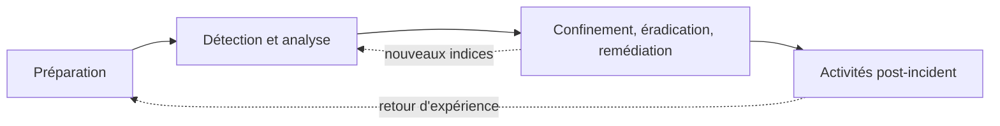

## Introduction

Le DFIR, pour *Digital Forensics and Incident Response*, réunit deux disciplines complémentaires. La **réponse à incident** consiste à agir vite pour contenir une menace active : couper un accès, isoler une machine, bloquer une adresse. La **forensique numérique** consiste à comprendre en détail ce qui s'est passé, avec un niveau de rigueur suffisant pour que les conclusions puissent être présentées à une direction, à un assureur, à une autorité de contrôle ou à un juge.

Concrètement, un analyste DFIR répond à quelques questions simples en apparence : comment l'attaquant est-il entré, quand, qu'a-t-il fait, jusqu'où est-il allé, est-il encore présent, et quelles données ont été touchées ? Chacune de ces réponses doit s'appuyer sur des preuves, pas sur une impression.

Ce cours part du principe posé au chapitre 5 du cours Droit et Réglementation : une investigation techniquement brillante mais mal menée sur le plan de la preuve n'a aucune valeur. À la fin de ce chapitre, tu sauras distinguer les deux temporalités du DFIR, situer les cadres de référence (NIST, SANS), appliquer l'ordre de volatilité, et organiser une investigation comme une démarche scientifique : des questions, des hypothèses, des preuves, des conclusions graduées.

## Le vocabulaire de base

Avant d'aller plus loin, fixons quelques termes qui reviendront dans tout le cours.

Un **événement** est toute occurrence observable sur un système ou un réseau : une connexion, la création d'un fichier, une requête DNS. Un **incident** est un événement, ou un ensemble d'événements, qui menace réellement la confidentialité, l'intégrité ou la disponibilité d'un système ou de ses données, ou qui viole une politique de sécurité. Tous les événements ne sont pas des incidents, et une grande partie du travail de triage consiste justement à faire le tri.

Un **artefact** est une trace laissée par une activité sur un système : une entrée de registre, un fichier Prefetch, une ligne de journal, une structure en mémoire. Un **indicateur de compromission** (IOC, *Indicator of Compromise*) est un artefact précis associé à une activité malveillante connue : le hash d'un fichier, une adresse IP de serveur de commande, un nom de domaine. Un **indicateur d'attaque** (IOA) décrit plutôt un comportement, par exemple un client de messagerie qui lance un interpréteur de commandes, indépendamment des fichiers utilisés.

Enfin, la **chaîne de custody** (chaîne de conservation) est la documentation qui retrace qui a manipulé une preuve, quand, comment et pourquoi. Elle est traitée en détail dans le cours Droit et Réglementation et sera appliquée concrètement au chapitre 2.

## Réponse à incident et forensique, deux temporalités différentes

<CompareTable
  titleA="Réponse à incident (Incident Response)"
  titleB="Forensique numérique (Digital Forensics)"
  rows={[
    { a: "Objectif : contenir et éradiquer rapidement", b: "Objectif : comprendre précisément ce qui s'est passé" },
    { a: "Échelle de temps : minutes à heures", b: "Échelle de temps : heures à semaines" },
    { a: "Peut accepter des compromis pour restaurer le service", b: "Exige la préservation stricte de l'intégrité des preuves" },
    { a: "Piloté par le SOC et l'équipe CSIRT (cours Analyse SOC)", b: "Piloté par des analystes DFIR spécialisés" },
    { a: "Livrable : un système assaini et un service rétabli", b: "Livrable : une chronologie étayée et un rapport défendable" },
  ]}
/>

Dans la réalité, les deux activités se déroulent en parallèle et s'alimentent mutuellement. La forensique fournit à la réponse à incident les indicateurs nécessaires pour trouver toutes les machines touchées ; la réponse à incident fournit à la forensique les premières alertes et le contexte. Le danger survient quand l'une écrase l'autre sans décision consciente.

### Contenir ou préserver, un arbitrage explicite

Prenons un serveur sur lequel un rançongiciel est en train de chiffrer des fichiers. L'équipe d'exploitation veut le redémarrer ou l'éteindre immédiatement. C'est compréhensible, mais le redémarrage efface la mémoire vive, qui peut contenir le processus malveillant, ses connexions vers le serveur de commande, parfois même des clés de chiffrement. Une fois la machine éteinte, ces preuves sont perdues définitivement.

Plusieurs options intermédiaires existent : isoler la machine du réseau (débrancher le câble, appliquer une règle de quarantaine depuis l'EDR) tout en la laissant allumée, faire un dump de la mémoire en quelques minutes, puis seulement l'éteindre. Dans certains cas, l'urgence opérationnelle l'emporte, par exemple si le chiffrement se propage à des partages réseau critiques. L'important est que la décision soit prise consciemment, par une personne habilitée, et consignée dans le carnet d'investigation.

<TipCallout>
Prépare cette décision à froid : un runbook de réponse à incident devrait préciser, par type de système, qui peut ordonner une extinction, dans quels cas on privilégie l'isolement réseau, et quelle procédure d'acquisition mémoire lancer avant toute action destructrice. Le jour de l'incident, personne ne raisonne bien sous la pression.
</TipCallout>

## Les cadres de référence de la réponse à incident

### Le cycle NIST SP 800-61 révision 2

Le document du NIST le plus cité en réponse à incident est le guide SP 800-61. Sa révision 2, publiée en 2012, décrit un cycle en quatre phases qui reste le modèle mental le plus répandu dans les équipes et dans les certifications.



La **préparation** regroupe tout ce qui est fait avant l'incident : outils, procédures, journalisation, formation. La **détection et analyse** consiste à repérer l'incident et à en comprendre la nature et l'étendue. Le **confinement, l'éradication et la remédiation** visent à stopper la propagation, à supprimer la présence de l'attaquant et à restaurer les systèmes. Les **activités post-incident** produisent le retour d'expérience qui améliore la préparation. Les flèches de retour sont essentielles : pendant le confinement, on découvre souvent de nouveaux indices qui relancent l'analyse.

### La révision 3 alignée sur le NIST CSF 2.0

En avril 2025, le NIST a publié la révision 3 du SP 800-61. Elle ne remplace pas le bon sens du cycle précédent, mais elle replace la réponse à incident dans l'ensemble de la gestion des risques, en s'appuyant sur les six fonctions du NIST Cybersecurity Framework 2.0 : Govern (gouverner), Identify (identifier), Protect (protéger), Detect (détecter), Respond (répondre) et Recover (rétablir). Les trois premières fonctions correspondent à la préparation ; les trois dernières couvrent la détection, la réponse et le rétablissement. Le message principal est que la réponse à incident n'est pas une activité isolée du SOC, mais une capacité de toute l'organisation, pilotée par la direction.

<CehCallout>
Pour les examens (CEH v13, Security+, GCIH), retiens les quatre phases du cycle NIST SP 800-61r2 : préparation, détection et analyse, confinement-éradication-remédiation, activités post-incident. Sache aussi que la révision 3 de 2025 aligne la réponse à incident sur les six fonctions du CSF 2.0, avec la fonction Govern ajoutée en 2024. Ce même cadre réapparaît au chapitre 4 du cours Rédaction de Rapports, vu sous l'angle du livrable.
</CehCallout>

### Le modèle SANS PICERL

Le SANS Institute utilise un découpage en six étapes, souvent désigné par l'acronyme PICERL : *Preparation*, *Identification*, *Containment*, *Eradication*, *Recovery*, *Lessons learned*. Il dit la même chose que le NIST, avec un grain plus fin sur la phase centrale.

| Cycle NIST SP 800-61r2 | Modèle SANS PICERL | Fonctions CSF 2.0 (SP 800-61r3) |
| --- | --- | --- |
| Préparation | Preparation | Govern, Identify, Protect |
| Détection et analyse | Identification | Detect, et début de Respond |
| Confinement, éradication, remédiation | Containment, Eradication, Recovery | Respond, Recover |
| Activités post-incident | Lessons learned | Amélioration continue, toutes fonctions |

Aucun modèle n'est meilleur que l'autre : choisis celui que ton organisation utilise et tiens-t'y, pour que tout le monde parle le même langage pendant la crise.

## Les principes fondamentaux de l'investigation forensique

<Steps steps={[
  { title: "Ne jamais travailler sur l'original", description: "Toute analyse se fait sur une copie forensique vérifiée par hash, jamais sur le système compromis lui-même (approfondi au chapitre 2)." },
  { title: "Documenter chaque action en temps réel", description: "Un carnet d'investigation daté et détaillé, rempli au fil de l'eau, pas une reconstitution de mémoire après coup." },
  { title: "Respecter l'ordre de volatilité", description: "Collecter d'abord les preuves les plus volatiles (mémoire vive, connexions réseau) avant les moins volatiles (disque, archives), car elles disparaissent les premières." },
  { title: "Corroborer, ne jamais présumer", description: "Une hypothèse d'investigation doit être confirmée par plusieurs sources de preuve indépendantes avant d'être présentée comme un fait." },
  { title: "Minimiser son empreinte", description: "Chaque commande exécutée sur un système vivant le modifie. Utiliser des outils de confiance, depuis un support externe, et noter tout ce qui a été lancé." },
]} />

### Le principe d'échange de Locard

En criminalistique classique, le principe d'Edmond Locard affirme que tout contact laisse une trace. En numérique, c'est la même chose : l'attaquant laisse des traces sur le système, mais l'enquêteur aussi. Lancer un outil sur une machine vivante crée un processus, modifie la mémoire, peut écrire un fichier Prefetch sous Windows. C'est inévitable lors d'une collecte à chaud ; ce qui compte, c'est de le savoir, de le limiter et de le documenter, pour pouvoir distinguer ensuite tes propres traces de celles de l'attaquant.

### L'ordre de volatilité

L'ordre de volatilité a été formalisé dans la RFC 3227, un document de l'IETF consacré aux bonnes pratiques de collecte de preuves. L'idée est simple : on collecte en premier ce qui disparaît le plus vite.

| Rang | Source de preuve | Durée de vie typique |
| --- | --- | --- |
| 1 | Registres et cache du processeur | Nanosecondes |
| 2 | Table de routage, cache ARP, table des processus, statistiques noyau, mémoire vive | Secondes à minutes, perdue à l'extinction |
| 3 | Fichiers temporaires et espace d'échange (swap, fichier d'échange) | Minutes à heures |
| 4 | Disque dur et SSD | Jours à années, mais modifié en continu |
| 5 | Journaux distants et données de supervision | Selon la rétention configurée |
| 6 | Configuration physique et topologie réseau | Longue |
| 7 | Supports d'archive (bandes, sauvegardes hors ligne) | Années |

En pratique, les registres du processeur ne sont pas collectables par un analyste. La règle opérationnelle devient donc : mémoire vive et état réseau d'abord, puis disque, puis journaux distants et sauvegardes.

<WarningCallout>
Sur un SSD moderne, la commande TRIM et le ramasse-miettes du contrôleur peuvent effacer physiquement des blocs libérés quelques secondes après une suppression. Le disque n'est donc pas aussi stable qu'on le croit : plus tu attends pour acquérir un SSD encore allumé, plus tu risques de perdre des fichiers supprimés récupérables.
</WarningCallout>

## L'investigation comme démarche scientifique

### Partir des bonnes questions

Une investigation sans question précise se noie dans les données. Avant de lancer le moindre outil, formule ce que tu cherches. Les questions de base sont toujours les mêmes : quel est le premier signe d'activité malveillante, quel est le vecteur d'accès initial, quels comptes ont été utilisés, quelles machines ont été touchées, y a-t-il eu persistance, des données ont-elles quitté le réseau, et l'attaquant est-il toujours présent ?

Chacune de ces questions se décline en hypothèses testables. Par exemple : « l'accès initial s'est fait par une pièce jointe piégée ouverte par l'utilisateur de PC-COMPTA-04 le 3 mars ». Cette hypothèse prédit des traces précises : un courriel avec pièce jointe dans la boîte de l'utilisateur, un processus de bureautique qui lance un processus enfant inhabituel, une connexion sortante peu après. Si ces traces existent dans plusieurs sources indépendantes, l'hypothèse est confirmée. Si elles n'existent pas, tu l'écartes ou tu la reformules.

### Graduer ses conclusions

Une conclusion n'est jamais binaire. Il est utile d'adopter une échelle de confiance explicite, par exemple : **confirmé** quand au moins deux sources indépendantes concordent, **probable** quand une seule source le montre sans contradiction, **possible** quand c'est cohérent avec les données mais sans preuve directe, **écarté** quand les données le contredisent. Cette échelle te servira directement au chapitre 8 pour rédiger le rapport.

<WarningCallout>
Un analyste qui formule une conclusion du type « c'est forcément un rançongiciel » avant d'avoir croisé plusieurs sources de preuve risque de biaiser toute la suite de son investigation : c'est le biais de confirmation. On ne cherche plus que ce qui conforte l'idée initiale. Chaque piste technique doit rester une hypothèse jusqu'à corroboration explicite.
</WarningCallout>

## Le triage et la collecte à chaud

Quand une machine suspecte est encore allumée, la première étape consiste souvent à capturer son état volatil avant toute autre action. Sous Linux, quelques commandes standard suffisent pour un premier instantané. L'exemple suivant est exécuté depuis un terminal, avec la sortie redirigée vers un support externe monté sur `/mnt/collecte`, pour ne pas écrire sur le disque suspect.

```bash
# Dossier de collecte sur un support externe (jamais sur le disque suspect)
CASE=/mnt/collecte/INC-2026-031
mkdir -p "$CASE"

# Heure système en UTC, pour caler toute la chronologie
date -u +"%Y-%m-%dT%H:%M:%SZ" > "$CASE/00_date_utc.txt"

# Interfaces et adresses (ip remplace l'ancien ifconfig)
ip -brief address > "$CASE/01_ip_addr.txt"

# Connexions TCP/UDP avec les processus associés (ss remplace netstat)
ss -tunap > "$CASE/02_connexions.txt"

# Arbre des processus avec leur ligne de commande complète
ps auxwf > "$CASE/03_processus.txt"

# Utilisateurs connectés et dernières connexions
who -a > "$CASE/04_who.txt"
last -F -n 50 > "$CASE/05_last.txt"

# Empreinte de chaque fichier collecté pour la chaîne de custody
sha256sum "$CASE"/*.txt > "$CASE/SHA256SUMS"
```

Voici à quoi peut ressembler un extrait du fichier de connexions sur une machine compromise. Repère la connexion établie vers une adresse externe sur un port inhabituel, portée par un processus au nom générique lancé depuis un répertoire temporaire.

```text
Netid State  Recv-Q Send-Q Local Address:Port   Peer Address:Port  Process
tcp   ESTAB  0      0      10.10.0.15:22        10.10.0.2:51544    users:(("sshd",pid=812,fd=4))
tcp   ESTAB  0      0      10.10.0.15:43918     203.0.113.47:8443  users:(("kworkerd",pid=2291,fd=3))
tcp   LISTEN 0      128    0.0.0.0:22           0.0.0.0:*          users:(("sshd",pid=640,fd=3))
```

Un processus nommé `kworkerd`, qui imite le nom des threads noyau `kworker`, mais qui possède une connexion réseau sortante, est un signal fort. Il ne prouve rien à lui seul : c'est une piste à corroborer avec la mémoire, le disque et les journaux.

Sous Windows, la même logique s'applique avec d'autres outils. Les équipes DFIR utilisent largement **Velociraptor**, une plateforme open source de collecte et de chasse à distance, et **KAPE**, un outil de collecte ciblée d'artefacts développé par Kroll. Ces outils permettent de collecter en quelques minutes les artefacts clés de dizaines de machines, ce qui est indispensable quand l'incident touche tout un parc.

## Préparer l'investigation avant l'incident

La qualité d'une investigation se joue en grande partie avant l'incident. Une organisation qui n'a pas de journaux ne pourra jamais reconstruire une chronologie, quel que soit le talent de l'analyste.

Les points de préparation essentiels sont les suivants. Toutes les machines doivent être synchronisées sur une source de temps fiable par NTP, sinon la corrélation devient un casse-tête. La journalisation doit être activée et centralisée : journaux de sécurité Windows avec audit avancé, ligne de commande des processus, journalisation PowerShell, et idéalement Sysmon. La rétention doit couvrir au moins plusieurs mois, car le délai moyen entre une compromission et sa détection se compte souvent en semaines. Une trousse d'intervention (*jump kit*) doit être prête : supports externes stériles, bloqueurs d'écriture, outils sur clé, formulaires de chaîne de custody. Enfin, la liste des contacts d'urgence, internes et externes (assureur, avocat, CERT, autorité de contrôle), doit être à jour.

<AuditCallout>
ISO/IEC 27001:2022 consacre plusieurs mesures de l'Annexe A à ce sujet : A.5.24 (planification et préparation de la gestion des incidents), A.5.25 (évaluation des événements et décision), A.5.26 (réponse aux incidents), A.5.27 (tirer des enseignements des incidents) et A.5.28 (collecte des preuves). Côté technique, A.8.15 traite de la journalisation et A.8.17 de la synchronisation des horloges. Un auditeur te demandera de montrer que ces mesures sont réellement appliquées, pas seulement écrites.
</AuditCallout>

## L'angle offensif : l'anti-forensique

Un attaquant expérimenté sait qu'il sera peut-être investigué et cherche à brouiller les pistes. Connaître ces techniques permet de les anticiper et de les repérer. Le référentiel MITRE ATT&CK les classe principalement sous la technique T1070, *Indicator Removal*.

<AttackDefenseTable rows={[
  { phase: "Effacement des journaux", attack: "Vider le journal Security Windows (T1070.001) ou supprimer des lignes de journaux Linux", defense: "Centraliser les journaux en temps réel dans un SIEM ; alerter sur l'Event ID 1102" },
  { phase: "Manipulation des dates", attack: "Modifier les horodatages d'un fichier pour le noyer dans les fichiers système (timestomping, T1070.006)", defense: "Comparer plusieurs sources temporelles : MFT, journal USN, Prefetch, journaux d'événements" },
  { phase: "Exécution en mémoire", attack: "Charger du code uniquement en mémoire sans fichier sur disque (T1620, chargement réflexif)", defense: "Acquérir la mémoire vive avant extinction ; EDR avec télémétrie mémoire" },
  { phase: "Suppression des outils", attack: "Effacer les binaires utilisés après usage (T1070.004)", defense: "Exploiter Prefetch, Amcache, journaux de création de processus, carving" },
  { phase: "Chiffrement des canaux", attack: "Communiquer en HTTPS vers une infrastructure légitime en apparence", defense: "Analyser les métadonnées réseau : SNI, empreintes JA4, régularité des connexions" },
]} />

Retiens que l'anti-forensique laisse elle-même des traces. Un journal vidé génère un événement, un fichier aux dates incohérentes se trahit par comparaison avec d'autres sources, et un trou dans une chronologie est en soi une information.

## Le carnet d'investigation

Le carnet d'investigation est le document le plus sous-estimé du DFIR. Il enregistre, au fil de l'eau et en heure UTC, chaque action, chaque commande, chaque constat et chaque décision. C'est lui qui permettra, des mois plus tard, de répondre à la question « comment savez-vous cela ? ».

```text
INC-2026-031 — Carnet d'investigation — Analyste : A. Mbemba

2026-03-12T08:41Z  Alerte EDR reçue : processus suspect sur SRV-WEB-02.
2026-03-12T08:47Z  Décision (RSSI, par téléphone) : isoler SRV-WEB-02 du réseau
                   via l'EDR, NE PAS éteindre. Isolement confirmé à 08:49Z.
2026-03-12T08:55Z  Acquisition mémoire lancée (avml), sortie vers /mnt/collecte.
2026-03-12T09:12Z  Acquisition terminée. SHA-256 = 3b9f...e21a (consigné en fiche).
2026-03-12T09:20Z  Hypothèse H1 : accès initial via la vulnérabilité de l'application
                   web exposée. À vérifier : journaux du serveur web, date du
                   premier processus enfant du service web.
```

Remarque la structure : l'horodatage, l'action, l'auteur de la décision, et la distinction claire entre ce qui est constaté et ce qui reste une hypothèse.

## Erreurs fréquentes

La première erreur est d'**éteindre ou redémarrer par réflexe** une machine compromise, ce qui détruit la mémoire vive sans qu'aucune décision n'ait été prise. La deuxième est d'**analyser directement sur la machine suspecte**, par exemple en ouvrant des fichiers avec l'explorateur, ce qui modifie les dates d'accès et crée de nouveaux artefacts. La troisième est de **ne rien noter** en pensant s'en souvenir : au bout de deux jours de crise, personne ne se rappelle à quelle heure telle action a été faite.

On rencontre aussi souvent le **mélange des fuseaux horaires**, quand une partie des horodatages est en heure locale et une autre en UTC, la **conclusion prématurée** sur la base d'un seul indice, et l'**oubli du périmètre** : on nettoie la machine où l'alerte est apparue sans chercher les autres machines touchées, et l'attaquant revient par une porte restée ouverte.

Enfin, une erreur stratégique fréquente consiste à **alerter l'attaquant** en agissant trop tôt et de façon partielle : si tu réinitialises un seul mot de passe alors que l'attaquant contrôle dix comptes, il saura qu'il est repéré et changera de méthode. Le confinement doit être coordonné.

## Lab — Mise en pratique

**Environnement** : Kali Linux (terminal Nyx), sans cible. Tu vas simuler une collecte à chaud documentée sur ta propre machine de lab, puis raisonner sur deux cas.

<Steps steps={[
  { title: "Créer un dossier d'affaire", description: "Crée un dossier d'investigation horodaté. Observe que le nom du dossier contient la date UTC, ce qui évite toute ambiguïté de fuseau.", code: "CASE=~/cases/INC-$(date -u +%Y%m%d-%H%M)\nmkdir -p \"$CASE\" && cd \"$CASE\" && pwd" },
  { title: "Démarrer un carnet d'investigation", description: "Crée une petite fonction qui ajoute une ligne horodatée en UTC au carnet. Utilise-la pour chaque action du lab.", code: "note() { echo \"$(date -u +%Y-%m-%dT%H:%M:%SZ)  $*\" >> \"$CASE/carnet.txt\"; }\nnote \"Ouverture du dossier, analyste: moi\"\ncat \"$CASE/carnet.txt\"" },
  { title: "Collecter l'état volatil", description: "Capture l'heure, les adresses, les connexions et les processus. Repère dans le fichier de connexions les processus qui ont une connexion établie.", code: "date -u > 00_date.txt\nip -brief address > 01_ip.txt\nss -tunap > 02_connexions.txt 2>&1\nps auxwf > 03_processus.txt\nnote \"Collecte volatile effectuée (date, ip, ss, ps)\"\ngrep ESTAB 02_connexions.txt" },
  { title: "Sceller la collecte par hash", description: "Calcule les empreintes SHA-256 de tous les fichiers collectés, puis vérifie-les. Chaque ligne doit afficher OK.", code: "sha256sum 0*.txt > SHA256SUMS\nnote \"Empreintes calculées\"\nsha256sum -c SHA256SUMS" },
  { title: "Simuler une altération", description: "Modifie un fichier collecté puis relance la vérification. Observe la ligne FAILED : c'est exactement ce qui se produit quand une preuve est altérée après collecte.", code: "echo 'ajout' >> 03_processus.txt\nsha256sum -c SHA256SUMS" },
  { title: "Arbitrer contenir ou préserver", description: "Raisonnement : un serveur de production semble compromis par un rançongiciel en cours de chiffrement. L'équipe IT veut le redémarrer immédiatement. Rédige dans ton carnet le risque pour l'investigation et la séquence d'actions que tu proposes (isolement, acquisition mémoire, puis extinction)." },
  { title: "Appliquer l'ordre de volatilité", description: "Classe ces sources de la plus volatile à la moins volatile : disque dur, mémoire vive, sauvegardes sur bande, table ARP, journaux centralisés dans le SIEM. Justifie chaque position dans ton carnet." },
]} />

## À retenir

- La réponse à incident vise à contenir vite, la forensique vise à comprendre avec rigueur ; les deux sont complémentaires et la tension entre contenir et préserver doit être arbitrée consciemment.
- Le cycle NIST SP 800-61r2 compte quatre phases : préparation, détection et analyse, confinement-éradication-remédiation, activités post-incident ; la révision 3 de 2025 l'aligne sur les six fonctions du NIST CSF 2.0.
- L'ordre de volatilité (RFC 3227) impose de collecter la mémoire vive et l'état réseau avant le disque, puis les journaux distants et les archives.
- On ne travaille jamais sur l'original, on documente tout en temps réel, et on corrobore chaque hypothèse avec plusieurs sources indépendantes.
- Une investigation est une démarche scientifique : des questions, des hypothèses testables, des preuves, des conclusions graduées par niveau de confiance.
- L'anti-forensique existe, mais elle laisse elle-même des traces que la corroboration permet de repérer.
- La qualité d'une investigation dépend de la préparation : synchronisation NTP, journalisation centralisée, rétention suffisante, trousse d'intervention prête.

## Questions de révision

1. Pourquoi redémarrer précipitamment un serveur compromis peut-il nuire gravement à une investigation forensique, et quelle alternative proposerais-tu ?
2. Quelles sont les quatre phases du cycle NIST SP 800-61r2, et qu'apporte la révision 3 publiée en 2025 ?
3. Pourquoi la mémoire vive doit-elle être collectée avant le disque dur lors d'une investigation ?
4. En quoi le principe d'échange de Locard s'applique-t-il aussi à l'enquêteur qui intervient sur une machine vivante ?
5. Formule une hypothèse testable sur un accès initial par courriel piégé, et cite trois traces que cette hypothèse prédit.
6. Pourquoi un trou inexpliqué dans une chronologie est-il une information, et pas une simple absence de données ?
7. Quelles mesures de préparation rendent possible une investigation fiable avant même qu'un incident survienne ?
