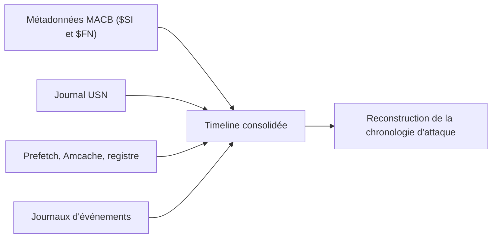

## Introduction

Malgré la montée en importance de l'analyse mémoire vue au chapitre 3, le disque reste une mine d'artefacts persistants : programmes exécutés, périphériques USB connectés, fichiers récemment ouverts, mécanismes de persistance, documents supprimés. Ces traces survivent souvent bien après que la mémoire vive a disparu au redémarrage, parfois pendant des mois.

L'analyse disque se fait toujours sur l'image acquise au chapitre 2, jamais sur l'original. À la fin de ce chapitre, tu sauras naviguer dans une image avec The Sleuth Kit, comprendre comment NTFS enregistre les fichiers et leurs dates, exploiter les artefacts Windows qui prouvent une exécution ou une présence, récupérer des fichiers supprimés et construire une première chronologie en repérant les dates falsifiées.

## Comprendre le système de fichiers NTFS

### La MFT, index de tout le volume

NTFS, le système de fichiers de Windows, repose sur une table centrale appelée **MFT** (*Master File Table*), stockée dans le fichier caché `$MFT` à la racine du volume. Chaque fichier et chaque dossier y possède au moins un **enregistrement** de 1 024 octets, identifié par un numéro. Cet enregistrement contient des **attributs** : le nom du fichier, ses dates, sa taille, ses droits, et l'emplacement de son contenu sur le disque. Pour les très petits fichiers, de quelques centaines d'octets, le contenu est même stocké directement dans l'enregistrement : on parle de données **résidentes**.

Quand un fichier est supprimé, son enregistrement MFT est marqué comme inutilisé, mais il n'est pas effacé immédiatement. Tant qu'il n'est pas réutilisé par un nouveau fichier, il reste lisible, avec le nom, les dates et parfois le contenu. C'est pourquoi la MFT contient souvent des traces de fichiers supprimés récemment.

### Deux jeux de dates : $STANDARD_INFORMATION et $FILE_NAME

Chaque enregistrement contient deux attributs qui stockent chacun quatre dates, abrégées **MACB** : *Modified* (contenu modifié), *Accessed* (dernier accès), *Changed* ou *entry Modified* (métadonnées de l'enregistrement MFT modifiées) et *Born* (création).

- L'attribut **$STANDARD_INFORMATION** (souvent abrégé $SI) contient les dates affichées par l'explorateur Windows. Il peut être modifié par des fonctions classiques de l'API Windows, donc par n'importe quel programme qui a les droits sur le fichier.
- L'attribut **$FILE_NAME** ($FN) contient aussi quatre dates, mais elles sont mises à jour par le noyau dans des circonstances plus limitées, par exemple lors d'une création, d'un renommage ou d'un déplacement. Elles sont beaucoup plus difficiles à falsifier avec les outils courants.

Cette dualité est la clé de la détection du *timestomping*, comme tu le verras plus loin. Note aussi que Windows ne met plus à jour systématiquement la date de dernier accès depuis Windows Vista, pour des raisons de performance : une date d'accès ancienne ne prouve donc pas qu'un fichier n'a pas été lu.

### Les journaux du système de fichiers et les flux alternatifs

NTFS tient deux journaux utiles à l'enquêteur. Le **journal USN** (`$Extend\$UsnJrnl`, flux `$J`) enregistre les changements de fichiers : création, renommage, suppression, modification, avec le nom et la date. Il permet souvent de prouver qu'un fichier a existé puis a été supprimé, même si son enregistrement MFT a été réutilisé. Le fichier `$LogFile` journalise les transactions sur les métadonnées et couvre une période plus courte.

Enfin, NTFS permet d'attacher à un fichier des **flux de données alternatifs** (ADS, *Alternate Data Streams*), invisibles dans l'explorateur. Le plus utile pour l'enquêteur est `Zone.Identifier`, ajouté par les navigateurs et les clients de messagerie aux fichiers téléchargés : c'est la marque *Mark of the Web*, qui indique la zone d'origine et parfois l'URL de téléchargement. À l'inverse, un attaquant peut cacher une charge utile dans un ADS (T1564.004).

## Naviguer dans une image avec The Sleuth Kit

**The Sleuth Kit** (TSK) est une boîte à outils open source en ligne de commande pour analyser les images disque. **Autopsy** en est l'interface graphique, avec des modules d'analyse automatique. Les outils TSK suivent une logique par couche : partition, système de fichiers, métadonnées, contenu.

| Commande | Couche | Rôle |
| --- | --- | --- |
| `mmls` | Partitions | Affiche la table de partitions (MBR ou GPT) et l'offset de début de chaque partition |
| `fsstat` | Système de fichiers | Détails du système de fichiers : type, taille des clusters, plages d'enregistrements |
| `fls` | Noms de fichiers | Liste les fichiers et dossiers, y compris les supprimés marqués d'un astérisque |
| `istat` | Métadonnées | Affiche un enregistrement précis : dates $SI et $FN, attributs, clusters |
| `icat` | Contenu | Extrait le contenu d'un fichier à partir de son numéro d'enregistrement |
| `tsk_recover` | Contenu | Récupère en masse les fichiers, supprimés par défaut ou tous avec l'option -a |

```bash
# Table de partitions : repérer l'offset (en secteurs) de la partition NTFS
mmls image.dd

# Lister récursivement les fichiers de la partition qui commence au secteur 2048
fls -o 2048 -r -p image.dd | grep -i -E 'prefetch|\.exe'

# Détails d'un enregistrement MFT, puis extraction de son contenu
istat -o 2048 image.dd 40213
icat -o 2048 image.dd 40213 > extrait.bin
```

```text
GUID Partition Table (EFI)
      Slot      Start        End          Length       Description
004:  000       0000002048   0001050623   0001048576   EFI system partition
005:  001       0001050624   0001312767   0000262144   Microsoft reserved partition
006:  002       0001312768   0499998719   0498685952   Basic data partition

r/r 40213-128-4:    Windows/Prefetch/MIMIKATZ.EXE-5F1A9C3B.pf
r/r * 51877-128-1:  Users/jdoe/AppData/Local/Temp/m.exe
```

La première ligne d'extrait de `fls` montre un fichier Prefetch encore présent. La seconde, marquée d'un astérisque, correspond à un fichier supprimé dont l'enregistrement MFT est encore lisible.

## Les artefacts Windows incontournables

Chaque artefact répond à une question précise. Certains prouvent qu'un programme **a été exécuté**, d'autres seulement qu'il **était présent**, d'autres encore qu'un utilisateur **a ouvert** un fichier ou un dossier. Confondre ces niveaux de preuve est une erreur classique.

| Artefact | Emplacement | Ce qu'il révèle |
| --- | --- | --- |
| Prefetch | `C:\Windows\Prefetch\*.pf` | Exécution d'un programme : nom, nombre d'exécutions, jusqu'à huit dernières dates d'exécution, fichiers chargés |
| Amcache | `C:\Windows\AppCompat\Programs\Amcache.hve` | Présence et souvent exécution de programmes, avec chemin et hash SHA-1 |
| ShimCache (AppCompatCache) | Ruche SYSTEM | Présence d'un exécutable sur le système ; depuis Windows 10, ne prouve pas à lui seul l'exécution |
| UserAssist | NTUSER.DAT de l'utilisateur | Programmes lancés depuis l'interface graphique, avec compteur et date ; noms encodés en ROT13 |
| Clés Run et RunOnce | `HKLM` et `HKCU\Software\Microsoft\Windows\CurrentVersion\Run` | Programmes lancés automatiquement : vecteur de persistance classique |
| Services | `HKLM\SYSTEM\CurrentControlSet\Services` | Services installés, dont ceux créés par un attaquant |
| Tâches planifiées | `C:\Windows\System32\Tasks` | Tâches créées pour la persistance ou l'exécution différée |
| Fichiers LNK et Jump Lists | Dossier Recent du profil utilisateur | Fichiers et dossiers ouverts, y compris sur des supports amovibles ou des partages |
| ShellBags | NTUSER.DAT et UsrClass.dat | Dossiers parcourus dans l'explorateur, même supprimés depuis |
| Historique USB | Ruche SYSTEM (USBSTOR, MountedDevices) et `setupapi.dev.log` | Périphériques USB connectés, numéros de série, premières connexions |
| SRUM | `C:\Windows\System32\sru\SRUDB.dat` | Consommation réseau et ressources par application sur environ un mois |
| Corbeille | `$Recycle.Bin\<SID>\` | Fichiers `$I` (nom d'origine, date de suppression) et `$R` (contenu) |
| Journaux d'événements | `C:\Windows\System32\winevt\Logs\*.evtx` | Connexions, processus, services, tâches : traités au chapitre 5 |

Les ruches de registre système (SAM, SECURITY, SOFTWARE, SYSTEM) se trouvent dans `C:\Windows\System32\config`, et la ruche propre à chaque utilisateur, NTUSER.DAT, à la racine de son profil.

<CehCallout>
Le fichier Prefetch d'un programme reste présent même après la suppression du programme lui-même. Un attaquant qui supprime son outil après usage laisse fréquemment une trace Prefetch révélant qu'il a bien été exécuté, avec le nombre d'exécutions et des horodatages précis. Nuance utile : le Prefetch est activé par défaut sur les postes de travail Windows, mais généralement pas sur Windows Server, où il faut s'appuyer sur d'autres artefacts.
</CehCallout>

### Les outils de référence pour les artefacts

Sous Windows, les **outils d'Eric Zimmerman**, gratuits et open source, sont devenus le standard de fait : PECmd pour le Prefetch, MFTECmd pour la MFT et le journal USN, AmcacheParser, AppCompatCacheParser, RECmd et Registry Explorer pour le registre, LECmd et JLECmd pour les raccourcis et les Jump Lists, et Timeline Explorer pour filtrer les résultats au format CSV. Sous Linux, **RegRipper** extrait les informations clés des ruches de registre, et Autopsy intègre de nombreux analyseurs.

```powershell
# Analyse de tous les fichiers Prefetch d'une image montée en lecture seule sur E:
PECmd.exe -d "E:\Windows\Prefetch" --csv C:\Analyse\Sortie

# Analyse de la MFT extraite
MFTECmd.exe -f "C:\Analyse\Extraits\$MFT" --csv C:\Analyse\Sortie
```

```text
Executable name: MIMIKATZ.EXE
Hash: 5F1A9C3B
Run count: 3
Last run: 2026-03-11 23:47:12
Other run times: 2026-03-11 23:41:05, 2026-03-11 23:40:58
Directories referenced: \VOLUME{...}\USERS\JDOE\APPDATA\LOCAL\TEMP
```

## Retrouver des fichiers supprimés

<Steps steps={[
  { title: "Comprendre la suppression NTFS", description: "Supprimer un fichier marque son enregistrement MFT et ses clusters comme libres, mais le contenu reste physiquement présent jusqu'à écrasement par de nouvelles données, sauf sur SSD avec TRIM." },
  { title: "Exploiter les métadonnées restantes", description: "fls et icat retrouvent les fichiers dont l'enregistrement MFT n'a pas encore été réutilisé ; le journal USN prouve qu'un fichier a existé même quand il ne reste plus rien d'autre." },
  { title: "Utiliser le carving de fichiers (file carving)", description: "Rechercher des signatures de formats connus, en-têtes et pieds de fichier, directement dans les données brutes ou dans l'espace non alloué, indépendamment du système de fichiers." },
  { title: "Examiner la corbeille et ses métadonnées", description: "Le dossier $Recycle.Bin conserve, pour chaque fichier mis à la corbeille, un fichier $I avec le nom d'origine et la date de suppression ; des enregistrements MFT de fichiers $I peuvent subsister même après vidage." },
]} />

Le **carving** repose sur le fait que la plupart des formats commencent par une signature fixe, appelée *magic number* : `%PDF` pour un PDF, `FF D8 FF` pour un JPEG, `50 4B 03 04` (soit `PK`) pour un ZIP ou un document Office moderne, `MZ` pour un exécutable Windows. Les outils les plus utilisés sont **PhotoRec** (de la suite TestDisk), **foremost**, **scalpel** et **bulk_extractor**, ce dernier étant spécialisé dans l'extraction d'éléments comme les adresses électroniques, les URL ou les numéros de carte.

```bash
# Carving des formats courants avec foremost, sortie dans un dossier dédié
foremost -t pdf,jpg,zip,exe -i image.dd -o carving_out

# Extraction d'éléments (courriels, URL, domaines) avec bulk_extractor
bulk_extractor -o bulk_out image.dd
```

<TipCallout>
Le carving fonctionne même sur un système de fichiers corrompu ou reformaté, car il ne dépend pas des métadonnées du système de fichiers et reconnaît directement les signatures binaires. Sa limite : il perd le nom et les dates du fichier, et il échoue souvent sur les fichiers fragmentés en plusieurs morceaux non contigus.
</TipCallout>

## Construire une timeline et repérer le timestomping

### De la liste de fichiers à la chronologie

Une **timeline** classe tous les événements horodatés par ordre chronologique. La méthode classique avec TSK consiste à produire un fichier intermédiaire au format *body file* avec `fls -m`, puis à le transformer en chronologie lisible avec `mactime`.

```bash
# Body file de toute la partition, puis timeline au format CSV en UTC
fls -o 2048 -r -m C: image.dd > body.txt
mactime -b body.txt -d -z UTC 2026-03-10 2026-03-13 > timeline.csv
```

Pour aller plus loin, l'outil **plaso** (commandes `log2timeline.py` puis `psort.py`) construit une *super-timeline* qui fusionne les dates du système de fichiers, du registre, des journaux d'événements, du Prefetch, des navigateurs et de dizaines d'autres sources en un seul fichier.



### Détecter le timestomping

<WarningCallout>
Les métadonnées de fichiers MACB peuvent être manipulées volontairement par un attaquant expérimenté, une technique appelée timestomping (MITRE ATT&CK T1070.006), pour masquer la date réelle de dépôt d'un outil malveillant. Une timeline construite uniquement sur ces métadonnées doit toujours être corroborée par d'autres sources : journal USN, Prefetch, registre, journaux d'événements.
</WarningCallout>

Plusieurs indices trahissent une falsification. Le premier est une **incohérence entre $SI et $FN** : une date de création $SI antérieure à la date de création $FN est suspecte, car l'outil de falsification a modifié l'attribut visible mais pas l'autre. Le deuxième concerne la **précision** : NTFS stocke les dates au dixième de microseconde près, et certains outils de falsification écrivent des dates aux fractions de seconde nulles, ce qui est statistiquement improbable pour un fichier réel. Le troisième est une **incohérence logique** : un fichier créé avant l'installation du système d'exploitation, ou un exécutable daté de 2015 alors que le journal USN montre sa création la semaine dernière.

Voici un extrait de `istat` sur un fichier suspect :

```text
$STANDARD_INFORMATION Attribute Values:
Created:        2015-07-14 09:12:00.000000000 (UTC)
File Modified:  2015-07-14 09:12:00.000000000 (UTC)

$FILE_NAME Attribute Values:
Created:        2026-03-11 23:39:47.518932100 (UTC)
File Modified:  2026-03-11 23:39:47.518932100 (UTC)
```

La date $SI de 2015, aux fractions nulles, contredit la date $FN de mars 2026. La conclusion la plus probable est un timestomping, à corroborer avec le journal USN et le Prefetch.

<CehCallout>
Croiser plusieurs sources indépendantes, métadonnées de fichiers, journaux d'événements et Prefetch, plutôt que se fier à une seule, est le principe de corroboration vu au chapitre 1. Un attaquant peut manipuler un horodatage de fichier, mais beaucoup plus difficilement l'ensemble des sources simultanément sans laisser d'incohérence détectable.
</CehCallout>

## Et sous Linux ?

Les principes sont les mêmes, avec d'autres artefacts. Les journaux d'authentification se trouvent dans `/var/log/auth.log` (Debian, Ubuntu) ou `/var/log/secure` (famille Red Hat), et dans le journal systemd consultable avec `journalctl`. L'historique des commandes est dans `~/.bash_history`, souvent vidé par les attaquants. La persistance se cache dans les crontabs, les unités systemd (`/etc/systemd/system`), les fichiers `~/.ssh/authorized_keys` et les scripts de démarrage du shell. Le système de fichiers ext4 enregistre aussi une date de création (champ `crtime`), visible avec `stat` ou `debugfs`.

## Angle offensif et défensif : la persistance sur disque

<AttackDefenseTable rows={[
  { phase: "Persistance par registre", attack: "Ajouter une valeur dans une clé Run ou RunOnce (T1547.001)", defense: "Surveiller les modifications de ces clés avec Sysmon (Event ID 13) ; analyser Run et RunOnce dans les ruches" },
  { phase: "Persistance par service", attack: "Créer un service qui lance la charge utile au démarrage (T1543.003)", defense: "Alerter sur l'Event ID 7045 ; inventorier les services et leur chemin d'exécutable" },
  { phase: "Persistance par tâche planifiée", attack: "Créer une tâche planifiée (T1053.005)", defense: "Alerter sur l'Event ID 4698 ; examiner C:\\Windows\\System32\\Tasks" },
  { phase: "Effacement des outils", attack: "Supprimer les binaires après usage (T1070.004)", defense: "Prefetch, Amcache, journal USN et carving prouvent l'existence et l'exécution" },
  { phase: "Exfiltration physique", attack: "Copier des données sur une clé USB (T1052.001)", defense: "Historique USB, LNK et ShellBags pointant vers un volume amovible ; contrôle des périphériques" },
]} />

## Erreurs fréquentes

La première erreur est de **confondre présence et exécution** : une entrée ShimCache sur Windows 10 prouve qu'un exécutable était sur le disque, pas qu'il a été lancé. Le Prefetch, UserAssist ou l'Event ID 4688 sont nécessaires pour l'affirmer. La deuxième est de **se fier aux dates affichées par l'explorateur**, qui proviennent de l'attribut $SI, le plus facile à falsifier.

On rencontre aussi l'**oubli du fuseau horaire** : la plupart des dates NTFS sont en UTC, mais certains artefacts ou outils les présentent en heure locale. L'**oubli de l'absence de Prefetch sur les serveurs** conduit parfois à conclure à tort qu'aucun programme suspect n'a été exécuté. Enfin, **monter l'image en lecture-écriture** pour « aller plus vite » modifie la preuve et invalide le hash.

## Lab — Mise en pratique

**Environnement** : Kali Linux (terminal Nyx). Tu vas fabriquer une petite image FAT contenant un fichier normal, un fichier aux dates falsifiées et un fichier supprimé, puis l'analyser avec The Sleuth Kit comme une vraie preuve. Le lab Nyx « La Boîte à Souvenirs » te permettra ensuite d'appliquer ces techniques à un poste Windows compromis.

<Steps steps={[
  { title: "Installer les outils", description: "Installe The Sleuth Kit, les utilitaires FAT et foremost.", code: "sudo apt update && sudo apt install -y sleuthkit dosfstools mtools foremost\nmkdir -p ~/lab-disk && cd ~/lab-disk" },
  { title: "Fabriquer la preuve", description: "Crée une image FAT, puis copies-y un rapport normal, un outil dont tu antidates la date de modification à 2015 (simulation de timestomping) et un document que tu supprimes ensuite.", code: "mkfs.fat -C usb.img 10240\necho 'rapport trimestriel' > rapport.txt\necho 'outil offensif' > outil.exe && touch -d '2015-07-14 09:12:00' outil.exe\necho '%PDF-1.4 plan confidentiel %%EOF' > plan.pdf\nmcopy -m -i usb.img rapport.txt outil.exe plan.pdf ::/\nmdel -i usb.img ::/plan.pdf\nsha256sum usb.img | tee usb.img.sha256" },
  { title: "Explorer le système de fichiers", description: "Affiche les caractéristiques du système de fichiers, puis liste les fichiers. Repère l'astérisque qui signale le fichier supprimé.", code: "fsstat usb.img | head -n 20\nfls -r -p usb.img" },
  { title: "Examiner les métadonnées", description: "Utilise istat sur le numéro d'entrée de outil.exe affiché par fls. Compare ses dates avec celles de rapport.txt : la date de 2015 est incohérente avec le reste du volume créé aujourd'hui.", code: "# remplace N par le numéro de OUTIL.EXE\nistat usb.img N" },
  { title: "Récupérer le fichier supprimé", description: "Extrais le contenu du fichier supprimé avec icat à partir de son numéro, puis récupère tous les fichiers supprimés avec tsk_recover.", code: "# remplace M par le numéro de PLAN.PDF\nicat usb.img M\ntsk_recover usb.img recup && ls -l recup" },
  { title: "Carver par signature", description: "Lance foremost pour retrouver les PDF par leur signature, sans utiliser le système de fichiers. Consulte le fichier audit.txt qu'il produit.", code: "foremost -t pdf -i usb.img -o carving\ncat carving/audit.txt" },
  { title: "Construire la timeline", description: "Produis un body file puis une timeline en UTC. Observe comment outil.exe se retrouve isolé en 2015 alors que tout le reste est daté d'aujourd'hui : c'est ainsi qu'une incohérence saute aux yeux.", code: "fls -r -m / usb.img > body.txt\nmactime -b body.txt -d -z UTC | column -s, -t | head -n 20\nsha256sum -c usb.img.sha256" },
  { title: "Interpréter un artefact Prefetch", description: "Raisonnement : un fichier Prefetch MIMIKATZ.EXE-5F1A9C3B.pf existe sur un poste, alors que l'exécutable a été supprimé. Rédige ce que cela prouve, ce que cela ne prouve pas, et deux autres sources à croiser pour confirmer la chronologie." },
]} />

## À retenir

- NTFS indexe tout dans la MFT ; un fichier supprimé laisse souvent un enregistrement lisible, et le journal USN prouve son existence passée.
- Chaque fichier NTFS possède deux jeux de dates MACB : $STANDARD_INFORMATION, facile à falsifier, et $FILE_NAME, plus fiable ; leur comparaison aide à détecter le timestomping.
- Prefetch, Amcache, UserAssist, ShimCache, clés Run et RunOnce, services, tâches, LNK, ShellBags, historique USB et SRUM répondent chacun à une question précise ; il faut distinguer présence, exécution et ouverture.
- Le Prefetch survit à la suppression du programme et prouve son exécution, mais il est généralement désactivé sur les serveurs.
- Le carving retrouve des fichiers par leur signature même sur un système de fichiers corrompu, au prix du nom et des dates.
- The Sleuth Kit et Autopsy, les outils d'Eric Zimmerman et plaso forment la boîte à outils de référence.
- Une timeline fondée sur les seules métadonnées doit être corroborée par d'autres sources indépendantes.

## Questions de révision

1. Pourquoi un fichier Prefetch peut-il révéler l'exécution d'un outil même après sa suppression, et sur quel type de système risques-tu de ne pas en trouver ?
2. En quoi le file carving diffère-t-il d'une récupération de fichier basée sur les métadonnées du système de fichiers ?
3. Que signifie l'acronyme MACB, et quelle différence y a-t-il entre les dates de $STANDARD_INFORMATION et celles de $FILE_NAME ?
4. Pourquoi une timeline basée uniquement sur les métadonnées de fichiers peut-elle induire en erreur un analyste DFIR ?
5. Une entrée ShimCache mentionne un outil offensif sur un poste Windows 11. Peux-tu affirmer qu'il a été exécuté ? Quels artefacts consulterais-tu ?
6. Quelles traces sur disque permettraient de démontrer qu'un utilisateur a copié des documents sur une clé USB ?
7. Quelle clé de registre et quel Event ID examinerais-tu pour rechercher une persistance par démarrage automatique ou par service ?
