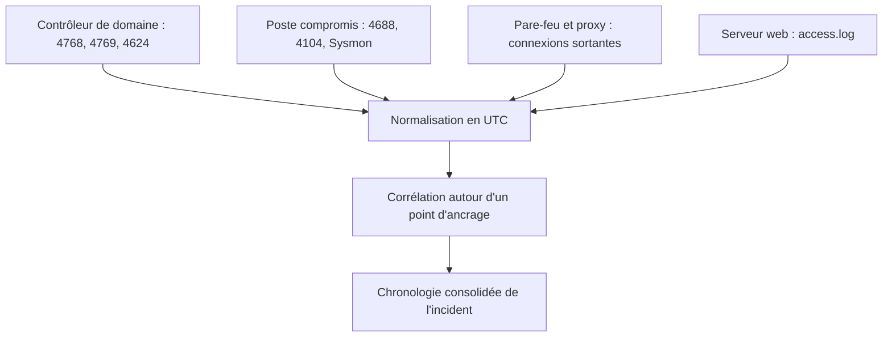

## Introduction

Ce chapitre approfondit la construction de timeline amorcée au chapitre 4, en se concentrant sur les **journaux d'événements**. Ce sont les sources de preuve les plus riches en détails temporels : qui s'est connecté, depuis où, avec quel compte, quel processus a été lancé avec quels arguments. Ce sont aussi les plus volumineuses et les plus faciles à mal interpréter sans méthode : un contrôleur de domaine peut produire des millions d'événements par jour.

À la fin de ce chapitre, tu sauras quels journaux consulter et quels identifiants d'événements chercher, comment les trier rapidement avec des outils dédiés, comment corréler des sources différentes sur une base temporelle commune, et comment éviter les erreurs d'interprétation qui mènent à de fausses conclusions.

## Les journaux Windows : où ils sont et ce qu'il faut activer

Sous Windows, les journaux sont stockés au format EVTX dans `C:\Windows\System32\winevt\Logs`. Les canaux les plus utiles en investigation sont **Security** (authentifications, processus, gestion des comptes), **System** (services, démarrages, pilotes), **Microsoft-Windows-PowerShell/Operational** (exécution de scripts), **Microsoft-Windows-TaskScheduler/Operational**, les journaux des services Bureau à distance, ceux de Microsoft Defender, et **Microsoft-Windows-Sysmon/Operational** si Sysmon est installé.

Un point essentiel : beaucoup d'événements précieux **ne sont pas enregistrés par défaut**. La création de processus (4688) nécessite d'activer l'audit correspondant, et la ligne de commande n'y figure que si la stratégie « Inclure la ligne de commande dans les événements de création de processus » est activée. La journalisation des blocs de script PowerShell (4104) doit aussi être activée par stratégie de groupe. **Sysmon**, un outil gratuit de la suite Sysinternals de Microsoft, enrichit énormément la visibilité : création de processus avec hash et processus parent (Event ID 1), connexions réseau (3), création de fichiers (11), modifications du registre (12 à 14), requêtes DNS (22).

## Les Event ID essentiels

<CompareTable
  titleA="Journal et Event ID"
  titleB="Ce qu'il révèle"
  rows={[
    { a: "Security 4624 et 4625", b: "Connexions réussies (4624) et échouées (4625), avec le type de connexion, le compte et l'adresse source" },
    { a: "Security 4672", b: "Privilèges spéciaux attribués à une session, typiquement un compte administrateur" },
    { a: "Security 4648", b: "Connexion avec des identifiants explicites, par exemple via runas ou un outil de mouvement latéral" },
    { a: "Security 4688", b: "Création de processus, avec la ligne de commande complète si l'audit avancé est configuré" },
    { a: "System 7045 et Security 4697", b: "Installation d'un nouveau service : vecteur de persistance et d'exécution à distance classique" },
    { a: "Security 4698", b: "Création d'une tâche planifiée" },
    { a: "Security 4720, 4728, 4732, 4756", b: "Création d'un compte, ajout à un groupe global, local ou universel" },
    { a: "Security 4768, 4769, 4776", b: "Demande de ticket Kerberos TGT, demande de ticket de service, validation NTLM (sur les contrôleurs de domaine)" },
    { a: "PowerShell 4104", b: "Contenu des blocs de script PowerShell exécutés, y compris après désobfuscation" },
    { a: "Security 1102 et System 104", b: "Effacement du journal Security, effacement d'un autre journal" },
  ]}
/>

### Les types de connexion de l'événement 4624

Le champ *Logon Type* de l'événement 4624 indique comment la session a été ouverte. Il change complètement l'interprétation.

| Type | Nom | Exemple |
| --- | --- | --- |
| 2 | Interactive | Ouverture de session au clavier, sur la console |
| 3 | Network | Accès à un partage SMB, exécution à distance via PsExec ou WMI |
| 4 | Batch | Tâche planifiée |
| 5 | Service | Démarrage d'un service sous un compte de service |
| 7 | Unlock | Déverrouillage de la session |
| 9 | NewCredentials | Utilisation de runas avec l'option /netonly |
| 10 | RemoteInteractive | Bureau à distance (RDP) |
| 11 | CachedInteractive | Connexion avec des identifiants en cache, sans contrôleur de domaine joignable |

<CehCallout>
L'Event ID 4624 avec un type de connexion 3 (réseau), suivi d'un 4688 (création de processus) sur la même machine dans un intervalle de quelques secondes, correspond souvent à un mouvement latéral réussi, comme vu au chapitre 4 du cours Active Directory. Si un 7045 apparaît en plus avec un service au nom aléatoire, c'est la signature typique d'une exécution à distance de type PsExec (T1569.002). Corréler ces événements révèle bien plus qu'un seul examiné isolément.
</CehCallout>

## Les journaux Linux et applicatifs

Sur Linux, les connexions SSH et l'usage de sudo apparaissent dans `/var/log/auth.log` sur Debian et Ubuntu, ou `/var/log/secure` sur la famille Red Hat. Sur les distributions récentes, le journal systemd centralise tout et se consulte avec `journalctl`.

```bash
# Connexions SSH sur une période, avec horodatage précis
journalctl -u ssh --since "2026-03-11 22:00" --until "2026-03-12 02:00" -o short-iso

# Les échecs puis les succès d'authentification dans auth.log
grep -E 'Failed password|Accepted (password|publickey)' /var/log/auth.log
```

```text
2026-03-11T23:12:04+0000 srv-web-02 sshd[20931]: Failed password for root from 198.51.100.23 port 52211 ssh2
2026-03-11T23:12:06+0000 srv-web-02 sshd[20931]: Failed password for root from 198.51.100.23 port 52211 ssh2
2026-03-11T23:14:41+0000 srv-web-02 sshd[21007]: Accepted password for deploy from 198.51.100.23 port 52298 ssh2
```

Une série d'échecs suivie d'un succès depuis la même adresse, sur un autre compte, évoque une attaque par force brute ou par pulvérisation de mots de passe réussie (T1110).

Les **journaux des serveurs web** sont souvent la clé de l'accès initial. Une ligne au format *combined* d'Apache ou de Nginx contient l'adresse cliente, la date, la requête, le code de réponse, la taille et l'agent utilisateur.

```text
198.51.100.23 - - [11/Mar/2026:23:05:17 +0100] "GET /produits.php?id=1%27%20UNION%20SELECT%20user,password%20FROM%20admins--%20 HTTP/1.1" 200 5123 "-" "sqlmap/1.8"
198.51.100.23 - - [11/Mar/2026:23:09:52 +0100] "POST /uploads/img_4821.php HTTP/1.1" 200 64 "-" "Mozilla/5.0"
```

La première ligne montre une injection SQL réalisée avec sqlmap, qui ne masque même pas son agent utilisateur. La seconde montre un appel POST vers un fichier PHP dans un dossier d'images téléversées : c'est le signe probable d'un webshell (T1505.003). Remarque le fuseau `+0100` : ces horodatages sont en heure locale et devront être convertis en UTC.

## Trier les journaux à grande échelle

Personne n'analyse des millions d'événements à la main. Plusieurs outils open source accélèrent le triage :

- **EvtxECmd**, d'Eric Zimmerman, convertit les fichiers EVTX en CSV normalisés, à ouvrir dans Timeline Explorer.
- **Hayabusa**, développé par Yamato Security, produit une chronologie des événements suspects à partir de fichiers EVTX, en appliquant des milliers de règles Sigma.
- **Chainsaw**, développé par WithSecure, recherche rapidement dans des EVTX avec des règles Sigma ou des mots-clés.

**Sigma** est un format ouvert de règles de détection, écrit en YAML, indépendant de tout SIEM. Une même règle peut être convertie en requête pour Splunk, Elastic, Microsoft Sentinel ou utilisée directement par Hayabusa et Chainsaw. Voici une règle simplifiée qui détecte l'effacement du journal Security :

```yaml
title: Effacement du journal Security
status: stable
logsource:
  product: windows
  service: security
detection:
  selection:
    EventID: 1102
  condition: selection
level: high
tags:
  - attack.defense-evasion
  - attack.t1070.001
```

```bash
# Chronologie des alertes Sigma sur un dossier d'EVTX collectés
hayabusa csv-timeline -d ./evtx -o hayabusa_timeline.csv

# Recherche avec Chainsaw et les règles Sigma
chainsaw hunt ./evtx -s sigma/ --mapping mappings/sigma-event-logs-all.yml
```

## Corréler des logs multi-sources



<Steps steps={[
  { title: "Synchroniser les fuseaux horaires", description: "Convertir toutes les sources dans un même référentiel temporel, UTC recommandé, avant toute corrélation. Noter pour chaque source son fuseau d'origine et son éventuel décalage d'horloge." },
  { title: "Identifier un point d'ancrage", description: "Un événement certain, par exemple l'alerte initiale du SIEM ou l'heure de création d'un fichier malveillant confirmée par plusieurs sources, sert de repère pour situer les autres événements avant et après." },
  { title: "Élargir progressivement la fenêtre temporelle", description: "Commencer par une fenêtre étroite autour du point d'ancrage, puis l'élargir si la chronologie reste incomplète, en remontant jusqu'au premier signe d'activité malveillante." },
  { title: "Pivoter sur les indicateurs", description: "Chaque nouvel indicateur trouvé, compte, adresse IP, nom de fichier, hash, sert de clé de recherche dans toutes les autres sources et sur toutes les autres machines." },
]} />

### Normaliser le temps

Les pièges temporels sont nombreux. Un serveur web peut journaliser en heure locale avec indication du fuseau, un pare-feu en UTC sans l'indiquer, un poste Windows afficher l'heure locale dans l'observateur d'événements alors que le fichier EVTX stocke de l'UTC. Le passage à l'heure d'été crée des heures en double ou manquantes. Enfin, une machine mal synchronisée peut dériver de plusieurs minutes. Pour mesurer ce décalage, compare un même événement vu par deux sources, par exemple une connexion visible à la fois dans les journaux du poste et dans ceux du contrôleur de domaine.

```bash
# Convertir un horodatage local avec fuseau en UTC, au format ISO 8601
date -u -d '2026-03-11 23:09:52 +0100' +%Y-%m-%dT%H:%M:%SZ
```

```text
2026-03-11T22:09:52Z
```

<WarningCallout>
Une erreur fréquente et coûteuse consiste à corréler des journaux provenant de systèmes configurés sur des fuseaux horaires différents sans les convertir au préalable vers un référentiel commun. Un événement peut alors sembler s'être produit avant sa cause réelle, ce qui fausse complètement la chronologie et peut conduire à accuser le mauvais compte ou la mauvaise machine.
</WarningCallout>

### Présenter la chronologie

Une chronologie de travail se tient idéalement dans un tableau partagé, avec une ligne par événement et des colonnes fixes : horodatage UTC, machine, source, événement brut, interprétation et niveau de confiance. Voici un extrait :

```text
Horodatage UTC        Machine     Source              Événement                                   Confiance
2026-03-11T22:05:17Z  SRV-WEB-02  access.log          Injection SQL (agent sqlmap) depuis 198.51.100.23   Confirmé
2026-03-11T22:09:52Z  SRV-WEB-02  access.log          POST vers /uploads/img_4821.php (webshell)          Confirmé
2026-03-11T22:10:03Z  SRV-WEB-02  Sysmon 1            w3wp.exe lance cmd.exe /c whoami                    Confirmé
2026-03-11T22:31:40Z  SRV-FILE-01 Security 4624 (3)   Connexion réseau du compte svc-backup depuis SRV-WEB-02  Confirmé
2026-03-11T22:31:44Z  SRV-FILE-01 System 7045         Service « xKfQ2 » installé                          Confirmé
2026-03-11T22:32:00Z  SRV-FILE-01 -                   Mouvement latéral de type PsExec                    Probable
```

Les quatre premières lignes sont des faits observés ; la dernière est une interprétation, marquée comme telle.

## Pièges classiques d'interprétation

<Steps steps={[
  { title: "Confondre corrélation et causalité", description: "Deux événements proches dans le temps ne sont pas automatiquement liés. Une hypothèse de lien doit être corroborée par d'autres preuves, par exemple un identifiant de session, un processus parent ou une adresse source commune (chapitre 1)." },
  { title: "Ignorer les logs manquants", description: "L'absence de logs pour une période donnée n'est pas neutre : elle peut résulter d'une purge volontaire par l'attaquant, d'un arrêt du service de journalisation ou d'une rotation trop courte. Chaque trou doit être expliqué." },
  { title: "Se noyer dans le volume sans hypothèse", description: "Sans hypothèse de travail claire, l'analyste se perd dans des millions d'événements sans jamais identifier le signal pertinent. On part d'une question et d'un point d'ancrage." },
  { title: "Oublier ce que l'audit ne voit pas", description: "Si l'audit de création de processus n'était pas activé, l'absence de 4688 ne prouve pas qu'aucun processus n'a été lancé. Toujours vérifier la configuration d'audit avant de conclure à une absence." },
]} />

<TipCallout>
Un journal Security anormalement plus petit que d'habitude, ou dont les entrées s'arrêtent brutalement à une heure précise, est en lui-même un indicateur de compromission. Un attaquant qui efface ses traces génère un Event ID 1102 (« le journal d'audit a été effacé »), qui devient la première entrée du journal vidé et qu'il oublie souvent. Si les journaux étaient transférés en temps réel vers un SIEM, la copie centralisée contient tout ce qui a été effacé localement.
</TipCallout>

## Angle offensif et défensif : l'attaque contre la journalisation

<AttackDefenseTable rows={[
  { phase: "Effacement", attack: "Vider les journaux avec wevtutil cl ou Clear-EventLog (T1070.001)", defense: "Transfert en temps réel vers un SIEM ou un collecteur WEF ; alerte sur 1102 et 104" },
  { phase: "Désactivation", attack: "Arrêter le service de journalisation ou modifier la stratégie d'audit (T1562.002)", defense: "Alerter sur les modifications de stratégie d'audit (4719) et sur l'arrêt du flux d'un hôte dans le SIEM" },
  { phase: "Contournement de PowerShell", attack: "Forcer PowerShell version 2, qui ne journalise pas les blocs de script", defense: "Désinstaller la fonctionnalité PowerShell v2 ; journalisation 4104 et AMSI" },
  { phase: "Noyade", attack: "Générer un grand volume d'événements bénins pour faire tourner les journaux locaux", defense: "Augmenter la taille des journaux locaux ; centralisation avec rétention longue" },
]} />

<AuditCallout>
ISO/IEC 27001:2022 traite ces sujets dans l'Annexe A avec la mesure A.8.15 (journalisation), qui exige de produire, conserver, protéger et analyser les journaux, A.8.16 (activités de surveillance) et A.8.17 (synchronisation des horloges). Un auditeur vérifiera notamment que les journaux sont protégés contre la modification et que les horloges sont synchronisées sur une source de référence.
</AuditCallout>

## Erreurs fréquentes

Les erreurs les plus courantes sont de **corréler sans normaliser le temps**, de **conclure à l'absence d'activité** alors que l'audit n'était pas activé, de **lire un 4624 sans regarder le type de connexion**, et de **considérer une connexion réussie comme légitime** parce que le compte est valide, alors que l'attaquant utilise justement des identifiants volés (T1078, comptes valides).

On voit aussi des analystes **filtrer trop tôt** sur un seul compte ou une seule machine et manquer le reste du périmètre, **oublier les journaux réseau et applicatifs** au profit des seuls journaux Windows, ou **ne pas sauvegarder les journaux avant qu'ils ne tournent** : sur un serveur chargé, le journal Security local peut ne couvrir que quelques heures.

## Lab — Mise en pratique

**Environnement** : Kali Linux (terminal Nyx). Tu vas analyser des extraits de journaux SSH et web, les normaliser en UTC et construire une mini-chronologie. Le lab Nyx « La Boîte à Souvenirs » te permettra ensuite de travailler sur des artefacts Windows.

<Steps steps={[
  { title: "Créer les journaux d'exercice", description: "Crée un extrait de auth.log (en UTC) et un extrait de access.log (en heure locale +0100).", code: "mkdir -p ~/lab-logs && cd ~/lab-logs\nprintf '%s\\n' '2026-03-11T22:01:10+0000 srv sshd[901]: Failed password for root from 198.51.100.23 port 50001 ssh2' '2026-03-11T22:01:12+0000 srv sshd[901]: Failed password for admin from 198.51.100.23 port 50002 ssh2' '2026-03-11T22:01:15+0000 srv sshd[903]: Failed password for deploy from 198.51.100.23 port 50003 ssh2' '2026-03-11T22:14:41+0000 srv sshd[977]: Accepted password for deploy from 198.51.100.23 port 50020 ssh2' '2026-03-11T22:15:02+0000 srv sudo: deploy : TTY=pts/0 ; PWD=/home/deploy ; USER=root ; COMMAND=/bin/bash' > auth.log\nprintf '%s\\n' '198.51.100.23 - - [11/Mar/2026:23:05:17 +0100] \"GET /produits.php?id=1%27%20UNION%20SELECT HTTP/1.1\" 200 5123 \"-\" \"sqlmap/1.8\"' '198.51.100.23 - - [11/Mar/2026:23:09:52 +0100] \"POST /uploads/img_4821.php HTTP/1.1\" 200 64 \"-\" \"Mozilla/5.0\"' > access.log\nwc -l auth.log access.log" },
  { title: "Compter les échecs par adresse", description: "Extrais les adresses sources des échecs d'authentification et compte-les. Une adresse unique avec de nombreux échecs sur des comptes différents évoque une pulvérisation de mots de passe.", code: "grep 'Failed password' auth.log | grep -oE 'from [0-9.]+' | sort | uniq -c | sort -rn" },
  { title: "Repérer le succès après les échecs", description: "Affiche les connexions réussies et l'élévation de privilèges qui suit. Note l'heure exacte : c'est un point d'ancrage.", code: "grep -E 'Accepted|sudo:' auth.log" },
  { title: "Normaliser le journal web en UTC", description: "Convertis les horodatages du journal web en UTC. Observe que 23:05 en +0100 devient 22:05 UTC : sans conversion, l'injection SQL semblerait postérieure à la connexion SSH.", code: "while read -r line; do ts=$(echo \"$line\" | grep -oE '[0-9]{2}/[A-Za-z]{3}/[0-9]{4}:[0-9:]{8} [+-][0-9]{4}'); d=$(echo \"$ts\" | sed -E 's#/# #g; s#:# #'); echo \"$(date -u -d \"$d\" +%Y-%m-%dT%H:%M:%SZ) WEB $(echo \"$line\" | cut -d'\"' -f2)\"; done < access.log | tee web_utc.txt" },
  { title: "Normaliser le journal SSH", description: "Mets le journal SSH au même format, avec la source indiquée.", code: "awk '{ts=substr($1,1,19)\"Z\"; $1=\"\"; print ts\" SSH\"$0}' auth.log | tee ssh_utc.txt" },
  { title: "Fusionner et trier", description: "Fusionne les deux sources et trie par horodatage. Lis la chronologie : injection SQL, webshell, force brute SSH, connexion réussie, élévation sudo. Toutes les lignes sont désormais comparables.", code: "sort web_utc.txt ssh_utc.txt > chronologie.txt\ncat chronologie.txt" },
  { title: "Corréler deux événements Windows", description: "Raisonnement : un Event ID 4624 de type 3 apparaît sur SRV-02 à 14:32:10 UTC, suivi d'un 4688 (powershell.exe) à 14:32:14 et d'un 7045 à 14:32:15. Formule l'hypothèse la plus probable et indique quelles données confirmeraient qu'il s'agit d'un même acteur." },
  { title: "Interpréter une absence de logs", description: "Raisonnement : le journal Security d'un serveur compromis présente un vide inexpliqué de 45 minutes juste avant la détection. Cite trois explications possibles et l'événement précis qui confirmerait une purge volontaire." },
]} />

## À retenir

- Les Event ID 4624 et 4625 (avec le type de connexion), 4672, 4688, 7045, 4698, 4104 et 1102 comptent parmi les plus utiles ; beaucoup nécessitent une configuration d'audit préalable, et Sysmon enrichit fortement la visibilité.
- Un 4624 de type 3 suivi d'un 4688 et d'un 7045 sur la même machine en quelques secondes évoque un mouvement latéral de type exécution de service à distance.
- Les journaux Linux et web révèlent souvent l'accès initial : force brute SSH, injection SQL, webshell.
- EvtxECmd, Hayabusa et Chainsaw, avec les règles Sigma, permettent de trier rapidement de gros volumes de journaux.
- Toute corrélation commence par la normalisation en UTC et le choix d'un point d'ancrage, puis s'élargit en pivotant sur les indicateurs.
- Corrélation n'est pas causalité, et une absence de journaux n'est jamais neutre : elle doit être expliquée, l'Event ID 1102 signalant un effacement.
- La journalisation centralisée en temps réel protège les preuves contre l'effacement local.

## Questions de révision

1. Pourquoi la synchronisation des fuseaux horaires est-elle indispensable avant toute corrélation de logs multi-sources ? Donne un exemple d'inversion de causalité.
2. Que peut signifier un vide inexpliqué dans un journal Security, et quel événement spécifique confirmerait une purge ?
3. Pourquoi deux événements proches dans le temps ne constituent-ils pas, à eux seuls, une preuve de lien causal ?
4. Quelle différence d'interprétation fais-tu entre un 4624 de type 3 et un 4624 de type 10 ?
5. Pourquoi l'absence d'Event ID 4688 sur une machine ne prouve-t-elle pas qu'aucun processus suspect n'a été lancé ?
6. À quoi sert une règle Sigma, et quel avantage apporte-t-elle par rapport à une requête écrite pour un seul SIEM ?
7. Quels indices dans un journal web laissent penser qu'un webshell a été déposé puis utilisé ?
