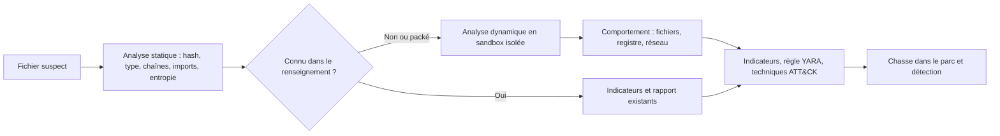

## Introduction

Une fois un fichier suspect identifié grâce à l'analyse mémoire, disque ou réseau des chapitres précédents, l'analyse de malware permet de comprendre ce que ce fichier fait réellement : comment il persiste, avec qui il communique, quelles données il vise, et comment le détecter ailleurs dans le parc. Elle se fait toujours sans exécuter le fichier sur un système de production, ni même sur son propre poste de travail non isolé.

L'objectif en DFIR n'est généralement pas de rétro-concevoir le malware jusqu'à la dernière instruction. C'est de produire rapidement des **indicateurs** et une **compréhension des capacités** qui orientent l'investigation et la remédiation. À la fin de ce chapitre, tu sauras mener une analyse statique de base, reconnaître un binaire packé, savoir ce qu'une sandbox apporte et ce qu'elle peut manquer, et écrire une première règle YARA.

## Préparer un environnement d'analyse sûr

Avant de toucher un échantillon, prépare l'environnement. Les règles de base sont simples. On travaille dans une **machine virtuelle dédiée**, avec un instantané propre pour revenir à l'état initial après chaque analyse. Le réseau de cette machine est **isolé** : pas d'accès au réseau de l'entreprise, et Internet coupé ou simulé. Les échantillons sont stockés dans des **archives chiffrées par mot de passe**, par convention avec le mot de passe `infected`, pour éviter qu'un antivirus ne les supprime ou qu'un collègue ne les ouvre par erreur. Enfin, on **renomme** l'échantillon avec une extension neutre, par exemple `.bin`, pour éviter un double-clic accidentel.

<WarningCallout>
N'ouvre jamais un échantillon sur ton poste de travail habituel, même « juste pour regarder ». Un simple aperçu dans l'explorateur de fichiers peut déclencher l'analyse d'un document piégé par un composant vulnérable. Et ne téléverse pas un fichier interne sur un service public d'analyse sans réfléchir : le fichier devient visible par d'autres utilisateurs, y compris potentiellement l'attaquant, qui saura alors qu'il a été découvert. Recherche d'abord le hash.
</WarningCallout>

## Analyse statique : examiner sans exécuter

L'analyse statique examine un fichier sans jamais l'exécuter. Elle est réalisée en premier, car elle ne présente aucun risque d'infection du poste d'analyse, et elle suffit souvent pour un malware déjà connu.

<CehCallout>
L'analyse statique examine un fichier suspect sans l'exécuter : hash, type réel, chaînes de caractères, fonctions importées, sections et entropie, signature numérique. Elle précède toujours l'analyse dynamique. Point d'examen classique : la combinaison des fonctions Windows VirtualAllocEx, WriteProcessMemory et CreateRemoteThread signale une capacité d'injection de code dans un autre processus (MITRE ATT&CK T1055).
</CehCallout>

<Steps steps={[
  { title: "Calculer le hash et interroger le renseignement", description: "Un hash SHA-256 recherché dans des bases comme VirusTotal ou MalwareBazaar révèle immédiatement si le fichier est un malware déjà documenté, avec son nom de famille et ses analyses existantes." },
  { title: "Identifier le type réel", description: "La commande file et l'outil Detect It Easy lisent la signature binaire du fichier, indépendamment de son extension : un .pdf qui est en réalité un exécutable est un indice fort." },
  { title: "Extraire les chaînes de caractères", description: "Les chaînes lisibles, URL, adresses IP, chemins, clés de registre, messages, révèlent souvent l'infrastructure ou le comportement. FLOSS va plus loin en décodant des chaînes obfusquées." },
  { title: "Examiner les imports et les sections", description: "Les fonctions importées suggèrent des capacités ; les sections et leur entropie indiquent si le code est compressé ou chiffré." },
  { title: "Vérifier la signature numérique", description: "L'absence de signature, ou une signature invalide ou révoquée, est un signal de suspicion, jamais suffisant à lui seul : des certificats volés servent parfois à signer des malwares." },
  { title: "Identifier les capacités", description: "L'outil capa, de Mandiant, détecte automatiquement des capacités comme la persistance, le chiffrement ou l'injection, et les relie aux techniques MITRE ATT&CK." },
]} />

### Hash, type et chaînes

```bash
sha256sum facture_mars.pdf.bin
file facture_mars.pdf.bin
strings -n 8 facture_mars.pdf.bin | grep -E -i 'http|\.onion|\\\\run|powershell|\.exe' | head
```

```text
9b2c4f...e81d  facture_mars.pdf.bin
facture_mars.pdf.bin: PE32+ executable (GUI) x86-64, for MS Windows
http://203.0.113.47/gate.php
Software\Microsoft\Windows\CurrentVersion\Run
powershell -nop -w hidden -c
```

Un fichier nommé comme une facture PDF qui est en réalité un exécutable Windows 64 bits, contenant une URL vers un fichier `gate.php`, la clé de registre de démarrage automatique et une commande PowerShell cachée : en quelques secondes, tu as déjà des indicateurs (l'adresse, l'URL) et des hypothèses de capacités (persistance par clé Run, exécution PowerShell). L'option `-n 8` de strings ne garde que les chaînes d'au moins huit caractères, ce qui réduit le bruit. Pense aussi à `strings -el`, qui extrait les chaînes en UTF-16 little-endian, très fréquentes dans les binaires Windows.

### Imports, sections et entropie

Un exécutable Windows au format PE déclare les fonctions qu'il importe depuis les DLL du système. Certaines combinaisons sont parlantes :

| Fonctions importées | Capacité suggérée |
| --- | --- |
| `VirtualAllocEx`, `WriteProcessMemory`, `CreateRemoteThread` | Injection de code dans un autre processus (T1055) |
| `URLDownloadToFileW`, `InternetOpenUrlW`, `WinHttpSendRequest` | Téléchargement ou communication HTTP |
| `RegSetValueExW`, `CreateServiceW` | Persistance par registre ou par service |
| `CryptEncrypt`, `BCryptEncrypt` et parcours massif de fichiers | Chiffrement de fichiers, typique d'un rançongiciel |
| `IsDebuggerPresent`, `CheckRemoteDebuggerPresent`, `GetTickCount` | Détection de débogueur ou d'environnement d'analyse |
| `OpenProcess` sur lsass.exe, `MiniDumpWriteDump` | Vol d'identifiants en mémoire (T1003.001) |

L'**entropie** mesure le désordre des octets d'une section, sur une échelle de 0 à 8 bits par octet. Du code machine normal se situe généralement entre 5 et 6,5 ; des données compressées ou chiffrées approchent 8. Une section exécutable à très haute entropie, des noms de sections inhabituels comme `UPX0` et `UPX1`, et une table d'imports réduite à `LoadLibraryA` et `GetProcAddress` sont les signes classiques d'un binaire **packé**.

```python
# Analyse rapide d'un PE avec la bibliothèque pefile (pip install pefile)
import pefile

pe = pefile.PE("facture_mars.pdf.bin")
for section in pe.sections:
    name = section.Name.rstrip(b"\x00").decode(errors="replace")
    print(f"{name:8} entropie={section.get_entropy():.2f} taille={section.SizeOfRawData}")
for entry in getattr(pe, "DIRECTORY_ENTRY_IMPORT", []):
    print(entry.dll.decode(), [imp.name.decode() for imp in entry.imports if imp.name][:5])
```

```text
UPX0     entropie=0.00 taille=0
UPX1     entropie=7.93 taille=184320
.rsrc    entropie=4.12 taille=4096
KERNEL32.DLL ['LoadLibraryA', 'GetProcAddress', 'VirtualProtect', 'ExitProcess']
```

### Le cas des binaires packés

<WarningCallout>
L'analyse statique a des limites fortes face à un malware packé, c'est-à-dire compressé ou chiffré pour dissimuler son code réel (T1027.002). Les chaînes et imports visibles ne reflètent alors que la couche d'emballage, pas le comportement réel, qui ne se révèle qu'à l'exécution. Un fichier qui ne montre presque aucune chaîne lisible ni import significatif doit être considéré comme probablement packé, et l'analyse dynamique devient nécessaire.
</WarningCallout>

Certains packers publics comme UPX peuvent être retirés avec l'outil lui-même (`upx -d`). Les packers et *crypters* utilisés par les attaquants sont en général conçus pour ne pas l'être, et l'on passe alors par l'analyse dynamique ou par l'extraction du code décompressé en mémoire, avec les techniques du chapitre 3.

## Écrire une règle YARA

**YARA** est un outil et un langage de règles qui permet de décrire une famille de fichiers par des chaînes, des séquences d'octets et des conditions. C'est le moyen standard de transformer une analyse en détection réutilisable : la même règle peut être lancée sur des disques, sur des dumps mémoire avec Volatility, ou intégrée à un EDR.

```text
rule Nyx_Loader_Facture_2026
{
    meta:
        description = "Chargeur déguisé en facture, campagne INC-2026-031"
        author = "Equipe DFIR"
        date = "2026-03-12"
    strings:
        $url  = "/gate.php" ascii wide
        $run  = "CurrentVersion\\Run" ascii wide nocase
        $ps   = "powershell -nop -w hidden" ascii wide nocase
        $mz   = { 4D 5A }
    condition:
        $mz at 0 and filesize < 2MB and 2 of ($url, $run, $ps)
}
```

La condition exige que le fichier commence par la signature `MZ` d'un exécutable Windows, qu'il fasse moins de 2 Mo, et qu'il contienne au moins deux des trois chaînes caractéristiques. Une bonne règle évite de reposer sur une seule chaîne triviale, ce qui provoquerait des faux positifs, et ne colle pas trop à un seul échantillon, ce qui la rendrait inutile sur la variante suivante.

## Analyse dynamique : observer le comportement en environnement isolé

<Steps steps={[
  { title: "Exécuter dans une sandbox isolée", description: "Un environnement virtualisé, sans accès réel au réseau de l'entreprise, avec un Internet coupé ou simulé, et totalement déconnecté du reste de l'infrastructure." },
  { title: "Observer les modifications du système", description: "Fichiers créés ou modifiés, clés de registre ajoutées, services et tâches créés, processus lancés : tout changement d'état pendant l'exécution, capturé avec Procmon, Sysmon ou une comparaison avant-après." },
  { title: "Capturer le trafic réseau généré", description: "Connexions sortantes et requêtes DNS révèlent l'infrastructure C2 ; un faux Internet comme INetSim ou FakeNet-NG répond aux requêtes pour pousser le malware à se dévoiler (lien direct avec le chapitre 6)." },
  { title: "Analyser après coup puis restaurer", description: "Les traces sont exportées pour analyse, puis la machine virtuelle est restaurée à son instantané propre. L'exécution n'a jamais lieu sur un poste connecté au réseau de production, même « juste pour voir »." },
]} />

Les **sandbox automatisées** produisent un rapport comportemental en quelques minutes. Parmi les solutions courantes, on trouve **CAPE**, une sandbox open source qui a succédé à Cuckoo (ce dernier n'est plus maintenu), et des services en ligne comme ANY.RUN, Hybrid Analysis ou Joe Sandbox. Pour une analyse manuelle, les outils de Sysinternals, Process Monitor et Process Explorer, restent des références.



### L'évasion de sandbox

Un malware sophistiqué peut détecter qu'il tourne dans une sandbox et s'abstenir de révéler son comportement malveillant : c'est l'**évasion de sandbox** (T1497). Les indices qu'il recherche sont conceptuellement simples : présence de pilotes ou de processus propres aux hyperviseurs, adresses MAC de cartes réseau virtuelles, très peu de mémoire ou de cœurs, absence de mouvements de souris, absence de documents récents, ou durée d'exécution limitée qu'il contourne en attendant longtemps avant d'agir. La parade défensive consiste à rendre l'environnement d'analyse réaliste, à prolonger l'exécution, à simuler une activité utilisateur, et surtout à ne jamais conclure qu'un fichier est sain parce que la sandbox n'a rien vu.

## Une méthodologie d'analyse raisonnable

<CompareTable
  titleA="Étape"
  titleB="Objectif"
  rows={[
    { a: "1. Analyse statique", b: "Identification rapide, sans risque, souvent suffisante pour un malware déjà connu" },
    { a: "2. Recherche de renseignement (threat intelligence)", b: "Vérifier si le hash, les domaines ou les adresses sont déjà documentés publiquement" },
    { a: "3. Analyse dynamique en sandbox", b: "Nécessaire si le malware est inconnu ou packé, pour observer son comportement réel" },
    { a: "4. Analyse approfondie (rétro-ingénierie)", b: "Désassemblage avec Ghidra ou un outil équivalent, réservé aux cas complexes et hors périmètre de ce chapitre" },
    { a: "5. Production d'indicateurs et de détections", b: "Hash, domaines, adresses, règles YARA et Sigma, techniques ATT&CK, pour chasser dans tout le parc" },
  ]}
/>

## Angle défensif : transformer l'analyse en protection

L'analyse n'a de valeur que si elle améliore la défense. Les indicateurs **atomiques** (hash, adresses IP, domaines) sont utiles immédiatement mais se périment vite : l'attaquant recompile, change de serveur. Les indicateurs **comportementaux** (une macro qui lance PowerShell, une injection dans un processus système, une persistance par clé Run) restent valables bien plus longtemps. C'est l'idée de la « pyramide de la douleur » de David Bianco : plus un indicateur est haut placé, comportements et techniques plutôt que hash, plus il est coûteux pour l'attaquant de le contourner.

<AttackDefenseTable rows={[
  { phase: "Livraison", attack: "Exécutable déguisé en document, archive ou raccourci joint à un courriel (T1566.001)", defense: "Filtrage des pièces jointes exécutables, affichage des extensions, blocage des macros venant d'Internet" },
  { phase: "Dissimulation", attack: "Packing et obfuscation pour échapper aux signatures (T1027)", defense: "Détection comportementale par l'EDR, règles YARA sur le code décompressé en mémoire" },
  { phase: "Évasion", attack: "Détection de la sandbox et attente avant d'agir (T1497)", defense: "Sandbox réaliste, exécution prolongée, corrélation avec la télémétrie réelle des postes" },
  { phase: "Persistance", attack: "Clé Run ou service créé au premier lancement (T1547.001, T1543.003)", defense: "Surveillance de ces emplacements avec Sysmon, règles Sigma, liste d'autorisation d'applications" },
]} />

<AuditCallout>
ISO/IEC 27001:2022 traite la protection contre les logiciels malveillants dans la mesure A.8.7 de l'Annexe A, et la gestion des vulnérabilités techniques dans la mesure A.8.8. Le renseignement sur les menaces, nouveauté de la version 2022, fait l'objet de la mesure A.5.7 : les indicateurs produits par tes analyses en sont une source directe.
</AuditCallout>

## Erreurs fréquentes

La première erreur est d'**exécuter avant d'avoir analysé statiquement**, ou d'exécuter hors d'une sandbox isolée. La deuxième est de **téléverser un échantillon interne** sur un service public sans réfléchir, ce qui peut alerter l'attaquant ou divulguer des données de l'organisation contenues dans un document. La troisième est de **conclure qu'un fichier est sain** parce que l'antivirus ou la sandbox n'a rien signalé.

On voit aussi des analystes **se fier à l'extension** plutôt qu'au type réel, **produire uniquement des hash** comme indicateurs alors qu'ils seront inutiles sur la variante suivante, et **oublier de restaurer** la machine d'analyse entre deux échantillons, ce qui mélange les traces.

## Lab — Mise en pratique

**Environnement** : Kali Linux (terminal Nyx). Tu vas travailler sur un binaire parfaitement inoffensif, une copie de la commande `ls`, pour observer l'effet du packing sur l'analyse statique, puis écrire et tester une règle YARA. Aucun malware n'est utilisé.

<Steps steps={[
  { title: "Préparer l'échantillon", description: "Installe les outils, copie un binaire système inoffensif comme échantillon et identifie son type réel.", code: "sudo apt update && sudo apt install -y upx-ucl yara\nmkdir -p ~/lab-malware && cd ~/lab-malware\ncp /bin/ls echantillon.bin\nsha256sum echantillon.bin\nfile echantillon.bin" },
  { title: "Extraire les chaînes", description: "Compte les chaînes d'au moins huit caractères et affiche-en quelques-unes. Observe qu'elles sont nombreuses et lisibles.", code: "strings -n 8 echantillon.bin | wc -l\nstrings -n 8 echantillon.bin | grep -i -E 'usage|color|time' | head" },
  { title: "Mesurer l'entropie", description: "Calcule l'entropie globale du fichier avec un petit script Python. Note la valeur obtenue.", code: "cat > entropie.py <<'PY'\nimport sys, math, collections\ndata = open(sys.argv[1], 'rb').read()\ncounts = collections.Counter(data)\nh = -sum(c / len(data) * math.log2(c / len(data)) for c in counts.values())\nprint(f'{sys.argv[1]}: {h:.2f} bits par octet')\nPY\npython3 entropie.py echantillon.bin" },
  { title: "Packer l'échantillon", description: "Crée une copie packée avec UPX, puis compare la taille, le nombre de chaînes et l'entropie. Les chaînes disparaissent presque toutes et l'entropie approche 8 : c'est ce que tu observerais sur un malware packé.", code: "upx -q -o echantillon_packe.bin echantillon.bin\nls -l echantillon*.bin\nstrings -n 8 echantillon_packe.bin | wc -l\nstrings echantillon_packe.bin | grep -i upx | head -n 3\npython3 entropie.py echantillon_packe.bin" },
  { title: "Écrire une règle YARA de détection du packing", description: "Écris une règle qui détecte un ELF packé par UPX grâce à la signature ELF et aux marqueurs UPX, puis lance-la sur les deux fichiers. Seul le fichier packé doit correspondre.", code: "cat > upx_elf.yar <<'YAR'\nrule ELF_Packe_UPX\n{\n    strings:\n        $elf = { 7F 45 4C 46 }\n        $upx1 = \"UPX!\"\n        $upx2 = \"UPX executable packer\" nocase\n    condition:\n        $elf at 0 and ($upx1 or $upx2)\n}\nYAR\nyara -s upx_elf.yar echantillon.bin echantillon_packe.bin" },
  { title: "Dépacker et vérifier", description: "Retire le packing avec UPX et vérifie que le fichier retrouve ses chaînes. Compare son hash avec l'original : il peut différer légèrement, ce qui montre pourquoi un hash seul est un indicateur fragile.", code: "upx -q -d -o echantillon_depacke.bin echantillon_packe.bin\nstrings -n 8 echantillon_depacke.bin | wc -l\nsha256sum echantillon.bin echantillon_depacke.bin" },
  { title: "Choisir la bonne première étape", description: "Raisonnement : tu identifies un exécutable suspect sur un poste compromis. Décris dans l'ordre tes premières actions, avant toute exécution, et dis ce que tu ferais du hash." },
  { title: "Expliquer une limite de l'analyse statique", description: "Raisonnement : un fichier ne révèle presque aucune chaîne lisible ni import significatif, et une section a une entropie de 7,9. Que suggère cette observation, et quelle est l'étape suivante ? Cite une technique d'évasion à laquelle tu devras être attentif." },
]} />

## À retenir

- L'analyse se fait dans une machine virtuelle dédiée, isolée, restaurable, avec des échantillons stockés en archives chiffrées.
- L'analyse statique (hash, type réel, chaînes, imports, entropie, signature, capacités avec capa) ne présente aucun risque et précède toujours toute exécution.
- VirtualAllocEx, WriteProcessMemory et CreateRemoteThread signalent une capacité d'injection de processus.
- Un binaire packé se reconnaît à peu de chaînes, peu d'imports et une entropie proche de 8 ; l'analyse dynamique devient alors nécessaire.
- L'analyse dynamique en sandbox isolée, par exemple avec CAPE, révèle le comportement réel, mais l'évasion de sandbox impose de ne jamais conclure qu'un fichier est sain faute d'activité observée.
- On recherche le hash avant de téléverser un échantillon sur un service public.
- L'analyse doit produire des détections durables : règles YARA, indicateurs comportementaux et techniques ATT&CK, plus résistants que les simples hash.

## Questions de révision

1. Pourquoi l'analyse statique doit-elle toujours précéder toute tentative d'exécution d'un fichier suspect ?
2. Qu'est-ce qu'un malware packé, comment le reconnais-tu, et pourquoi limite-t-il l'efficacité de l'analyse statique seule ?
3. Quelles fonctions importées suggèrent une capacité d'injection de processus, et quelle technique ATT&CK y correspond ?
4. Qu'est-ce que l'évasion de sandbox, et pourquoi complique-t-elle l'analyse dynamique automatisée ?
5. Pourquoi faut-il rechercher un hash avant de téléverser un échantillon sur un service d'analyse public ?
6. Quels critères rendent une règle YARA à la fois fiable et utile sur de futures variantes ?
7. Explique, à l'aide de la pyramide de la douleur, pourquoi un indicateur comportemental est plus précieux qu'un hash.
