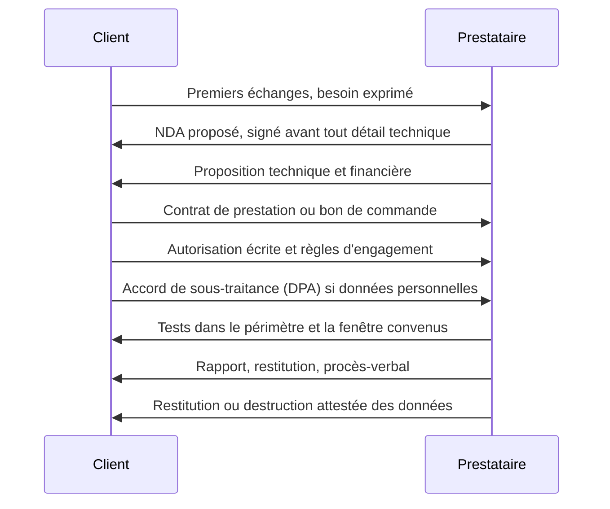

## Introduction

Ce chapitre couvre les documents contractuels qui encadrent la relation entre un professionnel de la cybersécurité et son client, au-delà de la seule autorisation de test vue au chapitre 1. Un pentester qui ne maîtrise pas ces bases s'expose personnellement, même en agissant de bonne foi : un scan qui fait tomber un serveur fragile, un rapport qui circule hors de l'entreprise, une donnée sensible conservée trop longtemps, et c'est un litige.

Le contrat n'est pas une formalité : c'est l'outil qui répartit les risques entre les parties avant qu'ils ne se réalisent. À la fin de ce chapitre, tu sauras quels documents signer et dans quel ordre, quelles clauses vérifier en priorité, ce que protège un NDA, et surtout ce qu'un contrat peut limiter, la responsabilité civile, et ce qu'il ne peut jamais limiter, la responsabilité pénale. Les exemples s'appuient sur le droit français ; les grands principes se retrouvent dans la plupart des droits d'inspiration civiliste, y compris dans les pays d'Afrique francophone comme le Congo, membre de l'OHADA.

## Les documents d'une mission, dans l'ordre

Une mission de pentest bien encadrée repose sur plusieurs documents complémentaires, signés à des moments différents.

Le **NDA** (*Non-Disclosure Agreement*, accord de confidentialité) vient en premier, parce que des informations sensibles circulent dès les premiers échanges : architecture, contexte d'un incident, technologies utilisées. Le **contrat de prestation** organise la relation commerciale et juridique globale. L'**autorisation écrite** et les **règles d'engagement** définissent ce qui peut être testé, quand et comment. L'**accord de sous-traitance** (DPA), vu au chapitre 2, s'ajoute dès que des données personnelles sont traitées. Enfin, la **restitution** et l'attestation de destruction des données closent la mission.

## Le contrat de prestation, au-delà de l'autorisation de test

L'autorisation écrite définit le périmètre technique du test. Le contrat de prestation définit, lui, la relation commerciale et juridique globale.

<Steps steps={[
  { title: "Objet précis de la mission", description: "Pas seulement « un pentest », mais le type exact (application web, réseau interne, Active Directory, red team), la méthodologie de référence, les livrables attendus et le calendrier." },
  { title: "Clause de limitation de responsabilité", description: "Plafonne la responsabilité financière du prestataire en cas de dommage, par exemple au montant de la commande, sauf faute lourde ou intentionnelle, qu'aucune clause ne peut couvrir." },
  { title: "Clause d'indemnisation (hold harmless)", description: "Le client s'engage à ne pas poursuivre le prestataire, et à le garantir contre les réclamations de tiers, pour les actions menées conformément au périmètre autorisé." },
  { title: "Propriété du rapport", description: "Précise qui peut utiliser, diffuser ou publier, même partiellement, le rapport livré, et ce que le prestataire conserve de ses propres outils et méthodes." },
  { title: "Conditions de résiliation", description: "Ce qui se passe si le client interrompt la mission en cours : paiement des travaux réalisés, remise des résultats partiels, destruction des données collectées." },
]} />

D'autres clauses méritent une lecture attentive. La **nature de l'obligation** est importante : un test d'intrusion est presque toujours une **obligation de moyens**, le prestataire s'engage à mettre en œuvre son savoir-faire selon les règles de l'art, pas à trouver toutes les vulnérabilités, ce qui serait une obligation de résultat impossible à tenir. Le rapport doit d'ailleurs rappeler que l'absence de vulnérabilité trouvée ne garantit pas l'absence de vulnérabilité. La clause de **sous-traitance** indique si le prestataire peut faire intervenir des tiers, par exemple des indépendants. La clause d'**assurance** impose de justifier d'une responsabilité civile professionnelle. Enfin, la **loi applicable** et la **juridiction compétente** sont essentielles dès que le client et le prestataire ne sont pas dans le même pays.

### Ce que vaut une limitation de responsabilité

En droit français, les clauses limitatives de responsabilité sont en principe valables entre professionnels, mais elles ont des limites. L'article 1231-3 du Code civil prévoit que le débiteur n'est tenu que des dommages prévisibles lors de la conclusion du contrat, sauf lorsque l'inexécution est due à une **faute lourde ou dolosive**. L'article 1170 répute non écrite toute clause qui **prive de sa substance l'obligation essentielle** du débiteur. Concrètement, un plafond égal au prix de la mission est généralement admis ; une clause qui exclurait toute responsabilité du prestataire même s'il fait n'importe quoi ne le serait pas.

<TipCallout>
La clause d'indemnisation (« hold harmless ») est particulièrement importante pour un pentester : elle protège contre le risque qu'un service perturbé accidentellement pendant un test pourtant autorisé, par exemple un scan trop agressif qui fait planter un serveur ancien, ne se transforme en poursuite judiciaire du client contre le prestataire. Elle ne joue que pour les actions conformes au périmètre et aux règles d'engagement : c'est une raison de plus pour tenir un journal précis de tes actions.
</TipCallout>

## Le NDA, accord de confidentialité

Un NDA encadre spécifiquement la confidentialité des informations échangées. Il est souvent signé avant même le contrat de prestation, dès les échanges commerciaux préliminaires. En droit français, l'article 1112-2 du Code civil prévoit déjà que celui qui utilise ou divulgue sans autorisation une information confidentielle obtenue pendant les négociations engage sa responsabilité ; le NDA précise et renforce cette obligation.

<CompareTable
  titleA="Ce qu'un NDA protège typiquement"
  titleB="Ce qu'un NDA ne remplace pas"
  rows={[
    { a: "Architecture réseau, code source et configurations consultés pendant l'audit", b: "L'autorisation de test elle-même, document distinct" },
    { a: "Vulnérabilités découvertes, avant et après correction par le client", b: "La limitation de responsabilité, clause du contrat de prestation" },
    { a: "Données personnelles ou sensibles rencontrées pendant les tests", b: "Un accord de sous-traitance RGPD (DPA) si des données personnelles sont traitées" },
    { a: "L'existence même de la mission, si le client le souhaite", b: "Les obligations légales de signalement ou de réponse à une réquisition judiciaire" },
  ]}
/>

Un NDA solide contient plusieurs éléments : une **définition** claire des informations confidentielles, souvent « toute information communiquée sous quelque forme que ce soit » ; des **exclusions** classiques, comme les informations déjà publiques, déjà connues du destinataire, développées indépendamment ou dont la divulgation est imposée par la loi ; les **personnes autorisées** à en connaître ; l'obligation de **restitution ou de destruction** à la fin ; et la **durée** de l'obligation. En France, les informations qui ont une valeur commerciale et font l'objet de mesures de protection peuvent aussi relever du **secret des affaires**, protégé par le Code de commerce depuis 2018.

<WarningCallout>
Un NDA impose généralement une obligation de confidentialité qui survit à la fin de la mission, souvent pendant trois à cinq ans. Un pentester qui réutilise, même anonymisé, un exemple précis tiré d'une mission couverte par NDA, dans un article de blog, une conférence ou un cours, peut être en infraction contractuelle des années après la fin du contrat. Si tu veux présenter un cas réel, obtiens l'accord écrit du client et retire tout élément permettant de l'identifier.
</WarningCallout>

## Responsabilité civile et responsabilité pénale

<CompareTable
  titleA="Responsabilité civile"
  titleB="Responsabilité pénale"
  rows={[
    { a: "Réparer un dommage causé à autrui par une indemnisation financière", b: "Sanctionner une infraction à la loi : amende, emprisonnement, peines complémentaires" },
    { a: "Peut être limitée ou plafonnée par contrat entre les parties", b: "Ne peut jamais être limitée ou exclue par un contrat" },
    { a: "Contractuelle envers le client, délictuelle envers les tiers", b: "Personnelle : on ne répond pénalement que de son propre fait" },
    { a: "Ex : un scan cause une panne de service non anticipée", b: "Ex : dépasser le périmètre autorisé (chapitre 1)" },
  ]}
/>

La **responsabilité civile** a deux visages. Envers le client, elle est **contractuelle** : elle découle d'une mauvaise exécution du contrat, et c'est elle que les clauses limitatives encadrent. Envers les tiers, elle est **délictuelle** : selon l'article 1240 du Code civil, tout fait qui cause un dommage à autrui oblige son auteur à le réparer. Un tiers qui n'a pas signé le contrat, par exemple l'hébergeur dont la plateforme mutualisée a été perturbée, n'est pas lié par les plafonds convenus entre toi et ton client.

La **responsabilité pénale** obéit à une autre logique. L'article 121-1 du Code pénal pose que nul n'est pénalement responsable que de son propre fait. Elle est **personnelle**, et elle relève de l'ordre public : aucun accord privé ne peut y déroger. Une société peut aussi être pénalement responsable, en vertu de l'article 121-2, des infractions commises pour son compte par ses organes ou représentants, sans que cela n'exonère la personne physique qui a agi.

<LegalCallout>
Un contrat, même parfaitement rédigé, ne peut jamais exonérer un pentester de sa responsabilité pénale personnelle en cas de dépassement de périmètre ou d'action malveillante. Seuls une autorisation écrite valable et le respect strict du périmètre protègent réellement sur ce plan : aucune clause contractuelle ne peut s'y substituer. Un contrat peut plafonner l'indemnisation civile ; il ne peut ni exclure ni limiter la responsabilité pénale.
</LegalCallout>

## Se protéger : assurance, traçabilité et livrables

### L'assurance

La **responsabilité civile professionnelle** (RC Pro) couvre les dommages causés aux clients et aux tiers dans l'exercice de l'activité. Pour un prestataire de sécurité, vérifie qu'elle couvre explicitement les activités de test d'intrusion, car certains contrats d'assurance excluent les « actes intentionnels » ou les « intrusions », ce qui peut être interprété largement. Les montants de garantie doivent être cohérents avec les plafonds de responsabilité négociés. Côté client, l'**assurance cyber** couvre les conséquences d'un incident ; elle impose souvent des conditions de sécurité et des délais de déclaration qui interagissent avec le travail de réponse à incident.

### La traçabilité

Ton meilleur allié en cas de litige est la **preuve de ce que tu as fait**. Tiens un journal horodaté de tes actions, conserve les sorties des outils, utilise des adresses IP sources déclarées au client, et documente immédiatement tout incident en cours de test : heure, action en cours, effet constaté, personne prévenue. Cette traçabilité permet de démontrer que tu es resté dans le périmètre, et donc de bénéficier de la clause d'indemnisation.

### Les livrables et les données

Le rapport de pentest est un document **extrêmement sensible** : c'est un mode d'emploi pour attaquer le client. Il se transmet chiffré, à des destinataires nommés, et sa diffusion est encadrée par le contrat. Les données collectées pendant la mission, captures, extraits de bases, condensats de mots de passe, sont conservées le temps strictement nécessaire, chiffrées, puis détruites, avec une attestation de destruction remise au client. La **propriété intellectuelle** doit aussi être clarifiée : le client devient généralement propriétaire du rapport, mais le prestataire conserve ses outils, scripts et méthodes génériques, qu'il pourra réutiliser.

En France, la qualification **PASSI** délivrée par l'ANSSI aux prestataires d'audit de la sécurité des systèmes d'information impose des exigences précises sur ces sujets : conventions d'audit, gestion des données, compétences des auditeurs. Elle est requise pour certains clients publics et opérateurs régulés, et constitue une bonne source d'inspiration pour tout prestataire.

## Erreurs fréquentes

La première erreur est de **démarrer sur la base d'un bon de commande** sans contrat ni autorisation détaillée. La deuxième est de **copier un modèle de contrat** sans vérifier qu'il couvre les activités réellement prévues, par exemple l'ingénierie sociale. La troisième est de **croire qu'une clause hold harmless couvre tout**, y compris un dépassement de périmètre.

On voit aussi des prestataires **sans assurance adaptée**, des rapports **envoyés en clair par courriel** à une liste de diffusion, des **données conservées indéfiniment** sur le poste du testeur, et des **présentations publiques de cas clients** reconnaissables, en violation d'un NDA encore en vigueur.

## Lab — Mise en pratique

**Environnement** : Kali Linux (terminal Nyx). Tu vas vérifier un projet de contrat avec une liste de contrôle automatisée, calculer la fin d'une obligation de confidentialité, et préparer un extrait de rapport expurgé.

<Steps steps={[
  { title: "Créer un projet de contrat", description: "Crée un extrait de contrat de prestation volontairement incomplet.", code: "mkdir -p ~/lab-contrat && cd ~/lab-contrat\nprintf '%s\\n' 'Article 1 - Objet : test d intrusion de l application web du client.' 'Article 2 - Duree : du 10 au 14 mars 2026.' 'Article 3 - Limitation de responsabilite : plafonnee au montant de la commande, sauf faute lourde ou dolosive.' 'Article 4 - Confidentialite : 5 ans apres la fin de la mission.' 'Article 5 - Loi applicable : droit francais.' > contrat.txt\ncat contrat.txt" },
  { title: "Vérifier les clauses essentielles", description: "Écris une liste de contrôle et vérifie quelles clauses sont présentes. Observe celles qui manquent : indemnisation, propriété du rapport, résiliation, assurance, données personnelles.", code: "for clause in 'Objet' 'Limitation de responsabilite' 'indemnisation' 'Propriete du rapport' 'Resiliation' 'Assurance' 'Confidentialite' 'sous-traitance' 'Loi applicable'; do if grep -qi \"$clause\" contrat.txt; then echo \"PRESENTE  $clause\"; else echo \"MANQUANTE $clause\"; fi; done" },
  { title: "Calculer la fin de l'obligation de confidentialité", description: "La mission se termine le 14 mars 2026 et la confidentialité survit cinq ans. Calcule la date jusqu'à laquelle tu ne peux pas présenter ce cas sans accord du client.", code: "date -d '2026-03-14 + 5 years' +%d/%m/%Y" },
  { title: "Préparer un extrait expurgé", description: "Crée un extrait de constat, puis remplace automatiquement les noms d'hôtes, adresses IP et identifiants par des marqueurs neutres. C'est le minimum avant toute réutilisation pédagogique, avec l'accord du client.", code: "printf '%s\\n' 'Sur srv-paie-01.client.local (10.20.3.14), le compte j.ngoma a pu lire /etc/shadow.' > constat.txt\nsed -E 's/[a-z0-9-]+\\.client\\.local/[HOTE]/g; s/([0-9]{1,3}\\.){3}[0-9]{1,3}/[IP]/g; s/\\b[a-z]\\.[a-z]+\\b/[COMPTE]/g' constat.txt" },
  { title: "Chiffrer un livrable", description: "Chiffre le rapport avec un mot de passe robuste avant de l'envoyer, et vérifie que le fichier chiffré n'est plus lisible. Le mot de passe se transmet par un autre canal.", code: "echo 'Rapport confidentiel - constats critiques' > rapport.txt\ngpg --batch --yes --pinentry-mode loopback --passphrase 'Une-phrase-longue-et-unique-2026' -c rapport.txt\nfile rapport.txt.gpg && head -c 64 rapport.txt.gpg | xxd | head -n 2\nshred -u rapport.txt" },
  { title: "Identifier une clause manquante", description: "Raisonnement : un contrat de pentest ne mentionne ni clause d'indemnisation ni limitation de responsabilité. Quel risque concret court le prestataire si un scan cause une panne accidentelle d'un service de production ?" },
  { title: "Distinguer les responsabilités", description: "Raisonnement : un pentester teste par inattention une plage d'adresses plus large que celle autorisée et provoque une panne chez un tiers. Responsabilité civile, pénale, ou les deux ? Envers qui ? Le contrat signé avec le client le protège-t-il ?" },
]} />

## À retenir

- Une mission se construit avec plusieurs documents : NDA d'abord, puis contrat de prestation, autorisation écrite et règles d'engagement, accord de sous-traitance si nécessaire, et attestation de destruction des données à la fin.
- Le contrat de prestation précise l'objet, la limitation de responsabilité, l'indemnisation, la propriété du rapport, la résiliation, l'assurance et la loi applicable ; un pentest relève d'une obligation de moyens.
- Une limitation de responsabilité ne couvre ni la faute lourde ou dolosive, ni ne peut vider l'obligation essentielle de sa substance.
- Le NDA protège la confidentialité des informations échangées, avec une durée qui survit souvent trois à cinq ans après la mission, et il ne remplace ni l'autorisation ni le DPA.
- La responsabilité civile peut être plafonnée par contrat entre les parties ; la responsabilité pénale, personnelle et d'ordre public, jamais.
- Assurance adaptée, journal horodaté des actions, livrables chiffrés et données détruites en fin de mission protègent concrètement le prestataire.

## Questions de révision

1. Que protège une clause d'indemnisation (« hold harmless ») dans un contrat de prestation, et dans quelle limite joue-t-elle ?
2. Pourquoi un NDA est-il souvent signé avant même le contrat de prestation, et pourquoi continue-t-il à s'appliquer après la mission ?
3. Quelles limites le droit impose-t-il à une clause de limitation de responsabilité ?
4. Pourquoi un contrat ne peut-il jamais exonérer un pentester de sa responsabilité pénale ?
5. Quelle est la différence entre responsabilité contractuelle et responsabilité délictuelle, et pourquoi un tiers n'est-il pas lié par les plafonds du contrat ?
6. Pourquoi un test d'intrusion relève-t-il d'une obligation de moyens plutôt que de résultat, et comment cela se traduit-il dans le rapport ?
7. Quelles précautions prends-tu pour transmettre un rapport de pentest et gérer les données collectées pendant la mission ?
