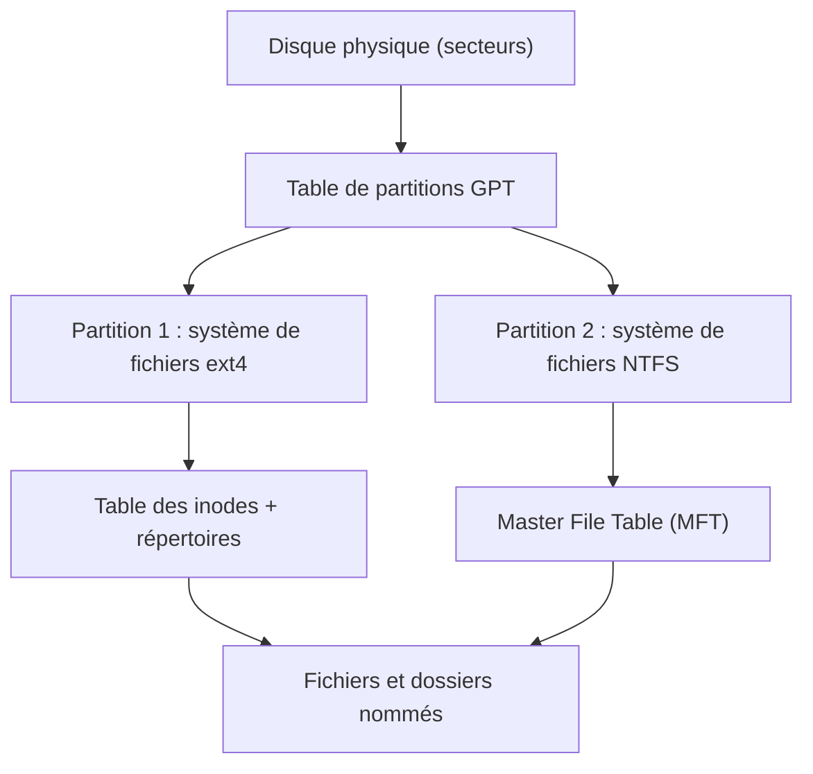

## Introduction

Ce cours pose les fondations autour d'un objet omniprésent mais rarement expliqué en profondeur : le fichier, et sa forme structurée par excellence, la base de données. Ce premier chapitre couvre le système de fichiers, déjà rencontré de façon appliquée aux cours Linux et Forensics & DFIR. Ici, on ouvre le capot.

Pourquoi est-ce important concrètement ? Parce qu'en sécurité, presque tout finit sur un disque. Un attaquant dépose un binaire, modifie un fichier de configuration, efface ses traces. Un analyste DFIR reconstruit une chronologie à partir des horodatages. Un administrateur restaure une sauvegarde. Un pentesteur cherche un fichier lisible par tous contenant un mot de passe. Dans chacun de ces cas, comprendre comment le système de fichiers range les données et les métadonnées fait la différence entre deviner et savoir.

À la fin de ce chapitre, tu sauras expliquer ce que fait un système de fichiers, lire la sortie de `stat` ligne par ligne, comprendre ce qu'est un inode et une entrée de la MFT, distinguer un lien physique d'un lien symbolique, et expliquer pourquoi un fichier supprimé est souvent récupérable.

## Le rôle d'un système de fichiers

### Du disque brut aux fichiers nommés

Un disque, qu'il soit mécanique (HDD) ou à mémoire flash (SSD, NVMe), n'expose au système d'exploitation qu'une longue suite de **blocs** numérotés, appelés secteurs au niveau matériel (historiquement 512 octets, souvent 4096 octets aujourd'hui). Le disque ne sait pas ce qu'est un fichier, un dossier ou un propriétaire.

Le **système de fichiers** est la couche logicielle qui transforme cette suite de blocs en une arborescence de fichiers nommés. Il répond à quatre questions : où se trouvent les données d'un fichier, comment s'appelle ce fichier et dans quel dossier il se trouve, qui a le droit de le lire ou de le modifier, et quand il a été créé ou modifié. Sans système de fichiers, un disque ne serait qu'une suite de zéros et de uns sans aucune structure exploitable par un humain ou une application.

Entre le disque et le système de fichiers se trouve généralement une **table de partitions**. Le format moderne est **GPT** (GUID Partition Table), associé au démarrage UEFI ; l'ancien format **MBR** est limité à quatre partitions primaires et à des disques de 2 To. Chaque partition contient ensuite son propre système de fichiers.



### Les systèmes de fichiers que tu rencontreras

| Système de fichiers | Plateforme | Points clés |
| --- | --- | --- |
| ext4 | Linux (défaut de Debian, Ubuntu, Kali) | Inodes, journalisation, extents, horodatages à la nanoseconde |
| XFS | Linux (défaut de RHEL, Rocky, Alma) | Très performant sur gros volumes, journalisé |
| Btrfs | Linux (défaut de Fedora, openSUSE) | Copie sur écriture, instantanés (snapshots), sommes de contrôle des données |
| NTFS | Windows | MFT, flux de données alternatifs, ACL, journal USN |
| ReFS | Windows Server | Résilience, sommes de contrôle, pensé pour le stockage serveur |
| APFS | macOS, iOS | Copie sur écriture, chiffrement natif, clones et snapshots |
| FAT32 / exFAT | Clés USB, cartes SD | Simples, sans permissions ni propriétaire, très portables |

Retiens surtout la différence de philosophie : FAT32 et exFAT ne stockent ni propriétaire ni permissions, donc copier un fichier sur une clé USB lui fait perdre ses droits d'accès. ext4 et NTFS, à l'inverse, portent un modèle de sécurité complet.

### La journalisation

Un système de fichiers **journalisé** (ext4, XFS, NTFS) écrit d'abord dans un journal l'intention d'une modification, puis l'applique. Si le courant est coupé au milieu d'une écriture, le système relit le journal au redémarrage et remet la structure dans un état cohérent, au lieu de lancer une longue vérification complète. On retrouvera exactement ce principe au chapitre 7 avec le journal des transactions des bases de données (le WAL de PostgreSQL). Pour un analyste, ces journaux sont aussi des sources de preuves : sur NTFS, le journal `$UsnJrnl` garde une trace des créations, renommages et suppressions de fichiers.

## Les métadonnées — des informations sur les données

Une **métadonnée** est une donnée qui décrit une autre donnée. Le contenu d'un fichier, c'est son texte ou ses octets ; ses métadonnées, ce sont sa taille, son propriétaire, ses permissions, ses dates. Elles existent pour un usage bien plus quotidien que la forensique : permettre au système d'exploitation de trier, rechercher, sauvegarder et protéger efficacement des millions de fichiers.

<CompareTable
  titleA="Métadonnée"
  titleB="Usage courant"
  rows={[
    { a: "Nom et extension", b: "Identification et association à une application par défaut (stockés dans le répertoire, pas dans l'inode sur Linux)" },
    { a: "Taille", b: "Gestion de l'espace disque, affichage dans l'explorateur de fichiers" },
    { a: "Dates (MACB)", b: "Tri chronologique, sauvegarde incrémentale (rappel du cours Administration Systèmes et Réseaux, chapitre 5)" },
    { a: "Permissions et propriétaire", b: "Contrôle d'accès (rappel du cours Linux, chapitre 2)" },
    { a: "Attributs étendus", b: "Étiquettes SELinux, capacités Linux, marque de provenance web sous Windows" },
  ]}
/>

### Les horodatages : MACB, MACE et leurs pièges

Rappel du cours Forensics & DFIR (chapitre 4) : chaque fichier porte plusieurs horodatages. Il existe deux conventions de lecture qu'il faut savoir distinguer, car les outils ne les nomment pas tous de la même façon.

Sur Linux, l'inode stocke quatre dates. La date **M** (modification, `mtime`) change quand le contenu est modifié. La date **A** (accès, `atime`) change quand le contenu est lu. La date **C** (changement, `ctime`) change quand les **métadonnées** sont modifiées : permissions, propriétaire, nombre de liens, renommage. Attention, le C de `ctime` ne veut pas dire « création ». Enfin, la date **B** (naissance, `btime` ou `crtime`) indique la création de l'inode ; elle est stockée par ext4 et affichée par `stat` sur les distributions récentes. Les outils forensiques comme The Sleuth Kit et plaso utilisent cette lecture : **MACB** pour Modified, Accessed, Changed, Born.

Sur Windows, NTFS stocke quatre dates nommées différemment : Modified, Accessed, Created et Entry modified (modification de l'entrée MFT). On parle alors de **MACE**, et certains supports de formation écrivent aussi MACB en lisant le C comme « Created ». Dans les deux cas, l'idée est la même : trois dates liées au contenu et à l'accès, et une date liée à la vie de l'entrée elle-même.

<WarningCallout>
La date d'accès est peu fiable. Pour éviter une écriture disque à chaque lecture, Linux monte par défaut les volumes avec l'option `relatime`, qui ne met à jour `atime` que si l'ancienne valeur est plus ancienne que `mtime` ou date de plus de 24 heures. Windows désactive aussi la mise à jour systématique de la date d'accès sur la plupart des installations. Ne conclus jamais qu'un fichier « n'a pas été lu » sur la seule base de son `atime`.
</WarningCallout>

### Le timestomping, ou comment un attaquant falsifie les dates

Puisque les enquêteurs s'appuient sur les dates, les attaquants les falsifient. Cette technique est référencée par MITRE ATT&CK sous l'identifiant **T1070.006 (Timestomp)**. Sur Linux, la commande `touch -d` modifie librement `mtime` et `atime` d'un fichier, ce qui permet de faire passer un binaire déposé hier pour un fichier système installé il y a deux ans.

```bash
# Faire croire qu'un fichier date du 1er janvier 2024
touch -d "2024-01-01 08:00:00" /tmp/outil
stat -c '%n  mtime=%y  ctime=%z' /tmp/outil
```

```text
/tmp/outil  mtime=2024-01-01 08:00:00.000000000 +0100  ctime=2026-11-09 10:42:17.318227410 +0100
```

Observe la sortie : `mtime` a bien été falsifiée, mais `ctime` affiche l'heure réelle de la manipulation, car modifier une date est en soi une modification de métadonnées. Le noyau ne permet pas de fixer `ctime` par un simple appel système. C'est un indice classique de timestomping sur Linux : une `ctime` beaucoup plus récente que la `mtime` sur un fichier censé être ancien. Sur NTFS, l'équivalent consiste à comparer les dates de l'attribut `$STANDARD_INFORMATION`, facilement modifiables par des API Windows, avec celles de l'attribut `$FILE_NAME`, beaucoup plus difficiles à altérer.

## La table des fichiers — l'index du système

Chaque système de fichiers tient un index central qui associe à chaque fichier ses métadonnées et l'emplacement de ses données sur le disque.

<Steps steps={[
  { title: "La MFT (Master File Table) sur NTFS", description: "Un index central recensant chaque fichier du volume et ses métadonnées, rappel direct du cours Forensics & DFIR (chapitre 4). Chaque fichier y possède au moins un enregistrement, généralement de 1024 octets." },
  { title: "Les inodes sur les systèmes Unix/Linux", description: "Une structure équivalente stockant les métadonnées d'un fichier séparément de son nom, permettant plusieurs noms (liens) pour un même contenu physique." },
]} />

### Anatomie d'un inode ext4

Un **inode** (index node) est une petite structure de taille fixe, 256 octets par défaut sur ext4, identifiée par un numéro unique au sein du système de fichiers. Il contient le type de fichier (fichier ordinaire, répertoire, lien symbolique, périphérique), les permissions, l'UID du propriétaire et le GID du groupe, la taille, les quatre horodatages, le **compteur de liens**, et la liste des blocs de données sous forme d'**extents** (des plages contiguës de blocs, plus efficaces que l'ancienne liste bloc par bloc d'ext2 et ext3).

Ce que l'inode ne contient **pas**, c'est le nom du fichier. Le nom est stocké dans le **répertoire** parent. Un répertoire n'est rien d'autre qu'un fichier spécial contenant une table de correspondance entre des noms et des numéros d'inode. Quand tu ouvres `/etc/passwd`, le noyau lit le répertoire racine, y trouve l'inode de `etc`, lit ce répertoire, y trouve l'inode de `passwd`, puis lit cet inode pour savoir où sont les données.

Le nombre d'inodes est fixé à la création d'un volume ext4. Un disque peut donc être « plein » alors qu'il reste de l'espace, simplement parce qu'il n'y a plus d'inode libre, typiquement sur un serveur qui crée des millions de petits fichiers de session ou de cache. La commande `df -i` affiche l'occupation des inodes.

### Anatomie d'une entrée de la MFT

Sur NTFS, tout est fichier, y compris les structures internes : la MFT elle-même est le fichier `$MFT`, et on trouve aussi `$LogFile`, `$Bitmap` ou `$Secure`. Chaque enregistrement de la MFT est composé d'**attributs**. Les plus importants sont `$STANDARD_INFORMATION` (dates, attributs DOS), `$FILE_NAME` (nom, dossier parent et un second jeu de dates) et `$DATA` (le contenu). Particularité utile : quand un fichier est très petit, quelques centaines d'octets, son contenu est stocké directement dans l'enregistrement MFT. On parle de donnée **résidente**. Une MFT extraite d'une image disque peut donc contenir le contenu de petits fichiers supprimés.

NTFS permet aussi plusieurs attributs `$DATA` nommés sur un même fichier : ce sont les **flux de données alternatifs** (Alternate Data Streams, ADS). Windows s'en sert légitimement pour la « marque du Web » : le flux `Zone.Identifier` indique qu'un fichier a été téléchargé depuis Internet, ce qui déclenche des avertissements de sécurité. Les attaquants s'en servent pour cacher des données dans un fichier anodin (MITRE ATT&CK **T1564.004**, NTFS File Attributes).

```powershell
# Lister les flux d'un fichier téléchargé et lire la marque du Web
Get-Item .\facture.zip -Stream *
Get-Content .\facture.zip -Stream Zone.Identifier
```

```text
[ZoneTransfer]
ZoneId=3
HostUrl=https://exemple.invalid/facture.zip
```

La valeur `ZoneId=3` correspond à la zone Internet. Un analyste y trouve même l'URL d'origine du téléchargement, une information précieuse lors d'une investigation de phishing.

## Lire les métadonnées en pratique

La commande `stat` affiche l'ensemble des métadonnées d'un fichier, dont son numéro d'inode.

```bash
stat /etc/passwd
```

```text
  File: /etc/passwd
  Size: 3105         Blocks: 8          IO Block: 4096   regular file
Device: 8,2   Inode: 1310834     Links: 1
Access: (0644/-rw-r--r--)  Uid: (    0/    root)   Gid: (    0/    root)
Access: 2026-11-09 08:12:44.512331090 +0100
Modify: 2026-10-02 14:03:11.204118765 +0200
Change: 2026-10-02 14:03:11.208118812 +0200
 Birth: 2026-10-02 14:03:11.204118765 +0200
```

Lisons-la ligne par ligne. `Size` est la taille logique en octets, tandis que `Blocks` compte les blocs de 512 octets réellement alloués : huit blocs, soit 4 Kio, un bloc ext4 complet. `Inode` est le numéro d'inode, et `Links` le nombre de noms qui pointent vers cet inode. `Access: (0644/-rw-r--r--)` donne les permissions en octal et en symbolique : lecture et écriture pour le propriétaire root, lecture seule pour tous les autres. Viennent ensuite les quatre dates. Ici, `Birth` et `Modify` sont presque identiques, ce qui est cohérent avec un fichier réécrit d'un bloc lors d'une mise à jour : beaucoup d'outils remplacent un fichier en en créant un nouveau puis en le renommant, ce qui génère un nouvel inode.

Pour aller plus loin que `stat`, l'outil `debugfs` (paquet e2fsprogs) lit directement les structures ext4, et `istat` de The Sleuth Kit fait de même sur une image disque, y compris pour NTFS.

## Liens physiques et liens symboliques

Cette séparation entre le nom d'un fichier et son contenu physique (via l'inode) explique pourquoi, sur Linux, on peut créer plusieurs liens vers un même fichier physique : un même contenu accessible sous plusieurs noms, sans duplication réelle des données.

```bash
echo "secret" > original.txt
ln original.txt physique.txt        # lien physique (hard link)
ln -s original.txt symbolique.txt   # lien symbolique
ls -li original.txt physique.txt symbolique.txt
```

```text
1572871 -rw-r--r-- 2 kali kali  7 nov.   9 10:50 original.txt
1572871 -rw-r--r-- 2 kali kali  7 nov.   9 10:50 physique.txt
1572874 lrwxrwxrwx 1 kali kali 12 nov.   9 10:50 symbolique.txt -> original.txt
```

L'option `-i` de `ls` affiche le numéro d'inode en première colonne. `original.txt` et `physique.txt` partagent le même inode 1572871 et le compteur de liens vaut 2 : ce sont deux noms pour exactement les mêmes données. Le lien symbolique, lui, a son propre inode et contient simplement un chemin texte, ici `original.txt`, d'où sa taille de 12 octets.

<CompareTable
  titleA="Lien physique (hard link)"
  titleB="Lien symbolique (symlink)"
  rows={[
    { a: "Second nom pour le même inode", b: "Fichier distinct contenant un chemin vers une cible" },
    { a: "Les données restent tant qu'au moins un nom existe", b: "Devient « cassé » si la cible est supprimée" },
    { a: "Impossible entre deux systèmes de fichiers différents", b: "Peut pointer n'importe où, même vers un chemin inexistant" },
    { a: "Interdit sur les répertoires pour les utilisateurs", b: "Autorisé sur les répertoires" },
  ]}
/>

Ce mécanisme explique aussi un comportement surprenant : renommer un fichier avec `mv` au sein d'un même système de fichiers ne copie aucune donnée. Le noyau retire simplement le nom de l'ancien répertoire et l'ajoute dans le nouveau ; le numéro d'inode et les blocs de données restent identiques, et l'opération est instantanée même pour un fichier de 50 Go. Seule la `ctime` de l'inode est mise à jour. Entre deux systèmes de fichiers différents, en revanche, `mv` doit copier puis supprimer.

Les liens symboliques ont une histoire de sécurité chargée. Si un programme privilégié écrit dans un fichier de `/tmp` au nom prévisible, un attaquant local peut y placer à l'avance un lien symbolique vers `/etc/shadow` et détourner l'écriture. C'est pour cela que Linux active la protection `fs.protected_symlinks`, et que les programmes sûrs utilisent `mktemp` pour créer des fichiers temporaires au nom imprévisible.

## Suppression, récupération et effacement

Supprimer un fichier avec `rm` appelle en réalité l'appel système `unlink`. Le noyau retire le nom du répertoire et décrémente le compteur de liens. Quand ce compteur atteint zéro et qu'aucun processus ne garde le fichier ouvert, l'inode et les blocs sont marqués comme libres. Les octets, eux, restent sur le disque tant qu'ils ne sont pas réécrits. C'est le principe du **file carving** et de la récupération de fichiers vu en DFIR.

Deux nuances modernes sont importantes. D'abord, sur SSD, la commande **TRIM** informe le contrôleur que des blocs sont libres ; il peut alors les effacer physiquement en arrière-plan, ce qui rend la récupération beaucoup plus aléatoire que sur un disque mécanique. Ensuite, un fichier supprimé mais encore ouvert par un processus reste accessible via `/proc/<pid>/fd/`, une astuce utile en réponse à incident quand un malware a effacé son propre binaire après s'être lancé.

Pour l'effacement sécurisé, l'outil `shred` écrase un fichier plusieurs fois, mais il n'est pas fiable sur les systèmes de fichiers journalisés en mode copie sur écriture comme Btrfs, ni sur les SSD. La recommandation actuelle pour protéger des données au repos est le **chiffrement intégral du disque** (LUKS sur Linux, BitLocker sur Windows, FileVault sur macOS) : détruire la clé suffit alors à rendre les données illisibles.

<AttackDefenseTable rows={[
  { phase: "Persistance", attack: "Dépôt d'un binaire dans un dossier système avec dates falsifiées (T1070.006)", defense: "Comparer ctime et mtime, surveiller l'intégrité des fichiers (AIDE, auditd, EDR)" },
  { phase: "Dissimulation", attack: "Données cachées dans un flux NTFS alternatif (T1564.004)", defense: "Lister les flux avec Get-Item -Stream, règles de détection sur la création d'ADS" },
  { phase: "Anti-forensique", attack: "Suppression des outils après usage, effacement des journaux", defense: "Analyse de la MFT, du journal USN et des fichiers encore ouverts dans /proc" },
  { phase: "Escalade locale", attack: "Lien symbolique piégé dans /tmp vers un fichier sensible", defense: "fs.protected_symlinks activé, usage de mktemp dans les scripts" },
]} />

## Permissions et attributs avancés

Les permissions classiques rwx (cours Linux, chapitre 2) sont une métadonnée dédiée au contrôle d'accès, distincte de la taille ou de l'extension. Linux ajoute plusieurs couches que tu croiseras en pentest comme en durcissement. Les **bits spéciaux** setuid et setgid font s'exécuter un programme avec les droits de son propriétaire ; un binaire setuid root mal choisi est une voie royale d'escalade de privilèges, et la commande `find / -perm -4000 -type f 2>/dev/null` les liste tous. Les **ACL POSIX**, lues avec `getfacl`, donnent des droits à des utilisateurs précis au-delà du trio propriétaire, groupe, autres. Les **attributs ext4**, lus avec `lsattr` et modifiés avec `chattr`, incluent l'attribut `i` (immuable) : même root ne peut plus modifier ni supprimer le fichier tant que l'attribut n'est pas retiré, une technique parfois utilisée par des malwares pour protéger leur persistance. Enfin, les **capacités Linux**, lues avec `getcap`, accordent un privilège précis à un binaire, par exemple ouvrir un port inférieur à 1024, sans le rendre setuid root.

<AuditCallout>
ISO/IEC 27001:2022 rattache ces sujets à plusieurs contrôles de l'Annexe A : A.8.3 (restriction d'accès à l'information), A.8.10 (suppression des informations, qui couvre l'effacement sécurisé des supports) et A.8.15 (journalisation). Les CIS Benchmarks Linux demandent notamment de recenser les binaires setuid et de restreindre les permissions des fichiers sensibles comme /etc/shadow.
</AuditCallout>

## Erreurs fréquentes

La première erreur consiste à lire `ctime` comme une date de création : sur Linux, c'est la date du dernier changement de métadonnées, et la date de création est `btime`. La deuxième est de faire confiance à `atime` pour prouver qu'un fichier a été lu ou non, alors que `relatime` et les réglages Windows la rendent approximative. La troisième est de croire qu'un `rm` détruit les données, alors qu'il ne fait que retirer un nom. La quatrième est d'oublier que copier un fichier, contrairement à le renommer, crée un nouvel inode avec de nouvelles dates, ce qui fausse une chronologie si l'on travaille sur des copies sans préserver les métadonnées ; en forensique, on travaille sur une image disque et on utilise des outils qui lisent les structures sans les modifier. La dernière est de conclure qu'un disque est plein en regardant seulement `df -h`, sans vérifier `df -i`.

<CehCallout>
Pour le CEH v13 et Security+, retiens : la MFT est propre à NTFS, l'inode est propre aux systèmes Unix, les métadonnées temporelles sont essentielles pour une chronologie d'incident, et le timestomping ainsi que les flux NTFS alternatifs sont des techniques de dissimulation classiques. La commande `stat` affiche toutes les métadonnées d'un fichier, y compris son numéro d'inode.
</CehCallout>

## Lab — Mise en pratique

**Environnement** : Kali Linux (terminal Nyx Shell). Aucun droit root n'est nécessaire : on travaille sur une image de disque créée dans un simple fichier.

<Steps steps={[
  { title: "Examiner les métadonnées d'un fichier", description: "Affiche les métadonnées complètes d'un fichier, y compris son inode. Repère la taille, le numéro d'inode, le compteur de liens et les quatre dates.", code: "stat /etc/passwd\ndf -i /" },
  { title: "Créer un lien physique et un lien symbolique", description: "Observe que le lien physique partage le numéro d'inode de l'original et que le compteur de liens passe à 2, alors que le lien symbolique a son propre inode.", code: "cd ~ && echo secret > original.txt\nln original.txt physique.txt\nln -s original.txt symbolique.txt\nls -li original.txt physique.txt symbolique.txt" },
  { title: "Vérifier qu'un renommage ne change pas l'inode", description: "Note le numéro d'inode avant et après le mv : il est identique, seule la date Change évolue.", code: "ls -i original.txt\nmv original.txt renomme.txt\nls -i renomme.txt\nstat -c '%n inode=%i ctime=%z' renomme.txt" },
  { title: "Simuler un timestomping et le détecter", description: "Falsifie la date de modification, puis compare mtime et ctime. Une ctime récente sur un fichier prétendument ancien est l'indice recherché.", code: "touch -d '2024-01-01 08:00' renomme.txt\nstat -c 'mtime=%y | ctime=%z' renomme.txt" },
  { title: "Créer une image ext4 et y écrire un fichier", description: "mkfs.ext4 accepte un fichier ordinaire comme cible. debugfs -w permet d'écrire dans l'image sans la monter.", code: "truncate -s 64M disque.img\nmkfs.ext4 -q disque.img\ndebugfs -w -R 'write /etc/hosts hosts' disque.img\ndebugfs -R 'ls -l' disque.img" },
  { title: "Lire l'inode brut avec debugfs", description: "Observe les champs de l'inode : type, mode, taille, dates crtime incluses, et la ligne EXTENTS qui indique les blocs de données.", code: "debugfs -R 'stat hosts' disque.img" },
  { title: "Supprimer puis retrouver la trace du fichier", description: "Après suppression, fls -d de The Sleuth Kit liste les entrées supprimées encore visibles. Selon l'état du répertoire, le nom ou l'inode peut encore apparaître : c'est la base de la récupération forensique.", code: "debugfs -w -R 'rm hosts' disque.img\nfls -d disque.img" },
]} />

## À retenir

- Un système de fichiers organise le stockage, le nommage et la recherche de données sur un support physique, au-dessus d'une table de partitions comme GPT.
- Les métadonnées (nom, taille, dates, permissions, attributs étendus) accompagnent chaque fichier pour un usage quotidien bien au-delà du seul contexte forensique.
- La MFT (NTFS) et les inodes (Unix/Linux) indexent centralement les fichiers ; sur Linux, le nom vit dans le répertoire, pas dans l'inode.
- Sur Linux, `ctime` signifie changement de métadonnées et non création ; la création est `btime`. Sur NTFS, on parle de MACE.
- Un lien physique est un second nom pour le même inode, un lien symbolique est un fichier contenant un chemin.
- Un `rm` retire un nom : les données restent jusqu'à réécriture, sauf effacement par TRIM sur SSD ; le chiffrement intégral reste la meilleure protection au repos.
- Le timestomping (T1070.006) et les flux NTFS alternatifs (T1564.004) détournent ces métadonnées ; la comparaison des dates permet souvent de les détecter.

## Questions de révision

1. Que se passerait-il si un disque n'avait aucun système de fichiers organisant ses données ?
2. Cite deux métadonnées d'un fichier et leur usage quotidien, au-delà du contexte forensique.
3. Pourquoi peut-on créer plusieurs liens (hard links) vers un même fichier physique sur un système Unix/Linux ?
4. Quelle est la différence entre `mtime`, `ctime` et `btime` sur un système de fichiers ext4 ?
5. Un binaire suspect affiche une `mtime` de 2023 mais une `ctime` d'hier. Quelle hypothèse formules-tu, et comment la vérifierais-tu ?
6. Pourquoi un `mv` d'un fichier de 50 Go est-il instantané au sein d'une même partition mais long vers une autre partition ?
7. Pourquoi la récupération d'un fichier supprimé est-elle plus incertaine sur un SSD que sur un disque mécanique ?
8. À quoi sert le flux `Zone.Identifier` sur NTFS, et pourquoi intéresse-t-il un analyste qui enquête sur un phishing ?
