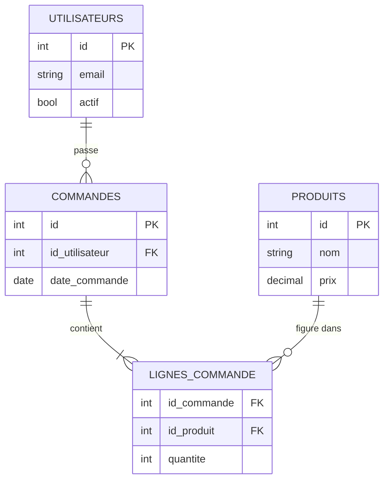

## Introduction

Derrière presque chaque application web, chaque ERP, chaque logiciel de paie ou de santé, il y a une base de données relationnelle. Les comptes utilisateurs, les commandes, les dossiers patients, les journaux d'audit : tout cela vit dans des tables. Le chapitre précédent a montré comment un fichier est structuré de l'intérieur. Une base de données relationnelle est, d'une certaine façon, l'aboutissement de cette idée : des données rangées selon un schéma strict, interrogeables avec un langage dédié, le SQL.

Pourquoi est-ce important concrètement en sécurité ? Parce que la base de données est très souvent la cible finale d'une attaque. L'injection SQL, déjà étudiée au cours Sécurité Web (chapitre 3) et approfondie au chapitre 6 de ce cours, reste l'une des vulnérabilités les plus graves du web. Or on ne comprend vraiment une injection que si l'on sait lire et écrire la requête légitime qu'elle détourne. Un pentesteur qui ignore ce qu'est une jointure ou un `UNION` tâtonne ; un développeur qui ne comprend pas comment sa requête est construite ne voit pas la faille. Côté défense, un analyste qui sait interroger une base peut vérifier des droits, auditer des comptes et lire des journaux.

À la fin de ce chapitre, tu sauras expliquer le modèle relationnel, distinguer clé primaire et clé étrangère, normaliser un schéma simple, écrire des requêtes `SELECT` avec filtres, jointures et agrégations, modifier des données avec `INSERT`, `UPDATE` et `DELETE`, interroger le catalogue d'une base, et expliquer pourquoi l'entrée `admin' --` contourne une authentification mal codée.

## Le modèle relationnel

### Tables, lignes et colonnes

Le modèle relationnel a été formalisé par Edgar F. Codd chez IBM en 1970. Son idée centrale est simple : toutes les données sont représentées sous forme de **relations**, que l'on appelle en pratique des **tables**. Une table possède des **colonnes**, aussi appelées attributs, qui ont chacune un nom et un type, et des **lignes**, aussi appelées enregistrements ou tuples, qui contiennent les valeurs.

Prenons une table `utilisateurs`. Chaque colonne décrit une propriété : un identifiant, un nom, une adresse email, un indicateur d'activité, une date de création. Chaque ligne décrit un utilisateur précis. Le **schéma** est la description de la structure : quelles tables existent, quelles colonnes elles contiennent, de quels types, avec quelles contraintes. Contrairement à un fichier CSV, une base relationnelle refuse une donnée qui ne respecte pas son schéma, par exemple une date invalide dans une colonne de type date.

Le logiciel qui gère tout cela s'appelle un **SGBDR**, pour système de gestion de bases de données relationnelles. Les plus courants aujourd'hui sont PostgreSQL, MySQL et son dérivé MariaDB, Microsoft SQL Server, Oracle Database et SQLite. SQLite a une particularité : ce n'est pas un serveur, mais une bibliothèque qui stocke toute la base dans un seul fichier. On le trouve partout, des navigateurs aux smartphones, ce qui en fait une source de preuves très fréquente en forensique.

### Les types de données

Chaque colonne a un type qui contraint les valeurs acceptées. Les types les plus courants sont les entiers (`INTEGER`, `BIGINT`), les chaînes de caractères (`VARCHAR(n)` pour une longueur maximale, `TEXT` pour une longueur libre), les booléens (`BOOLEAN`), les dates et horodatages (`DATE`, `TIMESTAMP`, et `TIMESTAMPTZ` sous PostgreSQL pour un horodatage avec fuseau horaire), et les nombres décimaux exacts (`NUMERIC(10,2)`), indispensables pour les montants financiers. Les types varient légèrement d'un SGBDR à l'autre : SQLite, par exemple, utilise un typage dynamique plus permissif que PostgreSQL.

<TipCallout>
Pour stocker de l'argent, utilise toujours un type décimal exact comme `NUMERIC`, jamais un nombre à virgule flottante (`REAL`, `FLOAT`). Les flottants introduisent des erreurs d'arrondi : additionner 0,1 et 0,2 ne donne pas exactement 0,3. En comptabilité, ces écarts minuscules finissent par devenir des incohérences visibles.
</TipCallout>

## Les clés et l'intégrité référentielle

### La clé primaire

Une **clé primaire** est une colonne, ou un ensemble de colonnes, dont la valeur identifie de façon unique chaque ligne d'une table. Deux lignes ne peuvent jamais avoir la même clé primaire, et une clé primaire ne peut jamais être vide, c'est-à-dire `NULL`. Le plus souvent, on utilise un entier généré automatiquement (`id`), ou un identifiant universel unique, l'UUID.

Pourquoi ne pas utiliser l'adresse email comme clé primaire ? Parce qu'une clé primaire doit être stable : un utilisateur peut changer d'email, et il faudrait alors modifier toutes les références vers lui. On préfère une clé dite **technique**, sans signification métier, et l'on ajoute une contrainte d'unicité sur l'email.

### La clé étrangère

Une **clé étrangère** est une colonne d'une table qui référence la clé primaire d'une autre table. C'est elle qui crée la **relation** entre les deux. Dans une table `commandes`, la colonne `id_utilisateur` est une clé étrangère qui pointe vers `utilisateurs.id` : chaque commande appartient à un utilisateur existant.

Le SGBDR fait respecter cette relation : c'est l'**intégrité référentielle**. Il refuse d'insérer une commande pour un utilisateur qui n'existe pas, et il refuse par défaut de supprimer un utilisateur qui possède encore des commandes. On peut modifier ce comportement avec des clauses comme `ON DELETE CASCADE`, qui supprime automatiquement les commandes quand l'utilisateur est supprimé, ou `ON DELETE SET NULL`, qui vide la référence.



Ce diagramme entité-association se lit ainsi : un utilisateur passe zéro, une ou plusieurs commandes ; une commande contient au moins une ligne ; un produit peut figurer dans zéro ou plusieurs lignes de commande. La table `lignes_commande` est une **table d'association** : elle matérialise une relation plusieurs-à-plusieurs entre commandes et produits.

### Les autres contraintes

Au-delà des clés, le schéma peut imposer d'autres règles. `NOT NULL` interdit une valeur vide. `UNIQUE` interdit les doublons dans une colonne. `CHECK` impose une condition, par exemple une quantité strictement positive. `DEFAULT` fournit une valeur par défaut. Ces contraintes sont une première ligne de défense pour la qualité des données : elles empêchent l'application, même boguée, d'écrire des incohérences.

<CompareTable
  titleA="Concept"
  titleB="Définition"
  rows={[
    { a: "Clé primaire", b: "Identifiant unique d'une ligne dans une table, jamais nul (ex : id_utilisateur)" },
    { a: "Clé étrangère", b: "Référence vers la clé primaire d'une autre table, créant une relation entre les deux" },
    { a: "Intégrité référentielle", b: "Garantie, assurée par le SGBDR, qu'une clé étrangère pointe toujours vers une ligne existante" },
    { a: "Contrainte UNIQUE", b: "Interdit deux valeurs identiques dans une colonne, comme une adresse email" },
    { a: "Normalisation", b: "Organiser les données pour éviter la duplication et les incohérences" },
  ]}
/>

## La normalisation

### Le problème de la duplication

Imagine une seule grande table qui stocke, pour chaque commande, le nom du client, son email, son adresse, le nom du produit et son prix. Si un client passe cinquante commandes, son adresse est recopiée cinquante fois. Le jour où il déménage, il faut modifier cinquante lignes ; si l'on en oublie une, la base contient deux adresses contradictoires pour la même personne. On appelle cela une **anomalie de mise à jour**. La **normalisation** est la démarche qui organise les données pour éviter ces duplications et les incohérences qu'elles provoquent.

### Les trois premières formes normales

La **première forme normale**, ou 1NF, exige que chaque cellule contienne une seule valeur atomique. Une colonne `telephones` contenant « 06 11 22 33 44, 07 55 66 77 88 » viole la 1NF : il faut une table séparée des numéros de téléphone.

La **deuxième forme normale**, ou 2NF, s'applique aux tables dont la clé primaire est composée de plusieurs colonnes. Elle exige que chaque colonne non clé dépende de la totalité de la clé, et pas seulement d'une partie. Dans une table `lignes_commande` dont la clé est le couple commande et produit, stocker le nom du produit viole la 2NF, car ce nom ne dépend que du produit.

La **troisième forme normale**, ou 3NF, exige qu'aucune colonne non clé ne dépende d'une autre colonne non clé. Si une table `employes` contient à la fois `id_service` et `nom_service`, le nom du service dépend de son identifiant et non de l'employé : on le déplace dans une table `services`.

```text
Avant (non normalisé) :
employes(id, nom, id_service, nom_service, etage_service)
  1  Alice  10  Comptabilité  2
  2  Bruno  10  Comptabilité  2
  3  Chloé  20  Informatique  4

Après (3NF) :
employes(id, nom, id_service)        services(id, nom_service, etage)
  1  Alice  10                          10  Comptabilité  2
  2  Bruno  10                          20  Informatique  4
  3  Chloé  20
```

En pratique, on vise généralement la 3NF pour les bases transactionnelles. Il arrive qu'on **dénormalise** volontairement, par exemple dans un entrepôt de données analytique, pour accélérer la lecture au prix d'une duplication contrôlée.

## Le langage SQL

### Les familles d'instructions

SQL, pour Structured Query Language, est normalisé par l'ISO sous la référence ISO/IEC 9075, dont la version la plus récente date de 2023. Chaque SGBDR ajoute ses propres extensions, mais le cœur est commun. On distingue plusieurs familles d'instructions. Le **DDL**, langage de définition des données, crée et modifie la structure avec `CREATE`, `ALTER` et `DROP`. Le **DML**, langage de manipulation des données, lit et modifie le contenu avec `SELECT`, `INSERT`, `UPDATE` et `DELETE`. Le **DCL**, langage de contrôle des données, gère les droits avec `GRANT` et `REVOKE`, que le chapitre 5 utilisera pour appliquer le moindre privilège. Enfin, le contrôle des transactions utilise `BEGIN`, `COMMIT` et `ROLLBACK`, détaillés au chapitre 7.

### Créer des tables

```sql
-- Syntaxe PostgreSQL
CREATE TABLE services (
    id          INTEGER GENERATED ALWAYS AS IDENTITY PRIMARY KEY,
    nom_service VARCHAR(100) NOT NULL UNIQUE
);

CREATE TABLE employes (
    id         INTEGER GENERATED ALWAYS AS IDENTITY PRIMARY KEY,
    nom        VARCHAR(100) NOT NULL,
    email      VARCHAR(255) NOT NULL UNIQUE,
    salaire    NUMERIC(10,2) CHECK (salaire > 0),
    id_service INTEGER REFERENCES services(id) ON DELETE SET NULL
);
```

La clause `GENERATED ALWAYS AS IDENTITY` est la façon standard et moderne de créer un identifiant auto-incrémenté sous PostgreSQL ; l'ancien type `SERIAL` fonctionne encore mais n'est plus recommandé. Sous MySQL on écrirait `AUTO_INCREMENT`, et sous SQLite `INTEGER PRIMARY KEY`.

### Les quatre opérations de base

Les quatre opérations du DML forment l'essentiel du SQL manipulé au quotidien. `SELECT` lit des données, `INSERT` en ajoute, `UPDATE` en modifie et `DELETE` supprime des lignes selon une condition.

```sql
-- Lire : sélectionner des colonnes et filtrer avec WHERE
SELECT nom, email FROM utilisateurs WHERE actif = true;

-- Ajouter une ligne
INSERT INTO utilisateurs (nom, email) VALUES ('Alice', 'alice@example.com');

-- Modifier : sans WHERE, TOUTES les lignes seraient modifiées
UPDATE utilisateurs SET actif = false WHERE id = 42;

-- Supprimer des lignes selon une condition
DELETE FROM commandes WHERE id = 17;
```

<WarningCallout>
Un `UPDATE` ou un `DELETE` sans clause `WHERE` s'applique à toutes les lignes de la table. C'est l'une des erreurs les plus coûteuses en production. Prends l'habitude d'écrire d'abord la requête en `SELECT` avec le même `WHERE` pour vérifier les lignes visées, et de travailler dans une transaction (`BEGIN` puis `ROLLBACK` si le résultat est inattendu).
</WarningCallout>

### Filtrer, trier et agréger

La clause `WHERE` accepte des comparaisons (`=`, `<>`, `>`), des combinaisons logiques (`AND`, `OR`, `NOT`), des intervalles (`BETWEEN`), des listes (`IN`), des motifs (`LIKE 'adm%'`, où `%` remplace n'importe quelle suite de caractères) et des tests de vacuité (`IS NULL`). `ORDER BY` trie le résultat et `LIMIT` en restreint le nombre de lignes.

Les **fonctions d'agrégation** résument plusieurs lignes en une seule valeur : `COUNT`, `SUM`, `AVG`, `MIN` et `MAX`. Combinées avec `GROUP BY`, elles calculent un résultat par groupe. La clause `HAVING` filtre ensuite les groupes, là où `WHERE` filtre les lignes avant le regroupement.

```sql
-- Nombre d'employés et salaire moyen par service, services de plus de 2 personnes
SELECT id_service, COUNT(*) AS effectif, ROUND(AVG(salaire), 2) AS salaire_moyen
FROM employes
GROUP BY id_service
HAVING COUNT(*) > 2
ORDER BY effectif DESC;
```

```text
 id_service | effectif | salaire_moyen
------------+----------+---------------
         20 |        5 |       3420.00
         10 |        3 |       2810.50
(2 rows)
```

### Les jointures

La **jointure**, avec le mot-clé `JOIN`, combine les lignes de deux tables sur la base d'une relation, typiquement une clé étrangère. C'est l'opération qui donne tout son sens au modèle relationnel : les données sont rangées séparément pour éviter la duplication, et on les rassemble au moment de la lecture.

```sql
-- Nom de chaque employé avec le nom de son service
SELECT e.nom, s.nom_service
FROM employes e
JOIN services s ON e.id_service = s.id;
```

```text
  nom  | nom_service
-------+--------------
 Alice | Comptabilité
 Bruno | Comptabilité
 Chloé | Informatique
(3 rows)
```

Les lettres `e` et `s` sont des **alias** qui raccourcissent l'écriture. La clause `ON` indique la condition de correspondance. Il existe plusieurs types de jointures : `INNER JOIN`, le comportement par défaut de `JOIN`, ne garde que les lignes qui ont une correspondance des deux côtés ; `LEFT JOIN` garde toutes les lignes de la table de gauche, en complétant par `NULL` quand il n'y a pas de correspondance, ce qui permet par exemple de trouver les employés sans service ; `RIGHT JOIN` fait l'inverse et `FULL JOIN` garde tout.

```sql
-- Employés rattachés à aucun service : LEFT JOIN + test de NULL
SELECT e.nom
FROM employes e
LEFT JOIN services s ON e.id_service = s.id
WHERE s.id IS NULL;
```

### UNION et sous-requêtes

L'opérateur `UNION` empile les résultats de deux requêtes `SELECT` en un seul résultat. Il impose une règle stricte : les deux requêtes doivent renvoyer **le même nombre de colonnes**, avec des types compatibles. `UNION` élimine les doublons, `UNION ALL` les conserve. Retiens bien cette règle : c'est exactement elle qu'un attaquant doit satisfaire dans une injection SQL de type union-based, comme le détaille le chapitre 6.

Une **sous-requête** est une requête imbriquée dans une autre, par exemple pour trouver les employés mieux payés que la moyenne : `SELECT nom FROM employes WHERE salaire > (SELECT AVG(salaire) FROM employes);`.

### Les index

Un **index** est une structure annexe, généralement un arbre B, qui accélère la recherche sur une colonne, comme l'index alphabétique d'un livre. Sans index, chercher un email parmi un million de lignes oblige le SGBDR à parcourir toute la table. Les clés primaires et les colonnes `UNIQUE` sont indexées automatiquement. On crée les autres avec `CREATE INDEX idx_employes_service ON employes(id_service);`. Un index accélère les lectures mais ralentit légèrement les écritures, puisqu'il doit être mis à jour.

## Le catalogue système

Une base relationnelle se décrit elle-même. Le **catalogue système** est un ensemble de tables et de vues qui contiennent la liste des bases, des tables, des colonnes, des utilisateurs et de leurs droits. La norme SQL définit un schéma standard, `information_schema`, disponible sous PostgreSQL, MySQL, MariaDB et SQL Server. Chaque moteur a aussi son propre catalogue : `pg_catalog` sous PostgreSQL, `sys` sous SQL Server, et la table `sqlite_master`, aussi accessible sous le nom `sqlite_schema`, sous SQLite.

```sql
-- Lister les colonnes de la table employes (PostgreSQL, MySQL, SQL Server)
SELECT column_name, data_type, is_nullable
FROM information_schema.columns
WHERE table_name = 'employes'
ORDER BY ordinal_position;
```

```text
 column_name |     data_type     | is_nullable
-------------+-------------------+-------------
 id          | integer           | NO
 nom         | character varying | NO
 email       | character varying | NO
 salaire     | numeric           | YES
 id_service  | integer           | YES
(5 rows)
```

Pour un défenseur, le catalogue sert à auditer : qui a accès à quoi, quelles tables contiennent des données personnelles. Pour un attaquant qui a trouvé une injection SQL, c'est la carte au trésor : interroger `information_schema.tables` puis `information_schema.columns` lui révèle le nom des tables et des colonnes à exfiltrer. C'est pourquoi un compte applicatif aux droits restreints, vu au chapitre 5, limite aussi ce qu'il peut voir du catalogue.

<CehCallout>
Le CEH v13 (module 15, SQL Injection) et l'OSCP+ attendent que tu saches reconnaître le SGBDR cible et interroger son catalogue. Retiens les correspondances : `information_schema` pour MySQL, MariaDB, PostgreSQL et SQL Server, `sqlite_master` pour SQLite, et les vues `all_tables` et `all_tab_columns` pour Oracle. Les commentaires diffèrent aussi : `--` suivi d'un espace est standard, `#` est propre à MySQL et MariaDB.
</CehCallout>

## Pourquoi ce socle éclaire l'injection SQL

Une injection SQL se produit quand une application construit une requête en **concaténant** une entrée utilisateur directement dans le texte SQL. L'entrée cesse alors d'être une simple valeur et devient du code. Comprendre la syntaxe légitime, avec `WHERE`, `JOIN`, `UNION` et les commentaires, rend immédiatement lisible ce que fait une charge malveillante.

```sql
-- Requête prévue par l'application (construite par concaténation, donc vulnérable)
SELECT * FROM utilisateurs WHERE nom = 'saisie_utilisateur' AND mot_de_passe = 'saisie_mdp';

-- Si saisie_utilisateur = admin' --
SELECT * FROM utilisateurs WHERE nom = 'admin' -- ' AND mot_de_passe = '...';
-- L'apostrophe ferme la chaîne, puis -- commente toute la suite de la requête :
-- la vérification du mot de passe disparaît.

-- Si saisie_utilisateur = ' OR '1'='1
SELECT * FROM utilisateurs WHERE nom = '' OR '1'='1' AND mot_de_passe = '...';
```

Dans le premier cas, le double tiret `--` démarre un commentaire SQL : tout ce qui suit est ignoré par le moteur, y compris la condition sur le mot de passe. La requête renvoie la ligne de l'utilisateur `admin`. Dans le second cas, l'entrée modifie la logique de la clause `WHERE`. Attention à la priorité des opérateurs : `AND` est évalué avant `OR`, donc la condition devient « nom vide, ou bien 1 égale 1 et mot de passe correct ». Selon la façon dont l'application est codée, la variante la plus courante ajoute un commentaire à la fin pour neutraliser complètement la suite.

<AttackDefenseTable
  rows={[
    { phase: "Construction de la requête", attack: "Concaténer une saisie utilisateur dans le texte SQL", defense: "Requêtes préparées : la structure SQL est fixée, la saisie est transmise séparément comme valeur" },
    { phase: "Énumération du schéma", attack: "Interroger information_schema pour découvrir tables et colonnes", defense: "Compte applicatif aux droits minimaux, sans accès inutile au catalogue (chapitre 5)" },
    { phase: "Exfiltration", attack: "UNION SELECT pour ajouter des lignes d'une autre table au résultat", defense: "Moindre privilège, journalisation des requêtes anormales, WAF en défense en profondeur" },
    { phase: "Erreurs visibles", attack: "Messages d'erreur SQL qui révèlent le moteur et la requête", defense: "Messages génériques côté client, détails uniquement dans les journaux serveur" },
  ]}
/>

La seule défense réellement fiable est la **requête préparée**, aussi appelée requête paramétrée. Le chapitre 6 détaille les variantes d'injection et le chapitre 5 les mesures de durcissement qui en limitent l'impact.

## Erreurs fréquentes

La première erreur est d'oublier la clause `WHERE` dans un `UPDATE` ou un `DELETE`, avec les conséquences décrites plus haut. La deuxième est de confondre `WHERE` et `HAVING` : `WHERE` filtre les lignes avant l'agrégation, `HAVING` filtre les groupes après. La troisième concerne `NULL`, qui signifie « valeur inconnue » et non « zéro » ou « chaîne vide » : la comparaison `colonne = NULL` ne renvoie jamais vrai, il faut écrire `colonne IS NULL`.

Une quatrième erreur consiste à croire que SQLite applique les clés étrangères par défaut : ce n'est pas le cas, il faut exécuter `PRAGMA foreign_keys = ON;` à chaque connexion. Une cinquième est de stocker plusieurs valeurs dans une seule cellule, en violant la première forme normale, ce qui rend les recherches et les jointures pénibles. Enfin, l'erreur de sécurité la plus grave reste de construire des requêtes par concaténation de chaînes, même « juste pour un script interne ».

## Lab — Mise en pratique

**Environnement** : Kali Linux (terminal Nyx Shell), avec `sqlite3` et Python 3. Si `sqlite3` est absent, installe-le avec `sudo apt install sqlite3`.

<Steps steps={[
  { title: "Créer la base et le schéma", description: "Crée une base SQLite avec deux tables reliées par une clé étrangère. Active les clés étrangères, désactivées par défaut sous SQLite.", code: "sqlite3 entreprise.db\nPRAGMA foreign_keys = ON;\nCREATE TABLE services (id INTEGER PRIMARY KEY, nom_service TEXT NOT NULL UNIQUE);\nCREATE TABLE employes (id INTEGER PRIMARY KEY, nom TEXT NOT NULL, id_service INTEGER REFERENCES services(id));\n.tables" },
  { title: "Insérer des données", description: "Ajoute deux services et trois employés. Observe que le moteur attribue automatiquement les identifiants.", code: "INSERT INTO services (nom_service) VALUES ('Comptabilité'), ('Informatique');\nINSERT INTO employes (nom, id_service) VALUES ('Alice', 1), ('Bruno', 1), ('Chloé', 2);\n.mode column\n.headers on\nSELECT * FROM employes;" },
  { title: "Tester l'intégrité référentielle", description: "Tente d'ajouter un employé dans un service inexistant. Le moteur doit refuser avec l'erreur FOREIGN KEY constraint failed.", code: "INSERT INTO employes (nom, id_service) VALUES ('Intrus', 99);" },
  { title: "Écrire une jointure", description: "Affiche le nom de chaque employé avec le nom de son service, puis compte l'effectif par service avec GROUP BY.", code: "SELECT e.nom, s.nom_service FROM employes e JOIN services s ON e.id_service = s.id;\nSELECT s.nom_service, COUNT(*) AS effectif FROM employes e JOIN services s ON e.id_service = s.id GROUP BY s.nom_service;" },
  { title: "Lire le catalogue", description: "Interroge la table système de SQLite pour lister les tables et leur définition. C'est l'équivalent de information_schema sur les autres moteurs. Quitte ensuite avec .quit.", code: "SELECT name, sql FROM sqlite_master WHERE type = 'table';\n.quit" },
  { title: "Observer une requête vulnérable", description: "Ce script construit la requête par concaténation. Lance-le avec le nom Alice, puis avec la saisie ' OR '1'='1 : toutes les lignes reviennent alors que personne ne porte ce nom.", code: "cat > vuln.py << 'EOF'\nimport sqlite3, sys\ncon = sqlite3.connect('entreprise.db')\nnom = sys.argv[1]\nrequete = \"SELECT nom FROM employes WHERE nom = '\" + nom + \"'\"\nprint(requete)\nprint(con.execute(requete).fetchall())\nEOF\npython3 vuln.py Alice\npython3 vuln.py \"' OR '1'='1\"" },
  { title: "Corriger avec une requête paramétrée", description: "Remplace la concaténation par un paramètre ?. La même saisie malveillante est désormais traitée comme un simple nom et ne renvoie aucune ligne.", code: "cat > safe.py << 'EOF'\nimport sqlite3, sys\ncon = sqlite3.connect('entreprise.db')\nprint(con.execute('SELECT nom FROM employes WHERE nom = ?', (sys.argv[1],)).fetchall())\nEOF\npython3 safe.py Alice\npython3 safe.py \"' OR '1'='1\"" },
]} />

## À retenir

- Une base relationnelle range les données en tables typées, dont la structure est décrite par un schéma que le SGBDR fait respecter.
- La clé primaire identifie de façon unique chaque ligne ; la clé étrangère référence la clé primaire d'une autre table et crée la relation, protégée par l'intégrité référentielle.
- La normalisation, jusqu'à la troisième forme normale, limite la duplication et les anomalies de mise à jour.
- `SELECT`, `INSERT`, `UPDATE` et `DELETE` sont les quatre opérations de base ; `JOIN` combine des tables reliées et `GROUP BY` agrège.
- `UNION` exige le même nombre de colonnes des deux côtés, une règle centrale dans l'injection union-based.
- Le catalogue système, comme `information_schema` ou `sqlite_master`, décrit la base : outil d'audit pour le défenseur, carte du trésor pour l'attaquant.
- L'injection SQL naît de la concaténation ; les requêtes préparées séparent structurellement le code des données.

## Questions de révision

1. Quelle est la différence entre une clé primaire et une clé étrangère, et que garantit l'intégrité référentielle ?
2. Pourquoi est-il déconseillé d'utiliser une adresse email comme clé primaire ?
3. Une table contient les colonnes `id_service` et `nom_service` pour chaque employé : quelle forme normale est violée, et comment corriger le schéma ?
4. Écris une requête affichant le nom de chaque employé avec le nom de son service, à partir des tables `employes(id, nom, id_service)` et `services(id, nom_service)`.
5. Quelle différence y a-t-il entre `WHERE` et `HAVING` ? Donne un exemple où seul `HAVING` convient.
6. Dans l'entrée `admin' --`, quel est le rôle de l'apostrophe et celui du double tiret ?
7. Pourquoi un attaquant qui exploite une injection SQL cherche-t-il à interroger `information_schema` ?
8. Pourquoi la connaissance de la règle du nombre de colonnes de `UNION` est-elle utile aussi bien au pentesteur qu'au défenseur ?
