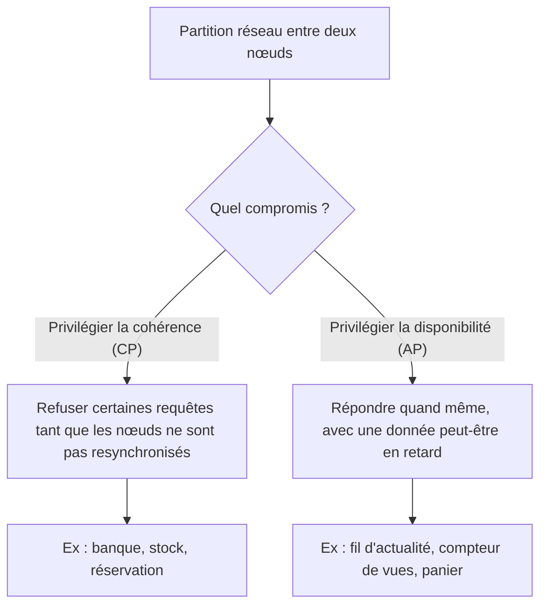

## Introduction

Le chapitre précédent a posé le modèle relationnel : des tables au schéma fixe, reliées par des clés, interrogées en SQL. Ce modèle domine depuis les années 1980, mais il n'est pas adapté à tout. Au milieu des années 2000, les grands services web ont dû stocker des volumes de données et absorber des charges que les bases relationnelles d'alors géraient mal sur un seul serveur. Une famille de solutions est née, regroupée sous l'étiquette **NoSQL**, que l'on lit aujourd'hui comme « Not only SQL ».

Tu utilises déjà du NoSQL sans le savoir : l'infrastructure Nyx elle-même s'appuie sur Redis pour son cache, ses sessions de labs et sa limitation de débit. BloodHound, que tu as croisé au cours Active Directory, repose sur une base orientée graphe. De nombreuses applications web modernes stockent leurs données dans MongoDB.

En sécurité, le NoSQL compte pour deux raisons. D'abord, l'idée reçue selon laquelle « pas de SQL veut dire pas d'injection » est fausse : l'injection NoSQL existe et contourne des authentifications. Ensuite, beaucoup de bases NoSQL ont longtemps été livrées sans authentification activée par défaut, ce qui a conduit à des milliers d'instances exposées sur Internet et à des campagnes d'extorsion massives.

À la fin de ce chapitre, tu sauras expliquer pourquoi le NoSQL existe, reconnaître les quatre familles et leurs cas d'usage, expliquer le théorème CAP, manipuler MongoDB et Redis en ligne de commande, et comprendre comment une injection NoSQL fonctionne et comment s'en protéger.

## Pourquoi le NoSQL a émergé

### Les limites du modèle relationnel pour certains besoins

Le modèle relationnel impose un **schéma défini à l'avance** : chaque table a ses colonnes et ses types. Ajouter un champ à une table de cent millions de lignes peut être une opération lourde. Pour des données dont la structure change souvent, comme les profils d'un réseau social, ou varie d'un enregistrement à l'autre, comme un catalogue où une chaussure et un ordinateur n'ont pas les mêmes caractéristiques, cette rigidité devient un frein.

Le deuxième enjeu est la **montée en charge**. Une base relationnelle classique grandit surtout verticalement : on achète un serveur plus puissant. Les bases NoSQL ont été conçues dès l'origine pour grandir **horizontalement** : on ajoute des serveurs ordinaires et les données sont réparties entre eux, ce que l'on appelle le **sharding**, ou partitionnement. Le troisième enjeu est la **performance extrême sur des opérations simples** : lire une valeur par sa clé en une fraction de milliseconde, comme le fait Redis pour le cache de Nyx.

<CehCallout>
Le NoSQL a émergé en complément du relationnel, pas en remplacement : le modèle relationnel impose une structure de tables fixe, et le NoSQL répond aux besoins où cette rigidité devient un frein, comme des données très volumineuses, une structure changeante ou un besoin de performance extrême sur des opérations simples. Beaucoup d'architectures combinent les deux, une approche appelée persistance polyglotte.
</CehCallout>

### La persistance polyglotte

En pratique, une application moderne utilise souvent plusieurs bases à la fois, chacune pour ce qu'elle fait le mieux. Nyx en est un bon exemple : PostgreSQL stocke les données structurées et relationnelles, comme les cours, la progression et les utilisateurs, tandis que Redis sert de cache rapide et stocke les sessions temporaires des labs avec une durée de vie limitée. Cette combinaison est appelée **persistance polyglotte**.

## Le théorème CAP et le modèle BASE

### Les trois propriétés

Quand des données sont réparties sur plusieurs serveurs, un compromis devient inévitable. Le **théorème CAP**, énoncé par Eric Brewer en 2000 et démontré formellement par Seth Gilbert et Nancy Lynch en 2002, porte sur trois propriétés. La **cohérence**, le C, signifie que toute lecture renvoie la donnée la plus récemment écrite. La **disponibilité**, le A pour availability, signifie que toute requête reçoit une réponse. La **tolérance au partitionnement**, le P, signifie que le système continue de fonctionner même si le réseau coupe la communication entre certains serveurs.

Le théorème dit qu'en cas de partition réseau, un système distribué doit choisir entre cohérence et disponibilité. Comme les pannes réseau sont inévitables dans un système réparti, le choix réel se fait entre un comportement **CP**, qui refuse de répondre plutôt que de renvoyer une donnée potentiellement périmée, et un comportement **AP**, qui répond toujours, quitte à renvoyer une donnée pas encore synchronisée.



### ACID contre BASE

Les bases relationnelles offrent par défaut des transactions **ACID**, pour atomicité, cohérence, isolation et durabilité, détaillées au chapitre 7. Beaucoup de systèmes NoSQL distribués adoptent un modèle plus souple, résumé par l'acronyme **BASE** : basically available, soft state, eventually consistent. L'idée clé est la **cohérence à terme** : après une écriture, les différents nœuds finissent par converger vers la même valeur, mais pas instantanément.

Il faut nuancer : la frontière s'est estompée. MongoDB supporte les transactions multi-documents ACID depuis sa version 4.0, et Cassandra permet de régler le niveau de cohérence requête par requête. Le choix n'est donc plus binaire, mais il reste vrai que certaines bases NoSQL sacrifient délibérément une part de la cohérence forte au profit de la performance ou de la disponibilité.

## Les quatre grandes familles NoSQL

<CompareTable
  titleA="Famille"
  titleB="Principe et exemple"
  rows={[
    { a: "Document", b: "Stocke des documents structurés (souvent JSON), au schéma flexible d'un document à l'autre — ex : MongoDB, Couchbase" },
    { a: "Clé-valeur", b: "Stockage et récupération ultra-rapides par clé unique — ex : Redis, déjà utilisé pour le cache de Nyx, ou son fork Valkey" },
    { a: "Colonne large", b: "Optimisée pour d'immenses volumes de données réparties sur de nombreux serveurs — ex : Apache Cassandra, HBase" },
    { a: "Graphe", b: "Optimisée pour les relations complexes entre entités — ex : Neo4j, le même principe que BloodHound (cours Active Directory)" },
  ]}
/>

### Les bases orientées document

Une base orientée document stocke des **documents**, généralement au format JSON ou dans un équivalent binaire. MongoDB utilise le BSON, pour Binary JSON, qui ajoute des types comme les dates et les identifiants `ObjectId`. Les documents sont regroupés en **collections**, l'équivalent approximatif des tables. Deux documents d'une même collection peuvent avoir des champs différents : c'est le **schéma flexible**. Un document peut aussi contenir des sous-documents et des tableaux, ce qui évite souvent les jointures.

```javascript
// Dans mongosh, le shell officiel de MongoDB (l'ancien shell « mongo » est retiré)
use boutique
db.produits.insertOne({ nom: "Clavier", prix: 49.9, tags: ["usb", "azerty"] })
db.produits.insertOne({ nom: "Écran", prix: 189, specs: { taille: 27, dalle: "IPS" } })

// Trouver les produits de moins de 100 € : $lt est un opérateur de requête
db.produits.find({ prix: { $lt: 100 } }, { _id: 0, nom: 1, prix: 1 })
```

```text
[ { nom: 'Clavier', prix: 49.9 } ]
```

Retiens la syntaxe des **opérateurs de requête**, qui commencent par un dollar : `$lt` pour inférieur, `$gt` pour supérieur, `$ne` pour différent, `$in` pour l'appartenance à une liste, `$regex` pour une expression régulière. Ce sont précisément ces opérateurs qu'exploite l'injection NoSQL.

### Les bases clé-valeur

Une base clé-valeur est la structure la plus simple : un grand dictionnaire où chaque **clé** unique donne accès à une **valeur**. Redis garde ses données en mémoire vive, ce qui le rend extrêmement rapide, et peut les persister sur disque. Ses valeurs ne sont pas que des chaînes : listes, ensembles, tables de hachage, flux. Surtout, chaque clé peut recevoir une **durée de vie**, appelée TTL, après laquelle elle disparaît automatiquement, idéal pour un cache ou une session.

```bash
redis-cli SET nyx:session:42 "user=aure" EX 7200   # EX : expiration en secondes (2 h)
redis-cli GET nyx:session:42
redis-cli TTL nyx:session:42                          # secondes restantes avant expiration
```

```text
OK
"user=aure"
(integer) 7197
```

Ce motif est exactement celui des sessions de labs de Nyx : une clé préfixée, une valeur, et un TTL de deux heures. Côté licence, note qu'en 2024 Redis a quitté sa licence libre BSD, ce qui a conduit la Linux Foundation à créer le fork **Valkey**, compatible ; Redis 8 a depuis ajouté l'AGPLv3 parmi ses licences possibles. Pour un apprenant, les commandes sont les mêmes.

### Les bases orientées colonne large

Les bases à colonnes larges, comme Apache Cassandra ou HBase, organisent les données en lignes identifiées par une clé de partition, chaque ligne pouvant avoir un grand nombre de colonnes. Elles sont conçues pour d'immenses volumes de données répartis sur de nombreux serveurs, avec des écritures très rapides. On les retrouve pour la télémétrie, les journaux, ou les historiques de messagerie. Cassandra s'interroge avec le CQL, un langage volontairement proche du SQL, mais sans jointures : on modélise les tables en fonction des requêtes que l'on fera.

### Les bases orientées graphe

Une base orientée graphe stocke des **nœuds**, qui représentent des entités, et des **relations** typées entre eux. Elle excelle quand la question porte sur les liens, comme « quel est le plus court chemin entre cet utilisateur et le groupe Admins du domaine ». C'est exactement ce que fait BloodHound, dont l'édition communautaire actuelle, BloodHound CE, peut s'appuyer sur Neo4j. Neo4j s'interroge avec le langage **Cypher**.

```text
// Cypher : chemins les plus courts d'un utilisateur vers le groupe Domain Admins
MATCH p = shortestPath((u:User {name: "ALICE@CORP.LOCAL"})-[*1..]->(g:Group {name: "DOMAIN ADMINS@CORP.LOCAL"}))
RETURN p
```

Faire la même chose en SQL demanderait des jointures récursives coûteuses. La base graphe parcourt simplement les relations de proche en proche.

## Relationnel ou NoSQL : un choix selon le besoin

Le NoSQL n'est pas une version « plus moderne » du relationnel : c'est un ensemble d'outils différents pour des besoins différents.

<CompareTable
  titleA="Relationnel (SQL)"
  titleB="NoSQL"
  rows={[
    { a: "Schéma fixe, cohérence forte entre tables", b: "Schéma flexible, adapté à des données hétérogènes" },
    { a: "Adapté aux données fortement structurées et relationnelles", b: "Adapté à de très grands volumes ou des besoins de performance spécifiques" },
    { a: "Transactions ACID robustes par défaut", b: "Certaines bases NoSQL sacrifient une part de cohérence pour la performance (compromis CAP)" },
    { a: "Montée en charge surtout verticale, réplication possible", b: "Conçu pour la montée en charge horizontale (sharding)" },
    { a: "Langage SQL normalisé (ISO/IEC 9075)", b: "Langage propre à chaque produit (API MongoDB, commandes Redis, CQL, Cypher)" },
  ]}
/>

Pour des données critiques où chaque écriture compte, comme une comptabilité, des dossiers médicaux ou des stocks, le relationnel reste généralement le premier choix. Pour un cache, des sessions, un catalogue au schéma variable, de la télémétrie massive ou l'analyse de relations, une base NoSQL adaptée sera souvent plus simple et plus performante.

## Enjeux de sécurité spécifiques au NoSQL

### Les bases exposées sans authentification

Pendant des années, plusieurs bases NoSQL ont été livrées avec une configuration par défaut pensée pour le développement : pas d'authentification, et parfois une écoute sur toutes les interfaces réseau. En 2017, des campagnes d'extorsion ont touché des dizaines de milliers d'instances MongoDB, puis Elasticsearch, exposées sur Internet : les attaquants copiaient ou effaçaient les données et laissaient une demande de rançon. Les éditeurs ont depuis durci les valeurs par défaut : MongoDB n'écoute plus que sur l'interface locale depuis sa version 3.6, Redis dispose d'un « protected mode » depuis la version 3.2 et de listes de contrôle d'accès, les ACL, depuis la version 6, et Elasticsearch active la sécurité par défaut depuis la version 8. Mais une mauvaise configuration reste vite arrivée, notamment dans un conteneur dont on publie le port sur toutes les interfaces.

<WarningCallout>
Avec Docker, l'option `-p 27017:27017` publie le port sur toutes les interfaces de l'hôte, et Docker insère ses propres règles de pare-feu qui peuvent contourner un pare-feu comme UFW. Pour un usage local, publie toujours sur la boucle locale avec `-p 127.0.0.1:27017:27017`, et active l'authentification même en développement.
</WarningCallout>

### L'injection NoSQL

Contrairement à une idée reçue, l'absence de SQL ne signifie pas l'absence d'injection. L'**injection NoSQL** exploite la façon dont une base comme MongoDB interprète les opérateurs spéciaux dans une requête construite à partir d'une entrée mal validée. L'impact est similaire à celui de l'injection SQL classique : contournement d'authentification, extraction de données.

```text
Exemple simplifié de NoSQL injection (MongoDB) :

Requête prévue : { "utilisateur": saisie_utilisateur, "motDePasse": saisie_mdp }

Si un attaquant soumet comme mot de passe : { "$ne": null }
La requête devient : { "utilisateur": "admin", "motDePasse": { "$ne": null } }
Cette condition est presque toujours vraie, contournant l'authentification.
```

L'opérateur `$ne` signifie « différent de ». La condition « le mot de passe est différent de null » est vraie pour tout compte qui possède un mot de passe : la base renvoie donc le document de l'administrateur sans que le vrai mot de passe soit connu.

Comment l'attaquant fait-il passer un objet au lieu d'une chaîne ? Dans une application Node.js avec Express, deux voies sont classiques. Si l'application accepte du JSON, il suffit d'envoyer `"motDePasse": {"$ne": null}` dans le corps de la requête. Si elle lit un formulaire ou des paramètres d'URL, l'analyseur de paramètres transforme souvent `motDePasse[$ne]=x` en objet. Le code vulnérable ressemble à ceci.

```javascript
// VULNÉRABLE : req.body.motDePasse peut être un objet { "$ne": null }
const user = await db.collection("utilisateurs").findOne({
  utilisateur: req.body.utilisateur,
  motDePasse: req.body.motDePasse,
});
```

D'autres opérateurs sont abusés de la même façon : `$gt` avec une chaîne vide, `$regex` pour deviner un secret caractère par caractère, ou `$where`, qui exécute du JavaScript côté serveur et ouvre la porte à des abus plus graves.

<CehCallout>
L'injection NoSQL rejoint directement le principe de l'injection SQL du chapitre 3 : une entrée non validée est interprétée comme une structure de requête plutôt que comme une simple valeur. L'injection reste une catégorie du Top 10 OWASP (A03 dans l'édition 2021, A05 dans l'édition 2025), et elle couvre explicitement les variantes NoSQL. La défense est la même en substance : valider strictement le type des entrées et ne jamais construire une requête à partir de données brutes.
</CehCallout>

### Se protéger de l'injection NoSQL

La première défense est la **validation de type**. Si le mot de passe doit être une chaîne, refuse tout ce qui n'est pas une chaîne. Une bibliothèque de schémas comme zod, utilisée dans Nyx, le fait proprement. La deuxième défense est de **neutraliser les clés commençant par un dollar** dans les entrées, par exemple avec l'option `sanitizeFilter` de la bibliothèque Mongoose. La troisième est de **désactiver le JavaScript côté serveur** si on ne l'utilise pas, avec le paramètre `security.javascriptEnabled: false` dans la configuration de MongoDB. Enfin, une authentification ne devrait jamais comparer un mot de passe dans la requête : on récupère l'utilisateur par son identifiant, puis on vérifie le mot de passe avec une fonction de hachage adaptée comme Argon2id ou bcrypt.

```javascript
// CORRIGÉ : validation stricte du type avec zod, puis vérification du hash
import { z } from "zod";
import argon2 from "argon2";

const Login = z.object({ utilisateur: z.string().min(1), motDePasse: z.string().min(1) });
const { utilisateur, motDePasse } = Login.parse(req.body); // rejette { "$ne": null }

const user = await db.collection("utilisateurs").findOne({ utilisateur });
const ok = user !== null && (await argon2.verify(user.hashMotDePasse, motDePasse));
```

<AttackDefenseTable
  rows={[
    { phase: "Découverte", attack: "Recherche d'instances MongoDB, Redis ou Elasticsearch exposées sur Internet", defense: "Écoute sur une interface privée, pare-feu, aucune exposition directe sur Internet" },
    { phase: "Accès", attack: "Connexion sans authentification à une base laissée en configuration de développement", defense: "Authentification activée (SCRAM pour MongoDB, ACL pour Redis), mots de passe robustes" },
    { phase: "Injection", attack: "Opérateurs $ne, $gt ou $regex injectés dans un champ attendu comme chaîne", defense: "Validation stricte des types, neutralisation des clés commençant par $, sanitizeFilter" },
    { phase: "Exécution", attack: "Abus de $where ou de commandes d'administration Redis (CONFIG)", defense: "JavaScript serveur désactivé, commandes dangereuses retirées via les ACL Redis" },
    { phase: "Impact", attack: "Copie ou suppression des données, puis demande de rançon", defense: "Sauvegardes testées et isolées (chapitre 7), journalisation et alertes sur les accès" },
  ]}
/>

## Erreurs fréquentes

La première erreur est de croire que NoSQL signifie « immunisé contre l'injection ». La deuxième est de confondre schéma flexible et absence de validation : une base qui accepte n'importe quel document oblige l'application à valider elle-même. La troisième est de choisir une base NoSQL par effet de mode, puis de réimplémenter péniblement des jointures et des transactions dans le code applicatif. La quatrième est d'utiliser Redis comme unique stockage de données importantes sans configurer la persistance, alors qu'un redémarrage peut tout effacer. La cinquième, enfin, est de publier le port d'une base de développement sur toutes les interfaces, puis d'oublier le conteneur qui tourne.

## Lab — Mise en pratique

**Environnement** : ta machine personnelle avec Docker et Docker Compose v2 (pas le terminal du lab Nyx). Les ports sont publiés uniquement sur la boucle locale.

<Steps steps={[
  { title: "Démarrer MongoDB en local", description: "Lance un conteneur MongoDB publié uniquement sur 127.0.0.1, puis ouvre le shell mongosh à l'intérieur du conteneur.", code: "docker run -d --name lab-mongo -p 127.0.0.1:27017:27017 mongo:8.0\ndocker exec -it lab-mongo mongosh" },
  { title: "Créer une collection de comptes", description: "Insère deux comptes de test. Observe que MongoDB ajoute automatiquement un champ _id de type ObjectId à chaque document.", code: "use labauth\ndb.utilisateurs.insertMany([{ utilisateur: 'admin', motDePasse: 'S3cret!' }, { utilisateur: 'alice', motDePasse: 'Soleil2026' }])\ndb.utilisateurs.find()" },
  { title: "Simuler une injection avec $ne", description: "Compare une requête légitime avec un mauvais mot de passe, qui ne renvoie rien, et la même requête où le mot de passe est remplacé par l'objet $ne null, qui renvoie le compte admin.", code: "db.utilisateurs.findOne({ utilisateur: 'admin', motDePasse: 'mauvais' })\ndb.utilisateurs.findOne({ utilisateur: 'admin', motDePasse: { $ne: null } })" },
  { title: "Observer l'énumération avec $regex", description: "Une condition $regex permet de tester si un secret commence par une lettre donnée. C'est le principe d'une extraction caractère par caractère. Quitte ensuite mongosh avec exit.", code: "db.utilisateurs.findOne({ utilisateur: 'admin', motDePasse: { $regex: '^S' } })\ndb.utilisateurs.findOne({ utilisateur: 'admin', motDePasse: { $regex: '^X' } })\nexit" },
  { title: "Manipuler Redis et les TTL", description: "Lance Redis, crée une clé de session avec une expiration de 60 secondes, puis observe le compte à rebours. Après expiration, GET renvoie nil.", code: "docker run -d --name lab-redis -p 127.0.0.1:6379:6379 redis:7-alpine\ndocker exec -it lab-redis redis-cli SET lab:session:1 alice EX 60\ndocker exec -it lab-redis redis-cli TTL lab:session:1\ndocker exec -it lab-redis redis-cli GET lab:session:1" },
  { title: "Créer un utilisateur Redis restreint", description: "Crée avec les ACL un utilisateur qui ne peut lire et écrire que les clés préfixées lab: et à qui la commande CONFIG est interdite. Vérifie qu'une tentative de CONFIG GET est refusée avec une erreur NOPERM.", code: "docker exec -it lab-redis redis-cli ACL SETUSER appli on '>MotDePasseLab' '~lab:*' +get +set -config\ndocker exec -it lab-redis redis-cli --user appli --pass MotDePasseLab GET lab:session:1\ndocker exec -it lab-redis redis-cli --user appli --pass MotDePasseLab CONFIG GET dir" },
  { title: "Nettoyer", description: "Supprime les deux conteneurs pour ne laisser aucune base de test active sur ta machine.", code: "docker rm -f lab-mongo lab-redis" },
]} />

## À retenir

- Le NoSQL a émergé en complément du relationnel pour répondre à des besoins de schéma flexible, de très grands volumes et de performance extrême sur des opérations simples.
- Les quatre familles sont le document (MongoDB), la clé-valeur (Redis), la colonne large (Cassandra) et le graphe (Neo4j, principe de BloodHound).
- Redis est une base clé-valeur en mémoire, utilisée par Nyx pour son cache et ses sessions grâce aux durées de vie des clés.
- Le théorème CAP impose, en cas de partition réseau, un choix entre cohérence et disponibilité ; certaines bases NoSQL privilégient la disponibilité et la cohérence à terme.
- L'injection NoSQL existe : un opérateur comme `$ne` injecté dans un champ non validé rend une condition presque toujours vraie.
- La défense commune à toutes les injections est de traiter l'entrée comme une valeur, jamais comme une structure : validation stricte des types et requêtes construites sans concaténation.
- Une base NoSQL ne doit jamais être exposée sur Internet sans authentification.

## Questions de révision

1. Pourquoi le NoSQL a-t-il émergé en complément du modèle relationnel plutôt qu'en remplacement ?
2. À quelle famille appartient Redis, et pourquoi convient-il au cache et aux sessions de Nyx ?
3. Pour un système de détection qui doit trouver des chemins d'attaque entre des comptes, des groupes et des machines, quelle famille NoSQL choisirais-tu et pourquoi ?
4. Énonce le théorème CAP et explique ce que signifie un comportement AP.
5. Dans l'exemple d'injection sur MongoDB, pourquoi la condition `{ "$ne": null }` contourne-t-elle la vérification du mot de passe ?
6. Quel principe commun relie l'injection SQL classique et l'injection NoSQL ?
7. Cite trois mesures concrètes qui protègent une application Node.js utilisant MongoDB contre l'injection NoSQL.
8. Pourquoi une base MongoDB lancée avec `-p 27017:27017` sur un serveur public est-elle dangereuse, même si un pare-feu est installé ?
