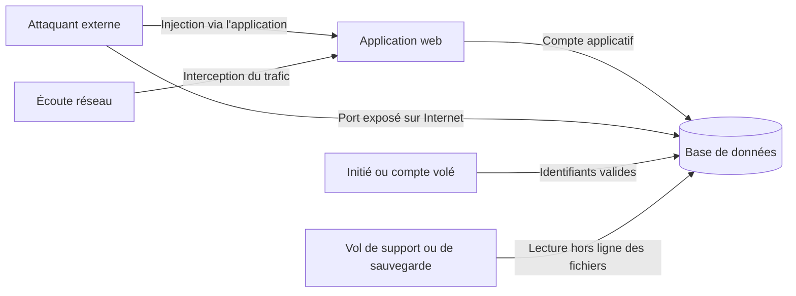

## Introduction

Une base de données concentre souvent l'essentiel des données sensibles d'une organisation : identités, mots de passe hachés, données de paiement, dossiers médicaux, secrets industriels. C'est pour cela qu'elle est si souvent la cible finale d'une intrusion, et que sa compromission fait la une des journaux. Ce chapitre applique à la base de données les principes de durcissement et de moindre privilège déjà détaillés aux cours Administration Systèmes et Réseaux et Cybersécurité Défensive.

L'angle de ce chapitre est **défensif**. Les techniques d'attaque par injection SQL sont détaillées au chapitre 6 ; ici, on se demande comment configurer la base et l'application pour qu'une attaque échoue, ou pour que son impact reste limité si elle réussit. C'est le principe de la **défense en profondeur** : plusieurs couches indépendantes, de sorte qu'une seule défaillance ne suffise pas à tout compromettre.

À la fin de ce chapitre, tu sauras établir le modèle de menace d'une base, créer des rôles aux droits minimaux, durcir la configuration réseau et l'authentification d'un serveur PostgreSQL, activer le chiffrement en transit, écrire des requêtes paramétrées, et mettre en place une journalisation exploitable par un SOC.

## Le modèle de menace d'une base de données

Avant de durcir, il faut savoir contre quoi. Une base de données peut être attaquée par plusieurs chemins, et chacun appelle des défenses différentes.



Le premier chemin passe par l'**application** : une injection SQL détourne les requêtes envoyées avec le compte applicatif. Le deuxième est l'**exposition directe** : un port de base de données accessible depuis Internet. Le troisième est l'utilisation d'**identifiants valides**, volés, par défaut ou détenus par un initié malveillant. Le quatrième est l'**accès physique ou hors ligne** : un disque volé, une sauvegarde copiée. Le cinquième est l'**interception réseau** du trafic entre l'application et la base. Dans la matrice MITRE ATT&CK, on retrouve ces chemins dans des techniques comme l'exploitation d'une application exposée (T1190), l'usage de comptes valides (T1078) et la collecte de données dans des dépôts d'information (T1213).

## Le moindre privilège appliqué aux comptes de base de données

### Le principe

Le **principe du moindre privilège** limite chaque compte aux seules permissions réellement nécessaires à son usage. C'est la mesure qui réduit le plus directement l'impact d'une injection SQL réussie : l'attaquant hérite des droits du compte applicatif, ni plus, ni moins.

<CehCallout>
Rappel du cours Administration Systèmes et Réseaux (chapitre 7) : un compte applicatif qui se connecte à une base de données ne devrait jamais disposer de droits d'administration complets. Un compte dédié avec uniquement les permissions strictement nécessaires, par exemple la lecture sur certaines tables et l'écriture sur d'autres, limite considérablement l'impact d'une éventuelle injection SQL réussie.
</CehCallout>

<CompareTable
  titleA="Violation fréquente"
  titleB="Application correcte du moindre privilège"
  rows={[
    { a: "L'application se connecte avec un compte 'root', 'postgres' ou 'sa' aux droits complets", b: "Un compte dédié à l'application, limité aux tables et opérations réellement nécessaires" },
    { a: "Un même compte pour toutes les applications de l'organisation", b: "Un compte distinct par application, limitant l'impact d'une compromission isolée" },
    { a: "Le compte applicatif possède les tables et peut les modifier ou les supprimer", b: "Un rôle propriétaire réservé aux migrations, distinct du rôle utilisé à l'exécution" },
    { a: "Les administrateurs partagent un compte générique", b: "Des comptes nominatifs, pour que chaque action soit attribuable dans les journaux" },
  ]}
/>

### Mettre en œuvre des rôles sous PostgreSQL

PostgreSQL gère les droits avec des **rôles**. Un rôle peut se connecter s'il a l'attribut `LOGIN`, et recevoir des privilèges sur des objets avec `GRANT`. Une bonne pratique consiste à séparer trois rôles : un rôle **propriétaire** du schéma, utilisé uniquement pour les migrations ; un rôle **applicatif** qui lit et écrit les données nécessaires ; et éventuellement un rôle **lecture seule** pour le reporting.

```sql
-- Rôle propriétaire : crée et modifie les tables (migrations uniquement)
CREATE ROLE boutique_owner NOLOGIN;
CREATE SCHEMA boutique AUTHORIZATION boutique_owner;

-- Rôle applicatif : peut se connecter, mais ne possède rien
CREATE ROLE boutique_app LOGIN PASSWORD 'à-générer-et-stocker-dans-un-coffre';
GRANT USAGE ON SCHEMA boutique TO boutique_app;
GRANT SELECT ON boutique.produits TO boutique_app;
GRANT SELECT, INSERT ON boutique.commandes TO boutique_app;
-- Pas de UPDATE ni de DELETE sur commandes, aucun droit sur les autres tables

-- Rôle de reporting : lecture seule
CREATE ROLE reporting LOGIN PASSWORD '...';
GRANT USAGE ON SCHEMA boutique TO reporting;
GRANT SELECT ON ALL TABLES IN SCHEMA boutique TO reporting;
```

Depuis PostgreSQL 15, le schéma `public` n'accorde plus par défaut le droit de création à tous les utilisateurs, ce qui corrige une faiblesse historique. Sur une version plus ancienne, on ajoute `REVOKE CREATE ON SCHEMA public FROM PUBLIC;`.

### Restreindre aussi les colonnes et les lignes

Le moindre privilège peut descendre plus finement que la table. Une **vue** expose seulement certaines colonnes : on peut créer une vue `clients_public` sans les colonnes sensibles, donner le droit de lecture sur la vue et le retirer sur la table. PostgreSQL permet aussi d'accorder des droits sur des colonnes précises, comme `GRANT SELECT (id, nom) ON clients TO support;`. Enfin, la **sécurité au niveau des lignes**, ou Row-Level Security, filtre automatiquement les lignes visibles selon l'utilisateur, ce qui est très utile dans une application multi-clients où chaque client ne doit voir que ses propres données.

<WarningCallout>
Rappel du cours Sécurité Web (chapitre 3) : si une application souffre d'une injection SQL mais se connecte avec un compte aux droits minimaux, par exemple en lecture seule sur les tables strictement nécessaires, l'impact d'une exploitation réussie reste bien plus limité que si le compte applicatif dispose de droits d'administration complets sur toute la base. L'attaquant ne peut ni lire la table des administrateurs, ni modifier, ni supprimer des données.
</WarningCallout>

## Durcir la configuration d'une base de données

<Steps steps={[
  { title: "Changer les identifiants par défaut", description: "Rappel du cours Cybersécurité Offensive (chapitre 5) : de nombreuses bases de données conservent des comptes par défaut documentés publiquement. Ce sont les premiers testés par un attaquant." },
  { title: "Restreindre l'accès réseau", description: "Une base de données ne devrait jamais être directement accessible depuis Internet, rappel du zonage réseau (cours Administration Systèmes et Réseaux, chapitre 1)." },
  { title: "Désactiver les fonctionnalités non utilisées", description: "Certaines bases de données proposent des fonctions d'exécution de commandes système ou de lecture de fichiers, rarement nécessaires et à désactiver si inutilisées." },
  { title: "Journaliser les accès sensibles", description: "Rappel du cours Analyse SOC (chapitre 3) : les requêtes vers des tables sensibles devraient être journalisées et surveillées comme n'importe quel autre événement critique." },
  { title: "Appliquer les correctifs", description: "Suivre les versions mineures publiées par l'éditeur, qui corrigent des vulnérabilités, et ne jamais rester sur une version majeure arrivée en fin de support." },
]} />

### Les identifiants par défaut

Chaque SGBDR a son compte d'administration historique : `root` pour MySQL et MariaDB, `sa` pour SQL Server, `postgres` pour PostgreSQL. Les outils d'attaque automatisés testent systématiquement ces noms avec des mots de passe vides ou triviaux. La règle est simple : mot de passe long et unique pour ces comptes, jamais utilisés par une application, et si possible connexion d'administration uniquement en local ou via un bastion.

### La restriction réseau

Une base de données doit vivre dans une zone réseau interne, accessible uniquement depuis les serveurs d'application qui en ont besoin. Sous PostgreSQL, cela se règle à deux niveaux. Le paramètre `listen_addresses` du fichier `postgresql.conf` définit les interfaces sur lesquelles le serveur écoute. Le fichier `pg_hba.conf`, pour host-based authentication, définit qui peut se connecter, depuis quelle adresse, à quelle base, et avec quelle méthode d'authentification. Les règles sont lues de haut en bas et la première qui correspond s'applique.

```text
# postgresql.conf
listen_addresses = '10.0.2.15'        # interface interne uniquement, jamais '*' sur un serveur exposé
ssl = on

# pg_hba.conf  (TYPE  BASE      UTILISATEUR    ADRESSE         MÉTHODE)
local   all       postgres                       peer
hostssl boutique  boutique_app   10.0.1.0/24     scram-sha-256
hostssl boutique  reporting      10.0.3.10/32    scram-sha-256
host    all       all            0.0.0.0/0       reject
```

La première ligne autorise l'administrateur uniquement en local, via le socket Unix, en vérifiant que l'utilisateur système porte le même nom. La deuxième autorise le compte applicatif depuis le sous-réseau des serveurs d'application, uniquement en TLS grâce au type `hostssl`. La dernière rejette explicitement tout le reste. Côté MySQL, l'équivalent est le paramètre `bind-address` et la définition des comptes sous la forme `'utilisateur'@'hôte'`.

### L'authentification

Une base doit utiliser une méthode d'authentification moderne. Sous PostgreSQL, c'est **SCRAM-SHA-256**, la méthode par défaut depuis la version 14 ; l'ancienne méthode `md5` repose sur un algorithme cassé et est officiellement dépréciée depuis PostgreSQL 18. Sous MySQL 8.4, le plugin par défaut est `caching_sha2_password`, et l'ancien `mysql_native_password`, basé sur SHA-1, est désactivé par défaut. Les mots de passe des comptes applicatifs ne doivent jamais être écrits dans le code source : ils se placent dans des variables d'environnement ou, mieux, dans un gestionnaire de secrets comme HashiCorp Vault ou le coffre de ton fournisseur cloud, avec une rotation régulière.

### Les fonctionnalités dangereuses

Plusieurs SGBDR offrent des fonctionnalités qui permettent, depuis une requête SQL, de lire ou d'écrire des fichiers, voire d'exécuter des commandes système. Elles transforment une injection SQL en compromission complète du serveur. Sous SQL Server, la procédure `xp_cmdshell` exécute des commandes système : elle est désactivée par défaut depuis SQL Server 2005 et doit le rester. Sous PostgreSQL, la commande `COPY ... PROGRAM` exécute un programme ; elle est réservée aux superutilisateurs et aux membres du rôle `pg_execute_server_program`, qu'il ne faut accorder à personne sans raison. Sous MySQL, le paramètre `secure_file_priv` restreint les répertoires accessibles aux fonctions de lecture et d'écriture de fichiers, et `local_infile = 0` désactive le chargement de fichiers locaux. Dans ATT&CK, l'abus de procédures stockées pour la persistance correspond à la technique T1505.001.

<AuditCallout>
L'ISO/IEC 27001:2022 couvre ces mesures dans son Annexe A : gestion des droits d'accès privilégiés (A.8.2), restriction d'accès à l'information (A.8.3), authentification sécurisée (A.8.5), gestion des configurations (A.8.9), masquage des données (A.8.11), journalisation (A.8.15) et usage de la cryptographie (A.8.24). Les CIS Benchmarks publient des guides de durcissement détaillés, contrôle par contrôle, pour PostgreSQL, MySQL, SQL Server, Oracle et MongoDB.
</AuditCallout>

## Chiffrement au repos et en transit

<CompareTable
  titleA="Chiffrement au repos"
  titleB="Chiffrement en transit"
  rows={[
    { a: "Protège les données stockées sur le disque du serveur de base de données", b: "Protège les données pendant leur transmission entre l'application et la base de données" },
    { a: "Rappel du cours Cryptographie Avancée (chapitre 2, AES)", b: "Rappel du cours Cryptographie Avancée (chapitre 7, TLS)" },
    { a: "Protège contre le vol physique du support de stockage ou d'une sauvegarde", b: "Protège contre l'interception réseau (cours DFIR, chapitre 6, forensique réseau)" },
    { a: "Mise en œuvre : chiffrement de disque (LUKS), TDE, chiffrement de colonnes", b: "Mise en œuvre : TLS 1.2 minimum, idéalement 1.3, avec vérification du certificat" },
  ]}
/>

### Le chiffrement en transit

Sans TLS, les requêtes, les résultats et parfois les identifiants circulent en clair entre l'application et la base. Sous PostgreSQL, on active `ssl = on` côté serveur et on force TLS avec des règles `hostssl` dans `pg_hba.conf`. Côté client, le paramètre `sslmode` est crucial : la valeur `require` chiffre mais ne vérifie pas l'identité du serveur, ce qui laisse possible une attaque de l'homme du milieu ; la valeur `verify-full` chiffre **et** vérifie que le certificat est signé par une autorité de confiance et correspond au nom du serveur.

```bash
# Chaîne de connexion avec vérification complète du certificat serveur
psql "host=db.interne.example port=5432 dbname=boutique user=boutique_app sslmode=verify-full sslrootcert=/etc/ssl/ca-interne.pem"
```

Sous MySQL, le paramètre `require_secure_transport = ON` refuse toute connexion non chiffrée.

### Le chiffrement au repos

Le chiffrement au repos protège les fichiers de la base si le support est volé ou copié. Il existe plusieurs niveaux. Le **chiffrement de disque ou de volume**, comme LUKS sous Linux ou BitLocker sous Windows, est simple et protège contre le vol physique, mais pas contre un attaquant qui a déjà accès au système en fonctionnement. Le **chiffrement transparent des données**, ou TDE, est proposé par SQL Server, Oracle et MySQL au niveau des fichiers de la base ; la version communautaire de PostgreSQL n'en dispose pas nativement et s'appuie sur le chiffrement du volume. Le **chiffrement au niveau des colonnes**, par exemple avec l'extension `pgcrypto` ou dans l'application, protège les champs les plus sensibles même contre un administrateur de base, au prix d'une complexité accrue. Dans tous les cas, la clé ne doit pas être stockée à côté des données chiffrées, et les **sauvegardes** doivent être chiffrées elles aussi.

<TipCallout>
Ces deux formes de chiffrement se complètent et répondent à des menaces différentes. Chiffrer uniquement en transit laisse les données vulnérables en cas de vol physique du disque ou d'une sauvegarde ; chiffrer uniquement au repos laisse les données interceptables en transit si le réseau n'est pas de confiance. Pour les mots de passe des utilisateurs, ni l'un ni l'autre ne suffit : ils se stockent avec une fonction de hachage lente et salée comme Argon2id ou bcrypt.
</TipCallout>

## Les requêtes paramétrées, le correctif de l'injection SQL

Le durcissement limite l'impact, mais il ne supprime pas la cause. La cause d'une injection SQL est toujours la même : une requête construite par concaténation d'une entrée utilisateur. Le correctif fiable est la **requête paramétrée**, ou requête préparée : le texte SQL contient des emplacements réservés, et les valeurs sont transmises séparément au moteur, qui ne les interprète jamais comme du code. Les mécanismes d'attaque eux-mêmes sont détaillés au chapitre 6.

```python
# Python 3.12+ avec psycopg 3 : %s est un paramètre, PAS un formatage de chaîne
import psycopg

with psycopg.connect("dbname=boutique user=boutique_app") as conn:
    email = input("Email : ")
    row = conn.execute(
        "SELECT id, nom FROM boutique.clients WHERE email = %s", (email,)
    ).fetchone()
```

```javascript
// Node.js avec le pilote pg : $1 est un paramètre positionnel
const { rows } = await pool.query("SELECT id, nom FROM boutique.clients WHERE email = $1", [email]);
```

Trois pièges méritent d'être connus. Premièrement, un ORM comme Prisma, SQLAlchemy ou Hibernate paramètre automatiquement ses requêtes normales, mais ses fonctions de requête brute redeviennent vulnérables si l'on y concatène des chaînes. Deuxièmement, on ne peut pas paramétrer un **identifiant**, c'est-à-dire un nom de table ou de colonne, par exemple pour un tri choisi par l'utilisateur : il faut alors comparer la valeur à une liste blanche de noms autorisés. Troisièmement, échapper les caractères à la main ou filtrer des mots-clés par liste noire n'est pas une défense fiable, comme le montrent les techniques d'évasion du chapitre 6.

## Journalisation et audit des accès

### Ce qu'il faut journaliser

Une base bien protégée doit aussi être **observable**. Si une injection réussit malgré tout, ou si un compte légitime est détourné, la journalisation est ce qui permet de le détecter et d'enquêter. Il est utile de journaliser les connexions et déconnexions, les échecs d'authentification, les changements de schéma et de droits, comme `CREATE`, `ALTER`, `DROP`, `GRANT` et `REVOKE`, les erreurs SQL, et les accès aux tables sensibles.

```text
# postgresql.conf : journalisation de base
log_connections = on
log_disconnections = on
log_statement = 'ddl'                  # changements de schéma ; 'all' est trop verbeux en production
log_line_prefix = '%m [%p] user=%u db=%d app=%a client=%h '

# Extension pgaudit pour un audit détaillé et structuré
shared_preload_libraries = 'pgaudit'
pgaudit.log = 'role, ddl'
```

L'extension **pgaudit** produit des traces d'audit détaillées et peut cibler des tables précises. SQL Server propose SQL Server Audit, et MySQL ou MariaDB disposent de plugins d'audit. Ces journaux doivent partir vers le SIEM, pour être corrélés avec ceux de l'application et du réseau, comme vu au cours Analyse SOC.

### Ce qu'il faut surveiller

Quelques signaux méritent une alerte : une rafale d'erreurs de syntaxe SQL provenant du compte applicatif, souvent signe d'une tentative d'injection ; une requête sur `information_schema` par un compte applicatif qui n'en a jamais besoin ; un volume de lignes lues anormalement élevé ; une connexion d'un compte d'administration en dehors des horaires ou depuis une adresse inhabituelle ; un `GRANT` ou un nouveau rôle créé sans demande de changement.

<LegalCallout>
Le RGPD impose, à son article 32, des mesures techniques et organisationnelles appropriées pour assurer la sécurité des données personnelles, en citant notamment le chiffrement et la pseudonymisation. Son article 25 impose la protection des données dès la conception et par défaut, ce qui rejoint le moindre privilège et la minimisation. Pour les données de cartes de paiement, PCI DSS 4.0.1 exige la protection des données stockées (exigence 3), l'identification et l'authentification des accès (exigence 8) et la journalisation de tous les accès (exigence 10).
</LegalCallout>

<AttackDefenseTable
  rows={[
    { phase: "Accès initial", attack: "Injection SQL via l'application (T1190)", defense: "Requêtes paramétrées, validation des entrées, compte applicatif aux droits minimaux" },
    { phase: "Accès direct", attack: "Connexion à un port de base exposé avec un compte par défaut (T1078)", defense: "Zonage réseau, pg_hba.conf restrictif, identifiants par défaut changés" },
    { phase: "Élévation", attack: "Abus de xp_cmdshell ou de COPY PROGRAM pour exécuter des commandes", defense: "Fonctionnalités désactivées, aucun rôle superutilisateur pour l'application" },
    { phase: "Collecte", attack: "Lecture massive de tables sensibles (T1213)", defense: "Vues et droits par colonne, Row-Level Security, alertes sur volumes anormaux" },
    { phase: "Exfiltration hors ligne", attack: "Vol d'un disque ou d'une sauvegarde", defense: "Chiffrement au repos et chiffrement des sauvegardes, clés stockées séparément" },
  ]}
/>

## Erreurs fréquentes

La première erreur est de connecter l'application avec le compte d'administration « parce que c'est plus simple ». La deuxième est de laisser `listen_addresses = '*'` avec une ligne `host all all 0.0.0.0/0` dans `pg_hba.conf` : la base devient joignable depuis n'importe où. La troisième est d'activer TLS côté serveur mais de laisser les clients en `sslmode=prefer` ou `require`, ce qui ne protège pas contre l'usurpation du serveur. La quatrième est de croire que le chiffrement au repos protège contre l'injection SQL : la base déchiffre les données pour l'application, donc pour l'attaquant qui passe par elle. La cinquième est de journaliser sans jamais lire : des journaux non envoyés au SIEM et non surveillés ne détectent rien. Enfin, oublier les sauvegardes, souvent stockées sans chiffrement et avec des droits trop larges, revient à laisser une copie complète de la base à disposition.

## Lab — Mise en pratique

**Environnement** : ta machine personnelle avec Docker (pas le terminal du lab Nyx). Le serveur PostgreSQL est publié uniquement sur la boucle locale.

<Steps steps={[
  { title: "Démarrer PostgreSQL", description: "Lance PostgreSQL 16 avec un mot de passe d'administration, publié uniquement sur 127.0.0.1, puis ouvre psql en tant que postgres.", code: "docker run -d --name lab-pg -e POSTGRES_PASSWORD=AdminLab2026 -p 127.0.0.1:5432:5432 postgres:16-alpine\nsleep 3\ndocker exec -it lab-pg psql -U postgres" },
  { title: "Créer le schéma et les données", description: "Crée un rôle propriétaire, un schéma et deux tables, dont une table sensible des administrateurs.", code: "CREATE ROLE boutique_owner NOLOGIN;\nCREATE SCHEMA boutique AUTHORIZATION boutique_owner;\nCREATE TABLE boutique.produits (id int PRIMARY KEY, nom text);\nCREATE TABLE boutique.admins (id int PRIMARY KEY, email text, hash text);\nINSERT INTO boutique.produits VALUES (1, 'Clavier'), (2, 'Écran');\nINSERT INTO boutique.admins VALUES (1, 'root@example.com', '$argon2id$...');" },
  { title: "Créer un rôle applicatif minimal", description: "Crée un rôle qui peut seulement lire la table des produits. Vérifie ses droits avec la commande \\dp, qui affiche les privilèges par table.", code: "CREATE ROLE boutique_app LOGIN PASSWORD 'AppLab2026';\nGRANT USAGE ON SCHEMA boutique TO boutique_app;\nGRANT SELECT ON boutique.produits TO boutique_app;\n\\dp boutique.*\n\\q" },
  { title: "Tester le moindre privilège", description: "Connecte-toi avec le rôle applicatif. La lecture des produits fonctionne ; la lecture des admins et la suppression échouent avec l'erreur permission denied. C'est exactement ce que subirait un attaquant ayant trouvé une injection.", code: "docker exec -it lab-pg psql -U boutique_app -d postgres -c 'SELECT * FROM boutique.produits;'\ndocker exec -it lab-pg psql -U boutique_app -d postgres -c 'SELECT * FROM boutique.admins;'\ndocker exec -it lab-pg psql -U boutique_app -d postgres -c 'DELETE FROM boutique.produits;'" },
  { title: "Inspecter l'authentification", description: "Affiche les règles d'accès effectivement chargées et la méthode de chiffrement des mots de passe. Tu dois voir scram-sha-256.", code: "docker exec -it lab-pg psql -U postgres -c 'SELECT type, database, user_name, address, auth_method FROM pg_hba_file_rules;'\ndocker exec -it lab-pg psql -U postgres -c 'SHOW password_encryption;'" },
  { title: "Activer la journalisation", description: "Active la journalisation des connexions et des changements de schéma, recharge la configuration, provoque une erreur de droits puis lis les journaux du conteneur.", code: "docker exec -it lab-pg psql -U postgres -c \"ALTER SYSTEM SET log_connections = on;\" -c \"ALTER SYSTEM SET log_statement = 'ddl';\" -c 'SELECT pg_reload_conf();'\ndocker exec -it lab-pg psql -U boutique_app -d postgres -c 'SELECT * FROM boutique.admins;'\ndocker logs --tail 15 lab-pg" },
  { title: "Nettoyer", description: "Supprime le conteneur de test.", code: "docker rm -f lab-pg" },
]} />

## À retenir

- Une base de données est attaquée par l'application, par un port exposé, par des identifiants valides, par le vol de supports ou par l'écoute réseau : chaque chemin appelle sa propre défense.
- Le moindre privilège, avec des rôles distincts pour les migrations, l'application et le reporting, limite directement l'impact d'une injection SQL réussie.
- Le durcissement passe par le changement des identifiants par défaut, une base jamais exposée sur Internet, une authentification SCRAM-SHA-256 et la désactivation des fonctionnalités d'exécution de commandes.
- Le chiffrement au repos protège contre le vol du support ; le chiffrement en transit, avec vérification du certificat, protège contre l'interception réseau. Les deux se complètent.
- Les requêtes paramétrées sont le seul correctif fiable de la cause de l'injection SQL ; le durcissement n'en limite que l'impact.
- Les accès aux tables sensibles, les changements de droits et les erreurs SQL doivent être journalisés et envoyés au SIEM.

## Questions de révision

1. Pourquoi un compte applicatif disposant de droits d'administration complets sur la base est-il risqué, même si l'application semble bien codée ?
2. Décris trois rôles que tu créerais pour une application web et les droits de chacun.
3. Quel est le rôle respectif de `listen_addresses` et de `pg_hba.conf` dans la restriction de l'accès réseau à PostgreSQL ?
4. Pourquoi faut-il désactiver des fonctionnalités comme `xp_cmdshell` ou restreindre `COPY ... PROGRAM` ?
5. Quelle menace le chiffrement en transit couvre-t-il que le chiffrement au repos ne couvre pas, et inversement ?
6. Pourquoi `sslmode=require` est-il insuffisant côté client, et quelle valeur faut-il préférer ?
7. Pourquoi les requêtes paramétrées corrigent-elles la cause de l'injection SQL, alors que le moindre privilège n'en limite que l'impact ?
8. Cite trois événements de base de données qui devraient déclencher une alerte dans un SOC, et explique pourquoi.
