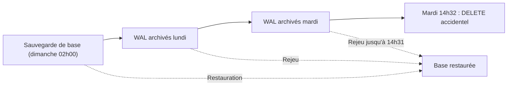

## Introduction

Ce dernier chapitre referme le cours en reliant deux préoccupations déjà abordées séparément aux cours Administration Systèmes et Réseaux et Cryptographie Avancée : la **sauvegarde** et l'**intégrité** des données. On les applique ici spécifiquement aux fichiers et aux bases de données étudiés depuis le début du cours.

Pourquoi est-ce si important ? Parce qu'une base de données peut disparaître de bien des façons : une panne de disque, une erreur humaine comme un `DELETE` sans `WHERE`, une mise à jour applicative boguée, ou une attaque par rançongiciel qui chiffre les serveurs et cherche délibérément à détruire les sauvegardes. Dans tous ces cas, la question n'est pas « avons-nous des sauvegardes ? », mais « pouvons-nous restaurer une base cohérente, intègre, à un instant précis, dans un délai acceptable ? ».

À la fin de ce chapitre, tu sauras définir une stratégie de sauvegarde avec ses objectifs RPO et RTO, choisir entre sauvegarde à froid et à chaud, expliquer comment les garanties ACID protègent l'intégrité de chaque transaction, sauvegarder et restaurer une base PostgreSQL, vérifier l'intégrité d'une sauvegarde par hachage, et protéger tes sauvegardes contre un attaquant.

## Sauvegarder une base de données : ce qui change par rapport aux fichiers

### La règle 3-2-1 et ses objectifs

La **règle 3-2-1** recommande de conserver au moins trois copies des données, sur au moins deux supports différents, dont au moins une hors site. Face aux rançongiciels, on la complète souvent en **3-2-1-1-0** : une copie supplémentaire hors ligne ou immuable, et zéro erreur lors de la vérification de restauration.

<CehCallout>
Rappel du cours Administration Systèmes et Réseaux (chapitre 5) : la règle 3-2-1 s'applique aussi aux bases de données, mais avec une contrainte supplémentaire. Une base de données active reçoit des écritures en continu, ce qui rend une simple copie de fichier à un instant donné potentiellement incohérente si des transactions sont en cours.
</CehCallout>

Deux objectifs chiffrés guident toute stratégie. Le **RPO**, pour Recovery Point Objective, est la perte de données maximale acceptable, exprimée en temps : un RPO de 24 heures signifie qu'on accepte de perdre jusqu'à une journée d'écritures, donc qu'une sauvegarde quotidienne suffit. Le **RTO**, pour Recovery Time Objective, est la durée maximale acceptable d'indisponibilité avant que le service soit rétabli. Une boutique en ligne visera un RPO de quelques minutes et un RTO de moins d'une heure ; un intranet documentaire pourra tolérer bien plus.

### Pourquoi une copie de fichiers ne suffit pas

Un SGBDR ne stocke pas une table dans un fichier unique écrit d'un seul coup. Il garde des pages en mémoire, écrit son journal de transactions, puis répercute les modifications dans les fichiers de données de façon différée. Copier ces fichiers avec `cp` pendant que la base tourne capture des fichiers à des instants légèrement différents : une page peut refléter une transaction, et la page voisine non. Le résultat peut être une base qui refuse de démarrer, ou pire, qui démarre avec des données silencieusement incohérentes.

### Froid ou chaud

<CompareTable
  titleA="Sauvegarde à froid"
  titleB="Sauvegarde à chaud"
  rows={[
    { a: "La base est arrêtée pendant la sauvegarde", b: "La base reste disponible pendant la sauvegarde" },
    { a: "Garantit une cohérence totale, simple à mettre en œuvre", b: "Nécessite un mécanisme spécifique pour garantir la cohérence malgré les écritures en cours" },
    { a: "Implique une interruption de service", b: "N'interrompt pas le service, adapté aux systèmes à haute disponibilité" },
    { a: "Ex : arrêt du service, copie du répertoire de données, redémarrage", b: "Ex : pg_dump, pg_basebackup, mysqldump --single-transaction, instantané coordonné" },
  ]}
/>

Une sauvegarde à chaud reste cohérente grâce aux mécanismes internes du SGBDR. `pg_dump` ouvre une transaction et lit toutes les tables dans un même **instantané** : il voit la base telle qu'elle était au début de la sauvegarde, même si des écritures continuent. `mysqldump` obtient le même effet avec l'option `--single-transaction` sur des tables InnoDB.

### Sauvegarde logique ou physique

Une sauvegarde **logique** exporte le contenu sous forme d'instructions SQL ou d'un format d'archive propre à l'outil. Sous PostgreSQL, `pg_dump` sauvegarde une base, `pg_dumpall` sauvegarde l'ensemble du serveur avec les rôles, et `pg_restore` restaure une archive au format personnalisé. Elle est portable entre versions et permet de restaurer une seule table, mais elle devient lente sur de très grosses bases.

Une sauvegarde **physique** copie les fichiers de données de façon cohérente. Sous PostgreSQL, `pg_basebackup` réalise une copie physique à chaud, et depuis PostgreSQL 17 il sait produire des sauvegardes **incrémentales**, que l'outil `pg_combinebackup` reconstitue. Combinée à l'**archivage continu du journal de transactions**, appelé WAL pour Write-Ahead Log, elle permet la **restauration à un instant précis**, ou PITR pour Point-In-Time Recovery : on restaure la sauvegarde de base, puis on rejoue le journal jusqu'à la seconde voulue, par exemple juste avant le `DELETE` malheureux. Des outils comme pgBackRest ou Barman automatisent ces opérations.



## Les transactions et la garantie ACID

### Qu'est-ce qu'une transaction

Une **transaction** est un ensemble d'opérations que la base traite comme une unité indivisible. L'exemple classique est le virement bancaire : débiter un compte et créditer un autre. Si le serveur tombe entre les deux, l'argent ne doit ni disparaître ni être créé.

```sql
BEGIN;
UPDATE comptes SET solde = solde - 500 WHERE id = 1;   -- débit
UPDATE comptes SET solde = solde + 500 WHERE id = 2;   -- crédit
COMMIT;   -- les deux modifications deviennent définitives ensemble

-- En cas de problème avant le COMMIT :
-- ROLLBACK;   -- annule tout, comme si rien ne s'était passé
```

### Les quatre garanties

<Steps steps={[
  { title: "Atomicité", description: "Une transaction s'exécute entièrement, ou pas du tout, jamais partiellement en cas d'échec en cours de route. Le débit sans le crédit est impossible." },
  { title: "Cohérence", description: "Une transaction amène la base d'un état valide à un autre état valide, sans jamais violer les contraintes définies, comme une clé étrangère ou une contrainte CHECK sur un solde positif." },
  { title: "Isolation", description: "Des transactions concurrentes ne s'interfèrent pas de façon incohérente entre elles : chacune se comporte comme si elle était seule, selon le niveau d'isolation choisi." },
  { title: "Durabilité", description: "Une fois une transaction validée, elle survit même à une panne immédiatement après, car elle est d'abord écrite dans le journal de transactions sur disque (rappel du concept de sauvegarde immuable, cours Administration Systèmes et Réseaux, chapitre 5)." },
]} />

L'**atomicité** et la **durabilité** reposent sur le journal d'écriture anticipée. Avant de modifier les fichiers de données, le SGBDR écrit la description de la modification dans le journal et force son écriture sur disque au moment du `COMMIT`. Après une panne, il relit le journal : les transactions validées sont rejouées, les autres sont ignorées. C'est aussi ce journal que l'archivage continu exploite pour la restauration à un instant précis.

L'**isolation** se règle par niveaux, définis par la norme SQL. Le niveau `READ COMMITTED`, par défaut sous PostgreSQL, empêche de lire des données non validées par d'autres transactions, ce qu'on appelle une lecture sale. Le niveau `REPEATABLE READ`, par défaut sous MySQL InnoDB, garantit qu'une même ligne relue renvoie la même valeur. Le niveau `SERIALIZABLE`, le plus strict, garantit un résultat équivalent à une exécution des transactions l'une après l'autre. Plus le niveau est strict, plus les conflits sont fréquents et doivent être gérés par l'application.

<CehCallout>
Ces garanties ACID expliquent pourquoi une base de données relationnelle reste préférée pour des données critiques, comme des transactions financières ou des dossiers médicaux, là où certaines bases NoSQL (chapitre 4) acceptent délibérément de sacrifier une part de ces garanties au profit de la performance ou de la disponibilité, conformément au compromis CAP.
</CehCallout>

### L'intégrité comme enjeu de sécurité

En sécurité, l'intégrité est le I de la triade confidentialité, intégrité, disponibilité. Une faille d'isolation peut devenir une vulnérabilité : une **condition de course** dans une application qui lit un solde, puis le met à jour dans deux requêtes séparées sans transaction ni verrou, peut permettre à un attaquant d'envoyer plusieurs requêtes simultanées et de dépenser deux fois le même crédit ou d'utiliser plusieurs fois un code promotionnel unique. La correction passe par une transaction avec un verrou explicite, comme `SELECT ... FOR UPDATE`, ou par une mise à jour atomique conditionnelle en une seule requête.

## Vérifier l'intégrité des données dans le temps

### Les sommes de contrôle de la base

Un disque peut corrompre silencieusement des données : un bit qui bascule, un contrôleur défaillant. PostgreSQL peut calculer une **somme de contrôle** pour chaque page de données et la vérifier à chaque lecture ; cette option, longtemps à activer manuellement avec `initdb --data-checksums`, est activée par défaut depuis PostgreSQL 18. L'outil `pg_amcheck` vérifie la structure des tables et des index. Ces contrôles détectent la corruption avant qu'elle ne se propage dans les sauvegardes.

### Le hachage des sauvegardes

<WarningCallout>
Rappel du cours Cryptographie Avancée (chapitre 4, hachage) : calculer une empreinte de hachage d'une sauvegarde de base de données au moment de sa création, puis la revérifier avant toute restauration, permet de détecter une corruption ou une altération survenue entre-temps. C'est un principe identique à la chaîne de custody vue au cours Forensics et DFIR et au cours Droit et Réglementation. Utilise SHA-256 ou plus ; MD5 et SHA-1 sont cassés en matière de collisions et ne doivent plus servir de garantie d'intégrité face à un adversaire.
</WarningCallout>

```bash
# À la création
pg_dump -Fc -d boutique -f boutique_2026-11-09.dump
sha256sum boutique_2026-11-09.dump > boutique_2026-11-09.dump.sha256

# Avant toute restauration
sha256sum -c boutique_2026-11-09.dump.sha256
```

```text
boutique_2026-11-09.dump: OK
```

Une limite importante : si un attaquant peut modifier à la fois la sauvegarde et le fichier d'empreinte stocké à côté, le hachage ne prouve plus rien. L'empreinte doit donc être conservée **ailleurs**, avec d'autres droits d'accès, ou **signée**, par exemple avec GPG, pour garantir non seulement l'intégrité mais aussi l'authenticité.

### Tester la restauration

Une sauvegarde qui n'a jamais été restaurée est une hypothèse, pas une garantie. Il faut restaurer régulièrement dans un environnement isolé, vérifier que la base démarre, que le nombre de lignes des tables principales est cohérent et que l'application fonctionne, et chronométrer l'opération pour vérifier que le RTO est tenable.

## Protéger les sauvegardes contre un attaquant

Les groupes de rançongiciels savent que des sauvegardes intactes rendent leur chantage inutile. Ils cherchent donc à les détruire ou à les chiffrer avant de déclencher le chiffrement principal. La matrice MITRE ATT&CK décrit ces comportements avec les techniques d'entrave à la restauration du système (T1490), de destruction de données (T1485) et de chiffrement de données à des fins d'impact (T1486). Les sauvegardes sont aussi une cible d'exfiltration : une copie complète de la base, souvent moins surveillée que la base elle-même.

<AttackDefenseTable
  rows={[
    { phase: "Reconnaissance", attack: "Repérer le serveur et la console de sauvegarde depuis un poste compromis", defense: "Réseau de sauvegarde isolé, console d'administration accessible seulement depuis un bastion" },
    { phase: "Accès", attack: "Réutiliser des identifiants d'administration du domaine sur la solution de sauvegarde", defense: "Comptes de sauvegarde distincts, hors annuaire principal, avec authentification multifacteur" },
    { phase: "Destruction", attack: "Supprimer les sauvegardes et les instantanés (T1490, T1485)", defense: "Copies immuables (verrouillage d'objet en mode WORM) et copie hors ligne" },
    { phase: "Chiffrement", attack: "Chiffrer les serveurs et les partages de sauvegarde (T1486)", defense: "Restauration testée, RPO et RTO connus, plan de reprise documenté" },
    { phase: "Exfiltration", attack: "Copier une sauvegarde complète de la base", defense: "Sauvegardes chiffrées, clés séparées, journalisation des accès au dépôt" },
  ]}
/>

<AuditCallout>
L'ISO/IEC 27001:2022 consacre un contrôle à la sauvegarde des informations (A.8.13), qui exige des copies conformes à une politique convenue et des tests réguliers de restauration, complété par la redondance des moyens de traitement (A.8.14). Le NIST CSF 2.0 regroupe la reprise dans sa fonction Recover, et le règlement européen DORA impose aux entités financières des politiques de sauvegarde et de restauration testées. NIS2 inclut la gestion des sauvegardes et la reprise d'activité parmi les mesures minimales de gestion des risques.
</AuditCallout>

## Erreurs fréquentes

La première erreur est de copier à chaud les fichiers d'une base active avec `cp` ou `rsync`, en croyant obtenir une sauvegarde utilisable. La deuxième est de ne jamais tester la restauration, et de découvrir le jour de la crise qu'un mot de passe de chiffrement est perdu ou qu'il manque les rôles, oubliés par `pg_dump`, qui ne sauvegarde qu'une base. La troisième est de stocker les sauvegardes sur le même serveur ou le même partage que la base, accessible avec les mêmes identifiants : un rançongiciel les chiffre en même temps. La quatrième est de stocker l'empreinte de hachage juste à côté de la sauvegarde, sans protection. La cinquième est d'oublier que les sauvegardes contiennent des données personnelles : elles doivent être chiffrées, et leur durée de conservation doit respecter le RGPD. Enfin, confondre réplication et sauvegarde est dangereux : un réplica recopie fidèlement un `DROP TABLE` en quelques millisecondes.

## Synthèse — panorama complet du cours

<CompareTable
  titleA="Chapitre"
  titleB="Contribution au panorama"
  rows={[
    { a: "1. Systèmes de fichiers", b: "Organisation et métadonnées du stockage" },
    { a: "2. Formats de fichiers", b: "Structure interne et signatures" },
    { a: "3. Bases relationnelles", b: "Modèle et syntaxe SQL de base" },
    { a: "4. Bases NoSQL", b: "Alternatives flexibles et leurs enjeux" },
    { a: "5. Sécurité des bases", b: "Durcissement et moindre privilège" },
    { a: "6. Injection SQL approfondie", b: "Application offensive du socle SQL" },
    { a: "7. Sauvegarde et intégrité", b: "Résilience et garanties de fiabilité" },
  ]}
/>

Le fil conducteur du cours est simple : on ne protège bien que ce que l'on comprend. Le système de fichiers et les formats expliquent où et comment les données vivent physiquement. Les modèles relationnel et NoSQL expliquent comment elles sont organisées et interrogées. La sécurité des bases et l'injection SQL montrent comment cette organisation est attaquée et défendue. La sauvegarde et l'intégrité, enfin, garantissent qu'on peut revenir à un état sain quand tout le reste a échoué.

## Lab — Mise en pratique

**Environnement** : ta machine personnelle avec Docker (pas le terminal du lab Nyx).

<Steps steps={[
  { title: "Préparer une base de test", description: "Lance PostgreSQL 16 et crée une table de comptes avec une contrainte interdisant un solde négatif.", code: "docker run -d --name lab-bkp -e POSTGRES_PASSWORD=Lab2026 postgres:16-alpine\nsleep 3\ndocker exec -it lab-bkp psql -U postgres -c 'CREATE DATABASE banque;'\ndocker exec -it lab-bkp psql -U postgres -d banque -c 'CREATE TABLE comptes (id int PRIMARY KEY, titulaire text, solde numeric(10,2) CHECK (solde >= 0));' -c \"INSERT INTO comptes VALUES (1, 'Alice', 1000), (2, 'Bruno', 200);\"" },
  { title: "Observer l'atomicité", description: "Le crédit de 1500 à Bruno réussit, mais le débit d'Alice viole la contrainte CHECK. La transaction est alors avortée et le COMMIT final se transforme en ROLLBACK : le crédit déjà appliqué est annulé, aucun solde n'est modifié. Relis la table pour le vérifier.", code: "docker exec -i lab-bkp psql -U postgres -d banque << 'EOF'\nBEGIN;\nUPDATE comptes SET solde = solde + 1500 WHERE id = 2;\nUPDATE comptes SET solde = solde - 1500 WHERE id = 1;\nCOMMIT;\nSELECT * FROM comptes ORDER BY id;\nEOF" },
  { title: "Sauvegarder à chaud et calculer l'empreinte", description: "Réalise une sauvegarde logique au format personnalisé pendant que la base tourne, copie-la sur l'hôte et calcule son empreinte SHA-256.", code: "docker exec lab-bkp pg_dump -U postgres -Fc -d banque -f /tmp/banque.dump\ndocker cp lab-bkp:/tmp/banque.dump .\nsha256sum banque.dump > banque.dump.sha256\ncat banque.dump.sha256" },
  { title: "Simuler une altération", description: "Fais une copie de la sauvegarde, modifie un seul octet de la copie, puis vérifie les deux. La copie altérée doit afficher FAILED.", code: "cp banque.dump altere.dump\nprintf 'X' | dd of=altere.dump bs=1 seek=100 conv=notrunc 2>/dev/null\nsha256sum -c banque.dump.sha256\nsha256sum banque.dump altere.dump" },
  { title: "Simuler l'incident", description: "Supprime toutes les lignes de la table, comme le ferait un DELETE sans WHERE ou un attaquant.", code: "docker exec -it lab-bkp psql -U postgres -d banque -c 'DELETE FROM comptes;' -c 'SELECT count(*) FROM comptes;'" },
  { title: "Restaurer après vérification", description: "Vérifie d'abord l'empreinte, puis restaure dans une nouvelle base pour ne pas écraser l'existante. Contrôle que les deux comptes sont revenus avec leurs soldes d'origine.", code: "sha256sum -c banque.dump.sha256 && docker exec -it lab-bkp psql -U postgres -c 'CREATE DATABASE banque_restauree;'\ndocker exec lab-bkp pg_restore -U postgres -d banque_restauree /tmp/banque.dump\ndocker exec -it lab-bkp psql -U postgres -d banque_restauree -c 'SELECT * FROM comptes ORDER BY id;'" },
  { title: "Nettoyer", description: "Supprime le conteneur et les fichiers de test.", code: "docker rm -f lab-bkp\nrm -f banque.dump banque.dump.sha256 altere.dump" },
]} />

## À retenir

- La règle 3-2-1, complétée par une copie immuable ou hors ligne, s'applique aux bases de données, guidée par deux objectifs : le RPO pour la perte de données acceptable et le RTO pour la durée d'interruption acceptable.
- Une simple copie de fichiers d'une base active peut être incohérente ; la sauvegarde à chaud s'appuie sur un instantané transactionnel ou sur le journal de transactions.
- La sauvegarde à froid garantit la cohérence au prix d'une interruption ; la sauvegarde à chaud préserve le service au prix d'un mécanisme de cohérence plus complexe.
- Les garanties ACID, atomicité, cohérence, isolation et durabilité, reposent sur le journal d'écriture anticipée et expliquent pourquoi le relationnel reste préféré pour les données critiques.
- Vérifier le hash SHA-256 d'une sauvegarde avant restauration applique le principe de la chaîne de custody ; l'empreinte doit être stockée séparément ou signée.
- Les rançongiciels ciblent d'abord les sauvegardes : isolement, identifiants distincts, copies immuables et tests de restauration réguliers sont indispensables.

## Questions de révision

1. Pourquoi une simple copie de fichier d'une base de données active peut-elle être incohérente ?
2. Définis le RPO et le RTO, puis propose des valeurs réalistes pour une boutique en ligne.
3. Pour une base de commerce en ligne qui ne peut jamais être interrompue en journée, choisirais-tu une sauvegarde à froid ou à chaud ? Justifie.
4. Que garantit l'atomicité d'une transaction, et pourquoi est-ce crucial pour un virement impliquant un débit et un crédit ?
5. Comment le journal de transactions permet-il à la fois la durabilité et la restauration à un instant précis ?
6. Pourquoi vérifier le hash d'une sauvegarde avant restauration, et pourquoi ce hash ne doit-il pas être stocké sans protection à côté de la sauvegarde ?
7. Pourquoi un réplica de base de données ne remplace-t-il pas une sauvegarde ?
8. Cite trois mesures qui empêchent un rançongiciel de détruire les sauvegardes d'une organisation.

Félicitations, tu viens de terminer le cours **Fichiers et Bases de Données** ! Ces fondations éclairent directement les cours Sécurité Web (injection SQL), Forensics & DFIR (systèmes de fichiers) et Administration Systèmes et Réseaux (sauvegarde). Continue vers **Machine Learning** pour approfondir les algorithmes déjà rencontrés au cours Data Science Complète.
