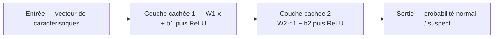
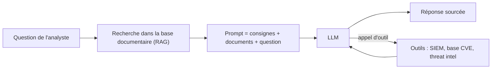

## Introduction

En quelques années, l'intelligence artificielle est passée du statut de sujet de recherche à celui d'outil quotidien dans les équipes de sécurité. Un analyste SOC demande à un assistant de résumer cinquante alertes, un pentesteur fait expliquer un binaire obscur, un responsable conformité fait relire une politique. Dans le même temps, les attaquants rédigent des emails de phishing sans fautes dans n'importe quelle langue, clonent des voix et automatisent leur reconnaissance. Pour défendre un système d'information en 2026, il faut donc comprendre ce que ces modèles savent faire, comment ils fonctionnent, et où ils cassent.

Ce cours prolonge le machine learning classique vu aux cours Data Science Complète et Python pour la Data Science vers des approches plus récentes : réseaux de neurones profonds, traitement du langage, grands modèles de langage et agents. Il aborde ensuite leur usage concret en défense, notamment l'automatisation du SOC, puis les risques qu'ils introduisent côté offensif, et termine par la gouvernance.

À la fin de ce chapitre, tu sauras expliquer avec tes propres mots ce qu'est un réseau de neurones, pourquoi le deep learning a besoin de beaucoup de données, comment un LLM est construit en trois étapes, et pourquoi chaque capacité de l'IA générative est à double usage.

## Du modèle classique au réseau de neurones

### Le neurone artificiel

Un neurone artificiel est une fonction très simple. Il reçoit un vecteur d'entrées, par exemple la durée d'une connexion, le nombre d'octets envoyés et le port de destination. Il multiplie chaque entrée par un poids, additionne le tout, ajoute un biais, puis applique une fonction d'activation. En notation compacte, la sortie vaut `activation(w · x + b)`, où `w` est le vecteur des poids, `x` le vecteur d'entrées et `b` le biais. Les poids et le biais sont les paramètres que l'entraînement va ajuster.

### Une couche, c'est une multiplication matricielle

Quand on place plusieurs neurones côte à côte, on obtient une couche. Tu te souviens du cours Algèbre Linéaire : calculer la sortie de toute une couche revient à multiplier le vecteur d'entrée par une matrice de poids, puis à ajouter un vecteur de biais. Un réseau de neurones peut donc être vu comme un empilement de transformations linéaires, chacune suivie d'une fonction non linéaire.

### Pourquoi la non-linéarité est indispensable

La fonction d'activation est le cœur du mécanisme. Si tu empiles dix multiplications matricielles sans rien entre elles, le résultat reste une seule multiplication matricielle : dix couches linéaires ne valent pas mieux qu'une. C'est la fonction non linéaire appliquée après chaque transformation, comme ReLU qui remplace les valeurs négatives par zéro, qui permet au réseau d'apprendre des motifs complexes : des frontières de décision courbes, des combinaisons de signaux, des hiérarchies de caractéristiques. Un modèle classique comme un arbre de décision ou un k-NN reste limité à la forme de frontière que sa structure impose ; un réseau suffisamment large peut, en théorie, approcher n'importe quelle fonction continue.



### Comment le réseau apprend

L'entraînement suit toujours la même boucle. Le réseau fait une prédiction, on mesure l'écart avec la bonne réponse grâce à une fonction de perte, puis l'algorithme de rétropropagation calcule comment chaque poids a contribué à cette erreur. La descente de gradient modifie alors légèrement chaque poids dans la direction qui réduit l'erreur. Répétée des millions de fois, cette boucle fait émerger des poids qui encodent les régularités des données. Le cours Deep Learning détaille ces mécanismes ; ici, retiens l'idée générale.

### Machine learning classique contre deep learning

La différence la plus importante n'est pas la taille du modèle, c'est la manière dont il obtient ses caractéristiques. En machine learning classique, c'est toi qui fais l'ingénierie des caractéristiques : tu décides de calculer le nombre de connexions par minute, l'entropie d'un nom de domaine ou la présence de macros dans un document. En deep learning, le réseau apprend lui-même ses représentations intermédiaires à partir de données brutes : les octets d'un fichier, les pixels d'une capture d'écran, les caractères d'une ligne de log.

<CompareTable
  titleA="Machine learning classique (cours Data Science Complète)"
  titleB="Deep learning (réseaux de neurones profonds)"
  rows={[
    { a: "Nécessite souvent une extraction manuelle de caractéristiques par un expert", b: "Peut apprendre directement des caractéristiques pertinentes à partir de données brutes" },
    { a: "Fonctionne bien avec des jeux de données de taille modeste", b: "Nécessite généralement de très grands volumes de données pour être performant" },
    { a: "Modèles souvent plus interprétables, par exemple la suite de règles d'un arbre de décision", b: "Modèles souvent peu interprétables, qualifiés de « boîte noire »" },
    { a: "Entraînement rapide sur CPU", b: "Entraînement coûteux, généralement sur GPU" },
    { a: "Excellent sur les données tabulaires structurées", b: "Excellent sur les données non structurées : texte, images, audio, séquences" },
  ]}
/>

Cette capacité à apprendre ses propres caractéristiques a un prix. Plus un réseau a de paramètres, plus il lui faut d'exemples pour les régler sans simplement mémoriser le jeu d'entraînement. Et ces représentations apprises sont des vecteurs de nombres qui n'ont pas de signification lisible : c'est pour cela qu'on parle de boîte noire. Un arbre de décision expose une suite de règles explicites, du type « si plus de 100 connexions par minute et port 22, alors suspect ». Un réseau profond empile des transformations dont la complexité rend l'interprétation de ses décisions beaucoup plus difficile pour un humain. En sécurité, où l'on doit justifier pourquoi on a bloqué un utilisateur, ce manque d'interprétabilité est un vrai sujet.

### Les grandes familles d'architectures

Selon le type de données, on utilise des architectures différentes, toutes construites sur le même principe de couches apprises.

| Architecture | Données de prédilection | Exemple en cybersécurité |
| --- | --- | --- |
| Perceptron multicouche (MLP) | Vecteurs de caractéristiques | Classification de flux réseau |
| Réseau convolutif (CNN) | Images, signaux, octets disposés en grille | Détection de pages de phishing par capture d'écran, classification de malwares |
| Réseau récurrent (RNN, LSTM) | Séquences ordonnées | Séquences d'appels système ou de commandes shell |
| Autoencodeur | Données non étiquetées | Détection d'anomalies (chapitre 2) |
| Transformer | Texte, code, séquences longues | Analyse de logs, LLM, assistants SOC |

## Les grands modèles de langage (LLM)

### Prédire le mot suivant

Un LLM, pour Large Language Model, est un réseau de neurones de type Transformer entraîné sur d'immenses volumes de texte pour prédire la suite probable d'une séquence. Le texte est d'abord découpé en tokens, des fragments de mots, puis chaque token est transformé en vecteur. Le modèle produit, pour la position suivante, une distribution de probabilité sur tout son vocabulaire. On tire un token, on l'ajoute à la séquence, et on recommence : c'est la génération autorégressive.

Pour sentir l'intuition, voici un modèle de langage minuscule qui compte simplement quel mot suit quel autre dans un corpus de quatre phrases.

```python
from collections import Counter, defaultdict

corpus = (
    "le pare-feu a bloqué la connexion suspecte . "
    "le pare-feu a journalisé la connexion entrante . "
    "le pare-feu a bloqué le scan de ports . "
    "l'analyste a bloqué la connexion suspecte ."
).split()

# Pour chaque mot, on compte les mots qui le suivent
suivants = defaultdict(Counter)
for mot, suivant in zip(corpus, corpus[1:]):
    suivants[mot][suivant] += 1

def proba_suivant(mot):
    total = sum(suivants[mot].values())
    return {s: round(n / total, 2) for s, n in suivants[mot].most_common()}

print("après 'a'      :", proba_suivant("a"))
print("après 'bloqué' :", proba_suivant("bloqué"))
print("après 'la'     :", proba_suivant("la"))
```

```text
après 'a'      : {'bloqué': 0.75, 'journalisé': 0.25}
après 'bloqué' : {'la': 0.67, 'le': 0.33}
après 'la'     : {'connexion': 1.0}
```

Ce modèle ne regarde qu'un seul mot en arrière. Un LLM fait la même chose en regardant des milliers de tokens en arrière grâce au mécanisme d'attention, avec des milliards de paramètres au lieu d'une table de comptage. Cette capacité de prédiction, à très grande échelle, produit des comportements qui semblent relever de la compréhension et du raisonnement : résumer, traduire, écrire du code, expliquer une alerte. Pourtant le modèle ne « comprend » pas au sens humain : il a appris des régularités statistiques extrêmement riches.

### Le cycle de vie d'un LLM en trois étapes

<Steps steps={[
  { title: "Pré-entraînement", description: "Le modèle apprend des motifs linguistiques généraux sur d'immenses corpus de texte et de code, sans tâche spécifique en tête, en prédisant le token suivant. C'est l'étape la plus coûteuse en calcul ; elle produit un modèle de base qui complète du texte mais ne suit pas forcément des instructions." },
  { title: "Alignement (fine-tuning)", description: "Le modèle est ensuite ajusté pour suivre des instructions et adopter un comportement utile et sûr : fine-tuning supervisé sur des exemples de dialogues, puis apprentissage à partir de préférences humaines ou de règles écrites (par exemple RLHF). C'est ici qu'il apprend à refuser certaines demandes dangereuses." },
  { title: "Utilisation via prompt", description: "L'utilisateur interagit avec le modèle en langage naturel, sans avoir besoin de connaître son fonctionnement interne. Le prompt système fixé par le développeur et le message de l'utilisateur sont concaténés dans la fenêtre de contexte, et le modèle génère sa réponse." },
]} />

### Ce qu'il faut savoir pour utiliser un LLM correctement

Quelques notions reviennent sans cesse dès qu'on intègre un LLM dans un outil de sécurité.

La fenêtre de contexte est la quantité maximale de tokens que le modèle peut prendre en compte à la fois, prompt et réponse compris. Tout ce qui n'y figure pas n'existe pas pour lui : le modèle n'a pas de mémoire propre entre deux appels, c'est l'application qui renvoie l'historique.

La température règle le caractère aléatoire du tirage. Une température basse rend les réponses plus déterministes, ce qui est préférable pour extraire des indicateurs de compromission d'un rapport ; une température élevée produit plus de variété.

Les hallucinations sont des réponses plausibles mais fausses : un numéro de CVE inventé, une option de commande qui n'existe pas, une technique ATT&CK mal attribuée. Elles découlent directement du principe de génération : le modèle produit ce qui est probable, pas ce qui est vérifié.

La date de coupure des connaissances signifie que le modèle ignore les vulnérabilités publiées après son entraînement. Pour pallier cela, on utilise le RAG, pour Retrieval-Augmented Generation : on recherche des documents pertinents, par exemple la base interne de procédures ou les avis CERT récents, et on les injecte dans le prompt. Le modèle répond alors en s'appuyant sur ces sources. Enfin, quand on donne au modèle la possibilité d'appeler des outils, comme interroger un SIEM ou une base de CVE, on obtient un agent, sujet des chapitres 4 et 5.



### Modèles accessibles par API et modèles à poids ouverts

Deux modes de déploiement coexistent. Les modèles accessibles par API sont hébergés par un fournisseur : tu envoies ton prompt sur Internet et reçois la réponse. C'est simple, mais cela pose immédiatement une question de confidentialité : envoyer des logs contenant des noms d'utilisateurs ou des adresses IP internes à un tiers doit être encadré contractuellement et vis-à-vis du RGPD. Les modèles à poids ouverts peuvent être téléchargés et exécutés en interne, sur tes propres GPU ; tu gardes la maîtrise des données, mais tu assumes l'exploitation, la mise à jour et la vérification de la provenance du modèle, car un fichier de modèle téléchargé est un artefact de chaîne d'approvisionnement comme un autre.

<TipCallout>
Pour un usage SOC, commence par lister les données que l'outil verra : si des données personnelles ou classifiées entrent dans le prompt, le choix entre API externe et modèle hébergé en interne devient une décision de conformité, pas seulement une décision technique.
</TipCallout>

## Pourquoi l'IA générative change le paysage de la cybersécurité

### Une capacité à double usage

Le terme dual-use désigne une technologie dont les mêmes capacités servent des usages légitimes et malveillants. L'IA générative en est l'exemple parfait.

<CompareTable
  titleA="Usage défensif"
  titleB="Usage offensif ou risque"
  rows={[
    { a: "Résumer automatiquement des alertes SOC (chapitre 5)", b: "Générer des emails de phishing très convaincants et personnalisés à grande échelle" },
    { a: "Assister la rédaction de rapports (cours Rédaction de Rapports)", b: "Générer du code malveillant ou des variantes de malware" },
    { a: "Détecter des anomalies dans des logs textuels (chapitre 3)", b: "Automatiser la reconnaissance et l'exploitation de vulnérabilités" },
    { a: "Expliquer un script obfusqué à un analyste junior", b: "Produire des deepfakes audio ou vidéo pour la fraude (chapitre 6)" },
    { a: "Traduire et synthétiser des rapports de threat intelligence", b: "Rédiger des prétextes d'ingénierie sociale dans la langue et le jargon de la cible" },
  ]}
/>

<WarningCallout>
La même capacité générative qui permet à un analyste de gagner un temps précieux en résumant des centaines d'alertes permet à un attaquant de générer, à un coût dérisoire, des milliers de variantes de messages de phishing convaincants. Cette dualité fondamentale traverse l'ensemble de ce cours.
</WarningCallout>

### Ce qui change concrètement côté attaque

L'IA générative n'invente pas de nouvelles classes d'attaques magiques ; elle abaisse le coût et augmente l'échelle d'attaques connues. Les fautes d'orthographe ne sont plus un indicateur fiable de phishing. Un attaquant peu qualifié peut obtenir une explication détaillée d'une technique. Les campagnes deviennent personnalisables à grande échelle à partir d'informations publiques sur la cible. Les filtres anti-phishing fondés sur des signatures de texte doivent donc s'appuyer davantage sur des signaux techniques : authentification SPF, DKIM et DMARC, réputation des domaines, comportement des liens.

### Ce qui change côté défense

Côté défense, les gains sont réels mais encadrés. Les LLM accélèrent le triage, l'enrichissement de contexte et la rédaction, ce qui libère du temps d'analyste pour l'investigation. Ils ne remplacent pas la vérification : chaque affirmation factuelle produite doit pouvoir être reliée à une source, un log ou une requête.

### Une nouvelle surface d'attaque : l'IA elle-même

Dès qu'une organisation déploie un LLM, celui-ci devient une cible. L'OWASP publie un Top 10 dédié aux applications LLM, dans sa version 2025, et MITRE maintient ATLAS, une base de tactiques et techniques d'attaque contre les systèmes d'IA, sur le modèle d'ATT&CK. Le prompt injection, l'empoisonnement de données, la fuite du prompt système ou l'agentivité excessive seront étudiés au chapitre 6.

## Erreurs fréquentes

La première erreur est de croire qu'un réseau de neurones est toujours meilleur qu'un modèle classique. Sur des données tabulaires de taille modeste, une forêt aléatoire ou un gradient boosting font souvent aussi bien, plus vite et de façon plus explicable.

La deuxième est de traiter la sortie d'un LLM comme un fait. Un CVE, une commande ou une attribution doivent toujours être vérifiés à la source.

La troisième est d'oublier que le prompt est une donnée envoyée quelque part : coller un extrait de log client dans un service public peut constituer une fuite de données.

La quatrième est de confondre alignement et sécurité : un modèle aligné refuse beaucoup de demandes dangereuses, mais cet alignement se contourne, d'où le besoin de contrôles externes.

## Lab — Mise en pratique

**Environnement** : Python 3.12 ou plus récent, avec `pandas` et `scikit-learn` 1.5 ou plus récent (`pip install pandas scikit-learn`).

<Steps steps={[
  { title: "Créer un jeu de données minuscule", description: "Construis un petit tableau de connexions réseau étiquetées normal ou suspect, comme au cours Data Science Complète. Observe qu'il n'y a que dix lignes.", code: "import pandas as pd\n\ndata = pd.DataFrame({\n    'duree_s': [2, 300, 1, 250, 3, 280, 2, 310, 1, 4],\n    'octets_envoyes': [500, 50000, 400, 48000, 600, 52000, 550, 51000, 300, 700],\n    'label': ['normal', 'suspect', 'normal', 'suspect', 'normal', 'suspect', 'normal', 'suspect', 'normal', 'normal']\n})\nprint(data)" },
  { title: "Entraîner un modèle classique (k-NN)", description: "Entraîne un k-NN sur ces dix exemples et mesure sa précision sur les trois exemples de test. Note que trois exemples de test rendent le score très instable.", code: "from sklearn.model_selection import train_test_split\nfrom sklearn.neighbors import KNeighborsClassifier\n\nX = data[['duree_s', 'octets_envoyes']]\ny = data['label']\nX_train, X_test, y_train, y_test = train_test_split(X, y, test_size=0.3, random_state=42)\n\nknn = KNeighborsClassifier(n_neighbors=3)\nknn.fit(X_train, y_train)\nprint('Precision k-NN :', knn.score(X_test, y_test))" },
  { title: "Entraîner un réseau de neurones (MLP) sur les mêmes données", description: "Entraîne un MLPClassifier sur le même jeu minuscule. Avec si peu d'exemples, le réseau ne peut pas exploiter sa capacité ; selon la graine aléatoire, il peut même faire moins bien.", code: "from sklearn.neural_network import MLPClassifier\n\nmlp = MLPClassifier(hidden_layer_sizes=(16, 16), max_iter=2000, random_state=42)\nmlp.fit(X_train, y_train)\nprint('Precision MLP :', mlp.score(X_test, y_test))" },
  { title: "Faire varier le volume de données", description: "Génère des jeux synthétiques de 40, 400 et 4000 exemples et compare les deux modèles. Observe que les deux progressent avec le volume et que l'écart reste modeste sur des données tabulaires : le deep learning brille surtout sur des données brutes non structurées.", code: "from sklearn.datasets import make_classification\nfrom sklearn.preprocessing import StandardScaler\nfrom sklearn.pipeline import make_pipeline\n\nfor n in (40, 400, 4000):\n    X, y = make_classification(n_samples=n, n_features=20, n_informative=8, n_redundant=4, class_sep=0.8, random_state=0)\n    Xtr, Xte, ytr, yte = train_test_split(X, y, test_size=0.3, random_state=0, stratify=y)\n    knn = make_pipeline(StandardScaler(), KNeighborsClassifier(n_neighbors=5)).fit(Xtr, ytr)\n    mlp = make_pipeline(StandardScaler(), MLPClassifier(hidden_layer_sizes=(64, 32), max_iter=2000, random_state=0)).fit(Xtr, ytr)\n    print(f'n={n:>5}  k-NN={knn.score(Xte, yte):.3f}  MLP={mlp.score(Xte, yte):.3f}')" },
  { title: "Construire un mini modèle de langage", description: "Reprends le modèle de bigrammes du chapitre et ajoute quelques phrases de logs. Observe comment les probabilités du mot suivant changent avec le corpus : c'est exactement ce qu'un LLM fait, à une échelle sans commune mesure.", code: "from collections import Counter, defaultdict\n\ncorpus = 'le pare-feu a bloqué la connexion suspecte . le pare-feu a journalisé la connexion entrante .'.split()\nsuivants = defaultdict(Counter)\nfor m, s in zip(corpus, corpus[1:]):\n    suivants[m][s] += 1\nprint(suivants['a'].most_common())" },
  { title: "Générer une phrase", description: "Écris une boucle qui part du mot « le » et choisit à chaque étape le mot suivant le plus probable, jusqu'au point. Observe que la phrase est grammaticale mais que le modèle n'a aucune idée de sa véracité : c'est l'origine des hallucinations.", code: "mot, phrase = 'le', ['le']\nwhile mot != '.' and len(phrase) < 15:\n    mot = suivants[mot].most_common(1)[0][0]\n    phrase.append(mot)\nprint(' '.join(phrase))" },
]} />

Sur une exécution de référence, l'étape 4 affiche par exemple les scores suivants ; tes valeurs peuvent légèrement varier selon la version de scikit-learn.

```text
n=   40  k-NN=0.667  MLP=0.833
n=  400  k-NN=0.792  MLP=0.842
n= 4000  k-NN=0.900  MLP=0.922
```

## À retenir

- Un réseau de neurones empile des transformations linéaires, des multiplications matricielles, suivies de fonctions non linéaires ; sans non-linéarité, l'empilement ne serait qu'un modèle linéaire.
- Le machine learning classique demande souvent une extraction manuelle de caractéristiques, alors que le deep learning apprend ses caractéristiques à partir de données brutes, au prix de gros volumes de données et d'une interprétabilité réduite.
- Un LLM prédit la suite probable d'un texte ; il est construit par pré-entraînement, puis alignement pour suivre des instructions de façon utile et sûre, puis utilisé via prompt.
- Les hallucinations, la fenêtre de contexte et la date de coupure des connaissances imposent de vérifier les sorties et motivent le RAG.
- L'IA générative est dual-use : la capacité qui résume des alertes SOC génère aussi du phishing personnalisé à grande échelle.
- Un LLM déployé devient lui-même une surface d'attaque, couverte par l'OWASP Top 10 for LLM Applications 2025 et MITRE ATLAS.

## Questions de révision

1. Pourquoi empiler plusieurs couches linéaires sans fonction d'activation n'apporte-t-il rien de plus qu'une seule couche ?
2. Quelle est la principale différence entre le machine learning classique et le deep learning en termes d'extraction de caractéristiques et de volume de données nécessaire ?
3. Que se passe-t-il pendant le pré-entraînement d'un LLM, et en quoi l'alignement modifie-t-il ensuite son comportement ?
4. Explique pourquoi un LLM peut inventer un numéro de CVE plausible mais inexistant.
5. Dans quelle situation choisirais-tu un modèle hébergé en interne plutôt qu'un modèle accessible par API pour un SOC ?
6. Donne un exemple concret de capacité d'IA générative à double usage, défensif et offensif.
7. Pourquoi l'absence de fautes d'orthographe n'est-elle plus un bon indicateur de légitimité d'un email ?
