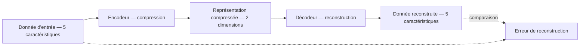

## Introduction

La plupart des attaques qui font vraiment mal ne ressemblent à rien de connu au moment où elles se produisent. Un outil de détection fondé sur des signatures repère très bien ce qu'il a déjà vu ; il est aveugle face à une exfiltration lente par un canal inhabituel, à un compte de service qui se met soudain à parcourir des partages réseau, ou à un implant utilisant un protocole maison. Pour ces cas, on cherche l'inverse d'une signature : on modélise ce qui est normal et on signale ce qui s'en écarte. C'est la détection d'anomalies, au cœur des NIDS comportementaux (Network Intrusion Detection Systems) et des solutions UEBA (User and Entity Behavior Analytics).

Ce chapitre approfondit la détection d'anomalies non supervisée déjà vue au cours Data Science Complète, au chapitre 6, avec une architecture de réseau de neurones spécifiquement conçue pour cet usage : l'autoencodeur. À la fin, tu sauras en construire un avec PyTorch 2.x, l'entraîner sur du trafic normal, régler son seuil, et surtout savoir quand il ne faut pas lui faire confiance.

## Rappel : pourquoi le non supervisé en sécurité

En apprentissage supervisé, on dispose d'exemples étiquetés « attaque » et « normal ». En sécurité, ces étiquettes sont rares, coûteuses à produire, et surtout incomplètes : on n'a d'exemples que des attaques déjà observées. Le non supervisé n'utilise pas d'étiquettes. Il apprend la structure des données disponibles, qui sont très majoritairement normales, et attribue à chaque nouvelle observation un score d'anomalie.

Tu connais déjà trois approches classiques. Le clustering k-means regroupe les points en grappes et considère comme suspect un point éloigné de tout centre. L'Isolation Forest isole les points par des coupures aléatoires : un point anormal s'isole en peu de coupures. La PCA, pour analyse en composantes principales, projette les données sur quelques axes principaux, et un point mal représenté par cette projection est atypique. L'autoencodeur généralise cette dernière idée.

## Le principe d'un autoencodeur

### Architecture : encodeur, goulot, décodeur

Un autoencodeur est un réseau de neurones entraîné à reproduire sa propre entrée en sortie. L'astuce, c'est qu'on l'oblige à passer par une représentation intermédiaire fortement compressée, avec moins de dimensions que l'entrée originale. Cette couche centrale s'appelle le goulot d'étranglement, ou espace latent. La première moitié du réseau, l'encodeur, compresse ; la seconde, le décodeur, tente de reconstruire l'entrée à partir de cette version compressée.



Puisque le goulot est trop étroit pour tout recopier, le réseau doit apprendre ce qui est essentiel dans les données : les corrélations et régularités. Par exemple, dans du trafic normal, le nombre de paquets est corrélé à la durée de la connexion, et un client web reçoit en général plus d'octets qu'il n'en envoie. Le réseau apprend à encoder ces régularités de façon compacte.

### Le lien avec la PCA

<CehCallout>
Le principe de compression d'un autoencodeur rejoint directement la réduction de dimension par PCA vue au cours Algèbre Linéaire, au chapitre 5. Un autoencodeur dont toutes les couches sont linéaires, entraîné avec une erreur quadratique, apprend le même sous-espace que les premières composantes principales. Les fonctions d'activation non linéaires permettent à l'autoencodeur d'aller plus loin et de capturer des structures courbes que la PCA, décomposition purement linéaire, ne peut pas représenter.
</CehCallout>

### La fonction de perte

On entraîne l'autoencodeur à minimiser l'erreur de reconstruction, généralement l'erreur quadratique moyenne entre l'entrée `x` et la sortie reconstruite `x̂`. Pour une connexion décrite par cinq caractéristiques standardisées, si l'entrée vaut `[0.2, -1.0, 0.5, 0.4, 0.0]` et la reconstruction `[0.1, -0.9, 0.5, 0.6, 0.0]`, les écarts au carré valent 0,01, 0,01, 0, 0,04 et 0, soit une moyenne de 0,012. C'est ce nombre, calculé pour chaque observation, qui servira de score d'anomalie.

## Pourquoi l'erreur de reconstruction révèle une anomalie

<Steps steps={[
  { title: "Entraîner uniquement sur du trafic normal", description: "L'autoencodeur apprend à compresser et reconstruire fidèlement les motifs typiques du trafic habituel. Il ne voit aucune attaque pendant l'entraînement." },
  { title: "Mesurer l'erreur de reconstruction sur de nouvelles données", description: "On compare chaque nouvelle donnée d'entrée à sa version reconstruite par le modèle." },
  { title: "Signaler une anomalie si l'erreur dépasse un seuil", description: "Une donnée très différente du trafic normal appris sera mal reconstruite, car le modèle n'a pas appris à la compresser : une erreur de reconstruction élevée révèle un écart au motif habituel." },
]} />

<TipCallout>
Ce principe est particulièrement adapté à la détection d'attaques inédites : l'autoencodeur n'a jamais besoin d'exemples étiquetés d'attaques pour fonctionner. Il suffit qu'un comportement s'écarte suffisamment de ce qui a été appris comme normal, ce qui prolonge directement la détection d'anomalies non supervisée du cours Data Science Complète.
</TipCallout>

## Construire un autoencodeur avec PyTorch

### Préparer les données

On simule du trafic réseau normal avec cinq caractéristiques par connexion : durée, nombre de paquets, octets sortants, octets entrants et nombre de ports de destination distincts. On fabrique ensuite deux familles d'anomalies : une exfiltration, où les octets sortants explosent, et un scan de ports, où le nombre de ports distincts devient énorme.

Deux transformations sont importantes. Les volumes réseau sont très asymétriques, avec quelques connexions énormes, donc on applique un logarithme `log1p`. Puis on standardise chaque colonne avec `StandardScaler`, ajusté uniquement sur les données d'entraînement pour éviter toute fuite d'information.

```python
import numpy as np
import torch
from torch import nn
from sklearn.preprocessing import StandardScaler

rng = np.random.default_rng(0)
torch.manual_seed(0)

def trafic_normal(n):
    duree = rng.lognormal(1.5, 0.5, n)                 # secondes
    paquets = duree * rng.normal(20, 3, n)             # environ 20 paquets/s
    octets_out = paquets * rng.normal(400, 40, n)      # taille moyenne des paquets
    octets_in = octets_out * rng.normal(3, 0.3, n)     # le client reçoit plus qu'il n'envoie
    ports = rng.integers(1, 3, n)                      # 1 ou 2 ports distincts
    return np.column_stack([duree, paquets, octets_out, octets_in, ports]).astype(np.float32)

X_train = trafic_normal(5000)   # uniquement du normal
X_val = trafic_normal(1000)     # normal, sert à fixer le seuil

exfil = trafic_normal(5); exfil[:, 2] *= 8; exfil[:, 3] /= 4
scan = trafic_normal(5); scan[:, 4] = rng.integers(200, 1000, 5); scan[:, 2] /= 20
X_test = np.vstack([trafic_normal(10), exfil, scan])

scaler = StandardScaler().fit(np.log1p(X_train))
prep = lambda X: torch.tensor(scaler.transform(np.log1p(X)), dtype=torch.float32)
```

### Définir et entraîner le modèle

Le réseau passe de cinq dimensions à huit, puis à deux pour le goulot, avant de remonter symétriquement. On utilise l'optimiseur Adam et la perte `MSELoss`. Note que la cible de la perte est l'entrée elle-même.

```python
model = nn.Sequential(
    nn.Linear(5, 8), nn.ReLU(),
    nn.Linear(8, 2),                 # goulot d'étranglement : 2 dimensions
    nn.ReLU(), nn.Linear(2, 8), nn.ReLU(),
    nn.Linear(8, 5),
)
opt = torch.optim.Adam(model.parameters(), lr=1e-2)
loss_fn = nn.MSELoss()
xt = prep(X_train)

for epoch in range(300):
    opt.zero_grad()
    loss = loss_fn(model(xt), xt)    # la cible est l'entrée elle-même
    loss.backward()
    opt.step()
    if epoch % 100 == 0 or epoch == 299:
        print(f"epoch {epoch:3d}  perte={loss.item():.4f}")
```

```text
epoch   0  perte=1.0459
epoch 100  perte=0.0799
epoch 200  perte=0.0276
epoch 299  perte=0.0264
```

La perte chute rapidement : le réseau a trouvé une représentation en deux dimensions qui suffit à reconstruire le trafic normal, parce que ses cinq caractéristiques sont fortement corrélées.

### Scorer et fixer le seuil

On calcule l'erreur de reconstruction par observation, puis on fixe le seuil au 99e percentile des erreurs sur le jeu de validation normal. Autrement dit, on accepte qu'environ 1 % du trafic normal déclenche une alerte.

```python
@torch.no_grad()
def erreur(X):
    x = prep(X)
    return ((model(x) - x) ** 2).mean(dim=1).numpy()

seuil = np.percentile(erreur(X_val), 99)
print(f"seuil (99e percentile validation) = {seuil:.3f}")
labels = ["normal"] * 10 + ["exfiltration"] * 5 + ["scan"] * 5
for lab, e in zip(labels, erreur(X_test)):
    print(f"{lab:<13} erreur={e:7.3f}  {'ANOMALIE' if e > seuil else 'ok'}")
```

```text
seuil (99e percentile validation) = 0.143
normal        erreur=  0.045  ok
normal        erreur=  0.027  ok
normal        erreur=  0.025  ok
...
exfiltration  erreur=  4.523  ANOMALIE
exfiltration  erreur=  4.299  ANOMALIE
...
scan          erreur= 70.590  ANOMALIE
scan          erreur= 55.370  ANOMALIE
```

L'exfiltration casse la relation apprise entre octets sortants et entrants ; le scan présente un nombre de ports jamais vu. Dans les deux cas, le décodeur reconstruit une connexion « normale » qui ne ressemble pas à l'entrée, d'où une erreur des dizaines de fois supérieure au seuil.

## Choisir le bon seuil de détection

<CehCallout>
Le choix du seuil d'erreur de reconstruction au-delà duquel une observation est signalée comme anomalie reproduit exactement le compromis précision/rappel vu au cours Data Science Complète, au chapitre 7 : un seuil trop bas génère de nombreux faux positifs, un seuil trop élevé laisse passer des attaques réelles.
</CehCallout>

Les anomalies grossières sont faciles. La vraie question est celle des attaques discrètes. Ajoutons des exfiltrations qui ne font que doubler les octets sortants et mesurons l'effet de trois seuils.

```python
discret = trafic_normal(200); discret[:, 2] *= 2
e_norm, e_disc = erreur(trafic_normal(1000)), erreur(discret)
for p in (90, 99, 99.9):
    s = np.percentile(erreur(X_val), p)
    print(f"seuil p{p:<5} ={s:6.3f}  faux positifs={np.mean(e_norm > s):6.1%}  "
          f"exfil. discrètes détectées={np.mean(e_disc > s):6.1%}")
```

```text
seuil p90    = 0.057  faux positifs=  9.9%  exfil. discrètes détectées=100.0%
seuil p99    = 0.143  faux positifs=  0.8%  exfil. discrètes détectées= 99.5%
seuil p99.9  = 0.274  faux positifs=  0.2%  exfil. discrètes détectées= 53.5%
```

Raisonne en volumes réels. Si ton réseau produit un million de connexions par jour, 9,9 % de faux positifs représentent près de cent mille alertes : ingérable. À 0,2 %, il en reste deux mille, ce qui est encore beaucoup, mais tu ne détectes plus qu'une exfiltration discrète sur deux. Le seuil n'est donc pas un paramètre technique : c'est une décision opérationnelle qui dépend de la capacité de ton SOC et du coût d'une attaque manquée. En pratique, on combine souvent le score d'anomalie avec d'autres signaux, comme la criticité de l'actif ou la réputation de la destination, avant de générer une alerte.

## Comparaison avec les approches classiques

<CompareTable
  titleA="Clustering (k-means, cours Data Science Complète)"
  titleB="Autoencodeur"
  rows={[
    { a: "Fonctionne bien sur des données à faible dimension", b: "Gère efficacement des données à très haute dimension (images, séquences longues)" },
    { a: "Suppose des groupes de forme relativement simple, à peu près sphériques", b: "Peut apprendre des structures normales bien plus complexes et non linéaires" },
    { a: "Plus rapide à entraîner, plus interprétable", b: "Nécessite plus de données et de puissance de calcul, moins interprétable" },
    { a: "Score d'anomalie : distance au centre le plus proche", b: "Score d'anomalie : erreur de reconstruction" },
  ]}
/>

| Méthode | Idée | Forces | Limites |
| --- | --- | --- | --- |
| k-means | Distance au centre de grappe | Simple, rapide | Grappes sphériques, choix de k |
| Isolation Forest | Facilité à isoler un point | Robuste, peu de réglages, bon point de départ | Moins bon sur les corrélations fines |
| PCA | Erreur de projection linéaire | Rapide, interprétable par composante | Uniquement des structures linéaires |
| Autoencodeur | Erreur de reconstruction non linéaire | Haute dimension, structures complexes, séquences | Données, calcul, réglages, opacité |

Le bon réflexe est de commencer par une Isolation Forest ou une PCA comme référence. Si l'autoencodeur ne fait pas nettement mieux sur tes données, sa complexité ne se justifie pas.

### Variantes utiles

Pour des données séquentielles, comme une suite d'appels système ou de commandes d'un utilisateur, on utilise un autoencodeur récurrent ou à base de Transformer, qui reconstruit une séquence entière. L'autoencodeur variationnel, ou VAE, apprend une distribution probabiliste dans l'espace latent, ce qui donne des scores plus réguliers. Ces variantes suivent toutes le même principe : apprendre le normal, mesurer l'écart.

## Les pièges opérationnels

### Des données d'entraînement représentatives

<WarningCallout>
Un autoencodeur entraîné sur un trafic normal non représentatif, par exemple capturé uniquement pendant une période calme, produira de nombreux faux positifs une fois déployé sur un trafic réel plus varié. C'est le principe vu au cours Data Science Complète, au chapitre 2 : la qualité et la représentativité des données d'entraînement conditionnent directement la fiabilité du modèle. Capture au moins un cycle complet d'activité, avec les fins de mois, les sauvegardes nocturnes et les mises à jour.
</WarningCallout>

Il existe aussi le problème inverse : si une compromission était déjà en cours pendant la capture, l'autoencodeur apprend l'attaque comme faisant partie du normal.

### La dérive

Le trafic évolue : nouvelle application, télétravail, migration vers le cloud. Un modèle figé voit son taux de faux positifs grimper. On surveille donc la distribution des erreurs de reconstruction dans le temps et on réentraîne régulièrement, après validation par un analyste des données ajoutées.

### Angle offensif : empoisonnement et mimétisme

Un attaquant qui sait qu'un modèle comportemental le surveille a deux options. La première est l'empoisonnement progressif : augmenter très lentement son activité pour que, réentraînement après réentraînement, elle soit intégrée au normal. La seconde est le mimétisme : faire ressembler son trafic au trafic légitime, par exemple en exfiltrant à petit débit pendant les heures de bureau via un service cloud déjà utilisé. MITRE ATLAS recense l'empoisonnement de données d'entraînement parmi les techniques d'attaque contre les systèmes d'IA, et ATT&CK décrit l'exfiltration vers un service web (T1567).

<AttackDefenseTable rows={[
  { phase: "Entraînement", attack: "Activité malveillante présente dans la capture de référence, apprise comme normale", defense: "Nettoyer la capture avec les IOC connus, la faire valider, comparer plusieurs périodes" },
  { phase: "Réentraînement", attack: "Empoisonnement progressif par une hausse lente de l'activité", defense: "Figer un modèle de référence, comparer les versions successives, limiter la part de données nouvelles" },
  { phase: "Détection", attack: "Mimétisme : exfiltration lente aux heures ouvrées vers un service cloud courant", defense: "Combiner le score d'anomalie avec des règles, la réputation des destinations et des seuils de volume cumulés" },
  { phase: "Exploitation", attack: "Saturer le SOC de faux positifs pour masquer l'attaque réelle", defense: "Agréger et dédupliquer les alertes, prioriser par criticité d'actif" },
]} />

## Erreurs fréquentes

La première erreur est d'ajuster le `StandardScaler` sur toutes les données, test compris : cela fuit de l'information et rend l'évaluation optimiste.

La deuxième est de donner trop de capacité à l'autoencodeur : avec un goulot aussi large que l'entrée, il apprend à tout recopier, y compris les anomalies, et l'erreur de reconstruction ne discrimine plus rien.

La troisième est d'évaluer uniquement sur des anomalies grossières. Un scan de mille ports est détecté par n'importe quelle règle ; c'est sur les attaques discrètes que l'on juge un modèle.

La quatrième est d'oublier l'explicabilité minimale : l'erreur par caractéristique, c'est-à-dire l'écart colonne par colonne, indique à l'analyste ce qui est anormal, par exemple « octets sortants », et rend l'alerte exploitable.

## Lab — Mise en pratique

**Environnement** : Python 3.12 ou plus récent avec `numpy`, `pandas`, `scikit-learn` 1.5 ou plus récent, et `torch` 2.x (`pip install torch --index-url https://download.pytorch.org/whl/cpu` pour une version CPU).

<Steps steps={[
  { title: "Générer un trafic majoritairement normal", description: "Construis un petit jeu de connexions réseau, essentiellement normales, avec quelques anomalies injectées. Observe les trois dernières lignes, très différentes des autres.", code: "import numpy as np\nimport pandas as pd\n\nnp.random.seed(42)\nnormal = pd.DataFrame({\n    'duree_s': np.random.normal(5, 1, 20),\n    'octets': np.random.normal(600, 100, 20)\n})\nanomalies = pd.DataFrame({\n    'duree_s': [400, 350, 420],\n    'octets': [90000, 85000, 95000]\n})\ntrafic = pd.concat([normal, anomalies], ignore_index=True)\nprint(trafic.tail(6))" },
  { title: "Établir une référence avec une Isolation Forest", description: "Avant tout deep learning, mesure ce que fait une méthode classique. Observe le nombre de connexions marquées -1.", code: "from sklearn.ensemble import IsolationForest\n\ncols = ['duree_s', 'octets']\nmodele = IsolationForest(contamination=0.15, random_state=42)\nmodele.fit(trafic[cols])\ntrafic['anomalie'] = modele.predict(trafic[cols])  # -1 = anomalie, 1 = normal\nprint(trafic['anomalie'].value_counts())" },
  { title: "Examiner les connexions signalées", description: "Trie les connexions par score : un score très bas joue ici le même rôle qu'une erreur de reconstruction élevée dans un autoencodeur.", code: "trafic['score'] = modele.score_samples(trafic[cols])\nprint(trafic[trafic['anomalie'] == -1].sort_values('score'))" },
  { title: "Ajuster le seuil et observer le compromis", description: "Fais varier le taux de contamination, l'équivalent du seuil, et observe l'effet sur le nombre d'alertes. Avec 0.30, des connexions normales sont signalées : ce sont des faux positifs.", code: "for c in [0.05, 0.15, 0.30]:\n    m = IsolationForest(contamination=c, random_state=42).fit(trafic[cols])\n    n = (m.predict(trafic[cols]) == -1).sum()\n    print(f'contamination={c} -> {n} connexions signalees')" },
  { title: "Entraîner l'autoencodeur PyTorch", description: "Copie le code du chapitre (fonction trafic_normal, préparation, modèle, boucle d'entraînement) dans un fichier ae.py et exécute-le. Vérifie que la perte descend sous 0.05.", code: "python3 ae.py" },
  { title: "Comparer avec la PCA", description: "Dans la même session Python, calcule l'erreur de reconstruction d'une PCA à 2 composantes sur les mêmes données préparées. Observe que la PCA signale aussi très bien les exfiltrations, avec des erreurs du même ordre que l'autoencodeur : ces données simulées sont presque linéaires, et la méthode simple suffit. C'est exactement pourquoi on mesure toujours une référence.", code: "from sklearn.decomposition import PCA\n\nZ_train = scaler.transform(np.log1p(X_train))\nZ_test = scaler.transform(np.log1p(X_test))\npca = PCA(n_components=2).fit(Z_train)\nrecon = pca.inverse_transform(pca.transform(Z_test))\nprint(((Z_test - recon) ** 2).mean(axis=1).round(3))" },
  { title: "Expliquer une alerte", description: "Pour une exfiltration, affiche l'erreur colonne par colonne. Observe que la colonne des octets sortants (indice 2) et celle des octets entrants (indice 3) dominent : c'est l'information à donner à l'analyste.", code: "with torch.no_grad():\n    x = prep(exfil[:1])\n    print(((model(x) - x) ** 2).numpy().round(2))" },
]} />

Pour aller plus loin sur un vrai jeu de données, essaie le lab **ds-001 — Le Trafic Suspect**, consacré à la détection d'anomalies réseau par Isolation Forest. Des jeux de recherche publics comme CIC-IDS2017 ou UNSW-NB15 existent aussi ; garde en tête qu'ils sont générés en environnement de test et ne reflètent pas fidèlement ton propre réseau.

## À retenir

- Un autoencodeur apprend à compresser puis reconstruire des données normales en passant par une représentation compressée plus petite que l'entrée, sans jamais avoir besoin d'exemples étiquetés d'attaques.
- Il s'entraîne uniquement sur du trafic normal ; une erreur de reconstruction élevée sur une nouvelle donnée révèle un écart par rapport aux motifs appris.
- Un autoencodeur linéaire retrouve le sous-espace de la PCA ; les non-linéarités lui permettent de capturer des structures plus complexes que la PCA ou le k-means, surtout en haute dimension.
- Le seuil reproduit le compromis précision/rappel : trop bas, il génère de nombreux faux positifs ; trop haut, il laisse passer des attaques discrètes.
- Des données d'entraînement non représentatives, par exemple une période calme, provoquent de nombreux faux positifs en production.
- Un attaquant peut empoisonner le réentraînement ou imiter le trafic légitime : le score d'anomalie doit être combiné à d'autres signaux.

## Questions de révision

1. Que signifie l'erreur de reconstruction d'un autoencodeur, et comment révèle-t-elle une anomalie ?
2. Pourquoi entraîne-t-on l'autoencodeur uniquement sur du trafic normal, et que se passe-t-il si une attaque était présente dans les données de référence ?
3. Pourquoi un autoencodeur entraîné sur des données capturées pendant une période calme produira-t-il de nombreux faux positifs ?
4. Explique le lien entre un autoencodeur et la PCA, et ce que les fonctions d'activation non linéaires apportent en plus.
5. Dans quel cas un autoencodeur est-il préférable à un clustering k-means pour la détection d'anomalies ?
6. Ton SOC peut traiter 500 alertes par jour sur un million de connexions. Comment raisonnes-tu pour fixer le seuil ?
7. Décris comment un attaquant pourrait empoisonner progressivement un modèle comportemental réentraîné chaque semaine, et une contre-mesure.
