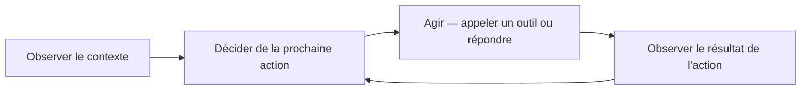
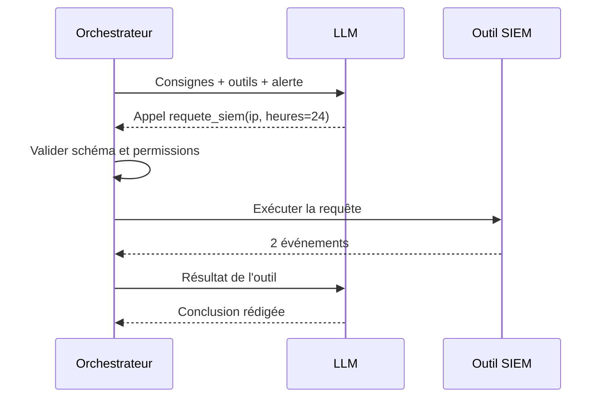

## Introduction

Un classifieur de phishing répond à une question : cet email est-il malveillant ? Un agent IA, lui, reçoit un objectif : trier cette alerte. Pour l'atteindre, il décide lui-même de consulter la réputation d'une adresse IP, d'interroger le SIEM, de lire l'historique de l'utilisateur, puis de rédiger une conclusion. Cette différence change tout, à la fois en valeur, parce que l'agent fait le travail répétitif d'un analyste, et en risque, parce qu'un système qui agit peut mal agir.

Ce chapitre pose les bases conceptuelles nécessaires avant d'aborder, au chapitre suivant, l'usage concret des agents IA pour l'automatisation SOC. Un agent n'est pas qu'un modèle qui répond à une question : c'est un système qui perçoit, décide et agit de façon autonome, potentiellement sur plusieurs étapes. À la fin, tu sauras décrire son architecture, expliquer comment un LLM appelle un outil, et surtout concevoir les garde-fous qui empêchent un agent de faire plus que ce qu'on attend de lui.

## Qu'est-ce qui distingue un agent d'un simple modèle

Un simple modèle de classification reçoit une entrée et produit une sortie unique, sans mémoire entre deux appels et sans interaction avec le reste du système d'information. Un agent combine un modèle, généralement un LLM, avec trois capacités supplémentaires : enchaîner plusieurs actions successives vers un objectif, appeler des outils externes, et maintenir un contexte et un état sur plusieurs étapes.

<CompareTable
  titleA="Modèle simple (ex : classificateur de phishing)"
  titleB="Agent IA autonome"
  rows={[
    { a: "Reçoit une entrée, produit une sortie unique", b: "Peut effectuer plusieurs actions successives pour atteindre un objectif" },
    { a: "N'interagit pas avec des systèmes externes", b: "Peut appeler des outils externes (bases de données, API, terminal)" },
    { a: "Aucune mémoire entre deux appels", b: "Peut maintenir un contexte et un état sur plusieurs étapes" },
    { a: "Comportement fixé par l'entraînement", b: "Comportement guidé par un objectif, des consignes et les résultats obtenus en cours de route" },
    { a: "Une erreur produit une mauvaise étiquette", b: "Une erreur peut produire une mauvaise action sur un système réel" },
  ]}
/>

<CehCallout>
Un agent IA de triage d'alertes SOC ne se contente pas de classer une alerte « suspecte » ou « normale ». Il peut, de façon autonome, interroger une base de renseignement sur la menace (threat intelligence), consulter l'historique de l'utilisateur concerné, puis rédiger une recommandation, enchaînant plusieurs actions pour une seule alerte.
</CehCallout>

Il existe un continuum d'autonomie. Au plus bas, un assistant propose une réponse que l'humain copie. Au milieu, un flux de travail fixe, écrit par un développeur, appelle un LLM à certaines étapes : l'ordre des actions est figé. Au plus haut, un agent choisit lui-même la séquence d'actions. Plus l'autonomie augmente, plus les garde-fous doivent être solides.

## Le cycle observation-décision-action

### La boucle

Tout agent suit la même boucle. Il observe le contexte, décide de la prochaine action la plus utile, agit, puis observe le résultat de cette action, qui devient une nouvelle observation. Le cycle recommence jusqu'à ce que l'objectif soit atteint ou qu'une limite soit rencontrée.



<Steps steps={[
  { title: "Observer", description: "L'agent reçoit un objectif et un contexte initial, par exemple une alerte SIEM à trier." },
  { title: "Décider", description: "L'agent détermine la prochaine action la plus utile pour progresser vers l'objectif." },
  { title: "Agir", description: "L'agent exécute cette action, souvent en appelant un outil externe." },
  { title: "Boucler", description: "Le résultat de l'action devient une nouvelle observation, et le cycle recommence jusqu'à ce que l'objectif soit atteint." },
]} />

### Comment un LLM « décide »

Dans un agent moderne, l'étape de décision est confiée à un LLM. On lui fournit un prompt système qui décrit son rôle et ses règles, la liste des outils disponibles, l'objectif, et l'historique des actions et résultats déjà obtenus. Le modèle répond soit par un texte final, soit par une demande d'appel d'outil. Ce schéma, où le modèle alterne raisonnement et action, a été popularisé sous le nom de ReAct, pour Reasoning and Acting.

Point essentiel : le LLM n'exécute rien lui-même. Il produit une demande structurée, et c'est le code de l'application, appelé l'orchestrateur ou le harnais, qui décide d'exécuter ou non l'outil, puis renvoie le résultat au modèle. C'est dans cet orchestrateur que tu places tes contrôles de sécurité.

## Le rôle central des outils

<CehCallout>
Un agent seul, sans accès à des outils externes, ne peut que raisonner sur ce qu'il connaît déjà. Donner à un agent l'accès à des outils, comme interroger une base de données, exécuter une recherche ou appeler une API de threat intelligence, est ce qui transforme un simple générateur de texte en système réellement capable d'agir sur le monde réel.
</CehCallout>

### L'appel d'outils (tool calling)

Chaque outil est décrit au modèle par un nom, une description en langage naturel et un schéma de paramètres, généralement au format JSON Schema. Voici à quoi ressemble la déclaration d'un outil de requête SIEM.

```json
{
  "name": "requete_siem",
  "description": "Recherche dans le SIEM les événements impliquant une adresse IP sur une période donnée. Lecture seule.",
  "input_schema": {
    "type": "object",
    "properties": {
      "ip": { "type": "string", "description": "Adresse IPv4 à rechercher" },
      "heures": { "type": "integer", "minimum": 1, "maximum": 72 }
    },
    "required": ["ip"]
  }
}
```

Quand le modèle juge l'outil utile, il répond par un appel structuré, par exemple le nom `requete_siem` avec les arguments `ip` et `heures`. L'orchestrateur valide ces arguments contre le schéma, exécute la fonction, et renvoie le résultat au modèle sous forme de message. La description de l'outil compte énormément : c'est elle que le modèle lit pour choisir. Une description vague conduit à des appels inappropriés.



### Les outils typiques en sécurité

<CompareTable
  titleA="Outil"
  titleB="Usage en sécurité"
  rows={[
    { a: "Requête vers une base de vulnérabilités (CVE)", b: "Vérifier si un logiciel mentionné dans une alerte est concerné par une vulnérabilité connue" },
    { a: "Requête vers un SIEM", b: "Rechercher des événements corrélés à une alerte donnée" },
    { a: "Consultation de threat intelligence", b: "Obtenir la réputation d'une IP, d'un domaine ou d'un hash de fichier" },
    { a: "Historique de l'utilisateur (annuaire, IAM)", b: "Comparer le comportement observé aux habitudes de connexion de l'utilisateur" },
    { a: "Exécution de commandes (terminal) ou EDR", b: "Automatiser une investigation ou une action de confinement, sous supervision" },
  ]}
/>

Classe toujours les outils selon leur effet : lecture seule, comme une requête SIEM, ou action, comme isoler un poste ou désactiver un compte. Cette distinction structure tous les garde-fous de la suite.

### Le Model Context Protocol (MCP)

Brancher chaque outil à chaque application d'IA demande beaucoup de code spécifique. Le Model Context Protocol, ou MCP, est un protocole ouvert publié par Anthropic fin 2024 et adopté depuis par de nombreux éditeurs. Il standardise la façon dont une application d'IA, le client, découvre et appelle des capacités exposées par des serveurs MCP : des outils, des ressources en lecture et des modèles de prompts. Un éditeur de SIEM ou de plateforme de threat intelligence peut ainsi publier un serveur MCP utilisable par n'importe quel agent compatible.

Du point de vue sécurité, un serveur MCP est un composant de la chaîne d'approvisionnement. Il reçoit des données de l'agent, renvoie des résultats que le modèle va lire, et ses descriptions d'outils influencent directement le comportement du modèle. Installer un serveur MCP non vérifié revient à installer un logiciel tiers avec les droits de l'agent : il faut vérifier sa provenance, restreindre ses permissions et journaliser ses appels.

## La mémoire d'un agent

Un LLM n'a pas de mémoire entre deux appels : tout ce qu'il « sait » d'une tâche en cours doit figurer dans sa fenêtre de contexte. On distingue donc plusieurs formes de mémoire, gérées par l'orchestrateur.

| Type de mémoire | Contenu | Exemple SOC |
| --- | --- | --- |
| Mémoire de travail | Historique des actions et résultats de la tâche en cours, dans la fenêtre de contexte | Les trois requêtes déjà faites pour cette alerte |
| Mémoire à long terme | Notes ou résumés persistés entre les tâches | « Le serveur de sauvegarde génère du trafic massif chaque nuit à 2 h » |
| Connaissances par RAG | Documents recherchés par similarité d'embeddings et injectés dans le prompt | Procédures internes, playbooks, avis CERT récents |

Le RAG, Retrieval-Augmented Generation, s'appuie sur les embeddings vus au chapitre 3 : les documents sont découpés en passages, chaque passage est transformé en vecteur et stocké dans une base vectorielle ; à chaque question, on récupère les passages les plus proches par similarité cosinus. Attention : toute mémoire persistante est aussi une surface d'attaque. Un document piégé dans la base RAG, ou une note empoisonnée dans la mémoire à long terme, influencera toutes les tâches futures. L'OWASP Top 10 for LLM Applications 2025 consacre d'ailleurs une catégorie aux faiblesses des vecteurs et embeddings, LLM08.

## Les risques propres aux agents

<WarningCallout>
Donner à un agent IA un accès direct à des outils capables d'agir sur des systèmes réels, comme exécuter des commandes ou modifier des configurations, sans supervision humaine ni garde-fou introduit un risque opérationnel réel. Un agent qui interprète mal une instruction ou est manipulé, comme on le verra au chapitre 6, peut causer des dommages allant bien au-delà d'une simple réponse textuelle erronée.
</WarningCallout>

L'OWASP nomme ce risque Excessive Agency, l'agentivité excessive, catégorie LLM06 de son Top 10 2025. Il a trois causes. La fonctionnalité excessive : l'agent dispose d'outils dont il n'a pas besoin, par exemple un outil shell générique alors qu'il ne devait que lire des logs. Les permissions excessives : l'outil utilise un compte de service avec des droits d'administrateur alors qu'une lecture suffisait. L'autonomie excessive : des actions à fort impact s'exécutent sans validation humaine.

Ces faiblesses deviennent critiques parce que le LLM lit des données que l'attaquant contrôle : le contenu d'un email, le nom d'un fichier, un champ « user-agent » dans un log. Ces données peuvent contenir des instructions qui détournent l'agent. Ce mécanisme, le prompt injection indirect, est expliqué au chapitre 6 ; retiens ici qu'il est impossible de garantir qu'un LLM ne sera jamais manipulé, et que la défense doit donc reposer sur ce que l'agent a le droit de faire.

### Les garde-fous architecturaux

<AttackDefenseTable rows={[
  { phase: "Conception des outils", attack: "Outil générique trop puissant, comme un shell ou une requête SQL libre, détournable vers d'autres usages", defense: "Outils étroits et spécialisés, paramètres validés par schéma et par liste blanche" },
  { phase: "Identité et droits", attack: "Compte de service administrateur réutilisé par l'agent", defense: "Moindre privilège : identité dédiée, droits en lecture seule par défaut, jetons à durée courte" },
  { phase: "Exécution des actions", attack: "Action destructrice déclenchée par une instruction injectée", defense: "Approbation humaine obligatoire pour toute action, journalisée avec l'identité de l'approbateur" },
  { phase: "Ressources", attack: "Boucle infinie ou épuisement volontaire des appels et du budget", defense: "Plafond d'étapes, de durée et de coût par tâche (OWASP LLM10, Unbounded Consumption)" },
  { phase: "Traçabilité", attack: "Décision impossible à reconstituer après un incident", defense: "Journal complet : prompts, appels d'outils, arguments, résultats, décision finale" },
]} />

<AuditCallout>
Le NIST AI Risk Management Framework 1.0 organise la gestion des risques de l'IA en quatre fonctions : Govern, Map, Measure et Manage. Pour un agent, cartographier signifie lister ses outils, ses droits et les données qu'il lit ; mesurer signifie tester son comportement, y compris face à des entrées malveillantes ; gérer signifie appliquer les garde-fous ci-dessus et les revoir. Côté ISO/IEC 27001:2022, les droits de l'agent relèvent du contrôle A.5.15 sur le contrôle d'accès et A.8.2 sur les droits d'accès privilégiés, et sa journalisation du contrôle A.8.15.
</AuditCallout>

## Un agent minimal en Python

Pour comprendre la mécanique sans dépendre d'un fournisseur de LLM, voici un agent dont le « cerveau » est une politique déterministe. Dans un vrai système, la fonction `decider` serait un appel au LLM qui renvoie un appel d'outil ; tout le reste, registre d'outils, contrôle des permissions, budget d'étapes et mémoire de travail, reste identique.

```python
import json

def threat_intel(ip):
    base = {"203.0.113.45": "malveillante (C2 connu)", "192.0.2.10": "inconnue"}
    return base.get(ip, "inconnue")

def historique_utilisateur(utilisateur):
    base = {"jdupont": "connexions habituelles depuis Pointe-Noire, 8h-18h"}
    return base.get(utilisateur, "aucun historique")

def requete_siem(ip, heures=24):
    evenements = {"203.0.113.45": ["10:02 connexion VPN jdupont", "10:05 accès partage RH"]}
    return evenements.get(ip, [])

def isoler_poste(hote):
    return f"poste {hote} isolé"

# Registre : chaque outil déclare son niveau de risque
OUTILS = {
    "threat_intel": {"fn": threat_intel, "risque": "lecture"},
    "historique_utilisateur": {"fn": historique_utilisateur, "risque": "lecture"},
    "requete_siem": {"fn": requete_siem, "risque": "lecture"},
    "isoler_poste": {"fn": isoler_poste, "risque": "action"},
}

def decider(objectif, memoire):
    """Remplace le LLM : choisit le prochain appel d'outil selon ce qui est déjà connu."""
    faits = {m["outil"]: m["resultat"] for m in memoire}
    alerte = objectif["alerte"]
    if "threat_intel" not in faits:
        return {"outil": "threat_intel", "arguments": {"ip": alerte["ip"]}}
    if "historique_utilisateur" not in faits:
        return {"outil": "historique_utilisateur", "arguments": {"utilisateur": alerte["utilisateur"]}}
    if "malveillante" in faits["threat_intel"] and "requete_siem" not in faits:
        return {"outil": "requete_siem", "arguments": {"ip": alerte["ip"]}}
    if "malveillante" in faits["threat_intel"]:
        return {"outil": "isoler_poste", "arguments": {"hote": alerte["hote"]}}
    return {"fin": "clôture : contexte normal"}

def executer(appel, approbation_humaine):
    """L'orchestrateur : c'est ici, et pas dans le modèle, que vivent les contrôles."""
    outil = OUTILS.get(appel["outil"])
    if outil is None:
        return "REFUS : outil inconnu"
    if outil["risque"] == "action" and not approbation_humaine(appel):
        return "REFUS : action non approuvée, escalade vers un analyste"
    return outil["fn"](**appel["arguments"])

def agent(objectif, approbation_humaine, max_etapes=6):
    memoire = []
    for etape in range(1, max_etapes + 1):
        appel = decider(objectif, memoire)                          # décider
        if "fin" in appel:
            print(f"[{etape}] FIN      {appel['fin']}")
            return memoire
        resultat = executer(appel, approbation_humaine)             # agir
        print(f"[{etape}] {appel['outil']:<22} "
              f"{json.dumps(appel['arguments'], ensure_ascii=False)} -> {resultat}")
        memoire.append({"outil": appel["outil"], "resultat": resultat})   # observer
        if str(resultat).startswith("REFUS"):
            return memoire
    print("Budget d'étapes épuisé : escalade")
    return memoire

refuser = lambda appel: False
agent({"alerte": {"ip": "203.0.113.45", "utilisateur": "jdupont", "hote": "PC-RH-042"}}, refuser)
print("---")
agent({"alerte": {"ip": "192.0.2.10", "utilisateur": "jdupont", "hote": "PC-COMPTA-07"}}, refuser)
```

```text
[1] threat_intel           {"ip": "203.0.113.45"} -> malveillante (C2 connu)
[2] historique_utilisateur {"utilisateur": "jdupont"} -> connexions habituelles depuis Pointe-Noire, 8h-18h
[3] requete_siem           {"ip": "203.0.113.45"} -> ['10:02 connexion VPN jdupont', '10:05 accès partage RH']
[4] isoler_poste           {"hote": "PC-RH-042"} -> REFUS : action non approuvée, escalade vers un analyste
---
[1] threat_intel           {"ip": "192.0.2.10"} -> inconnue
[2] historique_utilisateur {"utilisateur": "jdupont"} -> connexions habituelles depuis Pointe-Noire, 8h-18h
[3] FIN      clôture : contexte normal
```

Dans le premier cas, l'agent enchaîne trois outils en lecture, conclut qu'il faut isoler le poste, mais l'orchestrateur bloque l'action faute d'approbation humaine : l'alerte part vers un analyste avec tout le contexte déjà collecté. Dans le second, l'agent clôt seul un cas bénin. Les adresses utilisées appartiennent aux plages réservées à la documentation, définies par la RFC 5737.

## Erreurs fréquentes

La première erreur est de placer les règles de sécurité uniquement dans le prompt système, du type « n'isole jamais un serveur de production ». Un prompt est une consigne, pas un contrôle : il peut être ignoré ou contourné. Les contrôles doivent vivre dans l'orchestrateur et dans les droits des comptes.

La deuxième est de donner un outil générique par confort, comme un shell complet, au lieu de trois outils étroits.

La troisième est de réutiliser les identifiants d'un administrateur pour l'agent. L'agent doit avoir sa propre identité, traçable et révocable.

La quatrième est de ne journaliser que la conclusion. Sans les appels d'outils et leurs résultats, impossible de comprendre une erreur ou une manipulation.

La cinquième est d'oublier la limite d'étapes : un agent qui boucle consomme du budget et peut saturer une API interne.

## Lab — Mise en pratique

**Environnement** : Python 3.12 ou plus récent, aucune bibliothèque externe nécessaire. Enregistre le code du chapitre dans un fichier `agent.py`.

<Steps steps={[
  { title: "Exécuter l'agent de référence", description: "Lance le script et compare les deux traces. Repère, pour chaque ligne, l'étape du cycle observation-décision-action à laquelle elle correspond.", code: "python3 agent.py" },
  { title: "Ajouter un outil de recherche de vulnérabilités", description: "Ajoute un outil en lecture seule qui indique si un logiciel est concerné par une vulnérabilité connue, à partir d'un petit dictionnaire local. Déclare-le dans le registre avec le risque « lecture ».", code: "def recherche_cve(logiciel):\n    base = {'openssh 9.1': ['exemple : vulnérabilité connue, voir l avis éditeur']}\n    return base.get(logiciel.lower(), [])\n\nOUTILS['recherche_cve'] = {'fn': recherche_cve, 'risque': 'lecture'}" },
  { title: "Valider les arguments", description: "Avant d'exécuter un outil, vérifie que les arguments attendus sont présents et que l'adresse IP est bien une IPv4 valide grâce au module ipaddress. Observe le refus quand tu passes « 999.1.1.1 ».", code: "import ipaddress\n\ndef ip_valide(valeur):\n    try:\n        ipaddress.IPv4Address(valeur)\n        return True\n    except ValueError:\n        return False\n\nprint(ip_valide('203.0.113.45'), ip_valide('999.1.1.1'))" },
  { title: "Simuler une approbation humaine", description: "Remplace la fonction refuser par une fonction qui demande confirmation dans le terminal avec input(). Relance la première alerte et observe que l'isolement ne s'exécute que si tu tapes « oui ».", code: "def demander(appel):\n    reponse = input(f\"Approuver {appel['outil']} {appel['arguments']} ? (oui/non) \")\n    return reponse.strip().lower() == 'oui'\n\nagent({'alerte': {'ip': '203.0.113.45', 'utilisateur': 'jdupont', 'hote': 'PC-RH-042'}}, demander)" },
  { title: "Tester le budget d'étapes", description: "Modifie temporairement decider pour qu'il renvoie toujours l'appel threat_intel. Observe que l'agent s'arrête au bout de max_etapes avec le message d'escalade au lieu de boucler indéfiniment.", code: "agent({'alerte': {'ip': '203.0.113.45', 'utilisateur': 'jdupont', 'hote': 'PC-RH-042'}}, refuser, max_etapes=3)" },
  { title: "Écrire une piste d'audit", description: "Enregistre chaque appel dans un fichier JSON Lines avec horodatage, outil, arguments et résultat. Ouvre le fichier et vérifie que tu peux reconstituer toute la décision sans relancer l'agent.", code: "import json, datetime\n\ndef journaliser(appel, resultat, chemin='audit.jsonl'):\n    with open(chemin, 'a', encoding='utf-8') as f:\n        f.write(json.dumps({'ts': datetime.datetime.now().isoformat(), 'appel': appel, 'resultat': str(resultat)}, ensure_ascii=False) + '\\n')" },
]} />

## À retenir

- Un agent IA se distingue d'un simple modèle par sa capacité à enchaîner plusieurs actions autonomes vers un objectif, à appeler des outils externes et à maintenir un contexte sur plusieurs étapes.
- Le cycle observation-décision-action boucle : le résultat de chaque action devient une nouvelle observation, jusqu'à l'objectif ou une limite.
- Le LLM ne fait que demander un appel d'outil ; l'orchestrateur valide et exécute, c'est donc là que vivent les contrôles de sécurité.
- L'accès à des outils transforme un générateur de texte en système capable d'agir, et MCP standardise ce branchement, ce qui fait de chaque serveur MCP un composant de chaîne d'approvisionnement.
- La mémoire persistante et le RAG sont utiles mais empoisonnables.
- L'agentivité excessive (OWASP LLM06) vient d'une fonctionnalité, de permissions ou d'une autonomie excessives ; on la combat par le moindre privilège, l'approbation humaine des actions, les budgets et une journalisation complète.

## Questions de révision

1. Qu'est-ce qui distingue fondamentalement un agent IA d'un simple modèle de classification ?
2. Décris les quatre étapes du cycle observation-décision-action et ce qui se passe après une action.
3. Pourquoi dit-on que le LLM n'exécute jamais lui-même un outil, et quelle conséquence cela a-t-il pour la sécurité ?
4. À quoi sert une requête vers une base de vulnérabilités pour un agent de triage, et à quoi sert une requête vers un SIEM ?
5. Quels risques introduit l'ajout d'un serveur MCP tiers à un agent, et comment les limiter ?
6. Explique les trois causes de l'agentivité excessive selon l'OWASP, avec un exemple SOC pour chacune.
7. Pourquoi une consigne de sécurité écrite uniquement dans le prompt système ne suffit-elle pas ?
