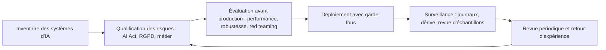

## Introduction

Tout au long de ce cours, tu as vu ce que l'IA sait faire pour la sécurité, de la détection d'anomalies au triage automatisé, et comment elle peut être attaquée ou détournée. Reste une question que tout responsable sécurité finit par se poser : comment encadrer tout cela ? Qui a le droit de déployer un agent qui clôture des alertes ? Qui vérifie qu'un modèle ne se dégrade pas ? Que dit la loi quand une décision automatisée touche un salarié ?

Ce dernier chapitre referme le cours en abordant la gouvernance de l'IA en sécurité, c'est-à-dire la façon d'encadrer son usage de façon responsable, puis dresse une synthèse reliant chaque chapitre à son usage concret. À la fin, tu sauras expliquer les grands principes de gouvernance, situer un système dans les catégories de l'AI Act, t'appuyer sur les référentiels NIST et ISO, et identifier les limites qui imposent de garder un humain dans la boucle.

## Principes de gouvernance de l'IA en sécurité

### Les quatre piliers

<Steps steps={[
  { title: "Transparence sur les décisions automatisées", description: "Documenter clairement quand une décision, comme la clôture d'une alerte ou le blocage d'un compte, a été prise par un agent IA plutôt que par un humain, avec les éléments qui l'ont motivée." },
  { title: "Supervision humaine sur les actions à conséquence réelle", description: "Rappel du chapitre 5 : aucune action de confinement critique sans validation humaine, sauf règles très strictes et validées au préalable." },
  { title: "Audit régulier des modèles et agents déployés", description: "Vérifier périodiquement que le comportement reste conforme aux attentes, notamment face à une dérive de concept, vue au cours Data Science Complète, au chapitre 8." },
  { title: "Conformité réglementaire", description: "Rappel du cours Droit et Réglementation : le RGPD encadre les décisions automatisées à impact significatif, et l'AI Act européen ajoute des obligations spécifiques à l'IA selon le niveau de risque." },
]} />

La transparence répond à une question simple : en relisant un dossier d'incident six mois plus tard, peut-on savoir qui ou quoi a décidé, et pourquoi ? Si la réponse est « l'agent, mais on ne sait plus avec quelle version ni sur quels éléments », la gouvernance a échoué.

La supervision humaine n'est pas un tampon apposé machinalement. Pour qu'elle soit réelle, l'humain doit avoir le temps, la compétence et l'information nécessaires pour contredire la machine. Un analyste qui valide cinq cents propositions par heure ne supervise rien : c'est ce qu'on appelle le biais d'automatisation, la tendance à accepter la proposition d'un système automatisé sans l'examiner.

L'audit régulier s'appuie sur les traces décrites aux chapitres 4 et 5 : journaux complets, revue d'échantillons, indicateurs de dérive. La conformité, enfin, se construit dès la conception et non après coup.

### Organiser la gouvernance au quotidien

Concrètement, une organisation qui utilise l'IA en sécurité met en place un inventaire de tous les systèmes d'IA, y compris les services externes utilisés par les équipes ; une politique d'usage qui dit quelles données peuvent être envoyées à quels services, pour lutter contre l'IA fantôme, ces outils adoptés sans validation ; un propriétaire identifié par système, responsable de ses performances et de ses risques ; un processus d'évaluation avant mise en production, incluant des tests de robustesse face au prompt injection ; et une procédure de gestion d'incident propre à l'IA, pour savoir quoi faire si un agent se comporte mal.



## Le cadre réglementaire et normatif

### L'AI Act européen

<LegalCallout>
L'AI Act, règlement (UE) 2024/1689, est entré en vigueur le 1er août 2024 et s'applique par étapes. Les pratiques interdites et l'obligation de maîtrise de l'IA par le personnel s'appliquent depuis le 2 février 2025, les obligations des modèles d'IA à usage général depuis le 2 août 2025, et la plupart des autres dispositions, dont les obligations des systèmes à haut risque de l'Annexe III et la transparence de l'article 50, à partir du 2 août 2026 ; les systèmes à haut risque intégrés à des produits réglementés suivent au 2 août 2027. La Commission a proposé fin 2025 d'ajuster une partie de ce calendrier : vérifie toujours l'état en vigueur avant de conclure sur une échéance.
</LegalCallout>

L'AI Act classe les systèmes d'IA selon leur niveau de risque, en quatre grandes catégories.

| Niveau | Principe | Exemples |
| --- | --- | --- |
| Risque inacceptable | Pratiques interdites (article 5) | Notation sociale, reconnaissance des émotions sur le lieu de travail sauf raisons médicales ou de sécurité, manipulation exploitant des vulnérabilités |
| Haut risque | Exigences strictes avant et après mise sur le marché | Domaines de l'Annexe III : biométrie, infrastructures critiques, éducation, emploi et gestion des travailleurs, accès aux services essentiels, application de la loi, migration, justice |
| Risque de transparence | Information des personnes (article 50) | Chatbots, contenus synthétiques et deepfakes |
| Risque minimal | Pas d'obligation spécifique, codes de conduite volontaires | Filtre anti-spam, la plupart des outils internes |

Pour un système à haut risque, le fournisseur doit notamment mettre en place un système de gestion des risques, une gouvernance des données, une documentation technique, une journalisation automatique des événements, des informations claires pour l'utilisateur, une supervision humaine effective, et garantir exactitude, robustesse et cybersécurité. L'article 15 cite explicitement la résilience face à l'empoisonnement des données ou du modèle, aux exemples adversariaux et aux attaques sur la confidentialité : exactement les menaces du chapitre 6. L'organisation qui utilise le système, appelée déployeur, a elle aussi des obligations, dont l'usage conforme aux instructions et la supervision humaine par des personnes compétentes.

### Un outil de sécurité est-il « à haut risque » ?

C'est une question fréquente, et la réponse est nuancée. Un outil d'IA utilisé uniquement pour la cybersécurité, comme un détecteur d'anomalies réseau ou un agent de triage, n'est pas classé à haut risque du seul fait de son usage en sécurité ni de l'impact de ses décisions. Le règlement précise même, dans son considérant 55, que les composants destinés uniquement à la cybersécurité ne doivent pas être considérés comme des composants de sécurité d'une infrastructure critique. En revanche, un système relève du haut risque s'il tombe dans un domaine de l'Annexe III : un outil qui surveille et évalue le comportement des salariés pour prendre des décisions sur leur relation de travail, un système d'identification biométrique, ou un outil de tri de candidatures.

Prenons le blocage automatique de comptes. Si l'outil bloque un compte compromis pour protéger le système d'information, il n'entre pas en soi dans une catégorie à haut risque. Mais c'est une décision de sécurité à fort impact sur une personne : le RGPD, et notamment son article 22, impose déjà de l'encadrer, de la documenter et de permettre une révision humaine. Et si les mêmes analyses servent à évaluer ou sanctionner des salariés, on bascule vers le domaine de l'emploi de l'Annexe III. Conclusion pratique : la qualification se fait cas par cas, avec le juriste et le DPO, et les garde-fous de supervision sont de toute façon une bonne pratique.

<CehCallout>
L'AI Act européen classe les systèmes d'IA selon leur niveau de risque : inacceptable, haut, transparence, minimal. Retiens que la catégorie dépend du domaine d'usage défini par le règlement, pas de la technologie employée, et que les obligations des systèmes à haut risque incluent supervision humaine, journalisation et robustesse face aux attaques.
</CehCallout>

### Les autres textes à connaître

Le RGPD reste central dès que l'IA traite des données personnelles : base légale, minimisation, analyse d'impact pour les traitements à risque, et article 22 sur les décisions automatisées. NIS2 impose aux entités essentielles et importantes une gestion des risques cyber qui couvre aussi les outils d'IA qu'elles déploient, et DORA fait de même pour le secteur financier, notamment pour les prestataires tiers.

### Les référentiels volontaires

<AuditCallout>
Le NIST AI Risk Management Framework 1.0, publié en janvier 2023, structure la gestion des risques de l'IA en quatre fonctions : Govern pour la culture, les rôles et les politiques, Map pour le contexte et l'identification des risques, Measure pour l'évaluation et le suivi, Manage pour le traitement et la priorisation. Le NIST l'a complété en 2024 par un profil dédié à l'IA générative, NIST AI 600-1. Côté ISO, l'ISO/IEC 42001:2023 définit un système de management de l'IA certifiable, sur le modèle de l'ISO/IEC 27001:2022, et l'ISO/IEC 23894:2023 donne des lignes directrices de gestion des risques propres à l'IA.
</AuditCallout>

Si ton organisation est déjà certifiée ISO/IEC 27001:2022, l'ISO/IEC 42001 s'y intègre naturellement : même structure de système de management, mêmes logiques d'analyse de risques, de revue de direction et d'amélioration continue. Les contrôles de l'Annexe A de l'ISO 27001 restent pertinents pour les systèmes d'IA : contrôle d'accès, journalisation, gestion des fournisseurs, développement sécurisé.

## Les limites actuelles de l'IA en cybersécurité

<CompareTable
  titleA="Limite"
  titleB="Implication pratique"
  rows={[
    { a: "Les modèles reflètent les biais de leurs données d'entraînement (cours Data Science Complète, chapitre 9)", b: "Un modèle peut sous-performer sur des menaces ou contextes sous-représentés à l'entraînement" },
    { a: "Vulnérabilité au prompt injection et aux attaques adversariales (chapitre 6)", b: "Aucun système d'IA de sécurité ne doit être considéré comme une défense infaillible" },
    { a: "Manque d'interprétabilité des modèles complexes (chapitre 1)", b: "Difficile d'expliquer précisément pourquoi un modèle a pris une décision donnée" },
    { a: "Dérive de concept dans le temps", b: "Un modèle non réentraîné se dégrade face à des menaces qui évoluent" },
    { a: "Hallucinations des LLM", b: "Toute affirmation factuelle doit être reliée à une source vérifiable" },
    { a: "Dépendance à un fournisseur et coûts", b: "Changement de version du modèle, panne ou hausse de prix affectent directement le SOC" },
  ]}
/>

Le biais est souvent mal compris en sécurité. Un modèle de détection entraîné principalement sur des attaques visant des environnements Windows sous-performera sur des serveurs Linux ou des équipements industriels. Un détecteur de phishing entraîné sur des emails en anglais sera moins bon sur des messages en lingala ou en français d'Afrique centrale. Le modèle ne « sait » pas qu'il ne sait pas : il donnera une réponse avec la même assurance.

La dérive de concept est la limite la plus insidieuse, car invisible sans mesure. Les attaquants changent leurs outils, l'organisation change son infrastructure, et un modèle figé se dégrade en silence. Le lab de ce chapitre montre comment repérer une dérive à partir d'un simple indicateur mensuel.

<WarningCallout>
Le principal risque de gouvernance n'est pas l'IA elle-même, mais une confiance excessive et non questionnée envers ses décisions. Traiter la sortie d'un modèle comme une vérité incontestable plutôt que comme une aide à la décision parmi d'autres est l'erreur la plus fréquente et la plus coûteuse dans le déploiement de l'IA en sécurité.
</WarningCallout>

## Synthèse — panorama complet du cours

<CompareTable
  titleA="Chapitre"
  titleB="Contribution au panorama"
  rows={[
    { a: "1. Panorama réseaux de neurones et LLM", b: "Fondations conceptuelles de l'IA moderne et caractère dual-use de l'IA générative" },
    { a: "2. Détection d'anomalies par deep learning", b: "Application défensive directe : l'autoencodeur et l'erreur de reconstruction" },
    { a: "3. NLP appliqué à la sécurité", b: "Exploiter les données textuelles : TF-IDF, embeddings, phishing et logs" },
    { a: "4. Agents IA autonomes", b: "Architecture d'un système qui agit, appel d'outils et agentivité excessive" },
    { a: "5. Agents IA pour le SOC", b: "Triage assisté, garde-fous, traçabilité et mesure de la performance" },
    { a: "6. IA offensive et risques", b: "Prompt injection, deepfakes, attaques adversariales et chaîne d'approvisionnement" },
    { a: "7. Gouvernance et limites", b: "Encadrer l'usage de façon responsable : AI Act, RGPD, NIST AI RMF, ISO/IEC 42001" },
  ]}
/>

Le fil rouge du cours tient en une phrase : l'IA est un multiplicateur de capacité, pour les défenseurs comme pour les attaquants, et sa valeur en sécurité dépend entièrement de la qualité des garde-fous qui l'entourent.

## Erreurs fréquentes

La première erreur est de conclure qu'un outil est à haut risque, ou au contraire sans obligation, sans analyse du domaine d'usage précis.

La deuxième est de confondre supervision humaine et validation automatique par un humain débordé. Une supervision réelle suppose du temps, de la compétence et le droit de dire non.

La troisième est de ne pas inventorier les usages d'IA fantôme : l'analyste qui colle des logs clients dans un chatbot public crée un risque que personne ne gouverne.

La quatrième est de traiter la gouvernance comme un projet ponctuel. Les modèles, les fournisseurs et la réglementation évoluent ; la revue doit être périodique.

## Où aller ensuite

<Steps steps={[
  { title: "Vers Analyse SOC", description: "Voir comment les agents et modèles vus dans ce cours s'intègrent concrètement dans le quotidien d'un analyste SOC." },
  { title: "Vers Psychologie et Ingénierie Sociale", description: "Approfondir les biais cognitifs exploités par l'ingénierie sociale, amplifiée par les deepfakes vus au chapitre 6." },
  { title: "Vers Droit et Réglementation", description: "Approfondir les obligations réglementaires encadrant les décisions automatisées et l'IA à haut risque." },
]} />

## Lab — Mise en pratique

**Environnement** : Python 3.12 ou plus récent avec `pandas` (`pip install pandas`).

<Steps steps={[
  { title: "Construire un journal de décisions automatisées", description: "Rassemble un petit historique de décisions prises par des agents IA, avec la présence d'une justification, l'existence d'une revue humaine et le niveau d'impact.", code: "import pandas as pd\n\ndecisions = pd.DataFrame({\n    'action': ['blocage_compte', 'cloture_alerte', 'blocage_compte', 'cloture_alerte', 'escalade'],\n    'justification_presente': [True, False, True, False, True],\n    'revue_humaine': [False, False, True, False, True],\n    'impact_eleve': [True, False, True, False, False]\n})\nprint(decisions)" },
  { title: "Calculer les métriques de transparence", description: "Mesure la proportion de décisions sans justification et le nombre de décisions à fort impact non revues. Tu dois obtenir 40 % et 1.", code: "taux_sans_justification = (~decisions['justification_presente']).mean() * 100\nnb_non_revues = decisions[decisions['impact_eleve'] & ~decisions['revue_humaine']].shape[0]\nprint(f'Decisions sans justification : {taux_sans_justification:.0f}%')\nprint(f'Decisions a fort impact non revues : {nb_non_revues}')" },
  { title: "Isoler les violations de gouvernance", description: "Affiche les décisions à fort impact jamais revues par un humain. Le blocage de compte de la ligne 0 est exactement le risque décrit dans ce chapitre.", code: "violations = decisions[decisions['impact_eleve'] & ~decisions['revue_humaine']]\nprint(violations)" },
  { title: "Surveiller la dérive du taux de clôture automatique", description: "Calcule le taux mensuel de clôtures automatiques et compare le dernier mois à un seuil égal à la moyenne plus trois écarts-types des mois précédents. Observe que octobre (0.778) dépasse nettement le seuil (environ 0.599) : à investiguer.", code: "mois = pd.DataFrame({\n    'mois': ['2026-06', '2026-07', '2026-08', '2026-09', '2026-10'],\n    'alertes': [41200, 39800, 40500, 42100, 40900],\n    'clotures_auto': [24300, 23600, 24100, 25000, 31800],\n})\nmois['taux_auto'] = (mois['clotures_auto'] / mois['alertes']).round(3)\nref = mois['taux_auto'].iloc[:4]\nseuil = ref.mean() + 3 * ref.std()\nmois['alerte_derive'] = mois['taux_auto'] > seuil\nprint(mois)\nprint(f'seuil = {seuil:.3f}')" },
  { title: "Dresser un inventaire et une qualification initiale", description: "Liste les systèmes d'IA de l'organisation avec leur domaine d'usage et applique une première qualification. Observe que les outils de cybersécurité ne déclenchent pas de catégorie particulière, alors que les systèmes liés à l'emploi demandent une analyse juridique.", code: "inventaire = pd.DataFrame({\n    'systeme': ['triage-soc', 'filtre-phishing', 'analyse-comportement-salaries', 'chatbot-support', 'tri-cv'],\n    'domaine': ['cybersecurite', 'cybersecurite', 'emploi', 'relation-client', 'emploi'],\n    'interagit_avec_personnes': [False, False, False, True, False],\n})\n\ndef qualifier(ligne):\n    if ligne.domaine in {'emploi', 'biometrie', 'education', 'credit'}:\n        return 'potentiellement haut risque (Annexe III) : analyse juridique requise'\n    if ligne.interagit_avec_personnes:\n        return 'obligations de transparence (art. 50)'\n    return 'aucune categorie AI Act identifiee : RGPD et bonnes pratiques'\n\ninventaire['qualification'] = inventaire.apply(qualifier, axis=1)\nprint(inventaire[['systeme', 'qualification']].to_string(index=False))" },
  { title: "Rédiger la fiche de gouvernance d'un système", description: "Pour le système triage-soc, écris une fiche courte en texte : propriétaire, données traitées, outils et droits, garde-fous, indicateurs suivis, fréquence de revue. Vérifie que chaque garde-fou du chapitre 5 y figure." },
]} />

Sur une exécution de référence, l'étape 4 affiche :

```text
      mois  alertes  clotures_auto  taux_auto  alerte_derive
0  2026-06    41200          24300      0.590          False
1  2026-07    39800          23600      0.593          False
2  2026-08    40500          24100      0.595          False
3  2026-09    42100          25000      0.594          False
4  2026-10    40900          31800      0.778           True
seuil = 0.599
```

Le seuil fondé sur trois écarts-types est volontairement simple. Avec seulement quatre mois de référence, il est fragile ; en production, on utilise un historique plus long et on investigue toute alerte de dérive avant de conclure, car une hausse peut aussi venir d'un changement légitime, comme une nouvelle règle de détection très bruyante.

## À retenir

- La gouvernance de l'IA en sécurité repose sur la transparence des décisions automatisées, la supervision humaine des actions à conséquence réelle, l'audit régulier et la conformité réglementaire.
- L'AI Act classe les systèmes d'IA selon leur niveau de risque ; la catégorie dépend du domaine d'usage, et un outil utilisé uniquement pour la cybersécurité n'est pas à haut risque par principe.
- Les obligations du haut risque incluent supervision humaine, journalisation et robustesse face aux attaques ; l'article 50 impose la transparence sur les contenus synthétiques à partir d'août 2026.
- Le RGPD encadre déjà toute décision automatisée à impact significatif sur une personne, comme le blocage d'un compte.
- Le NIST AI RMF 1.0 (Govern, Map, Measure, Manage) et l'ISO/IEC 42001:2023 structurent la démarche.
- Biais hérités des données, vulnérabilité au prompt injection et aux attaques adversariales, manque d'interprétabilité, dérive de concept et hallucinations imposent de garder l'humain dans la boucle.
- Le risque principal n'est pas l'IA elle-même, mais une confiance excessive et non questionnée envers ses décisions.

## Questions de révision

1. Que classifie l'AI Act européen, et quelles sont ses quatre catégories ?
2. Un agent de triage SOC qui clôture des alertes est-il un système à haut risque au sens de l'AI Act ? Justifie ta réponse.
3. Dans quelle situation un outil d'analyse comportementale des comptes utilisateurs pourrait-il basculer dans une catégorie à haut risque ?
4. Qu'est-ce que le biais d'automatisation, et pourquoi menace-t-il la supervision humaine ?
5. Cite quatre limites actuelles de l'IA appliquée à la cybersécurité et leur implication pratique.
6. Comment détecter qu'un modèle subit une dérive de concept, et que faire une fois l'alerte levée ?
7. Pourquoi le risque principal de gouvernance de l'IA est-il une confiance excessive plutôt que l'IA elle-même ?

Félicitations, tu viens de terminer le cours **IA et Agents en Cybersécurité**. Direction **Analyse SOC** pour voir concrètement comment ces outils s'intègrent dans le travail quotidien d'un analyste.
