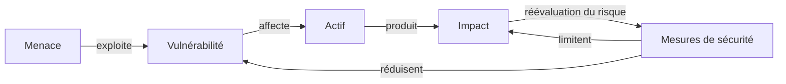
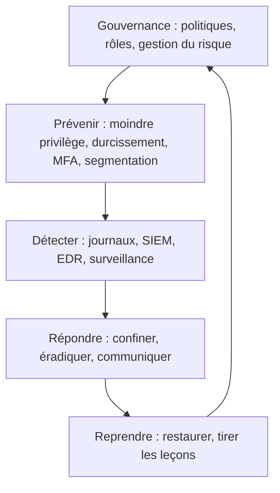

## Introduction

Avant de manipuler le moindre outil, il faut comprendre le problème que la cybersécurité cherche à résoudre. Un hôpital dont les dossiers patients deviennent inaccessibles, une PME dont le compte bancaire est vidé après un faux ordre de virement, une administration dont les données personnelles se retrouvent en vente : ces situations sont devenues ordinaires. Elles ont toutes la même structure. Quelque chose de précieux, un **actif**, a été atteint par quelqu'un ou quelque chose, une **menace**, qui a profité d'une faiblesse, une **vulnérabilité**, avec une conséquence, un **impact**.

Ce chapitre pose les bases sur lesquelles reposent tous les cours suivants de Nyx. Tu y trouveras le vocabulaire commun de la profession, la triade CIA qui sert à analyser n'importe quel incident, les familles de menaces et les acteurs qui les portent, ainsi que les principes de conception qui guident la défense. Ce vocabulaire est exactement celui des examens d'entrée comme Security+ et CEH, et celui que tu utiliseras dans un rapport ou une réunion de crise.

À la fin de ce chapitre, tu sauras décrire un incident avec les bons termes, dire quelle propriété de sécurité il a atteinte, identifier le type d'acteur probable et proposer des mesures en respectant les principes de base de la défense.

## Qu'est-ce que la cybersécurité ?

### Une définition opérationnelle

La **cybersécurité** regroupe l'ensemble des pratiques, technologies et processus qui visent à protéger les systèmes, les réseaux et les données contre les accès non autorisés, les altérations et les interruptions. On parle aussi de **sécurité des systèmes d'information** (SSI). La définition est large à dessein : la cybersécurité n'est pas qu'une affaire de pare-feu et d'antivirus. Elle inclut la gouvernance (qui décide, avec quel budget), les personnes (formation, procédures) et la technique.

Surtout, ce n'est pas un état mais un **processus continu**. Une organisation n'est jamais « sécurisée » une fois pour toutes : de nouvelles vulnérabilités sont publiées chaque jour, l'organisation change, les attaquants s'adaptent. On ne cherche donc pas l'invulnérabilité, qui n'existe pas, mais la **gestion du risque** : ramener le risque à un niveau que l'organisation accepte consciemment.

### Le vocabulaire de base

| Terme | Définition | Exemple |
| --- | --- | --- |
| Actif | Tout ce qui a de la valeur pour l'organisation | Base clients, serveur de paie, réputation |
| Menace | Cause potentielle d'un incident | Groupe de rançongiciel, employé négligent, inondation |
| Vulnérabilité | Faiblesse qu'une menace peut exploiter | Logiciel non corrigé, mot de passe faible, absence de sauvegarde |
| Exploit | Moyen concret d'utiliser une vulnérabilité | Programme ou procédure qui déclenche la faille |
| Impact | Conséquence d'un incident | Arrêt de production, amende, perte de confiance |
| Risque | Combinaison de la vraisemblance d'un incident et de son impact | « Forte probabilité de chiffrement des serveurs, impact critique » |
| Mesure de sécurité | Moyen qui réduit le risque | Correctif, MFA, sauvegarde hors ligne, formation |

Le chapitre 4 de ce cours approfondit la gestion du risque. Retiens pour l'instant que sans actif de valeur il n'y a rien à protéger, sans vulnérabilité la menace ne peut rien faire, et sans menace une vulnérabilité reste théorique.

## La triade CIA

### Les trois propriétés

Trois propriétés fondamentales structurent toute analyse de sécurité. On les désigne par l'acronyme anglais **CIA**, ou **DIC** en français (Disponibilité, Intégrité, Confidentialité).

<CompareTable
  titleA="Propriété"
  titleB="Ce qu'elle garantit"
  rows={[
    { a: "Confidentialité (Confidentiality)", b: "Seules les personnes autorisées peuvent accéder à l'information" },
    { a: "Intégrité (Integrity)", b: "L'information n'est pas altérée de façon non autorisée, qu'elle soit stockée ou en transit" },
    { a: "Disponibilité (Availability)", b: "L'information et les services restent accessibles quand on en a besoin" },
  ]}
/>

La **confidentialité** se protège par le contrôle d'accès, le chiffrement et la classification des informations. L'**intégrité** se protège par les fonctions de hachage, les signatures numériques, les contrôles d'accès en écriture et la journalisation. La **disponibilité** se protège par la redondance, les sauvegardes, la capacité de résister aux surcharges et les plans de continuité.

<TipCallout>
Retiens l'acronyme CIA (Confidentiality, Integrity, Availability). C'est l'un des concepts les plus testés dans toutes les certifications d'entrée en cybersécurité, Security+ et CEH en tête. Une méthode efficace : face à n'importe quel scénario, demande-toi « qu'est-ce qui a été vu, qu'est-ce qui a été modifié, qu'est-ce qui est devenu inaccessible ? ».
</TipCallout>

### Appliquer la triade à des incidents

Une attaque par **déni de service distribué** (DDoS) ne vole aucune donnée et n'en modifie aucune : elle vise uniquement la **disponibilité**. Une **fuite de base de données clients**, sans altération ni interruption de service, touche la **confidentialité**. Un attaquant qui modifie discrètement le RIB d'un fournisseur dans le logiciel de comptabilité atteint l'**intégrité**, et l'entreprise paie le mauvais destinataire sans rien remarquer.

Les incidents réels touchent souvent plusieurs propriétés à la fois. Un rançongiciel moderne pratique généralement la **double extorsion** : il exfiltre les données avant de les chiffrer. La confidentialité est atteinte par le vol, la disponibilité par le chiffrement, et l'attaquant menace de publier les données si la rançon n'est pas payée.

Les mesures de sécurité, elles aussi, peuvent entrer en tension avec l'une des propriétés. Chiffrer un disque protège la confidentialité, mais si la clé est perdue, la disponibilité est perdue avec elle. Exiger trois validations pour chaque modification protège l'intégrité mais ralentit le service.

### Les propriétés complémentaires

La triade est souvent complétée par d'autres propriétés. L'**authenticité** garantit que l'origine d'une information ou l'identité d'un interlocuteur est bien celle annoncée. La **non-répudiation** empêche l'auteur d'une action de nier l'avoir accomplie, grâce à une signature numérique ou à une journalisation fiable. La **traçabilité** (ou imputabilité) permet de savoir qui a fait quoi et quand. Le trio identification, authentification, autorisation, souvent complété par la traçabilité sous le sigle **AAA** (Authentication, Authorization, Accounting), décrit le contrôle d'accès.

### Au-delà de CIA : le Parkerian Hexad

Le chercheur Donn Parker a proposé en 1998 un modèle à six propriétés, le **Parkerian Hexad**, qui ajoute trois propriétés à la triade pour analyser plus finement certains incidents.

<CompareTable
  titleA="Propriété additionnelle"
  titleB="Ce qu'elle capture"
  rows={[
    { a: "Possession ou contrôle", b: "Perdre le contrôle d'une donnée sans forcément la rendre publique, par exemple un rançongiciel qui chiffre sans exfiltrer, ou un support volé mais chiffré" },
    { a: "Authenticité", b: "Garantir que l'origine d'une information est bien celle annoncée, par exemple contrer l'usurpation d'identité ou un faux e-mail du directeur" },
    { a: "Utilité", b: "L'information reste exploitable, pas seulement accessible, par exemple des données présentes mais chiffrées avec une clé perdue" },
  ]}
/>

Un rançongiciel qui chiffre sans exfiltrer illustre la limite de la triade seule : les données restent confidentielles, personne d'autre ne les voit, et parfois même intactes, mais leur disponibilité et leur **possession** sont perdues. Le Parkerian Hexad nomme cette nuance avec précision.

## Les grandes familles de menaces

Les menaces se classent de plusieurs façons. La plus utile pour débuter consiste à regarder **comment** l'attaque procède.

<AttackDefenseTable rows={[
  { phase: "Malware", attack: "Logiciels malveillants : rançongiciels, chevaux de Troie, voleurs d'identifiants (infostealers), vers", defense: "EDR, correctifs, contrôle des applications, sauvegardes hors ligne, sensibilisation" },
  { phase: "Ingénierie sociale", attack: "Phishing, vishing par téléphone, fraude au président, prétexte, manipulation psychologique", defense: "Formation continue, simulations, MFA résistante au phishing, procédures de double validation des paiements" },
  { phase: "Attaque réseau", attack: "Interception (homme du milieu), écoute, déni de service", defense: "Chiffrement TLS, segmentation, protection anti-DDoS" },
  { phase: "Exploitation applicative", attack: "Injection SQL, XSS, contrôle d'accès défaillant, désérialisation", defense: "Validation des entrées, revues de code, tests de sécurité, WAF" },
  { phase: "Abus d'identifiants", attack: "Réutilisation de mots de passe volés, attaques par dictionnaire, vol de jetons de session", defense: "MFA, gestionnaire de mots de passe, détection des connexions anormales" },
  { phase: "Chaîne d'approvisionnement", attack: "Compromission d'un fournisseur, d'un prestataire ou d'une dépendance logicielle", defense: "Évaluation des fournisseurs, inventaire des composants (SBOM), moindre privilège des accès tiers" },
  { phase: "Menace physique et environnementale", attack: "Vol de matériel, intrusion dans les locaux, incendie, panne électrique", defense: "Contrôle d'accès physique, chiffrement des disques, sites de secours" },
]} />

Il faut aussi garder en tête les **menaces non malveillantes** : l'erreur de manipulation d'un administrateur, la mauvaise configuration d'un stockage cloud laissé public, la panne matérielle. Elles causent une part importante des incidents et relèvent de la même démarche de sécurité.

### Ce que disent les rapports du secteur

Quelques rapports annuels de référence aident à comprendre où se trouvent réellement les risques. Le **Verizon Data Breach Investigations Report** (DBIR) analyse chaque année des milliers d'incidents ; le rapport **Cost of a Data Breach** d'IBM, réalisé avec le Ponemon Institute, mesure le coût et la durée des violations ; en France, l'**ANSSI** publie un panorama annuel de la cybermenace.

Leurs conclusions convergent depuis des années. Le **phishing et le vol d'identifiants** figurent, année après année, parmi les vecteurs d'accès initial les plus fréquents, bien avant l'exploitation de vulnérabilités inconnues dites **zero-day** ; l'exploitation de vulnérabilités connues sur les équipements exposés, comme les passerelles VPN, a cependant fortement progressé. Une **composante humaine** (erreur, négligence ou manipulation) est présente dans une majorité des violations. Enfin, les violations sont détectées tard : le cycle complet d'une violation, de la compromission à son confinement, dépasse les **200 jours** en moyenne dans les éditions récentes du rapport d'IBM, même si cette durée tend à diminuer. Le coût moyen d'une violation se compte en millions de dollars.

Les chiffres précis changent d'une édition à l'autre ; ce qui compte est l'ordre de grandeur et la tendance. Consulte toujours l'édition la plus récente avant de citer un chiffre.

<CehCallout>
Ces constats expliquent pourquoi le CEH consacre un module entier à l'ingénierie sociale (Module 09) : une porte blindée ne sert à rien si quelqu'un en donne la clé. Retiens aussi la notion de zero-day : une vulnérabilité exploitée avant que l'éditeur n'ait publié de correctif.
</CehCallout>

## Les acteurs de la menace

Tous les attaquants n'ont ni les mêmes motivations, ni les mêmes moyens, ni la même patience. Identifier l'acteur probable aide à choisir des défenses proportionnées.

| Acteur | Motivation | Moyens et mode opératoire |
| --- | --- | --- |
| Script kiddie | Curiosité, défi, notoriété | Peu de compétences, outils tout faits, cibles d'opportunité |
| Hacktiviste | Idéologique ou politique | Défigurations de sites, DDoS, fuites de données à visée militante |
| Cybercriminel organisé | Financière | Très structuré : rançongiciel en tant que service (RaaS), courtiers en accès initial, blanchiment |
| APT (Advanced Persistent Threat) | Espionnage, sabotage, intérêts stratégiques | Groupes sophistiqués, souvent liés à des États, campagnes longues et discrètes, outils sur mesure |
| Menace interne (insider) | Vengeance, appât du gain, ou simple négligence | Accès légitime, connaissance des systèmes, difficile à détecter |
| Concurrent, espion industriel | Avantage économique | Vol de propriété intellectuelle, parfois par l'intermédiaire de prestataires |

Le modèle économique du **rançongiciel en tant que service** (Ransomware-as-a-Service) illustre la professionnalisation de la cybercriminalité : des développeurs louent leur logiciel à des affiliés qui mènent les intrusions, en partageant les rançons, tandis que des **courtiers en accès initial** vendent des accès à des réseaux déjà compromis.

<WarningCallout>
La menace interne, qu'elle soit malveillante ou simplement due à la négligence, représente une part significative des incidents et reste sous-estimée par rapport aux attaques APT médiatisées. Un employé qui envoie un fichier au mauvais destinataire, ou un ancien salarié dont le compte n'a jamais été désactivé, sont des scénarios bien plus fréquents qu'une opération d'espionnage d'État.
</WarningCallout>

## Les principes de conception sécurisée

Quelques principes reviennent dans tous les référentiels. Ils permettent de juger une architecture ou une mesure avant même de connaître les outils.

Le **moindre privilège** consiste à ne donner à chaque utilisateur, programme ou service que les droits strictement nécessaires à sa tâche, et seulement pour la durée nécessaire. Un compte de service qui n'a besoin que de lire une base ne doit pas pouvoir l'administrer. La **défense en profondeur** empile plusieurs couches de protection indépendantes, de sorte que la défaillance de l'une ne suffise pas à compromettre l'ensemble : filtrage réseau, durcissement des systèmes, authentification forte, détection, sauvegardes. La **séparation des tâches** répartit une opération sensible entre plusieurs personnes, par exemple celle qui saisit un virement et celle qui le valide.

La **sécurité par défaut** et la **sécurité dès la conception** (secure by default, secure by design) demandent qu'un système soit sûr dans sa configuration initiale, sans attendre que l'utilisateur pense à le durcir. La **réduction de la surface d'attaque** supprime tout ce qui n'est pas indispensable : services, ports, comptes, logiciels. Enfin, le principe de **conception ouverte**, hérité de Kerckhoffs, rappelle que la sécurité ne doit pas reposer sur le secret de la conception : cacher un service sur un port inhabituel (la « sécurité par l'obscurité ») n'est jamais une protection suffisante.

Ce cycle reprend la logique du **NIST Cybersecurity Framework 2.0**, détaillé au chapitre 4 : gouverner, identifier, protéger, détecter, répondre, rétablir. Il rappelle qu'on ne peut pas tout prévenir ; une organisation mature investit autant dans la détection et la réponse que dans la protection.

### Le triangle sécurité, fonctionnalité, facilité d'utilisation

Un principe informel mais très cité, notamment dans le référentiel CEH : on ne peut pas maximiser à la fois la **sécurité**, la **fonctionnalité** et la **facilité d'utilisation** d'un système. Chaque décision de sécurité implique un compromis sur les deux autres axes. Un mot de passe de 32 caractères aléatoires est très sûr, mais personne ne le retient sans gestionnaire de mots de passe : la facilité d'utilisation en pâtit, ce qui pousse les utilisateurs à contourner la mesure avec un post-it ou en réutilisant le même mot de passe partout. Une mesure contournée ne protège plus rien.

<AuditCallout>
Un bon RSSI (Responsable de la Sécurité des Systèmes d'Information) ne cherche pas la sécurité maximale absolue, mais le meilleur compromis acceptable pour l'organisation. Dans ISO/IEC 27001:2022, ce compromis se formalise par l'appréciation des risques et par des politiques validées par la direction : une mesure trop contraignante, que personne ne respecte, n'apporte aucune protection réelle.
</AuditCallout>

## Erreurs fréquentes

La première erreur est de croire que la cybersécurité est une affaire purement technique. Les incidents les plus coûteux combinent presque toujours une faiblesse technique, une erreur humaine et un défaut d'organisation, comme l'absence de procédure de validation d'un virement. La deuxième est de confondre les termes : une vulnérabilité n'est pas une menace, et un risque n'est pas une vulnérabilité. La troisième est de réduire un incident à une seule propriété de la triade alors qu'il en touche souvent plusieurs, comme la double extorsion le montre.

On surestime aussi souvent les attaques sophistiquées au détriment des risques banals : la majorité des organisations sont compromises par des identifiants volés, des correctifs non appliqués ou des erreurs de configuration, bien plus que par des zero-day. Enfin, croire que l'on est « trop petit pour être une cible » est dangereux : les attaques automatisées et opportunistes ne choisissent pas leurs victimes, elles cherchent les vulnérabilités.

## Lab — Mise en pratique

**Environnement** : réflexion guidée, avec une étape facultative dans le terminal Nyx Shell. Note tes réponses : elles serviront de base aux exercices des chapitres suivants.

<Steps steps={[
  { title: "Analyser un déni de service", description: "Un site d'e-commerce subit une attaque DDoS de trois heures pendant laquelle aucune commande n'a pu être passée, mais aucune donnée n'a été volée ni modifiée. Quelle propriété de la triade CIA est touchée ? Quel impact métier peux-tu chiffrer ?" },
  { title: "Classer un incident interne", description: "Un employé mécontent copie la base clients sur une clé USB avant son départ. Identifie l'acteur, la famille de menace, la propriété atteinte et deux mesures qui auraient réduit le risque, l'une préventive et l'autre de détection." },
  { title: "Décomposer une double extorsion", description: "Un rançongiciel exfiltre 200 Go de données puis chiffre les serveurs. Pour chaque action, indique la propriété de la triade et, le cas échéant, la propriété du Parkerian Hexad qui est atteinte." },
  { title: "Appliquer le vocabulaire", description: "Pour le scénario suivant, identifie l'actif, la menace, la vulnérabilité, l'impact et une mesure : un comptable reçoit un e-mail imitant un fournisseur, qui demande de changer de RIB ; aucune procédure de rappel téléphonique n'existe." },
  { title: "Vérifier l'intégrité d'un fichier", description: "Dans le terminal, calcule l'empreinte SHA-256 d'un fichier, modifie-le d'un seul caractère, puis recalcule-la. L'empreinte change entièrement : c'est le principe utilisé pour vérifier l'intégrité d'un téléchargement ou d'une preuve.", code: "echo 'Rapport trimestriel v1' > /tmp/rapport.txt\nsha256sum /tmp/rapport.txt\necho 'Rapport trimestriel v2' > /tmp/rapport.txt\nsha256sum /tmp/rapport.txt" },
  { title: "Appliquer les principes de conception", description: "Pour chacun de ces principes, donne un exemple concret dans ton environnement personnel ou professionnel : moindre privilège, défense en profondeur, séparation des tâches, réduction de la surface d'attaque." },
  { title: "Trouver le compromis", description: "Ton entreprise veut imposer une reconnexion avec MFA toutes les 15 minutes. Explique, avec le triangle sécurité, fonctionnalité, facilité d'utilisation, pourquoi la mesure risque d'être contournée, et propose une alternative plus équilibrée." },
]} />

## À retenir

- La cybersécurité est un processus continu de gestion du risque, qui associe gouvernance, personnes et technique ; ce n'est pas un état final.
- Un incident se décrit avec un vocabulaire précis : actif, menace, vulnérabilité, exploit, impact, risque, mesure.
- La triade CIA (Confidentialité, Intégrité, Disponibilité) structure toute analyse ; un DDoS touche la disponibilité, une fuite la confidentialité, une modification frauduleuse l'intégrité.
- L'authenticité, la non-répudiation et la traçabilité complètent la triade ; le Parkerian Hexad ajoute possession, authenticité et utilité.
- Les acteurs vont du script kiddie à l'APT étatique, en passant par l'hacktiviste et le cybercriminel organisé ; la menace interne reste sous-estimée.
- Le phishing et le vol d'identifiants restent parmi les vecteurs d'accès initial les plus fréquents, et les violations sont souvent détectées après plus de 200 jours.
- Moindre privilège, défense en profondeur, séparation des tâches et sécurité par défaut guident toute conception ; chaque mesure se négocie avec la fonctionnalité et la facilité d'utilisation.

## Questions de révision

1. Que signifie l'acronyme CIA en cybersécurité, et quelle mesure typique protège chacune des trois propriétés ?
2. Une attaque DDoS touche principalement quelle propriété de la triade CIA ? Et une fuite de base de données sans altération ni interruption ?
3. Pourquoi un rançongiciel qui chiffre sans exfiltrer est-il mieux décrit par le Parkerian Hexad que par la triade CIA seule ?
4. Quelle est la différence entre une menace, une vulnérabilité et un risque ? Illustre-la par un exemple.
5. Quelle est la différence entre un hacktiviste et un APT, en termes de motivation et de mode opératoire ?
6. Pourquoi la menace interne est-elle difficile à détecter, et quelles mesures permettent de la limiter ?
7. Explique le principe de défense en profondeur et donne trois couches de protection indépendantes pour un serveur web.
8. Illustre le triangle sécurité, fonctionnalité, facilité d'utilisation par un exemple, et explique pourquoi un RSSI vise le meilleur compromis plutôt que la sécurité maximale.
