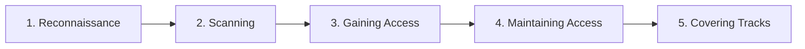
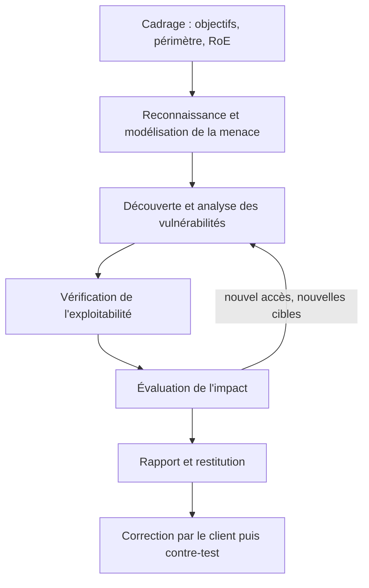

## Introduction

Un test d'intrusion réussi n'est pas une succession désordonnée de commandes lancées au hasard. C'est une démarche **structurée, reproductible et documentée**, qui part d'un besoin du client et aboutit à des recommandations qu'il pourra appliquer. Deux auditeurs qui suivent la même méthodologie sur le même périmètre doivent arriver à des conclusions comparables ; c'est ce qui distingue un professionnel d'un amateur talentueux.

La méthodologie protège aussi tout le monde. Elle garantit au client que le test couvre ce qui était prévu, et seulement cela. Elle protège l'auditeur, qui peut prouver qu'il est resté dans son périmètre. Elle donne enfin aux défenseurs un langage commun pour comprendre ce qui a été testé et comment le détecter.

Ce chapitre présente les cadres de référence de l'industrie, sans entrer dans les techniques elles-mêmes, que les cours spécialisés aborderont dans un cadre de lab. À la fin, tu sauras situer un test parmi les types d'évaluation, nommer et ordonner les phases, préparer un cadrage solide, relier chaque phase aux modèles défensifs et organiser tes notes et ton rapport.

## Les types d'évaluation de la sécurité

### Du scan au red team

On confond souvent des prestations très différentes. Les choisir correctement fait partie du conseil au client.

| Prestation | Objectif | Ce qu'elle produit |
| --- | --- | --- |
| Audit de vulnérabilités | Inventorier largement les faiblesses connues, souvent avec des scanners | Une liste exhaustive mais peu contextualisée, avec des faux positifs à trier |
| Test d'intrusion (pentest) | Vérifier manuellement si les faiblesses sont exploitables et mesurer l'impact réel, sur un périmètre défini | Des vulnérabilités confirmées, avec preuves, impact et recommandations |
| Audit de configuration ou de code | Comparer un système ou un code source à un référentiel de bonnes pratiques | Des écarts au référentiel |
| Red team | Simuler un adversaire réaliste sur une longue période pour tester la détection et la réponse, avec un objectif métier | Un scénario d'attaque complet et une évaluation des capacités de détection |
| Purple team | Faire travailler attaquants et défenseurs ensemble pour améliorer la détection en continu | Des règles de détection validées et améliorées |

Le **test d'intrusion** se distingue de l'audit de vulnérabilités par la vérification manuelle et la démonstration de l'impact : un scanner signale qu'une version logicielle est ancienne, le pentester vérifie si cela permet réellement d'accéder à quelque chose. Le **red team** se distingue du pentest par son objectif : le pentest cherche à trouver le maximum de vulnérabilités sur un périmètre, le red team cherche à atteindre un objectif précis sans être détecté, pour éprouver la défense.

### Boîte noire, grise ou blanche

L'**approche boîte noire** donne à l'auditeur le minimum d'informations, souvent un simple nom de domaine : elle simule un attaquant externe, mais consomme beaucoup de temps en découverte. L'**approche boîte blanche** fournit tout : architecture, comptes, code source ; elle permet la couverture la plus profonde en un temps donné. L'**approche boîte grise**, la plus courante, fournit un compte utilisateur standard et quelques informations, ce qui simule un attaquant ayant déjà un pied dans l'organisation, par exemple un salarié ou un compte compromis. On parle aussi de scénario d'**intrusion présumée** (assumed breach) quand on part directement d'un poste interne compromis.

On distingue également le **test externe**, mené depuis Internet contre les services exposés, et le **test interne**, mené depuis le réseau de l'organisation.

## Les 5 phases du hacking selon le CEH

Le référentiel CEH décrit l'attaque en **5 phases**, qui servent de fil conducteur à son examen et à de nombreux cours.



<CompareTable
  titleA="Phase"
  titleB="Objectif, et ce que le défenseur doit voir"
  rows={[
    { a: "1. Reconnaissance", b: "Collecter des informations passives puis actives sur la cible ; côté défense, maîtriser son exposition publique" },
    { a: "2. Scanning", b: "Identifier les hôtes, ports, services et versions exposés, puis les énumérer ; côté défense, détecter les balayages" },
    { a: "3. Gaining Access", b: "Exploiter une vulnérabilité ou des identifiants pour obtenir un accès initial ; côté défense, corriger et durcir" },
    { a: "4. Maintaining Access", b: "Établir une persistance pour revenir ; côté défense, surveiller les nouveaux comptes, services et tâches planifiées" },
    { a: "5. Covering Tracks", b: "Effacer les traces de l'intrusion ; côté défense, centraliser et protéger les journaux" },
  ]}
/>

Le CEH v13 détaille aussi une méthodologie plus fine, qui distingue l'empreinte et la reconnaissance, le balayage, l'**énumération** (extraire comptes, partages et services d'un système), l'**analyse de vulnérabilités**, puis le piratage du système lui-même avec l'élévation de privilèges. Ces étapes se rangent toutes dans les 5 phases.

Dans un test d'intrusion professionnel, la phase 5 est **simulée et documentée**, jamais réellement appliquée : effacer des journaux chez un client détruirait des preuves et gênerait sa propre détection. On note ce qu'un attaquant pourrait effacer, et on vérifie si les journaux sont protégés. De même, toute persistance mise en place pendant un test doit être inventoriée et retirée à la fin.

<CehCallout>
Les 5 phases, dans l'ordre (Reconnaissance, Scanning, Gaining Access, Maintaining Access, Covering Tracks), structurent l'examen CEH. Chaque outil que tu croiseras dans Nyx se rattache à l'une d'elles. Retiens aussi que l'énumération et l'analyse de vulnérabilités font le lien entre le scanning et l'accès initial.
</CehCallout>

## Reconnaissance passive et active

La reconnaissance se divise en deux approches complémentaires. La **reconnaissance passive** collecte des informations sans interaction directe avec les systèmes de la cible : sources ouvertes (OSINT), registres de noms de domaine (WHOIS), DNS publics, journaux de transparence des certificats, réseaux sociaux professionnels, offres d'emploi qui révèlent les technologies utilisées, moteurs spécialisés qui indexent les services exposés. Elle est indétectable par la cible. La **reconnaissance active** interagit directement avec la cible : requêtes vers ses serveurs, découverte d'hôtes, scan de ports. Elle laisse des traces et peut être détectée par un IDS.

```bash
# Reconnaissance passive : informations publiques d'enregistrement d'un domaine
whois example.com | grep -iE 'registrar:|creation date|name server'
```

```text
Registrar: RESERVED-Internet Assigned Numbers Authority
Creation Date: 1995-08-14T04:00:00Z
Name Server: A.IANA-SERVERS.NET
Name Server: B.IANA-SERVERS.NET
```

En situation réelle, on privilégie la reconnaissance passive le plus longtemps possible : elle donne du contexte, aide à prioriser et réduit le bruit. Côté défense, la même démarche s'appelle la **gestion de la surface d'attaque externe** : faire régulièrement sa propre reconnaissance pour savoir ce qu'un attaquant verrait, et supprimer ce qui ne devrait pas être exposé.

<TipCallout>
Même la reconnaissance active doit rester dans le périmètre autorisé. Une requête DNS vers un résolveur public est passive ; une requête directe vers le serveur DNS de la cible est active. Dans le doute, considère qu'une action est active et vérifie qu'elle est couverte par les règles d'engagement.
</TipCallout>

## Les méthodologies de référence

### PTES : de l'engagement au rapport

Le **Penetration Testing Execution Standard** (PTES) détaille sept phases qui englobent les 5 phases du CEH en ajoutant explicitement ce qui se passe avant et après la technique.

<Steps steps={[
  { title: "Pre-engagement", description: "Négociation des objectifs et du périmètre, signature des règles d'engagement, avant toute action technique." },
  { title: "Intelligence Gathering", description: "Équivalent structuré de la reconnaissance : empreinte organisationnelle, technique, humaine et physique." },
  { title: "Threat Modeling", description: "Croiser les actifs identifiés avec les menaces les plus pertinentes pour prioriser l'effort de test." },
  { title: "Vulnerability Analysis", description: "Identifier et valider les faiblesses, par scan, revue de configuration et analyse manuelle." },
  { title: "Exploitation", description: "Démontrer, de façon contrôlée, qu'une vulnérabilité confirmée permet un accès." },
  { title: "Post Exploitation", description: "Évaluer l'impact réel : quelles données, quels systèmes seraient accessibles depuis ce point, dans les limites autorisées." },
  { title: "Reporting", description: "Livrable final : synthèse pour la direction, détails techniques, recommandations priorisées." },
]} />

### NIST SP 800-115 : quatre phases

La publication **NIST SP 800-115**, « Technical Guide to Information Security Testing and Assessment », propose un cycle plus compact en quatre phases : **Planning** (planification et autorisation), **Discovery** (découverte et analyse des vulnérabilités), **Attack** (vérification par l'exploitation, avec retour possible à la découverte quand un nouvel accès révèle de nouvelles cibles) et **Reporting**. Elle date de 2008 mais reste une référence citée dans les appels d'offres et les audits, notamment parce qu'elle insiste sur la planification et la gestion des risques du test lui-même.

### OWASP WSTG pour les applications web

Pour les applications web, la référence est l'**OWASP Web Security Testing Guide** (WSTG), dont la version stable actuelle est la 4.2. Il organise les tests par catégories (collecte d'informations, configuration, gestion des identités, authentification, autorisation, gestion des sessions, validation des entrées, gestion des erreurs, cryptographie, logique métier, côté client, API) et attribue à chaque test un identifiant, par exemple `WSTG-ATHN-03` pour les mécanismes de verrouillage de compte. Ces identifiants permettent de prouver la couverture du test dans le rapport. L'OWASP publie aussi l'**ASVS** (Application Security Verification Standard), qui fixe des niveaux d'exigences vérifiables, et des Top 10 qui classent les risques les plus courants.

D'autres cadres existent : l'**OSSTMM** pour une approche scientifique des mesures de sécurité, **TIBER-EU** et les tests fondés sur la menace (TLPT) exigés par DORA pour le secteur financier, et, en France, le référentiel **PASSI** de l'ANSSI pour les prestataires qualifiés.



## Le cadrage : la phase qui conditionne tout

Le chapitre précédent a présenté les éléments juridiques de l'autorisation. Le cadrage opérationnel va plus loin : il transforme le besoin du client en plan de test. Il répond à plusieurs questions. Quel est l'**objectif** : satisfaire une exigence de conformité, valider une nouvelle application avant sa mise en production, mesurer la capacité de détection ? Quel est le **périmètre** exact, et qu'est-ce qui en est exclu ? Quelle **approche** : boîte noire, grise ou blanche, externe ou interne ? Quelles **contraintes** : horaires, systèmes fragiles, environnements de production ?

Le cadrage inclut aussi la **gestion des risques du test lui-même**. Un scan trop agressif peut faire tomber un équipement ancien ; un test de verrouillage de compte peut bloquer de vrais utilisateurs. On prévoit donc un contact d'urgence, une procédure d'arrêt, des comptes de test dédiés et, si nécessaire, une sauvegarde préalable. On convient enfin de la conduite à tenir si l'auditeur découvre une **compromission réelle** en cours : arrêter le test et prévenir immédiatement le client, car ce n'est plus un exercice.

<WarningCallout>
Un test d'intrusion sans documentation n'a aucune valeur pour le client, quel que soit le nombre de vulnérabilités trouvées. Chaque action significative, chaque preuve (capture d'écran, sortie d'outil, requête) doit être horodatée et conservée en vue du rapport. Ces notes te protègent aussi : en cas d'incident pendant la mission, elles prouvent ce que tu as fait, et ce que tu n'as pas fait.
</WarningCallout>

## Relier l'attaque aux modèles défensifs

### La Cyber Kill Chain

La **Cyber Kill Chain**, publiée par Lockheed Martin en 2011, décrit une intrusion en sept étapes. Elle est orientée défense : son idée centrale est qu'interrompre n'importe quel maillon arrête l'attaque.

<AttackDefenseTable rows={[
  { phase: "1. Reconnaissance", attack: "Collecte d'informations sur la cible", defense: "Surveillance de l'exposition publique (OSINT défensif), réduction de la surface d'attaque" },
  { phase: "2. Weaponization", attack: "Préparation d'une charge malveillante associée à un vecteur", defense: "Renseignement sur la menace, signatures et règles de détection à jour" },
  { phase: "3. Delivery", attack: "Envoi de la charge : e-mail, lien, clé USB, site compromis", defense: "Filtrage de la messagerie et du web, sensibilisation au phishing, blocage des supports amovibles" },
  { phase: "4. Exploitation", attack: "Déclenchement du code malveillant", defense: "Correctifs, EDR, durcissement, contrôle des applications" },
  { phase: "5. Installation", attack: "Mise en place d'une porte dérobée persistante", defense: "Détection d'anomalies, contrôle d'intégrité des fichiers, surveillance des mécanismes de démarrage" },
  { phase: "6. Command & Control", attack: "Communication avec un serveur de commande", defense: "Surveillance réseau et détection de trafic anormal, filtrage sortant, proxy" },
  { phase: "7. Actions on Objectives", attack: "Atteinte de l'objectif : exfiltration, chiffrement, sabotage", defense: "Prévention des fuites de données (DLP), segmentation, sauvegardes hors ligne" },
]} />

### MITRE ATT&CK

Si la Kill Chain reste utile pour expliquer, la plupart des équipes SOC travaillent avec **MITRE ATT&CK**, une base de connaissances bien plus granulaire. Elle est organisée en **tactiques**, le « pourquoi » d'une action (par exemple Persistence ou Privilege Escalation), et en **techniques**, le « comment », chacune identifiée par un code : T1566 pour le phishing, T1595 pour le balayage actif, T1078 pour l'usage de comptes valides, T1053 pour les tâches planifiées, T1110 pour la force brute, T1070 pour l'effacement d'indicateurs. La matrice Enterprise compte 15 tactiques, de Reconnaissance à Impact.

<CompareTable
  titleA="Cyber Kill Chain"
  titleB="MITRE ATT&CK"
  rows={[
    { a: "7 étapes linéaires et séquentielles", b: "15 tactiques Enterprise (14 jusqu'en 2025), non nécessairement séquentielles, avec des centaines de techniques et sous-techniques" },
    { a: "Modèle conceptuel, peu d'exemples concrets", b: "Chaque technique référence des cas réels observés : groupes, logiciels malveillants, campagnes" },
    { a: "Centrée sur l'intrusion initiale", b: "Couvre aussi ce qui se passe après : mouvement latéral, collecte, impact" },
    { a: "Bonne pour expliquer et former", b: "Bonne pour cartographier un incident, mesurer la couverture de détection et décrire un test" },
  ]}
/>

Pour un pentester, ATT&CK est un outil de communication : rattacher chaque constat à une technique permet aux défenseurs de vérifier si leurs outils l'auraient détecté. Les SIEM du marché, comme Splunk, Elastic ou Microsoft Sentinel, mappent d'ailleurs leurs règles de détection sur ces identifiants.

### Le purple team

La pratique du **purple team** fait travailler attaquants et défenseurs en temps réel plutôt qu'en silos successifs. L'équipe offensive exécute une technique ATT&CK précise, l'équipe défensive vérifie immédiatement si son SIEM ou son EDR l'a détectée, et ajuste ses règles sur-le-champ. Cette approche raccourcit considérablement la boucle d'amélioration par rapport à un test classique dont le rapport est lu des semaines plus tard.

## Documenter et rapporter

### Notes et preuves

Une bonne organisation se prépare dès le premier jour : un répertoire par mission, des sous-dossiers par phase, un journal horodaté de chaque action, et des preuves nommées de façon cohérente. Les preuves sont chiffrées au repos, car elles contiennent souvent des données sensibles du client, et leur **empreinte** (hash SHA-256) permet de prouver qu'elles n'ont pas été modifiées.

### La structure d'un rapport

Un rapport s'adresse à deux publics. La **synthèse managériale**, d'une ou deux pages sans jargon, explique à la direction le niveau de risque, les constats majeurs et les priorités. La **partie technique** détaille, pour chaque vulnérabilité, sa description, les systèmes concernés, les preuves, l'impact, la sévérité, la recommandation et les références. On y ajoute la méthodologie suivie, le périmètre effectivement testé et les limites du test.

La sévérité s'exprime souvent avec **CVSS** (Common Vulnerability Scoring System), dont la version actuelle est la **4.0**, publiée par le FIRST en 2023. CVSS 4.0 distingue les métriques de base, de menace, d'environnement et supplémentaires, et produit un score de 0 à 10. Un score n'est cependant qu'une partie de la priorisation : on le complète par le contexte du client, par la probabilité d'exploitation estimée par **EPSS**, et par la présence de la vulnérabilité dans le catalogue **KEV** de la CISA, qui recense les vulnérabilités activement exploitées. Le chapitre suivant revient sur cette logique de risque.

<AuditCallout>
Le PTES et la NIST SP 800-115 rappellent que le rapport est une phase à part entière, pas une formalité de fin : le client paie autant pour la qualité des recommandations que pour les vulnérabilités trouvées. Dans ISO/IEC 27001:2022, les résultats de tests alimentent la gestion des vulnérabilités techniques (A.8.8) et le traitement des risques. Un **contre-test** après correction permet de clore les constats de façon vérifiable.
</AuditCallout>

## Erreurs fréquentes

La première erreur est de commencer par les outils : lancer un scanner avant d'avoir compris l'objectif et le périmètre produit du bruit, des risques et un rapport sans valeur. La deuxième est de confondre audit de vulnérabilités et test d'intrusion, et de livrer une sortie de scanner brute avec ses faux positifs. La troisième est de négliger la prise de notes, puis de passer des jours à reconstituer ce qui a été fait.

On voit aussi des rapports qui listent des dizaines de constats sans priorisation, ou qui donnent des recommandations vagues comme « mettre à jour le système ». Une bonne recommandation est précise, réaliste et vérifiable. Enfin, oublier de nettoyer en fin de mission, en laissant un compte de test ou un fichier déposé, crée une vulnérabilité de plus chez le client.

## Lab — Mise en pratique

**Environnement** : réflexion guidée et terminal Nyx Shell pour organiser ton espace de travail. Aucune action n'est dirigée contre une cible.

<Steps steps={[
  { title: "Classer des actions par phase", description: "Pour chacune des actions suivantes, indique la phase CEH correspondante et une technique ATT&CK proche : consulter les offres d'emploi d'une entreprise, scanner les ports d'un serveur, se connecter avec un compte dont le mot de passe a fuité, créer une tâche planifiée après l'accès, supprimer les journaux d'authentification." },
  { title: "Choisir le bon type d'évaluation", description: "Pour chaque besoin, propose le type de prestation et l'approche (boîte noire, grise ou blanche) : une banque veut tester sa détection face à un groupe réaliste ; une start-up veut valider sa nouvelle API avant la mise en production ; une PME doit prouver à un client qu'elle a fait auditer son site." },
  { title: "Préparer l'espace de mission", description: "Crée l'arborescence d'une mission fictive, avec un dossier par phase et un fichier de notes. Une structure identique à chaque mission te fera gagner un temps considérable.", code: "mkdir -p ~/missions/2026-acme/{00-cadrage,01-recon,02-scan,03-analyse,04-preuves,05-rapport}\ntree ~/missions/2026-acme 2>/dev/null || ls -R ~/missions/2026-acme" },
  { title: "Journaliser automatiquement ton terminal", description: "Lance un enregistrement horodaté de ta session. Chaque commande et sa sortie seront conservées, ce qui alimente directement le rapport et prouve ce que tu as fait. Tape exit pour arrêter l'enregistrement.", code: "script -q -a ~/missions/2026-acme/00-cadrage/session-$(date +%F_%H%M).log\ndate -Is\nwhoami\nexit" },
  { title: "Garantir l'intégrité des preuves", description: "Calcule l'empreinte SHA-256 de chaque fichier de preuve et conserve-la dans un fichier dédié. Toute modification ultérieure d'une preuve sera détectable avec sha256sum -c.", code: "cd ~/missions/2026-acme\necho 'capture fictive' > 04-preuves/V01-capture.txt\nsha256sum 04-preuves/* > 04-preuves/SHA256SUMS\nsha256sum -c 04-preuves/SHA256SUMS" },
  { title: "Rédiger une fiche de vulnérabilité", description: "Rédige une fiche pour un constat fictif : un serveur web affiche sa version exacte dans l'en-tête Server. Remplis les rubriques titre, systèmes concernés, description, preuve, impact, sévérité, recommandation, référence OWASP WSTG et technique ATT&CK associée." },
  { title: "Relier Kill Chain et défense", description: "Pour les étapes Delivery et Command & Control de la Kill Chain, propose deux mesures défensives concrètes chacune, autres que celles du tableau, et indique quels journaux permettraient de détecter l'étape." },
]} />

## À retenir

- Audit de vulnérabilités, test d'intrusion, red team et purple team répondent à des objectifs différents ; l'approche peut être en boîte noire, grise ou blanche, externe ou interne.
- Les 5 phases du CEH sont, dans l'ordre : Reconnaissance, Scanning, Gaining Access, Maintaining Access, Covering Tracks ; en mission réelle, l'effacement des traces est simulé et la persistance retirée.
- La reconnaissance passive n'interagit pas avec la cible (WHOIS, OSINT), la reconnaissance active le fait (scan de ports) et peut être détectée.
- PTES ajoute le Pre-engagement et le Reporting comme phases à part entière ; NIST SP 800-115 propose Planning, Discovery, Attack, Reporting ; l'OWASP WSTG structure les tests web.
- Le cadrage fixe objectifs, périmètre, approche, contraintes et gestion des risques du test.
- La Cyber Kill Chain de Lockheed Martin compte 7 étapes linéaires ; MITRE ATT&CK décrit 15 tactiques (depuis la scission de Defense Evasion en 2026) et des centaines de techniques identifiées par un code, langage commun entre attaque et défense.
- Le rapport combine synthèse managériale et détail technique, avec une sévérité CVSS 4.0 complétée par EPSS, KEV et le contexte du client.

## Questions de révision

1. Quelle différence fais-tu entre un audit de vulnérabilités, un test d'intrusion et un exercice red team ?
2. Quelles sont les 5 phases du CEH, dans l'ordre, et pourquoi la dernière est-elle seulement simulée lors d'un test professionnel ?
3. Quelle est la différence entre reconnaissance passive et active ? Classe la consultation WHOIS et un scan de ports.
4. Selon PTES, quelle phase intervient avant même la reconnaissance, et que contient-elle ?
5. Quelles sont les quatre phases de la NIST SP 800-115, et pourquoi peut-on revenir de la phase Attack à la phase Discovery ?
6. Nomme les sept étapes de la Cyber Kill Chain et associe une mesure défensive à l'étape Command & Control.
7. Quelle est la principale différence entre la Cyber Kill Chain et MITRE ATT&CK, et pourquoi un pentester a-t-il intérêt à citer des identifiants ATT&CK dans son rapport ?
8. Pourquoi un score CVSS ne suffit-il pas à prioriser les corrections, et quelles informations le complètent ?
