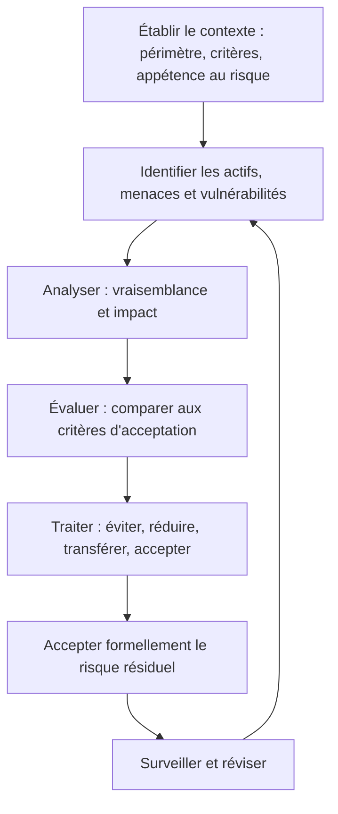
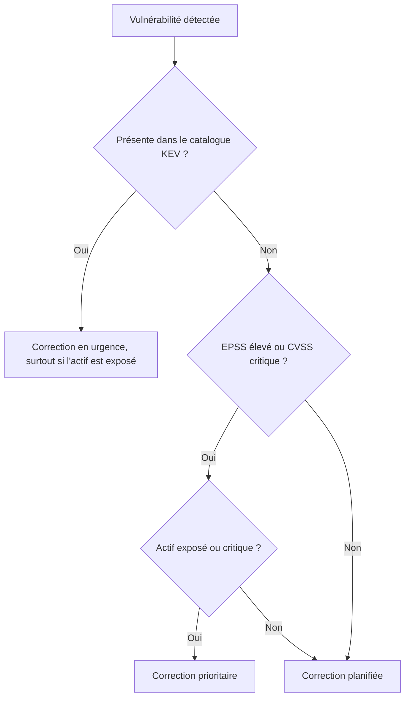

## Introduction

La sécurité parfaite n'existe pas, et elle n'est pas souhaitable : une organisation qui voudrait se protéger de tout dépenserait plus que ce qu'elle protège et ne pourrait plus travailler. Chaque organisation doit donc **arbitrer** entre le coût des mesures de protection et le niveau de risque qu'elle accepte. Cet arbitrage a un nom : la **gestion des risques**. C'est elle qui explique pourquoi on corrige telle vulnérabilité en urgence et telle autre dans six mois, pourquoi on achète une cyber-assurance, ou pourquoi la direction signe un document acceptant un risque connu.

Pour un technicien, comprendre cette logique change la façon de communiquer. Dire « ce serveur a une faille critique » convainc moins qu'expliquer « cette faille est activement exploitée, le serveur porte la facturation, son arrêt coûterait tant par jour ». Pour un pentester, c'est ce qui transforme une liste de vulnérabilités en recommandations priorisées. Pour un analyste SOC, c'est ce qui détermine quelles alertes traiter en premier.

À la fin de ce chapitre, tu sauras distinguer précisément les notions de base, évaluer un risque de façon qualitative et quantitative, choisir une stratégie de traitement, prioriser des vulnérabilités avec les outils actuels et situer les grands référentiels normatifs et réglementaires.

## Vulnérabilité, menace et risque : ne pas confondre

Ces termes sont souvent utilisés de façon interchangeable, à tort.

<CompareTable
  titleA="Terme"
  titleB="Définition"
  rows={[
    { a: "Actif", b: "Ce qui a de la valeur : information, service, matériel, réputation, personnes" },
    { a: "Vulnérabilité", b: "Une faiblesse dans un système ou une organisation : bug logiciel, mauvaise configuration, absence de correctif, procédure manquante" },
    { a: "Menace", b: "Un acteur ou un événement susceptible d'exploiter une vulnérabilité : attaquant, incendie, erreur humaine" },
    { a: "Vraisemblance", b: "La probabilité qu'un scénario de menace se réalise sur une période donnée" },
    { a: "Impact", b: "La gravité des conséquences si le scénario se réalise : financière, juridique, opérationnelle, réputationnelle" },
    { a: "Risque", b: "La combinaison de la vraisemblance qu'une menace exploite une vulnérabilité et de l'impact qui en résulte" },
  ]}
/>

<TipCallout>
Formule simplifiée à retenir : **Risque = Menace × Vulnérabilité × Impact**. Sans vulnérabilité, la menace ne peut rien faire ; sans menace capable de l'atteindre, la vulnérabilité reste théorique ; sans impact, il n'y a rien à perdre. Les normes utilisent plutôt la forme Risque = Vraisemblance × Impact, où la vraisemblance intègre à la fois la menace et la vulnérabilité.
</TipCallout>

Un exemple fait toute la différence. Un serveur utilise une version de PHP obsolète affectée par une faille d'exécution de code à distance connue. La **vulnérabilité existe** sans aucun doute. Mais si ce serveur est isolé sur un réseau interne sans accès Internet, accessible seulement à trois administrateurs, aucune menace ne peut facilement l'exploiter : le **risque réel est atténué**. Il n'est pas nul, car un attaquant déjà présent sur le réseau interne pourrait s'en servir, mais il est bien plus faible que celui du même serveur exposé sur Internet. C'est exactement ce raisonnement qui permet de prioriser.

## Le cycle de gestion du risque



Ce cycle, décrit par les normes **ISO 31000** (management du risque en général) et **ISO/IEC 27005:2022** (risques liés à la sécurité de l'information), commence par le **contexte** : quel périmètre, quels critères pour juger qu'un risque est acceptable, quelle **appétence au risque** la direction affiche-t-elle. Il se termine par une **surveillance** continue, car le risque change à chaque nouvelle vulnérabilité, nouveau projet ou nouvelle menace.

### Les quatre stratégies de traitement

Face à un risque jugé inacceptable, quatre stratégies sont possibles.

| Stratégie | Principe | Exemple |
| --- | --- | --- |
| Éviter | Supprimer l'activité à l'origine du risque | Fermer un service exposé inutile, renoncer à stocker des numéros de carte |
| Réduire (mitiger) | Appliquer des mesures pour diminuer la vraisemblance ou l'impact | Correctif, MFA, segmentation, sauvegardes hors ligne |
| Transférer (partager) | Faire porter tout ou partie des conséquences par un tiers | Cyber-assurance, externalisation à un prestataire avec engagements contractuels |
| Accepter | Décider consciemment de vivre avec le risque | Garder un logiciel ancien dont la migration coûterait plus que l'incident probable |

Le **transfert** ne transfère jamais la responsabilité : si un prestataire perd les données de tes clients, c'est toujours ton organisation que la CNIL et les clients tiendront responsable. Il transfère une partie des conséquences financières. L'**acceptation** est légitime à condition d'être consciente, documentée et validée au bon niveau ; un risque ignoré n'est pas un risque accepté.

<CehCallout>
Le CEH et Security+ attendent une bonne maîtrise de ce vocabulaire : plusieurs questions portent directement sur la distinction entre les quatre stratégies de traitement. Retiens en particulier que la cyber-assurance relève du transfert, et qu'une PME qui conserve un logiciel critique non maintenu parce que sa migration coûterait plus cher que l'incident le plus probable applique l'acceptation.
</CehCallout>

### Le risque résiduel

Aucune mesure ne ramène un risque à zéro. Après traitement, il subsiste toujours un **risque résiduel**, que la direction doit **accepter formellement**, souvent par la signature d'un responsable désigné, appelé propriétaire du risque. Cette décision doit être documentée et assumée à un niveau hiérarchique approprié : un administrateur système n'a pas à accepter seul un risque qui menace toute l'entreprise. Le **registre des risques** consigne chaque risque, son propriétaire, son évaluation avant et après traitement, et sa date de revue.

## Évaluer un risque

### L'approche qualitative

L'approche **qualitative** note la vraisemblance et l'impact sur une échelle simple, par exemple de 1 à 4, et combine les deux dans une **matrice des risques**. Elle est rapide, facile à communiquer, et convient à la grande majorité des analyses.

| Vraisemblance, puis impact | Mineur (1) | Significatif (2) | Grave (3) | Critique (4) |
| --- | --- | --- | --- | --- |
| Quasi certaine (4) | Moyen | Élevé | Critique | Critique |
| Probable (3) | Faible | Moyen | Élevé | Critique |
| Possible (2) | Faible | Moyen | Moyen | Élevé |
| Rare (1) | Faible | Faible | Faible | Moyen |

Sa limite est la subjectivité : deux évaluateurs peuvent noter différemment le même scénario. On la réduit en définissant précisément chaque niveau, par exemple « Critique : arrêt de la production de plus de 48 heures ou perte supérieure à 500 000 € ».

### L'approche quantitative : SLE, ARO et ALE

L'approche **quantitative** exprime le risque en valeur monétaire. La méthode classique, présente dans le CEH, Security+ et CISSP, repose sur trois grandeurs.

```text
AV  (Asset Value)                = valeur de l'actif
EF  (Exposure Factor)            = part de la valeur perdue lors d'un incident, en %
SLE (Single Loss Expectancy)     = AV × EF          → perte attendue pour UN incident
ARO (Annualized Rate of Occurrence) = nombre d'incidents attendus par an
ALE (Annual Loss Expectancy)     = SLE × ARO        → perte attendue PAR AN

Exemple : un serveur et ses données valent 50 000 €.
Un incident en détruirait 40 % (EF = 0,4). On estime un incident tous les 5 ans (ARO = 0,2).
SLE = 50 000 × 0,4 = 20 000 €
ALE = 20 000 × 0,2 = 4 000 € par an
```

L'ALE sert à comparer le coût d'une mesure au risque qu'elle réduit. Si une mesure coûte 3 000 € par an et ramène l'ARO de 0,2 à 0,05, la nouvelle ALE vaut 20 000 × 0,05 = 1 000 €. Le gain annuel est de 4 000 − 1 000 = 3 000 €, égal au coût de la mesure : l'investissement est tout juste à l'équilibre. Si la mesure coûtait 1 500 €, elle serait clairement rentable.

<TipCallout>
Le calcul de l'ALE offre une comparaison directe et parlante pour une direction : « investir 3 000 € par an dans une protection contre un risque évalué à 4 000 € par an » convainc bien plus qu'une case orange dans une matrice. Sa limite tient à la qualité des estimations : un ARO deviné au hasard donne un ALE faussement précis. Des méthodes comme FAIR (Factor Analysis of Information Risk) travaillent avec des fourchettes et des distributions plutôt qu'avec une valeur unique.
</TipCallout>

## Prioriser les vulnérabilités

Une organisation de taille moyenne découvre des milliers de vulnérabilités par an. Les corriger toutes immédiatement est impossible ; il faut prioriser, et la priorisation applique directement la logique de risque.

**CVSS** (Common Vulnerability Scoring System), aujourd'hui en version **4.0**, mesure la **sévérité technique** d'une vulnérabilité sur une échelle de 0 à 10 : vecteur d'accès, complexité, privilèges requis, impact sur la confidentialité, l'intégrité et la disponibilité. Mais une faille notée 9,8 qui n'est jamais exploitée dans la nature peut être moins urgente qu'une faille notée 7,5 exploitée massivement. Deux sources complètent donc CVSS.

**EPSS** (Exploit Prediction Scoring System), publié par le FIRST, estime la **probabilité** qu'une vulnérabilité soit exploitée dans les 30 jours, à partir de données observées ; le score est mis à jour quotidiennement. Le catalogue **KEV** (Known Exploited Vulnerabilities) de la CISA recense les vulnérabilités dont l'**exploitation active** est avérée ; les agences fédérales américaines ont l'obligation de les corriger dans des délais fixés, et de nombreuses organisations dans le monde l'utilisent comme liste de priorité absolue.



<AuditCallout>
La norme ISO/IEC 27001:2022 impose une appréciation des risques documentée (clause 6.1.2), un plan de traitement (clause 6.1.3) et une **Déclaration d'applicabilité** qui justifie l'inclusion ou l'exclusion de chacun des 93 contrôles de l'Annexe A. L'appréciation doit être revue à intervalles planifiés et lors de changements importants, en pratique au moins une fois par an. C'est souvent le premier document demandé lors d'un audit de certification, et la gestion des vulnérabilités techniques relève du contrôle A.8.8.
</AuditCallout>

## Les grands référentiels

### ISO/IEC 27001:2022 et la famille 27000

**ISO/IEC 27001** définit les exigences d'un **SMSI** (Système de Management de la Sécurité de l'Information). C'est la seule norme de la famille qui soit **certifiable** : un organisme accrédité vérifie que l'entreprise a mis en place un système de management, fondé sur l'appréciation des risques et l'amélioration continue selon le cycle « planifier, faire, vérifier, agir ». La version en vigueur est celle de **2022**, amendée en 2024 pour intégrer la prise en compte du changement climatique. Les certificats délivrés selon l'ancienne version de 2013 ne sont plus valides depuis la fin de la période de transition, au 31 octobre 2025.

Son Annexe A compte **93 contrôles** répartis en quatre thèmes : **A.5** organisationnels (37 contrôles), **A.6** liés aux personnes (8), **A.7** physiques (14) et **A.8** technologiques (34). La norme **ISO/IEC 27002:2022** détaille la mise en œuvre de chacun. Quelques exemples : A.5.1 politiques de sécurité, A.5.7 renseignement sur la menace, A.5.23 sécurité des services cloud, A.6.3 sensibilisation, A.8.8 gestion des vulnérabilités techniques, A.8.13 sauvegarde, A.8.16 activités de surveillance.

### NIST Cybersecurity Framework 2.0

Le **NIST Cybersecurity Framework** (CSF) est un cadre volontaire américain, devenu une référence mondiale grâce à sa simplicité. Sa version **2.0**, publiée en février 2024, compte **six fonctions**. La version 1.1 de 2018 en comptait **cinq** : Identify, Protect, Detect, Respond, Recover. La version 2.0 ajoute la fonction **Govern**, placée au centre des cinq autres, et élargit le cadre à toutes les organisations, quels que soient leur taille et leur secteur.

<AttackDefenseTable rows={[
  { phase: "Govern (nouvelle en 2.0)", attack: "Absence de pilotage : personne ne décide ni ne finance la sécurité", defense: "Contexte organisationnel, stratégie de gestion du risque, rôles et responsabilités, politiques, supervision, risques de la chaîne d'approvisionnement" },
  { phase: "Identify", attack: "Actifs inconnus ou oubliés, donc jamais protégés", defense: "Cartographier les actifs, les données et les risques ; identifier les améliorations" },
  { phase: "Protect", attack: "Comptes sans MFA, systèmes non corrigés", defense: "Contrôle d'accès, sensibilisation, sécurité des données, durcissement des plateformes" },
  { phase: "Detect", attack: "Intrusion qui dure des mois sans être vue", defense: "Surveillance continue, analyse des événements, SOC et SIEM" },
  { phase: "Respond", attack: "Incident mal géré qui s'aggrave", defense: "Gestion des incidents, analyse, communication, confinement" },
  { phase: "Recover", attack: "Impossible de redémarrer après un rançongiciel", defense: "Plans de reprise, restauration testée, communication de sortie de crise" },
]} />

Le CSF 2.0 propose aussi des **profils** (la situation actuelle et la situation cible d'une organisation) et des **niveaux** de maturité de 1 à 4 (partiel, informé des risques, reproductible, adaptatif). Les identifiants des sous-catégories, comme GV.RM pour la stratégie de gestion du risque, facilitent les correspondances avec ISO 27001 et les CIS Controls.

### Les autres référentiels à connaître

<CompareTable
  titleA="Référentiel"
  titleB="Contexte d'usage"
  rows={[
    { a: "ISO/IEC 27005:2022", b: "Lignes directrices pour la gestion des risques de sécurité de l'information, en appui d'ISO 27001" },
    { a: "EBIOS Risk Manager", b: "Méthode française d'analyse de risque publiée par l'ANSSI, en cinq ateliers, centrée sur des scénarios d'attaque réalistes et l'écosystème de l'organisation" },
    { a: "CIS Controls v8.1", b: "18 contrôles techniques priorisés, organisés en trois groupes de mise en œuvre (IG1 à IG3) selon la maturité de l'organisation" },
    { a: "PCI DSS 4.0.1", b: "Obligatoire pour toute organisation qui stocke, traite ou transmet des données de cartes de paiement" },
    { a: "HDS / HIPAA", b: "Hébergement de données de santé en France (certification HDS) ; protection des données de santé aux États-Unis (HIPAA)" },
    { a: "SOC 2", b: "Rapport d'assurance américain très demandé par les clients des solutions SaaS B2B" },
    { a: "RGPD", b: "Règlement européen sur la protection des données personnelles, avec une logique d'analyse de risque pour les personnes (AIPD)" },
  ]}
/>

À ces référentiels s'ajoutent les réglementations européennes vues au chapitre 2. **NIS2** impose aux entités essentielles et importantes une approche de gestion des risques et des mesures minimales, et engage la responsabilité des dirigeants. **DORA** fait de même pour le secteur financier, avec un accent sur les risques liés aux prestataires informatiques. Le **Cyber Resilience Act** impose une analyse de risque aux fabricants de produits numériques, et l'**AI Act** une gestion des risques pour les systèmes d'IA à haut risque.

En pratique, une organisation combine souvent plusieurs référentiels : ISO 27001 comme cadre de gouvernance général, complété par PCI DSS si elle traite des paiements, EBIOS RM ou ISO 27005 pour l'analyse de risque détaillée exigée par ISO 27001, et le NIST CSF pour communiquer simplement sa maturité.

## Erreurs fréquentes

La première erreur est de confondre vulnérabilité et risque, et de traiter toutes les failles « critiques » selon leur seul score CVSS, sans regarder l'exposition de l'actif ni l'exploitation réelle. La deuxième est de réduire la gestion des risques à un document produit une fois pour l'audit, puis oublié : le registre doit vivre. La troisième est de croire que transférer un risque à un assureur ou à un prestataire transfère la responsabilité.

On rencontre aussi des acceptations implicites : un risque connu de tous, jamais traité, jamais signé. Ce n'est pas une acceptation, c'est une négligence. Enfin, les calculs d'ALE fondés sur des estimations fantaisistes donnent une illusion de précision ; mieux vaut une fourchette honnête qu'un chiffre faux au centime près.

## Lab — Mise en pratique

**Environnement** : réflexion guidée et terminal Nyx Shell avec Python 3. Les deux dernières étapes consultent des sources publiques et nécessitent un accès Internet.

<Steps steps={[
  { title: "Distinguer les concepts", description: "Un serveur web tourne avec une version de PHP obsolète connue pour une faille d'exécution de code, mais il n'est accessible que sur un réseau interne isolé sans accès Internet. La vulnérabilité existe-t-elle ? Le risque est-il élevé ? Justifie, puis indique ce qui ferait monter le risque." },
  { title: "Choisir une stratégie de traitement", description: "Pour chaque situation, indique la stratégie appliquée : souscrire une cyber-assurance ; fermer un serveur FTP inutilisé ; déployer la MFA ; garder un logiciel métier critique non maintenu car sa migration coûterait plus cher que l'incident le plus probable." },
  { title: "Calculer un ALE", description: "Vérifie l'exemple du cours, puis calcule le gain d'une mesure à 3 000 € par an qui ramène l'ARO de 0,2 à 0,05. Modifie les valeurs pour trouver le coût maximal au-delà duquel la mesure n'est plus rentable.", code: "python3 -c \"av,ef,aro=50000,0.4,0.2; sle=av*ef; ale=sle*aro; ale2=sle*0.05; print(f'SLE={sle:.0f} EUR  ALE={ale:.0f} EUR/an  ALE apres mesure={ale2:.0f} EUR/an  gain={ale-ale2:.0f} EUR/an')\"" },
  { title: "Construire un registre des risques", description: "Crée un petit registre au format CSV et calcule automatiquement le niveau de chaque risque avec la matrice du cours. Ajoute deux risques de ton choix et observe leur classement.", code: "cat > /tmp/registre.csv <<'EOF'\nrisque,vraisemblance,impact\nRançongiciel via VPN sans MFA,3,4\nFuite par stockage cloud public,2,3\nPanne du serveur de fichiers,2,2\nVol d'un portable chiffré,3,1\nEOF\npython3 -c \"import csv\nM={(4,1):'Moyen',(4,2):'Élevé',(4,3):'Critique',(4,4):'Critique',(3,1):'Faible',(3,2):'Moyen',(3,3):'Élevé',(3,4):'Critique',(2,1):'Faible',(2,2):'Moyen',(2,3):'Moyen',(2,4):'Élevé',(1,1):'Faible',(1,2):'Faible',(1,3):'Faible',(1,4):'Moyen'}\nfor r in sorted(csv.DictReader(open('/tmp/registre.csv')),key=lambda r:-int(r['vraisemblance'])*int(r['impact'])):\n  print(f\\\"{M[int(r['vraisemblance']),int(r['impact'])]:9} {r['risque']}\\\")\"" },
  { title: "Consulter la probabilité d'exploitation", description: "Interroge l'API publique EPSS du FIRST pour la vulnérabilité Log4Shell. Le champ epss donne la probabilité d'exploitation à 30 jours et percentile le rang par rapport aux autres vulnérabilités ; les valeurs évoluent chaque jour.", code: "curl -s 'https://api.first.org/data/v1/epss?cve=CVE-2021-44228' | python3 -m json.tool" },
  { title: "Vérifier la présence dans le catalogue KEV", description: "Télécharge le catalogue KEV de la CISA et vérifie si Log4Shell y figure, avec sa date d'ajout. Compte ensuite le nombre total d'entrées du catalogue.", code: "curl -s https://www.cisa.gov/sites/default/files/feeds/known_exploited_vulnerabilities.json -o /tmp/kev.json\npython3 -c \"import json; d=json.load(open('/tmp/kev.json')); v=[x for x in d['vulnerabilities'] if x['cveID']=='CVE-2021-44228']; print(v[0]['vulnerabilityName'], v[0]['dateAdded']); print(len(d['vulnerabilities']), 'entrées')\"" },
  { title: "Associer fonctions et mesures", description: "Range ces mesures dans la bonne fonction du NIST CSF 2.0 : nommer un RSSI et lui fixer un budget, inventorier les serveurs, activer la MFA, déployer un SIEM, rédiger un plan de réponse à incident, tester la restauration des sauvegardes." },
]} />

## À retenir

- Le risque combine la vraisemblance qu'une menace exploite une vulnérabilité et l'impact qui en résulte ; formule simplifiée : Risque = Menace × Vulnérabilité × Impact.
- Une vulnérabilité sans menace capable de l'atteindre présente un risque atténué : c'est la base de toute priorisation.
- Quatre stratégies de traitement : éviter, réduire, transférer (la responsabilité reste), accepter (consciemment et formellement) ; le risque résiduel est accepté par la direction.
- L'évaluation qualitative utilise une matrice ; l'évaluation quantitative calcule SLE = AV × EF et ALE = SLE × ARO.
- CVSS 4.0 mesure la sévérité, EPSS la probabilité d'exploitation, le catalogue KEV l'exploitation avérée.
- ISO/IEC 27001:2022 est la norme certifiable du SMSI, avec 93 contrôles en quatre thèmes (A.5 à A.8) ; le NIST CSF 2.0 compte six fonctions (Govern, Identify, Protect, Detect, Respond, Recover), contre cinq dans la version 1.1.
- EBIOS RM, ISO 27005, CIS Controls, PCI DSS 4.0.1, NIS2 et DORA complètent le paysage selon le pays et le secteur.

## Questions de révision

1. Quelle est la différence entre une vulnérabilité et un risque ? Illustre-la avec l'exemple d'un serveur isolé.
2. Cite les quatre stratégies de traitement d'un risque et donne un exemple pour chacune. Pourquoi le transfert ne transfère-t-il pas la responsabilité ?
3. Qu'est-ce que le risque résiduel, et qui doit l'accepter ?
4. Pour un actif de 80 000 €, un facteur d'exposition de 25 % et un incident attendu tous les quatre ans, calcule la SLE et l'ALE.
5. Pourquoi CVSS ne suffit-il pas à prioriser les correctifs, et qu'apportent EPSS et le catalogue KEV ?
6. Quelles sont les fonctions du NIST Cybersecurity Framework 2.0, et laquelle a été ajoutée par rapport aux cinq fonctions de la version 1.1 ?
7. Qu'est-ce qu'un SMSI, et quels documents un auditeur ISO/IEC 27001:2022 demandera-t-il en premier ?
8. Quel référentiel est obligatoire pour une organisation qui traite des paiements par carte bancaire, et lequel est une méthode d'analyse de risque portée par l'ANSSI ?
