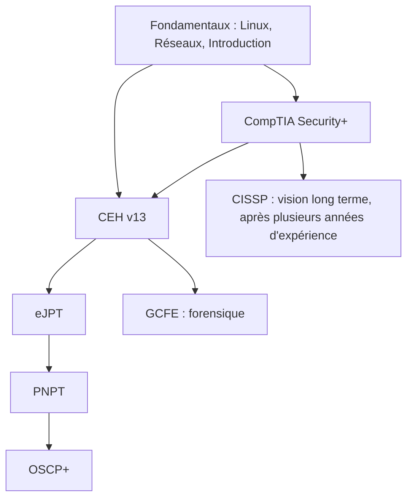

## Introduction

Ce dernier chapitre du cours d'introduction referme la boucle conceptuelle avant les cours techniques. Il répond à une question simple mais souvent négligée : dans quel ordre progresser, vers quel métier, et pourquoi ces certifications précisément ? Le marché de la formation en cybersécurité est foisonnant, et il est facile de dépenser du temps et de l'argent dans une certification prestigieuse mais inadaptée à son niveau ou à son objectif.

Une certification n'est pas une fin en soi. Elle valide un socle de connaissances, ouvre parfois un filtre de recrutement, et structure l'apprentissage par un programme et une échéance. Mais un recruteur cherche avant tout des compétences démontrables : savoir expliquer ce que l'on fait, l'avoir déjà fait, et l'avoir documenté. Comprendre la logique d'un parcours rend aussi chaque cours suivant plus motivant, parce que tu sais où il te mène.

À la fin de ce chapitre, tu sauras situer les grandes familles de métiers, positionner les principales certifications du marché, éviter les erreurs de progression classiques, construire un plan réaliste et un portfolio qui parle aux recruteurs.

## Les grandes familles de métiers

<CompareTable
  titleA="Famille"
  titleB="Exemples de métiers"
  rows={[
    { a: "Offensif (Red Team)", b: "Pentester, Red Teamer, chercheur de vulnérabilités, auditeur technique" },
    { a: "Défensif (Blue Team)", b: "Analyste SOC, Threat Hunter, ingénieur détection, analyste en renseignement sur la menace" },
    { a: "Réponse à incident et forensique (DFIR)", b: "Analyste DFIR, investigateur numérique, analyste de logiciels malveillants" },
    { a: "Gouvernance, Risque, Conformité (GRC)", b: "RSSI, consultant ou auditeur ISO 27001, risk manager, DPO" },
    { a: "Sécurité applicative et DevSecOps", b: "AppSec engineer, développeur sécurisé, ingénieur DevSecOps" },
    { a: "Architecture et ingénierie", b: "Architecte sécurité, ingénieur sécurité réseau, ingénieur sécurité cloud, spécialiste IAM" },
  ]}
/>

Chaque famille mobilise des compétences différentes. L'**offensif** demande une solide base système et réseau, de la curiosité, de la rigueur méthodologique et de bonnes capacités rédactionnelles, car le rapport est le livrable. Le **défensif** demande de connaître les attaques pour les reconnaître, de savoir lire des journaux et d'écrire des règles de détection, souvent dans un environnement en horaires décalés au début. La **DFIR** exige de la méthode, une connaissance fine des systèmes d'exploitation et le sens de la preuve. La **GRC** demande une compréhension des normes, de la gestion des risques et une capacité à dialoguer avec la direction. La **sécurité applicative** suppose de savoir développer.

Pour se repérer, deux référentiels publics décrivent ces métiers en détail : le **panorama des métiers de la cybersécurité** publié par l'ANSSI, et l'**European Cybersecurity Skills Framework** (ECSF) de l'ENISA, qui définit douze profils types avec leurs missions et compétences.

<TipCallout>
Ces familles ne sont pas étanches : un bon pentester comprend la défense, et un bon analyste SOC pense comme un attaquant. Nyx couvre volontairement l'offensif et le défensif pour cette raison. Beaucoup de carrières commencent d'ailleurs en SOC ou en administration système avant de bifurquer vers le pentest, la DFIR ou l'architecture.
</TipCallout>

## Les certifications du parcours Nyx

### La logique d'ensemble

Le parcours suit une progression : un **socle généraliste** (Security+ ou CEH), puis une bascule vers la **pratique** (eJPT, PNPT), puis une certification pratique **exigeante** (OSCP+), avec des branches de spécialisation (GCFE pour la forensique, CISSP pour une trajectoire de management).

### Les certifications une par une

| Certification | Organisme | Format et positionnement |
| --- | --- | --- |
| CompTIA Security+ (SY0-701) | CompTIA | Base généraliste et prérequis conceptuel avant toute spécialisation. QCM et questions de mise en situation (performance-based), au maximum 90 questions en 90 minutes. Cinq domaines : concepts généraux, menaces et vulnérabilités, architecture, opérations de sécurité, gestion et supervision du programme de sécurité. Valable trois ans |
| CEH v13 | EC-Council | Panorama large des techniques offensives, très orienté théorie et vocabulaire, en 20 modules ; la version 13 intègre l'usage de l'IA. Examen théorique de 125 questions en 4 heures, complété par un examen pratique optionnel (CEH Practical) ; réussir les deux donne le titre de CEH Master |
| eJPT (v2) | INE Security | Première certification 100 % pratique, accessible en sortie de CEH : un examen dans un environnement de lab, avec des questions à résoudre en menant un test sur un réseau fictif |
| PNPT | TCM Security | Test d'intrusion complet de bout en bout, avec un rapport professionnel à produire et une restitution orale devant un évaluateur ; forte composante Active Directory |
| OSCP et OSCP+ | OffSec | Référence historique de l'exigence pratique en pentest. Depuis novembre 2024, réussir l'examen du cours PEN-200 donne l'OSCP+, valable trois ans, en plus de l'OSCP sans expiration. Examen pratique de près de 24 heures incluant un environnement Active Directory, suivi de 24 heures pour rédiger le rapport |
| GCFE | GIAC (SANS) | Spécialisation forensique numérique sur Windows, branche DFIR |
| CISSP | ISC2 | Vision managériale et transversale en huit domaines, pertinente après plusieurs années d'expérience : il faut justifier de cinq ans d'expérience dans au moins deux domaines (une année peut être compensée par un diplôme ou une autre certification reconnue), sinon on devient Associate of ISC2 en attendant |

Les détails d'examen évoluent : nombre de questions, durée, versions et tarifs changent régulièrement, et une version d'examen est généralement remplacée au bout de quelques années. Vérifie toujours la page officielle de l'organisme avant de t'inscrire.

<CehCallout>
Ce n'est pas un hasard si Nyx structure ses cours (Linux, Réseaux, Sécurité web, Active Directory, DFIR, Cryptographie) autour des prérequis du CEH : chaque cours technique correspond à un ou plusieurs modules officiels du référentiel. Le CEH v13 compte 20 modules, de l'introduction au hacking éthique jusqu'à la cryptographie, en passant par le cloud, l'IoT et les technologies opérationnelles.
</CehCallout>

### Certification théorique ou pratique

Les certifications se répartissent en deux grandes catégories. Les certifications **théoriques**, à base de QCM, comme Security+, CEH ou CISSP, vérifient l'étendue des connaissances et le vocabulaire ; elles sont souvent exigées dans les appels d'offres et par les services de ressources humaines. Les certifications **pratiques**, comme l'eJPT, le PNPT, l'OSCP+ ou le CEH Practical, demandent de réaliser réellement un test dans un environnement de lab, parfois avec un rapport à rendre ; elles sont plus valorisées par les équipes techniques parce qu'elles prouvent un savoir-faire. Les deux se complètent : la théorie donne la carte, la pratique prouve que tu sais t'y déplacer.

### Les alternatives selon ta voie

Le parcours Nyx est centré sur l'offensif et ses fondamentaux, mais d'autres voies ont leurs propres certifications reconnues.

| Voie | Certifications reconnues |
| --- | --- |
| Défensif et SOC | CompTIA CySA+, Blue Team Level 1 (Security Blue Team), Microsoft SC-200, HTB Certified Defensive Security Analyst, OffSec OSDA |
| Pentest avancé et red team | HTB CPTS, CRTO (Zero-Point Security), OSEP, puis l'OSCE³ qui réunit OSEP, OSWE et OSED |
| DFIR et analyse de malwares | GCFA, GCFE, GREM |
| Cloud | AWS Certified Security – Specialty, Microsoft AZ-500, Google Professional Cloud Security Engineer, CCSK |
| GRC et audit | ISO/IEC 27001 Lead Implementer ou Lead Auditor, CISM, CISA |

## Construire un plan de progression réaliste

<Steps steps={[
  { title: "Consolider les fondamentaux (2 à 4 mois)", description: "Termine Linux, Réseaux et ce cours d'introduction avant toute certification : ce sont les prérequis silencieux de tout le reste. Tu dois être à l'aise avec la ligne de commande, l'adressage IP, TCP/UDP, DNS et HTTP." },
  { title: "Valider un socle généraliste (2 à 3 mois)", description: "Security+ ou directement CEH selon ton niveau de départ et ton marché local, pour valider un socle théorique large et le vocabulaire commun." },
  { title: "Basculer vers la pratique (3 à 6 mois)", description: "eJPT puis PNPT pour développer une véritable méthodologie de test d'intrusion de bout en bout, rapport compris. Pratique en parallèle sur les labs Nyx et sur des plateformes d'entraînement." },
  { title: "Viser une certification exigeante (6 mois et plus)", description: "OSCP+ pour l'offensif pur, GCFE pour la forensique, ou une certification défensive avancée. Ne t'y inscris que lorsque les machines de difficulté moyenne te paraissent abordables." },
  { title: "Se spécialiser et évoluer", description: "Red team, cloud, AppSec ou DFIR selon tes affinités ; CISSP pour une trajectoire managériale, une fois l'expérience requise acquise." },
]} />

Les durées sont indicatives : elles supposent un travail régulier de quelques heures par semaine. La régularité compte plus que l'intensité : une heure par jour pendant six mois produit bien plus qu'un week-end intensif par mois.

<WarningCallout>
L'erreur la plus fréquente est de viser l'OSCP trop tôt, sans bases réseau ni Linux solides. La difficulté ressentie n'est alors pas celle du pentest, mais celle des fondamentaux qui auraient dû être acquis avant, ce qui démotive inutilement. La deuxième erreur fréquente consiste à empiler les certifications théoriques sans jamais pratiquer, ce qui donne un CV impressionnant et un entretien technique difficile.
</WarningCallout>

### Suivre sa progression sur Nyx

La page **Certifications** de la plateforme calcule automatiquement ton taux de préparation pour chaque certification, en fonction des cours liés que tu as terminés. C'est un indicateur pour prioriser, pas un objectif en soi : la vraie compétence se construit dans les chapitres et les labs, pas dans le pourcentage affiché.

## Construire un portfolio, pas seulement des diplômes

Les certifications valident un socle, mais un recruteur en cybersécurité, particulièrement côté offensif, accorde souvent autant d'importance à un **portfolio concret**. Voici ce qui fonctionne le mieux.

Les **write-ups de CTF** documentés sur un blog ou sur GitHub, qui expliquent la résolution de machines TryHackMe ou Hack The Box, sont l'élément le plus courant ; leur valeur vient de l'explication de la démarche, pas de la liste des commandes. Respecte les règles des plateformes, qui interdisent souvent de publier la solution des machines encore actives. Les **contributions open source** (un outil, un script, une règle de détection, une correction de documentation) montrent que tu sais travailler avec d'autres. Un **profil de bug bounty**, même modeste au départ, prouve que tu sais trouver et rapporter une vulnérabilité réelle de façon professionnelle. Un **home lab** documenté, par exemple un petit Active Directory, un SIEM et quelques règles de détection, est très parlant pour un poste défensif. Enfin, les **certifications pratiques** comptent aussi dans le portfolio : leur valeur perçue vient justement du rapport ou de l'examen produit, pas seulement du badge.

<TipCallout>
Les labs Nyx que tu termines, une fois documentés (scénario, méthodologie, constats, recommandations, sans dévoiler les flags), constituent une première brique de portfolio réutilisable pour candidater. La page Portfolio de la plateforme est faite pour cela. Un rapport bien écrit sur un lab vaut souvent plus, en entretien, qu'une ligne de plus sur le CV.
</TipCallout>

## Rester à jour : une discipline, pas une option

La cybersécurité évolue vite : une certification obtenue aujourd'hui couvre un paysage de menaces qui aura changé dans deux ans. Quelques habitudes structurent une veille efficace sans y consacrer un temps déraisonnable.

<CompareTable
  titleA="Type de source"
  titleB="Exemples concrets"
  rows={[
    { a: "Bulletins de vulnérabilités", b: "Bases CVE et NVD, catalogue KEV de la CISA, avis et alertes du CERT-FR pour le contexte francophone" },
    { a: "Communautés techniques", b: "Blogs de chercheurs, conférences dont les présentations sont souvent publiées gratuitement (DEF CON, Black Hat, SSTIC, Hack in Paris)" },
    { a: "Rapports annuels sectoriels", b: "Verizon DBIR, IBM Cost of a Data Breach, panorama de la cybermenace de l'ANSSI, rapport ENISA Threat Landscape" },
    { a: "Formation continue", b: "MOOC SecNumacadémie de l'ANSSI, cours gratuits des éditeurs, nouvelles salles des plateformes d'entraînement" },
  ]}
/>

<AuditCallout>
Le maintien des certifications professionnelles exige explicitement des crédits de formation continue : par exemple 120 crédits CPE sur trois ans pour le CISSP, et 120 crédits ECE sur trois ans pour le CEH, avec des frais annuels de maintien. La veille n'est donc pas qu'une bonne pratique informelle : c'est une condition contractuelle de renouvellement. Garde une trace de tes conférences, formations et publications au fil de l'eau.
</AuditCallout>

## Et après ? Les parcours de spécialisation

Une fois les fondamentaux et une première certification pratique acquis, les trajectoires se diversifient selon l'appétence. La **red team avancée** mène vers l'évasion des défenses et l'Active Directory offensif, avec des certifications comme CRTO ou OSEP. La **sécurité du cloud**, de plus en plus demandée à mesure que les infrastructures migrent, passe par les certifications sécurité des grands fournisseurs. Le **renseignement sur la menace** mène vers l'analyse de groupes d'attaquants et la corrélation de campagnes, avec par exemple le GCTI. Le **reverse engineering** et l'**analyse de malwares**, avec le GREM, demandent une solide base en programmation et en assembleur. La **sécurité de l'IA**, enfin, émerge comme spécialité à part entière, avec les tests adverses des modèles et le Top 10 OWASP des applications fondées sur les grands modèles de langage.

Aucune de ces spécialisations n'a de sens sans les fondamentaux couverts par ce cours d'introduction et les cours Linux et Réseaux : elles en sont le prolongement naturel, pas un raccourci possible.

## Erreurs fréquentes

La première erreur est de choisir une certification pour son prestige plutôt que pour son adéquation à son niveau et à son objectif, typiquement viser l'OSCP en partant de zéro. La deuxième est de collectionner les certifications sans pratique ni portfolio. La troisième est de négliger la rédaction : dans tous les métiers de la cybersécurité, on écrit des rapports, des tickets, des procédures, et une compétence technique mal expliquée perd l'essentiel de sa valeur.

On voit aussi des candidats qui publient des write-ups de machines encore actives en violation des règles des plateformes, ou qui affichent des compétences offensives sans aucune mention du cadre légal. Enfin, beaucoup oublient les exigences de maintien et laissent expirer une certification durement obtenue.

## Lab — Mise en pratique

**Environnement** : réflexion guidée, avec deux étapes facultatives dans le terminal Nyx Shell pour démarrer ton portfolio et ta veille.

<Steps steps={[
  { title: "Auto-évaluation", description: "Note honnêtement ton niveau actuel (débutant, intermédiaire, confirmé) sur Linux, les réseaux, la programmation et l'anglais technique. Les deux premiers sont les prérequis silencieux les plus souvent sous-estimés." },
  { title: "Choisir une famille de métiers", description: "À partir du tableau des familles, choisis celle qui t'attire le plus et une seconde en alternative. Pour chacune, cite trois compétences que tu possèdes déjà et trois qui te manquent." },
  { title: "Choisir sa première cible", description: "En fonction de ton objectif (offensif, défensif, GRC, forensique), identifie quelle certification devrait être ta priorité à 12 mois, puis vérifie sur le site officiel de l'organisme la version d'examen en vigueur, le format et les prérequis." },
  { title: "Rédiger un plan sur 12 mois", description: "Découpe l'année en trimestres. Pour chacun, indique les cours Nyx à terminer, les labs à réaliser, la certification éventuelle visée et un élément de portfolio à produire." },
  { title: "Préparer ton portfolio", description: "Crée un dépôt local qui accueillera tes write-ups et rapports de labs, avec un modèle de fiche réutilisable. Tu pourras le publier plus tard sur une plateforme d'hébergement de code.", code: "mkdir -p ~/portfolio/{writeups,rapports,outils} && cd ~/portfolio\nprintf '# Titre du lab\\n\\n## Contexte et périmètre\\n\\n## Méthodologie\\n\\n## Constats\\n\\n## Recommandations\\n\\n## Ce que j ai appris\\n' > writeups/MODELE.md\ngit init -q && git add . && git commit -qm 'Initialisation du portfolio' && git log --oneline" },
  { title: "Mettre en place ta veille", description: "Récupère le flux RSS des alertes du CERT-FR et affiche les titres des dernières publications. Choisis ensuite trois sources du tableau de veille et bloque un créneau hebdomadaire de 30 minutes pour les lire.", code: "curl -s https://www.cert.ssi.gouv.fr/alerte/feed/ | grep -o '<title>[^<]*</title>' | sed 's/<[^>]*>//g' | head -6" },
]} />

## À retenir

- Les métiers de la cybersécurité se répartissent en grandes familles : offensif (Red Team), défensif (Blue Team, dont l'analyste SOC et le Threat Hunter), DFIR, GRC, sécurité applicative et architecture.
- Le parcours Nyx suit une progression : Security+ ou CEH en base, puis eJPT, PNPT et OSCP+, avec des branches spécialisées comme GCFE ou CISSP.
- Security+ (SY0-701) est la base généraliste ; le CEH v13 donne un panorama théorique large ; l'eJPT est la première certification 100 % pratique ; le PNPT exige un rapport professionnel ; l'OSCP+ reste la référence pratique exigeante.
- Viser l'OSCP trop tôt, sans bases Linux et réseau solides, est l'erreur de progression la plus fréquente.
- Un portfolio concret (write-ups de CTF documentés, rapports de labs, contributions open source, bug bounty, home lab) pèse autant que les certifications.
- Le maintien des certifications exige des crédits de formation continue (CPE pour le CISSP, ECE pour le CEH) : la veille est une obligation, pas une option.

## Questions de révision

1. Cite les grandes familles de métiers de la cybersécurité, et place l'analyste SOC et le pentester dans la bonne famille.
2. Pourquoi Security+ ou le CEH sont-ils positionnés avant l'eJPT dans le parcours Nyx ?
3. Quelle différence fais-tu entre une certification théorique et une certification pratique ? Donne deux exemples de chaque.
4. Qu'est-ce qui a changé pour l'OSCP en novembre 2024 ?
5. Quelle est l'erreur de progression la plus fréquente mise en garde dans ce chapitre, et pourquoi démotive-t-elle ?
6. Cite trois éléments de portfolio et explique ce que chacun prouve à un recruteur.
7. Que sont les crédits CPE et ECE, et pourquoi conditionnent-ils le maintien d'une certification comme le CISSP ou le CEH ?
8. Quelles conditions d'expérience faut-il remplir pour obtenir le CISSP, et que se passe-t-il si on réussit l'examen sans les remplir ?

Tu viens de terminer le cours **Introduction à la cybersécurité** : direction **Linux** et **Réseaux informatiques** pour construire les bases techniques de ton parcours.
