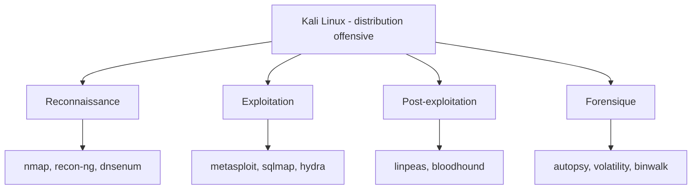

## Introduction

Linux est le système d'exploitation de référence en cybersécurité, aussi bien offensive que défensive. La quasi-totalité des outils de test d'intrusion, la majorité des serveurs exposés sur Internet et presque toutes les plateformes d'analyse forensique tournent sous Linux. En apprendre la maîtrise n'est donc pas optionnel : c'est le socle sur lequel repose tout le reste de ta progression vers des certifications comme le CEH, l'eJPT ou l'OSCP.

À la fin de ce chapitre, tu sauras ce qui distingue Kali des autres distributions, tu te repéreras dans l'arborescence des fichiers sans hésiter, tu installeras n'importe quel outil manquant avec APT, et tu auras configuré un terminal qui te fera gagner du temps à chaque session. Le terminal est ton établi : plus tu le connais, plus tu es rapide, et en pentest la rapidité se traduit directement en couverture de tests.

## Qu'est-ce que Linux, concrètement ?

Le terme « Linux » désigne d'abord un **noyau** (kernel) : le programme central qui fait l'intermédiaire entre le matériel (processeur, mémoire, disque, carte réseau) et les logiciels que tu lances. Autour de ce noyau, une **distribution** rassemble un gestionnaire de paquets, un ensemble d'outils en ligne de commande, parfois un bureau graphique, et une philosophie d'usage. Debian, Ubuntu, Fedora et Kali sont des distributions différentes partageant le même noyau Linux.

Une notion revient en permanence sous Linux : presque tout est représenté comme un **fichier**. Un document, bien sûr, mais aussi un périphérique matériel (`/dev/sda` pour un disque), une information sur un processus (`/proc/1/status`), ou un paramètre du noyau (`/proc/sys/net/...`). Cette uniformité explique pourquoi quelques commandes simples suffisent à inspecter un système entier : tu lis des fichiers.

### Le shell, interface entre toi et le système

Le **shell** est le programme qui interprète les commandes que tu tapes. Sous Kali, le shell par défaut est **Bash** (Bourne Again SHell) ou **Zsh** selon la version. Quand tu écris une commande, le shell la découpe en mots, remplace les variables, lance le programme correspondant et t'affiche sa sortie. Comprendre que le shell n'est qu'un intermédiaire — et pas le système lui-même — t'évite beaucoup de confusions par la suite.

## Pourquoi Kali Linux ?

Kali Linux est une distribution dérivée de **Debian**, maintenue par la société **Offensive Security** (aujourd'hui OffSec). Elle embarque plusieurs centaines d'outils dédiés au test d'intrusion, à l'audit et à l'analyse forensique, déjà installés et configurés. Ce n'est pas un système grand public : c'est un établi d'artisan spécialisé, pensé pour être utilisé par un opérateur qui sait ce qu'il fait.

Kali n'est pas la seule distribution offensive — Parrot OS et BlackArch existent aussi — mais c'est la plus répandue dans la formation et dans les certifications, ce qui en fait le choix par défaut pour apprendre.



### Les éditions de Kali

Kali existe sous plusieurs formes selon le contexte d'usage. Le cœur d'outils reste comparable d'une édition à l'autre : seul l'emballage change.

| Édition | Usage visé |
| --- | --- |
| Kali (ISO classique) | Installation sur machine physique ou virtuelle |
| Kali Purple | Orientée défense et SOC, avec des outils Blue Team supplémentaires |
| Kali NetHunter | Adaptation Android pour le pentest mobile |
| Images cloud (AWS, Azure) | Campagnes de test à grande échelle, infrastructure jetable |

<WarningCallout>
Ne lance jamais d'outil de scan ou d'exploitation contre une cible que tu n'es pas explicitement autorisé à tester. Toutes les commandes de ce cours doivent être exécutées uniquement dans les labs Nyx ou sur des machines qui t'appartiennent. Scanner un système tiers sans autorisation écrite est une infraction pénale dans la plupart des pays.
</WarningCallout>

## Le terminal : premiers pas

Le terminal affiche une **invite de commande** (prompt) qui t'indique souvent l'utilisateur, la machine et le répertoire courant. Le symbole final renseigne sur ton niveau de privilège : un `$` signale un utilisateur standard, un `#` signale l'utilisateur **root**, l'administrateur tout-puissant du système.

Trois commandes forment la base de toute navigation : `pwd` affiche le répertoire courant, `ls` liste son contenu, et `cd` change de répertoire.

```bash
# Afficher le répertoire de travail courant
pwd

# Lister le contenu, y compris les fichiers cachés (-a) au format détaillé (-l)
ls -la

# Se déplacer dans un répertoire, puis revenir au répertoire parent
cd /usr/share
cd ..
```

```text
total 20
drwxr-xr-x 1 root root 4096 nov.   9 10:12 .
drwxr-xr-x 1 root root 4096 nov.   9 10:12 ..
-rw-r--r-- 1 root root  220 nov.   9 10:12 .bashrc
-rw-r--r-- 1 root root  807 nov.   9 10:12 .profile
```

Dans cette sortie, chaque ligne décrit un élément : la première colonne donne le type et les permissions, puis le nombre de liens, le propriétaire, le groupe, la taille, la date, et enfin le nom. Les entrées `.` et `..` désignent respectivement le répertoire courant et son parent ; les fichiers dont le nom commence par un point (comme `.bashrc`) sont **cachés** et n'apparaissent qu'avec l'option `-a`.

<TipCallout>
Le raccourci `cd -` te ramène instantanément au répertoire précédent, comme un bouton « retour ». Très utile quand tu fais des allers-retours entre deux dossiers de travail pendant un audit. Tapé seul, `cd` sans argument te renvoie dans ton répertoire personnel.
</TipCallout>

## L'arborescence du système de fichiers

Contrairement à Windows et ses lettres de lecteur (C:, D:), Linux organise tout à partir d'une **racine unique** notée `/`. Chaque disque, chaque périphérique, chaque dossier se greffe quelque part sous cette racine. Voici les répertoires que tu croiseras le plus souvent ; le chapitre suivant détaillera cette hiérarchie et ses implications de sécurité.

| Répertoire | Contenu |
| --- | --- |
| `/etc` | Fichiers de configuration du système et des services |
| `/var/log` | Journaux système, précieux en investigation |
| `/home` | Répertoires personnels des utilisateurs standards |
| `/root` | Répertoire personnel de l'administrateur (root) |
| `/usr/bin` | La plupart des programmes exécutables installés |
| `/usr/share/wordlists` | Dictionnaires utilisés pour les attaques par bruteforce |
| `/tmp` | Fichiers temporaires, effaçables à tout moment |

```bash
# Explorer l'arborescence depuis la racine
ls -la /

# Afficher les deux premiers niveaux d'un répertoire sous forme d'arbre
tree -L 2 /usr/share/wordlists
```

Le répertoire `/usr/share/wordlists` mérite une attention particulière : il contient les dictionnaires livrés avec Kali, dont la célèbre liste `rockyou.txt`, utilisée par les outils de cassage de mots de passe. Savoir où ils se trouvent t'évite de les chercher à chaque fois.

## Gérer les paquets avec APT

Kali hérite de Debian son gestionnaire de paquets, **APT** (Advanced Package Tool). Un paquet est une archive contenant un logiciel et la liste de ses dépendances. APT se charge de télécharger, installer, mettre à jour et désinstaller ces paquets depuis des **dépôts** (serveurs officiels). Dès qu'un outil te manque, c'est par APT que tu l'obtiens.

```bash
# Synchroniser la liste des paquets disponibles avec les dépôts
# (à faire avant toute installation)
sudo apt update

# Installer un outil, ici la collection de dictionnaires SecLists
sudo apt install -y seclists

# Rechercher un paquet par mot-clé
apt search wordlist

# Mettre à jour tous les paquets déjà installés
sudo apt upgrade -y
```

<WarningCallout>
Sans `apt update` préalable, la commande `apt install` échoue souvent avec le message « Unable to locate package ». La raison est simple : la liste locale des paquets disponibles n'a pas encore été synchronisée avec les dépôts, donc APT ignore que le paquet existe. Le réflexe est de toujours lancer `apt update` avant une première installation.
</WarningCallout>

## Permissions : première approche

Chaque fichier Linux appartient à un **propriétaire** et à un **groupe**, et porte des permissions de lecture (`r`), écriture (`w`) et exécution (`x`) pour trois catégories : le propriétaire, le groupe, et les autres utilisateurs. La commande `ls -l` affiche ces permissions dans sa première colonne ; par exemple `-rwxr-xr-x` se lit de gauche à droite : type de fichier, puis trois blocs de trois caractères.

Ces permissions se notent aussi en **octal**, où chaque chiffre résume un bloc : lecture vaut 4, écriture vaut 2, exécution vaut 1, et on additionne. Ainsi `rwx` donne 7, `r-x` donne 5, et l'ensemble `rwxr-xr-x` s'écrit 755.

<CompareTable
  titleA="Notation symbolique"
  titleB="Notation octale"
  rows={[
    { a: "rwxr-xr-x", b: "755" },
    { a: "rw-r--r--", b: "644" },
    { a: "rwx------", b: "700" }
  ]}
/>

```bash
# Rendre un script exécutable pour tous, modifiable par le seul propriétaire
chmod 755 script.sh

# Changer le propriétaire et le groupe d'un fichier
sudo chown user:group fichier.txt
```

Nous n'effleurons ici que les bases ; le chapitre 2 est entièrement consacré aux permissions, y compris les bits spéciaux comme SUID qui constituent un vecteur d'élévation de privilèges majeur.

## Personnaliser son environnement de travail

Un opérateur passe des centaines d'heures dans un terminal. Quelques réglages simples, chargés automatiquement à chaque ouverture via le fichier `~/.bashrc`, font gagner un temps considérable sur la durée.

```bash
# Créer des alias permanents en les ajoutant à ~/.bashrc
echo "alias ll='ls -la'" >> ~/.bashrc
echo "alias ports='ss -tulpn'" >> ~/.bashrc

# Recharger la configuration sans fermer le terminal
source ~/.bashrc

# Définir une variable d'environnement pour la session de test
export TARGET=10.10.0.10
echo "$TARGET"
```

Une **variable d'environnement** comme `TARGET` est une valeur nommée que le shell et les programmes peuvent réutiliser. Définir `TARGET` une fois t'évite de retaper l'adresse de la cible dans chaque commande ; tu écris `$TARGET` à la place.

<TipCallout>
Garde tes alias et variables dans un fichier versionné en dépôt Git privé. Tu retrouveras un environnement de travail identique sur chaque nouvelle machine Kali, sans tout reconfigurer à la main.
</TipCallout>

## Erreurs fréquentes

- **Oublier `apt update`** avant une installation et conclure à tort qu'un outil n'existe pas.
- **Confondre `/` et `~`** : `cd /` va à la racine du système, `cd ~` va à ton répertoire personnel. Lancer une suppression récursive à la mauvaise racine est catastrophique.
- **Travailler en permanence en root** : utiliser root pour tout banalise les erreurs destructrices. Privilégie un utilisateur standard et `sudo` au cas par cas.
- **Ignorer les fichiers cachés** : beaucoup d'informations sensibles (clés, historiques, configurations) sont dans des fichiers commençant par un point, invisibles sans `ls -a`.
- **Chemins relatifs mal maîtrisés** : vérifie toujours ton répertoire courant avec `pwd` avant une commande sensible.

## Angle offensif et défensif

Du point de vue de l'attaquant, la première chose faite après avoir obtenu un accès sur une machine Linux est la **reconnaissance du système** : qui suis-je (`whoami`, `id`), quelle est la version du système (`uname -a`, `cat /etc/os-release`), qu'y a-t-il d'intéressant dans les fichiers cachés du répertoire personnel. Ces informations orientent toute la suite.

Du point de vue du défenseur, un système bien tenu applique le **principe du moindre privilège** dès l'installation : pas de compte root utilisé au quotidien, paquets réduits au strict nécessaire pour diminuer la surface d'attaque, et mises à jour régulières via APT pour fermer les failles connues.

<CehCallout>
La reconnaissance locale fait partie des tout premiers réflexes évalués en certification pratique. Savoir identifier rapidement l'utilisateur courant, la version du noyau et la distribution est attendu, car ces éléments conditionnent le choix d'un éventuel exploit local.
</CehCallout>

## Lab — Mise en pratique

**Environnement** : Kali Linux (terminal Nyx Shell)

<Steps steps={[
  { title: "Identifier le système", description: "Observe l'utilisateur courant, la version du noyau et la distribution. Ces trois informations sont la base de toute reconnaissance locale.", code: "whoami\nid\nuname -a\ncat /etc/os-release" },
  { title: "Explorer l'arborescence", description: "Liste la racine et repère les répertoires clés. Remarque l'absence de lettres de lecteur : tout part de la racine.", code: "ls -la /\ntree -L 1 /" },
  { title: "Révéler les fichiers cachés", description: "Affiche le contenu complet de ton répertoire personnel. Les fichiers commençant par un point n'apparaissent qu'avec -a.", code: "cd ~\nls -la" },
  { title: "Localiser les dictionnaires", description: "Vérifie où se trouvent les wordlists livrées avec Kali. Note la présence de rockyou.", code: "ls -la /usr/share/wordlists" },
  { title: "Mettre à jour et installer un outil", description: "Synchronise les dépôts puis installe SecLists. Observe que l'installation échouerait sans la synchronisation préalable.", code: "sudo apt update\nsudo apt install -y seclists" },
  { title: "Créer un alias utile", description: "Ajoute un alias permanent et recharge la configuration. Teste-le aussitôt.", code: "echo \"alias ll='ls -la'\" >> ~/.bashrc\nsource ~/.bashrc\nll" },
  { title: "Définir une variable de cible", description: "Enregistre l'adresse de la cible du lab dans une variable réutilisable pour tes prochaines commandes.", code: "export TARGET=10.10.0.10\necho \"Cible definie : $TARGET\"" }
]} />

## À retenir

- Linux désigne un noyau ; une distribution comme Kali l'habille d'outils et d'un gestionnaire de paquets.
- Kali Linux est une distribution Debian maintenue par Offensive Security, taillée pour le pentest.
- Sous Linux, tout part d'une racine unique `/` ; il n'y a pas de lettres de lecteur.
- `ls -la` révèle les fichiers cachés, `cd -` revient au répertoire précédent.
- APT gère les paquets ; `apt update` doit précéder toute première installation.
- Les permissions `rwx` se notent aussi en octal (lecture 4, écriture 2, exécution 1).
- Personnaliser `~/.bashrc` avec des alias et des variables fait gagner du temps à chaque session.

## Questions de révision

1. Quelle est la différence entre le noyau Linux et une distribution comme Kali ?
2. Quelle commande liste les fichiers cachés d'un répertoire, et à quoi reconnaît-on un fichier caché ?
3. Pourquoi `apt install` échoue-t-il souvent si `apt update` n'a pas été exécuté auparavant ?
4. Que fait le raccourci `cd -` dans un terminal ?
5. Qui maintient la distribution Kali Linux, et quelle édition est orientée défense et SOC ?
6. Comment se traduit la permission symbolique `rwxr-xr-x` en notation octale ?
7. Dans quel répertoire trouve-t-on par défaut les dictionnaires de bruteforce sous Kali ?
8. Pourquoi est-il déconseillé de travailler en permanence sous le compte root ?
