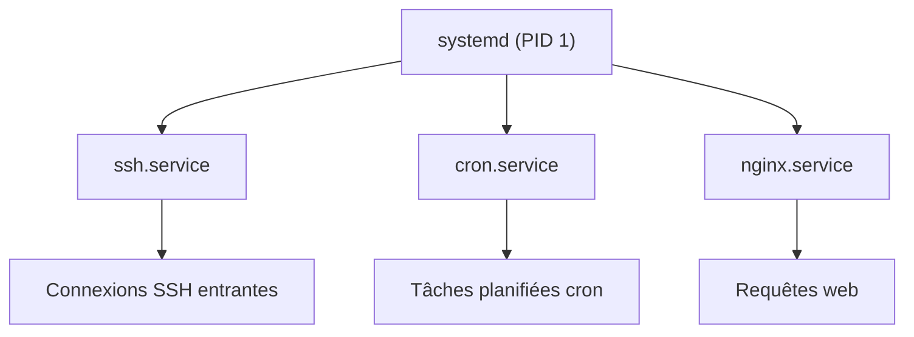

## Introduction

Un système compromis laisse presque toujours une trace au niveau des processus : un reverse shell qui tourne en arrière-plan, un service qui écoute sur un port inhabituel, une tâche planifiée qui relance un script malveillant. Un **reverse shell** est une connexion qu'une machine victime ouvre vers l'attaquant pour lui donner un accès au terminal ; c'est l'un des mécanismes les plus courants après une première intrusion.

Savoir lire l'état des processus d'une machine est donc une compétence à double tranchant : elle sert à maintenir un accès côté attaquant, et à détecter une intrusion côté défenseur. À la fin de ce chapitre, tu sauras explorer l'arborescence des processus, les piloter avec les bons signaux, comprendre comment **systemd** gère les services d'un système moderne, et repérer les anomalies qui trahissent une compromission.

## Les processus : PID, PPID et arborescence

Un **processus** est une instance d'un programme en cours d'exécution. Chaque processus possède un identifiant numérique unique, le **PID** (Process ID), et connaît son processus parent via le **PPID** (Parent Process ID). Tout processus est en effet créé par un autre, ce qui forme une arborescence dont la racine est le processus de PID 1 — historiquement `init`, aujourd'hui `systemd` sur la plupart des distributions.

```bash
# Vue arborescente de tous les processus (hiérarchie parent/enfant)
ps auxf

# Même hiérarchie, format System V
ps -ef --forest

# Vue temps réel triée par consommation CPU
top

# Alternative moderne, plus lisible et interactive
htop
```

```text
USER  PID  PPID %CPU %MEM COMMAND
root    1     0  0.0  0.4 /sbin/init
root  412     1  0.0  0.2 /usr/sbin/sshd -D
root  980   412  0.0  0.3  \_ sshd: kali [priv]
kali 1004   980  0.1  0.5      \_ -bash
```

Dans l'option `ps aux`, chaque lettre a un sens : `a` affiche les processus de tous les utilisateurs, `u` ajoute le propriétaire et la consommation de ressources, `x` inclut les processus sans terminal associé. L'option `f` (pour forest) dessine la hiérarchie, où l'indentation révèle d'un coup d'œil quel processus a lancé quel autre.

<CompareTable
  titleA="Commande"
  titleB="Usage"
  rows={[
    { a: "ps aux", b: "Lister tous les processus, tous utilisateurs confondus" },
    { a: "ps -ef --forest", b: "Afficher la hiérarchie parent/enfant des processus" },
    { a: "pgrep nginx", b: "Récupérer les PID des processus portant un nom" },
    { a: "pkill nginx", b: "Envoyer un signal à tous les processus d'un nom donné" }
  ]}
/>

<TipCallout>
Un PPID égal à 1 pour un processus suspect signifie qu'il a été « orphelinisé » : son parent d'origine a disparu et le processus a été rattaché à `systemd` (PID 1). C'est souvent le signe d'un processus volontairement détaché de son terminal, une technique classique pour faire survivre un reverse shell à la fermeture de la session.
</TipCallout>

## Les signaux Unix

Piloter un processus, c'est lui envoyer un **signal** : un message asynchrone que le noyau transmet au processus pour lui demander d'agir. La commande `kill` ne « tue » pas forcément ; elle envoie le signal de ton choix. Chaque signal porte un nom et un numéro.

<CompareTable
  titleA="Signal"
  titleB="Effet"
  rows={[
    { a: "SIGTERM (15, défaut)", b: "Demande poliment au processus de se terminer proprement" },
    { a: "SIGKILL (9)", b: "Termine immédiatement, sans nettoyage possible — dernier recours" },
    { a: "SIGHUP (1)", b: "Souvent utilisé pour recharger la configuration d'un service sans l'arrêter" },
    { a: "SIGSTOP / SIGCONT", b: "Suspend puis reprend l'exécution d'un processus" }
  ]}
/>

```bash
# Arrêt propre (SIGTERM implicite) : à privilégier
kill 1234

# Arrêt forcé (SIGKILL) : seulement si le processus ignore SIGTERM
kill -9 1234

# Recharger la configuration d'un service sans coupure de service
kill -HUP $(pgrep nginx)
```

La différence entre SIGTERM et SIGKILL est essentielle : SIGTERM laisse au processus le temps de fermer ses fichiers et de libérer ses ressources, tandis que SIGKILL le stoppe net, au risque de laisser des données incohérentes. On n'emploie SIGKILL qu'en dernier recours.

<WarningCallout>
Un processus malveillant bien conçu peut intercepter et ignorer SIGTERM pour éviter d'être arrêté proprement. Si un processus résiste à SIGTERM et ne cède qu'à SIGKILL, c'est un indice de sophistication à noter en investigation.
</WarningCallout>

## systemd et la gestion des services

**systemd** est le système d'initialisation et le gestionnaire de services de la majorité des distributions modernes (Debian, Ubuntu, Kali, Fedora, RHEL récents). Il a remplacé les anciens scripts SysV. Un **service** (ou démon) est un programme qui tourne en arrière-plan en continu — un serveur SSH, un serveur web, une base de données. systemd décrit chaque service par une **unité**, un fichier de configuration dont l'extension indique le type : `.service` pour un démon, `.timer` pour une tâche planifiée, `.socket` pour une activation sur connexion.

```bash
# Consulter l'état d'un service
systemctl status ssh

# Démarrer, arrêter, activer au démarrage un service
sudo systemctl start ssh
sudo systemctl stop ssh
sudo systemctl enable ssh

# Lister tous les services actuellement démarrés
systemctl list-units --type=service --state=running

# Lister les services activés au démarrage (persistance potentielle)
systemctl list-unit-files --state=enabled
```



### journalctl, la mémoire de systemd

systemd centralise les journaux de tous les services dans un format binaire interrogeable via **journalctl**, bien plus riche et filtrable que les anciens fichiers texte épars de `/var/log`.

```bash
# Journaux d'un service précis, par exemple le serveur SSH
journalctl -u ssh

# Journaux depuis le dernier démarrage, en continu (comme tail -f)
journalctl -b -f

# Entrées récentes avec contexte d'erreur
journalctl -xe --since "1 hour ago"
```

<CehCallout>
Un attaquant disposant d'un accès root persiste souvent en créant un service systemd malveillant dans `/etc/systemd/system/`, qui relance un reverse shell à chaque redémarrage. En réponse à incident, l'inspection de ce répertoire et des services activés (`systemctl list-unit-files --state=enabled`) est une vérification systématique.
</CehCallout>

## cron, l'autre vecteur de persistance

Au-delà des services systemd, les **tâches cron** restent un mécanisme de persistance très utilisé, car souvent moins surveillé. cron est un planificateur qui exécute des commandes à intervalles réguliers, décrits par une syntaxe de cinq champs (minute, heure, jour du mois, mois, jour de la semaine).

```bash
# Tâches cron de l'utilisateur courant
crontab -l

# Tâches cron système
cat /etc/crontab
ls -la /etc/cron.d/ /etc/cron.daily/

# Crontabs de tous les utilisateurs (nécessite root)
ls -la /var/spool/cron/crontabs/
```

```text
# Exemple d'entrée suspecte dans une crontab : relance toutes les 5 minutes
*/5 * * * * /tmp/.update.sh
```

Une tâche planifiée pointant vers un script caché (nom commençant par un point) dans un répertoire inscriptible comme `/tmp` est un drapeau rouge classique. En réponse à incident, on inspecte `/etc/crontab`, `/etc/cron.d/` et les crontabs utilisateurs au même titre que les services systemd.

## Détecter un processus ou un service suspect

<AttackDefenseTable rows={[
  { phase: "Persistance", attack: "Créer un service systemd déguisé en processus légitime dans /etc/systemd/system", defense: "Auditer /etc/systemd/system et comparer avec une baseline connue" },
  { phase: "Camouflage", attack: "Renommer un binaire malveillant avec un nom de processus système courant", defense: "Vérifier l'intégrité des binaires avec un outil comme AIDE" },
  { phase: "Réseau", attack: "Ouvrir un port d'écoute non déclaré pour recevoir un reverse shell", defense: "Croiser ss -tulpn avec la liste des ports autorisés par la politique de sécurité" }
]} />

Un réflexe puissant consiste à croiser la liste des processus avec celle des ports en écoute, puis à repérer les processus dont le binaire a disparu du disque — une astuce fréquente des malwares qui s'effacent après exécution tout en restant en mémoire.

```bash
# Croiser processus et ports en écoute (-t TCP, -u UDP, -l écoute, -p processus, -n numérique)
ss -tulpn

# Repérer les processus dont le binaire a été supprimé du disque
ls -la /proc/*/exe 2>/dev/null | grep deleted
```

```text
tcp LISTEN 0 128 0.0.0.0:22   0.0.0.0:* users:(("sshd",pid=412,fd=3))
tcp LISTEN 0 1   0.0.0.0:4444 0.0.0.0:* users:(("nc",pid=2051,fd=3))
```

Dans cette sortie, le port 22 et `sshd` sont attendus ; en revanche un processus `nc` (Netcat) à l'écoute sur le port 4444 n'a rien à faire sur un serveur de production et trahit très probablement un accès malveillant.

<WarningCallout>
La technique `ls -la /proc/*/exe | grep deleted` est une méthode légitime d'investigation forensique. Ne l'utilise que sur des systèmes que tu es explicitement autorisé à auditer.
</WarningCallout>

## Erreurs fréquentes

- **Dégainer `kill -9` d'emblée** : SIGKILL empêche tout nettoyage. Commence toujours par SIGTERM.
- **Confondre `systemctl stop` et `systemctl disable`** : `stop` arrête le service maintenant, `disable` l'empêche de redémarrer au prochain démarrage. Les deux sont souvent nécessaires.
- **Ne regarder que les services systemd** et oublier cron : les deux doivent être inspectés en réponse à incident.
- **Se fier au seul nom d'un processus** : un malware se renomme facilement en `sshd` ou `kworker`. Vérifie le chemin du binaire (`/proc/PID/exe`) et son intégrité.
- **Oublier `-n` avec `ss`** : sans cette option, la résolution DNS et de services peut ralentir la sortie et masquer les numéros de port réels.

## Angle offensif et défensif

Côté attaquant, la post-exploitation passe par l'énumération des processus (`ps auxf`), des services (`systemctl`), des ports (`ss -tulpn`) et des tâches planifiées (`crontab -l`, `/etc/cron.d`), à la recherche d'un service tournant en root qui pourrait être détourné, ou d'un script planifié inscriptible qui offrirait une élévation de privilèges.

Côté défenseur, la détection repose sur une **baseline** : une photographie de l'état normal du système (processus, ports, services, tâches planifiées) à laquelle comparer l'état courant. Toute déviation — un nouveau service, un port inattendu, un binaire supprimé encore actif — devient alors visible. Les journaux centralisés par journalctl fournissent la chronologie qui relie ces anomalies à un événement d'intrusion.

## Lab — Mise en pratique

**Environnement** : Kali Linux (terminal Nyx Shell)

<Steps steps={[
  { title: "Explorer l'arborescence des processus", description: "Affiche tous les processus avec leur hiérarchie. Remonte jusqu'au PID 1 pour comprendre qui a lancé quoi.", code: "ps -ef --forest | head -40" },
  { title: "Identifier le PID 1", description: "Confirme que le processus racine est bien systemd sur cette machine.", code: "ps -p 1 -o pid,ppid,comm" },
  { title: "Lister les services actifs", description: "Recense les services systemd actuellement démarrés. Repère ceux que tu ne reconnais pas.", code: "systemctl list-units --type=service --state=running" },
  { title: "Croiser processus et ports réseau", description: "Identifie quels processus écoutent sur quels ports. Un port inhabituel associé à nc ou bash est suspect.", code: "ss -tulpn" },
  { title: "Consulter les journaux d'un service", description: "Lis les dernières lignes du journal du service SSH pour observer les connexions et les erreurs.", code: "journalctl -u ssh --no-pager | tail -20" },
  { title: "Inspecter les tâches planifiées", description: "Recense toutes les tâches cron du système. Une tâche pointant vers un script dans /tmp est un drapeau rouge.", code: "cat /etc/crontab\nls -la /etc/cron.d/ /etc/cron.daily/" },
  { title: "Expérimenter les signaux", description: "Lance un processus de longue durée en arrière-plan, puis arrête-le proprement avec SIGTERM avant de recourir à SIGKILL.", code: "sleep 600 &\nPID=$!\nkill $PID\nkill -9 $PID 2>/dev/null" }
]} />

## À retenir

- Chaque processus a un PID et un PPID ; l'arborescence remonte jusqu'au PID 1, qui est systemd.
- Un PPID égal à 1 pour un processus suspect signale qu'il a été orphelinisé, souvent pour faire persister un accès.
- `kill` envoie des signaux : SIGTERM (15) demande un arrêt propre, SIGKILL (9) force l'arrêt, SIGHUP (1) recharge une configuration.
- systemd gère les services via des unités `.service`, `.timer`, `.socket` ; journalctl centralise leurs journaux.
- La persistance se cache dans `/etc/systemd/system`, les services activés, ou les tâches cron.
- Croiser processus, ports (`ss -tulpn`) et intégrité des binaires permet de détecter une anomalie.
- Une baseline de l'état normal du système est la clé pour repérer rapidement une déviation.

## Questions de révision

1. Que signifie un PPID égal à 1 pour un processus suspect, et pourquoi est-ce révélateur ?
2. Quelle est la différence pratique entre les signaux SIGTERM et SIGKILL ?
3. Quel signal est généralement utilisé pour recharger la configuration d'un service sans l'arrêter ?
4. Quelle commande liste les services systemd actuellement démarrés ?
5. Où un attaquant dépose-t-il typiquement un service malveillant pour persister au redémarrage ?
6. Comment croiser les processus en cours et les ports réseau en écoute, et que révèle un port inattendu ?
7. Quelle commande consulte les journaux d'un service systemd précis comme SSH ?
8. Quelle technique permet de repérer un processus dont le binaire a été supprimé du disque après son lancement ?
