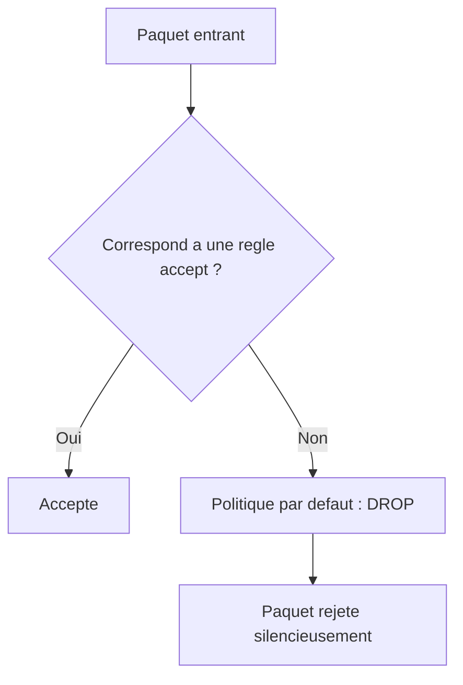

## Introduction

Ce dernier chapitre referme la boucle du cours Linux : après avoir appris à naviguer, à gérer les permissions, les processus et le scripting, il est temps de configurer le réseau et de durcir un système contre les attaques les plus courantes. Le **durcissement** (hardening) désigne l'ensemble des mesures qui réduisent la surface d'attaque d'un système, c'est-à-dire tout ce qu'un attaquant pourrait viser.

C'est une compétence double. L'attaquant doit comprendre la surface d'exposition d'une cible pour l'exploiter ; le défenseur doit la réduire pour la protéger. À la fin de ce chapitre, tu sauras diagnostiquer la couche réseau d'une machine, construire une politique de pare-feu solide, sécuriser l'accès distant par SSH, ajuster les paramètres de sécurité du noyau, et mesurer objectivement ton niveau de durcissement.

## Diagnostic réseau avec les outils modernes

La première étape, en attaque comme en défense, est de dresser la carte réseau de la machine : ses adresses, ses routes, sa résolution de noms et ses connexions. La suite **iproute2** (`ip`, `ss`) est aujourd'hui la référence ; elle remplace la vieille suite **net-tools** (`ifconfig`, `route`, `netstat`), considérée comme obsolète et souvent absente des distributions récentes.

```bash
# Interfaces réseau et adresses IP
ip a

# Table de routage (passerelle par défaut)
ip route

# Serveurs DNS configurés et résolution d'un nom
cat /etc/resolv.conf
dig example.com +short

# Connectivité et chemin réseau
ping -c 4 8.8.8.8
traceroute 8.8.8.8
```

```text
2: eth0: <BROADCAST,MULTICAST,UP,LOWER_UP> mtu 1500 state UP
    inet 10.10.0.5/24 brd 10.10.0.255 scope global eth0
default via 10.10.0.1 dev eth0
```

<CompareTable
  titleA="Ancienne commande (net-tools)"
  titleB="Commande moderne (iproute2)"
  rows={[
    { a: "ifconfig", b: "ip a" },
    { a: "route -n", b: "ip route" },
    { a: "netstat -tulpn", b: "ss -tulpn" },
    { a: "arp -a", b: "ip neigh" }
  ]}
/>

<TipCallout>
La suite net-tools (`ifconfig`, `route`, `netstat`) est obsolète depuis plusieurs années au profit d'iproute2 (`ip`, `ss`). Beaucoup de distributions récentes ne l'installent même plus par défaut : apprends directement les commandes modernes, mais sache reconnaître les anciennes, encore présentes dans d'innombrables tutoriels et sur de vieux serveurs.
</TipCallout>

## Le pare-feu : nftables et iptables

Un **pare-feu** filtre le trafic réseau selon des règles. Sur Linux, le filtrage est assuré par le noyau ; on le configure avec un outil en espace utilisateur. **nftables** est le successeur officiel d'**iptables** sur les distributions modernes, mais iptables reste très répandu et largement documenté — il faut donc savoir lire les deux.

Le principe de base du durcissement réseau est la politique **deny-by-default** (tout refuser par défaut) : on bloque l'intégralité du trafic, puis on autorise explicitement, règle par règle, uniquement ce qui est nécessaire. C'est l'inverse d'une approche permissive où l'on bloquerait au cas par cas en laissant tout passer par défaut.

```bash
# --- Avec iptables ---
# Afficher les règles actuelles (-n numérique, -v détaillé)
iptables -L -n -v

# Politique par défaut : tout bloquer en entrée
iptables -P INPUT DROP
# Autoriser le loopback (communications internes à la machine)
iptables -A INPUT -i lo -j ACCEPT
# Autoriser les réponses aux connexions déjà établies
iptables -A INPUT -m conntrack --ctstate ESTABLISHED,RELATED -j ACCEPT
# Autoriser seulement SSH, HTTP et HTTPS en entrée
iptables -A INPUT -p tcp --dport 22 -j ACCEPT
iptables -A INPUT -p tcp --dport 80 -j ACCEPT
iptables -A INPUT -p tcp --dport 443 -j ACCEPT
```

```bash
# --- Équivalent avec nftables ---
nft add table inet filter
nft add chain inet filter input { type filter hook input priority 0 \; policy drop \; }
nft add rule inet filter input iif lo accept
nft add rule inet filter input ct state established,related accept
nft add rule inet filter input tcp dport { 22, 80, 443 } accept
```

Dans l'exemple nftables, `policy drop` appliqué à la chaîne `input` signifie que tout paquet entrant qui ne correspond à aucune règle d'acceptation est rejeté. C'est la traduction concrète du deny-by-default : les quelques règles `accept` qui suivent constituent la liste blanche du trafic autorisé.



<CehCallout>
Une politique de pare-feu en DROP par défaut (deny-by-default) plutôt qu'en ACCEPT est le principe fondamental du durcissement réseau. C'est un point systématiquement vérifié lors d'un audit de configuration et un réflexe attendu en certification.
</CehCallout>

## Durcir l'accès SSH

SSH est la porte d'entrée distante de la plupart des serveurs Linux, et donc une cible privilégiée des attaques par **bruteforce** — l'essai automatisé de milliers de mots de passe. Deux mesures réduisent fortement le risque, et une troisième freine les attaquants.

La première consiste à **désactiver l'authentification par mot de passe** au profit des clés cryptographiques. Une clé SSH est une paire : une clé privée gardée secrète sur ton poste, une clé publique déposée sur le serveur. Sans la clé privée, aucun bruteforce de mot de passe ne sert à rien. La deuxième mesure est d'**interdire la connexion directe du compte root**, pour forcer le passage par un compte nommé et tracé. La troisième est **fail2ban**, un service qui surveille les journaux d'authentification et bannit temporairement, via le pare-feu, toute adresse IP qui accumule les échecs de connexion.

```bash
# Dans /etc/ssh/sshd_config :
PasswordAuthentication no
PermitRootLogin no

# Appliquer la nouvelle configuration
sudo systemctl restart ssh

# Installer et activer fail2ban contre le bruteforce
sudo apt install -y fail2ban
sudo systemctl enable --now fail2ban
```

<AuditCallout>
La désactivation de l'authentification par mot de passe SSH, l'interdiction du login root direct et la mise en place de fail2ban répondent au contrôle A.8.5 (authentification sécurisée) de la norme ISO/IEC 27001:2022. La restriction des accès à privilèges relève quant à elle du contrôle A.8.2.
</AuditCallout>

<WarningCallout>
Applique une politique de pare-feu restrictive uniquement dans l'environnement du lab. Sur une machine distante à laquelle tu accèdes par SSH, une règle DROP mal placée ou une désactivation prématurée de l'authentification par mot de passe peut te couper l'accès immédiatement, sans moyen de revenir en arrière.
</WarningCallout>

## Contrôle d'accès obligatoire : AppArmor et SELinux

Les permissions Unix classiques relèvent du **DAC** (Discretionary Access Control, contrôle d'accès discrétionnaire) : le propriétaire d'un fichier décide librement de qui y accède, et root peut tout faire. Les modules de sécurité du noyau comme **AppArmor** (par défaut sur Debian, Ubuntu, Kali) et **SELinux** (par défaut sur RHEL, Fedora) ajoutent une couche de **MAC** (Mandatory Access Control, contrôle d'accès obligatoire) : une politique définie par l'administrateur confine chaque programme à un profil, et même root peut se voir refuser une action qui sort de ce profil.

La différence fondamentale est là : en DAC, les droits dépendent de l'identité et du bon vouloir du propriétaire ; en MAC, ils dépendent d'une politique globale qui s'impose à tous, root compris.

```bash
# Vérifier l'état d'AppArmor et les profils chargés
sudo aa-status

# Passer un profil en mode "complain" (journalise sans bloquer) pour les tests
sudo aa-complain /etc/apparmor.d/usr.sbin.nginx

# Repasser en mode "enforce" (bloquant) une fois le profil validé
sudo aa-enforce /etc/apparmor.d/usr.sbin.nginx
```

Un profil MAC bien configuré contient les dégâts d'une exploitation applicative : même si un attaquant parvient à exécuter du code dans un service, le profil limite les fichiers qu'il peut atteindre et les appels système qu'il peut émettre, bien au-delà des simples permissions Unix.

## Durcir le noyau avec sysctl

Le noyau Linux expose de nombreux paramètres réseau et de sécurité ajustables à chaud via **sysctl**, sans recompilation ni redémarrage. Quelques réglages sont des classiques du durcissement.

```bash
# Désactiver le routage IP si la machine n'est pas un routeur
sudo sysctl -w net.ipv4.ip_forward=0

# Activer les SYN cookies : protection contre le SYN flooding
sudo sysctl -w net.ipv4.tcp_syncookies=1

# Ignorer les ICMP redirect (protection contre certaines attaques de type MITM)
sudo sysctl -w net.ipv4.conf.all.accept_redirects=0

# Rendre un réglage permanent
echo "net.ipv4.tcp_syncookies=1" | sudo tee -a /etc/sysctl.conf
sudo sysctl -p
```

Le paramètre `net.ipv4.tcp_syncookies=1` protège spécifiquement contre le **SYN flooding**, une attaque par déni de service qui sature la file des connexions semi-ouvertes en envoyant un déluge de paquets SYN sans jamais terminer la poignée de main TCP. Activé, il permet au serveur de répondre sans réserver de ressources tant que la connexion n'est pas confirmée.

<AttackDefenseTable rows={[
  { phase: "Accès initial", attack: "Bruteforce SSH sur le port 22 par mot de passe", defense: "Authentification par clé uniquement, interdiction du login root, fail2ban" },
  { phase: "Reconnaissance", attack: "Scan de ports révélant des services inutiles exposés", defense: "Pare-feu deny-by-default et désactivation des services non indispensables" },
  { phase: "Déni de service", attack: "SYN flooding saturant la file des connexions TCP", defense: "Activer net.ipv4.tcp_syncookies via sysctl" }
]} />

## Auditer son durcissement avec Lynis

Plutôt que de vérifier chaque point à la main, l'outil **Lynis** audite automatiquement un système Linux : il passe en revue des centaines de contrôles (configuration SSH, pare-feu, paramètres noyau, permissions sensibles), produit un **indice de durcissement** (hardening index) et propose des recommandations priorisées.

```bash
# Lancer un audit complet du système
sudo lynis audit system

# Consulter les données détaillées du dernier rapport
sudo cat /var/log/lynis-report.dat
```

Faire tourner Lynis avant et après une phase de durcissement, puis comparer les indices, est une excellente façon de mesurer objectivement les progrès et de documenter le travail accompli pour un rapport d'audit.

## Erreurs fréquentes

- **Se verrouiller dehors en SSH** : poser une règle DROP ou couper l'authentification par mot de passe sans avoir vérifié son accès par clé au préalable.
- **Oublier d'autoriser les connexions établies** : un pare-feu en DROP sans règle `ESTABLISHED,RELATED` casse aussi le trafic de retour, y compris ta propre session.
- **Croire ifconfig toujours présent** : sur une Kali récente, c'est `ip a` qu'il faut utiliser.
- **Rendre les règles de pare-feu non persistantes** : sans sauvegarde (`iptables-save`, service dédié), elles disparaissent au redémarrage.
- **Désactiver AppArmor « parce qu'il gêne »** au lieu d'ajuster le profil en mode complain : on supprime alors une couche de défense entière.

## Angle offensif et défensif

Côté attaquant, cartographier la surface d'exposition est la priorité : quels ports sont ouverts, quels services écoutent, quelle version tourne. Un service oublié ou un SSH acceptant les mots de passe est une porte d'entrée. Côté défenseur, la démarche est miroir : réduire les ports ouverts avec un pare-feu deny-by-default, supprimer les services inutiles, forcer l'authentification SSH par clé, confiner les applications avec un profil MAC, durcir le noyau via sysctl, et vérifier le tout avec Lynis. Chaque port fermé et chaque service désactivé est une porte de moins à défendre.

## Lab — Mise en pratique

**Environnement** : Kali Linux (terminal Nyx Shell)

<Steps steps={[
  { title: "Diagnostiquer le réseau", description: "Relève l'adresse IP, la passerelle par défaut et les serveurs DNS avec les outils modernes.", code: "ip a\nip route\ncat /etc/resolv.conf" },
  { title: "Comparer ancien et moderne", description: "Observe que ss remplace netstat pour lister les ports en écoute.", code: "ss -tulpn" },
  { title: "Auditer les règles de pare-feu", description: "Liste les règles iptables en place. Note la politique par défaut de chaque chaîne.", code: "sudo iptables -L -n -v" },
  { title: "Appliquer une politique deny-by-default", description: "Bloque tout l'entrant sauf loopback et connexions établies. Fais-le uniquement dans le lab.", code: "sudo iptables -P INPUT DROP\nsudo iptables -A INPUT -i lo -j ACCEPT\nsudo iptables -A INPUT -m conntrack --ctstate ESTABLISHED,RELATED -j ACCEPT\nsudo iptables -A INPUT -p tcp --dport 22 -j ACCEPT" },
  { title: "Durcir un paramètre du noyau", description: "Active les SYN cookies et vérifie la valeur appliquée.", code: "sudo sysctl -w net.ipv4.tcp_syncookies=1\nsysctl net.ipv4.tcp_syncookies" },
  { title: "Vérifier AppArmor", description: "Affiche l'état d'AppArmor et les profils chargés sur le système.", code: "sudo aa-status" },
  { title: "Lancer un audit Lynis", description: "Effectue un audit système et relève l'indice de durcissement proposé en fin de rapport.", code: "sudo lynis audit system --quick" }
]} />

## À retenir

- La suite iproute2 (`ip`, `ss`) remplace net-tools (`ifconfig`, `netstat`) sur les distributions modernes.
- `ip a` remplace `ifconfig`, `ss -tulpn` remplace `netstat -tulpn`.
- Une politique de pare-feu deny-by-default bloque tout par défaut et n'autorise que l'explicite ; c'est le socle du durcissement réseau.
- Durcir SSH passe par l'authentification par clé, l'interdiction du login root direct et fail2ban contre le bruteforce.
- AppArmor et SELinux (MAC) imposent une politique globale qui contraint même root, contrairement aux permissions Unix (DAC).
- `net.ipv4.tcp_syncookies=1` protège contre le SYN flooding ; sysctl ajuste les paramètres du noyau à chaud.
- Lynis audite automatiquement le durcissement et fournit un indice mesurable ; ces mesures rejoignent ISO/IEC 27001:2022 (A.8.5, A.8.2).

## Questions de révision

1. Quelle commande moderne remplace `ifconfig`, et quelle suite d'outils la fournit ?
2. Quelle commande moderne remplace `netstat -tulpn` ?
3. Que signifie une politique de pare-feu deny-by-default, et que fait `policy drop` dans l'exemple nftables ?
4. Quelles sont les deux mesures principales pour durcir l'accès SSH, et à quoi sert fail2ban ?
5. Quelle différence fondamentale distingue le contrôle d'accès obligatoire (MAC) des permissions Unix classiques (DAC) ?
6. Quel paramètre sysctl protège spécifiquement contre le SYN flooding, et comment agit-il ?
7. Quel est le rôle de l'outil Lynis dans une démarche de durcissement ?
8. Pourquoi faut-il autoriser le trafic `ESTABLISHED,RELATED` dans une politique de pare-feu en DROP ?

Félicitations, tu viens de terminer le cours **Linux pour la Cybersécurité**. Direction le cours **Réseaux Informatiques** pour approfondir les protocoles que tu viens de manipuler.
