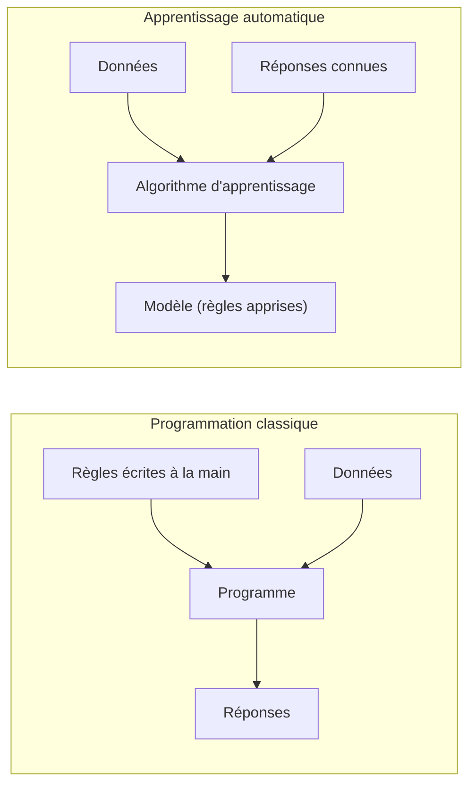
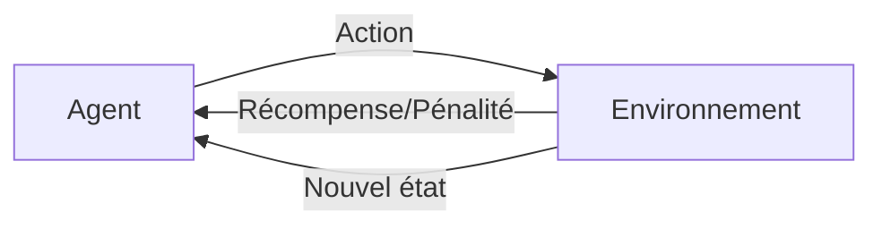

## Introduction

Ce cours approfondit les algorithmes de machine learning déjà rencontrés de façon appliquée au cours Data Science Complète — il ne s'agit plus seulement de savoir QUAND utiliser un algorithme, mais de comprendre PRÉCISÉMENT comment chacun fonctionne mathématiquement, en s'appuyant sur le socle du cours Algèbre Linéaire.

Pourquoi est-ce utile à quelqu'un qui travaille en cybersécurité ? Parce que le machine learning est désormais partout dans les outils de défense : les EDR classent des processus, les passerelles email notent des messages, les SIEM modernes scorent des comportements d'utilisateurs, et les produits de détection réseau cherchent des anomalies dans les flux. Un analyste qui comprend ces algorithmes sait pourquoi un outil produit trop de faux positifs, comment un attaquant peut le contourner, et quand un fournisseur promet l'impossible. Il peut aussi construire ses propres modèles quand aucun produit ne répond à son besoin.

À la fin de ce chapitre, tu sauras définir précisément ce qu'est un problème d'apprentissage, distinguer les grands paradigmes et leurs variantes, expliquer le fonctionnement d'un agent qui apprend par renforcement, et comprendre pourquoi aucun algorithme n'est le meilleur partout. Ces notions serviront de cadre à tous les chapitres suivants.

## Ce qu'apprendre veut dire pour une machine

### Programmer ou apprendre

En programmation classique, un humain écrit les règles : « si l'email contient plus de cinq liens et provient d'un domaine créé il y a moins de trente jours, alors c'est suspect ». Le programme applique ces règles aux données et produit une réponse. En apprentissage automatique, on inverse la démarche : on fournit des données et, selon le paradigme, les réponses attendues, et c'est l'algorithme qui produit les règles, sous la forme d'un modèle.



Les règles écrites à la main restent excellentes quand le phénomène est bien compris et stable, comme une signature YARA pour une famille de malware connue. L'apprentissage devient intéressant quand les règles sont trop nombreuses, trop subtiles ou trop changeantes pour être écrites par un humain.

### La définition de Tom Mitchell

Une définition formelle, proposée par Tom Mitchell en 1997, reste la référence : un programme apprend de l'expérience E, pour une tâche T et une mesure de performance P, si sa performance sur T, mesurée par P, s'améliore avec l'expérience E. Appliquée à un filtre anti-phishing : la tâche T consiste à classer des emails, l'expérience E est un ensemble d'emails déjà étiquetés par des analystes, et la performance P peut être le rappel sur la classe phishing. Cette définition oblige à expliciter les trois éléments, et beaucoup de projets échouent parce que l'un d'eux est flou, le plus souvent la mesure de performance.

### Les ingrédients d'un problème d'apprentissage

Tout algorithme d'apprentissage combine trois choix. Le premier est l'espace d'hypothèses : la famille de fonctions parmi lesquelles le modèle est cherché, par exemple toutes les droites, ou tous les arbres de profondeur 5. Le deuxième est la fonction de perte : une formule qui mesure l'erreur d'une hypothèse sur les données, comme l'erreur quadratique moyenne que tu verras au chapitre 2. Le troisième est l'algorithme d'optimisation : la méthode pour trouver, dans l'espace d'hypothèses, celle qui minimise la perte, comme la descente de gradient. Chaque chapitre de ce cours décrira un algorithme à travers ces trois choix.

## Rappel et complément des paradigmes d'apprentissage

<CompareTable
  titleA="Paradigme"
  titleB="Principe (rappel et complément du cours Data Science Complète)"
  rows={[
    { a: "Supervisé (ch.5 Data Science Complète)", b: "Apprend à partir d'exemples déjà étiquetés" },
    { a: "Non supervisé (ch.6 Data Science Complète)", b: "Cherche des motifs sans étiquettes préalables" },
    { a: "Par renforcement (nouveau)", b: "Un agent apprend par essai-erreur, en recevant une récompense ou une pénalité selon ses actions" },
]}
/>

### L'apprentissage supervisé

Les données se présentent sous forme de paires (x, y) : x est un vecteur de caractéristiques, y la réponse attendue, appelée étiquette. L'objectif est d'apprendre une fonction f telle que f(x) soit proche de y, y compris pour de nouveaux x jamais vus. Quand y est une catégorie, on parle de classification : classer un email en phishing ou légitime à partir d'exemples déjà étiquetés est l'exemple type. Quand y est une valeur continue, on parle de régression : prédire le volume de trafic de demain ou le temps de résolution d'un incident.

La difficulté principale en sécurité est le coût des étiquettes : il faut des analystes pour décider si chaque alerte était vraie ou fausse, et les attaques réelles sont rares.

### L'apprentissage non supervisé

Les données ne comportent que des x, sans étiquette. L'algorithme cherche une structure : des groupes d'exemples similaires (clustering), des points qui ne ressemblent à rien d'autre (détection d'anomalies), ou une représentation plus compacte (réduction de dimension). Regrouper des malwares similaires sans disposer d'étiquettes préalables, par exemple à partir de leurs appels système, relève de ce paradigme. Les chapitres 5 et 6 lui sont consacrés.

### Les paradigmes intermédiaires

Entre ces deux pôles, deux variantes comptent beaucoup aujourd'hui. L'apprentissage semi-supervisé combine un petit nombre d'exemples étiquetés et une grande masse de données non étiquetées, une situation très fréquente en SOC, où seule une fraction des alertes est revue par un humain. L'apprentissage auto-supervisé fabrique ses propres étiquettes à partir des données : par exemple, masquer un mot d'une phrase et apprendre à le deviner. C'est ainsi que sont pré-entraînés les grands modèles de langage, sujet du cours Deep Learning.

## L'apprentissage par renforcement

<CehCallout>
Rappel du cours IA & Agents en Cybersécurité (chapitre 4) : un agent qui apprend par renforcement explore un environnement, reçoit une récompense (positive ou négative) après chaque action, et ajuste progressivement sa stratégie pour maximiser la récompense cumulée sur le long terme — un paradigme totalement différent du supervisé, où aucune "bonne réponse" n'est fournie à l'avance.
</CehCallout>



### Le vocabulaire du renforcement

Le schéma ci-dessus se formalise avec quelques termes précis. L'état s décrit la situation observée par l'agent à un instant donné. L'action a est le choix que fait l'agent dans cet état. La récompense r est le signal numérique renvoyé par l'environnement après l'action : positif si l'action était bonne, négatif sinon. L'environnement renvoie aussi un nouvel état. La politique π est la stratégie de l'agent, la règle qui associe une action à chaque état ; c'est elle que l'on cherche à apprendre.

L'agent ne cherche pas la meilleure récompense immédiate, mais la récompense cumulée sur le long terme. On pondère les récompenses futures par un facteur d'actualisation γ (gamma), compris entre 0 et 1 : le retour vaut r0 + γ × r1 + γ² × r2 + ..., et plus γ est petit, plus l'agent privilégie le court terme.

Un dilemme central est celui de l'exploration et de l'exploitation. Exploiter, c'est choisir l'action qui semble la meilleure d'après ce qu'on sait ; explorer, c'est essayer une autre action pour en apprendre davantage. Un agent qui n'explore jamais peut rester bloqué sur une stratégie médiocre. La stratégie ε-greedy (epsilon-gourmande) résout simplement ce dilemme : avec une probabilité ε, par exemple 10 %, l'agent choisit une action au hasard ; sinon, il choisit la meilleure action connue.

### Un exemple chiffré : apprendre une politique de réponse aux alertes

Imaginons un agent de défense qui reçoit des alertes de trois niveaux, faible, moyen ou critique, et peut répondre de trois façons : ignorer, analyser ou isoler la machine. L'agent ne connaît pas les conséquences de ses actions ; il les découvre par les récompenses. Isoler une machine pour une alerte faible coûte cher (interruption d'activité), ignorer une alerte critique coûte très cher. L'agent estime une valeur Q(s, a) pour chaque couple état-action, et la met à jour après chaque essai :

```text
Q(s, a) ← Q(s, a) + α × (r − Q(s, a))
```

Le taux d'apprentissage α (alpha) règle la vitesse à laquelle l'estimation suit les nouvelles récompenses. Pas à pas : si Q(critique, isoler) vaut 0 et que l'agent reçoit une récompense de 8 avec α = 0,1, la nouvelle valeur est 0 + 0,1 × (8 − 0) = 0,8. Au fil des essais, Q converge vers la récompense moyenne de chaque action. Ce cas particulier, où chaque décision est indépendante de la suivante, s'appelle un bandit contextuel ; l'algorithme de Q-learning complet ajoute à r le terme γ × max Q(s', a'), la valeur du meilleur choix dans l'état suivant s'.

```python
import numpy as np

rng = np.random.default_rng(0)
niveaux = ["faible", "moyen", "critique"]
actions = ["ignorer", "analyser", "isoler"]
# Récompense moyenne de chaque action (inconnue de l'agent) : lignes = niveau, colonnes = action
R = np.array([[ 1.0, -0.5, -5.0],
              [-3.0,  2.0,  0.5],
              [-10.0, 1.0,  8.0]])

Q = np.zeros((3, 3))
alpha, epsilon = 0.1, 0.1
for episode in range(5000):
    s = rng.integers(3)                                   # une alerte arrive
    if rng.random() < epsilon:
        a = rng.integers(3)                               # exploration
    else:
        a = int(Q[s].argmax())                            # exploitation
    r = R[s, a] + rng.normal(0, 2)                        # récompense bruitée
    Q[s, a] += alpha * (r - Q[s, a])                      # mise à jour

print(Q.round(1))
for s in range(3):
    print(niveaux[s], "->", actions[Q[s].argmax()])
```

```text
[[ 1.1 -0.5 -5.2]
 [-4.   1.5  0.1]
 [-9.8  0.7  8.3]]
faible -> ignorer
moyen -> analyser
critique -> isoler
```

Sans qu'aucune bonne réponse ne lui ait été fournie, l'agent a appris une politique raisonnable : ignorer les alertes faibles, analyser les moyennes, isoler les critiques. Les valeurs Q sont proches des récompenses moyennes réelles, à l'exception de quelques cases peu explorées.

<TipCallout>
L'apprentissage par renforcement est notamment utilisé pour entraîner des agents capables de jouer à des jeux complexes ou d'optimiser des décisions séquentielles — un principe qui rejoint conceptuellement le cycle observation-décision-action des agents IA déjà étudié, mais où l'apprentissage lui-même se fait par cette boucle de récompense.
</TipCallout>

En cybersécurité, le renforcement sert surtout dans la recherche et la simulation : des agents qui apprennent à optimiser une stratégie de défense réseau par essais successifs, récompensés quand ils bloquent une attaque, ou des agents attaquants automatisés dans des environnements simulés. Le cadre CybORG ou le projet CyberBattleSim de Microsoft en sont des exemples. Son usage en production reste limité : il faut un environnement sûr où l'agent peut se tromper des milliers de fois, et une fonction de récompense mal conçue produit des comportements absurdes, comme un agent qui isole tout le réseau pour ne plus jamais être attaqué.

## Généraliser : le vrai objectif

### Apprendre n'est pas mémoriser

Un modèle n'a de valeur que s'il fonctionne sur des données qu'il n'a jamais vues : c'est la généralisation. Un modèle qui mémorise ses exemples d'entraînement, bruit compris, obtient un score parfait à l'entraînement et décevant en production : c'est le surapprentissage (overfitting). À l'inverse, un modèle trop simple pour capturer la structure des données se trompe partout : c'est le sous-apprentissage (underfitting).

### Le compromis biais-variance

L'erreur d'un modèle sur de nouvelles données se décompose en trois parts. Le biais est l'erreur due à des hypothèses trop simplistes : une droite ne peut pas représenter une frontière courbe, quelle que soit la quantité de données. La variance est la sensibilité du modèle aux particularités de l'échantillon d'entraînement : un arbre très profond change complètement si l'on retire quelques exemples. Le bruit irréductible est la part d'aléa que nul modèle ne peut prédire.

| Situation | Score d'entraînement | Score de test | Diagnostic | Remèdes |
| --- | --- | --- | --- | --- |
| Sous-apprentissage | Faible | Faible | Biais élevé | Modèle plus riche, meilleures caractéristiques |
| Bon ajustement | Bon | Proche de l'entraînement | Équilibre | Conserver, surveiller |
| Surapprentissage | Très élevé | Nettement plus faible | Variance élevée | Plus de données, régularisation, modèle plus simple, ensembles |

Ce compromis reviendra à chaque chapitre : la régularisation au chapitre 2, la profondeur des arbres et les forêts au chapitre 3, le choix de k au chapitre 4.

### Pas de repas gratuit

Le théorème « no free lunch », formulé par David Wolpert dans les années 1990, affirme qu'en moyenne sur tous les problèmes possibles, aucun algorithme d'apprentissage n'est meilleur qu'un autre. En pratique, cela signifie qu'un algorithme est performant parce que ses hypothèses, son biais inductif, correspondent à la structure du problème : le k-NN suppose que des points proches ont la même classe, la régression linéaire suppose une relation linéaire. C'est précisément pourquoi il faut comprendre les algorithmes en détail : pour choisir celui dont les hypothèses collent à tes données.

## Pourquoi approfondir maintenant, après la data science appliquée

<CehCallout>
Rappel du cours Python pour la Data Science (chapitre 7) : scikit-learn permet d'entraîner un modèle en quelques lignes (`.fit()`, `.predict()`) sans connaître le détail mathématique sous-jacent — ce cours ouvre précisément cette "boîte noire" pratique, pour comprendre pourquoi et comment chaque algorithme fonctionne, une compétence qui permet d'ajuster finement un modèle plutôt que de simplement l'utiliser par défaut.
</CehCallout>

Les réglages par défaut de scikit-learn sont raisonnables, mais rarement optimaux pour un problème donné. Savoir que la régression logistique est régularisée par défaut, que le k-NN exige des données normalisées, ou que DBSCAN dépend d'un rayon de voisinage, c'est la différence entre un modèle médiocre et un modèle utile.

## Le machine learning en cybersécurité : panorama

<AttackDefenseTable rows={[
  { phase: "Supervisé : classification", attack: "Phishing (T1566), malwares connus, domaines malveillants", defense: "Classifieurs entraînés sur des exemples étiquetés : emails, exécutables, URL, domaines DGA" },
  { phase: "Non supervisé : anomalies", attack: "Comptes compromis utilisés normalement en apparence (T1078), exfiltration discrète", defense: "Modèles de comportement normal par utilisateur ou hôte (UEBA), détection d'écarts" },
  { phase: "Non supervisé : clustering", attack: "Variantes multiples d'une même famille de malware, campagnes coordonnées", defense: "Regroupement par similarité pour trier et prioriser l'analyse" },
  { phase: "Renforcement", attack: "Attaques automatisées qui s'adaptent aux défenses", defense: "Simulation et entraînement d'agents de défense dans des environnements contrôlés" },
  { phase: "Attaques contre le ML", attack: "Évasion, empoisonnement des données d'entraînement, vol de modèle (MITRE ATLAS)", defense: "Validation des données, surveillance des performances, défense en profondeur sans dépendre d'un seul modèle" },
]} />

<LegalCallout>
Le règlement européen sur l'intelligence artificielle (AI Act), entré en vigueur en août 2024, s'applique progressivement. Les systèmes d'IA à haut risque sont soumis à des exigences de gestion des risques, de qualité des données, de documentation et de cybersécurité, avec notamment une obligation de robustesse face aux tentatives de manipulation. Un modèle de détection utilisé pour surveiller des salariés relève aussi du RGPD.
</LegalCallout>

## Ce que ce cours réutilise du parcours Nyx

<Steps steps={[
  { title: "Algèbre Linéaire", description: "Vecteurs, matrices, produit scalaire — le langage mathématique de chaque algorithme détaillé dans ce cours." },
  { title: "Mathématiques Appliquées", description: "Probabilités et statistiques, nécessaires pour comprendre les fondements de nombreux algorithmes." },
  { title: "Data Science Complète", description: "Le cadre méthodologique général (cycle de vie, évaluation) dans lequel s'insère chaque algorithme approfondi ici." },
]} />

## Erreurs fréquentes

- **Choisir l'algorithme avant d'avoir défini la tâche, l'expérience et la mesure de performance** : un modèle qui optimise la mauvaise métrique est inutile, quelle que soit sa sophistication.
- **Utiliser du supervisé sans étiquettes fiables** : un modèle apprend les erreurs de ses étiquettes aussi bien que le reste.
- **Croire que le non supervisé trouve « les attaques »** : il trouve ce qui est rare ou différent, ce qui n'est pas toujours malveillant.
- **Juger un modèle sur son score d'entraînement** : seul le score sur des données jamais vues mesure la généralisation.
- **Concevoir une récompense naïve en renforcement** : l'agent optimise exactement ce qu'on lui demande, y compris les effets de bord indésirables.
- **Lire les numéros de groupes d'un clustering comme des étiquettes** : le groupe 0 d'un k-means n'a aucun lien avec la classe 0.

## Lab — Mise en pratique

**Environnement** : Python 3.12 ou plus récent avec scikit-learn et NumPy (terminal Nyx Shell ou environnement local).

<Steps steps={[
  { title: "Créer un petit jeu de données étiqueté", description: "Construis manuellement un jeu de données jouet (points 2D + étiquette connue) qui servira aux deux paradigmes comparés ci-dessous.", code: "import numpy as np\nX = np.array([[1, 2], [1.5, 1.8], [5, 8], [8, 8], [1, 0.6], [9, 11]])\ny = np.array([0, 0, 1, 1, 0, 1])  # etiquettes connues (paradigme supervise)" },
  { title: "Apprendre à partir des étiquettes (supervisé)", description: "Entraîne un classifieur qui utilise directement les étiquettes y — rappel du cours Python pour la Data Science (chapitre 7).", code: "from sklearn.linear_model import LogisticRegression\nclf = LogisticRegression().fit(X, y)\nprint('predictions supervisees:', clf.predict(X))" },
  { title: "Découvrir une structure sans étiquette (non supervisé)", description: "Sur les mêmes points, exécute un clustering qui ne reçoit jamais y — il doit retrouver une structure similaire par lui-même. Observe que les numéros de groupes peuvent être inversés par rapport à y.", code: "from sklearn.cluster import KMeans\nkm = KMeans(n_clusters=2, n_init=10, random_state=0).fit(X)\nprint('groupes non supervises:', km.labels_)" },
  { title: "Comparer les deux paradigmes", description: "Compare les résultats des deux étapes précédentes : le modèle supervisé a appris de y, le clustering a dû redécouvrir une structure proche sans jamais le voir. L'indice de Rand ajusté (ARI) mesure l'accord entre deux partitions indépendamment des numéros de groupes : il vaut 1 ici malgré des numéros inversés. Explique en une phrase pourquoi l'apprentissage par renforcement (un troisième paradigme) ne peut être illustré par aucun des deux blocs de code ci-dessus.", code: "from sklearn.metrics import accuracy_score, adjusted_rand_score\nprint('accuracy supervise:', accuracy_score(y, clf.predict(X)))\nprint('accord non supervise (ARI):', adjusted_rand_score(y, km.labels_))" },
  { title: "Implémenter l'agent par renforcement", description: "Recopie l'agent de réponse aux alertes du chapitre et vérifie qu'il apprend la politique ignorer, analyser, isoler.", code: "rng = np.random.default_rng(0)\nR = np.array([[1.0, -0.5, -5.0], [-3.0, 2.0, 0.5], [-10.0, 1.0, 8.0]])\nQ = np.zeros((3, 3))\nalpha, epsilon = 0.1, 0.1\nfor _ in range(5000):\n    s = rng.integers(3)\n    a = rng.integers(3) if rng.random() < epsilon else int(Q[s].argmax())\n    r = R[s, a] + rng.normal(0, 2)\n    Q[s, a] += alpha * (r - Q[s, a])\nprint(Q.round(1))\nprint(Q.argmax(axis=1))" },
  { title: "Supprimer l'exploration", description: "Relance l'agent avec epsilon = 0, puis 0.5. Sans exploration, la politique finale peut sembler correcte, mais regarde les valeurs : ignorer une alerte critique est estimé à environ -0,9 au lieu de -10. L'agent n'a presque jamais essayé les autres actions et ne les a écartées que grâce au bruit des récompenses. Avec ε = 0,5, toutes les estimations sont proches des vraies valeurs.", code: "for eps in [0.0, 0.5]:\n    rng = np.random.default_rng(0)\n    Q = np.zeros((3, 3))\n    for _ in range(5000):\n        s = rng.integers(3)\n        a = rng.integers(3) if rng.random() < eps else int(Q[s].argmax())\n        Q[s, a] += 0.1 * (R[s, a] + rng.normal(0, 2) - Q[s, a])\n    print(eps, Q.argmax(axis=1), Q.round(1).tolist())" },
  { title: "Observer le surapprentissage", description: "Entraîne un arbre de décision sans limite de profondeur sur des données bruitées, puis compare ses scores d'entraînement et de test à ceux d'un arbre de profondeur 3.", code: "from sklearn.datasets import make_classification\nfrom sklearn.model_selection import train_test_split\nfrom sklearn.tree import DecisionTreeClassifier\nXc, yc = make_classification(n_samples=600, n_features=10, flip_y=0.15, random_state=0)\nXtr, Xte, ytr, yte = train_test_split(Xc, yc, random_state=0)\nfor prof in [None, 3]:\n    arbre = DecisionTreeClassifier(max_depth=prof, random_state=0).fit(Xtr, ytr)\n    print(prof, round(arbre.score(Xtr, ytr), 2), round(arbre.score(Xte, yte), 2))" },
]} />

## À retenir

- Ce cours approfondit mathématiquement les algorithmes de machine learning déjà rencontrés de façon appliquée au cours Data Science Complète.
- Un problème d'apprentissage se définit par une tâche, une expérience et une mesure de performance ; un algorithme se définit par un espace d'hypothèses, une fonction de perte et une méthode d'optimisation.
- Le supervisé apprend à partir d'exemples étiquetés (classification ou régression), le non supervisé cherche une structure sans étiquettes, et le semi-supervisé comme l'auto-supervisé occupent l'entre-deux.
- L'apprentissage par renforcement, un troisième paradigme, apprend par essai-erreur via une boucle de récompense : l'agent reçoit une récompense ou une pénalité et un nouvel état après chaque action, sans exemples étiquetés ni motifs à découvrir directement.
- L'objectif est la généralisation ; le compromis biais-variance explique le sous-apprentissage et le surapprentissage.
- Aucun algorithme n'est le meilleur partout : comprendre le détail mathématique d'un algorithme permet de l'ajuster finement, au-delà de son usage par défaut via une bibliothèque comme scikit-learn.

## Questions de révision

1. Quelle est la différence fondamentale entre l'apprentissage par renforcement et l'apprentissage supervisé ?
2. Pourquoi ce cours choisit-il d'approfondir mathématiquement des algorithmes déjà utilisés de façon appliquée précédemment ?
3. Quels cours Nyx fournissent le socle mathématique mobilisé tout au long de ce cours ?
4. Applique la définition de Mitchell à un modèle de détection de domaines DGA : quelles sont la tâche, l'expérience et la mesure de performance ?
5. Avec α = 0,1, Q(s, a) = 2 et une récompense r = −3, quelle est la nouvelle valeur de Q(s, a) ? Que se passerait-il avec ε = 0 ?
6. Un modèle obtient 99 % à l'entraînement et 70 % au test : quel est le diagnostic, et quels remèdes proposerais-tu ?
7. Pourquoi l'indice de Rand ajusté convient-il mieux que l'accuracy pour comparer un clustering à des étiquettes connues ?
