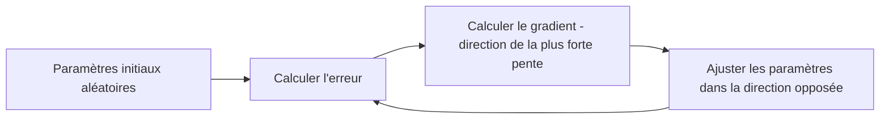

## Introduction

Ce chapitre détaille les deux algorithmes les plus fondamentaux du machine learning supervisé — la régression linéaire pour prédire une valeur continue, la régression logistique pour classer, un socle indispensable avant d'aborder des modèles plus complexes.

Ces modèles ne sont pas de simples exercices scolaires. La régression logistique reste l'un des classifieurs les plus utilisés en production, y compris en sécurité, parce qu'elle est rapide, robuste et surtout interprétable : on peut expliquer à un auditeur pourquoi tel email a été bloqué. La régression linéaire, elle, sert à prévoir une capacité réseau, estimer une volumétrie de logs ou définir une référence de trafic. Et les mécanismes que tu vas voir ici, fonction de coût, descente de gradient, régularisation, sont exactement ceux qui entraînent les réseaux de neurones du cours Deep Learning.

À la fin de ce chapitre, tu sauras calculer à la main une droite de régression, mesurer son erreur, implémenter la descente de gradient en NumPy, expliquer ce que fait la sigmoïde, interpréter les coefficients d'un classifieur de phishing et régler la régularisation.

## La régression linéaire — prédire une valeur continue

<CehCallout>
La régression linéaire cherche la droite (ou l'hyperplan en plusieurs dimensions, rappel du cours Algèbre Linéaire) qui minimise l'écart entre les valeurs prédites et les valeurs réelles observées — une formalisation mathématique précise de "prédire une tendance" déjà pressentie intuitivement au cours Data Science Complète (chapitre 3, sur les nuages de points).
</CehCallout>

```text
Modèle de régression linéaire simple :
y = a*x + b

où a est la pente (l'influence de x sur y) et b l'ordonnée à l'origine.
Avec plusieurs variables (régression multiple) :
y = a1*x1 + a2*x2 + ... + an*xn + b
```

La pente a indique de combien la prédiction augmente quand x augmente d'une unité. L'ordonnée à l'origine b est la prédiction quand x vaut zéro. En régression multiple, chaque coefficient a1 à an représente l'influence de sa variable sur la prédiction, les autres variables étant fixées. En notation vectorielle, on écrit ŷ = w · x + b, où w est le vecteur des coefficients (les poids) et le point désigne le produit scalaire du cours Algèbre Linéaire. Le chapeau sur ŷ indique une valeur prédite, par opposition à la valeur réelle y.

### Un exemple chiffré pas à pas

Une équipe réseau mesure la bande passante consommée en fonction du nombre d'utilisateurs connectés, en centaines :

| Utilisateurs (x, centaines) | 1 | 2 | 3 | 4 | 5 |
| --- | --- | --- | --- | --- | --- |
| Bande passante (y, Mbit/s) | 50 | 55 | 65 | 70 | 80 |

Pour une seule variable, les paramètres optimaux ont une formule exacte, dite des moindres carrés : a = somme de (x − x̄)(y − ȳ) divisée par somme de (x − x̄)², puis b = ȳ − a × x̄, où x̄ et ȳ sont les moyennes. Calculons :

```text
x̄ = (1+2+3+4+5)/5 = 3          ȳ = (50+55+65+70+80)/5 = 64
écarts x − x̄ :  -2   -1    0    1    2
écarts y − ȳ : -14   -9    1    6   16
produits     :  28    9    0    6   32   → somme = 75
carrés x − x̄ :   4    1    0    1    4   → somme = 10

a = 75 / 10 = 7,5        b = 64 − 7,5 × 3 = 41,5
Modèle : bande passante = 7,5 × utilisateurs + 41,5
```

Chaque centaine d'utilisateurs supplémentaire consomme environ 7,5 Mbit/s, et le réseau consomme 41,5 Mbit/s de fond, même sans utilisateur (sauvegardes, mises à jour, supervision). Pour 800 utilisateurs, le modèle prédit 7,5 × 8 + 41,5 = 101,5 Mbit/s. Attention toutefois : prédire si loin des données observées, qui s'arrêtent à 500 utilisateurs, est une extrapolation risquée.

En plusieurs dimensions, la formule généralisée s'appelle l'équation normale : w = (XᵀX)⁻¹ Xᵀy, qui mobilise la transposée et l'inverse du cours Algèbre Linéaire. Elle devient coûteuse quand le nombre de variables est grand, d'où l'intérêt de la descente de gradient.

## La fonction de coût — mesurer l'erreur du modèle

<Steps steps={[
  { title: "Calculer l'erreur pour chaque exemple", description: "La différence entre la valeur prédite et la valeur réelle observée." },
  { title: "Élever au carré et moyenner", description: "Rappel du cours Mathématiques Appliquées (chapitre 6, écart-type) : élever au carré élimine les signes négatifs, la moyenne donne l'erreur quadratique moyenne (MSE)." },
  { title: "Chercher les paramètres qui minimisent cette erreur", description: "L'objectif de l'entraînement : trouver la droite (les valeurs de a et b) qui minimise l'erreur quadratique moyenne sur l'ensemble des exemples." },
]} />

```text
MSE = (1/n) × somme de (yi − ŷi)²
```

Sans le carré, les erreurs positives et négatives se compenseraient : un modèle qui surestime de 10 puis sous-estime de 10 aurait une erreur moyenne nulle. Le carré a un second effet : il pénalise fortement les grosses erreurs, une erreur de 10 comptant cent fois plus qu'une erreur de 1. C'est pourquoi la régression linéaire est sensible aux valeurs aberrantes. Sur notre exemple :

```text
prédictions ŷ : 49   56,5   64   71,5   79
erreurs y − ŷ :  1   -1,5    1   -1,5    1
carrés        :  1   2,25    1   2,25    1   → somme 7,5 → MSE = 7,5 / 5 = 1,5
```

La racine de la MSE, notée RMSE, vaut environ 1,22 Mbit/s et s'exprime dans l'unité de y, ce qui la rend plus parlante. Le coefficient de détermination R² compare enfin la MSE du modèle à celle d'un modèle naïf qui prédirait toujours la moyenne : R² = 1 − somme des carrés des erreurs / somme des carrés des écarts à la moyenne. Ici, R² vaut 0,987 : le modèle explique 98,7 % de la variabilité de la bande passante.

## La descente de gradient — comment le modèle apprend

<CehCallout>
La descente de gradient est l'algorithme qui ajuste progressivement les paramètres du modèle pour minimiser la fonction de coût — à chaque étape, elle calcule dans quelle direction modifier chaque paramètre pour réduire l'erreur, un peu comme descendre une pente en suivant toujours la direction la plus raide vers le bas.
</CehCallout>



### Le gradient de la MSE

Le gradient est le vecteur des dérivées partielles de la fonction de coût par rapport à chaque paramètre. Il pointe dans la direction où le coût augmente le plus vite ; on se déplace donc dans la direction opposée. Pour la MSE d'une régression simple :

```text
∂MSE/∂a = (2/n) × somme de (ŷi − yi) × xi
∂MSE/∂b = (2/n) × somme de (ŷi − yi)

Mise à jour, avec un taux d'apprentissage η (êta) :
a ← a − η × ∂MSE/∂a
b ← b − η × ∂MSE/∂b
```

Partons de a = b = 0 avec η = 0,05. Toutes les prédictions valent 0, donc les erreurs ŷ − y valent −50, −55, −65, −70, −80. Le gradient par rapport à b vaut 2 × (−320) / 5 = −128, et par rapport à a, 2 × (−1 035) / 5 = −414. Les nouveaux paramètres sont a = 0 − 0,05 × (−414) = 20,7 et b = 0 − 0,05 × (−128) = 6,4.

```python
import numpy as np

x = np.array([1, 2, 3, 4, 5], dtype=float)
y = np.array([50, 55, 65, 70, 80], dtype=float)

def descente(lr: float, etapes: int) -> tuple[float, float]:
    a = b = 0.0
    for _ in range(etapes):
        erreur = (a * x + b) - y            # ŷ − y
        a -= lr * 2 * (erreur * x).mean()   # pas dans la direction opposée au gradient
        b -= lr * 2 * erreur.mean()
    return a, b

for lr in [0.001, 0.05, 0.1]:
    a, b = descente(lr, 2000)
    print(f"lr={lr}: a={a:.3f}, b={b:.3f}")
```

```text
lr=0.001: a=12.657, b=22.882
lr=0.05: a=7.500, b=41.500
lr=0.1: a=-185770992345212585635...(diverge), b=-51455586032182077186...(diverge)
```

<TipCallout>
Le "taux d'apprentissage" (learning rate) contrôle la taille de chaque pas de la descente de gradient — trop grand, le modèle peut "sauter" au-delà du minimum sans jamais converger ; trop petit, l'entraînement devient extrêmement lent, un compromis similaire à d'autres paramètres de réglage déjà rencontrés dans le parcours.
</TipCallout>

Les trois résultats illustrent parfaitement ce compromis. Avec η = 0,05, la descente retrouve exactement la solution analytique, a = 7,5 et b = 41,5. Avec η = 0,001, après 2 000 étapes, elle est encore loin du but, avec une MSE de 64,6 au lieu de 1,5 : les pas sont trop petits. Avec η = 0,1, chaque pas dépasse le minimum et rebondit de plus en plus loin : a passe de 41,4 à −15,96 puis à 61,6, et les valeurs finissent par exploser vers l'infini.

### Variantes et mise à l'échelle

La version ci-dessus, qui utilise tous les exemples à chaque pas, s'appelle descente de gradient par lots (batch). La descente de gradient stochastique (SGD) met à jour les paramètres après chaque exemple, ou après un petit lot d'exemples (mini-batch) : chaque pas est plus bruité mais beaucoup moins coûteux, ce qui la rend indispensable sur de gros volumes. C'est la variante utilisée pour entraîner les réseaux de neurones.

La descente de gradient est très sensible à l'échelle des variables : si une variable s'exprime en octets (millions) et une autre en secondes (dizaines), le coût forme une vallée très allongée, et un même taux d'apprentissage est trop grand dans une direction et trop petit dans l'autre. Normaliser les variables, par exemple avec `StandardScaler`, est donc presque obligatoire.

## La régression logistique — de la valeur continue à la classification

<WarningCallout>
Malgré son nom, la régression logistique sert à la classification, pas à la régression au sens strict — elle applique une fonction sigmoïde au résultat d'une régression linéaire pour obtenir une probabilité entre 0 et 1 (par exemple, la probabilité qu'un email soit du phishing), puis classe selon un seuil (généralement 0,5).
</WarningCallout>

```text
Régression logistique :
probabilité = 1 / (1 + e^-(a*x + b))

Si probabilité > 0.5 → classe 1 (ex : phishing)
Sinon → classe 0 (ex : légitime)
```

### La fonction sigmoïde

La sigmoïde σ(z) = 1 / (1 + e^−z) transforme n'importe quel nombre réel z en une valeur strictement comprise entre 0 et 1. Quelques valeurs repères : σ(−4) ≈ 0,018, σ(0) = 0,5, σ(1,386) ≈ 0,8 et σ(4) ≈ 0,982. Le score linéaire z = w · x + b est donc converti en probabilité. Si un email obtient une probabilité de 0,8, il est classé en classe 1, phishing, puisque 0,8 dépasse le seuil de 0,5. Le seuil 0,5 correspond exactement à z = 0 : la frontière de décision est l'ensemble des points où w · x + b = 0, c'est-à-dire un hyperplan. La régression logistique est donc un classifieur linéaire.

### Pourquoi ne pas utiliser la MSE : la log-loss

Pour la classification, on n'entraîne pas la régression logistique avec la MSE, car combinée à la sigmoïde elle produit une fonction de coût non convexe, pleine de minima locaux. On utilise l'entropie croisée binaire, ou log-loss :

```text
log-loss = −(1/n) × somme de [ yi × log(pi) + (1 − yi) × log(1 − pi) ]
```

Pour un vrai phishing (y = 1), seul le terme −log(p) compte. Si le modèle annonce p = 0,9, la perte vaut 0,105 ; s'il annonce 0,6, elle vaut 0,511 ; s'il annonce 0,1, elle grimpe à 2,303. La log-loss punit donc sévèrement les erreurs commises avec assurance. Elle est convexe pour la régression logistique, ce qui garantit que la descente de gradient trouve le minimum global.

### Interpréter les coefficients : les cotes

La quantité p / (1 − p) s'appelle la cote (odds) : une probabilité de 0,8 correspond à une cote de 4 contre 1. La régression logistique modélise le logarithme de la cote comme une fonction linéaire : log(p / (1 − p)) = w · x + b. Conséquence pratique : quand une variable augmente d'une unité, la cote est multipliée par e^w. Entraînons une régression logistique sur le jeu d'emails du cours Python pour la Data Science (chapitre 7) :

```python
import numpy as np
import pandas as pd
from sklearn.linear_model import LogisticRegression
from sklearn.model_selection import train_test_split

df = pd.read_csv("emails.csv")
cols = ["nb_liens", "contient_urgence", "domaine_recent", "nb_fautes"]
X_train, X_test, y_train, y_test = train_test_split(
    df[cols], df["est_phishing"], test_size=0.25, random_state=42, stratify=df["est_phishing"])

modele = LogisticRegression().fit(X_train, y_train)
for col, w in zip(cols, modele.coef_[0]):
    print(f"{col:<18} {w:+.3f}  cote x{np.exp(w):.2f}")
print("intercept", modele.intercept_.round(3))
```

```text
nb_liens           +0.845  cote x2.33
contient_urgence   +3.219  cote x25.01
domaine_recent     +3.217  cote x24.95
nb_fautes          +1.381  cote x3.98
intercept [-9.859]
```

Lecture : chaque lien supplémentaire multiplie la cote d'être un phishing par 2,33 ; la présence d'une formule d'urgence la multiplie par 25, toutes choses égales par ailleurs. Pour un email avec 6 liens, une urgence, un domaine récent et 3 fautes, le score vaut z = −9,859 + 6 × 0,845 + 3,219 + 3,217 + 3 × 1,381 ≈ 5,79, soit une probabilité σ(5,79) ≈ 0,997. Cette lisibilité est un atout considérable pour justifier une décision de blocage auprès d'un utilisateur, d'un juriste ou d'un auditeur.

## La régularisation — limiter le surapprentissage

Avec beaucoup de variables, un modèle linéaire peut surapprendre en donnant des poids énormes à des variables qui collent au bruit. La régularisation ajoute à la fonction de coût une pénalité sur la taille des poids.

<CompareTable
  titleA="Régularisation L2 (Ridge)"
  titleB="Régularisation L1 (Lasso)"
  rows={[
    { a: "Pénalité : somme des carrés des poids", b: "Pénalité : somme des valeurs absolues des poids" },
    { a: "Réduit tous les poids sans les annuler", b: "Annule certains poids : sélection automatique de variables" },
    { a: "Stable quand les variables sont corrélées", b: "Utile pour obtenir un modèle parcimonieux et lisible" },
    { a: "Ridge, LogisticRegression(penalty=\"l2\")", b: "Lasso, LogisticRegression(penalty=\"l1\", solver=\"liblinear\")" },
]}
/>

Point important dans scikit-learn : `LogisticRegression` est régularisée par défaut (L2), et la force de la régularisation se règle avec `C`, l'inverse de la pénalité. Un petit `C` régularise fortement, un grand `C` presque pas. Sur des données parfaitement séparables, comme notre exemple de bande passante transformé en « au-dessus ou en dessous de 65 Mbit/s », un modèle non régularisé pousse ses poids vers l'infini pour atteindre des probabilités de 0 ou 1. Avec `C=1.0`, les probabilités restent nuancées (0,18, 0,39, 0,65, 0,84, 0,94) ; avec `C=1e6`, elles deviennent quasi binaires (0, 0,001, 0,999, 1, 1). Les modèles linéaires `Ridge` et `Lasso`, eux, utilisent un paramètre `alpha` où, à l'inverse, une valeur plus grande signifie plus de régularisation.

## Applications et angle sécurité

<AttackDefenseTable rows={[
  { phase: "Classification d'emails", attack: "Phishing (T1566) optimisé pour paraître légitime", defense: "Régression logistique interprétable : chaque blocage s'explique par des coefficients et des cotes" },
  { phase: "Évasion d'un modèle linéaire", attack: "Un modèle linéaire est prévisible : l'attaquant réduit les caractéristiques aux poids les plus forts (urgence, domaine récent)", defense: "Ne pas dépendre d'un seul modèle, ajouter des caractéristiques coûteuses à falsifier (réputation, historique d'envoi)" },
  { phase: "Référence de trafic", attack: "Exfiltration qui gonfle progressivement la bande passante", defense: "Régression du trafic attendu selon l'activité, alerte quand l'écart à la prédiction (le résidu) dépasse plusieurs RMSE" },
]} />

## Erreurs fréquentes

- **Oublier de normaliser** avant une descente de gradient ou une régression régularisée : la convergence ralentit et la pénalité frappe inégalement les variables.
- **Choisir un taux d'apprentissage au hasard** : trop grand, la perte diverge ; trop petit, elle stagne. Trace la courbe de la perte au fil des itérations.
- **Extrapoler loin des données observées** : une droite valable entre 100 et 500 utilisateurs n'a aucune garantie au-delà.
- **Utiliser la régression linéaire pour classer** : ses prédictions sortent de l'intervalle 0 à 1 et ne sont pas des probabilités.
- **Ignorer la régularisation par défaut** de `LogisticRegression` : comparer des coefficients obtenus avec des `C` différents n'a pas de sens.
- **Interpréter les coefficients de variables non normalisées ou corrélées** comme des importances absolues.

## Lab — Mise en pratique

**Environnement** : Python 3.12 ou plus récent avec scikit-learn et NumPy (terminal Nyx Shell ou environnement local).

<Steps steps={[
  { title: "Préparer un petit jeu de données", description: "Construis le jeu de données du chapitre : x représente le nombre d'utilisateurs connectés (en centaines) et y la bande passante consommée en Mbit/s.", code: "import numpy as np\nX = np.array([[1], [2], [3], [4], [5]])\ny = np.array([50, 55, 65, 70, 80])" },
  { title: "Entraîner une régression linéaire avec scikit-learn", description: "Rappel du cours Python pour la Data Science (chapitre 7) : entraîne un modèle LinearRegression et lis les paramètres a et b appris, au sens de y = a*x + b. Vérifie que tu retrouves a = 7,5 et b = 41,5, comme dans le calcul à la main, et un R² de 0,987.", code: "from sklearn.linear_model import LinearRegression\nreg = LinearRegression().fit(X, y)\nprint('a (pente):', reg.coef_[0])\nprint('b (intercept):', reg.intercept_)\nprint('R2:', reg.score(X, y))\nprint('MSE:', ((reg.predict(X) - y) ** 2).mean())" },
  { title: "Implémenter la descente de gradient", description: "Écris la descente de gradient en NumPy et teste trois taux d'apprentissage. Observe la convergence avec 0,05, la lenteur avec 0,001 et la divergence avec 0,1.", code: "x, yf = X.ravel().astype(float), y.astype(float)\nfor lr in [0.001, 0.05, 0.1]:\n    a = b = 0.0\n    for _ in range(2000):\n        err = a * x + b - yf\n        a -= lr * 2 * (err * x).mean()\n        b -= lr * 2 * err.mean()\n    print(lr, a, b)" },
  { title: "Passer à la régression logistique", description: "Transforme le problème en classification binaire (bande passante >= 65 Mbit/s -> charge élevée) et entraîne une LogisticRegression pour obtenir une probabilité de charge élevée, au sens de la fonction sigmoïde vue plus haut. Compare ensuite avec C = 1e6.", code: "from sklearn.linear_model import LogisticRegression\ny_classe = (y >= 65).astype(int)\nfor C in [1.0, 1e6]:\n    clf = LogisticRegression(C=C).fit(X, y_classe)\n    print('C =', C, 'probabilites:', clf.predict_proba(X)[:, 1].round(3))" },
  { title: "Observer l'effet du taux d'apprentissage", description: "Entraîne un SGDRegressor avec un taux d'apprentissage très petit puis très grand, et compare les coefficients obtenus pour constater qu'un taux trop élevé déstabilise la convergence. Le petit taux déclenche un avertissement de non-convergence ; le grand produit des coefficients de l'ordre de 10 puissance 12.", code: "from sklearn.linear_model import SGDRegressor\nfor lr in [0.001, 1.0]:\n    sgd = SGDRegressor(eta0=lr, learning_rate='constant', max_iter=50, random_state=0).fit(X, y)\n    print('eta0=', lr, '-> coef:', sgd.coef_, 'intercept:', sgd.intercept_)" },
  { title: "Interpréter un classifieur de phishing", description: "Avec le fichier emails.csv du cours Python pour la Data Science, entraîne une régression logistique et affiche, pour chaque caractéristique, le coefficient et le facteur multiplicatif de la cote. Identifie les deux caractéristiques les plus influentes.", code: "import pandas as pd\nfrom sklearn.model_selection import train_test_split\ndf = pd.read_csv('emails.csv')\ncols = ['nb_liens', 'contient_urgence', 'domaine_recent', 'nb_fautes']\nXtr, Xte, ytr, yte = train_test_split(df[cols], df['est_phishing'], test_size=0.25, random_state=42, stratify=df['est_phishing'])\nm = LogisticRegression().fit(Xtr, ytr)\nfor c, w in zip(cols, m.coef_[0]):\n    print(c, round(w, 3), round(np.exp(w), 2))" },
  { title: "Calculer la log-loss", description: "Calcule la log-loss du modèle sur le jeu de test, puis à la main pour un phishing prédit avec p = 0,9, 0,6 et 0,1. Constate la forte pénalité des erreurs commises avec assurance.", code: "from sklearn.metrics import log_loss\nprint(log_loss(yte, m.predict_proba(Xte)))\nprint(-np.log([0.9, 0.6, 0.1]))" },
]} />

## À retenir

- La régression linéaire modélise y = a × x + b (ou w · x + b en plusieurs dimensions) et cherche les paramètres qui minimisent l'erreur quadratique moyenne entre valeurs prédites et réelles.
- Le carré de la MSE élimine les signes et pénalise fortement les grosses erreurs ; le R² compare le modèle à une prédiction constante par la moyenne.
- La descente de gradient ajuste progressivement ces paramètres dans la direction opposée au gradient ; un taux d'apprentissage trop grand fait diverger, un taux trop petit ralentit fortement la convergence.
- La régression logistique applique une fonction sigmoïde pour transformer une régression linéaire en probabilité de classification, avec un seuil généralement fixé à 0,5.
- Elle s'entraîne avec la log-loss, et ses coefficients s'interprètent comme des facteurs multiplicatifs de la cote, ce qui la rend précieuse quand une décision doit être justifiée.
- La régularisation L2 réduit les poids et la L1 en annule certains ; dans `LogisticRegression`, un petit `C` signifie une forte régularisation.

## Questions de révision

1. Que cherche à minimiser l'entraînement d'une régression linéaire, et pourquoi élève-t-on les erreurs au carré ?
2. Comment la descente de gradient ajuste-t-elle les paramètres d'un modèle à chaque étape ?
3. Pourquoi la régression logistique, malgré son nom, sert-elle à la classification plutôt qu'à la régression au sens strict ?
4. Calcule à la main la pente et l'ordonnée à l'origine de la droite passant au mieux par les points (1, 2), (2, 4) et (3, 5).
5. Qu'observe-t-on avec un taux d'apprentissage trop élevé, et avec un taux trop faible ?
6. Un coefficient logistique vaut 0,7 pour la variable « pièce jointe exécutable ». Comment interpréter cette valeur ?
7. Quelle différence pratique y a-t-il entre la régularisation L1 et la régularisation L2 ?
