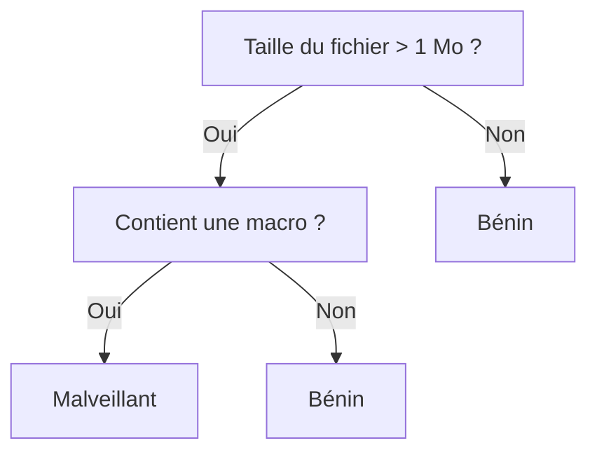
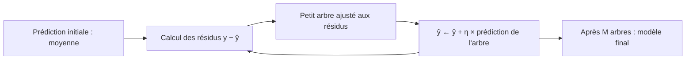

## Introduction

Ce chapitre détaille les arbres de décision et les méthodes d'ensemble qui les combinent — des algorithmes parmi les plus utilisés en pratique, y compris pour la détection d'anomalies en cybersécurité, déjà mentionnés sans détail au cours Data Science Complète (chapitre 5).

Sur des données tabulaires, c'est-à-dire des tableaux de caractéristiques comme des logs, des métadonnées de fichiers ou des statistiques de flux réseau, les ensembles d'arbres restent en 2026 la référence à battre, souvent devant les réseaux de neurones. Les détecteurs de malware statiques fondés sur les caractéristiques d'un exécutable (taille des sections, imports, entropie), les modèles de scoring d'alertes et de nombreuses briques de produits EDR ou NDR reposent sur des forêts aléatoires ou du gradient boosting. Le jeu de données public EMBER, publié en 2018 pour la détection de malware Windows, a d'ailleurs été accompagné d'un modèle de référence LightGBM, une bibliothèque de gradient boosting.

À la fin de ce chapitre, tu sauras comment un arbre choisit ses questions, calculer à la main l'entropie et l'indice de Gini, régler la complexité d'un arbre, expliquer pourquoi une forêt surpasse un arbre seul, et choisir entre bagging et boosting.

## Construire un arbre de décision

<CehCallout>
Un arbre de décision divise successivement les données selon des questions simples (par exemple "la taille du fichier dépasse-t-elle 1 Mo ?") choisies pour séparer au mieux les classes à chaque étape — un principe qui se rapproche d'un organigramme de décision, lisible et interprétable, contrairement à de nombreux autres modèles.
</CehCallout>



Le vocabulaire est celui d'un arbre renversé. Le nœud racine, en haut, contient tous les exemples. Chaque nœud interne pose une question binaire sur une variable, de la forme « variable inférieure ou égale à un seuil ». Chaque feuille, en bas, attribue une classe : la classe majoritaire des exemples qui y aboutissent. Classer un nouveau fichier revient à suivre le chemin des réponses depuis la racine jusqu'à une feuille.

### Mesurer la pureté : l'entropie

<TipCallout>
Le critère de séparation à chaque nœud est choisi pour maximiser la "pureté" des groupes résultants — rappel du concept d'entropie (cours Mathématiques Appliquées, chapitre 5) : un groupe parfaitement pur (une seule classe) a une entropie nulle, l'algorithme cherche donc la question qui réduit le plus l'entropie à chaque division.
</TipCallout>

Pour un groupe où la proportion de chaque classe k vaut pk, l'entropie vaut H = − somme de pk × log2(pk). Elle est nulle pour un groupe pur, et maximale, 1 bit pour deux classes, quand les classes sont à égalité. Le gain d'information d'une question est la diminution d'entropie qu'elle apporte : l'entropie du parent moins la moyenne des entropies des enfants, pondérée par leur taille.

### Un calcul pas à pas

Prenons huit fichiers décrits par leur taille en Mo et la présence d'une macro :

| Taille (Mo) | 0,5 | 2 | 3 | 0,2 | 5 | 1 | 4 | 6 |
| --- | --- | --- | --- | --- | --- | --- | --- | --- |
| Macro | non | oui | oui | non | oui | non | non | oui |
| Classe | bénin | malv. | malv. | bénin | malv. | bénin | bénin | malv. |

À la racine, 4 bénins et 4 malveillants : H = −(0,5 × log2 0,5 + 0,5 × log2 0,5) = 1. Comparons deux questions candidates.

```text
Question « taille > 1 Mo ? »
  Oui : 5 fichiers (4 malveillants, 1 bénin)  H = −(0,8 log2 0,8 + 0,2 log2 0,2) = 0,722
  Non : 3 fichiers (3 bénins)                  H = 0
  Entropie moyenne pondérée = 5/8 × 0,722 + 3/8 × 0 = 0,451
  Gain d'information = 1 − 0,451 = 0,549

Question « contient une macro ? »
  Oui : 4 fichiers (4 malveillants)  H = 0
  Non : 4 fichiers (4 bénins)        H = 0
  Gain d'information = 1 − 0 = 1
```

La question sur la macro sépare parfaitement les classes, avec un gain maximal de 1. Un algorithme d'apprentissage la placerait donc à la racine, et non la question sur la taille comme dans le diagramme ci-dessus, qui illustre le principe sans avoir été appris. C'est exactement ce que confirme scikit-learn :

```python
import numpy as np
from sklearn.tree import DecisionTreeClassifier, export_text

X = np.array([[0.5, 0], [2, 1], [3, 1], [0.2, 0], [5, 1], [1, 0], [4, 0], [6, 1]])
y = np.array([0, 1, 1, 0, 1, 0, 0, 1])   # 0 = bénin, 1 = malveillant
clf = DecisionTreeClassifier(max_depth=2, random_state=0).fit(X, y)
print(export_text(clf, feature_names=["taille_mo", "a_macro"]))
```

```text
|--- a_macro <= 0.50
|   |--- class: 0
|--- a_macro >  0.50
|   |--- class: 1
```

Pour les variables continues comme la taille, l'algorithme teste tous les seuils situés à mi-chemin entre deux valeurs consécutives triées. Il procède de façon gloutonne : il choisit la meilleure question à chaque nœud sans revenir en arrière, puis recommence sur chaque enfant. Cette stratégie, appelée CART dans scikit-learn, est rapide mais ne garantit pas l'arbre globalement optimal.

### L'indice de Gini, le critère par défaut

scikit-learn utilise par défaut l'indice de Gini, `criterion="gini"` : G = 1 − somme de pk². Il mesure la probabilité de mal classer un exemple tiré au hasard si on lui attribuait une classe tirée selon les proportions du groupe. À la racine, G = 1 − (0,5² + 0,5²) = 0,5. Pour la question sur la taille, le groupe « oui » vaut 1 − (0,8² + 0,2²) = 0,32, soit une moyenne pondérée de 5/8 × 0,32 = 0,2. Gini et entropie choisissent presque toujours les mêmes questions ; Gini est un peu plus rapide à calculer car il évite le logarithme. On active l'entropie avec `criterion="entropy"`.

## La faiblesse d'un arbre isolé — le surapprentissage

<WarningCallout>
Un arbre de décision poussé trop en profondeur mémorise les particularités du jeu d'entraînement plutôt que d'apprendre une règle générale — rappel direct du surapprentissage (overfitting) déjà rencontré au cours Data Science Complète (chapitre 6) : un arbre trop profond obtient un score parfait sur l'entraînement mais généralise mal à de nouvelles données.
</WarningCallout>

Sans contrainte, l'algorithme continue de diviser jusqu'à ce que chaque feuille soit pure, quitte à créer une feuille pour un seul exemple bruité. Les arbres ont donc une variance élevée : retirer quelques exemples peut changer complètement la structure de l'arbre. Plusieurs hyperparamètres, c'est-à-dire des réglages choisis avant l'entraînement et non appris, limitent cette complexité :

| Hyperparamètre | Effet | Valeur par défaut |
| --- | --- | --- |
| `max_depth` | Profondeur maximale de l'arbre | `None` (illimitée) |
| `min_samples_leaf` | Nombre minimal d'exemples dans une feuille | 1 |
| `min_samples_split` | Nombre minimal d'exemples pour diviser un nœud | 2 |
| `max_leaf_nodes` | Nombre maximal de feuilles | `None` |
| `ccp_alpha` | Élagage a posteriori : supprime les branches qui apportent peu au regard de leur complexité | 0.0 |

Sur un jeu synthétique de 3 000 exemples à 20 variables, avec 5 % d'étiquettes bruitées, un arbre sans limite obtient 100 % à l'entraînement et 88,8 % au test ; limité à une profondeur de 5, il descend à 95 % à l'entraînement mais monte à 92 % au test. Moins d'ajustement aux données vues, meilleure généralisation.

## Le bagging — Random Forest

<CehCallout>
Une forêt aléatoire (Random Forest) entraîne un grand nombre d'arbres de décision, chacun sur un sous-échantillon aléatoire des données et des variables, puis combine leurs prédictions (vote majoritaire en classification, moyenne en régression) — cette technique s'appelle le bagging (bootstrap aggregating).
</CehCallout>

<Steps steps={[
  { title: "Tirer des sous-échantillons aléatoires", description: "Chaque arbre de la forêt est entraîné sur un sous-ensemble différent des données, tiré avec remise (bootstrap)." },
  { title: "Limiter les variables considérées à chaque nœud", description: "Chaque arbre ne considère qu'un sous-ensemble aléatoire des variables disponibles à chaque division, augmentant la diversité entre arbres." },
  { title: "Combiner les prédictions", description: "La prédiction finale résulte du vote majoritaire (classification) ou de la moyenne (régression) de tous les arbres de la forêt." },
]} />

### Pourquoi cela fonctionne

Un échantillon bootstrap de n exemples, tiré avec remise parmi n, contient certains exemples plusieurs fois et en omet d'autres : en moyenne, environ 63 % d'exemples distincts, car la probabilité qu'un exemple ne soit jamais tiré vaut (1 − 1/n)^n, qui tend vers 1/e ≈ 0,37. Les 37 % restants, dits hors sac (out-of-bag), servent d'ensemble de validation gratuit : avec `oob_score=True`, la forêt évalue chaque exemple uniquement avec les arbres qui ne l'ont pas vu.

Le tirage aléatoire des variables à chaque nœud, réglé par `max_features` (par défaut la racine carrée du nombre de variables en classification), empêche tous les arbres de choisir la même variable dominante à la racine. Les arbres deviennent moins corrélés entre eux. Or la variance d'une moyenne de modèles diminue d'autant plus que leurs erreurs sont indépendantes : c'est ce qui permet à la forêt de réduire la variance d'arbres individuellement surajustés.

<TipCallout>
Cette diversité entre arbres est la clé du succès du bagging : des arbres individuellement faibles ou surajustés, une fois combinés, compensent mutuellement leurs erreurs respectives — un principe similaire à la sagesse des foules, où l'agrégation de nombreux avis indépendants surpasse souvent un avis unique, même expert.
</TipCallout>

Sur le même jeu synthétique, l'effet du nombre d'arbres est net :

```text
n_estimators    1      10     50     300
score de test   0.850  0.924  0.926  0.932
```

Un arbre unique entraîné sur un échantillon bootstrap fait moins bien que l'arbre complet ; dix arbres suffisent à dépasser largement l'arbre limité, et le gain se stabilise ensuite. Ajouter des arbres ne provoque pas de surapprentissage, cela coûte seulement du temps de calcul. Le score hors sac, 0,939, est proche du score de test : une bonne estimation sans sacrifier de données.

## Le boosting — Gradient Boosting

<CehCallout>
Contrairement au bagging qui entraîne des arbres indépendamment puis les combine, le boosting (dont Gradient Boosting est l'exemple le plus connu) entraîne les arbres séquentiellement — chaque nouvel arbre est entraîné spécifiquement pour corriger les erreurs commises par les arbres précédents.
</CehCallout>

### Le principe des résidus

En régression, l'idée est très concrète. On part d'une prédiction constante, la moyenne. On calcule les résidus, c'est-à-dire les erreurs y − ŷ. On entraîne un petit arbre, souvent de profondeur 3, à prédire ces résidus. On ajoute ses prédictions, multipliées par un taux d'apprentissage η (le paramètre `learning_rate`, 0,1 par défaut), à la prédiction courante. Puis on recommence sur les nouveaux résidus. Chaque arbre corrige ainsi un peu ce que les précédents ont mal fait. Le nom « gradient » vient de ce que les résidus sont, pour la MSE, l'opposé du gradient de la perte : le gradient boosting est une descente de gradient dans l'espace des fonctions, et il se généralise à la log-loss pour la classification.



Le taux d'apprentissage et le nombre d'arbres vont de pair : un η petit exige plus d'arbres, mais généralise généralement mieux. Contrairement à la forêt, le boosting peut surapprendre si l'on ajoute trop d'arbres ; on utilise donc l'arrêt précoce (early stopping), qui stoppe l'ajout d'arbres quand le score sur un ensemble de validation cesse de progresser.

### Les implémentations modernes

`GradientBoostingClassifier` est l'implémentation historique de scikit-learn, pédagogique mais lente sur de gros volumes. `HistGradientBoostingClassifier` regroupe d'abord les valeurs continues en au plus 255 intervalles (histogrammes), ce qui accélère énormément l'entraînement ; il gère nativement les valeurs manquantes et active l'arrêt précoce automatiquement au-delà de 10 000 exemples. Hors de scikit-learn, XGBoost, LightGBM et CatBoost sont les bibliothèques de référence, très utilisées en compétition et en production.

```text
Modèle                   train   test
Arbre profondeur libre   1.000   0.888
Arbre max_depth=5        0.950   0.920
Random Forest (300)      1.000   0.932
Gradient Boosting        0.965   0.924
HistGradientBoosting     1.000   0.940
```

<CompareTable
  titleA="Bagging (Random Forest)"
  titleB="Boosting (Gradient Boosting)"
  rows={[
    { a: "Arbres entraînés indépendamment et en parallèle", b: "Arbres entraînés séquentiellement, chacun corrigeant le précédent" },
    { a: "Réduit principalement la variance (surapprentissage)", b: "Réduit principalement le biais (sous-apprentissage), au risque de surapprendre si mal réglé" },
    { a: "Plus simple à paralléliser, entraînement rapide", b: "Généralement plus performant mais plus sensible aux réglages" },
]}
/>

En pratique, la Random Forest est un excellent premier modèle : elle donne de bons résultats avec ses réglages par défaut. Le boosting obtient souvent les meilleurs scores, au prix d'un réglage plus soigneux du taux d'apprentissage, du nombre d'arbres et de leur profondeur.

## Interpréter un ensemble : l'importance des variables

L'attribut `feature_importances_` d'une forêt mesure la diminution totale d'impureté apportée par chaque variable, moyennée sur les arbres. Cette mesure est rapide mais biaisée : elle favorise les variables continues ou à nombreuses valeurs distinctes, comme un identifiant, qui offrent beaucoup de seuils possibles. L'importance par permutation, `sklearn.inspection.permutation_importance`, est plus fiable : elle mélange aléatoirement une colonne sur le jeu de test et mesure la baisse de score qui en résulte. Si mélanger une variable ne dégrade rien, le modèle ne s'en sert pas vraiment.

<AttackDefenseTable rows={[
  { phase: "Détection de malware statique", attack: "Exécutable malveillant (T1204.002, exécution par l'utilisateur) aux caractéristiques proches d'un logiciel légitime", defense: "Ensemble d'arbres sur des caractéristiques PE : sections, imports, entropie, signature" },
  { phase: "Évasion", attack: "Packing ou obfuscation (T1027) pour modifier l'entropie et les imports ; ajout d'octets ou de sections bénignes", defense: "Caractéristiques difficiles à falsifier sans casser le binaire, analyse dynamique en complément, réentraînement sur les variantes" },
  { phase: "Fuite de variable", attack: "Le modèle apprend un artefact (date de compilation, chemin de build) au lieu d'un comportement", defense: "Importance par permutation pour repérer une variable au poids anormal, revue métier des variables utilisées" },
]} />

## Erreurs fréquentes

- **Laisser un arbre seul sans limite de profondeur** : score parfait à l'entraînement, généralisation médiocre.
- **Faire confiance aveuglément à `feature_importances_`** : préfère l'importance par permutation calculée sur le jeu de test.
- **Normaliser les données pour un arbre** : c'est inutile, les arbres ne dépendent que de l'ordre des valeurs. La normalisation ne nuit pas, mais elle ne sert à rien.
- **Augmenter indéfiniment le nombre d'arbres d'un boosting** sans arrêt précoce : contrairement à la forêt, il finit par surapprendre.
- **Monter le taux d'apprentissage pour aller plus vite** : le boosting devient instable. Baisse plutôt η et ajoute des arbres.
- **Croire qu'une forêt est interprétable comme un arbre** : chaque arbre l'est, l'ensemble de trois cents arbres ne l'est plus.

## Lab — Mise en pratique

**Environnement** : Python 3.12 ou plus récent avec scikit-learn et NumPy (terminal Nyx Shell ou environnement local).

<Steps steps={[
  { title: "Préparer un petit jeu de données", description: "Reconstruis en données le scénario du diagramme ci-dessus : taille de fichier (Mo) et présence d'une macro, pour prédire si le fichier est malveillant.", code: "import numpy as np\nX = np.array([[0.5, 0], [2, 1], [3, 1], [0.2, 0], [5, 1], [1, 0], [4, 0], [6, 1]])\ny = np.array([0, 1, 1, 0, 1, 0, 0, 1])  # 0=benin, 1=malveillant" },
  { title: "Calculer l'entropie et le gain à la main", description: "Écris une fonction d'entropie et calcule le gain d'information des deux questions candidates. Tu dois obtenir 0,549 pour la taille et 1 pour la macro.", code: "def entropie(etiquettes):\n    _, n = np.unique(etiquettes, return_counts=True)\n    p = n / n.sum()\n    return -(p * np.log2(p)).sum()\n\ndef gain(masque):\n    g, d = y[masque], y[~masque]\n    return entropie(y) - (len(g) * entropie(g) + len(d) * entropie(d)) / len(y)\n\nprint('taille > 1 :', round(gain(X[:, 0] > 1), 3))\nprint('macro :', round(gain(X[:, 1] == 1), 3))" },
  { title: "Construire un arbre de décision isolé", description: "Entraîne un DecisionTreeClassifier et affiche les questions qu'il pose à chaque nœud. Constate qu'il choisit la macro à la racine, conformément au calcul précédent, et non la taille comme dans le diagramme illustratif.", code: "from sklearn.tree import DecisionTreeClassifier, export_text\nclf = DecisionTreeClassifier(max_depth=2, random_state=0).fit(X, y)\nprint(export_text(clf, feature_names=['taille_mo', 'a_macro']))" },
  { title: "Entraîner une Random Forest (bagging)", description: "Entraîne une forêt aléatoire sur les mêmes données et inspecte l'importance de chaque variable dans la décision finale. La taille reçoit une importance non nulle car certains arbres, privés de la variable macro à un nœud, se rabattent sur elle.", code: "from sklearn.ensemble import RandomForestClassifier\nrf = RandomForestClassifier(n_estimators=100, random_state=0).fit(X, y)\nprint('importance des variables:', rf.feature_importances_)" },
  { title: "Comparer avec le Gradient Boosting", description: "Entraîne un Gradient Boosting et compare ses scores en validation croisée à ceux de la forêt aléatoire, pour relier au tableau comparatif bagging vs boosting. Avec seulement 8 exemples, les scores par pli sautent de 0,5 à 1 : un jeu aussi petit ne permet aucune conclusion.", code: "from sklearn.ensemble import GradientBoostingClassifier\nfrom sklearn.model_selection import cross_val_score\ngb = GradientBoostingClassifier(random_state=0)\nprint('scores Gradient Boosting (cv=3):', cross_val_score(gb, X, y, cv=3))\nprint('scores Random Forest (cv=3):', cross_val_score(rf, X, y, cv=3))" },
  { title: "Observer le surapprentissage sur un jeu réaliste", description: "Génère 3 000 exemples à 20 variables avec du bruit, puis compare les scores d'entraînement et de test d'un arbre libre, d'un arbre limité, d'une forêt et d'un HistGradientBoosting.", code: "from sklearn.datasets import make_classification\nfrom sklearn.model_selection import train_test_split\nfrom sklearn.ensemble import HistGradientBoostingClassifier\nXc, yc = make_classification(n_samples=3000, n_features=20, n_informative=6, flip_y=0.05, weights=[0.9], random_state=1)\nXtr, Xte, ytr, yte = train_test_split(Xc, yc, test_size=0.3, random_state=0, stratify=yc)\nfor nom, m in [('arbre libre', DecisionTreeClassifier(random_state=0)), ('arbre prof. 5', DecisionTreeClassifier(max_depth=5, random_state=0)), ('foret', RandomForestClassifier(n_estimators=300, random_state=0)), ('hist GB', HistGradientBoostingClassifier(random_state=0))]:\n    m.fit(Xtr, ytr)\n    print(nom, round(m.score(Xtr, ytr), 3), round(m.score(Xte, yte), 3))" },
  { title: "Comparer les deux importances", description: "Compare l'importance par impureté et l'importance par permutation de la forêt sur le jeu de test. Repère les variables jugées importantes par l'une mais pas par l'autre.", code: "from sklearn.inspection import permutation_importance\nforet = RandomForestClassifier(n_estimators=300, random_state=0).fit(Xtr, ytr)\nperm = permutation_importance(foret, Xte, yte, n_repeats=10, random_state=0)\nfor i in np.argsort(-perm.importances_mean)[:6]:\n    print(i, round(foret.feature_importances_[i], 3), round(perm.importances_mean[i], 3))" },
]} />

## À retenir

- Un arbre de décision divise successivement les données selon des questions choisies pour maximiser la pureté des groupes résultants ; un groupe parfaitement pur a une entropie nulle.
- Le gain d'information et l'indice de Gini, critère par défaut de scikit-learn, mesurent la qualité d'une question ; la construction est gloutonne.
- Un arbre isolé, trop profond, surapprend facilement ; `max_depth`, `min_samples_leaf` et l'élagage limitent sa complexité, et les méthodes d'ensemble corrigent cette faiblesse en combinant plusieurs arbres.
- Le bagging (Random Forest) entraîne des arbres indépendamment en parallèle sur des échantillons bootstrap, avec un sous-ensemble aléatoire de variables à chaque nœud, et réduit surtout la variance.
- Le boosting (Gradient Boosting) les entraîne séquentiellement, chacun corrigeant les erreurs du précédent ; il réduit surtout le biais et demande un réglage du taux d'apprentissage et un arrêt précoce.
- L'importance par permutation est plus fiable que l'importance par impureté pour savoir quelles variables un modèle utilise vraiment.

## Questions de révision

1. Comment un arbre de décision choisit-il la question à poser à chaque nœud ?
2. Pourquoi un arbre de décision isolé, trop profond, généralise-t-il souvent mal ?
3. Quelle est la différence fondamentale entre le bagging et le boosting ?
4. Calcule l'entropie et l'indice de Gini d'un nœud contenant 6 fichiers malveillants et 2 bénins.
5. Pourquoi tirer un sous-ensemble aléatoire de variables à chaque nœud améliore-t-il une forêt aléatoire ?
6. Qu'est-ce que le score hors sac (out-of-bag), et pourquoi est-il « gratuit » ?
7. Pourquoi l'importance par impureté peut-elle surestimer une variable comme un identifiant, et comment le vérifier ?
