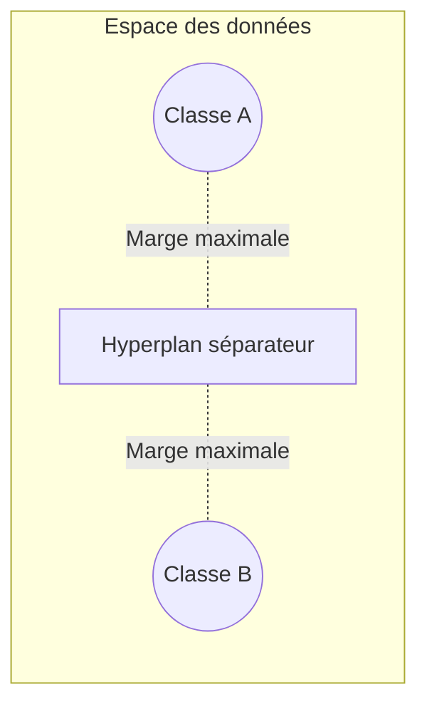

## Introduction

Ce chapitre détaille deux algorithmes aux principes géométriques distincts — les machines à vecteurs de support (SVM), qui séparent les classes par un hyperplan optimal, et k-plus-proches-voisins (k-NN), déjà utilisé de façon appliquée au cours Data Science Complète (chapitre 5) mais jamais expliqué dans son détail mathématique.

Ces deux algorithmes raisonnent en termes de géométrie : chaque exemple est un point dans un espace à autant de dimensions qu'il y a de caractéristiques, et classer revient à décider de quel côté d'une frontière il se trouve, ou à regarder qui sont ses voisins. Les SVM ont longtemps été l'état de l'art en classification de texte, de spam et de malware avant l'essor du deep learning ; elles restent très performantes sur des jeux de taille moyenne. Le k-NN, lui, sert de référence simple, et son principe, chercher les exemples connus les plus proches, est au cœur de la recherche de similarité : retrouver les échantillons de malware les plus proches d'un nouvel échantillon, ou les incidents passés qui ressemblent à l'incident en cours.

À la fin de ce chapitre, tu sauras ce que représentent la marge et les vecteurs de support, régler les paramètres C et gamma d'une SVM, expliquer l'astuce du noyau, choisir k et la distance pour un k-NN, et utiliser une SVM à une classe pour détecter des anomalies.

## Les Support Vector Machines — séparer par un hyperplan maximal

<CehCallout>
Une SVM cherche l'hyperplan (rappel du cours Algèbre Linéaire, chapitre 5) qui sépare deux classes en maximisant la marge — la distance entre l'hyperplan et les points les plus proches de chaque classe, appelés vecteurs de support — un principe différent de la régression logistique, qui ne cherche pas explicitement à maximiser cette marge.
</CehCallout>



### La géométrie de la marge

Un hyperplan s'écrit w · x + b = 0, où w est un vecteur perpendiculaire à l'hyperplan et b un décalage. En deux dimensions c'est une droite, en trois un plan. Un point est classé selon le signe de w · x + b. Quand des données sont linéairement séparables, une infinité d'hyperplans les séparent ; la SVM choisit celui qui laisse le plus de place de part et d'autre.

Par convention, on normalise w et b pour que les points les plus proches vérifient w · x + b = +1 d'un côté et −1 de l'autre. La distance entre ces deux hyperplans parallèles vaut alors 2 / ‖w‖, où ‖w‖ est la norme de w. Maximiser la marge revient donc à minimiser ‖w‖, sous la contrainte que chaque point soit du bon côté avec une marge d'au moins 1 : c'est un problème d'optimisation quadratique, dont la solution est unique.

### Un exemple chiffré

```python
import numpy as np
from sklearn.svm import SVC

X = np.array([[1, 1], [2, 1], [1, 2], [4, 4], [5, 4], [4, 5]])
y = np.array([0, 0, 0, 1, 1, 1])
svm = SVC(kernel="linear", C=1e6).fit(X, y)      # C très grand : marge stricte
w, b = svm.coef_[0], svm.intercept_[0]
print(w, b, 2 / np.linalg.norm(w))
print(svm.support_vectors_)
```

```text
[0.40009103 0.39986345] -2.19989379
3.5357349312049138
[[2. 1.]
 [1. 2.]
 [4. 4.]]
```

L'hyperplan appris est environ 0,4 × x1 + 0,4 × x2 − 2,2 = 0, soit la droite x1 + x2 = 5,5, à mi-chemin entre les deux nuages. La marge vaut 2 / ‖(0,4 ; 0,4)‖ = 2 / 0,566 ≈ 3,54. Vérifions sur le vecteur de support (4, 4) : 0,4 × 4 + 0,4 × 4 − 2,2 = 1, il est bien exactement sur le bord de la marge. Seuls trois points sur six sont des vecteurs de support.

<TipCallout>
Seuls les points les plus proches de la frontière (les vecteurs de support) déterminent la position de l'hyperplan — les autres points, plus éloignés, n'influencent pas le résultat final, ce qui rend les SVM relativement robustes aux points éloignés de la frontière de décision.
</TipCallout>

Tu peux le vérifier : déplace le point (5, 4) en (9, 9) et réentraîne, l'hyperplan ne bouge pas. Déplace en revanche le vecteur de support (2, 1), et tout change.

### Marge souple et paramètre C

Les données réelles se chevauchent et contiennent du bruit : exiger qu'aucun point ne franchisse la marge est impossible ou absurde. La SVM à marge souple autorise des violations, chacune pénalisée par une perte appelée hinge loss, qui vaut max(0, 1 − y × (w · x + b)) en notant les classes −1 et +1. Le paramètre C règle le compromis : un C grand pénalise fortement chaque violation et donne une marge étroite qui colle aux données (risque de surapprentissage) ; un C petit tolère les erreurs et donne une marge large, plus régulière (risque de sous-apprentissage). Dans scikit-learn, C vaut 1 par défaut, et comme pour la régression logistique, c'est l'inverse d'une force de régularisation.

## Quand les données ne sont pas linéairement séparables — l'astuce du noyau

<WarningCallout>
De nombreux jeux de données réels ne peuvent pas être séparés par une simple droite ou un plan — l'astuce du noyau (kernel trick) permet de projeter implicitement les données dans un espace de dimension supérieure, où elles deviennent linéairement séparables, sans jamais calculer explicitement cette projection coûteuse.
</WarningCallout>

### L'intuition

Imagine des points sur une droite : les bénins au centre, entre −1 et 1, les malveillants aux deux extrémités. Aucun seuil unique ne les sépare. Ajoutons une seconde coordonnée, x². Dans le plan (x, x²), les points du centre ont un x² petit et ceux des extrémités un x² grand : une droite horizontale les sépare désormais. On a projeté les données dans un espace de dimension supérieure grâce à une fonction φ(x) = (x, x²).

### Pourquoi « astuce »

Le problème d'optimisation de la SVM peut se réécrire sous une forme dite duale, où les données n'apparaissent qu'à travers des produits scalaires xi · xj entre paires de points. Un noyau est une fonction K(x, x') qui calcule directement le produit scalaire φ(x) · φ(x') dans l'espace projeté, sans jamais calculer φ. On obtient ainsi la puissance d'un espace de très grande dimension, voire infinie pour le noyau RBF, pour le coût d'un calcul dans l'espace d'origine.

<CompareTable
  titleA="Noyau"
  titleB="Usage typique"
  rows={[
    { a: "Linéaire", b: "Données déjà linéairement séparables, calcul rapide" },
    { a: "Polynomial", b: "Frontières de décision courbes de complexité modérée" },
    { a: "RBF (Radial Basis Function)", b: "Frontières de décision très flexibles, le noyau le plus utilisé en pratique" },
]}
/>

| Noyau | Formule K(x, x') | Paramètres scikit-learn |
| --- | --- | --- |
| Linéaire | x · x' | `kernel="linear"` |
| Polynomial | (γ × x · x' + r)^d | `kernel="poly"`, `degree`, `gamma`, `coef0` |
| RBF (gaussien) | exp(−γ × ‖x − x'‖²) | `kernel="rbf"` (défaut), `gamma` |

### Le paramètre gamma du noyau RBF

Le noyau RBF mesure une similarité qui vaut 1 pour deux points identiques et décroît avec leur distance. Le paramètre γ règle la vitesse de cette décroissance, donc le rayon d'influence de chaque vecteur de support. Un γ petit donne une influence large et une frontière douce ; un γ grand donne une influence très locale et une frontière qui épouse chaque point. Sur un jeu en croissants bruités de 600 points, l'effet est net :

```text
gamma   train   test    vecteurs de support
0.1     0.876   0.856   172
1       0.907   0.872   116
10      0.933   0.894   166
100     0.969   0.878   357
```

Avec γ = 100, le score d'entraînement grimpe mais le score de test redescend, et plus de 350 points sur 420 deviennent des vecteurs de support : le modèle mémorise. La valeur par défaut, `gamma="scale"`, vaut 1 / (nombre de variables × variance des données) et constitue un bon point de départ. En pratique, on cherche le meilleur couple C et γ par validation croisée, avec `GridSearchCV`, sur une grille logarithmique.

### Limites pratiques des SVM

Le temps d'entraînement d'une `SVC` croît entre le carré et le cube du nombre d'exemples : au-delà de quelques dizaines de milliers de lignes, elle devient très lente. Pour de grands volumes, `LinearSVC` ou `SGDClassifier(loss="hinge")` entraînent une SVM linéaire beaucoup plus vite. Par ailleurs, une SVM ne produit pas naturellement de probabilités : `probability=True` les estime par une calibration interne coûteuse. Enfin, comme tout algorithme fondé sur des distances ou des produits scalaires, elle exige des variables normalisées.

## k-plus-proches-voisins — approfondissement

<CehCallout>
Rappel du cours Data Science Complète (chapitre 5) : k-NN classe un nouveau point selon la classe majoritaire parmi ses k voisins les plus proches — ce chapitre approfondit ce qui rend cet algorithme particulier : il ne construit aucun modèle pendant l'entraînement, il se contente de mémoriser l'ensemble des données (apprentissage "paresseux" ou lazy learning).
</CehCallout>

<Steps steps={[
  { title: "Calculer la distance", description: "Pour classer un nouveau point, k-NN calcule sa distance (généralement euclidienne, rappel du cours Algèbre Linéaire) à tous les points d'entraînement." },
  { title: "Sélectionner les k plus proches", description: "Les k points d'entraînement les plus proches du nouveau point sont retenus." },
  { title: "Voter", description: "La classe majoritaire parmi ces k voisins est attribuée au nouveau point." },
]} />

### Un exemple à la main

Cinq hôtes connus sont décrits par deux scores d'activité : (1, 1), (2, 1) et (1, 2) sont sains (classe 0), (4, 4) et (5, 4) sont compromis (classe 1). Un nouvel hôte a pour coordonnées (3,5 ; 3). Distances euclidiennes, racine de la somme des carrés des écarts :

```text
vers (4, 4) : racine(0,25 + 1)    = 1,118   classe 1
vers (5, 4) : racine(2,25 + 1)    = 1,803   classe 1
vers (2, 1) : racine(2,25 + 4)    = 2,500   classe 0
vers (1, 2) : racine(6,25 + 1)    = 2,693   classe 0
vers (1, 1) : racine(6,25 + 4)    = 3,202   classe 0

k = 1 : voisin (4, 4)                      → compromis
k = 3 : 2 votes compromis contre 1 sain    → compromis
k = 5 : 2 votes compromis contre 3 sains   → sain
```

Avec k = 5, le vote inclut tous les points, y compris des voisins lointains et peu pertinents, et la décision bascule vers la classe la plus nombreuse. C'est exactement le danger d'un k trop grand.

<WarningCallout>
Le choix de k influence fortement le résultat — un k trop petit rend le modèle sensible au bruit (une seule donnée aberrante proche peut fausser la décision) ; un k trop grand lisse excessivement la frontière de décision et peut inclure des voisins non pertinents, un compromis biais-variance similaire à celui rencontré avec la profondeur d'un arbre de décision.
</WarningCallout>

```text
k      train   test
1      1.000   0.894
5      0.940   0.889
15     0.924   0.889
51     0.907   0.872
201    0.857   0.833
```

Avec k = 1, le score d'entraînement vaut toujours 1, chaque point étant son propre plus proche voisin : ce chiffre ne signifie rien. Sur des données bruitées contenant des exemples mal étiquetés, un k plus grand est généralement préférable, car il dilue l'influence de chaque erreur d'étiquetage. Pour une classification binaire, on choisit souvent un k impair afin d'éviter les égalités.

### Les réglages qui comptent

- **La distance** (`metric`) : euclidienne par défaut, Manhattan (somme des écarts absolus) plus robuste aux grandes différences sur une seule variable, ou cosinus pour des vecteurs de texte où seule la direction compte.
- **La pondération** (`weights="distance"`) : les voisins proches votent plus fort que les lointains, ce qui atténue le problème d'un k trop grand.
- **La normalisation** : sans elle, la variable à la plus grande échelle domine la distance. Sur un jeu où les octets se comptent en dizaines de milliers et la durée en dizaines de secondes, un k-NN brut obtient 0,852 contre 0,992 après `StandardScaler`, alors que seule la durée détermine la classe.
- **Le coût de prédiction** : « paresseux » à l'entraînement, le k-NN paie à la prédiction, car il doit comparer chaque nouveau point à tous les exemples stockés. Les structures KD-tree et Ball-tree (`algorithm="auto"`) accélèrent la recherche en faible dimension.
- **La dimension** : en très grande dimension, toutes les distances tendent à se ressembler, et la notion de plus proche voisin perd son sens. C'est le fléau de la dimension, traité au chapitre 6.

<CompareTable
  titleA="SVM"
  titleB="k-NN"
  rows={[
    { a: "Entraînement coûteux, prédiction rapide", b: "Aucun entraînement, prédiction coûteuse" },
    { a: "Modèle compact : seuls les vecteurs de support sont gardés", b: "Doit conserver toutes les données d'entraînement" },
    { a: "Paramètres clés : C, noyau, gamma", b: "Paramètres clés : k, distance, pondération" },
    { a: "Frontière globale optimisée", b: "Décision purement locale" },
    { a: "Normalisation indispensable", b: "Normalisation indispensable" },
]}
/>

## Détection d'anomalies : la One-Class SVM

Une variante, la One-Class SVM, n'apprend qu'à partir d'exemples normaux : elle trace une frontière qui englobe la masse des données et considère comme anormal tout ce qui tombe à l'extérieur. Le paramètre `nu` fixe la proportion maximale d'exemples d'entraînement autorisés hors de la frontière, et donc approximativement le taux de fausses alertes sur des données normales.

```python
import numpy as np
from sklearn.pipeline import make_pipeline
from sklearn.preprocessing import StandardScaler
from sklearn.svm import OneClassSVM

rng = np.random.default_rng(0)
normal = rng.normal(0, 1, (500, 2))                       # comportement habituel
detecteur = make_pipeline(StandardScaler(), OneClassSVM(nu=0.05, gamma="scale")).fit(normal)
print(detecteur.predict([[0, 0], [0.5, -0.3], [4, 4], [-5, 1]]))   # 1 = normal, -1 = anomalie
```

```text
[ 1  1 -1 -1]
```

C'est utile quand les attaques étiquetées manquent, ce qui est le cas le plus fréquent en sécurité : on modélise le normal plutôt que le malveillant.

<AttackDefenseTable rows={[
  { phase: "Similarité de malware", attack: "Variantes légèrement modifiées d'un malware connu (T1027, obfuscation)", defense: "k-NN sur des empreintes ou des vecteurs de caractéristiques pour retrouver la famille la plus proche" },
  { phase: "Comportement anormal", attack: "Compte ou hôte compromis dont le comportement sort de son profil habituel (T1078)", defense: "One-Class SVM ou k-NN sur la distance au profil normal, réglage de nu selon le volume d'alertes acceptable" },
  { phase: "Évasion par proximité", attack: "Rapprocher artificiellement un échantillon malveillant des exemples bénins, par exemple en ajoutant du contenu légitime", defense: "Caractéristiques robustes, validation de la normalisation, combinaison avec d'autres détecteurs" },
]} />

## Erreurs fréquentes

- **Oublier la normalisation** pour une SVM ou un k-NN : la variable à la plus grande échelle écrase les autres.
- **Évaluer sur les données d'entraînement** : un k-NN avec k = 1 ou une SVM avec un γ énorme y obtiennent des scores parfaits sans aucune valeur.
- **Régler C et γ séparément** : ils interagissent ; cherche-les ensemble par validation croisée.
- **Utiliser `SVC` sur des centaines de milliers d'exemples** : préfère `LinearSVC` ou `SGDClassifier`.
- **Choisir k pair en binaire** sans pondération : les égalités sont tranchées arbitrairement.
- **Appliquer un k-NN en très grande dimension** sans réduction de dimension ni sélection de variables.

## Lab — Mise en pratique

**Environnement** : Python 3.12 ou plus récent avec scikit-learn et NumPy (terminal Nyx Shell ou environnement local).

<Steps steps={[
  { title: "Générer des données non linéairement séparables", description: "Utilise un jeu de données en forme de croissants imbriqués, l'exemple type qu'une droite ne peut pas séparer, et sépare-le en entraînement et test.", code: "from sklearn.datasets import make_moons\nfrom sklearn.model_selection import train_test_split\nX, y = make_moons(n_samples=600, noise=0.3, random_state=0)\nXtr, Xte, ytr, yte = train_test_split(X, y, test_size=0.3, random_state=0)" },
  { title: "Tester une SVM à noyau linéaire", description: "Entraîne une SVM linéaire sur ces données et observe son score — l'hyperplan ne peut pas bien séparer des croissants.", code: "from sklearn.svm import SVC\nsvm_lin = SVC(kernel='linear').fit(Xtr, ytr)\nprint('accuracy noyau lineaire:', svm_lin.score(Xte, yte))" },
  { title: "Appliquer le kernel trick (noyau RBF)", description: "Entraîne la même SVM avec un noyau RBF et compare le score obtenu, pour constater l'effet du kernel trick évoqué plus haut. Affiche aussi le nombre de vecteurs de support.", code: "svm_rbf = SVC(kernel='rbf', gamma='scale').fit(Xtr, ytr)\nprint('accuracy noyau RBF:', svm_rbf.score(Xte, yte))\nprint('vecteurs de support:', svm_rbf.n_support_.sum())" },
  { title: "Explorer gamma et C", description: "Fais varier gamma puis C et compare scores d'entraînement et de test. Repère la valeur de gamma à partir de laquelle le modèle surapprend.", code: "for g in [0.1, 1, 10, 100]:\n    m = SVC(kernel='rbf', gamma=g).fit(Xtr, ytr)\n    print('gamma', g, round(m.score(Xtr, ytr), 3), round(m.score(Xte, yte), 3), m.n_support_.sum())\nfor C in [0.01, 1, 100]:\n    m = SVC(kernel='rbf', C=C).fit(Xtr, ytr)\n    print('C', C, round(m.score(Xtr, ytr), 3), round(m.score(Xte, yte), 3))" },
  { title: "Observer l'effet du choix de k en k-NN", description: "Entraîne k-NN avec un k très petit puis un k très grand sur les mêmes données et compare les scores d'entraînement et de test, pour relier au compromis biais-variance vu plus haut.", code: "from sklearn.neighbors import KNeighborsClassifier\nfor k in [1, 5, 20, 201]:\n    knn = KNeighborsClassifier(n_neighbors=k).fit(Xtr, ytr)\n    print('k=', k, '-> train:', round(knn.score(Xtr, ytr), 3), 'test:', round(knn.score(Xte, yte), 3))" },
  { title: "Mesurer l'effet de la normalisation", description: "Crée deux variables d'échelles très différentes (octets et durée) où seule la durée détermine la classe, puis compare un k-NN brut et un k-NN normalisé.", code: "import numpy as np\nfrom sklearn.pipeline import make_pipeline\nfrom sklearn.preprocessing import StandardScaler\nrng = np.random.default_rng(0)\noctets = rng.lognormal(10, 1, 1000)\nduree = rng.exponential(30, 1000)\nXb, yb = np.c_[octets, duree], (duree > 60).astype(int)\na, b, c, d = train_test_split(Xb, yb, random_state=0)\nprint('brut:', KNeighborsClassifier().fit(a, c).score(b, d))\nprint('normalise:', make_pipeline(StandardScaler(), KNeighborsClassifier()).fit(a, c).score(b, d))" },
  { title: "Détecter des anomalies avec une One-Class SVM", description: "Entraîne une One-Class SVM sur des données normales uniquement, puis teste des points proches et éloignés. Vérifie que la proportion d'anomalies sur les données d'entraînement est proche de nu.", code: "from sklearn.svm import OneClassSVM\nnormal = rng.normal(0, 1, (500, 2))\noc = make_pipeline(StandardScaler(), OneClassSVM(nu=0.05, gamma='scale')).fit(normal)\nprint(oc.predict([[0, 0], [0.5, -0.3], [4, 4], [-5, 1]]))\nprint((oc.predict(normal) == -1).mean())" },
]} />

## À retenir

- Une SVM cherche l'hyperplan w · x + b = 0 qui maximise la marge entre les classes, égale à 2 / ‖w‖, déterminé uniquement par les vecteurs de support.
- La marge souple tolère des erreurs ; le paramètre C règle le compromis entre marge large et ajustement aux données.
- L'astuce du noyau permet aux SVM de séparer des données non linéairement séparables, sans calculer explicitement une projection coûteuse ; le noyau RBF est le plus utilisé, et son paramètre gamma règle la portée de chaque point.
- k-NN ne construit aucun modèle à l'entraînement — il mémorise les données et classe chaque nouveau point selon le vote de ses k plus proches voisins, généralement en distance euclidienne.
- Un k trop petit est sensible au bruit, un k trop grand lisse excessivement et inclut des voisins non pertinents.
- SVM et k-NN exigent des variables normalisées ; la One-Class SVM détecte des anomalies en n'apprenant que le comportement normal.

## Questions de révision

1. Qu'est-ce qu'un vecteur de support, et pourquoi ces points déterminent-ils seuls la position de l'hyperplan ?
2. À quoi sert l'astuce du noyau (kernel trick) dans une SVM ?
3. Pourquoi k-NN est-il qualifié d'algorithme d'apprentissage « paresseux » (lazy learning) ?
4. Pour l'hyperplan 0,4 × x1 + 0,4 × x2 − 2,2 = 0, calcule la marge et vérifie que le point (2, 1) est sur le bord de la marge.
5. Quel est l'effet d'un gamma très grand sur la frontière d'une SVM à noyau RBF, et comment le détecter ?
6. Sur un jeu contenant des exemples mal étiquetés, pourquoi un k plus grand est-il généralement préférable ?
7. Dans quelle situation de sécurité une One-Class SVM est-elle plus adaptée qu'un classifieur supervisé ?
