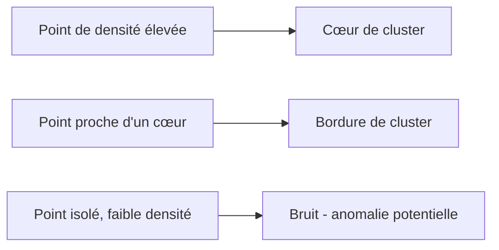
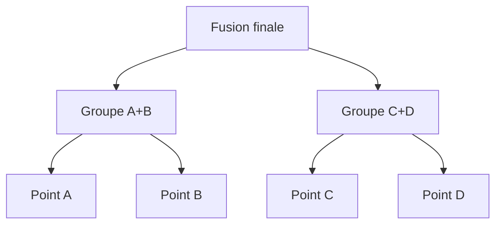

## Introduction

Ce chapitre approfondit le clustering déjà introduit de façon appliquée au cours Data Science Complète (chapitre 6) — trois approches complémentaires, chacune adaptée à des formes de données différentes, un choix particulièrement pertinent pour regrouper des familles de malwares ou détecter des comportements réseau atypiques.

Le clustering (partitionnement) est un apprentissage non supervisé : on ne dispose d'aucune étiquette et l'on cherche des groupes d'exemples qui se ressemblent. En sécurité, c'est souvent la seule option, car les étiquettes coûtent cher et les attaques nouvelles n'en ont pas. Un laboratoire d'analyse reçoit des milliers d'échantillons par jour et les regroupe pour n'analyser en détail qu'un représentant par famille ; un SOC regroupe des alertes similaires pour traiter une campagne d'un seul bloc ; une équipe réseau cherche les flux qui n'appartiennent à aucun groupe de trafic habituel.

À la fin de ce chapitre, tu sauras dérouler k-means à la main, choisir le nombre de groupes, régler DBSCAN, lire un dendrogramme, évaluer un clustering sans étiquettes, et surtout choisir la méthode adaptée à la forme de tes données.

## k-means en détail

<CehCallout>
Rappel du cours Data Science Complète (chapitre 6) : k-means partitionne les données en k groupes en minimisant la distance entre chaque point et le centre (centroïde) de son groupe — ce chapitre détaille comment cet algorithme trouve itérativement ces centroïdes.
</CehCallout>

### La fonction objectif

k-means cherche les k centroïdes qui minimisent l'inertie, aussi appelée somme des carrés intra-groupes : la somme, sur tous les points, du carré de la distance entre le point et le centroïde de son groupe. Une inertie faible signifie des groupes compacts.

<Steps steps={[
  { title: "Initialiser k centroïdes aléatoirement", description: "k points sont choisis (souvent aléatoirement parmi les données) comme centroïdes initiaux." },
  { title: "Assigner chaque point au centroïde le plus proche", description: "Chaque point est rattaché au groupe dont le centroïde est le plus proche (distance euclidienne)." },
  { title: "Recalculer les centroïdes", description: "Chaque centroïde est repositionné à la moyenne des points de son groupe." },
  { title: "Répéter jusqu'à stabilisation", description: "Les étapes 2 et 3 se répètent jusqu'à ce que les assignations ne changent plus (convergence)." },
]} />

### Un exemple à la main

Six serveurs sont décrits par un seul chiffre, leur nombre moyen de connexions par minute : 1, 2, 3, 10, 11 et 13. On cherche k = 2 groupes, avec des centroïdes initiaux à 1 et 4.

```text
Itération 1
  Assignation : 1, 2 → centroïde 1      3, 10, 11, 13 → centroïde 4
  (3 est plus proche de 4 que de 1 : distance 1 contre 2)
  Nouveaux centroïdes : (1+2)/2 = 1,5      (3+10+11+13)/4 = 9,25

Itération 2
  Assignation : 1, 2, 3 → centroïde 1,5    10, 11, 13 → centroïde 9,25
  (3 est maintenant à 1,5 du premier centroïde contre 6,25 du second)
  Nouveaux centroïdes : 2      11,33

Itération 3
  Assignations inchangées → convergence
  Inertie = (1−2)² + (2−2)² + (3−2)² + (10−11,33)² + (11−11,33)² + (13−11,33)²
          = 1 + 0 + 1 + 1,78 + 0,11 + 2,78 = 6,67
```

Chaque itération ne peut que diminuer l'inertie, ce qui garantit la convergence. En revanche, l'algorithme converge vers un minimum local qui dépend de l'initialisation : de mauvais centroïdes de départ peuvent donner une partition médiocre.

### k-means++ et les initialisations multiples

Pour limiter ce problème, scikit-learn utilise par défaut l'initialisation k-means++ : le premier centroïde est tiré au hasard, puis chaque suivant est tiré avec une probabilité proportionnelle au carré de sa distance aux centroïdes déjà choisis, ce qui les écarte les uns des autres. Le paramètre `n_init` relance l'algorithme plusieurs fois avec des initialisations différentes et garde la meilleure inertie. Pour de très gros volumes, `MiniBatchKMeans` met à jour les centroïdes à partir de petits lots de données, beaucoup plus vite.

### Choisir k : coude et silhouette

L'inertie diminue toujours quand k augmente, jusqu'à zéro quand chaque point a son propre groupe ; on ne peut donc pas simplement la minimiser. La méthode du coude trace l'inertie en fonction de k et cherche le point où la baisse ralentit brutalement. Le coefficient de silhouette est plus rigoureux : pour chaque point, on calcule a, la distance moyenne aux points de son propre groupe, et b, la distance moyenne aux points du groupe voisin le plus proche. La silhouette du point vaut (b − a) / max(a, b), entre −1 et 1 : proche de 1, le point est bien dans son groupe ; proche de 0, il est à la frontière ; négative, il est probablement mal placé. On retient le k qui maximise la silhouette moyenne.

```text
k    inertie    silhouette
2    18363.1    0.588
3     5241.2    0.762
4     1127.4    0.811
5     1019.9    0.680
6      921.1    0.577
```

Sur ce jeu généré avec quatre groupes, l'inertie chute fortement jusqu'à k = 4 puis ne baisse presque plus : c'est le coude. La silhouette culmine elle aussi à k = 4, avec 0,811. Les deux critères concordent.

<WarningCallout>
k-means nécessite de choisir k à l'avance et suppose des groupes de forme sphérique et de taille comparable — deux limites importantes : un mauvais choix de k ou des groupes de forme irrégulière (en croissant, imbriqués) donnent des résultats médiocres.
</WarningCallout>

Ces hypothèses viennent directement de la fonction objectif : minimiser des distances au carré à un centre favorise des groupes ronds et équilibrés. Sur deux croissants imbriqués, k-means coupe les données par une droite au milieu, en prenant la moitié de chaque croissant. Enfin, comme tout algorithme fondé sur des distances, k-means exige des variables normalisées, et il est sensible aux valeurs extrêmes, qui déplacent les moyennes.

## DBSCAN — le clustering par densité

<CehCallout>
DBSCAN (Density-Based Spatial Clustering) ne nécessite pas de choisir un nombre de groupes à l'avance — il regroupe les points densément proches les uns des autres et marque comme "bruit" les points isolés, une capacité directement utile pour la détection d'anomalies (un point de bruit est potentiellement une anomalie).
</CehCallout>



### Les deux paramètres et les trois types de points

DBSCAN repose sur deux paramètres : `eps`, le rayon de voisinage, et `min_samples`, le nombre minimal de points dans ce rayon (le point lui-même compris) pour parler de zone dense. On distingue alors trois types de points. Un point cœur possède au moins `min_samples` voisins dans un rayon `eps`. Un point de bordure n'a pas assez de voisins pour être cœur, mais se trouve dans le voisinage d'un point cœur. Un point de bruit n'est ni l'un ni l'autre ; scikit-learn lui attribue l'étiquette −1.

L'algorithme part d'un point cœur, agrège tous les points atteignables de proche en proche par une chaîne de points cœurs, et forme ainsi un groupe, puis recommence avec un point cœur non encore visité. Les groupes peuvent donc prendre n'importe quelle forme, y compris des croissants.

<TipCallout>
Cette capacité à identifier le "bruit" distingue fondamentalement DBSCAN de k-means, qui force chaque point dans l'un des k groupes même s'il ne ressemble à aucun d'entre eux — un atout majeur pour la détection d'anomalies réseau (cours Analyse SOC, chapitre 5), où les points de bruit correspondent souvent aux comportements les plus intéressants à investiguer.
</TipCallout>

### Régler eps

Le choix de `eps` est délicat : trop petit, presque tout devient du bruit ; trop grand, tous les groupes fusionnent. Une méthode classique consiste à calculer, pour chaque point, la distance à son k-ième plus proche voisin avec k égal à `min_samples`, puis à trier ces distances : le graphique obtenu montre un coude, et `eps` se choisit à ce niveau. Une règle de départ courante pour `min_samples` est le double du nombre de dimensions. Comme DBSCAN utilise un rayon unique, il peine quand les groupes ont des densités très différentes. Sa variante HDBSCAN, disponible dans scikit-learn depuis la version 1.3 sous le nom `sklearn.cluster.HDBSCAN`, explore toutes les valeurs de rayon et ne demande qu'une taille minimale de groupe.

### Un cas réseau

Simulons 500 flux réseau décrits par le logarithme de leur durée et de leur volume : 300 flux web et 200 requêtes DNS, plus trois flux anormaux, dont un très court et énorme, typique d'une exfiltration éclair.

```python
import numpy as np
from sklearn.cluster import DBSCAN, HDBSCAN, KMeans
from sklearn.preprocessing import StandardScaler

rng = np.random.default_rng(3)
web = np.c_[rng.normal(2.0, 0.3, 300), rng.normal(3.5, 0.3, 300)]    # log10 durée, log10 octets
dns = np.c_[rng.normal(-1.0, 0.2, 200), rng.normal(2.0, 0.2, 200)]
anomalies = np.array([[0.3, 7.7], [3.2, 2.0], [-0.8, 5.5]])
flux = StandardScaler().fit_transform(np.vstack([web, dns, anomalies]))

db = DBSCAN(eps=0.3, min_samples=10).fit(flux)
print("DBSCAN, bruit :", np.where(db.labels_ == -1)[0])
hdb = HDBSCAN(min_cluster_size=20, copy=True).fit(flux)
print("HDBSCAN, bruit :", np.where(hdb.labels_ == -1)[0])
km = KMeans(n_clusters=2, n_init=10, random_state=0).fit(flux)
print("k-means, groupes des 3 anomalies :", km.labels_[-3:])
```

```text
DBSCAN, bruit : [ 29  37 263 423 500 501 502]
HDBSCAN, bruit : [500 501 502]
k-means, groupes des 3 anomalies : [0 0 0]
```

DBSCAN isole bien les trois anomalies (indices 500 à 502), mais aussi quatre flux normaux situés en bordure de nuage : avec un rayon fixe, les zones moins denses produisent des faux positifs. HDBSCAN ne signale que les trois anomalies. k-means, lui, les range tranquillement dans un groupe existant : il est incapable de dire qu'un point n'appartient à rien.

## Le clustering hiérarchique

<CehCallout>
Le clustering hiérarchique construit une hiérarchie de groupes emboîtés, visualisable sous forme de dendrogramme — un arbre qui montre à quel niveau de similarité chaque paire de groupes fusionne, permettant de choisir a posteriori le nombre de groupes en "coupant" l'arbre au niveau souhaité.
</CehCallout>



### L'approche agglomérative

La version la plus courante, agglomérative, part de n groupes d'un seul point, fusionne à chaque étape les deux groupes les plus proches, et s'arrête quand il n'en reste qu'un. Le dendrogramme enregistre chaque fusion à une hauteur égale à la distance entre les groupes fusionnés. Couper l'arbre horizontalement à une certaine hauteur donne une partition : plus la coupe est basse, plus il y a de groupes. Pour regrouper des malwares, c'est précieux : une coupe basse sépare des variantes, une coupe haute regroupe des familles.

### Le critère de liaison

Tout dépend de la définition de la distance entre deux groupes, le critère de liaison (`linkage`) :

| Liaison | Distance entre deux groupes | Comportement |
| --- | --- | --- |
| `ward` (défaut) | Augmentation de l'inertie provoquée par la fusion | Groupes compacts et équilibrés, proche de k-means |
| `complete` | Distance maximale entre deux points des groupes | Groupes compacts, sensible aux extrêmes |
| `average` | Distance moyenne entre toutes les paires | Compromis |
| `single` | Distance minimale entre deux points des groupes | Suit des formes allongées, mais crée des « chaînes » avec le bruit |

Sur les croissants imbriqués du lab, la liaison `ward` obtient un indice de Rand ajusté de 0,43, alors que la liaison `single` retrouve parfaitement les deux croissants (ARI de 1,0), car elle relie les points de proche en proche. Le coût de calcul est le principal inconvénient : il faut stocker les distances entre toutes les paires de points, ce qui limite la méthode à quelques dizaines de milliers d'exemples. Pour tracer le dendrogramme, on utilise `scipy.cluster.hierarchy.linkage` puis `dendrogram`.

<CompareTable
  titleA="Méthode"
  titleB="Avantage distinctif"
  rows={[
    { a: "k-means", b: "Rapide, efficace sur de grands volumes, mais nécessite de fixer k à l'avance" },
    { a: "DBSCAN", b: "Détecte le bruit/les anomalies, aucune forme de groupe imposée, aucun k requis" },
    { a: "Hiérarchique", b: "Fournit une vue à tous les niveaux de granularité via le dendrogramme, mais coûteux en calcul sur de grands volumes" },
]}
/>

## Évaluer un clustering

Sans étiquettes, on mesure la qualité interne : la silhouette, ou l'inertie pour k-means. Quand des étiquettes existent pour une partie des données, par exemple des familles de malware identifiées par des analystes, on mesure l'accord externe avec l'indice de Rand ajusté (ARI), qui vaut 1 pour un accord parfait, environ 0 pour un regroupement aléatoire, et qui ignore les numéros de groupes. Sur les croissants du lab, k-means obtient un ARI de 0,26, DBSCAN de 1,0. Attention : la silhouette favorise les groupes ronds et peut donc préférer un k-means faux à un DBSCAN juste sur des formes non sphériques. Aucune métrique ne remplace l'examen des groupes par un humain qui connaît le domaine.

<AttackDefenseTable rows={[
  { phase: "Tri de malwares", attack: "Milliers de variantes repackagées d'une même famille (T1027.002, packing)", defense: "Clustering hiérarchique sur des caractéristiques statiques et dynamiques, analyse d'un représentant par groupe" },
  { phase: "Campagnes de phishing", attack: "Vagues d'emails légèrement différents pour échapper aux signatures (T1566)", defense: "Regrouper les signalements par similarité (expéditeur, URL, structure) pour traiter la campagne d'un bloc" },
  { phase: "Détection d'anomalies réseau", attack: "Flux de commande et contrôle ou d'exfiltration noyés dans le trafic (T1071, T1041)", defense: "DBSCAN ou HDBSCAN sur des caractéristiques de flux normalisées, revue des points de bruit" },
  { phase: "Évasion du clustering", attack: "Imiter le profil d'un groupe légitime, par exemple en calquant durée et volume sur le trafic web", defense: "Multiplier les caractéristiques indépendantes, suivre l'évolution des groupes dans le temps" },
]} />

## Erreurs fréquentes

- **Oublier de normaliser** : la variable à la plus grande échelle dicte seule les groupes.
- **Choisir k au hasard** pour k-means : utilise le coude et la silhouette, puis vérifie que les groupes ont un sens métier.
- **Appliquer k-means à des formes non sphériques** ou à des groupes de tailles très différentes.
- **Considérer tout point de bruit DBSCAN comme une attaque** : les bordures de groupes peu denses produisent aussi du bruit.
- **Interpréter les numéros de groupes** comme des classes : le groupe 0 n'a aucune signification propre.
- **Lancer un clustering hiérarchique sur des centaines de milliers de points** : la mémoire nécessaire explose.

## Lab — Mise en pratique

**Environnement** : Python 3.12 ou plus récent avec scikit-learn, NumPy et SciPy (terminal Nyx Shell ou environnement local).

<Steps steps={[
  { title: "Générer des données en croissants imbriqués", description: "Crée un jeu de données dont la forme n'est pas sphérique, exactement le cas limite de k-means évoqué plus haut.", code: "from sklearn.datasets import make_moons\nX, y_true = make_moons(n_samples=200, noise=0.05, random_state=0)" },
  { title: "Appliquer k-means", description: "Partitionne ces données avec k-means (k=2) et observe que la frontière sphérique imposée découpe mal les deux croissants. L'ARI doit être d'environ 0,26.", code: "from sklearn.cluster import KMeans\nfrom sklearn.metrics import adjusted_rand_score\nkm = KMeans(n_clusters=2, n_init=10, random_state=0).fit(X)\nprint('labels k-means (20 premiers):', km.labels_[:20])\nprint('ARI:', adjusted_rand_score(y_true, km.labels_))" },
  { title: "Appliquer DBSCAN", description: "Sur les mêmes données, exécute DBSCAN et compare : il doit retrouver les deux croissants (ARI de 1) et compter les points de bruit isolés, ici aucun car le bruit généré est faible.", code: "from sklearn.cluster import DBSCAN\ndb = DBSCAN(eps=0.2, min_samples=5).fit(X)\nprint('labels DBSCAN (20 premiers):', db.labels_[:20])\nprint('nombre de points de bruit:', (db.labels_ == -1).sum())\nprint('ARI:', adjusted_rand_score(y_true, db.labels_))" },
  { title: "Appliquer le clustering hiérarchique", description: "Termine par un clustering hiérarchique sur les mêmes données avec deux liaisons différentes, et compare les trois méthodes en te reliant au tableau comparatif vu plus haut.", code: "from sklearn.cluster import AgglomerativeClustering\nfor link in ['ward', 'single']:\n    agg = AgglomerativeClustering(n_clusters=2, linkage=link).fit(X)\n    print(link, agg.labels_[:20], adjusted_rand_score(y_true, agg.labels_))" },
  { title: "Choisir k avec le coude et la silhouette", description: "Génère quatre groupes sphériques et calcule l'inertie et la silhouette pour k de 2 à 7. Vérifie que les deux critères désignent k = 4.", code: "from sklearn.datasets import make_blobs\nfrom sklearn.metrics import silhouette_score\nXb, _ = make_blobs(n_samples=600, centers=4, random_state=7)\nfor k in range(2, 8):\n    m = KMeans(n_clusters=k, n_init=10, random_state=0).fit(Xb)\n    print(k, round(m.inertia_, 1), round(silhouette_score(Xb, m.labels_), 3))" },
  { title: "Détecter des flux anormaux", description: "Reproduis le cas réseau du chapitre et compare les points de bruit trouvés par DBSCAN et HDBSCAN, puis le groupe attribué aux anomalies par k-means.", code: "import numpy as np\nfrom sklearn.cluster import HDBSCAN\nfrom sklearn.preprocessing import StandardScaler\nrng = np.random.default_rng(3)\nweb = np.c_[rng.normal(2.0, 0.3, 300), rng.normal(3.5, 0.3, 300)]\ndns = np.c_[rng.normal(-1.0, 0.2, 200), rng.normal(2.0, 0.2, 200)]\nanom = np.array([[0.3, 7.7], [3.2, 2.0], [-0.8, 5.5]])\nF = StandardScaler().fit_transform(np.vstack([web, dns, anom]))\nprint(np.where(DBSCAN(eps=0.3, min_samples=10).fit(F).labels_ == -1)[0])\nprint(np.where(HDBSCAN(min_cluster_size=20, copy=True).fit(F).labels_ == -1)[0])\nprint(KMeans(n_clusters=2, n_init=10, random_state=0).fit(F).labels_[-3:])" },
  { title: "Tracer un dendrogramme", description: "Calcule la hiérarchie avec SciPy sur un sous-ensemble des flux et trace le dendrogramme. Repère la hauteur de coupe qui sépare les deux grands groupes de trafic.", code: "import matplotlib.pyplot as plt\nfrom scipy.cluster.hierarchy import linkage, dendrogram\nZ = linkage(F[::10], method='ward')\ndendrogram(Z, no_labels=True)\nplt.ylabel('Distance de fusion')\nplt.show()" },
]} />

## À retenir

- k-means partitionne itérativement les données en k groupes en minimisant l'inertie, la somme des distances au carré aux centroïdes : initialiser, assigner, recalculer les centroïdes comme moyenne du groupe, répéter jusqu'à stabilisation.
- k-means nécessite de fixer k, choisi par le coude ou la silhouette, et suppose des groupes sphériques de taille comparable ; k-means++ et `n_init` limitent les mauvaises initialisations.
- DBSCAN regroupe par densité sans nécessiter de k prédéfini, distingue points cœurs, de bordure et de bruit, et identifie explicitement les points isolés comme du bruit — utile pour la détection d'anomalies ; HDBSCAN lève la contrainte d'un rayon unique.
- Le clustering hiérarchique construit un dendrogramme permettant de choisir le nombre de groupes après coup, à n'importe quel niveau de granularité ; le critère de liaison change radicalement le résultat.
- La silhouette évalue un clustering sans étiquettes, l'ARI le compare à des étiquettes connues ; aucun ne remplace l'examen métier des groupes.

## Questions de révision

1. Quelles sont les principales étapes itératives de l'algorithme k-means ?
2. Pourquoi DBSCAN est-il particulièrement adapté à la détection d'anomalies, contrairement à k-means ?
3. Qu'est-ce qu'un dendrogramme, et quel avantage offre-t-il par rapport à k-means ?
4. Déroule k-means à la main sur les valeurs 2, 4, 5, 20, 22 avec des centroïdes initiaux à 2 et 5.
5. Pourquoi k-means peine-t-il à regrouper des données en forme de croissants imbriqués ?
6. Comment choisirais-tu la valeur de eps pour DBSCAN, et que se passe-t-il si elle est trop petite ?
7. Pourquoi un point de bruit DBSCAN n'est-il pas forcément une attaque ?
