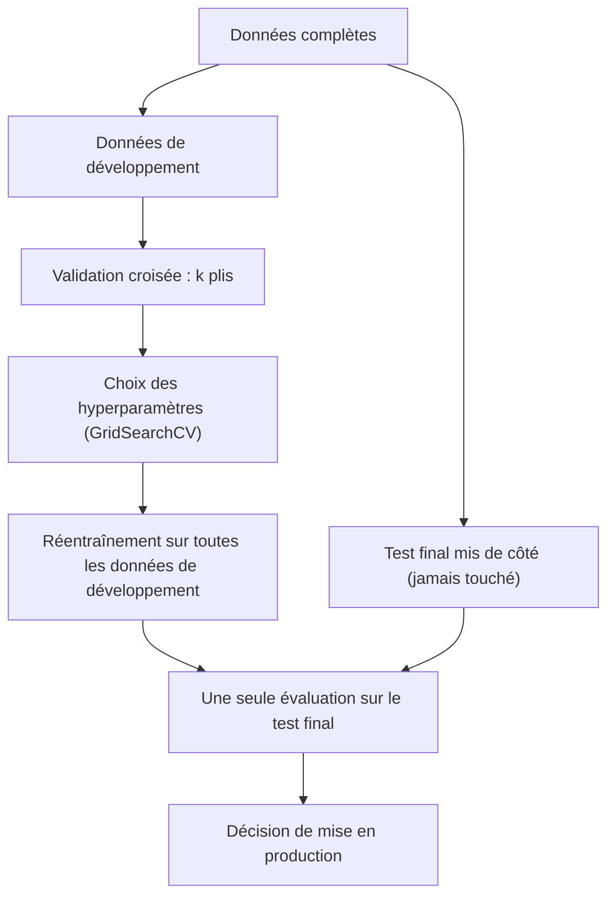

## Introduction

Ce dernier chapitre referme le cours en détaillant rigoureusement comment évaluer un modèle avant de le déployer — une étape trop souvent bâclée alors qu'elle conditionne la fiabilité de toute décision fondée sur ce modèle, en particulier en cybersécurité, où un modèle mal évalué peut laisser passer de véritables menaces.

Un modèle de détection mal évalué échoue de deux façons, aussi graves l'une que l'autre. Soit il laisse passer des attaques que l'équipe croyait couvertes, soit il noie les analystes sous des milliers de fausses alertes jusqu'à ce que plus personne ne les regarde. Dans les deux cas, le problème vient rarement de l'algorithme : il vient d'une évaluation qui ne reflétait pas les conditions réelles. Les fournisseurs de solutions de sécurité qui annoncent « 99 % de précision » sans préciser sur quelles données ni avec quel taux de base en sont l'illustration quotidienne.

À la fin de ce chapitre, tu sauras choisir le bon schéma de validation, débusquer les fuites de données, lire des courbes ROC et précision-rappel, calculer la charge d'alertes réelle d'un détecteur, régler les hyperparamètres sans tricher, et mettre un modèle en production avec la surveillance qui l'empêchera de se dégrader en silence.

## Au-delà du simple split train/test

<CehCallout>
Rappel du cours Data Science Complète (chapitre 6) : diviser les données en un ensemble d'entraînement et un ensemble de test est la base de toute évaluation — mais un unique split dépend fortement du hasard de cette division, une seule "mauvaise" répartition pouvant fausser l'évaluation.
</CehCallout>

<Steps steps={[
  { title: "Diviser les données en k parties (folds)", description: "Par exemple, k=5 : les données sont divisées en 5 parties égales." },
  { title: "Entraîner et évaluer k fois", description: "À chaque itération, une partie sert de test et les k-1 autres d'entraînement — répété k fois, chaque partie servant une fois de test." },
  { title: "Moyenner les résultats", description: "La performance finale est la moyenne des k évaluations, une estimation bien plus fiable qu'un split unique." },
]} />

<TipCallout>
Cette validation croisée en k-plis (k-fold cross-validation) est particulièrement précieuse sur des jeux de données de taille limitée, où chaque split unique gaspillerait des données potentiellement informatives en les excluant définitivement de l'entraînement.
</TipCallout>

Avec k = 5, le modèle est donc entraîné et évalué cinq fois. Au-delà de la moyenne, l'écart-type des scores entre plis est une information précieuse : il indique à quel point le résultat dépend du découpage. Deux modèles dont les moyennes diffèrent de moins d'un écart-type ne peuvent pas être départagés sérieusement.

### Choisir le bon schéma de découpage

Le découpage doit reproduire la façon dont le modèle sera utilisé. Quatre variantes couvrent l'essentiel des cas :

| Schéma | Classe scikit-learn | Quand l'utiliser |
| --- | --- | --- |
| k-plis stratifiés | `StratifiedKFold` | Classification, surtout déséquilibrée : chaque pli garde la proportion de chaque classe |
| Découpage temporel | `TimeSeriesSplit` | Données horodatées : on entraîne toujours sur le passé et on teste sur le futur |
| Découpage par groupes | `GroupKFold` | Plusieurs lignes par entité (hôte, utilisateur, échantillon de malware) : une entité n'apparaît jamais à la fois en entraînement et en test |
| Validation croisée imbriquée | `GridSearchCV` dans `cross_val_score` | Estimer honnêtement la performance d'un modèle dont on règle aussi les hyperparamètres |

En sécurité, le découpage temporel et le découpage par groupes sont souvent les seuls honnêtes. Si les flux d'un même hôte compromis se retrouvent dans les deux ensembles, le modèle reconnaît l'hôte plutôt que l'attaque. Si des échantillons de malware de 2026 servent à l'entraînement et des échantillons de 2025 au test, le modèle « prédit » le passé avec une connaissance du futur.

### Trois ensembles : entraînement, validation, test

Régler des hyperparamètres, comme la profondeur d'un arbre ou le C d'une régression logistique, en regardant le score de test revient à apprendre sur le test : le score final devient optimiste. La règle est de séparer trois rôles. L'ensemble d'entraînement sert à ajuster les paramètres du modèle ; l'ensemble de validation, ou la validation croisée sur l'entraînement, sert à choisir les hyperparamètres ; l'ensemble de test, mis de côté dès le départ, ne sert qu'une fois, à la toute fin.

```python
from sklearn.datasets import make_classification
from sklearn.linear_model import LogisticRegression
from sklearn.model_selection import GridSearchCV, StratifiedKFold, cross_val_score
from sklearn.pipeline import Pipeline
from sklearn.preprocessing import StandardScaler

X, y = make_classification(n_samples=1000, weights=[0.95, 0.05], random_state=0)   # 5 % d'attaques
pipe = Pipeline([("scaler", StandardScaler()), ("clf", LogisticRegression())])
grille = {"clf__C": [0.01, 0.1, 1, 10]}

recherche = GridSearchCV(pipe, grille, cv=StratifiedKFold(5), scoring="average_precision").fit(X, y)
print(recherche.best_params_, round(recherche.best_score_, 3))

imbriquee = cross_val_score(GridSearchCV(pipe, grille, cv=3, scoring="average_precision"),
                            X, y, cv=StratifiedKFold(5), scoring="average_precision")
print(round(imbriquee.mean(), 3))
```

```text
{'clf__C': 0.1} 0.866
0.856
```

Le meilleur score de la grille, 0,866, est légèrement optimiste, car c'est le maximum de quatre essais évalués sur les mêmes plis. La validation croisée imbriquée, qui refait toute la recherche à l'intérieur de chaque pli externe, donne 0,856 : c'est l'estimation honnête de ce que la procédure complète, recherche comprise, produira sur de nouvelles données. La notation `clf__C` désigne le paramètre `C` de l'étape nommée `clf` du pipeline.



## Les pièges courants de l'évaluation

<WarningCallout>
La fuite de données (data leakage) survient quand des informations de l'ensemble de test s'infiltrent, même indirectement, dans l'entraînement — par exemple, normaliser l'ensemble des données (calculer moyenne et écart-type) avant de les diviser en train/test, ce qui donne au modèle une connaissance implicite de la distribution des données de test.
</WarningCallout>

### Les formes de fuite de données

La normalisation avant le découpage est l'exemple classique, mais la fuite prend bien d'autres formes, souvent plus dévastatrices :

- **Prétraitement appris sur tout le jeu** : normalisation, imputation par la médiane, sélection de variables (chapitre 6), encodage. Le remède est toujours le même : tout mettre dans un `Pipeline`, qui réapprend chaque étape sur le seul pli d'entraînement.
- **Variable issue du futur ou de la cible** : une colonne « ticket d'incident ouvert » ou « bloqué par le pare-feu » qui n'existe qu'après la détection. Le modèle semble parfait parce qu'il lit la réponse.
- **Doublons entre entraînement et test** : le même échantillon de malware sous deux noms, ou des flux répétés. Dédoublonne avant de découper.
- **Fuite temporelle** : mélanger aléatoirement des données horodatées.
- **Fuite par entité** : le même hôte, utilisateur ou famille de malware des deux côtés.

Un signal d'alarme simple : un score qui paraît trop beau pour être vrai l'est presque toujours. Examine alors les variables les plus importantes du modèle ; une fuite y apparaît souvent en tête.

<CompareTable
  titleA="Piège d'évaluation"
  titleB="Conséquence"
  rows={[
    { a: "Fuite de données (normalisation avant le split)", b: "Performance surestimée à l'évaluation, dégradée en production" },
    { a: "Jeu de données déséquilibré non pris en compte", b: "Un modèle prédisant toujours la classe majoritaire semble performant en exactitude alors qu'il est inutile" },
    { a: "Évaluer uniquement sur les données d'entraînement", b: "Aucune indication de la capacité de généralisation du modèle" },
    { a: "Régler les hyperparamètres sur le test", b: "Score final optimiste : le test a servi à l'apprentissage" },
    { a: "Découpage aléatoire de données temporelles ou groupées", b: "Le modèle reconnaît des entités ou anticipe le futur au lieu de généraliser" },
]}
/>

## Mesurer ce qui compte sur un jeu déséquilibré

<CehCallout>
Rappel du cours Data Science Complète (chapitre 6, précision et rappel) : sur un jeu de données déséquilibré — typique en cybersécurité, où les attaques réelles représentent une infime minorité du trafic — l'exactitude seule est trompeuse ; le rappel (ne pas manquer d'attaques réelles) et la précision (limiter les fausses alertes) doivent être examinés ensemble.
</CehCallout>

Sur le jeu de 1 000 exemples dont 54 attaques, la régression logistique obtient une exactitude moyenne de 0,981 en validation croisée. Impressionnant ? Un `DummyClassifier`, qui prédit toujours « normal », obtient déjà 0,945. Le rapport complet raconte une autre histoire :

```text
              precision    recall  f1-score   support

           0       0.99      0.99      0.99       946
           1       0.87      0.76      0.81        54

    accuracy                           0.98      1000

Matrice de confusion : [[940   6]
                        [ 13  41]]
```

Sur 54 attaques, 13 passent inaperçues : un rappel de 0,76. C'est cette ligne, pas l'exactitude, qu'un responsable sécurité doit lire.

### Les courbes ROC et précision-rappel

Les métriques précédentes dépendent du seuil de décision, fixé à 0,5 par défaut. Les courbes permettent d'évaluer le modèle pour tous les seuils à la fois. La courbe ROC trace le taux de vrais positifs (le rappel) en fonction du taux de faux positifs, FP / (FP + VN), quand on fait varier le seuil. Son aire, l'AUC ROC, vaut 0,5 pour un modèle aléatoire et 1 pour un modèle parfait ; elle s'interprète comme la probabilité qu'une attaque tirée au hasard reçoive un score plus élevé qu'un événement normal tiré au hasard.

Sur des données très déséquilibrées, l'AUC ROC est souvent trop flatteuse, car le taux de faux positifs reste petit même avec beaucoup de fausses alertes, le dénominateur étant énorme. La courbe précision-rappel est alors plus parlante, et son résumé, la précision moyenne (`average_precision_score`), se compare au taux de base : un modèle aléatoire obtient une précision moyenne égale à la proportion d'attaques.

```text
AUC ROC              0.964
Précision moyenne    0.833   (hasard : 0.054)
```

### Régler le seuil de décision

Le seuil se choisit selon le coût relatif des erreurs. Abaisser le seuil à 0,2 sur notre exemple fait passer le rappel de 0,759 à 0,778 et la précision de 0,872 à 0,764 : une attaque supplémentaire détectée pour sept fausses alertes de plus. La fonction `precision_recall_curve` renvoie tous les couples possibles, ce qui permet par exemple de choisir le seuil le plus haut garantissant un rappel d'au moins 90 %. Le choix du seuil doit se faire sur la validation, jamais sur le test final.

### Le paradoxe du taux de base

Le piège le plus important pour un détecteur en sécurité tient à l'arithmétique. Supposons un détecteur d'intrusion qui détecte 99 % des attaques et ne se trompe que sur 1 % des connexions normales, déployé sur un million de connexions par jour, dont 0,1 % sont malveillantes :

```text
Connexions malveillantes : 1 000      détectées : 990       (rappel 99 %)
Connexions normales      : 999 000    fausses alertes : 9 990 (1 %)
Alertes totales          : 10 980
Précision = 990 / 10 980 ≈ 9 %
```

Plus de 90 % des alertes sont fausses, et l'équipe doit en trier près de 11 000 par jour. Un taux de faux positifs qui semble minuscule devient ingérable dès que les événements normaux sont très nombreux : c'est le paradoxe du taux de base. Conséquence pratique : évalue toujours un détecteur avec le volume et la proportion d'attaques de l'environnement réel, et raisonne en nombre d'alertes par jour, pas seulement en pourcentages.

## Mettre un modèle en production

<Steps steps={[
  { title: "Sérialiser le modèle entraîné", description: "Le modèle final, une fois entraîné et validé, est sauvegardé dans un format réutilisable sans réentraînement." },
  { title: "Exposer le modèle via une interface stable", description: "Une API ou un service dédié permet à d'autres systèmes d'obtenir des prédictions sans connaître les détails internes du modèle." },
  { title: "Surveiller la dérive du modèle", description: "Les données réelles évoluent avec le temps (concept drift) — un modèle performant à son déploiement peut se dégrader progressivement si son environnement change." },
  { title: "Réentraîner périodiquement", description: "Un modèle en production doit être réévalué et réentraîné régulièrement sur des données récentes pour rester pertinent." },
]} />

### Sérialiser et versionner

On sérialise le pipeline complet, prétraitement compris, avec `joblib.dump`. Ce format repose sur pickle et exécute du code au chargement : un modèle d'origine inconnue est une porte d'entrée pour un attaquant. Contrôle l'empreinte des fichiers déployés, et envisage skops, conçu pour charger les modèles scikit-learn de façon plus sûre, ou ONNX pour un format portable entre langages. Chaque modèle déployé doit être versionné avec ses données d'entraînement, son code, ses hyperparamètres et ses métriques ; un registre de modèles comme MLflow facilite ce suivi.

### Exposer le modèle

Le modèle est généralement servi derrière une API HTTP, par exemple avec FastAPI, ou intégré à un pipeline de traitement par lots qui score les logs de la veille. Cette API est un composant exposé comme un autre : authentification, limitation de débit, validation stricte des entrées et journalisation des requêtes. Un attaquant qui peut interroger librement le modèle peut aussi chercher méthodiquement les entrées qui lui échappent, ou en reconstruire une copie.

### Surveiller la dérive

Deux phénomènes dégradent un modèle déployé. La dérive des données (data drift) est un changement de la distribution des entrées : un nouveau service, une migration vers le cloud ou le télétravail modifient les volumes et les horaires. La dérive de concept (concept drift) est un changement de la relation entre les entrées et la cible : les attaquants changent de technique, et ce qui était un signal fort ne l'est plus.

La dérive des données se mesure sans étiquettes, en comparant la distribution actuelle de chaque variable à celle de l'entraînement. Le test de Kolmogorov-Smirnov (`scipy.stats.ks_2samp`) compare deux distributions continues. L'indice de stabilité de population (PSI) découpe la distribution de référence en intervalles, par exemple en déciles, et somme (q − p) × ln(q / p) sur chaque intervalle, p et q étant les proportions de référence et actuelles. Une règle empirique courante considère qu'un PSI inférieur à 0,1 indique une distribution stable, entre 0,1 et 0,25 une dérive modérée à surveiller, et au-delà de 0,25 une dérive importante. Sur une durée de session dont la distribution s'est décalée, on obtient un PSI de 0,17, contre 0,002 pour un échantillon tiré de la même distribution.

La dérive de concept, elle, ne se voit qu'avec des étiquettes : il faut suivre le rappel et la précision sur les alertes revues par les analystes, et surveiller la proportion d'alertes produites. Un taux d'alertes qui double ou s'effondre sans raison connue est un symptôme immédiat.

<WarningCallout>
La dérive de concept (concept drift) est particulièrement critique en cybersécurité : les techniques d'attaque évoluent constamment, un modèle de détection entraîné sur des attaques d'il y a un an peut manquer des variantes plus récentes — rappel du principe de veille et de mise à jour continue déjà souligné au cours Analyse SOC.
</WarningCallout>

### Réentraîner sans s'empoisonner

Le réentraînement périodique utilise les nouvelles données étiquetées, notamment les verdicts des analystes. Cette boucle de rétroaction est aussi une surface d'attaque : un attaquant qui parvient à faire étiqueter ses actions comme bénignes, ou à injecter du trafic choisi, empoisonne le prochain modèle. Chaque nouveau modèle doit donc être comparé à l'ancien sur un jeu de test de référence avant d'être promu, et pouvoir être retiré rapidement.

<AttackDefenseTable rows={[
  { phase: "Évasion en production", attack: "Interroger le modèle exposé pour trouver les entrées qui lui échappent (attaque d'évasion, MITRE ATLAS)", defense: "Authentification et limitation de débit de l'API, scores non exposés au client, détection des requêtes en rafale" },
  { phase: "Empoisonnement", attack: "Faire réétiqueter des actions malveillantes comme bénignes pour fausser le réentraînement", defense: "Contrôle de provenance des étiquettes, comparaison systématique au modèle précédent sur un test de référence" },
  { phase: "Chaîne d'approvisionnement", attack: "Fichier de modèle pickle piégé substitué lors du déploiement (T1195)", defense: "Empreintes vérifiées, registre de modèles, formats sans exécution de code" },
  { phase: "Dérive exploitée", attack: "Nouvelle technique d'attaque absente des données d'entraînement", defense: "Surveillance du PSI et du taux d'alertes, revue humaine, réentraînement et règles complémentaires" },
]} />

<AuditCallout>
Le NIST AI Risk Management Framework (AI RMF 1.0, publié en 2023) structure la gestion des risques d'un système d'IA autour de quatre fonctions : gouverner, cartographier, mesurer et gérer. Dans un système de management ISO/IEC 27001:2022, un modèle de détection relève notamment de la surveillance des activités (mesure A.8.16) et de la gestion des changements (A.8.32). Et si le système relève du haut risque au sens de l'AI Act européen, documentation technique, journalisation, exactitude et robustesse face aux manipulations deviennent des obligations.
</AuditCallout>

## Erreurs fréquentes

- **Annoncer l'exactitude** d'un détecteur sur des données déséquilibrées : compare toujours à la référence naïve et donne rappel et précision.
- **Prétraiter avant de découper** : normalisation, imputation ou sélection doivent vivre dans un `Pipeline`.
- **Découper aléatoirement des données temporelles ou groupées** : utilise `TimeSeriesSplit` ou `GroupKFold`.
- **Choisir le seuil ou les hyperparamètres sur le test** : le test final ne sert qu'une fois.
- **Ignorer le taux de base** : 1 % de faux positifs sur un million d'événements, ce sont dix mille alertes par jour.
- **Déployer sans surveillance ni plan de retour arrière** : la dégradation passe inaperçue jusqu'à l'incident.

## Lab — Mise en pratique

**Environnement** : Python 3.12 ou plus récent avec scikit-learn, NumPy et SciPy (terminal Nyx Shell ou environnement local).

<Steps steps={[
  { title: "Générer un jeu de données déséquilibré", description: "Simule un scénario de détection d'intrusion où les attaques réelles ne représentent que 5% du trafic. Vérifie le nombre d'exemples de chaque classe.", code: "import numpy as np\nfrom sklearn.datasets import make_classification\nX, y = make_classification(n_samples=1000, weights=[0.95, 0.05], random_state=0)  # 5% d attaques\nprint(np.bincount(y))" },
  { title: "Évaluer sans fuite de données via k-fold", description: "Construis un pipeline qui normalise les données à l'intérieur de chaque pli de validation croisée, pour éviter la fuite de données décrite plus haut. Compare ensuite avec un DummyClassifier.", code: "from sklearn.model_selection import cross_val_score, StratifiedKFold\nfrom sklearn.linear_model import LogisticRegression\nfrom sklearn.pipeline import Pipeline\nfrom sklearn.preprocessing import StandardScaler\nfrom sklearn.dummy import DummyClassifier\npipe = Pipeline([('scaler', StandardScaler()), ('clf', LogisticRegression())])\nscores = cross_val_score(pipe, X, y, cv=StratifiedKFold(5), scoring='accuracy')\nprint('accuracy par pli:', scores, 'moyenne:', scores.mean(), 'ecart-type:', scores.std())\nprint('reference naive:', cross_val_score(DummyClassifier(), X, y, cv=StratifiedKFold(5)).mean())" },
  { title: "Démasquer une exactitude trompeuse", description: "Rappel du piège des jeux déséquilibrés vu plus haut : calcule précision et rappel séparément, l'exactitude seule masquerait un modèle inutile qui prédit toujours la classe majoritaire.", code: "from sklearn.model_selection import cross_val_predict\nfrom sklearn.metrics import classification_report, confusion_matrix\ny_pred = cross_val_predict(pipe, X, y, cv=5)\nprint(classification_report(y, y_pred))\nprint(confusion_matrix(y, y_pred))" },
  { title: "Ajuster le seuil pour privilégier le rappel", description: "Abaisse le seuil de décision pour capturer davantage d'attaques réelles au prix de plus de fausses alertes, et compare précision et rappel obtenus — le choix justifié dans les questions de révision.", code: "from sklearn.metrics import recall_score, precision_score\nproba = cross_val_predict(pipe, X, y, cv=5, method='predict_proba')\ny_proba = proba[:, 1]\ny_pred_seuil_bas = (y_proba > 0.2).astype(int)\nprint('rappel (seuil=0.2):', recall_score(y, y_pred_seuil_bas))\nprint('precision (seuil=0.2):', precision_score(y, y_pred_seuil_bas))" },
  { title: "Comparer AUC ROC et précision moyenne", description: "Calcule les deux résumés de courbe et compare la précision moyenne au taux de base. Explique pourquoi l'AUC ROC paraît plus flatteuse.", code: "from sklearn.metrics import roc_auc_score, average_precision_score\nprint('AUC ROC:', roc_auc_score(y, y_proba))\nprint('precision moyenne:', average_precision_score(y, y_proba))\nprint('taux de base:', y.mean())" },
  { title: "Régler un hyperparamètre honnêtement", description: "Cherche le meilleur C avec GridSearchCV, puis estime la performance de toute la procédure par validation croisée imbriquée. Compare les deux scores.", code: "from sklearn.model_selection import GridSearchCV\ngrille = {'clf__C': [0.01, 0.1, 1, 10]}\ngs = GridSearchCV(pipe, grille, cv=StratifiedKFold(5), scoring='average_precision').fit(X, y)\nprint(gs.best_params_, gs.best_score_)\nimb = cross_val_score(GridSearchCV(pipe, grille, cv=3, scoring='average_precision'), X, y, cv=StratifiedKFold(5), scoring='average_precision')\nprint('imbriquee:', imb.mean())" },
  { title: "Calculer la charge d'alertes réelle", description: "Applique le paradoxe du taux de base : pour un million de connexions par jour, 0,1 % d'attaques, un rappel de 99 % et 1 % de faux positifs, calcule le nombre d'alertes et la précision. Refais le calcul avec 0,1 % de faux positifs.", code: "for fpr in [0.01, 0.001]:\n    n, taux = 1_000_000, 0.001\n    vp = n * taux * 0.99\n    fp = n * (1 - taux) * fpr\n    print(f'FPR {fpr}: {vp + fp:.0f} alertes, precision {vp / (vp + fp):.1%}')" },
  { title: "Mesurer une dérive avec le PSI", description: "Compare une distribution de référence à une distribution décalée, puis à un échantillon de même distribution, avec le PSI calculé sur les déciles et le test de Kolmogorov-Smirnov.", code: "from scipy.stats import ks_2samp\nrng = np.random.default_rng(0)\nref, cur = rng.lognormal(3, 1, 5000), rng.lognormal(3.4, 1.1, 5000)\nbords = np.quantile(ref, np.linspace(0, 1, 11))\nbords[0], bords[-1] = -np.inf, np.inf\np = np.histogram(ref, bords)[0] / len(ref)\nq = np.histogram(cur, bords)[0] / len(cur)\nprint('PSI:', ((q - p) * np.log(q / p)).sum())\nprint(ks_2samp(ref, cur))" },
]} />

## À retenir

- La validation croisée en k-plis donne une estimation plus fiable de la performance d'un modèle qu'un simple split train/test unique ; avec k = 5, le modèle est entraîné et évalué cinq fois, et l'écart-type entre plis mesure la stabilité.
- Le schéma de découpage doit refléter l'usage réel : stratifié pour les classes rares, temporel pour les données horodatées, par groupes pour les entités répétées, imbriqué quand on règle des hyperparamètres.
- La fuite de données et les jeux de données déséquilibrés sont deux pièges fréquents qui faussent l'évaluation apparente d'un modèle ; tout prétraitement appris va dans un Pipeline.
- Sur des données déséquilibrées, rappel, précision et courbe précision-rappel priment sur l'exactitude et l'AUC ROC ; le seuil de décision se choisit selon le coût des erreurs.
- Le paradoxe du taux de base transforme un faible taux de faux positifs en milliers d'alertes : raisonne en volume d'alertes par jour.
- La mise en production enchaîne sérialisation, exposition via une interface stable, surveillance de la dérive et réentraînement périodique ; un modèle en production doit être surveillé pour détecter une dérive de concept, particulièrement critique face à des attaques qui évoluent.

## Questions de révision

1. Pourquoi la validation croisée en k-plis donne-t-elle une estimation plus fiable qu'un split train/test unique ?
2. Qu'est-ce que la fuite de données (data leakage), et comment peut-elle fausser une évaluation ? Donne deux exemples en dehors de la normalisation.
3. Pourquoi la dérive de concept est-elle particulièrement critique pour un modèle de détection d'intrusion ?
4. Pourquoi faut-il utiliser `GroupKFold` quand un jeu contient plusieurs flux par hôte ?
5. Un détecteur annonce une AUC ROC de 0,98 sur un jeu contenant 0,5 % d'attaques. Quelle autre mesure demanderais-tu, et pourquoi ?
6. Calcule la précision d'un détecteur au rappel de 95 % et à 0,5 % de faux positifs, sur 500 000 événements dont 0,2 % d'attaques.
7. Dans quel cas privilégierais-tu un seuil de décision bas pour un modèle de détection d'intrusion, et quelle conséquence opérationnelle faut-il anticiper ?

Félicitations, tu viens de terminer le cours **Machine Learning** ! Tu maîtrises désormais en profondeur les algorithmes fondamentaux — régression, arbres et méthodes d'ensemble, SVM, k-NN, clustering et réduction de dimension — ainsi que leur évaluation rigoureuse. Continue vers **Deep Learning** pour découvrir les réseaux de neurones et les architectures qui ont transformé l'intelligence artificielle moderne.
