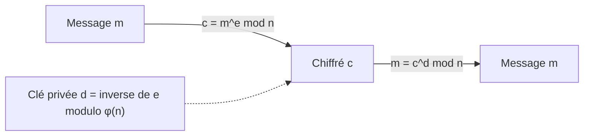
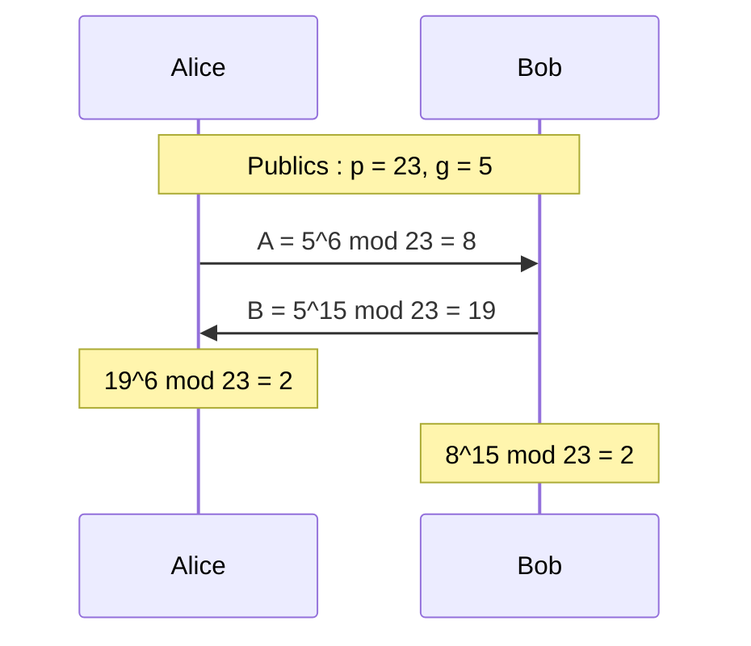

## Introduction

Ce cours de mathématiques appliquées n'a pas vocation à être théorique pour lui-même : chaque notion introduite sert directement un usage en cybersécurité. L'arithmétique modulaire est la première brique, et sans doute la plus rentable. Elle explique comment fonctionne RSA, vu au chapitre 3 du cours Cryptographie Avancée, mais aussi l'échange de clés Diffie-Hellman, le vieux chiffre de César, les numéros de carte bancaire valides, les tables de hachage et même le débordement des compteurs dans un programme.

Concrètement, à la fin de ce chapitre, tu sauras calculer un reste de division à la main et en Python, réduire un calcul énorme en petits morceaux grâce aux propriétés du modulo, dérouler l'exponentiation modulaire rapide qui rend RSA praticable, et expliquer ce qu'est un inverse modulaire. Tous les calculs sont donnés pas à pas, puis vérifiés avec Python 3.12, qui intègre nativement les outils nécessaires.

## L'opération modulo : le reste d'une division entière

### Définition

Quand tu divises un entier `a` par un entier positif `n`, tu obtiens un quotient `q` et un reste `r`, avec la relation `a = q × n + r` et un reste compris entre 0 et n moins 1. L'opération **modulo**, notée « mod » en mathématiques et `%` dans la plupart des langages, renvoie simplement ce reste `r`. Le nombre `n` s'appelle le **module**.

Prenons l'exemple de 17 mod 5. On cherche combien de fois 5 tient entièrement dans 17 : trois fois, ce qui fait 15. Il reste 17 moins 15, soit 2. Donc 17 = 3×5 + 2 et 17 mod 5 = 2.

C'est une notion que tu utilises déjà sans le savoir : une horloge fonctionne en arithmétique modulo 12. Si il est 10 heures et que tu ajoutes 5 heures, l'aiguille n'indique pas 15 mais 3, car 15 mod 12 = 3. Les jours de la semaine fonctionnent modulo 7, les minutes modulo 60.

### Exemples calculés pas à pas

```text
17 mod 5   : 17  = 3×5   + 2   → 2
23 mod 7   : 23  = 3×7   + 2   → 2
29 mod 6   : 29  = 4×6   + 5   → 5
100 mod 9  : 100 = 11×9  + 1   → 1
100 mod 12 : 100 = 8×12  + 4   → 4
15 mod 15  : 15  = 1×15  + 0   → 0
```

La méthode est toujours la même : trouver le plus grand multiple du module qui ne dépasse pas le nombre, puis calculer la différence. Pour 23 mod 7, le plus grand multiple de 7 inférieur ou égal à 23 est 21, et 23 moins 21 donne 2. Pour 100 mod 9, le plus grand multiple de 9 est 99, il reste 1.

Le dernier cas, 15 mod 15, mérite qu'on s'y arrête : le résultat est 0, car 15 est exactement divisible par lui-même. De façon générale, **a mod n vaut 0 si et seulement si n divise a**. C'est le test de divisibilité le plus simple qui soit, et il revient constamment : un nombre est pair si son reste modulo 2 est nul.

<CehCallout>
Le modulo donne le reste d'une division entière : 17 mod 5 = 2 car 17 = 3×5 + 2, et 23 mod 7 = 2 car 23 = 3×7 + 2. Les examens de sécurité (CEH v13, Security+) n'exigent pas de calculs lourds, mais attendent que tu saches que RSA et Diffie-Hellman reposent sur l'exponentiation modulaire, et que la sécurité de RSA dépend de la difficulté de la factorisation.
</CehCallout>

### La notion de congruence

Deux nombres qui ont le même reste modulo n sont dits **congrus modulo n**. On écrit `a ≡ b (mod n)`, ce qui se lit « a est congru à b modulo n ». Par exemple 17 ≡ 2 (mod 5), et aussi 17 ≡ 7 (mod 5) puisque 7 mod 5 = 2. Une définition équivalente, très pratique : a et b sont congrus modulo n si leur différence est un multiple de n. Ici 17 moins 7 vaut 10, qui est bien un multiple de 5.

Cette idée transforme les entiers en un ensemble fini de « classes » : modulo 5, il n'existe que cinq restes possibles, 0, 1, 2, 3 et 4. Les mathématiciens notent cet ensemble Z/5Z. Toute la cryptographie à clé publique classique travaille dans ce type d'ensemble fini, avec un module gigantesque.

### Le modulo en Python, et le piège des nombres négatifs

```python
# Python 3.12 : l'opérateur % renvoie le reste, divmod renvoie quotient et reste
print(17 % 5, 23 % 7, 29 % 6, 100 % 9, 100 % 12, 15 % 15)
print(divmod(100, 12))   # (quotient, reste)

# Avec un nombre négatif, Python renvoie toujours un reste du signe du module
print(-7 % 5)
```

```text
2 2 5 1 4 0
(8, 4)
3
```

Le dernier résultat surprend souvent. En Python, -7 mod 5 vaut 3, car -7 = (-2)×5 + 3 et le reste est choisi entre 0 et 4. En C, en Java ou en JavaScript, l'opérateur `%` renvoie au contraire -2, du signe du dividende. Cette différence a causé de vrais bugs de sécurité : un indice de tableau calculé avec `%` sur une valeur négative en C peut devenir négatif et provoquer une lecture hors limites. Quand tu portes un algorithme cryptographique d'un langage à l'autre, vérifie toujours la convention.

## Les propriétés de l'addition et de la multiplication modulaires

### Réduire à chaque étape

La propriété fondamentale est la suivante : on peut réduire modulo n **à n'importe quelle étape** d'une suite d'additions ou de multiplications sans changer le résultat final.

```text
Addition       : (a + b) mod n = ((a mod n) + (b mod n)) mod n
Multiplication : (a × b) mod n = ((a mod n) × (b mod n)) mod n
```

Vérifions l'addition avec 7 et 9 modulo 5. Calcul direct : 7 + 9 = 16, et 16 mod 5 = 1. Calcul réduit : 7 mod 5 = 2 et 9 mod 5 = 4, puis 2 + 4 = 6 et 6 mod 5 = 1. Les deux chemins donnent bien 1.

Vérifions la multiplication avec (15 × 22) mod 4. Calcul direct : 15 × 22 = 330, et 330 = 82×4 + 2, donc le résultat est 2. Calcul réduit : 15 mod 4 = 3 et 22 mod 4 = 2, puis 3 × 2 = 6, et 6 mod 4 = 2. On retrouve 2, en ne manipulant que de tout petits nombres.

```python
# Vérification des deux propriétés
print((7 + 9) % 5, ((7 % 5) + (9 % 5)) % 5)
print((15 * 22) % 4, ((15 % 4) * (22 % 4)) % 4)
```

```text
1 1
2 2
```

L'intérêt devient évident quand les nombres sont énormes : au lieu de calculer un produit de mille chiffres puis de le réduire, tu réduis chaque facteur d'abord et tu ne manipules jamais rien de plus grand que n au carré.

### Et la soustraction, la division ?

La soustraction suit la même règle que l'addition, en gardant à l'esprit qu'un résultat négatif se ramène entre 0 et n moins 1 en ajoutant n. La division, en revanche, **n'existe pas directement** en arithmétique modulaire : diviser par a revient à multiplier par l'inverse modulaire de a, une notion vue plus bas, et cet inverse n'existe pas toujours.

## Applications directes : César, Luhn et tables de hachage

### Le chiffre de César, un décalage modulo 26

Le chiffre de César remplace chaque lettre par celle située k positions plus loin dans l'alphabet, en revenant au début après Z. Si on numérote les lettres de A = 0 à Z = 25, le chiffrement est `c = (p + k) mod 26` et le déchiffrement `p = (c - k) mod 26`.

Avec une clé k = 3, chiffrons « NYX ». N vaut 13, et 13 + 3 = 16, soit Q. Y vaut 24, et 24 + 3 = 27, qui modulo 26 donne 1, soit B. X vaut 23, et 23 + 3 = 26, qui modulo 26 donne 0, soit A. Le texte chiffré est donc « QBA ».

```python
def cesar(texte: str, k: int) -> str:
    # Chaque lettre est décalée de k positions modulo 26
    return "".join(chr((ord(c) - ord("A") + k) % 26 + ord("A")) for c in texte)

chiffre = cesar("NYX", 3)
print(chiffre, cesar(chiffre, -3))
```

```text
QBA NYX
```

Ce chiffre est évidemment trivial à casser : il n'existe que 26 clés possibles, et un attaquant les teste toutes en une fraction de seconde. Il illustre néanmoins parfaitement le rôle du modulo, qui fait « boucler » l'alphabet.

### L'algorithme de Luhn, une somme de contrôle modulo 10

Les numéros de carte bancaire et les numéros IMEI des téléphones contiennent un chiffre de contrôle calculé par l'algorithme de Luhn. On double un chiffre sur deux en partant de la droite (en retranchant 9 si le double dépasse 9), on additionne tout, et le numéro est valide si la somme est un multiple de 10, autrement dit si la somme mod 10 vaut 0.

```python
def luhn_valide(numero: str) -> bool:
    total = 0
    for i, c in enumerate(reversed(numero)):
        d = int(c)
        if i % 2 == 1:          # un chiffre sur deux, en partant de la droite
            d *= 2
            if d > 9:
                d -= 9
        total += d
    return total % 10 == 0

print(luhn_valide("79927398713"), luhn_valide("79927398710"))
```

```text
True False
```

En cybersécurité, ce test sert dans les outils de prévention des fuites de données (DLP) : une suite de seize chiffres qui passe le test de Luhn a de bonnes chances d'être un vrai numéro de carte, ce qui réduit les faux positifs. Attention, Luhn détecte les erreurs de frappe mais **n'apporte aucune sécurité** : n'importe qui peut fabriquer un numéro valide.

### Tables de hachage et répartition

Une table de hachage range une donnée dans la case numéro `hash(clé) mod taille`. Le modulo ramène un hash gigantesque à un indice valide. Si un attaquant peut choisir des clés qui tombent toutes dans la même case, il dégrade les performances d'un serveur : c'est l'attaque par collisions de hachage, qui a poussé Python, Perl ou Ruby à randomiser leur fonction de hachage des chaînes (en Python, depuis la version 3.3, via `PYTHONHASHSEED`).

## L'exponentiation modulaire rapide

### Le problème de la taille

RSA chiffre un message `m` en calculant `c = m^e mod n`, où n fait aujourd'hui au moins 2048 bits, soit environ 617 chiffres décimaux. Calculer `m^e` en entier puis appliquer le modulo à la fin est impossible : le nombre intermédiaire serait astronomique. Pour te donner une idée, 2^1000 calculé directement s'écrit déjà avec **plus de 300 chiffres**, exactement 302.

```python
print(len(str(2**1000)))    # nombre de chiffres décimaux de 2^1000
print(len(str(2**2048)))    # taille décimale d'un module RSA 2048 bits
```

```text
302
617
```

Avec un exposant privé RSA de 2048 bits, le résultat intermédiaire aurait plus de chiffres qu'il n'y a d'atomes dans l'univers observable. La solution consiste à combiner deux idées : réduire modulo n après chaque multiplication, grâce à la propriété vue plus haut, et réduire le **nombre** de multiplications grâce à l'écriture binaire de l'exposant.

### L'algorithme square-and-multiply

L'idée est de lire l'exposant en binaire. Calculons 4^13 mod 497. En binaire, 13 s'écrit 1101, c'est-à-dire 8 + 4 + 1. Donc 4^13 = 4^8 × 4^4 × 4^1. On calcule les puissances successives 4^1, 4^2, 4^4, 4^8 en élevant au carré à chaque étape, en réduisant modulo 497, puis on multiplie celles qui correspondent à un bit à 1.

```text
Bit de poids faible d'abord : 13 = 1101 en binaire

Puissance   Calcul (mod 497)          Bit   Résultat partiel
4^1         4                          1     r = 4
4^2         16                         0     r = 4
4^4         16² = 256                  1     r = 4 × 256 = 1024 mod 497 = 30
4^8         256² = 65536 mod 497 = 429 1     r = 30 × 429 = 12870 mod 497 = 445

4^13 mod 497 = 445
```

Au lieu de douze multiplications, on en fait au plus deux par bit de l'exposant. Pour un exposant de 2048 bits, cela représente environ 4096 multiplications de nombres de 2048 bits, ce qu'un smartphone réalise en quelques millisecondes.

```python
def expmod(base: int, exp: int, mod: int) -> int:
    # Square-and-multiply : on parcourt les bits de l'exposant
    resultat = 1
    base %= mod
    while exp > 0:
        if exp & 1:                       # bit courant à 1 : on multiplie
            resultat = (resultat * base) % mod
        base = (base * base) % mod        # on élève au carré pour le bit suivant
        exp >>= 1
    return resultat

print(expmod(4, 13, 497), pow(4, 13, 497))
```

```text
445 445
```

En pratique, tu n'as pas à coder cet algorithme : la fonction native `pow(base, exp, mod)` de Python l'implémente de façon optimisée. Retiens simplement qu'il faut toujours lui passer le troisième argument.

<WarningCallout>
L'implémentation naïve de square-and-multiply fait une multiplication de plus quand le bit vaut 1 : son temps d'exécution dépend donc de la clé secrète. C'est la base des attaques temporelles et par canal auxiliaire (Kocher, 1996). Les bibliothèques sérieuses (OpenSSL, BoringSSL, libsodium) utilisent des implémentations à temps constant et du « blinding ». N'utilise jamais ta propre implémentation pour protéger de vraies données.
</WarningCallout>

## L'inverse modulaire

### Définition et condition d'existence

L'inverse modulaire de a modulo n est le nombre x tel que `(a × x) mod n = 1`. C'est l'équivalent de 1/5 pour le nombre 5 en arithmétique classique, puisque 5 × 1/5 = 1. Par exemple, l'inverse de 3 modulo 7 est 5, car 3 × 5 = 15 et 15 mod 7 = 1.

Cet inverse **n'existe pas toujours**. Un inverse modulaire de a existe si et seulement si a et n sont **premiers entre eux**, c'est-à-dire si leur PGCD vaut 1. Par exemple, 2 n'a pas d'inverse modulo 4 : les produits 2×1, 2×2 et 2×3 donnent comme restes 2, 0 et 2, jamais 1. Le PGCD de 2 et 4 vaut 2, la condition n'est pas remplie. Le chapitre 2 explique comment calculer ce PGCD et comment trouver l'inverse avec l'algorithme d'Euclide étendu.

```python
print(pow(3, -1, 7))          # inverse de 3 modulo 7 (Python 3.8 et plus)
try:
    pow(2, -1, 4)
except ValueError as e:
    print("Erreur :", e)
```

```text
5
Erreur : base is not invertible for the given modulus
```

### Le rôle de l'inverse dans RSA

Dans RSA, la clé publique contient un exposant `e`, très souvent 65537. La clé privée `d` est précisément l'**inverse de e modulo φ(n)**, où φ(n) est un nombre que seul le propriétaire de la clé peut calculer parce qu'il connaît les deux facteurs premiers de n. Chiffrer puis déchiffrer revient à calculer `(m^e)^d mod n`, et comme e × d ≡ 1 (mod φ(n)), on retrouve m. Voici un exemple jouet, avec des nombres minuscules réservés à l'apprentissage :

```python
p, q = 61, 53
n = p * q                    # module public
phi = (p - 1) * (q - 1)      # calculable seulement si on connaît p et q
e = 17                       # exposant public
d = pow(e, -1, phi)          # clé privée = inverse de e modulo phi
m = 65                       # message (un nombre plus petit que n)
c = pow(m, e, n)             # chiffrement
print(n, phi, d, c, pow(c, d, n))
```

```text
3233 3120 2753 2790 65
```

On retrouve bien le message 65 après déchiffrement. Avec un vrai module de 2048 bits, retrouver d sans connaître p et q exige de factoriser n, ce qui est hors de portée des ordinateurs classiques.



## Une autre application : l'échange de clés Diffie-Hellman

Diffie-Hellman permet à deux personnes de se mettre d'accord sur un secret commun en ne s'échangeant que des valeurs publiques. On choisit publiquement un nombre premier p et un générateur g. Alice choisit un secret a et envoie `A = g^a mod p`, Bob choisit b et envoie `B = g^b mod p`. Chacun élève ensuite la valeur reçue à son propre secret : Alice calcule `B^a mod p`, Bob calcule `A^b mod p`, et les deux obtiennent `g^(ab) mod p`.

```python
p, g = 23, 5                 # paramètres publics (jouet)
a, b = 6, 15                 # secrets d'Alice et de Bob
A, B = pow(g, a, p), pow(g, b, p)
print(A, B, pow(B, a, p), pow(A, b, p))
```

```text
8 19 2 2
```

Le secret partagé vaut 2 des deux côtés. Un observateur voit p, g, A et B, mais retrouver a à partir de A est le **problème du logarithme discret**, difficile pour de grands nombres. Dans TLS 1.3, on utilise surtout sa variante sur courbes elliptiques (ECDHE, par exemple X25519), et depuis 2024-2025 les navigateurs et OpenSSL 3.5 déploient l'échange hybride X25519MLKEM768, qui ajoute l'algorithme post-quantique ML-KEM standardisé par le NIST dans FIPS 203.



<TipCallout>
Pour vérifier un calcul modulaire rapidement, ouvre un interpréteur Python et utilise `pow(a, b, n)` et `pow(a, -1, n)`. Pour des nombres de taille cryptographique, Python gère nativement les entiers de taille arbitraire, sans aucune bibliothèque externe.
</TipCallout>

## Erreurs fréquentes

La première erreur consiste à confondre le quotient et le reste : 23 mod 7 vaut 2, pas 3, car 3 est le quotient. La deuxième est d'oublier que le résultat d'un modulo n est toujours compris entre 0 et n moins 1 : un résultat égal à n signale une erreur de calcul, comme dans la confusion fréquente qui consiste à répondre 15 pour 15 mod 15 au lieu de 0.

La troisième erreur concerne les nombres négatifs, dont le traitement diffère entre Python et les langages de la famille C. La quatrième consiste à calculer `a ** b % n` en Python au lieu de `pow(a, b, n)` : le résultat est le même, mais le premier calcule d'abord la puissance entière, ce qui devient interminable dès que les nombres grandissent. Enfin, beaucoup supposent qu'un inverse modulaire existe toujours, alors qu'il exige que a et n soient premiers entre eux.

## Lab — Mise en pratique

**Environnement** : terminal Kali ou n'importe quel poste avec Python 3.12.

<Steps steps={[
  { title: "Calculer des modulos à la main puis en Python", description: "Calcule 29 mod 6, 100 mod 9 et 15 mod 15 sur papier en écrivant la relation a = q × n + r, puis vérifie avec divmod. Observe que 15 mod 15 donne 0 et explique pourquoi.", code: "python3 -c \"print(divmod(29, 6), divmod(100, 9), divmod(15, 15))\"" },
  { title: "Vérifier la propriété d'addition", description: "Vérifie que (7 + 9) mod 5 et ((7 mod 5) + (9 mod 5)) mod 5 donnent le même résultat, à savoir 1.", code: "python3 -c \"print((7 + 9) % 5, ((7 % 5) + (9 % 5)) % 5)\"" },
  { title: "Vérifier la propriété de multiplication", description: "Calcule (15 × 22) mod 4 directement, puis en réduisant chaque facteur. Les deux méthodes doivent donner 2.", code: "python3 -c \"print((15 * 22) % 4, ((15 % 4) * (22 % 4)) % 4)\"" },
  { title: "Comparer Python et C sur un nombre négatif", description: "Calcule -7 mod 5 en Python, puis avec bc qui suit la convention du C. Note la différence de signe.", code: "python3 -c \"print(-7 % 5)\"\necho '-7 % 5' | bc" },
  { title: "Mesurer l'intérêt de pow à trois arguments", description: "Compare le temps de calcul de pow(7, 10**6, 13) et de 7 ** 10**6 % 13. Les résultats sont identiques mais le second est beaucoup plus lent.", code: "python3 -m timeit \"pow(7, 10**6, 13)\"\npython3 -m timeit -n 3 \"7 ** 10**6 % 13\"" },
  { title: "Dérouler square-and-multiply", description: "Écris 13 en binaire, puis refais à la main le tableau de 4^13 mod 497 et vérifie que tu obtiens 445.", code: "python3 -c \"print(bin(13), pow(4, 13, 497))\"" },
  { title: "Construire un RSA jouet", description: "Reprends p = 61 et q = 53, calcule n, φ(n) et d avec pow(e, -1, phi), puis chiffre et déchiffre un message de ton choix inférieur à n. Vérifie que tu retrouves le message initial.", code: "python3 -c \"p,q,e=61,53,17; n=p*q; d=pow(e,-1,(p-1)*(q-1)); c=pow(42,e,n); print(n, d, c, pow(c,d,n))\"" }
]} />

## À retenir

- Le modulo renvoie le reste de la division entière : a = q × n + r, avec un reste compris entre 0 et n moins 1, et a mod n vaut 0 exactement quand n divise a.
- Deux nombres sont congrus modulo n quand leur différence est un multiple de n ; l'arithmétique modulaire travaille dans un ensemble fini de restes.
- On peut réduire modulo n à chaque étape d'une suite d'additions ou de multiplications sans changer le résultat, par exemple (15 × 22) mod 4 = (3 × 2) mod 4 = 2.
- L'exponentiation modulaire rapide (square-and-multiply) calcule a^b mod n en environ deux multiplications par bit de l'exposant, sans jamais manipuler de nombre plus grand que n au carré.
- L'inverse modulaire de a existe si et seulement si a et n sont premiers entre eux ; la clé privée RSA est l'inverse de e modulo φ(n).
- RSA, Diffie-Hellman, le chiffre de César, l'algorithme de Luhn et les tables de hachage reposent tous sur le modulo.
- En Python, utilise `pow(a, b, n)` et `pow(a, -1, n)`, et méfie-toi des différences de convention sur les nombres négatifs entre langages.

## Questions de révision

1. Que donne 23 mod 7, et comment le calcule-t-on étape par étape ?
2. Calcule (15 × 22) mod 4 de deux façons différentes et explique pourquoi elles donnent le même résultat.
3. Pourquoi ne peut-on pas simplement calculer a^b puis appliquer le modulo à la fin en cryptographie RSA ?
4. Déroule l'algorithme square-and-multiply pour 3^5 mod 7 en t'appuyant sur l'écriture binaire de 5.
5. À quelle condition un nombre a possède-t-il un inverse modulaire par rapport à n ? Donne un exemple où il n'existe pas.
6. Pourquoi le chiffre de César est-il trivial à casser, alors qu'il utilise lui aussi l'arithmétique modulaire ?
7. Pourquoi une implémentation naïve de l'exponentiation modulaire peut-elle laisser fuir une clé secrète ?
