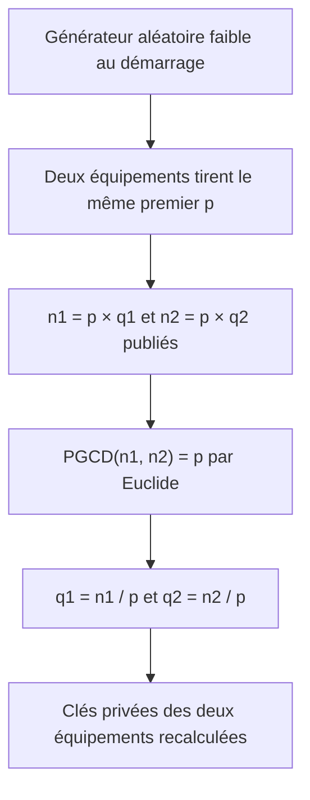

## Introduction

Les nombres premiers ne sont pas qu'une curiosité mathématique : ils sont au cœur de la sécurité de RSA, étudié au chapitre 3 du cours Cryptographie Avancée. La robustesse de RSA repose sur un déséquilibre de calcul. Multiplier deux grands nombres premiers est instantané, mais retrouver ces deux facteurs à partir du seul produit est extrêmement coûteux.

Le **PGCD**, ou plus grand commun diviseur, est l'outil qui complète ce tableau. C'est grâce à lui que l'on vérifie qu'un inverse modulaire existe, que l'on calcule la clé privée RSA, et que des chercheurs ont réussi à casser des dizaines de milliers de clés RSA réelles mal générées. À la fin de ce chapitre, tu sauras reconnaître un nombre premier, appliquer le crible d'Ératosthène, dérouler l'algorithme d'Euclide et sa version étendue, et expliquer ce que révèle un PGCD non trivial entre deux modules RSA.

## Qu'est-ce qu'un nombre premier

### Définition

Un **nombre premier** est un entier supérieur à 1 qui n'a exactement que deux diviseurs : 1 et lui-même. Les premiers d'entre eux sont 2, 3, 5, 7, 11, 13, 17, 19, 23, 29 et 31. Un entier supérieur à 1 qui n'est pas premier est dit **composé** : il s'écrit comme un produit de nombres plus petits.

```text
Nombres premiers : 2, 3, 5, 7, 11, 13, 17, 19, 23, 29, 31...
Nombres composés : 4 = 2×2, 6 = 2×3, 9 = 3×3, 15 = 3×5,
                   21 = 3×7, 27 = 3×3×3, 33 = 3×11
```

Remarque que 1 n'est pas premier, par convention, et que 2 est le seul nombre premier pair. 23 est premier : aucun des nombres 2, 3 ou 4 ne le divise, et il est inutile d'aller plus loin, comme on va le voir.

### Le théorème fondamental de l'arithmétique

Tout entier supérieur à 1 se décompose **de façon unique** en produit de nombres premiers, à l'ordre près. Par exemple 84 = 2 × 2 × 3 × 7 et 360 = 2³ × 3² × 5. Les nombres premiers sont donc les « atomes » de la multiplication. C'est cette unicité qui donne son sens à la sécurité de RSA : un module n = p × q n'a qu'une seule décomposition, et la clé privée n'est calculable qu'en la connaissant.

### Tester si un nombre est premier

La méthode la plus simple est la **division d'essai** : on essaie de diviser n par tous les entiers de 2 jusqu'à la racine carrée de n. Si aucun ne divise n, il est premier. Pourquoi s'arrêter à la racine carrée ? Si n = a × b avec a et b tous deux supérieurs à la racine de n, leur produit dépasserait n. Un des deux facteurs est donc forcément inférieur ou égal à la racine carrée.

```python
import math

def est_premier(n: int) -> bool:
    if n < 2:
        return False
    for d in range(2, math.isqrt(n) + 1):   # inutile d'aller au-delà de la racine
        if n % d == 0:
            return False
    return True

print([x for x in (21, 23, 27, 33, 97) if est_premier(x)])
```

```text
[23, 97]
```

Pour les nombres de taille cryptographique, la division d'essai est impraticable. Les bibliothèques utilisent des **tests probabilistes** comme Miller-Rabin, qui reposent sur le petit théorème de Fermat : si p est premier, alors a^(p-1) mod p = 1 pour tout a non divisible par p. Un nombre qui échoue à ce test est certainement composé ; un nombre qui le passe de nombreuses fois avec des bases aléatoires est premier avec une probabilité d'erreur négligeable. OpenSSL, par exemple, génère ainsi les premiers de 1024 bits d'une clé RSA 2048 bits.

## Le crible d'Ératosthène

Pour trouver **tous** les nombres premiers jusqu'à une limite, la méthode la plus intuitive date de plus de 2000 ans. On écrit la liste des entiers de 2 à la limite. On prend le premier nombre non barré, 2, qui est premier, et on barre tous ses multiples. On passe au nombre non barré suivant, 3, on barre ses multiples, puis 5, et ainsi de suite. Les nombres qui restent sont premiers : le crible **élimine progressivement tous les multiples de chaque nombre premier trouvé**.

```python
def crible(limite: int) -> list[int]:
    est_p = [True] * (limite + 1)
    est_p[0] = est_p[1] = False
    for i in range(2, int(limite ** 0.5) + 1):
        if est_p[i]:
            for multiple in range(i * i, limite + 1, i):   # barrer les multiples
                est_p[multiple] = False
    return [i for i, p in enumerate(est_p) if p]

print(crible(50))
```

```text
[2, 3, 5, 7, 11, 13, 17, 19, 23, 29, 31, 37, 41, 43, 47]
```

On commence à barrer à partir de i × i, car les multiples plus petits ont déjà été barrés par un nombre premier plus petit. Le crible est très efficace jusqu'à quelques milliards, mais il ne sert à rien pour générer un premier de 1024 bits : il faudrait un tableau plus grand que toute la mémoire de la planète.

<TipCallout>
Les nombres premiers ne se raréfient que lentement : autour d'un nombre N, environ un nombre sur ln(N) est premier. Pour des nombres de 1024 bits, cela fait environ un sur 710, et un sur 355 si l'on ne teste que les impairs. C'est pourquoi tirer des nombres au hasard et les tester avec Miller-Rabin trouve un premier en quelques centaines d'essais.
</TipCallout>

## Le PGCD — plus grand commun diviseur

Le **PGCD** de deux entiers est le plus grand entier qui les divise tous les deux exactement. Les diviseurs de 48 sont 1, 2, 3, 4, 6, 8, 12, 16, 24 et 48 ; ceux de 18 sont 1, 2, 3, 6, 9 et 18. Les diviseurs communs sont 1, 2, 3 et 6, donc PGCD(48, 18) = 6.

Deux nombres sont **premiers entre eux** si leur PGCD vaut 1, c'est-à-dire s'ils n'ont aucun facteur premier commun. Attention, ils n'ont pas besoin d'être premiers eux-mêmes : 35 = 5 × 7 et 12 = 2² × 3 sont premiers entre eux, alors qu'aucun des deux n'est premier. En revanche 35 et 14 partagent le facteur 7. Comme on l'a vu au chapitre 1, être premiers entre eux est la condition d'existence d'un inverse modulaire.

Lister tous les diviseurs fonctionne pour de petits nombres mais devient impossible pour de grands nombres. Il faut une méthode plus maline.

## L'algorithme d'Euclide

### Le principe

L'algorithme d'Euclide, décrit vers 300 avant notre ère et l'un des plus anciens algorithmes connus, repose sur une observation simple : **le PGCD de a et b est égal au PGCD de b et de a mod b**. En effet, tout diviseur commun de a et b divise aussi le reste a − q × b, et réciproquement. On remplace donc la paire (a, b) par la paire (b, a mod b), qui est plus petite, et on recommence jusqu'à obtenir un reste nul.

<Steps steps={[
  { title: "Diviser le plus grand par le plus petit", description: "Écrire a = q × b + r et noter le reste r." },
  { title: "Décaler la paire", description: "Le diviseur b devient le nouveau dividende, et le reste r devient le nouveau diviseur." },
  { title: "Recommencer jusqu'au reste nul", description: "Quand le reste vaut 0, le dernier diviseur non nul est le PGCD recherché." }
]} />

### Exemples pas à pas

```text
PGCD(48, 18)
48 = 2×18 + 12   → PGCD(48, 18) = PGCD(18, 12)
18 = 1×12 + 6    → PGCD(18, 12) = PGCD(12, 6)
12 = 2×6  + 0    → reste nul : PGCD = 6

PGCD(84, 30)
84 = 2×30 + 24
30 = 1×24 + 6
24 = 4×6  + 0    → PGCD = 6

PGCD(56, 98)     (on commence par le plus grand)
98 = 1×56 + 42
56 = 1×42 + 14
42 = 3×14 + 0    → PGCD = 14

PGCD(35, 12)
35 = 2×12 + 11
12 = 1×11 + 1
11 = 11×1 + 0    → PGCD = 1 : 35 et 12 sont premiers entre eux

PGCD(35, 14)
35 = 2×14 + 7
14 = 2×7  + 0    → PGCD = 7 : 35 et 14 ne sont pas premiers entre eux
```

### En Python

```python
import math

def pgcd(a: int, b: int) -> int:
    # Algorithme d'Euclide : (a, b) devient (b, a mod b) jusqu'au reste nul
    while b != 0:
        print(f"{a} = {a // b}×{b} + {a % b}")
        a, b = b, a % b
    return a

print("PGCD =", pgcd(98, 56))
print(math.gcd(48, 18), math.gcd(84, 30), math.gcd(56, 98), math.gcd(35, 12), math.gcd(35, 14))
```

```text
98 = 1×56 + 42
56 = 1×42 + 14
42 = 3×14 + 0
PGCD = 14
6 6 14 1 7
```

### Pourquoi c'est si rapide

Le reste diminue très vite : on peut montrer que tous les deux tours, le plus grand nombre est au moins divisé par deux. Le nombre d'étapes est donc proportionnel au **nombre de chiffres** des nombres, pas à leur valeur. Pour deux nombres de 2048 bits, cela représente au plus quelques milliers d'étapes, réalisées en une fraction de milliseconde. C'est cette efficacité, inchangée depuis plus de 2300 ans, qui rend l'algorithme utilisable dans toutes les implémentations cryptographiques modernes.

<CehCallout>
Points à retenir pour les examens : un nombre premier n'a que deux diviseurs, 1 et lui-même ; RSA tire sa sécurité de la difficulté de factoriser le produit de deux grands premiers ; l'algorithme d'Euclide calcule un PGCD en un nombre d'étapes remarquablement faible, même sur des nombres de plusieurs centaines de chiffres. Les tailles de clés recommandées aujourd'hui sont d'au moins 2048 bits pour RSA, 3072 bits pour viser une sécurité de 128 bits.
</CehCallout>

## L'algorithme d'Euclide étendu et l'inverse modulaire

### L'identité de Bézout

En remontant les étapes de l'algorithme d'Euclide, on peut toujours écrire le PGCD sous la forme `a × x + b × y = PGCD(a, b)`, avec x et y entiers. C'est l'**identité de Bézout**. Quand a et n sont premiers entre eux, on obtient `a × x + n × y = 1`, et en prenant cette égalité modulo n, le terme n × y disparaît : il reste a × x ≡ 1 (mod n). Le nombre x est donc l'inverse modulaire de a.

### Exemple : la clé privée du RSA jouet

Au chapitre 1, on a utilisé e = 17 et φ(n) = 3120, et Python a donné d = 2753. Voyons d'où vient ce nombre.

```text
Euclide sur (3120, 17) :
3120 = 183×17 + 9
17   = 1×9    + 8
9    = 1×8    + 1
8    = 8×1    + 0     → PGCD = 1, l'inverse existe

Remontée :
1 = 9 − 1×8
  = 9 − 1×(17 − 1×9)       = 2×9 − 1×17
  = 2×(3120 − 183×17) − 17 = 2×3120 − 367×17

Donc 17 × (−367) ≡ 1 (mod 3120), et −367 + 3120 = 2753
```

```python
def euclide_etendu(a: int, b: int) -> tuple[int, int, int]:
    # Renvoie (g, x, y) tels que a*x + b*y = g = PGCD(a, b)
    if b == 0:
        return a, 1, 0
    g, x, y = euclide_etendu(b, a % b)
    return g, y, x - (a // b) * y

g, x, _ = euclide_etendu(17, 3120)
print(g, x, x % 3120, pow(17, -1, 3120), (17 * 2753) % 3120)
```

```text
1 -367 2753 2753 1
```

La fonction native `pow(e, -1, n)` de Python utilise exactement ce principe. Retiens la chaîne logique : le PGCD dit si l'inverse existe, l'algorithme étendu le calcule.

## Le lien avec la sécurité de RSA

### La factorisation, un problème difficile

Une clé RSA publique contient un module n = p × q. Si un attaquant retrouve p et q, il calcule φ(n) = (p − 1)(q − 1), puis la clé privée d par Euclide étendu, en quelques millisecondes. Toute la sécurité repose donc sur la difficulté de **factoriser** n. Ce n'est pas impossible en théorie, c'est simplement trop coûteux en pratique : le record public, RSA-250, un nombre de 829 bits, a été factorisé en 2020 au prix d'environ 2700 années-cœur de calcul. Un module de 2048 bits est hors de portée des méthodes classiques connues.

L'horizon est fixé par l'ordinateur quantique : l'algorithme de Shor factoriserait efficacement ces nombres sur une machine suffisamment puissante, qui n'existe pas encore. C'est pourquoi le NIST a publié en 2024 les standards post-quantiques FIPS 203 (ML-KEM), FIPS 204 (ML-DSA) et FIPS 205 (SLH-DSA), et prévoit dans son projet de document IR 8547 de déprécier RSA et les courbes elliptiques d'ici 2030 puis de les interdire d'ici 2035.

### Quand un PGCD casse des clés réelles

Si deux modules RSA n1 = p × q1 et n2 = p × q2 partagent accidentellement un même facteur premier p, il n'est pas nécessaire de factoriser quoi que ce soit : `PGCD(n1, n2) = p`, calculé instantanément par Euclide. Il suffit ensuite de diviser chaque module par p pour obtenir q1 et q2, et les **deux** clés sont cassées.

```python
import math

# Deux modules jouets générés avec un générateur aléatoire défaillant
n1 = 101 * 103
n2 = 101 * 107
p = math.gcd(n1, n2)
print(n1, n2, "facteur commun :", p, "->", n1 // p, n2 // p)
```

```text
10403 10807 facteur commun : 101 -> 103 107
```

Ce scénario n'est pas théorique. En 2012, deux équipes de chercheurs (Heninger et al., « Mining Your Ps and Qs », et Lenstra et al., « Ron was wrong, Whit is right ») ont collecté des millions de clés publiques sur Internet et calculé des PGCD entre elles. Elles ont pu retrouver les clés privées de dizaines de milliers d'équipements, principalement des routeurs et appliances embarqués qui généraient leurs clés au démarrage, avant d'avoir accumulé assez d'aléa. Une technique appelée **batch GCD** permet de calculer efficacement le PGCD de chaque clé avec le produit de toutes les autres.



<WarningCallout>
Le maillon faible de RSA n'est presque jamais les mathématiques, mais la génération des clés. Une source d'aléa insuffisante, un générateur non cryptographique ou une bibliothèque défaillante (comme la faille ROCA, CVE-2017-15361, qui touchait des puces Infineon et rendait la factorisation praticable) suffisent à anéantir la sécurité théorique. Génère tes clés avec des outils éprouvés, par exemple `openssl genpkey -algorithm RSA -pkeyopt rsa_keygen_bits:3072`, sur un système correctement initialisé.
</WarningCallout>

### Le point de vue défensif

Côté défense, ce chapitre se traduit en contrôles concrets. Il faut inventorier les clés et certificats (taille, algorithme, date de génération) et refuser les modules RSA de moins de 2048 bits. Les clés générées par des équipements embarqués méritent une vérification, et des outils comme `badkeys` permettent de tester une clé publique contre des faiblesses connues, dont les facteurs partagés et ROCA. Enfin, il est temps de planifier la migration post-quantique en recensant où RSA et ECDH sont utilisés.

<AuditCallout>
Dans ISO/IEC 27001:2022, la gestion des clés cryptographiques relève du contrôle A.8.24 « Utilisation de la cryptographie », qui exige des règles couvrant la génération, le stockage, la rotation et la destruction des clés. Les tailles minimales se justifient par des référentiels reconnus comme NIST SP 800-57 ou le guide de sélection d'algorithmes de l'ANSSI.
</AuditCallout>

## Erreurs fréquentes

On pense parfois que deux nombres premiers entre eux doivent être premiers : c'est faux, 35 et 12 le prouvent. On oublie aussi que 1 n'est pas premier et que 2 l'est. Dans l'algorithme d'Euclide, l'erreur classique consiste à prendre le dernier reste, qui vaut 0, au lieu du dernier diviseur non nul. Une autre confusion fréquente oppose factorisation et PGCD : factoriser un grand nombre est extrêmement difficile, alors que calculer un PGCD est quasi instantané, et c'est précisément pourquoi un facteur partagé est catastrophique. Enfin, on croit souvent que RSA est « prouvé incassable » : sa sécurité repose sur une difficulté de calcul supposée, pas sur une impossibilité théorique.

## Lab — Mise en pratique

**Environnement** : terminal Kali ou poste avec Python 3.12 et OpenSSL 3.

<Steps steps={[
  { title: "Reconnaître des nombres premiers", description: "Parmi 21, 23, 27 et 33, détermine à la main lesquels sont premiers en testant les diviseurs jusqu'à la racine carrée, puis vérifie avec la commande factor.", code: "factor 21 23 27 33" },
  { title: "Programmer le crible d'Ératosthène", description: "Recopie la fonction crible du chapitre dans un fichier crible.py et affiche les premiers jusqu'à 100. Compte-les : il doit y en avoir 25.", code: "python3 crible.py" },
  { title: "Calculer des PGCD à la main", description: "Déroule l'algorithme d'Euclide pour PGCD(56, 98), puis pour PGCD(84, 30). Vérifie que tu obtiens 14 et 6.", code: "python3 -c \"import math; print(math.gcd(56, 98), math.gcd(84, 30))\"" },
  { title: "Tester des nombres premiers entre eux", description: "35 et 12 sont-ils premiers entre eux ? Et 35 et 14 ? Justifie chaque réponse par le PGCD.", code: "python3 -c \"import math; print(math.gcd(35, 12), math.gcd(35, 14))\"" },
  { title: "Calculer un inverse par Euclide étendu", description: "Remonte à la main les étapes d'Euclide pour trouver l'inverse de 17 modulo 3120, puis compare avec pow.", code: "python3 -c \"print(pow(17, -1, 3120))\"" },
  { title: "Simuler une fuite par facteur partagé", description: "Choisis trois petits premiers p, q1, q2, construis deux modules qui partagent p et retrouve tous les facteurs avec un seul calcul de PGCD.", code: "python3 -c \"import math; n1, n2 = 101*103, 101*107; p = math.gcd(n1, n2); print(p, n1 // p, n2 // p)\"" },
  { title: "Inspecter une vraie clé RSA", description: "Génère une clé RSA 3072 bits dans un répertoire de test et observe le module, l'exposant public 65537 et les deux premiers prime1 et prime2 dans la sortie.", code: "openssl genpkey -algorithm RSA -pkeyopt rsa_keygen_bits:3072 -out test.pem\nopenssl pkey -in test.pem -text -noout | head -20" }
]} />

## À retenir

- Un nombre premier est un entier supérieur à 1 qui n'a que deux diviseurs, 1 et lui-même ; tout entier se décompose de façon unique en facteurs premiers.
- Le crible d'Ératosthène trouve tous les premiers jusqu'à une limite en éliminant progressivement les multiples de chaque premier trouvé.
- L'algorithme d'Euclide remplace (a, b) par (b, a mod b) jusqu'au reste nul : PGCD(48, 18) = 6, PGCD(84, 30) = 6, PGCD(56, 98) = 14.
- Deux nombres sont premiers entre eux si leur PGCD vaut 1, sans qu'ils soient forcément premiers eux-mêmes.
- L'algorithme d'Euclide étendu calcule l'inverse modulaire, et donc la clé privée RSA à partir de e et φ(n).
- La sécurité de RSA repose sur la difficulté de factoriser n = p × q ; un PGCD non trivial entre deux modules révèle un facteur partagé et casse les deux clés.
- Les clés RSA doivent faire au moins 2048 bits, être générées avec un aléa de qualité, et la migration post-quantique (FIPS 203, 204, 205) doit être planifiée.

## Questions de révision

1. Pourquoi RSA repose-t-il sur des nombres premiers plutôt que sur des nombres quelconques ?
2. Pourquoi suffit-il de tester les diviseurs jusqu'à la racine carrée de n pour savoir si n est premier ?
3. Calcule PGCD(84, 30) en appliquant l'algorithme d'Euclide étape par étape.
4. 35 et 12 sont-ils premiers entre eux ? Pourquoi ce résultat montre-t-il qu'être premiers entre eux n'exige pas d'être premiers ?
5. Comment l'algorithme d'Euclide étendu permet-il de calculer la clé privée RSA ?
6. Pourquoi le calcul du PGCD entre deux modules RSA peut-il révéler une faille de génération de clés, et quel type d'équipement était surtout concerné en 2012 ?
7. Quelles mesures défensives mettrais-tu en place dans une organisation pour éviter des clés RSA faibles ?
