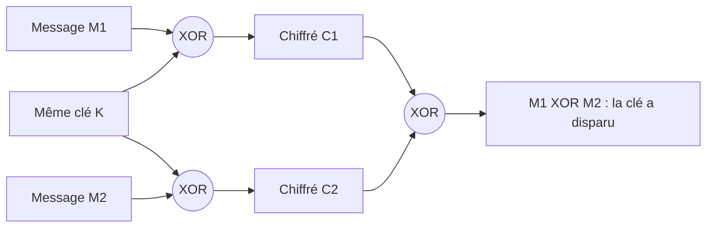

## Introduction

La logique booléenne, formalisée par George Boole au XIXe siècle, est le langage sous-jacent à tout ce qui est numérique. Un processeur n'est qu'un immense assemblage de portes logiques ; une règle de pare-feu est une condition booléenne ; une requête dans un SIEM ou une règle de détection Sigma combine des conditions avec ET, OU et NON. Et en cryptographie, un opérateur règne en maître : le **XOR**.

À la fin de ce chapitre, tu sauras construire et lire une table de vérité, simplifier une condition avec les lois de De Morgan, manipuler des bits en Python pour calculer une adresse réseau ou des permissions Unix, et expliquer pourquoi le masque jetable est incassable tant qu'on ne réutilise jamais la clé.

## Les valeurs et les opérateurs de base

### Vrai, faux, 1 et 0

Une variable **booléenne** ne peut prendre que deux valeurs : vrai ou faux, que l'on note aussi 1 et 0. Un **opérateur logique** prend une ou deux valeurs booléennes et en produit une nouvelle. Il en existe quatre à connaître absolument.

<CompareTable
  titleA="Opérateur"
  titleB="Signification"
  rows={[
    { a: "ET (AND), noté A ∧ B ou A & B", b: "Vrai seulement si les deux conditions sont vraies" },
    { a: "OU (OR), noté A ∨ B ou A | B", b: "Vrai si au moins une des deux conditions est vraie" },
    { a: "NON (NOT), noté ¬A ou ~A", b: "Inverse la valeur : vrai devient faux et inversement" },
    { a: "XOR (OU exclusif), noté A ⊕ B ou A ^ B", b: "Vrai si les deux valeurs sont différentes l'une de l'autre" }
  ]}
/>

La différence entre OU et XOR est le point qui piège le plus souvent. Le OU est **inclusif** : il est vrai si l'une, l'autre ou les deux conditions sont vraies. Le XOR est **exclusif** : il exclut le cas où les deux sont vraies en même temps. En français courant, « fromage ou dessert » au restaurant est un XOR, tandis que « tu peux payer par carte ou en espèces » est plutôt un OU.

### Les tables de vérité

Une **table de vérité** liste toutes les combinaisons possibles des entrées et le résultat correspondant. Avec deux entrées, il y a quatre lignes.

```text
 A  B | A ET B | A OU B | A XOR B | NON A
 0  0 |   0    |   0    |    0    |   1
 0  1 |   0    |   1    |    1    |   1
 1  0 |   0    |   1    |    1    |   0
 1  1 |   1    |   1    |    0    |   0
```

Lis ce tableau ligne par ligne. Quand A = 1 et B = 0, le ET donne 0, car il exige que les deux soient vrais. Quand A = 0 et B = 0, le OU donne 0, car aucune des deux n'est vraie. Quand A = 1 et B = 1, le XOR donne 0, car les deux valeurs sont identiques.

```python
from itertools import product

# Génère la table de vérité complète de quatre opérateurs
print(" A B | ET OU XOR")
for a, b in product([0, 1], repeat=2):
    print(f" {a} {b} |  {a & b}  {a | b}  {a ^ b}")
```

```text
 A B | ET OU XOR
 0 0 |  0  0  0
 0 1 |  0  1  1
 1 0 |  0  1  1
 1 1 |  1  1  0
```

### Les opérateurs dérivés

On rencontre aussi NAND (NON-ET) et NOR (NON-OU), qui sont simplement la négation du ET et du OU. Ils ont une propriété remarquable : chacun suffit à lui seul pour construire tous les autres. C'est pourquoi les puces électroniques sont souvent conçues uniquement avec des portes NAND. Une autre équivalence utile : A XOR B vaut (A OU B) ET NON (A ET B), ce qui traduit littéralement « l'un ou l'autre, mais pas les deux ».

## L'algèbre de Boole : simplifier les conditions

### Priorité des opérateurs

Comme en arithmétique où la multiplication passe avant l'addition, les opérateurs logiques ont une priorité : **NON s'applique d'abord, puis ET, puis OU**. Ainsi `NON A ET B OU C` se lit `((NON A) ET B) OU C`. Dans la pratique, et surtout dans une règle de sécurité, mets toujours des parenthèses : elles lèvent toute ambiguïté et évitent qu'un relecteur interprète la règle autrement que toi.

Attention, cette priorité varie selon les langages. En Python, `not` passe avant `and`, qui passe avant `or`, conformément à la règle. Mais les opérateurs bit à bit `&`, `^` et `|` ont une priorité **supérieure** aux comparaisons comme `==` en Python, et inférieure en C, une source classique de bugs.

### Les lois de De Morgan

Les deux lois de De Morgan permettent de « distribuer » une négation :

```text
NON (A ET B) = (NON A) OU (NON B)
NON (A OU B) = (NON A) ET (NON B)
```

Pour retenir : quand la négation entre dans la parenthèse, le ET devient OU et le OU devient ET. Un exemple concret : « il est faux que l'utilisateur soit à la fois admin et connecté depuis le VPN » équivaut à « l'utilisateur n'est pas admin, ou il ne vient pas du VPN ». On peut le vérifier mécaniquement sur les quatre combinaisons :

```python
from itertools import product

for a, b in product([False, True], repeat=2):
    loi1 = (not (a and b)) == ((not a) or (not b))
    loi2 = (not (a or b)) == ((not a) and (not b))
    print(a, b, loi1, loi2)
```

```text
False False True True
False True True True
True False True True
True True True True
```

Toutes les lignes affichent True : les deux lois sont vérifiées dans tous les cas. Ce type de vérification exhaustive est exactement ce que fait un outil de vérification formelle, à plus grande échelle.

### Les autres lois utiles

Quelques identités servent constamment. A ET 1 = A, et A ET 0 = 0. A OU 0 = A, et A OU 1 = 1. NON (NON A) = A. Pour le XOR, A XOR 0 = A, A XOR A = 0, et le XOR est commutatif et associatif, ce qui signifie que l'ordre des opérations n'a aucune importance. Ces trois dernières propriétés sont la clé de tout ce qui suit en cryptographie.

## La logique booléenne en sécurité opérationnelle

### Règles de pare-feu et de détection

Une règle de pare-feu est une condition booléenne. « Autoriser si la source est dans le réseau interne ET la destination est le port 443 ET le protocole est TCP » utilise trois ET. Un piège fréquent consiste à écrire une règle trop large avec un OU au lieu d'un ET, et donc à ouvrir bien plus que prévu.

Les règles de détection suivent le même principe. Le format **Sigma**, standard ouvert de règles de détection traduisibles vers la plupart des SIEM, contient un champ `condition` qui combine des blocs nommés avec `and`, `or` et `not` :

```yaml
title: PowerShell lancé depuis Office (exemple simplifié)
logsource:
  category: process_creation
  product: windows
detection:
  parent_office:
    ParentImage|endswith:
      - '\WINWORD.EXE'
      - '\EXCEL.EXE'
  powershell:
    Image|endswith: '\powershell.exe'
  filtre_legitime:
    CommandLine|contains: 'MacroSigneeInterne'
  condition: parent_office and powershell and not filtre_legitime
level: high
```

Lis la condition comme une phrase : un processus est suspect si son parent est Word OU Excel (les valeurs d'une liste sont combinées par un OU), ET s'il s'agit de PowerShell, ET s'il n'est pas couvert par l'exception légitime. Cette technique correspond dans MITRE ATT&CK à T1566.001 (pièce jointe d'hameçonnage) suivie de T1059.001 (exécution PowerShell). Le NON sert à **réduire les faux positifs** sans désactiver la règle entière.

<TipCallout>
Quand une règle de détection devient illisible, applique De Morgan : `not (a or b)` se réécrit `not a and not b`, souvent plus clair. Teste ensuite la règle sur des événements connus, positifs comme négatifs, avant de la déployer, exactement comme tu vérifierais une table de vérité.
</TipCallout>

### Les opérations bit à bit : masques réseau

Les opérateurs `&`, `|`, `^` et `~` s'appliquent aussi bit par bit sur des entiers. L'usage le plus courant en réseau est le **masque de sous-réseau** : l'adresse du réseau s'obtient par un ET bit à bit entre l'adresse IP et le masque. Les bits du masque à 1 conservent la partie réseau, les bits à 0 l'effacent.

```text
Adresse 192.168.1.130 : dernier octet 130 = 1000 0010
Masque  /26           : dernier octet 192 = 1100 0000
ET bit à bit          :                     1000 0000 = 128
Réseau                : 192.168.1.128/26
```

```python
import ipaddress

ip = int(ipaddress.ip_address("192.168.1.130"))
masque = int(ipaddress.ip_address("255.255.255.192"))
print(ipaddress.ip_address(ip & masque))                       # ET bit à bit
print(ipaddress.ip_interface("192.168.1.130/26").network)     # même résultat
```

```text
192.168.1.128
192.168.1.128/26
```

### Les opérations bit à bit : permissions Unix

Les permissions Unix sont trois groupes de trois bits : lecture (4), écriture (2) et exécution (1) pour le propriétaire, le groupe et les autres. Le mode 754 signifie rwx pour le propriétaire, r-x pour le groupe et r-- pour les autres. Le **umask** retire des permissions par défaut avec un ET et un NON : un fichier créé avec 666 et un umask de 022 obtient `666 ET NON 022`, soit 644.

```python
print(oct(0o666 & ~0o022), oct(0o777 & ~0o022))   # fichier, puis répertoire
print(bool(0o754 & 0o002))                          # les autres ont-ils l'écriture ?
```

```text
0o644 0o755
False
```

Tester un bit précis avec un ET est exactement ce que fait un outil d'audit qui recherche les fichiers modifiables par tout le monde, comme `find / -perm -o+w`.

## Le XOR : l'opérateur préféré de la cryptographie

### La propriété d'auto-annulation

Le XOR possède une propriété remarquable : appliqué deux fois avec la même clé, il annule son propre effet. En effet, (M XOR K) XOR K = M XOR (K XOR K) = M XOR 0 = M, grâce à l'associativité et aux identités vues plus haut. Chiffrer et déchiffrer sont donc **la même opération**.

```text
Chiffrement :
Message : 1010
Clé     : 0110
Chiffré : 1100   (1⊕0=1, 0⊕1=1, 1⊕1=0, 0⊕0=0)

Déchiffrement :
Chiffré : 1100
Clé     : 0110
Message : 1010   ← on retrouve le message original

Autre exemple :
1011 XOR 0101 = 1110   (1⊕0=1, 0⊕1=1, 1⊕0=1, 1⊕1=0)
1110 XOR 0101 = 1011   ← retour à la valeur de départ
```

```python
m, k = 0b1010, 0b0110
c = m ^ k
print(format(c, "04b"), format(c ^ k, "04b"))
print(format(0b1011 ^ 0b0101, "04b"), format(0b1110 ^ 0b0101, "04b"))
```

```text
1100 1010
1110 1011
```

Le XOR a une autre qualité : si la clé est parfaitement aléatoire, le résultat l'est aussi. Chaque bit du chiffré vaut 0 ou 1 avec une probabilité d'une chance sur deux, quel que soit le message. Le chiffré ne révèle donc **rien** sur le clair.

### Le masque jetable de Vernam

Le chiffrement de Vernam, ou **masque jetable** (one-time pad), consiste à faire un XOR entre le message et une clé aléatoire. Claude Shannon a démontré en 1949 qu'il offre une **sécurité parfaite**, à trois conditions strictes : la clé doit être véritablement aléatoire, aussi longue que le message, et utilisée une seule fois. C'est la seule méthode de chiffrement mathématiquement prouvée incassable, mais ces contraintes la rendent impraticable à grande échelle, car il faut transmettre de façon sûre une clé aussi volumineuse que les données.

<CehCallout>
À retenir pour l'examen : le XOR vaut 1 quand les deux bits sont différents ; (message XOR clé) XOR clé redonne le message ; le masque jetable est incassable si la clé est aléatoire, aussi longue que le message et à usage unique. Le XOR est partout dans les chiffrements modernes : étape AddRoundKey d'AES, chiffrements par flot comme ChaCha20, mode CTR et mode GCM, qui génèrent un flux de clé puis le combinent au message par XOR.
</CehCallout>

### Pourquoi réutiliser la clé est catastrophique

Supposons que deux messages M1 et M2 soient chiffrés avec la même clé K. Un attaquant qui intercepte C1 = M1 XOR K et C2 = M2 XOR K calcule C1 XOR C2. La clé s'annule :

```text
C1 XOR C2 = (M1 XOR K) XOR (M2 XOR K) = M1 XOR M2
```



L'attaquant obtient une relation directe entre les deux messages clairs, sans connaître la clé. Comme les textes réels sont très redondants, il devine des fragments probables de l'un (un en-tête HTTP, « Bonjour », un format JSON) et en déduit les fragments correspondants de l'autre. C'est la célèbre attaque du « two-time pad ». Historiquement, le projet Venona a déchiffré une partie des communications soviétiques parce que des masques avaient été réutilisés, et le chiffrement Wi-Fi WEP a été cassé notamment parce que son flux de clé RC4 se répétait.

```python
# Démonstration : la clé disparaît quand on combine deux chiffrés
k = bytes([0x3A, 0x91, 0x5C, 0x07, 0xE2])
m1, m2 = b"ATTAQ", b"DEFEN"
c1 = bytes(a ^ b for a, b in zip(m1, k))
c2 = bytes(a ^ b for a, b in zip(m2, k))
x = bytes(a ^ b for a, b in zip(c1, c2))
print(x == bytes(a ^ b for a, b in zip(m1, m2)))   # C1 XOR C2 == M1 XOR M2
print(bytes(a ^ b for a, b in zip(x, m1)))         # connaître M1 révèle M2
```

```text
True
b'DEFEN'
```

<WarningCallout>
Le même problème existe dans les chiffrements modernes : réutiliser un nonce avec AES-GCM ou ChaCha20-Poly1305 et la même clé produit le même flux de clé, donc exactement la faiblesse du two-time pad, et compromet en plus l'authentification. Les bibliothèques ne protègent pas toujours contre cette erreur : génère les nonces correctement, ou utilise une construction résistante comme AES-GCM-SIV.
</WarningCallout>

### Le XOR côté analyse de malwares

Les auteurs de malwares utilisent souvent un XOR avec une clé d'un octet pour masquer des chaînes ou une configuration. Ce n'est pas du chiffrement sérieux : avec seulement 256 clés possibles, un analyste les teste toutes. Des outils comme CyberChef (opération « XOR Brute Force ») ou des règles YARA avec le modificateur `xor` détectent ces chaînes masquées. Encore une fois, la sécurité du XOR dépend entièrement de la clé.

## Erreurs fréquentes

La confusion la plus courante oppose OU et XOR : 1 OU 1 vaut 1, mais 1 XOR 1 vaut 0. On applique aussi souvent De Morgan à moitié, en niant les termes sans changer ET en OU. Dans les règles de détection, l'oubli des parenthèses dans `a or b and not c` change complètement le sens, puisque le ET est évalué avant le OU. En Python, confondre `and` avec `&` donne parfois le bon résultat par hasard sur des booléens, mais pas sur des entiers : `2 and 1` vaut 1 alors que `2 & 1` vaut 0. Enfin, croire qu'un XOR suffit à chiffrer est une erreur : sans clé aléatoire, longue et unique, il n'offre aucune sécurité.

## Lab — Mise en pratique

**Environnement** : terminal Kali ou poste avec Python 3.12.

<Steps steps={[
  { title: "Construire la table de vérité du OU", description: "Écris à la main la table du OU pour A et B, puis génère-la en Python. Vérifie que 0 OU 0 vaut 0 et que 1 OU 1 vaut 1.", code: "python3 -c \"from itertools import product\nfor a, b in product([0, 1], repeat=2): print(a, b, a | b)\"" },
  { title: "Appliquer un XOR binaire", description: "Calcule 1011 XOR 0101 à la main bit par bit, puis vérifie qu'en appliquant à nouveau XOR avec 0101 tu retrouves bien 1011.", code: "python3 -c \"x = 0b1011 ^ 0b0101; print(format(x, '04b'), format(x ^ 0b0101, '04b'))\"" },
  { title: "Vérifier les deux lois de De Morgan", description: "Vérifie sur les quatre combinaisons que NON(A ET B) = NON A OU NON B et que NON(A OU B) = NON A ET NON B. Toutes les lignes doivent afficher True.", code: "python3 -c \"from itertools import product\nfor a, b in product([False, True], repeat=2): print((not (a and b)) == ((not a) or (not b)), (not (a or b)) == ((not a) and (not b)))\"" },
  { title: "Calculer une adresse réseau", description: "Calcule à la main l'adresse réseau de 10.20.30.77/28 avec un ET bit à bit sur le dernier octet, puis vérifie avec le module ipaddress.", code: "python3 -c \"import ipaddress; print(ipaddress.ip_interface('10.20.30.77/28').network)\"" },
  { title: "Observer l'effet du umask", description: "Affiche ton umask, crée un fichier et un répertoire, puis compare leurs permissions avec le calcul 666 ET NON umask.", code: "umask\ntouch test_fichier && mkdir test_dossier\nstat -c '%a %n' test_fichier test_dossier" },
  { title: "Démontrer le two-time pad", description: "Chiffre deux messages de même longueur avec la même clé aléatoire, combine les deux chiffrés et vérifie que le résultat est égal au XOR des deux clairs.", code: "python3 -c \"import secrets; k = secrets.token_bytes(5); m1, m2 = b'ATTAQ', b'DEFEN'; c1 = bytes(a ^ b for a, b in zip(m1, k)); c2 = bytes(a ^ b for a, b in zip(m2, k)); print(bytes(a ^ b for a, b in zip(c1, c2)) == bytes(a ^ b for a, b in zip(m1, m2)))\"" },
  { title: "Lire une condition Sigma", description: "Reformule à voix haute la condition parent_office and powershell and not filtre_legitime, puis réécris not (a or b) avec De Morgan et explique l'effet de chaque version sur les faux positifs." }
]} />

## À retenir

- Les quatre opérateurs fondamentaux sont ET, OU, NON et XOR ; le XOR est vrai seulement si les deux valeurs sont différentes, ce qui le distingue du OU inclusif.
- En l'absence de parenthèses, NON passe avant ET, qui passe avant OU ; dans une règle de sécurité, mets toujours des parenthèses.
- Les lois de De Morgan transforment NON(A ET B) en (NON A) OU (NON B), et NON(A OU B) en (NON A) ET (NON B).
- Les opérations bit à bit servent à calculer des réseaux avec un masque et à manipuler les permissions Unix.
- Le XOR s'annule lorsqu'on l'applique deux fois avec la même clé : 1010 XOR 0110 = 1100, et 1011 XOR 0101 = 1110.
- Le masque jetable de Vernam est prouvé incassable si la clé est aléatoire, aussi longue que le message et utilisée une seule fois.
- Réutiliser une clé, ou un nonce dans AES-GCM ou ChaCha20, fait disparaître la clé dans C1 XOR C2 et révèle une relation entre les messages clairs.

## Questions de révision

1. Quelle est la différence entre OU (OR) et XOR (OU exclusif) ? Donne la ligne de la table de vérité qui les distingue.
2. Comment se lit la condition NON A ET B OU C en l'absence de parenthèses ?
3. Applique la loi de De Morgan à NON(A OU B) et donne un exemple de règle de sécurité où cette réécriture est utile.
4. Calcule l'adresse réseau de 192.168.1.130/26 et explique le rôle du ET bit à bit.
5. Pourquoi (message XOR clé) XOR clé redonne-t-il le message original ?
6. Quelles sont les trois conditions qui rendent le masque jetable incassable ?
7. Pourquoi réutiliser la même clé pour chiffrer deux messages avec un simple XOR est-il dangereux, et quel équivalent moderne de cette erreur existe avec AES-GCM ?
