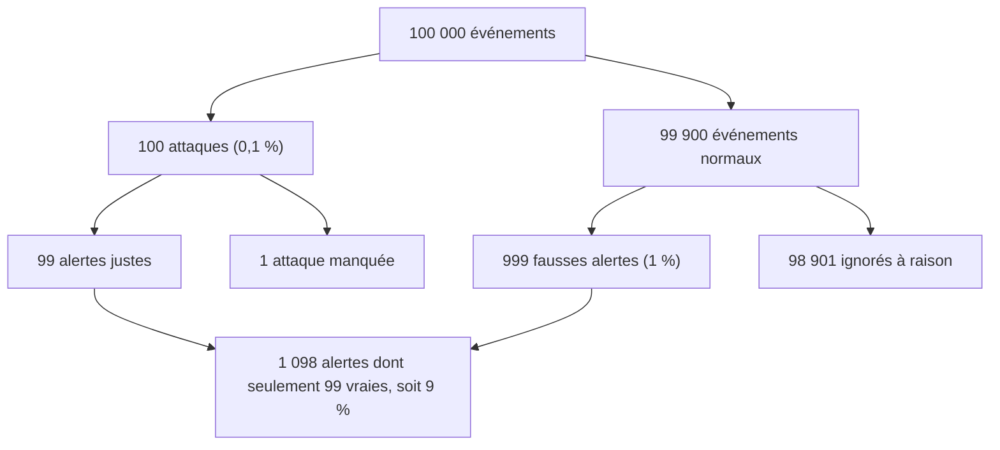

## Introduction

En sécurité, on manipule sans cesse des intuitions : « ce mot de passe est fort », « cette attaque a peu de chances de réussir », « cette alerte est sûrement un vrai incident ». Les probabilités permettent de rendre ces intuitions **mesurables** et donc discutables. Combien d'essais faut-il pour deviner un code PIN ? Combien de temps tient un mot de passe de huit caractères face à une carte graphique ? Quelle est la probabilité qu'une alerte soit vraiment une attaque, sachant que l'outil se trompe rarement ?

Ce chapitre pose les bases nécessaires, en lien direct avec les chapitres suivants sur l'entropie et les statistiques, et avec le cours Data Science. À la fin, tu sauras calculer un espace de recherche, estimer un temps de force brute, utiliser le théorème de Bayes pour juger un détecteur, et expliquer pourquoi les collisions de hachage arrivent bien plus tôt qu'on ne le croit.

## Probabilité d'un événement simple

### Le vocabulaire

Une **expérience aléatoire** est une situation dont le résultat n'est pas connu à l'avance, comme tirer un code PIN au hasard. L'ensemble de tous les résultats possibles s'appelle l'**univers**. Un **événement** est un sous-ensemble de cet univers, par exemple « le code commence par 1 ».

Quand tous les résultats sont **équiprobables**, c'est-à-dire qu'ils ont tous la même chance de se produire, la probabilité d'un événement se calcule ainsi :

```text
P(événement) = nombre de cas favorables / nombre de cas possibles
```

Une probabilité est toujours comprise entre 0 (événement impossible) et 1 (événement certain). Deviner un chiffre entre 0 et 9 au hasard a une probabilité de 1/10, soit 0,1 ou 10 %.

### Exemple : le code PIN à quatre chiffres

Un code PIN comporte quatre positions, chacune pouvant prendre dix valeurs. Le nombre de codes possibles est donc 10 × 10 × 10 × 10 = 10^4 = 10 000. Si le code a été choisi uniformément au hasard, la probabilité de le deviner en un seul essai est de **1/10 000**, soit 0,01 %.

```text
Nombre de codes possibles     = 10 × 10 × 10 × 10 = 10 000
P(succès en un essai)         = 1 / 10 000 = 0,0001
P(succès en 3 essais distincts) = 3 / 10 000 = 0,0003
```

Avec trois essais différents, l'attaquant couvre trois cas favorables sur dix mille, d'où 3/10 000. C'est exactement pourquoi une carte bancaire se bloque après trois erreurs : la limitation du nombre d'essais maintient la probabilité de succès très basse, même avec un espace de recherche modeste.

### La probabilité complémentaire

La probabilité qu'un événement **ne** se produise **pas** vaut 1 moins sa probabilité. On la note P(non A) = 1 − P(A). Cette règle est très pratique pour les questions du type « au moins une fois ». Par exemple, si un attaquant tente dix codes au hasard, indépendamment, en acceptant les répétitions, la probabilité qu'il échoue à chaque fois est (9999/10000)^10, et la probabilité qu'il réussisse au moins une fois est donc 1 − (9999/10000)^10, soit environ 0,000 999 5, très proche de 10/10 000.

## Combiner des événements

### Événements indépendants et règle du produit

Deux événements sont **indépendants** si la réalisation de l'un ne change pas la probabilité de l'autre. Le résultat d'un lancer de dé n'influence pas le lancer suivant ; le premier caractère d'un mot de passe **généré aléatoirement** n'influence pas le deuxième.

Pour des événements indépendants, la probabilité qu'ils se réalisent tous est le **produit** de leurs probabilités individuelles :

```text
P(A et B) = P(A) × P(B)       si A et B sont indépendants
```

Deviner le premier chiffre d'un PIN a une probabilité de 1/10, le deuxième aussi, et ainsi de suite. Deviner les quatre vaut 1/10 × 1/10 × 1/10 × 1/10 = 1/10 000. On retrouve le résultat précédent : c'est la règle du produit qui explique pourquoi le nombre de combinaisons se calcule par une puissance.

### Événements incompatibles et règle de la somme

Deux événements sont **incompatibles** s'ils ne peuvent pas se produire en même temps, par exemple « le PIN commence par 1 » et « le PIN commence par 2 ». Pour des événements incompatibles, P(A ou B) = P(A) + P(B). Dans le cas général, il faut retirer la partie commune pour ne pas la compter deux fois : P(A ou B) = P(A) + P(B) − P(A et B).

<WarningCallout>
L'indépendance est une hypothèse, pas une évidence. Les caractères d'un mot de passe choisi par un humain ne sont pas indépendants : après « Mot » vient très souvent « depasse », et une majuscule apparaît surtout en première position. Multiplier les probabilités comme si les caractères étaient indépendants surestime alors énormément la robustesse réelle.
</WarningCallout>

## Dénombrer pour mesurer un espace de recherche

### Le principe multiplicatif

L'**espace de recherche** d'un mot de passe est le nombre total de mots de passe possibles pour une politique donnée. Si chaque caractère est choisi indépendamment dans un alphabet de taille A, et que le mot de passe fait L caractères, l'espace vaut A puissance L. Pour six caractères pris parmi 26 lettres, on obtient 26^6, et non 6 × 26 ni 26 + 6.

<CompareTable
  titleA="Composition du mot de passe"
  titleB="Nombre de combinaisons possibles (espace de recherche)"
  rows={[
    { a: "4 chiffres (0-9)", b: "10^4 = 10 000" },
    { a: "6 chiffres (0-9)", b: "10^6 = 1 000 000" },
    { a: "6 lettres minuscules (26 lettres)", b: "26^6 ≈ 309 millions" },
    { a: "10 chiffres (0-9)", b: "10^10 = 10 milliards" },
    { a: "6 caractères mixtes (94 caractères imprimables)", b: "94^6 ≈ 690 milliards" },
    { a: "8 caractères minuscules (26 lettres)", b: "26^8 ≈ 208 milliards" },
    { a: "8 caractères mixtes (minuscules, majuscules, chiffres, symboles, soit 94 caractères)", b: "94^8 ≈ 6,1 × 10^15, soit environ 6 millions de milliards" },
    { a: "12 caractères alphanumériques (62 caractères)", b: "62^12 ≈ 3,2 × 10^21" }
  ]}
/>

Le chiffre de 94 vient des caractères ASCII imprimables sans l'espace : 26 minuscules, 26 majuscules, 10 chiffres et 32 symboles. Attention aux ordres de grandeur en français : un milliard vaut 10^9, un million de milliards vaut 10^15, et un milliard de milliards vaudrait 10^18. Avec 94^8 ≈ 6,1 × 10^15, on parle donc bien d'environ **6 millions de milliards**.

```python
# Espaces de recherche : la puissance vient de la règle du produit
for nom, alphabet, longueur in [
    ("PIN 4 chiffres", 10, 4),
    ("6 chiffres", 10, 6),
    ("10 chiffres", 10, 10),
    ("6 mixtes", 94, 6),
    ("8 minuscules", 26, 8),
    ("8 mixtes", 94, 8),
]:
    print(f"{nom:15} {alphabet ** longueur:>26,}  ({alphabet ** longueur:.2e})")
```

```text
PIN 4 chiffres                      10,000  (1.00e+04)
6 chiffres                       1,000,000  (1.00e+06)
10 chiffres                 10,000,000,000  (1.00e+10)
6 mixtes                   689,869,781,056  (6.90e+11)
8 minuscules               208,827,064,576  (2.09e+11)
8 mixtes             6,095,689,385,410,816  (6.10e+15)
```

### Longueur ou diversité ?

Comparons un mot de passe de 10 chiffres et un mot de passe de 6 caractères mixtes. Le premier est plus long, mais son espace vaut 10^10, soit 10 milliards. Le second vaut 94^6, environ 690 milliards, soit 69 fois plus. Ici la diversité de l'alphabet compense la longueur plus faible.

Mais l'inverse est souvent vrai aussi : chaque caractère supplémentaire **multiplie** l'espace par la taille de l'alphabet. Passer de 8 à 12 caractères mixtes multiplie l'espace par 94^4, soit environ 78 millions. C'est pourquoi les recommandations modernes privilégient la longueur. La version 4 des lignes directrices NIST SP 800-63B, publiée en 2025, demande au moins 15 caractères pour un mot de passe utilisé seul (8 s'il s'inscrit dans une authentification multifacteur), déconseille d'imposer des règles de composition et demande de comparer les mots de passe à des listes de mots de passe compromis.

## Estimer le temps d'une attaque par force brute

### Le calcul

Une attaque par **force brute** essaie toutes les combinaisons. Si l'espace contient N possibilités et que l'attaquant teste v candidats par seconde, le temps maximal est N/v, et le temps **moyen** est la moitié, N/(2v), puisqu'en moyenne on trouve le secret à mi-chemin.

Prenons une hypothèse volontairement prudente de 10 milliards d'essais par seconde, un ordre de grandeur réaliste pour une carte graphique récente face à un hash rapide et non salé comme NTLM ou MD5 :

```text
8 minuscules : 2,09 × 10^11 / 10^10 ≈ 21 secondes au maximum
8 mixtes     : 6,10 × 10^15 / 10^10 ≈ 610 000 s ≈ 7 jours au maximum, 3,5 jours en moyenne
12 alphanum. : 3,23 × 10^21 / 10^10 ≈ 10 000 ans environ
```

```python
vitesse = 10_000_000_000          # 10 milliards d'essais par seconde (hypothèse)
for nom, n in [("8 minuscules", 26**8), ("8 mixtes", 94**8), ("12 alphanum.", 62**12)]:
    secondes = n / vitesse
    print(f"{nom:13} max {secondes:>14,.0f} s  ~ {secondes / 86400:>12,.1f} jours")
```

```text
8 minuscules  max             21 s  ~          0.0 jours
8 mixtes      max        609,569 s  ~          7.1 jours
12 alphanum.  max 322,626,676,240 s  ~  3,734,105.0 jours
```

### Les leviers défensifs

Ce calcul montre les trois leviers de la défense. Le premier est d'**augmenter N**, avec des mots de passe longs ou des phrases de passe générées aléatoirement. Le deuxième consiste à **réduire v** en stockant les mots de passe avec une fonction de hachage lente et salée comme Argon2id, scrypt ou bcrypt, qui divise la vitesse de l'attaquant par des millions par rapport à un hash rapide. Le troisième est de **limiter le nombre d'essais** pour les attaques en ligne : verrouillage temporaire, délais croissants, authentification multifacteur. Une attaque en ligne contre un service bien protégé ne teste que quelques essais par minute, ce qui rend même un espace modeste difficile à parcourir.

<CehCallout>
Les attaques par mot de passe du CEH v13 (module System Hacking) distinguent les attaques en ligne, limitées par le réseau et le verrouillage, et les attaques hors ligne sur des hashs volés, limitées uniquement par la puissance de calcul. Hydra, utilisé dans les TP Nyx, réalise des attaques en ligne ; hashcat et John the Ripper réalisent des attaques hors ligne. Le calcul N divisé par v s'applique aux deux, avec des vitesses qui diffèrent de plusieurs ordres de grandeur.
</CehCallout>

## Probabilité conditionnelle et théorème de Bayes

### La probabilité conditionnelle

La **probabilité conditionnelle** de A sachant B, notée P(A | B), est la probabilité que A se produise quand on sait déjà que B s'est produit. Elle se calcule ainsi :

```text
P(A | B) = P(A et B) / P(B)
```

En détection d'intrusion, la question qui intéresse l'analyste SOC est justement conditionnelle : **sachant qu'une alerte s'est déclenchée**, quelle est la probabilité qu'il s'agisse réellement d'une attaque, et non d'un faux positif ? Cette probabilité s'appelle la **précision** ou valeur prédictive positive du détecteur.

### Le théorème de Bayes et le piège du taux de base

Le théorème de Bayes relie P(A | B) à P(B | A), plus facile à mesurer :

```text
P(attaque | alerte) = P(alerte | attaque) × P(attaque) / P(alerte)

avec P(alerte) = P(alerte | attaque) × P(attaque) + P(alerte | normal) × P(normal)
```

Prenons un exemple chiffré. Sur un réseau, un événement sur mille est réellement malveillant : P(attaque) = 0,001. Le détecteur repère 99 % des attaques, donc P(alerte | attaque) = 0,99. Il se trompe sur 1 % des événements normaux, donc P(alerte | normal) = 0,01. Le détecteur semble excellent. Pourtant :

```text
P(alerte) = 0,99 × 0,001 + 0,01 × 0,999 = 0,00099 + 0,00999 = 0,01098
P(attaque | alerte) = 0,00099 / 0,01098 ≈ 0,090
```

Seulement **9 %** des alertes correspondent à de vraies attaques : plus de neuf alertes sur dix sont des faux positifs. Ce phénomène, appelé **paradoxe du taux de base**, explique la fatigue des analystes SOC. Quand les attaques sont rares, même un faible taux de faux positifs produit une montagne d'alertes inutiles.

```python
def precision(prevalence: float, sensibilite: float, taux_fp: float) -> float:
    # Théorème de Bayes : P(attaque | alerte)
    p_alerte = sensibilite * prevalence + taux_fp * (1 - prevalence)
    return sensibilite * prevalence / p_alerte

print(f"{precision(0.001, 0.99, 0.01):.3f}")
print(f"{precision(0.001, 0.99, 0.001):.3f}")   # faux positifs divisés par 10
```

```text
0.090
0.498
```

Diviser le taux de faux positifs par dix fait passer la précision de 9 % à près de 50 %. Côté défense, c'est un argument chiffré pour investir dans l'ajustement des règles (exceptions, contexte, corrélation) plutôt que de multiplier les détections bruyantes.



## Le paradoxe des anniversaires et les collisions

Dans un groupe de 23 personnes, la probabilité que deux d'entre elles partagent la même date d'anniversaire dépasse 50 %. Ce résultat surprend, car on pense à tort à la probabilité qu'une personne partage **ta** date. Or ce qui compte, c'est le nombre de **paires** : avec 23 personnes, il y en a 253. On calcule plus facilement la probabilité complémentaire, celle que toutes les dates soient différentes, puis on la soustrait de 1.

```python
def proba_collision(k: int, n: int = 365) -> float:
    p_toutes_differentes = 1.0
    for i in range(k):
        p_toutes_differentes *= (n - i) / n
    return 1 - p_toutes_differentes

print(round(proba_collision(23), 3), round(proba_collision(50), 3), round(proba_collision(70), 3))
```

```text
0.507 0.97 0.999
```

En cryptographie, cela signifie qu'une fonction de hachage de n bits ne résiste aux collisions que jusqu'à environ 2^(n/2) essais, pas 2^n. Un hash de 64 bits donne une collision après environ 2^32, soit 4 milliards d'essais, ce qui est à la portée de n'importe qui. C'est pourquoi on utilise au minimum SHA-256, qui offre 128 bits de résistance aux collisions, et pourquoi les collisions pratiques obtenues sur MD5 et SHA-1 (attaque SHAttered en 2017) ont rendu ces fonctions inutilisables pour les signatures.

## Simuler pour vérifier : la méthode de Monte-Carlo

Quand un calcul te semble douteux, tu peux le vérifier par **simulation** : répéter l'expérience un grand nombre de fois et mesurer la fréquence observée, qui se rapproche de la probabilité théorique d'après la loi des grands nombres.

```python
import random

random.seed(2026)                 # graine fixe : résultat reproductible
essais = 1_000_000
tentatives = {"0000", "1234", "1111"}   # les 3 essais de l'attaquant
succes = 0
for _ in range(essais):
    pin = f"{random.randrange(10_000):04d}"   # PIN tiré uniformément
    if pin in tentatives:
        succes += 1
print(f"Fréquence observée    : {succes / essais:.5f}")
print(f"Probabilité théorique : {3 / 10_000:.5f}")
```

```text
Fréquence observée    : 0.00030
Probabilité théorique : 0.00030
```

Cette simulation suppose des PIN uniformes. Dans la réalité, « 1234 », « 0000 » et « 1111 » font partie des codes les plus utilisés : un attaquant qui les essaie en premier a une probabilité de succès bien supérieure à 3 sur 10 000. C'est exactement ce qu'exploitent les attaques par dictionnaire.

<TipCallout>
Le module `random` convient pour simuler, mais jamais pour générer un secret : son générateur (Mersenne Twister) est prévisible. Pour un mot de passe, un jeton ou une clé, utilise le module `secrets`, par exemple `secrets.token_urlsafe(16)`. Ce point est développé au chapitre 5.
</TipCallout>

## Erreurs fréquentes

On confond souvent 26^6 avec 6 × 26 : le nombre de combinaisons se calcule par une puissance, car chaque position multiplie les possibilités. On confond aussi les ordres de grandeur, par exemple en écrivant « milliard de milliards » pour 10^15 au lieu de « million de milliards ». Beaucoup supposent que les caractères d'un mot de passe humain sont indépendants et uniformes, ce qui surestime la robustesse réelle. On oublie le facteur 2 entre temps maximal et temps moyen d'une force brute. On confond P(alerte | attaque), le taux de détection, avec P(attaque | alerte), la précision, qui peut être très faible. Enfin, on sous-estime les collisions en raisonnant en 2^n au lieu de 2^(n/2).

## Lab — Mise en pratique

**Environnement** : terminal Kali ou poste avec Python 3.12.

<Steps steps={[
  { title: "Calculer un espace de recherche", description: "Calcule à la main le nombre de combinaisons d'un mot de passe de 6 caractères composé uniquement de chiffres, puis vérifie en Python. Tu dois trouver 1 000 000.", code: "python3 -c \"print(10 ** 6)\"" },
  { title: "Comparer longueur et diversité", description: "Compare l'espace de recherche d'un mot de passe de 10 chiffres à celui d'un mot de passe de 6 caractères mixtes (alphabet de 94). Lequel est le plus grand, et de quel facteur ?", code: "python3 -c \"print(10**10, 94**6, 94**6 / 10**10)\"" },
  { title: "Vérifier les ordres de grandeur", description: "Affiche 26^8 et 94^8 en notation scientifique et exprime-les en français : environ 208 milliards et environ 6 millions de milliards.", code: "python3 -c \"print(f'{26**8:.3e} {94**8:.3e}')\"" },
  { title: "Estimer un temps de force brute", description: "Pour une vitesse de 10 milliards d'essais par seconde, calcule le temps moyen pour trouver un mot de passe de 8 caractères mixtes, puis de 14 caractères mixtes.", code: "python3 -c \"v = 1e10\nfor L in (8, 14): print(L, 94**L / (2 * v) / 86400, 'jours')\"" },
  { title: "Appliquer Bayes à une alerte", description: "Avec une prévalence de 1 sur 10 000, une sensibilité de 95 % et un taux de faux positifs de 0,5 %, calcule la proportion d'alertes qui sont de vraies attaques. Commente le résultat pour l'équipe SOC.", code: "python3 -c \"p, s, f = 1e-4, 0.95, 0.005; print(s * p / (s * p + f * (1 - p)))\"" },
  { title: "Vérifier le paradoxe des anniversaires", description: "Calcule la probabilité de collision pour 23 personnes, puis cherche le plus petit nombre de personnes qui dépasse 99 %." },
  { title: "Simuler une attaque sur un PIN", description: "Exécute la simulation de Monte-Carlo du chapitre, puis remplace le tirage uniforme par un tirage qui choisit 1234 une fois sur dix. Observe comment la fréquence de succès explose." }
]} />

## À retenir

- Pour des résultats équiprobables, une probabilité vaut cas favorables divisés par cas possibles : deviner un PIN à 4 chiffres en un essai a une probabilité de 1/10 000.
- La probabilité complémentaire, 1 − P(A), simplifie les calculs du type « au moins une fois ».
- Pour des événements indépendants, les probabilités se multiplient ; c'est pourquoi l'espace d'un mot de passe aléatoire vaut A puissance L, par exemple 26^8 ≈ 208 milliards et 94^8 ≈ 6,1 × 10^15, soit environ 6 millions de milliards.
- Le temps moyen d'une force brute vaut N divisé par deux fois la vitesse ; on se défend en augmentant N, en réduisant la vitesse avec un hachage lent et salé, et en limitant les essais.
- La probabilité qu'une alerte soit une vraie attaque est une probabilité conditionnelle ; le théorème de Bayes montre qu'elle reste faible quand les attaques sont rares.
- Le paradoxe des anniversaires impose des hashs d'au moins 256 bits, car les collisions apparaissent après environ 2^(n/2) essais.

## Questions de révision

1. Comment calcule-t-on la probabilité d'un événement simple, et quelle hypothèse cette formule suppose-t-elle ?
2. Pourquoi les probabilités se multiplient-elles pour des événements indépendants, et pourquoi cela donne-t-il une puissance pour l'espace d'un mot de passe ?
3. Comment calcule-t-on l'espace de recherche d'un mot de passe de 6 caractères parmi 26 lettres ?
4. Lequel est le plus robuste : un mot de passe de 10 chiffres ou un mot de passe de 6 caractères mixtes ? Justifie par le calcul.
5. Pourquoi un mot de passe « humain », formé d'un mot du dictionnaire avec des substitutions prévisibles, est-il bien moins robuste que son espace de recherche théorique ne le suggère ?
6. Un détecteur repère 99 % des attaques avec 1 % de faux positifs. Pourquoi la plupart de ses alertes peuvent-elles être fausses ?
7. Pourquoi une fonction de hachage de 64 bits n'offre-t-elle pas une résistance aux collisions suffisante ?
