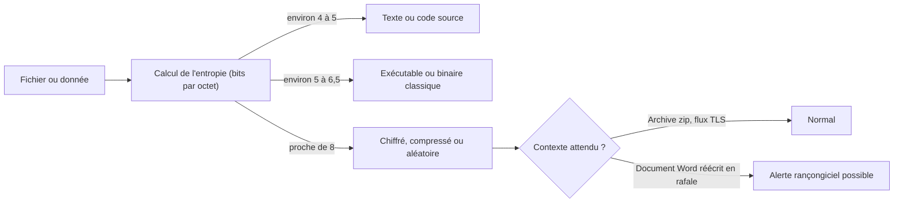

## Introduction

L'**entropie**, concept central de la théorie de l'information formalisée par Claude Shannon en 1948 dans « A Mathematical Theory of Communication », quantifie une notion utilisée intuitivement en sécurité : le degré d'imprévisibilité d'une donnée. C'est la mesure de référence pour évaluer la robustesse réelle d'un mot de passe ou d'une clé, mais aussi un outil d'analyse très concret : un analyste repère un fichier chiffré par un rançongiciel ou un exécutable compressé par un packer simplement parce que son entropie est anormalement élevée.

Ce chapitre prolonge directement le chapitre 4. Tu y as calculé des espaces de recherche ; tu vas maintenant les exprimer en bits, une échelle bien plus pratique. À la fin, tu sauras calculer l'entropie d'un mot de passe, celle d'une distribution quelconque avec la formule de Shannon, expliquer pourquoi un mot de passe humain vaut bien moins que sa valeur théorique, et mesurer l'entropie d'un fichier en Python.

## Rappel : le logarithme en base 2

Le **logarithme en base 2** d'un nombre N, noté log2(N), répond à la question : « à quelle puissance faut-il élever 2 pour obtenir N ? ». Ainsi log2(8) = 3 car 2^3 = 8, log2(1024) = 10 car 2^10 = 1024, et log2(1) = 0. Pour un nombre qui n'est pas une puissance de 2, le résultat n'est pas entier : log2(10) vaut environ 3,32, car 10 se situe entre 2^3 = 8 et 2^4 = 16.

Intuitivement, log2(N) est le **nombre de questions oui ou non** nécessaires pour identifier un élément parmi N possibilités équiprobables, en coupant l'ensemble en deux à chaque question. Pour trouver un nombre entre 1 et 8, trois questions suffisent : « est-il supérieur à 4 ? », puis « supérieur à 6 ? », puis « est-ce 7 ? ». Le logarithme transforme les multiplications en additions : log2(A × B) = log2(A) + log2(B), et log2(A^L) = L × log2(A). C'est exactement ce qui va simplifier les calculs sur les mots de passe.

## Ce que mesure l'entropie

### Définition dans le cas équiprobable

L'entropie mesure la quantité d'incertitude, ou d'information, contenue dans une donnée. Elle s'exprime en **bits**. Pour une donnée qui peut prendre N valeurs équiprobables :

```text
Entropie (en bits) = log2(N)
```

Un bit d'entropie correspond à un choix entre deux possibilités équiprobables, comme un tirage à pile ou face. Chaque bit supplémentaire **double** le nombre de possibilités, donc double le travail d'un attaquant qui procède par force brute. Un mot de passe de 60 bits d'entropie est 2^40 fois, soit environ mille milliards de fois, plus difficile à deviner qu'un mot de passe de 20 bits.

### Entropie par caractère

```text
Un chiffre (10 possibilités)            : log2(10) ≈ 3,32 bits
Une lettre minuscule (26 possibilités)  : log2(26) ≈ 4,70 bits
Un caractère alphanumérique (62)        : log2(62) ≈ 5,95 bits
Un caractère imprimable (94)            : log2(94) ≈ 6,55 bits
```

Le nombre 62 correspond aux 26 minuscules, 26 majuscules et 10 chiffres ; le nombre 94 ajoute les 32 symboles ASCII imprimables.

### Entropie d'un mot de passe aléatoire

Si chaque caractère est tiré **indépendamment et uniformément**, les entropies s'additionnent. Un mot de passe de L caractères pris dans un alphabet de taille A a donc une entropie de L × log2(A).

```text
8 caractères parmi 94   : 8 × 6,55  ≈ 52,4 bits
10 caractères parmi 26  : 10 × 4,70 ≈ 47 bits
12 caractères parmi 62  : 12 × 5,95 ≈ 71,5 bits
```

```python
import math

for nom, n in [("chiffre (10)", 10), ("minuscule (26)", 26), ("alphanumérique (62)", 62),
               ("ASCII imprimable (94)", 94), ("mot Diceware (7776)", 7776)]:
    print(f"{nom:24} {math.log2(n):.2f} bits")
print(f"8 parmi 94   : {8 * math.log2(94):.1f} bits")
print(f"10 parmi 26  : {10 * math.log2(26):.1f} bits")
print(f"12 parmi 62  : {12 * math.log2(62):.1f} bits")
print(f"6 mots Diceware : {6 * math.log2(7776):.1f} bits")
```

```text
chiffre (10)             3.32 bits
minuscule (26)           4.70 bits
alphanumérique (62)      5.95 bits
ASCII imprimable (94)    6.55 bits
mot Diceware (7776)      12.92 bits
8 parmi 94   : 52.4 bits
10 parmi 26  : 47.0 bits
12 parmi 62  : 71.5 bits
6 mots Diceware : 77.5 bits
```

### Le lien avec l'espace de recherche

Ce calcul rejoint directement celui du chapitre 4. L'espace de recherche d'un mot de passe de 8 caractères parmi 94 vaut 94^8, environ 6,1 × 10^15. Son entropie vaut log2(94^8) = 8 × log2(94) ≈ 52,4 bits, et l'on vérifie que 2^52,4 ≈ 6,1 × 10^15. **L'entropie est simplement le logarithme en base 2 de l'espace de recherche** : les deux mesurent la même réalité, mais l'entropie s'additionne au lieu de se multiplier, ce qui rend les comparaisons beaucoup plus lisibles.

<CehCallout>
À retenir : l'entropie en bits d'une donnée à N possibilités équiprobables vaut log2(N) ; log2(94) ≈ 6,55 bits par caractère, donc 8 caractères mixtes aléatoires donnent environ 52,4 bits. L'entropie est le logarithme en base 2 de l'espace de recherche. Chaque bit supplémentaire double le travail de l'attaquant.
</CehCallout>

## L'entropie de Shannon : le cas général

### La formule

Quand les possibilités ne sont pas équiprobables, Shannon définit l'entropie comme la moyenne de l'information apportée par chaque résultat, pondérée par sa probabilité :

```text
H = somme sur tous les symboles de  p × log2(1 / p)
```

Un résultat très probable apporte peu d'information, car on s'y attendait ; un résultat rare en apporte beaucoup. Quand les N possibilités sont équiprobables, chaque p vaut 1/N et la formule redonne exactement log2(N). C'est d'ailleurs le **maximum** possible : toute inégalité entre les probabilités fait baisser l'entropie.

### Exemples calculés

Une pièce truquée qui tombe sur pile 9 fois sur 10 a une entropie de 0,9 × log2(1/0,9) + 0,1 × log2(1/0,1), soit environ 0,137 + 0,332 = 0,47 bit, contre 1 bit pour une pièce équilibrée. Une source qui émet quatre symboles avec les probabilités 1/2, 1/4, 1/8 et 1/8 a une entropie de 0,5 × 1 + 0,25 × 2 + 0,125 × 3 + 0,125 × 3 = 1,75 bit, au lieu des 2 bits d'une source uniforme à quatre symboles.

On peut aussi estimer l'entropie d'une chaîne à partir de la fréquence de ses caractères :

```python
import math
from collections import Counter

def entropie_shannon(donnees: bytes | str) -> float:
    # H = somme de p × log2(1/p) sur les symboles observés
    n = len(donnees)
    return sum(c / n * math.log2(n / c) for c in Counter(donnees).values())

for s in ["aaaa", "abab", "abcd", "password", "P@ssw0rd123!"]:
    print(f"{s!r:16} {entropie_shannon(s):.2f} bits/symbole")
```

```text
'aaaa'           0.00 bits/symbole
'abab'           1.00 bits/symbole
'abcd'           2.00 bits/symbole
'password'       2.75 bits/symbole
'P@ssw0rd123!'   3.42 bits/symbole
```

<WarningCallout>
Cette mesure décrit la répartition des caractères **dans la chaîne**, pas l'imprévisibilité du mot de passe. « P@ssw0rd123! » obtient un score correct alors qu'il figure dans toutes les listes de mots de passe compromis. Les « jauges de robustesse » naïves qui calculent ainsi une entropie sont trompeuses : la seule entropie qui compte est celle du **procédé de génération**, telle que l'attaquant peut la modéliser.
</WarningCallout>

## Entropie théorique et entropie réelle

### Pourquoi les humains font baisser l'entropie

Le calcul L × log2(A) suppose une génération véritablement aléatoire et uniforme. Un mot de passe choisi par un humain, même s'il respecte les règles de complexité imposées, a une entropie réelle bien plus faible. Les humains choisissent des mots du dictionnaire, des prénoms, des dates, des séquences de clavier comme « azerty », placent la majuscule au début et les chiffres et le symbole à la fin, et appliquent des substitutions prévisibles comme « a » vers « @ » ou « o » vers « 0 ». Les outils de cassage modélisent précisément ces habitudes : hashcat applique des **règles de mutation** à des listes de mots, et l'attaquant teste donc d'abord les candidats les plus probables.

<CompareTable
  titleA="Mot de passe"
  titleB="Entropie théorique et entropie réelle"
  rows={[
    { a: "P@ssw0rd123! (12 caractères mixtes)", b: "Entropie théorique élevée, environ 79 bits si les 12 caractères étaient aléatoires parmi 94. Entropie réelle très faible : motif prévisible, présent dans les dictionnaires d'attaque." },
    { a: "Motdepasse2026! (15 caractères)", b: "Entropie théorique respectable, mais un mot courant, l'année en cours et un point d'exclamation final sont parmi les premières combinaisons testées par les règles de mutation." },
    { a: "xK9$mQ2#vL7& (12 caractères générés)", b: "Entropie théorique et réelle proches, environ 79 bits, car il est généré aléatoirement par un gestionnaire de mots de passe, sans motif reconnaissable." },
    { a: "six mots Diceware tirés aux dés", b: "Environ 77,5 bits réels, car chaque mot est tiré uniformément parmi 7776, tout en restant mémorisable." }
  ]}
/>

### Les phrases de passe

La méthode **Diceware** consiste à tirer des mots au hasard dans une liste de 7776 mots, en lançant cinq dés par mot (6^5 = 7776). Chaque mot apporte log2(7776) ≈ 12,9 bits. Six mots donnent environ 77,5 bits, soit plus qu'un mot de passe de 12 caractères alphanumériques aléatoires, tout en restant bien plus facile à retenir. Le point essentiel est que les mots sont **tirés au hasard**, pas choisis : une phrase célèbre ou une citation a une entropie réelle très faible.

<TipCallout>
Les recommandations actuelles, dont NIST SP 800-63B dans sa version 4 publiée en 2025, vont dans le sens de l'entropie réelle : privilégier la longueur, autoriser les phrases de passe et tous les caractères, abandonner les règles de composition et le renouvellement périodique forcé, et refuser les mots de passe présents dans des listes de fuites. Pour les comptes d'administration, un gestionnaire de mots de passe et l'authentification multifacteur, idéalement résistante à l'hameçonnage comme FIDO2 ou les passkeys, restent la meilleure réponse.
</TipCallout>

## L'entropie appliquée aux clés cryptographiques

### La longueur ne garantit rien

Une clé AES-256 fait 256 bits de long. Elle a 256 bits d'entropie **seulement** si elle a été produite par un générateur de nombres aléatoires cryptographiquement sûr, appelé **CSPRNG** (cryptographically secure pseudo-random number generator). Si la clé est dérivée d'un mot de passe de 40 bits d'entropie, ou d'une graine prévisible comme l'heure, l'attaquant n'a pas à parcourir 2^256 possibilités, seulement l'espace réel de la graine. C'est l'entropie réelle, et non la longueur en bits, qui garantit la résistance de la clé à la force brute.

### Un cas réel : la faille OpenSSL de Debian

En 2008, une modification du paquet OpenSSL de Debian (CVE-2008-0166) a supprimé par erreur presque toutes les sources d'aléa du générateur. La seule variable restante était l'identifiant de processus, limité à 32 768 valeurs, soit 15 bits d'entropie. Toutes les clés SSH et SSL générées sur Debian et Ubuntu pendant près de deux ans appartenaient donc à un ensemble de quelques dizaines de milliers de clés par type et taille, que des chercheurs ont précalculées. Des clés RSA de 2048 bits n'avaient en réalité que 15 bits d'entropie.

### Les bons outils en Python

```python
import secrets

print(secrets.token_hex(32))          # 32 octets aléatoires = 256 bits, en hexadécimal
print(secrets.token_urlsafe(16))      # jeton de 128 bits encodé pour une URL
alphabet = "abcdefghijklmnopqrstuvwxyzABCDEFGHIJKLMNOPQRSTUVWXYZ0123456789"
print("".join(secrets.choice(alphabet) for _ in range(16)))   # environ 95 bits
```

```text
9f2c4e7a1b8d03f65ac2e9d17b4f8a0c3e6d2b9f71a5c8e04d3b6f9a2c7e1d58
X3vQ9kLm2pR7tW1zYb8cNg
h7KqP2xRm9VtL4wZ
```

La sortie change à chaque exécution, c'est le but. Le module `secrets` s'appuie sur le CSPRNG du système d'exploitation (`os.urandom`, qui lit `getrandom` sous Linux). Le module `random`, lui, utilise Mersenne Twister : après avoir observé 624 sorties de 32 bits, un attaquant peut reconstituer son état interne et prédire toutes les suivantes. Il ne doit jamais servir à générer un jeton de session, un mot de passe ou une clé.

## L'entropie comme outil d'analyse

### Repérer les données chiffrées ou compressées

Un octet peut prendre 256 valeurs, donc l'entropie maximale d'un fichier mesurée octet par octet est log2(256) = 8 bits par octet. Un texte en français tourne autour de 4 à 5 bits par octet, car certaines lettres sont bien plus fréquentes que d'autres. Des données chiffrées, compressées ou aléatoires s'approchent au contraire de 8 bits par octet.

```python
import math, os
from collections import Counter

def entropie_octets(donnees: bytes) -> float:
    n = len(donnees)
    return sum(c / n * math.log2(n / c) for c in Counter(donnees).values())

texte = ("Le chiffrement protège la confidentialité des données. " * 200).encode()
aleatoire = os.urandom(len(texte))
print(f"Texte répétitif   : {entropie_octets(texte):.2f} bits/octet")
print(f"Octets aléatoires : {entropie_octets(aleatoire):.2f} bits/octet")
```

```text
Texte répétitif   : 4.17 bits/octet
Octets aléatoires : 7.98 bits/octet
```

La seconde valeur varie légèrement d'une exécution à l'autre, mais reste très proche de 8.

### Applications défensives

Cette mesure a plusieurs usages concrets. En **analyse de malwares**, une section d'exécutable dont l'entropie dépasse environ 7 bits par octet suggère un code compressé ou chiffré par un packer, ce que signalent des outils comme Detect It Easy ou le module `pefile` de Python. En **détection de rançongiciels**, une solution EDR peut repérer un processus qui réécrit en rafale des documents dont l'entropie passe brutalement de 4 à près de 8. En **détection d'exfiltration**, des sous-domaines DNS longs et à forte entropie, comme dans les tunnels DNS (MITRE ATT&CK T1071.004), ou des noms de domaine générés par algorithme (DGA, T1568.002) se distinguent des noms choisis par des humains. Enfin, en **revue de code**, des outils de détection de secrets comme TruffleHog ou Gitleaks combinent des expressions régulières et des seuils d'entropie pour repérer des clés d'API oubliées.



Ces seuils sont des ordres de grandeur, pas des règles absolues : une image JPEG ou une archive ZIP a aussi une entropie proche de 8. L'entropie est un indice qu'il faut toujours croiser avec le contexte.

## Erreurs fréquentes

La première erreur consiste à confondre longueur et entropie : une clé de 256 bits dérivée d'un mot de passe faible n'a pas 256 bits d'entropie. La deuxième est de multiplier au lieu d'additionner : les entropies de caractères indépendants s'additionnent, alors que les espaces de recherche se multiplient. La troisième consiste à croire une jauge de robustesse qui calcule la diversité des caractères d'un mot de passe : elle mesure le résultat, pas le procédé de génération. On utilise aussi encore trop souvent `random` au lieu de `secrets` pour produire des jetons. Enfin, on interprète une entropie élevée comme une preuve de malveillance, alors que tout fichier compressé légitime en présente une.

## Lab — Mise en pratique

**Environnement** : terminal Kali ou poste avec Python 3.12.

<Steps steps={[
  { title: "Calculer des entropies par caractère", description: "Calcule log2(94), log2(26) et log2(62) en Python. Tu dois trouver environ 6,55, 4,70 et 5,95 bits.", code: "python3 -c \"import math; print(math.log2(94), math.log2(26), math.log2(62))\"" },
  { title: "Calculer l'entropie de mots de passe", description: "Calcule l'entropie d'un mot de passe de 10 caractères parmi 26 minuscules, puis de 12 caractères alphanumériques. Vérifie environ 47 bits et 71,5 bits.", code: "python3 -c \"import math; print(10 * math.log2(26), 12 * math.log2(62))\"" },
  { title: "Relier entropie et espace de recherche", description: "Vérifie que log2(94^8) est égal à 8 × log2(94), puis que 2 puissance 52,4 redonne environ 6,1 × 10^15.", code: "python3 -c \"import math; print(math.log2(94**8), 8 * math.log2(94), f'{2**52.44:.2e}')\"" },
  { title: "Comparer entropie théorique et réelle", description: "Explique pourquoi Motdepasse2026! a une entropie théorique respectable mais une entropie réelle bien plus faible face à un attaquant qui connaît les habitudes humaines. Liste les motifs prévisibles qu'il contient." },
  { title: "Générer des secrets correctement", description: "Génère un jeton de 256 bits et un mot de passe de 16 caractères avec le module secrets. Exécute deux fois et constate que les sorties changent.", code: "python3 -c \"import secrets, string; print(secrets.token_hex(32)); print(''.join(secrets.choice(string.ascii_letters + string.digits) for _ in range(16)))\"" },
  { title: "Mesurer l'entropie de fichiers", description: "Crée un fichier texte, une archive gzip de ce fichier et un fichier aléatoire, puis compare leur entropie avec l'outil ent. Observe que l'archive et le fichier aléatoire approchent 8 bits par octet.", code: "seq 1 20000 > texte.txt\ngzip -k texte.txt\nhead -c 100000 /dev/urandom > alea.bin\nfor f in texte.txt texte.txt.gz alea.bin; do echo \"$f\"; ent \"$f\" | head -1; done" },
  { title: "Repérer un nom de domaine suspect", description: "Calcule l'entropie de Shannon des chaînes google, wikipedia et xk7qz9vj2lpw4r avec la fonction entropie_shannon du chapitre. Explique pourquoi ce critère seul produirait des faux positifs." }
]} />

## À retenir

- L'entropie mesure l'imprévisibilité d'une donnée en bits ; pour N possibilités équiprobables, elle vaut log2(N), et chaque bit supplémentaire double le travail de l'attaquant.
- log2(94) ≈ 6,55 bits, log2(26) ≈ 4,7 bits et log2(62) ≈ 5,95 bits par caractère ; 8 caractères parmi 94 donnent environ 52,4 bits et 10 minuscules environ 47 bits.
- L'entropie est le logarithme en base 2 de l'espace de recherche : elle s'additionne là où l'espace se multiplie.
- La formule de Shannon, somme de p × log2(1/p), généralise la mesure aux distributions non uniformes, et atteint son maximum quand tout est équiprobable.
- Un mot de passe choisi par un humain a une entropie réelle bien plus faible que sa borne théorique, car les attaquants modélisent les motifs prévisibles.
- Une clé n'atteint son entropie nominale que si elle est générée par un CSPRNG ; en Python, on utilise `secrets` et jamais `random`.
- Une entropie proche de 8 bits par octet signale des données chiffrées, compressées ou aléatoires, un indice utile contre les packers, les rançongiciels et l'exfiltration.

## Questions de révision

1. Que mesure l'entropie en théorie de l'information, et dans quelle unité s'exprime-t-elle ?
2. Pourquoi l'entropie d'un mot de passe aléatoire de L caractères vaut-elle L × log2(A) ?
3. Quelle relation lie l'espace de recherche d'un mot de passe, vu au chapitre 4, et son entropie ?
4. Calcule l'entropie de Shannon d'une source qui émet trois symboles avec les probabilités 1/2, 1/4 et 1/4.
5. Pourquoi l'entropie réelle d'un mot de passe choisi par un humain est-elle souvent inférieure à son entropie théorique ?
6. Pourquoi une clé AES-256 doit-elle être générée par un générateur aléatoire cryptographiquement sûr pour atteindre réellement 256 bits d'entropie ? Illustre avec la faille Debian de 2008.
7. Comment l'entropie d'un fichier peut-elle aider à détecter un rançongiciel, et quelle est la principale limite de cet indicateur ?
