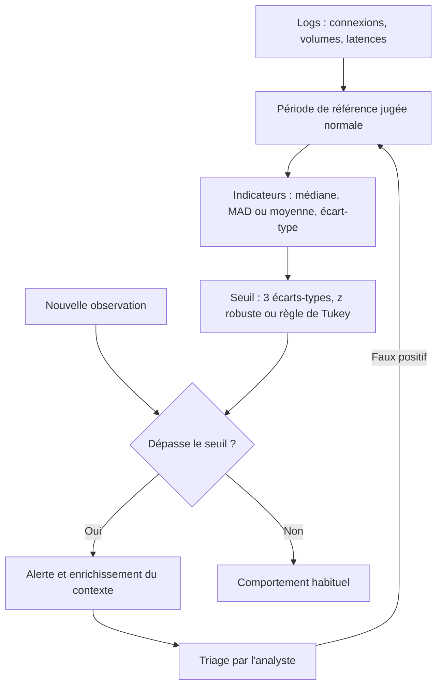

## Introduction

Les statistiques descriptives résument un jeu de données en quelques indicateurs : une valeur « typique », une mesure de dispersion, quelques repères de position. C'est une compétence mobilisée en permanence en sécurité opérationnelle. Un analyste SOC qui se demande si 300 connexions par minute sont normales, un ingénieur qui suit la latence d'un service, un chasseur de menaces qui cherche le poste qui envoie dix fois plus de données que les autres : tous raisonnent en termes de moyenne, de dispersion et d'écart à la normale. Une activité « anormale » n'est souvent qu'une valeur statistiquement éloignée du comportement habituel.

Ce chapitre sert de base aux cours Data Science, IA & Cybersécurité et Analyse SOC. À la fin, tu sauras calculer et interpréter les indicateurs principaux, à la main et avec le module `statistics` de Python 3.12, construire un seuil d'alerte statistique, et surtout comprendre pourquoi certains indicateurs se laissent piéger par une seule valeur extrême.

## Les indicateurs de tendance centrale

### Moyenne, médiane et mode

Un **indicateur de tendance centrale** cherche à résumer un jeu de données par une seule valeur représentative. Il en existe trois principaux.

<CompareTable
  titleA="Indicateur"
  titleB="Calcul et usage"
  rows={[
    { a: "Moyenne", b: "Somme des valeurs divisée par leur nombre. Elle utilise toute l'information mais elle est sensible aux valeurs extrêmes." },
    { a: "Médiane", b: "Valeur qui sépare le jeu de données trié en deux moitiés égales. Elle est insensible aux valeurs extrêmes." },
    { a: "Mode", b: "Valeur la plus fréquente. Il est utile pour les données catégorielles, comme le port ou l'agent utilisateur le plus fréquent." }
  ]}
/>

Pour calculer la **médiane**, on trie les valeurs. Si leur nombre est impair, la médiane est la valeur du milieu. S'il est pair, c'est la moyenne des deux valeurs centrales.

### Un exemple qui montre tout

Prenons le jeu de données 2, 3, 3, 4, 5, 100, qui compte six valeurs.

```text
Moyenne : (2 + 3 + 3 + 4 + 5 + 100) / 6 = 117 / 6 = 19,5
Médiane : valeurs triées 2, 3, 3, 4, 5, 100 → deux valeurs centrales 3 et 4
          médiane = (3 + 4) / 2 = 3,5
Mode    : 3 apparaît deux fois, plus que toute autre valeur → mode = 3
```

La moyenne vaut 19,5, alors que cinq valeurs sur six sont inférieures ou égales à 5. Elle est fortement tirée vers le haut par la seule valeur 100. La médiane, 3,5, reste représentative de la majorité. C'est le piège classique : en analyse de logs ou de trafic, un seul pic exceptionnel peut fausser une moyenne, alors que la médiane résiste.

### Le même phénomène sur des temps de réponse

Prenons maintenant des temps de réponse d'un serveur, en millisecondes : 45, 48, 50, 47, 46, 300.

```text
Somme   : 45 + 48 + 50 + 47 + 46 + 300 = 536
Moyenne : 536 / 6 ≈ 89,3 ms
Médiane : valeurs triées 45, 46, 47, 48, 50, 300 → (47 + 48) / 2 = 47,5 ms
```

La moyenne, environ 89 ms, ne correspond à **aucune** requête réelle : cinq requêtes ont pris moins de 50 ms et une a pris 300 ms. La médiane, 47,5 ms, décrit beaucoup mieux le comportement typique du serveur. C'est pour cette raison que les équipes d'exploitation suivent la médiane et les percentiles plutôt que la moyenne.

```python
import statistics as st

donnees = [2, 3, 3, 4, 5, 100]
print("moyenne :", round(st.mean(donnees), 2), "| médiane :", st.median(donnees), "| mode :", st.mode(donnees))

latences = [45, 48, 50, 47, 46, 300]
print("moyenne :", round(st.mean(latences), 1), "ms | médiane :", st.median(latences), "ms")
```

```text
moyenne : 19.5 | médiane : 3.5 | mode : 3
moyenne : 89.3 ms | médiane : 47.5 ms
```

<CehCallout>
La moyenne est sensible aux valeurs extrêmes, la médiane ne l'est pas. Pour 2, 3, 3, 4, 5, 100 : moyenne 19,5, médiane 3,5, mode 3. Cette distinction revient dans tous les contextes de supervision : une moyenne de volume réseau peut masquer ou exagérer un incident, alors que la médiane décrit le comportement habituel.
</CehCallout>

## Mesurer la dispersion

### Pourquoi la tendance centrale ne suffit pas

Deux serveurs peuvent avoir exactement la même latence moyenne de 50 ms. Le premier répond toujours entre 48 et 52 ms ; le second alterne entre 10 et 90 ms. Leur comportement est radicalement différent, et seul un indicateur de **dispersion** le révèle.

### Variance et écart-type

L'**écart-type** mesure à quel point les valeurs s'éloignent en moyenne de la moyenne. Il se calcule en trois étapes.

<Steps steps={[
  { title: "Calculer l'écart à la moyenne", description: "Pour chaque valeur, calculer sa différence avec la moyenne du jeu de données." },
  { title: "Élever au carré et moyenner", description: "Élever chaque écart au carré, pour éliminer les signes négatifs et pénaliser davantage les grands écarts, puis calculer la moyenne de ces carrés : c'est la variance." },
  { title: "Prendre la racine carrée", description: "La racine carrée de la variance donne l'écart-type, exprimé dans la même unité que les données d'origine." }
]} />

Appliquons-le au jeu 2, 3, 3, 4, 5, 100, de moyenne 19,5 :

```text
Écarts        : -17,5  -16,5  -16,5  -15,5  -14,5  80,5
Carrés        : 306,25 272,25 272,25 240,25 210,25 6480,25
Somme         : 7781,5
Variance      : 7781,5 / 6 ≈ 1296,9
Écart-type    : racine de 1296,9 ≈ 36,0
```

La valeur 100 contribue à elle seule à 6480 sur 7781 dans la somme des carrés : l'écart-type, comme la moyenne, est très sensible aux valeurs extrêmes, et même plus encore à cause de l'élévation au carré.

### Population ou échantillon

Quand tes données représentent **toute** la population étudiée, on divise par n : c'est l'écart-type de la population, `pstdev` en Python. Quand elles ne sont qu'un **échantillon** et que tu veux estimer la dispersion de la population entière, on divise par n moins 1, ce qui corrige un léger biais : c'est `stdev`. Sur de gros volumes, la différence est négligeable ; sur six valeurs, elle se voit.

```python
import statistics as st

donnees = [2, 3, 3, 4, 5, 100]
print("variance (population)    :", round(st.pvariance(donnees), 1))
print("écart-type (population)  :", round(st.pstdev(donnees), 2))
print("écart-type (échantillon) :", round(st.stdev(donnees), 2))
```

```text
variance (population)    : 1296.9
écart-type (population)  : 36.01
écart-type (échantillon) : 39.45
```

<TipCallout>
Un écart-type faible signifie des valeurs regroupées près de la moyenne, donc un comportement stable et prévisible ; un écart-type élevé signale une forte dispersion. En pandas 2.x, attention : la méthode `std()` d'une série divise par n moins 1 par défaut, alors que `numpy.std` divise par n. Précise toujours le paramètre `ddof` pour éviter les écarts inexpliqués entre deux outils.
</TipCallout>

## Quartiles, percentiles et boîte à moustaches

### Les quartiles

Les **quartiles** découpent les données triées en quatre parts égales. Le premier quartile Q1 laisse 25 % des valeurs en dessous de lui, le deuxième quartile est la médiane, et le troisième quartile Q3 laisse 75 % des valeurs en dessous. L'**écart interquartile**, noté IQR, vaut Q3 moins Q1 : il mesure la dispersion de la moitié centrale des données, sans être affecté par les extrêmes.

La règle de Tukey, utilisée par les boîtes à moustaches, considère comme valeur atypique toute valeur supérieure à Q3 + 1,5 × IQR ou inférieure à Q1 − 1,5 × IQR. Plusieurs méthodes de calcul des quartiles existent et donnent des résultats légèrement différents sur de petits jeux ; l'important est de rester cohérent.

```python
import statistics as st

latences = [45, 48, 50, 47, 46, 300]
q1, q2, q3 = st.quantiles(latences, n=4, method="inclusive")
iqr = q3 - q1
print("Q1 =", q1, "| médiane =", q2, "| Q3 =", q3, "| IQR =", iqr)
print("seuil haut de Tukey :", q3 + 1.5 * iqr)
```

```text
Q1 = 46.25 | médiane = 47.5 | Q3 = 49.5 | IQR = 3.25
seuil haut de Tukey : 54.375
```

Avec un seuil d'environ 54 ms, la valeur 300 est clairement identifiée comme atypique, alors que les cinq autres restent dans la norme.

### Les percentiles

Un **percentile** généralise cette idée : le 95e percentile, noté p95, est la valeur sous laquelle se trouvent 95 % des observations. Les objectifs de niveau de service s'expriment souvent ainsi, par exemple « 99 % des requêtes en moins de 200 ms ». En sécurité, le p99 du volume de données sortantes par poste est une référence bien plus stable que la moyenne pour repérer une exfiltration.

## Application à la détection d'anomalies

### Le z-score

Le **z-score** d'une valeur mesure son écart à la moyenne en nombre d'écarts-types : z = (x − moyenne) / écart-type. Un z-score de 0 signifie une valeur égale à la moyenne, un z-score de 3 une valeur située trois écarts-types au-dessus.

Pour une distribution proche de la **loi normale**, la fameuse courbe en cloche, environ 68 % des valeurs se trouvent à moins d'un écart-type de la moyenne, 95 % à moins de deux, et 99,7 % à moins de trois. D'où la règle empirique simple de détection : **signaler toute valeur qui s'écarte de plus de 2 ou 3 écarts-types de la moyenne habituelle**.

### Le bon usage : une référence calculée sur une période normale

La bonne méthode consiste à calculer la moyenne et l'écart-type sur une période de **référence** jugée normale, puis à comparer les nouvelles valeurs à ce seuil.

```python
import statistics as st

reference = [45, 48, 50, 47, 46]          # latences d'une période normale
mu, s = st.mean(reference), st.stdev(reference)
seuil = mu + 3 * s
print(f"moyenne {mu:.1f} ms, écart-type {s:.2f} ms, seuil {seuil:.1f} ms")
for x in [49, 53, 300]:
    print(x, "ALERTE" if x > seuil else "ok")
```

```text
moyenne 47.2 ms, écart-type 1.92 ms, seuil 53.0 ms
49 ok
53 ALERTE
300 ALERTE
```

### Le piège du masquage

Que se passe-t-il si l'on calcule moyenne et écart-type **en incluant** la valeur suspecte ? L'anomalie gonfle elle-même la moyenne et surtout l'écart-type, et se cache derrière.

```python
import statistics as st

latences = [45, 48, 50, 47, 46, 300]
mu, sigma = st.mean(latences), st.pstdev(latences)
for x in latences:
    print(f"{x:>4} ms  z = {(x - mu) / sigma:+.2f}")
```

```text
  45 ms  z = -0.47
  48 ms  z = -0.44
  50 ms  z = -0.42
  47 ms  z = -0.45
  46 ms  z = -0.46
 300 ms  z = +2.24
```

La valeur 300 ms, six fois plus grande que les autres, n'obtient qu'un z-score de 2,24 : elle passerait **sous** un seuil à 3 écarts-types. C'est l'effet de **masquage**.

### La solution robuste : médiane et MAD

Pour éviter ce piège, on remplace la moyenne par la médiane et l'écart-type par la **MAD** (median absolute deviation), la médiane des écarts absolus à la médiane. Multipliée par 1,4826, la MAD est comparable à un écart-type pour une loi normale, ce qui donne un **z-score robuste**.

```python
import statistics as st

latences = [45, 48, 50, 47, 46, 300]
med = st.median(latences)
mad = st.median([abs(x - med) for x in latences])
for x in latences:
    print(f"{x:>4} ms  z robuste = {(x - med) / (1.4826 * mad):+.1f}")
```

```text
  45 ms  z robuste = -0.8
  48 ms  z robuste = +0.2
  50 ms  z robuste = +0.8
  47 ms  z robuste = -0.2
  46 ms  z robuste = -0.5
 300 ms  z robuste = +85.2
```

Avec la médiane 47,5 et une MAD de 2, la valeur 300 obtient un z-score robuste de 85 : impossible à manquer.



### Les limites à connaître

Ces approches supposent une distribution relativement **stable** dans le temps. Le trafic réel varie selon l'heure, le jour de la semaine et les périodes d'activité : 500 connexions à 10 heures un mardi peuvent être normales, mais pas à 3 heures un dimanche. On calcule donc des références **par tranche horaire** ou glissantes, et on les recalcule périodiquement. Il faut aussi éviter d'intégrer une compromission en cours dans la période de référence, sous peine d'apprendre l'attaque comme un comportement normal. Enfin, beaucoup de données de sécurité, comme les volumes transférés, suivent des distributions très asymétriques, avec une longue traîne, pour lesquelles la règle des 68-95-99,7 % ne s'applique pas : les indicateurs robustes ou une transformation logarithmique sont alors plus fiables.

<WarningCallout>
Un seuil statistique n'est pas une preuve d'attaque. Il produit des faux positifs, comme une sauvegarde nocturne exceptionnelle, et des faux négatifs, comme un attaquant patient qui exfiltre lentement sous le seuil. Comme l'a montré le théorème de Bayes au chapitre 4, quand les attaques sont rares, même un bon seuil génère beaucoup de fausses alertes : il doit être combiné à du contexte et à des règles métier.
</WarningCallout>

<AuditCallout>
NIST CSF 2.0 place la surveillance continue dans la fonction Detect (catégorie DE.CM, « Continuous Monitoring ») et l'analyse des événements dans DE.AE (« Adverse Event Analysis »), qui recommande d'établir des références de comportement. Dans ISO/IEC 27001:2022, le contrôle A.8.16 « Activités de surveillance » demande de surveiller les réseaux, systèmes et applications pour détecter les comportements anormaux, ce qui suppose précisément de définir ce qui est normal.
</AuditCallout>

## Erreurs fréquentes

La première erreur consiste à résumer des latences ou des volumes par leur seule moyenne, alors qu'une valeur extrême la déforme. La deuxième est d'oublier de trier les données avant de chercher la médiane, ou de prendre une seule valeur centrale quand leur nombre est pair. On confond aussi variance et écart-type : la variance s'exprime en unités au carré, l'écart-type dans l'unité d'origine. Mélanger écart-type de population et d'échantillon entre deux outils produit des écarts inexpliqués. Calculer un z-score en incluant l'anomalie dans la référence provoque l'effet de masquage. Enfin, appliquer la règle des trois écarts-types à des données très asymétriques ou saisonnières génère des alertes à tort.

## Lab — Mise en pratique

**Environnement** : terminal Kali ou poste avec Python 3.12.

<Steps steps={[
  { title: "Calculer moyenne, médiane et mode à la main", description: "Pour le jeu 2, 3, 3, 4, 5, 100, calcule la moyenne, la médiane et le mode sur papier, puis vérifie en Python. Tu dois trouver 19,5, 3,5 et 3.", code: "python3 -c \"import statistics as st; d = [2, 3, 3, 4, 5, 100]; print(st.mean(d), st.median(d), st.mode(d))\"" },
  { title: "Comparer moyenne et médiane sur des latences", description: "Pour les temps de réponse 45, 48, 50, 47, 46 et 300 ms, calcule la moyenne et la médiane. Laquelle représente mieux le comportement typique du serveur, et pourquoi ?", code: "python3 -c \"import statistics as st; t = [45, 48, 50, 47, 46, 300]; print(sum(t), st.mean(t), st.median(t))\"" },
  { title: "Dérouler le calcul de l'écart-type", description: "Pour 2, 3, 3, 4, 5, 100, calcule les écarts à la moyenne, leurs carrés, la variance puis l'écart-type. Compare avec pstdev et stdev et explique la différence.", code: "python3 -c \"import statistics as st; d = [2, 3, 3, 4, 5, 100]; print(st.pvariance(d), st.pstdev(d), st.stdev(d))\"" },
  { title: "Observer l'effet de masquage", description: "Calcule le z-score de 300 ms en incluant cette valeur dans le calcul de la moyenne et de l'écart-type, puis en utilisant uniquement les cinq autres valeurs comme référence. Compare les deux résultats." },
  { title: "Calculer un z-score robuste", description: "Calcule la médiane, la MAD, puis le z-score robuste de chaque latence. Vérifie que 300 ms obtient environ 85." },
  { title: "Analyser un vrai fichier de log", description: "Sur ta machine Kali, compte le nombre de lignes de journal par heure sur la dernière journée, puis calcule la médiane et repère les heures atypiques avec la règle de Tukey.", code: "journalctl --since \"24 hours ago\" -o short-iso | cut -c1-13 | sort | uniq -c" },
  { title: "Justifier un seuil d'alerte", description: "Explique pourquoi un seuil basé sur la médiane et la MAD, calculé par tranche horaire, est plus robuste qu'un seuil fixe arbitraire comme « plus de 1000 connexions par minute » pour un service dont l'activité varie fortement selon l'heure." }
]} />

## À retenir

- La moyenne est sensible aux valeurs extrêmes, la médiane ne l'est pas : pour 2, 3, 3, 4, 5, 100, la moyenne vaut 19,5, la médiane 3,5 et le mode 3.
- Pour les latences 45, 48, 50, 47, 46 et 300 ms, la moyenne d'environ 89,3 ms ne décrit aucune requête réelle, alors que la médiane de 47,5 ms décrit le comportement typique.
- L'écart-type s'obtient en calculant les écarts à la moyenne, en les élevant au carré, en moyennant ces carrés pour obtenir la variance, puis en prenant la racine carrée.
- On divise par n pour une population et par n moins 1 pour un échantillon ; les outils n'ont pas tous la même convention par défaut.
- Quartiles, écart interquartile et percentiles décrivent la distribution sans être déformés par les extrêmes ; la règle de Tukey repère les valeurs atypiques.
- La détection statistique simple signale les valeurs à plus de 2 ou 3 écarts-types de la moyenne habituelle, calculée sur une période de référence normale.
- L'anomalie incluse dans la référence se masque elle-même ; médiane et MAD offrent un z-score robuste, à recalculer régulièrement et par tranche horaire.

## Questions de révision

1. Pourquoi la médiane est-elle plus robuste que la moyenne face à des valeurs extrêmes ? Illustre avec le jeu 2, 3, 3, 4, 5, 100.
2. Que mesure l'écart-type, et que signifie un écart-type faible par rapport à un écart-type élevé ?
3. Deux serveurs ont la même latence moyenne mais des écarts-types très différents. Que peux-tu en conclure ?
4. Quelle est la différence entre l'écart-type d'une population et celui d'un échantillon, et pourquoi la précision est-elle importante quand on compare deux outils ?
5. Explique l'effet de masquage à partir des latences 45, 48, 50, 47, 46 et 300 ms.
6. Pourquoi la combinaison médiane et MAD est-elle plus adaptée que moyenne et écart-type pour détecter une anomalie isolée ?
7. Pourquoi un seuil de détection statistique doit-il parfois être recalculé périodiquement plutôt que fixé une fois pour toutes ?
