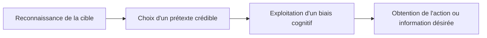

## Introduction

Après plusieurs cours consacrés à des vulnérabilités techniques, sur le web, le réseau ou Active Directory, ce cours aborde la vulnérabilité la plus universellement exploitée en cybersécurité : l'humain lui-même. Aucun pare-feu ni chiffrement ne protège contre un employé convaincu d'ouvrir une pièce jointe, de communiquer un code ou de valider un virement par un attaquant habile.

Ce constat n'a rien de méprisant envers les utilisateurs. Il dit simplement que l'être humain a une manière de penser, de faire confiance et de réagir sous pression qui est prévisible, et que les attaquants ont appris à s'en servir. Comprendre ces mécanismes est la condition pour construire des défenses qui fonctionnent réellement, au lieu de répéter aux gens « soyez vigilants ».

À la fin de ce chapitre, tu sauras définir l'ingénierie sociale, expliquer pourquoi une vulnérabilité humaine ne se corrige pas comme une faille logicielle, décrire le schéma général d'une attaque en quatre étapes, situer ces attaques dans une intrusion complète, et expliquer pourquoi ce cours a une finalité strictement défensive.

## Pourquoi l'humain reste le vecteur le plus exploité

### Un constat stable depuis des années

Les grands rapports annuels sur les violations de données, comme le Data Breach Investigations Report de Verizon, attribuent année après année une majorité des compromissions à un élément humain : un clic sur un lien de phishing, des identifiants volés, une erreur de configuration ou une manipulation par ingénierie sociale. Les chiffres exacts varient d'une édition à l'autre et selon la méthode, mais la tendance est constante.

<CehCallout>
De nombreuses études sectorielles citées par l'industrie de la cybersécurité placent le facteur humain, qu'il s'agisse de phishing, d'erreur de configuration ou d'ingénierie sociale, parmi les causes premières les plus fréquentes des compromissions réussies. Il arrive souvent devant l'exploitation de vulnérabilités techniques pures, largement contrées par les correctifs, pare-feux et durcissements déjà étudiés dans les cours précédents.
</CehCallout>

La raison est économique. Plus les défenses techniques progressent, plus il devient coûteux de trouver et d'exploiter une faille logicielle. Pendant ce temps, un email bien rédigé ou un appel convaincant coûtent presque rien, et peuvent être tentés des milliers de fois. Un attaquant rationnel choisit le chemin le moins cher.

### Vulnérabilité technique et vulnérabilité humaine

<CompareTable
  titleA="Vulnérabilité technique"
  titleB="Vulnérabilité humaine (ingénierie sociale)"
  rows={[
    { a: "Corrigée par un correctif de sécurité", b: "Ne se \"corrige\" jamais définitivement — les biais cognitifs sont universels et permanents" },
    { a: "Détectable par un scan automatisé", b: "Difficile à détecter techniquement, se joue dans l'interaction humaine" },
    { a: "Coût d'exploitation souvent technique et complexe", b: "Coût d'exploitation souvent faible : un appel téléphonique ou un email suffit" },
  ]}
/>

Ce tableau mérite d'être lu ligne par ligne. Une injection SQL disparaît définitivement quand le code utilise des requêtes paramétrées. En revanche, la tendance humaine à obéir à une autorité ou à réagir vite sous la pression ne disparaît pas après une formation : ce sont des mécanismes de fonctionnement normaux du cerveau, présents chez tout le monde. On peut en réduire l'exploitation, jamais les supprimer.

Une faille technique se repère avec un scanner. Une vulnérabilité humaine, elle, se révèle seulement au moment de l'interaction : rien dans les journaux ne distingue un employé qui saisit son mot de passe sur une fausse page de connexion d'un employé qui travaille normalement, tant que la page n'est pas identifiée comme frauduleuse. Enfin, exploiter une faille technique demande souvent du temps et de l'expertise, alors qu'une tentative d'ingénierie sociale peut se résumer à un appel téléphonique ou un email.

## Le principe général de l'ingénierie sociale

### Définition

<CehCallout>
L'ingénierie sociale consiste à manipuler une personne pour qu'elle réalise une action ou divulgue une information qu'elle n'aurait pas faite ou communiquée dans des circonstances normales, en exploitant des mécanismes psychologiques universels plutôt qu'une faille technique.
</CehCallout>

Dans cette définition, trois éléments comptent. D'abord, la cible est une **personne**, pas un système. Ensuite, l'objectif est une **action** ou une **information** : cliquer, ouvrir, saisir, transférer, ouvrir une porte, révéler une procédure interne ou le nom d'un fournisseur. Enfin, le levier est un **mécanisme psychologique universel**, comme le respect de l'autorité, la peur de la sanction, l'envie d'aider ou la politesse, et non une faille logicielle.

L'expression a été popularisée dans le monde de la sécurité par Kevin Mitnick, qui a raconté dans son livre The Art of Deception, publié en 2002, comment il obtenait des accès en téléphonant aux employés plutôt qu'en attaquant les systèmes. Aujourd'hui, l'ingénierie sociale est la porte d'entrée de nombreuses attaques par rançongiciel, des fraudes au faux ordre de virement, appelées aussi fraudes au président ou BEC pour Business Email Compromise, et de nombreuses campagnes d'espionnage.

### Le schéma en quatre étapes

Quelle que soit sa forme, une attaque d'ingénierie sociale suit généralement le même enchaînement.

La **reconnaissance** consiste à collecter des informations sur la cible : son poste, son supérieur, ses fournisseurs, les outils utilisés, le jargon interne, l'actualité de l'entreprise. Le **prétexte** est le scénario qui justifie la prise de contact : un technicien du support, un fournisseur qui a changé de banque, un collègue d'une autre agence. L'**exploitation d'un biais cognitif** est le moment où l'attaquant appuie sur un levier psychologique, par exemple l'urgence ou l'autorité, pour court-circuiter la réflexion. L'**obtention** est le résultat : un mot de passe saisi, une pièce jointe ouverte, un virement validé, un badge prêté.

<TipCallout>
Ce schéma rejoint directement la méthodologie de reconnaissance déjà vue au cours Cybersécurité Offensive. Un ingénieur social efficace collecte d'abord des informations sur sa cible, sur les réseaux sociaux, dans l'organigramme ou dans l'actualité de l'entreprise, avant de choisir le prétexte le plus crédible possible. C'est aussi pourquoi limiter ce que l'organisation expose publiquement fait partie de la défense.
</TipCallout>

## Pourquoi cela fonctionne : les deux vitesses de la pensée

Le psychologue Daniel Kahneman, prix Nobel d'économie en 2002 pour ses travaux avec Amos Tversky, a popularisé dans son livre Thinking, Fast and Slow, publié en 2011, une distinction entre deux modes de pensée. Le **système 1** est rapide, automatique, intuitif et peu coûteux en effort : c'est lui qui reconnaît un visage, lit un panneau ou répond à un email de routine. Le **système 2** est lent, délibéré et coûteux : c'est lui qui vérifie un calcul, compare deux options ou se demande si une demande est vraiment légitime.

La plupart de nos décisions quotidiennes passent par le système 1, et c'est une bonne chose : sans ces raccourcis, appelés **heuristiques**, nous serions incapables de traiter les centaines de micro-décisions d'une journée de travail. Mais ces raccourcis produisent des erreurs systématiques et prévisibles, appelées **biais cognitifs**. L'ingénieur social conçoit ses messages pour rester dans le registre du système 1 : une demande familière, une pression de temps, une figure d'autorité, une émotion forte. Tout ce qui empêche la personne de s'arrêter et d'activer le système 2 joue en sa faveur.

Le chapitre 2 détaillera ces biais un par un. Retiens pour l'instant l'idée centrale : la défense ne consiste pas à demander aux gens de « penser plus fort » en permanence, ce qui est impossible, mais à créer des moments et des procédures qui forcent le passage au système 2 quand l'enjeu est élevé, comme rappeler l'interlocuteur sur un numéro connu avant de modifier des coordonnées bancaires.

## Les canaux de l'ingénierie sociale

L'ingénierie sociale emprunte tous les canaux de communication. L'**email** reste le plus massif, avec le phishing et ses variantes ciblées. Le **téléphone**, ou vishing, ajoute la pression d'une voix humaine en direct. Le **SMS** et les messageries, ou smishing, exploitent la brièveté et la confiance dans le téléphone personnel. Les **codes QR** frauduleux, parfois appelés quishing, redirigent vers des pages piégées en échappant aux filtres qui analysent les liens des emails. Les **réseaux sociaux professionnels** servent à la reconnaissance et aux fausses offres d'emploi. L'**accès physique**, enfin, repose sur le prétexte en personne et le fait de suivre quelqu'un à travers une porte sécurisée. Les chapitres 3 et 4 détaillent ces variantes, et le cours IA et Cybersécurité montre comment les voix et vidéos synthétiques renforcent ces attaques.

## Situer l'ingénierie sociale dans une attaque complète

L'ingénierie sociale est rarement une fin en soi. Elle sert généralement d'**accès initial**, la première étape d'une intrusion qui se poursuit ensuite avec les techniques vues aux cours Cybersécurité Offensive et Active Directory : exécution de code, élévation de privilèges, mouvement latéral, exfiltration ou chiffrement.

La matrice MITRE ATT&CK référence ces comportements. La technique **T1566, Phishing**, couvre l'envoi de messages piégés pour obtenir un accès, avec des sous-techniques pour la pièce jointe, le lien, le message via un service tiers et l'appel vocal. La technique **T1598, Phishing for Information**, couvre la collecte d'informations par message trompeur pendant la reconnaissance. La technique **T1656, Impersonation**, couvre l'usurpation d'identité d'une personne ou d'une organisation de confiance.

<AttackDefenseTable
  rows={[
    { phase: "Reconnaissance", attack: "Collecte d'informations publiques sur l'organisation et ses employés", defense: "Limiter l'exposition publique (organigrammes détaillés, adresses email nominatives)" },
    { phase: "Prise de contact", attack: "Email, appel ou SMS crédible utilisant un prétexte (T1566, T1598)", defense: "Filtrage des emails, authentification de domaine SPF, DKIM et DMARC, bandeau « expéditeur externe »" },
    { phase: "Manipulation", attack: "Exploitation de l'autorité, de l'urgence ou de la sympathie (T1656)", defense: "Formation par mises en situation, procédures de vérification par un second canal" },
    { phase: "Obtention", attack: "Mot de passe saisi, code transmis, virement validé", defense: "Authentification multifacteur résistante au phishing (FIDO2, clés d'accès), double validation des paiements" },
    { phase: "Après coup", attack: "Exploitation discrète de l'accès obtenu", defense: "Signalement simple et non punitif, détection et réponse rapide par le SOC" },
  ]}
/>

Ce tableau montre une idée essentielle : la défense contre l'ingénierie sociale n'est pas seulement humaine. Elle combine des **mesures techniques**, qui réduisent le nombre de tentatives qui atteignent les personnes et l'utilité de ce qu'elles pourraient divulguer, des **procédures organisationnelles**, qui imposent des vérifications aux moments critiques, et une **dimension humaine**, faite de formation et d'une culture où l'on signale sans crainte.

## Ce cours n'enseigne pas à manipuler, mais à comprendre pour défendre

<WarningCallout>
L'objectif de ce cours est strictement défensif et pédagogique : comprendre les mécanismes de manipulation pour mieux former les utilisateurs et concevoir des défenses efficaces, jamais pour les exploiter à des fins malveillantes. Ce principe rejoint directement le cadre légal du hacking éthique vu au cours Droit et Réglementation (chapitre 1), où l'ingénierie sociale ne peut être pratiquée que dans le cadre strict d'une autorisation écrite explicite.
</WarningCallout>

Pourquoi l'autorisation écrite est-elle si importante ici ? Parce qu'une tentative d'ingénierie sociale non autorisée peut constituer plusieurs infractions selon les circonstances, comme l'accès frauduleux à un système d'information ou l'usurpation d'identité, et parce qu'elle touche des personnes réelles qui n'ont rien demandé. Même dans un test professionnel, des règles éthiques supplémentaires s'appliquent, que le chapitre 6 détaille : sujets exclus, contact d'urgence, débriefing sans blâme.

<LegalCallout>
En droit français, l'accès ou le maintien frauduleux dans un système de traitement automatisé de données est réprimé par l'article 323-1 du Code pénal, et l'usurpation de l'identité d'un tiers en vue de troubler sa tranquillité ou de porter atteinte à son honneur par l'article 226-4-1. Un test d'ingénierie sociale ne se pratique donc que sur mandat écrit du responsable légitime, dans un périmètre défini.
</LegalCallout>

## Erreurs fréquentes

La première erreur est de considérer les utilisateurs comme « le maillon faible » à blâmer. Ce discours est inexact, puisque les biais concernent tout le monde, et contre-productif, car il décourage le signalement. La deuxième est de croire qu'une formation annuelle suffit à « corriger » la vulnérabilité humaine. La troisième est de tout miser sur la vigilance individuelle en négligeant les mesures techniques et les procédures, qui rendent une erreur humaine beaucoup moins coûteuse. La quatrième est de penser que l'ingénierie sociale se limite à l'email : le téléphone, le SMS et l'accès physique sont tout aussi exploités. La cinquième, enfin, est de tester l'ingénierie sociale sur ses collègues « pour voir », sans mandat : c'est illégal et cela détruit la confiance.

## Lab — Mise en pratique

**Environnement** : réflexion guidée, avec une étape facultative dans le terminal Kali pour observer la protection d'un domaine. Note tes réponses : elles serviront dans les chapitres suivants.

<Steps steps={[
  { title: "Comparer deux vulnérabilités", description: "Pourquoi une vulnérabilité technique, comme une injection SQL, peut-elle être définitivement corrigée, alors qu'une vulnérabilité humaine, comme la susceptibilité à l'urgence, ne le peut jamais totalement ? Rédige ta réponse en trois phrases." },
  { title: "Identifier un vecteur à faible coût", description: "Pourquoi un simple appel téléphonique bien préparé peut-il parfois être plus efficace qu'une attaque technique complexe pour obtenir un accès initial ? Compare le temps, l'expertise et le risque pour l'attaquant." },
  { title: "Appliquer le schéma en quatre étapes", description: "Un employé reçoit un appel d'une personne qui connaît le nom de son responsable et prétend venir du support pour une migration urgente. Associe chaque élément du scénario à l'une des quatre étapes : reconnaissance, prétexte, biais exploité, obtention." },
  { title: "Inventorier ton exposition publique", description: "Pour une organisation que tu connais, liste ce qu'un attaquant pourrait apprendre sans aucune intrusion : format des adresses email, noms des responsables, fournisseurs, outils cités dans les offres d'emploi. Ne collecte rien sur des personnes privées et reste sur des informations professionnelles publiques." },
  { title: "Observer une défense technique", description: "Dans le terminal Kali, consulte les enregistrements SPF et DMARC d'un domaine public. Une politique DMARC en p=reject ou p=quarantine rend l'usurpation directe du domaine dans un email beaucoup plus difficile.", code: "dig +short TXT example.com\ndig +short TXT _dmarc.example.com" },
  { title: "Classer les défenses", description: "Pour chaque ligne du tableau attaque et défense de ce chapitre, indique si la défense proposée est technique, organisationnelle ou humaine. Observe qu'aucune catégorie ne suffit seule." },
]} />

## À retenir

- L'humain reste le vecteur d'attaque le plus exploité, souvent devant les vulnérabilités techniques pures, largement contrées par les défenses déjà étudiées.
- L'ingénierie sociale manipule une personne via des mécanismes psychologiques universels, pas via une faille technique.
- Une vulnérabilité humaine ne se corrige jamais définitivement, se détecte difficilement et coûte peu à exploiter.
- Le schéma général enchaîne reconnaissance de la cible, choix d'un prétexte crédible, exploitation d'un biais cognitif et obtention de l'action ou de l'information.
- Les attaquants cherchent à maintenir la victime dans le mode de pensée rapide et automatique décrit par Kahneman ; la défense crée des points d'arrêt qui forcent la réflexion.
- La défense combine mesures techniques, procédures et culture du signalement, sans jamais blâmer les individus.
- Ce cours a un objectif strictement défensif, et toute pratique de l'ingénierie sociale exige une autorisation écrite explicite.

## Questions de révision

1. Pourquoi une vulnérabilité humaine ne peut-elle jamais être « corrigée » définitivement, contrairement à une vulnérabilité technique ?
2. Quelles sont les quatre étapes du schéma général d'une attaque d'ingénierie sociale, et que se passe-t-il à chacune ?
3. Pourquoi le coût d'exploitation d'une vulnérabilité humaine est-il souvent faible par rapport à celui d'une vulnérabilité technique ?
4. Explique la différence entre le système 1 et le système 2 décrits par Kahneman, et pourquoi l'attaquant cherche à rester dans le premier.
5. Cite trois mesures techniques qui réduisent l'impact de l'ingénierie sociale sans dépendre de la vigilance des utilisateurs.
6. Pourquoi l'ingénierie sociale ne peut-elle être pratiquée légalement que dans le cadre d'une autorisation écrite explicite ?
7. Pourquoi le discours du « maillon faible » est-il à la fois inexact et contre-productif ?
