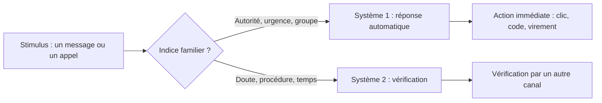

## Introduction

Le chapitre précédent a posé une idée centrale : l'ingénierie sociale exploite des mécanismes psychologiques universels. Ce chapitre les détaille un par un. Ce sont des **biais cognitifs** bien documentés en psychologie sociale depuis des décennies, présents chez tout le monde, indépendamment du niveau d'expertise technique ou de la vigilance individuelle.

Pourquoi les étudier précisément ? Parce qu'on ne se défend bien que contre ce que l'on sait nommer. Un employé qui reconnaît « on essaie de me presser » ou « on joue sur l'autorité » gagne la seconde de recul qui suffit souvent à déjouer une manipulation. Et un responsable sécurité qui comprend quel biais un scénario exploite peut concevoir la procédure qui le neutralise, au lieu de compter uniquement sur la vigilance des personnes.

À la fin de ce chapitre, tu sauras définir un biais cognitif, citer les principes d'influence de Robert Cialdini, reconnaître ces leviers dans des messages réels, et proposer pour chacun une contre-mesure concrète.

## Heuristiques et biais : d'où viennent ces failles

Une **heuristique** est un raccourci mental qui permet de prendre une décision rapide sans analyser toute l'information disponible. « Si mon responsable me le demande, c'est que c'est nécessaire » ou « si tout le monde le fait, c'est que c'est correct » sont des heuristiques. Elles sont utiles la plupart du temps : elles nous font gagner un temps et une énergie considérables.

Un **biais cognitif** est l'erreur systématique et prévisible que produit une heuristique quand on l'applique dans une situation où elle ne convient pas. Les psychologues Amos Tversky et Daniel Kahneman ont documenté ces biais dès les années 1970. Dans le vocabulaire de Kahneman vu au chapitre 1, les heuristiques appartiennent au **système 1**, rapide et automatique, et les biais apparaissent quand le **système 2**, lent et délibéré, ne prend pas le relais pour vérifier.

Le psychologue Robert Cialdini a ensuite étudié, dans son livre Influence publié en 1984, les techniques utilisées par les vendeurs, les recruteurs et les collecteurs de fonds pour obtenir un « oui ». Il en a tiré six principes d'influence : la réciprocité, l'engagement et la cohérence, la preuve sociale, la sympathie, l'autorité et la rareté. L'édition révisée de 2021 en ajoute un septième, l'unité, c'est-à-dire le sentiment d'appartenir au même groupe. Ces principes sont exactement ceux que mobilise un ingénieur social.



## Le principe d'autorité

<CehCallout>
Le biais d'autorité pousse à obéir plus facilement à une figure perçue comme légitime, comme un supérieur hiérarchique, un technicien informatique ou un représentant officiel. Un attaquant se faisant passer pour le PDG ou le support informatique exploite directement ce réflexe, souvent sans que la victime ne remette en question la demande.
</CehCallout>

La force de ce biais a été mise en évidence par les expériences de Stanley Milgram à l'université Yale, publiées en 1963 : une majorité de participants acceptaient d'administrer ce qu'ils croyaient être des chocs électriques dangereux à une autre personne, simplement parce qu'un expérimentateur en blouse le leur demandait. En entreprise, l'autorité se manifeste par un titre, une signature, un jargon technique, un uniforme ou un ton assuré.

```text
Exemple : "Bonjour, je suis Marc du support informatique, votre
ordinateur a été identifié comme compromis, j'ai besoin que vous
me donniez votre mot de passe pour lancer un scan de sécurité
immédiat avant que d'autres postes ne soient touchés."
```

Dans cet exemple, Marc se présente comme membre du support informatique : c'est l'autorité technique. Il ajoute une menace, l'ordinateur compromis, et une urgence, avant que d'autres postes ne soient touchés. La contre-mesure ne consiste pas à se méfier de tout le support, mais à poser une règle claire et connue de tous : le support ne demande jamais un mot de passe, en aucune circonstance. Une demande de mot de passe devient alors, par définition, un signal d'alerte.

## L'urgence et la rareté

<CehCallout>
Un sentiment d'urgence artificiel, comme « votre compte sera fermé dans 24h » ou « cette offre expire dans 10 minutes », court-circuite la réflexion posée au profit d'une réaction rapide. Ce mécanisme est exploité systématiquement dans les emails de phishing les plus efficaces, en lien direct avec les caractéristiques déjà vues au cours Sécurité Web (chapitre 5, sur les attaques d'authentification).
</CehCallout>

L'**urgence** et la **rareté** sont proches mais distinctes. L'urgence porte sur le temps : il faut agir maintenant. La rareté, au sens de Cialdini, porte sur la perte : une ressource, une opportunité ou un accès risque de disparaître. Les deux réduisent le temps de réflexion et activent la peur de perdre, qui pèse psychologiquement plus lourd que l'envie de gagner, un phénomène que Kahneman et Tversky ont appelé l'**aversion à la perte**. « Votre accès sera suspendu » joue sur la rareté implicite ; « avant 17 heures » joue sur l'urgence.

La contre-mesure la plus efficace est procédurale : déclarer à l'avance qu'aucune opération sensible, comme un changement de coordonnées bancaires ou une réinitialisation d'accès, ne peut être réalisée dans l'urgence sans vérification par un second canal. L'urgence elle-même devient alors un indice de fraude.

## La preuve sociale, la sympathie et la réciprocité

<CompareTable
  titleA="Biais"
  titleB="Exploitation typique"
  rows={[
    { a: "Preuve sociale", b: "\"Tous vos collègues ont déjà validé cette mise à jour\" — l'individu suit le comportement perçu du groupe" },
    { a: "Sympathie", b: "Un attaquant établit un rapport chaleureux avant de formuler sa demande, la rendant plus difficile à refuser" },
    { a: "Réciprocité", b: "Offrir un petit service ou une information avant de demander quelque chose en retour, créant un sentiment d'obligation" },
  ]}
/>

La **preuve sociale** repose sur l'idée que, dans une situation incertaine, nous regardons ce que font les autres pour décider. Un message affirmant que « 85 % de votre service a déjà complété la procédure » pousse les retardataires à suivre, sans vérifier que ce chiffre existe.

La **sympathie** repose sur le fait que nous disons plus facilement oui aux personnes que nous apprécions ou qui nous ressemblent. L'attaquant cherche des points communs, une ville, une école, un club de sport, complimente, prend des nouvelles. Une fois le lien établi, refuser une demande devient socialement inconfortable. L'**unité**, le septième principe de Cialdini, en est une forme renforcée : « entre collègues du même groupe, on se rend service ».

La **réciprocité** repose sur une norme sociale universelle : quand quelqu'un nous rend service, nous nous sentons obligés de rendre la pareille. L'attaquant offre d'abord quelque chose, une aide, une information utile, un petit cadeau, puis formule sa demande. La différence avec la sympathie est importante : la sympathie crée un lien affectif, la réciprocité crée une **dette**.

## L'engagement et la cohérence

Le principe d'**engagement et de cohérence** dit qu'une fois que nous avons pris une petite position, nous avons tendance à agir de façon cohérente avec elle. La technique du **pied dans la porte**, étudiée par Jonathan Freedman et Scott Fraser en 1966, montre que les personnes qui acceptent une petite demande acceptent plus facilement une demande plus importante ensuite.

En ingénierie sociale, cela donne une escalade progressive : l'attaquant demande d'abord une information anodine, le nom du logiciel de messagerie, puis une confirmation, « vous êtes bien au service comptabilité ? », puis une petite action, ouvrir un lien de « test », avant la vraie demande. Chaque « oui » rend le suivant plus facile. Ce mécanisme explique pourquoi les prétextes du chapitre 4 se construisent souvent sur plusieurs échanges.

## Autres leviers fréquents

D'autres mécanismes complètent ce tableau. La **curiosité** pousse à ouvrir un fichier intitulé « Salaires 2026 » ou à scanner un code QR inconnu. La **peur**, de la sanction, du piratage ou d'une amende, provoque une réaction immédiate. L'**excès de confiance** fait croire qu'on ne se ferait jamais piéger, ce qui baisse la garde. Le **biais de confirmation** pousse à interpréter les indices dans le sens de ce que l'on attend déjà : si l'on attend un colis, un SMS de livraison paraît naturel. Enfin, la **surcharge cognitive** d'une journée chargée réduit la disponibilité du système 2 : les messages piégés envoyés en fin de journée ou en période de clôture comptable en profitent.

## Pourquoi ces biais sont universels, pas des faiblesses individuelles

<WarningCallout>
Un piège fréquent consiste à considérer qu'une victime de phishing a simplement « manqué de vigilance ». En réalité, ces biais cognitifs affectent tout le monde, y compris des professionnels expérimentés de la sécurité, particulièrement sous pression de temps ou de charge de travail élevée. La formation efficace (chapitre 5) part de ce principe plutôt que de blâmer l'individu.
</WarningCallout>

Ces biais ne sont pas des défauts de caractère. Ce sont des mécanismes normaux du cerveau, qui nous servent la plupart du temps. Un expert en sécurité fatigué, pressé et confronté à un message parfaitement contextualisé peut cliquer comme n'importe qui. Blâmer la victime a deux effets négatifs : cela ignore la vraie cause, qui est le caractère universel de ces biais, et cela décourage les personnes de signaler leurs erreurs, alors que le signalement rapide est l'une des meilleures défenses.

## Reconnaître ces biais dans un scénario concret

```text
Un email prétendant venir du service RH annonce :
"Suite à un audit de sécurité, tous les employés doivent
confirmer leurs identifiants avant 17h aujourd'hui via ce lien,
sous peine de suspension temporaire d'accès."

Biais exploités :
- Autorité (le service RH)
- Urgence (échéance du jour même)
- Rareté implicite (conséquence négative si non-respect)
```

Analysons ce message. L'**autorité** vient de l'expéditeur affiché, le service RH, et de la référence à un audit de sécurité, qui donne une légitimité supplémentaire. L'**urgence** vient de l'échéance de 17 heures le jour même, qui empêche de prendre le temps de vérifier. La **rareté implicite** vient de la menace de suspension d'accès : la peur de perdre quelque chose. On peut y ajouter une touche de **preuve sociale**, puisque « tous les employés » sont concernés, ce qui rend la demande normale.

<AttackDefenseTable
  rows={[
    { phase: "Autorité", attack: "Se présenter comme le PDG, les RH ou le support informatique", defense: "Règles publiques simples : le support ne demande jamais de mot de passe ; toute demande inhabituelle d'un dirigeant se vérifie par rappel" },
    { phase: "Urgence et rareté", attack: "Imposer une échéance très courte ou menacer d'une perte", defense: "Procédure : aucune opération sensible sans vérification par un second canal, quelle que soit l'urgence" },
    { phase: "Preuve sociale", attack: "Affirmer que tous les collègues ont déjà agi", defense: "Communication interne officielle sur un canal connu pour toute campagne réelle" },
    { phase: "Sympathie et réciprocité", attack: "Créer un lien ou rendre service avant la demande", defense: "Séparer la relation de la décision : une demande sensible suit la procédure, même venant d'un interlocuteur sympathique" },
    { phase: "Engagement", attack: "Escalade de petites demandes vers une demande sensible", defense: "Former à repérer la dérive d'une conversation et autoriser à interrompre poliment" },
  ]}
/>

## Erreurs fréquentes

La première erreur est de penser que connaître les biais suffit à s'en protéger : la connaissance aide, mais sous pression le système 1 reprend le dessus, d'où l'importance des procédures. La deuxième est de confondre sympathie et réciprocité, alors que l'une crée un lien et l'autre une dette. La troisième est de croire qu'un message mal écrit est le seul signe d'une attaque : les messages les plus dangereux sont soignés, contextualisés et désormais souvent rédigés avec l'aide de l'IA générative. La quatrième est de transformer la formation en chasse aux coupables. La cinquième, enfin, est d'attribuer à des recherches des chiffres précis que l'on n'a pas vérifiés : en sensibilisation, la crédibilité de l'équipe sécurité dépend aussi de la rigueur de ses sources.

## Lab — Mise en pratique

**Environnement** : réflexion guidée (sans terminal). Travaille par écrit, idéalement en comparant tes réponses avec un collègue.

<Steps steps={[
  { title: "Identifier les biais dans un scénario", description: "Un appel téléphonique prétend venir d'un fournisseur habituel, mentionne un projet en cours connu de l'entreprise, et demande une confirmation urgente de coordonnées bancaires avant la fin de la journée. Identifie les biais cognitifs exploités et justifie chacun." },
  { title: "Reformuler sans blâme", description: "Reformule cette phrase pour qu'elle ne blâme pas l'individu : « L'employé a été négligent en cliquant sur ce lien de phishing. » Ta version doit nommer le mécanisme exploité et une amélioration possible." },
  { title: "Analyser l'exemple de Marc", description: "Relis l'exemple de Marc du support informatique. Repère les mots qui activent l'autorité, ceux qui activent la peur et ceux qui activent l'urgence. Propose une règle d'entreprise d'une seule phrase qui neutraliserait ce scénario." },
  { title: "Distinguer sympathie et réciprocité", description: "Écris deux courts scénarios fictifs, l'un reposant uniquement sur la sympathie, l'autre uniquement sur la réciprocité. Explique en une phrase ce qui les différencie." },
  { title: "Repérer l'escalade d'engagement", description: "Imagine une conversation téléphonique en quatre demandes successives qui mène d'une question anodine à une demande sensible. Indique à quel moment la personne aurait dû interrompre l'échange, et comment le faire poliment." },
  { title: "Associer une contre-mesure à chaque biais", description: "Pour l'email RH de ce chapitre, propose une mesure technique, une procédure et un message de sensibilisation qui, ensemble, réduiraient fortement son efficacité." },
]} />

## À retenir

- Une heuristique est un raccourci mental utile ; un biais cognitif est l'erreur systématique qu'elle produit quand le système 2 ne prend pas le relais.
- Robert Cialdini décrit sept principes d'influence : réciprocité, engagement et cohérence, preuve sociale, sympathie, autorité, rareté et unité.
- L'autorité, illustrée par Marc du support informatique, pousse à obéir sans remettre en question la demande.
- L'urgence et la rareté réduisent le temps de réflexion et activent la peur de perdre.
- La sympathie crée un lien qui rend le refus inconfortable ; la réciprocité crée une dette après un service rendu.
- Les messages les plus efficaces combinent plusieurs biais, comme l'email RH qui associe autorité, urgence et rareté implicite.
- Ces biais touchent tout le monde, y compris les experts : la défense repose sur des procédures et une culture sans blâme.

## Questions de révision

1. Quelle est la différence entre une heuristique et un biais cognitif ?
2. Pourquoi le biais d'autorité est-il particulièrement efficace lorsqu'un attaquant se fait passer pour le support informatique ?
3. Quelle est la différence entre l'urgence et la rareté, et pourquoi l'aversion à la perte renforce-t-elle la seconde ?
4. En quoi le biais de réciprocité peut-il être exploité avant même la demande principale d'un attaquant ?
5. Comment la technique du pied dans la porte s'applique-t-elle à une attaque par téléphone ?
6. Dans l'email RH qui exige une confirmation des identifiants avant 17 heures, quels biais sont combinés ?
7. Pourquoi est-il contre-productif de considérer qu'une victime de phishing a simplement « manqué de vigilance » ?
8. Propose une procédure qui neutralise à la fois l'autorité et l'urgence dans une demande de virement inhabituelle.
