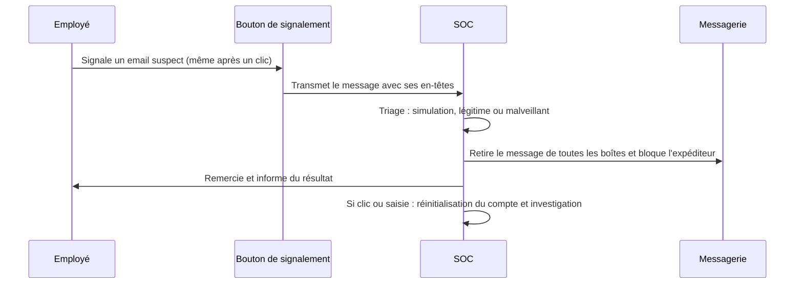

## Introduction

Ce chapitre aborde la dimension défensive centrale de ce cours : comment former efficacement des personnes face à des techniques qui exploitent des biais cognitifs universels, impossibles à « corriger » par une simple séance de sensibilisation annuelle.

Les chapitres précédents ont montré que l'autorité, l'urgence, la sympathie ou la réciprocité agissent sur tout le monde, et que les attaques par email, téléphone, SMS ou en personne sont de plus en plus soignées. La question devient donc : comment une organisation peut-elle réduire durablement le nombre de personnes piégées, et surtout réduire l'impact quand quelqu'un l'est malgré tout ?

À la fin de ce chapitre, tu sauras expliquer pourquoi la sensibilisation classique échoue, concevoir un programme adapté aux rôles et fondé sur la pratique, choisir des indicateurs utiles, mettre en place un canal de signalement efficace, encadrer une simulation de phishing interne, et combiner la formation avec des procédures et des mesures techniques.

## Pourquoi la sensibilisation classique échoue souvent

<WarningCallout>
Une formation annuelle obligatoire, sous forme de diaporama générique suivi d'un quiz, produit rarement un changement de comportement durable. Les biais cognitifs du chapitre 2 restent actifs sous pression réelle, même chez des personnes qui « connaissent » la théorie du phishing en dehors de tout contexte de stress ou d'urgence.
</WarningCallout>

La raison tient à la différence entre **savoir** et **faire**. Pendant un quiz, la personne est calme, attentive, et sait qu'on l'interroge sur le phishing : c'est le système 2 qui répond. Face à un vrai message, à 17 heures, entre deux réunions, c'est le système 1 qui décide. Une formation qui ne travaille que la connaissance déclarative prépare au quiz, pas à la situation réelle.

Il y a aussi un phénomène d'**oubli** bien connu en psychologie de l'apprentissage depuis les travaux d'Hermann Ebbinghaus au XIXe siècle : une information vue une seule fois s'efface rapidement si elle n'est pas réactivée. Une session unique par an laisse onze mois sans rappel. Enfin, un contenu générique, identique pour tous, paraît déconnecté du quotidien de chacun, ce qui réduit l'attention et la mémorisation.

<CompareTable
  titleA="Formation classique inefficace"
  titleB="Formation efficace"
  rows={[
    { a: "Contenu générique, identique pour tous les postes", b: "Contenu adapté aux risques réels du poste (finance, RH, IT ont des expositions différentes)" },
    { a: "Une session annuelle isolée", b: "Renforcement régulier et progressif tout au long de l'année" },
    { a: "Théorie abstraite sans mise en situation", b: "Simulations pratiques dans des conditions proches du réel" },
    { a: "Sanction ou honte en cas d'échec", b: "Retour d'expérience constructif, sans blâme individuel (rappel du chapitre 2)" },
  ]}
/>

## Concevoir une formation réellement efficace

<Steps steps={[
  { title: "Adapter le contenu au rôle réel", description: "Un comptable et un développeur ne font pas face aux mêmes scénarios de spear phishing les plus probables (chapitre 3)." },
  { title: "Multiplier les mises en situation courtes", description: "Des simulations fréquentes et brèves ancrent mieux le réflexe qu'une session longue et unique." },
  { title: "Mesurer et ajuster", description: "Suivre le taux de clic sur les simulations dans le temps, pas seulement les scores de quiz théoriques." },
  { title: "Créer un canal de signalement simple et non punitif", description: "Un employé qui a cliqué par erreur doit pouvoir le signaler immédiatement sans crainte de sanction, pour permettre une réponse rapide (rappel du cours Analyse SOC, chapitre 6, sur les playbooks)." },
]} />

### Adapter le contenu au rôle

Chaque fonction a ses scénarios les plus probables. La **comptabilité** et les achats sont exposés aux faux changements de coordonnées bancaires de fournisseurs et aux fraudes au président. Les **ressources humaines** reçoivent des candidatures piégées et des demandes de modification de RIB pour la paie. Le **support informatique** est la cible d'appels de faux employés qui demandent une réinitialisation de mot de passe ou d'authentification multifacteur. Les **développeurs** sont visés par des dépendances piégées, de fausses offres d'emploi et des vols de jetons d'accès. Les **dirigeants** sont la cible du whaling et, de plus en plus, de voix synthétiques imitant celles de leurs pairs. L'**accueil** fait face au prétexte en personne et au tailgating vus au chapitre 4. Un bon programme part de cette cartographie des risques par rôle.

### Pratiquer plutôt qu'écouter

L'objectif est de construire des **réflexes**, pas seulement des connaissances. Des formats courts et fréquents, comme une micro-leçon de trois minutes, un exemple réel commenté ou un exercice d'identification de signaux, sont plus efficaces qu'une longue session. Le meilleur moment pour apprendre est juste après une erreur : une page pédagogique affichée immédiatement après un clic sur une simulation, qui explique les indices manqués sans culpabiliser, transforme l'erreur en apprentissage.

### Enseigner des règles simples plutôt que des listes

Une personne sous pression ne se souvient pas d'une liste de vingt signaux d'alerte. Elle peut en revanche retenir quelques règles simples et non négociables. Par exemple : le support ne demande jamais de mot de passe ni de code reçu par SMS ; tout changement de coordonnées bancaires se vérifie en rappelant le contact sur un numéro déjà connu, jamais sur celui fourni dans le message ; une demande urgente et inhabituelle d'un dirigeant se vérifie par un second canal ; dans le doute, on signale, et signaler n'est jamais une faute.

## Mesurer le comportement, pas seulement la connaissance

Les scores de quiz mesurent ce que les personnes savent dans un contexte calme. Pour savoir si le comportement change, il faut des indicateurs de terrain, suivis dans le temps.

| Indicateur | Ce qu'il mesure | Point d'attention |
| --- | --- | --- |
| Taux de clic sur les simulations | La proportion de personnes qui cliquent sur un message simulé | Dépend fortement de la difficulté du scénario : comparer des scénarios de difficulté comparable |
| Taux de saisie d'identifiants | La proportion qui va jusqu'à saisir un mot de passe | Plus grave que le simple clic, à suivre séparément |
| Taux de signalement | La proportion qui signale le message à l'équipe sécurité | Indicateur positif souvent plus parlant que le taux de clic |
| Délai de signalement | Le temps entre la réception et le premier signalement | Un premier signalement rapide permet de bloquer la campagne pour tous |
| Signalements de vrais messages | Le nombre de menaces réelles remontées par les employés | Montre que la culture du signalement fonctionne hors simulation |

Le **taux de signalement** mérite une attention particulière. Un taux de clic de zéro est irréaliste : il y aura toujours quelqu'un pour cliquer. En revanche, si un employé signale le message dans les premières minutes, l'équipe sécurité peut retirer le message de toutes les boîtes de réception et bloquer le domaine avant que d'autres ne cliquent. L'objectif réaliste n'est donc pas « personne ne clique », mais « quelqu'un signale très vite ».

## Le canal de signalement

<CehCallout>
Un canal de signalement simple, comme un bouton « signaler comme phishing » directement dans le client email, réduit considérablement le délai entre le clic accidentel et l'alerte à l'équipe SOC. C'est un rappel direct du cours Analyse SOC (chapitre 2) : plus une alerte est signalée tôt, plus le triage et la réponse peuvent être rapides et limiter l'impact.
</CehCallout>

Un bon canal de signalement remplit quatre conditions. Il est **simple** : un seul bouton ou une adresse unique, connue de tous, sans formulaire à remplir. Il est **non punitif** : une personne qui signale avoir cliqué est remerciée, jamais sanctionnée, sinon elle se taira la fois suivante. Il est **relié au SOC** : le message signalé arrive avec ses en-têtes complets dans l'outil de traitement de l'équipe, qui peut le trier et lancer le playbook adapté. Il est **bouclé** : la personne reçoit un retour, même automatique, pour savoir si le message était malveillant, une simulation ou légitime.

Ce diagramme rejoint le cours Analyse SOC : le signalement est une alerte comme une autre, qui suit un triage puis un playbook de réponse. Si la personne a saisi son mot de passe, le playbook prévoit la réinitialisation des identifiants, la révocation des sessions actives et la recherche d'autres victimes de la même campagne.

## Les simulations de phishing internes

<CehCallout>
Une simulation de phishing interne, qui consiste à envoyer un faux email de phishing contrôlé aux employés pour mesurer le taux de clic, doit être menée avec les mêmes garde-fous éthiques qu'un test d'intrusion réel : autorisation de la direction, périmètre défini, et surtout un objectif d'apprentissage, jamais de sanction punitive des employés qui cliquent.
</CehCallout>

En pratique, une simulation sérieuse se prépare. Elle est **autorisée** par écrit par la direction, et les représentants du personnel ainsi que le délégué à la protection des données sont informés en amont, puisque la simulation traite des données personnelles sur le comportement des employés. Les employés savent, de manière générale, que des simulations ont lieu, sans connaître les dates. Les scénarios sont **réalistes mais respectueux** : on évite les prétextes qui jouent sur des sujets douloureux ou trompeurs, comme une fausse prime, une fausse annonce de licenciement ou un faux message médical, qui abîment la confiance. Les résultats sont **agrégés** par service ou par population, jamais publiés nominativement. Les outils open source comme GoPhish permettent de mener ces campagnes en interne, sur un périmètre autorisé.

<WarningCallout>
Une simulation de phishing conçue pour « piéger » et humilier publiquement les employés qui cliquent est contre-productive : elle génère de la méfiance envers l'équipe sécurité et décourage le signalement spontané d'erreurs réelles, exactement l'inverse de l'effet recherché.
</WarningCallout>

## Ne pas tout faire reposer sur les personnes

La formation est indispensable, mais elle ne suffit jamais seule. Une stratégie mature réduit à la fois le nombre de messages piégés qui atteignent les personnes et l'impact d'une erreur inévitable.

Côté **technique**, le filtrage de la messagerie et l'authentification des domaines avec SPF, DKIM et DMARC limitent l'usurpation directe du domaine de l'entreprise. Un bandeau signalant les messages venant de l'extérieur aide à repérer un faux message interne. Surtout, l'**authentification multifacteur résistante au phishing**, fondée sur les normes FIDO2 et WebAuthn, comme les clés de sécurité matérielles et les clés d'accès appelées passkeys, rend inutile un mot de passe volé sur une fausse page, car l'authentification est liée cryptographiquement au vrai site. Les codes à usage unique par SMS ou par application, eux, peuvent être relayés par un attaquant.

Côté **procédures**, la double validation des paiements, le rappel systématique sur un numéro connu avant tout changement de coordonnées bancaires et une procédure stricte de vérification d'identité au support informatique avant toute réinitialisation neutralisent des familles entières d'attaques, quelle que soit la qualité du prétexte.

<AuditCallout>
L'ISO/IEC 27001:2022 exige que le personnel reçoive une sensibilisation, un enseignement et une formation appropriés et régulièrement mis à jour (contrôle A.6.3), et prévoit un dispositif de signalement des événements de sécurité par le personnel (A.6.8). Le NIST a publié en 2024 la révision 1 du SP 800-50, consacrée à la construction d'un programme de formation en cybersécurité et protection de la vie privée. La directive NIS2 impose une formation des organes de direction et inclut la cyberhygiène et la formation parmi les mesures de gestion des risques.
</AuditCallout>

## Erreurs fréquentes

La première erreur est de mesurer le succès au seul taux de complétion de la formation obligatoire : avoir suivi un module ne prouve aucun changement de comportement. La deuxième est de piloter uniquement le taux de clic, en rendant les simulations de plus en plus faciles pour afficher de beaux chiffres. La troisième est de sanctionner les personnes qui cliquent, ce qui détruit le signalement. La quatrième est de rendre le signalement compliqué, avec un formulaire ou une adresse que personne ne retient. La cinquième est de ne jamais répondre aux personnes qui signalent, qui finissent par arrêter. Enfin, la sixième est d'oublier les procédures et les mesures techniques, en attendant de la formation ce qu'elle ne peut pas offrir seule.

## Lab — Mise en pratique

**Environnement** : réflexion guidée (sans terminal). Produis des documents courts, comme si tu préparais un programme réel pour une organisation de 200 personnes.

<Steps steps={[
  { title: "Adapter une formation par rôle", description: "Pour une équipe de comptabilité, propose un scénario de simulation de phishing plus pertinent qu'un email générique, en t'appuyant sur les variantes du chapitre 3. Précise le biais exploité et l'indice que l'employé devrait repérer." },
  { title: "Cartographier les risques par fonction", description: "Construis un tableau à trois colonnes : fonction, scénario le plus probable, règle simple à enseigner. Couvre au moins la comptabilité, les RH, le support informatique et l'accueil." },
  { title: "Concevoir un canal de signalement", description: "Propose une caractéristique concrète qui rendrait un canal de signalement de phishing à la fois simple d'usage et non punitif. Décris ce que reçoit le SOC et ce que reçoit l'employé en retour." },
  { title: "Rédiger trois règles non négociables", description: "Écris trois règles d'une phrase chacune, faciles à retenir sous pression, qui neutralisent l'autorité et l'urgence. Vérifie qu'elles ne demandent aucune compétence technique." },
  { title: "Choisir les indicateurs", description: "Pour un programme d'un an, choisis trois indicateurs parmi ceux du chapitre, fixe une tendance réaliste à atteindre, et explique pourquoi le taux de signalement est plus parlant qu'un objectif de zéro clic." },
  { title: "Préparer une simulation éthique", description: "Liste les personnes à informer avant une simulation, les scénarios que tu exclurais, et la façon dont les résultats seront présentés à la direction sans nommer personne." },
]} />

## À retenir

- Une formation générique et annuelle échoue souvent, car les biais cognitifs restent actifs sous pression réelle, indépendamment de la théorie connue.
- Une formation efficace adapte le contenu au rôle, multiplie les mises en situation courtes et enseigne quelques règles simples et non négociables.
- Il faut mesurer le comportement réel, avec le taux de clic, de saisie et surtout de signalement, pas seulement les scores de quiz.
- Un canal de signalement simple, non punitif et relié au SOC réduit le délai avant la réponse et limite l'impact d'un clic.
- Les simulations de phishing internes exigent autorisation, périmètre défini, résultats agrégés et objectif d'apprentissage, jamais la sanction.
- La formation ne suffit pas seule : l'authentification résistante au phishing et les procédures de vérification réduisent l'impact des erreurs inévitables.

## Questions de révision

1. Pourquoi une formation annuelle générique échoue-t-elle souvent à changer durablement le comportement ?
2. Pourquoi le contenu d'une formation doit-il être adapté au rôle réel de chaque employé ? Donne deux exemples.
3. Pourquoi le taux de signalement est-il un indicateur plus utile qu'un objectif de zéro clic ?
4. Pourquoi un canal de signalement non punitif est-il crucial pour la réponse rapide à un incident de phishing ?
5. Quelles garanties éthiques doivent encadrer une simulation de phishing interne ?
6. Pourquoi une simulation de phishing conçue pour humilier les employés est-elle contre-productive ?
7. En quoi une authentification multifacteur fondée sur FIDO2 protège-t-elle mieux qu'un code reçu par SMS contre une fausse page de connexion ?
