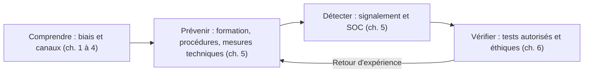

## Introduction

Ce dernier chapitre referme le cours en abordant le cadre éthique spécifique aux tests d'ingénierie sociale professionnels. C'est une pratique qui, plus que toute autre forme de test d'intrusion, touche directement des personnes réelles et leur dignité. Un scanner de vulnérabilités qui teste un serveur ne blesse personne ; un faux appel qui met un employé sous pression, ou un email qui joue sur ses émotions, peut laisser des traces réelles.

Pourquoi des organisations commandent-elles malgré tout ces tests ? Parce qu'ils sont le seul moyen de vérifier, dans des conditions proches du réel, si les procédures du chapitre 5 fonctionnent : le support vérifie-t-il vraiment l'identité avant une réinitialisation ? L'accueil applique-t-il la règle d'un badge par personne ? Les employés signalent-ils les messages suspects ? Le test n'a de valeur que s'il améliore ces défenses sans abîmer la confiance.

À la fin de ce chapitre, tu sauras quelles clauses doit contenir l'autorisation d'un test d'ingénierie sociale, comment traiter les données collectées, comment débriefer sans blâmer, et tu disposeras d'une synthèse complète du cours.

## Le cadre éthique et légal spécifique au social engineering

<CehCallout>
Rappel du cours Droit et Réglementation (chapitre 1) : un test d'ingénierie sociale nécessite une autorisation écrite encore plus précise qu'un pentest technique classique. Elle doit couvrir explicitement les techniques autorisées, comme le phishing simulé, le vishing ou la tentative d'accès physique, et exclure certains sujets sensibles, comme les données médicales ou la situation personnelle, même si l'accès y serait techniquement possible.
</CehCallout>

### Pourquoi une autorisation plus précise

Dans un test technique, la cible est un système appartenant au client, qui peut l'autoriser. Dans un test d'ingénierie sociale, la cible est aussi une **personne**, qui ne peut pas être informée à l'avance sans fausser le test. Le donneur d'ordre autorise l'atteinte à ses systèmes, mais pas n'importe quelle atteinte à ses salariés. L'autorisation doit donc protéger à la fois le testeur, l'organisation et les personnes ciblées.

Rappelons le contexte juridique vu au chapitre 1. En France, l'accès frauduleux à un système d'information relève de l'article 323-1 du Code pénal, et l'usurpation de l'identité d'un tiers de l'article 226-4-1. Une intrusion physique sans autorisation peut aussi constituer d'autres infractions. Seul un mandat écrit, signé par une personne qui a réellement le pouvoir d'engager l'organisation sur les locaux et les systèmes concernés, place le testeur dans un cadre légitime. Lors d'un test physique, le testeur garde sur lui une copie de cette autorisation et les coordonnées d'un contact capable de la confirmer immédiatement, ce que le métier appelle familièrement une lettre « sortie de prison ».

### Les clauses indispensables

<Steps steps={[
  { title: "Définir un périmètre précis des techniques autorisées", description: "Le phishing simulé est-il autorisé ? Le vishing ? Une tentative de tailgating physique ? Chaque technique est listée explicitement, avec les sites, les populations et les plages horaires concernés." },
  { title: "Exclure les sujets personnels sensibles", description: "Ne jamais exploiter des informations personnelles hors du cadre strictement professionnel, même si elles faciliteraient techniquement l'attaque : santé, famille, religion, situation financière personnelle." },
  { title: "Prévoir un contact d'urgence", description: "Rappel du cours Droit et Réglementation, chapitre 1 : une personne côté client doit pouvoir être contactée en cas de réaction disproportionnée pendant le test, comme un appel à la police ou une détresse visible." },
  { title: "Débriefer sans blâmer", description: "Rappel du chapitre 5 : le rapport final doit rester constructif, jamais nommer publiquement les employés ayant échoué au test." },
]} />

Au-delà de ces quatre clauses, des **règles d'engagement** détaillées précisent ce qui est permis pendant le test. Elles fixent les prétextes interdits, par exemple se faire passer pour les forces de l'ordre, pour un service d'urgence ou pour un médecin, ou annoncer un décès, un accident ou un licenciement. Elles indiquent ce que le testeur fait s'il obtient un accès inattendu, s'il est découvert ou s'il découvre un incident réel en cours : il s'arrête et prévient le contact d'urgence. Elles définissent enfin les conditions d'arrêt immédiat du test.

<WarningCallout>
Un test d'ingénierie sociale mal encadré peut causer un préjudice psychologique réel à un employé piégé. Une pratique éthique du social engineering professionnel exige une prudence et une bienveillance particulières, au-delà du simple respect de la lettre du contrat. Si un scénario te met mal à l'aise à l'idée de l'expliquer à la personne ciblée lors du débriefing, c'est probablement qu'il ne devrait pas être utilisé.
</WarningCallout>

## Le traitement des données collectées

Un test d'ingénierie sociale produit des données personnelles : les noms et adresses des personnes ciblées, des enregistrements d'appels si l'autorisation les prévoit, des identifiants saisis sur une page de simulation, des photos prises lors d'un test physique, et les informations collectées en reconnaissance sur les réseaux sociaux.

Le RGPD s'applique à ces traitements. Le principe de **minimisation** impose de ne collecter que ce qui est nécessaire au test : une page de simulation peut se contenter d'enregistrer qu'un mot de passe a été saisi, sans le stocker en clair. Le principe de **limitation de la conservation** impose de supprimer les données brutes à l'issue de la mission, selon un délai fixé dans le contrat. La **sécurité** des données collectées, chiffrées et à accès restreint, est une obligation, car la base de résultats d'un test est en elle-même une liste sensible des personnes qui se sont fait piéger. Enfin, la reconnaissance en sources ouvertes se limite à l'environnement **professionnel** des personnes : un profil professionnel public est pertinent, la vie familiale ne l'est pas.

<LegalCallout>
Le RGPD fixe à son article 5 les principes de minimisation des données et de limitation de leur conservation, et impose à son article 32 des mesures de sécurité adaptées au risque. Dans une simulation interne, le délégué à la protection des données de l'organisation doit être associé en amont, et l'enregistrement d'appels téléphoniques suppose un cadre juridique vérifié au préalable.
</LegalCallout>

## Le débriefing et le rapport

Le moment le plus important d'un test d'ingénierie sociale n'est pas l'attaque, c'est ce qui suit. Un bon débriefing commence par informer les personnes ciblées, collectivement, qu'un test autorisé a eu lieu et pourquoi. Il présente des **résultats agrégés**, par service ou par site, jamais une liste nominative. Il explique les mécanismes exploités, en reprenant les biais du chapitre 2, pour que chacun comprenne qu'il ne s'agit pas d'une faiblesse personnelle. Il met en valeur les **bons réflexes**, comme les personnes qui ont signalé, refusé ou vérifié. Enfin, il transforme chaque constat en recommandation portant sur une **procédure** ou une **mesure technique**, pas sur des individus.

Le rapport destiné à la direction suit la même logique, comme vu au cours Rédaction de rapports : un résumé exécutif, les constats classés par gravité, les causes racines et un plan d'action. Une constatation comme « 12 personnes ont donné leur mot de passe » est moins utile que « la procédure de réinitialisation du support ne prévoit aucune vérification d'identité, et un attaquant peut obtenir un nouvel accès en un seul appel ».

<AttackDefenseTable
  rows={[
    { phase: "Avant le test", attack: "Test lancé sans mandat clair ou signé par une personne non habilitée", defense: "Autorisation écrite précise, signée par un responsable habilité, avec périmètre et exclusions" },
    { phase: "Pendant le test", attack: "Prétexte jouant sur la santé, la famille ou une fausse urgence vitale", defense: "Règles d'engagement listant les prétextes interdits et les conditions d'arrêt" },
    { phase: "Incident imprévu", attack: "Réaction disproportionnée d'un employé, appel aux forces de l'ordre", defense: "Contact d'urgence joignable à tout moment, lettre d'autorisation sur soi" },
    { phase: "Données", attack: "Mots de passe et enregistrements conservés sans protection", defense: "Minimisation, chiffrement, suppression à la fin de la mission" },
    { phase: "Après le test", attack: "Rapport nommant publiquement les personnes piégées", defense: "Résultats agrégés, recommandations sur les procédures, valorisation des signalements" },
  ]}
/>

## Synthèse — panorama complet du cours

<CompareTable
  titleA="Chapitre"
  titleB="Application défensive"
  rows={[
    { a: "1. Introduction", b: "Comprendre pourquoi l'humain reste le vecteur le plus exploité" },
    { a: "2. Biais cognitifs", b: "Identifier les mécanismes précis à surveiller et à expliquer aux utilisateurs" },
    { a: "3. Phishing et variantes", b: "Reconnaître les signaux d'alerte spécifiques à chaque canal (email, téléphone, SMS)" },
    { a: "4. Prétexting et usurpation", b: "Anticiper des scénarios plus élaborés que le simple email isolé" },
    { a: "5. Former et protéger", b: "Concevoir une sensibilisation qui change réellement le comportement" },
    { a: "6. Éthique du test", b: "Encadrer les tests professionnels avec rigueur et bienveillance" },
  ]}
/>

Le fil conducteur du cours tient en une phrase : les attaquants exploitent des mécanismes humains universels, donc la défense doit être conçue pour des humains réels, et non pour des utilisateurs parfaits. Le chapitre 1 a montré pourquoi l'humain reste la cible privilégiée et présenté le schéma reconnaissance, prétexte, biais, obtention. Le chapitre 2 a nommé les biais exploités, de l'autorité à la réciprocité. Les chapitres 3 et 4 ont décrit les canaux et les scénarios, du phishing de masse au prétexte en personne. Le chapitre 5 a montré comment former, mesurer et outiller l'organisation. Ce chapitre, enfin, a posé les règles qui permettent de tester ces défenses sans nuire.

## Où aller ensuite

<Steps steps={[
  { title: "Vers Cybersécurité Offensive", description: "Voir comment l'ingénierie sociale s'intègre dans une méthodologie de pentest complète, de la reconnaissance au rapport." },
  { title: "Vers Analyse SOC", description: "Voir comment un signalement de phishing (chapitre 5) est concrètement traité et trié par une équipe SOC." },
  { title: "Vers Droit et Réglementation", description: "Approfondir le cadre légal encadrant les tests d'ingénierie sociale professionnels." },
]} />

## Erreurs fréquentes

La première erreur est de considérer l'autorisation d'un test technique comme suffisante pour un test d'ingénierie sociale. La deuxième est de faire signer l'autorisation par une personne qui n'a pas autorité sur tous les sites ou toutes les populations testées, par exemple un prestataire ou un locataire. La troisième est de choisir le prétexte « le plus efficace » sans se demander s'il est acceptable. La quatrième est de garder les données collectées « au cas où ». La cinquième est de livrer un rapport qui pointe des personnes au lieu de procédures. Enfin, la sixième est d'oublier de valoriser les personnes qui ont bien réagi, ce qui est pourtant le meilleur levier pour renforcer la culture du signalement.

## Lab — Mise en pratique

**Environnement** : réflexion guidée (sans terminal). Rédige comme si tu préparais une vraie mission pour un client.

<Steps steps={[
  { title: "Définir un périmètre de test éthique", description: "Pour un test d'ingénierie sociale visant une entreprise de 50 employés, rédige trois clauses de périmètre que tu jugerais indispensables dans l'autorisation écrite." },
  { title: "Lister les prétextes interdits", description: "Rédige une liste de cinq prétextes que tu refuserais d'utiliser, même s'ils étaient efficaces, et justifie chacun en une phrase." },
  { title: "Préparer la gestion d'incident", description: "Décris ce que tu fais si, pendant un test physique, un agent de sécurité appelle la police. Qui contactes-tu, avec quel document, et dans quel ordre ?" },
  { title: "Identifier un manquement éthique", description: "Un rapport de test d'ingénierie sociale nomme publiquement les employés ayant cliqué sur le phishing simulé, avec leur photo. Quel principe du chapitre 5 est violé, et quelle conséquence organisationnelle cela risque-t-il de provoquer ?" },
  { title: "Réécrire un constat", description: "Transforme le constat « Huit employés de l'accueil ont laissé entrer le testeur » en un constat centré sur une procédure, suivi d'une recommandation concrète." },
  { title: "Construire ta synthèse", description: "Pour chacun des six chapitres du cours, écris une action défensive concrète que tu pourrais proposer dès demain dans une organisation." },
]} />

## À retenir

- Un test d'ingénierie sociale professionnel exige une autorisation écrite encore plus précise qu'un pentest technique, car il touche directement des personnes réelles et leur dignité.
- L'autorisation définit les techniques autorisées, exclut les sujets personnels sensibles et prévoit un contact d'urgence joignable pendant le test.
- Les règles d'engagement interdisent certains prétextes et fixent les conditions d'arrêt du test.
- Les données collectées sont minimisées, protégées et supprimées à la fin de la mission, conformément au RGPD.
- Le débriefing reste constructif et non punitif, avec des résultats agrégés et des recommandations portant sur les procédures.
- Le cours relie la compréhension des mécanismes psychologiques à leur application défensive : formation, signalement, procédures et tests éthiques encadrés.

## Questions de révision

1. Pourquoi l'autorisation écrite d'un test d'ingénierie sociale doit-elle être plus précise que celle d'un pentest technique classique ?
2. Quels sujets doivent être exclus d'un test d'ingénierie sociale, même s'ils sont techniquement accessibles ?
3. À quoi sert le contact d'urgence prévu dans l'autorisation, et dans quelles situations le joindre ?
4. Comment appliquer les principes de minimisation et de limitation de la conservation aux données d'une simulation de phishing ?
5. Pourquoi un débriefing qui nomme publiquement les employés ayant échoué est-il problématique ?
6. Pourquoi un constat centré sur une procédure est-il plus utile qu'un constat centré sur des personnes ?
7. Quel cours Nyx complémentaire approfondirait le plus directement le traitement d'un signalement de phishing par une équipe SOC ?

Félicitations, tu viens de terminer le cours **Psychologie & Ingénierie Sociale** ! Direction **Cybersécurité Offensive** pour voir comment ces techniques s'intègrent dans une méthodologie de pentest complète.
