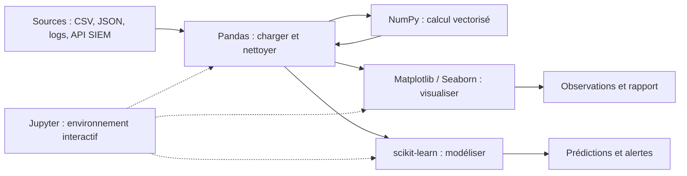

## Introduction

Ce cours met en pratique, avec du code réel, chaque notion théorique du cours Data Science Complète : nettoyage, exploration, visualisation et modélisation. Le fil rouge sera toujours le même : des jeux de données de sécurité, comme des journaux de connexions réseau, des emails de phishing ou des alertes d'un SOC (Security Operations Center, le centre de supervision de la sécurité).

Pourquoi un analyste sécurité devrait-il apprendre la data science en Python ? Parce que le métier est devenu un problème de volume. Un pare-feu d'entreprise produit des millions de lignes de journaux par jour, un EDR (Endpoint Detection and Response) remonte des milliers d'événements par poste, et une campagne de phishing peut générer des centaines de signalements. Aucun humain ne lit tout cela ligne par ligne. Savoir charger un export de logs, le filtrer, l'agréger et le visualiser en quelques lignes de Python fait la différence entre une investigation de deux jours et une investigation de vingt minutes.

Ce premier chapitre présente l'écosystème avant d'écrire la moindre ligne d'analyse. À la fin, tu sauras expliquer à quoi sert chaque bibliothèque, pourquoi Python est aussi rapide en pratique alors qu'il est lent en théorie, comment installer un environnement propre et reproductible, et quels pièges de sécurité guettent quiconque installe des paquets Python.

## Pourquoi Python domine la data science

### Un langage lent, des calculs rapides

Python est un langage interprété : chaque instruction est lue et exécutée par l'interpréteur au moment de l'exécution, avec une vérification dynamique des types. Une boucle Python qui additionne un million de nombres est donc des dizaines de fois plus lente que la même boucle écrite en C. Pourtant, Python est devenu le langage de référence de la data science et du machine learning.

<CehCallout>
Python s'est imposé en data science non pas pour sa rapidité brute (un langage compilé comme C serait plus rapide), mais pour la richesse de son écosystème de bibliothèques optimisées (NumPy, Pandas) qui délèguent les calculs lourds à du code C/Fortran sous-jacent, tout en gardant une syntaxe simple et lisible pour l'utilisateur.
</CehCallout>

Concrètement, quand tu écris `tableau.sum()` sur un tableau NumPy d'un million de valeurs, Python ne fait qu'un seul appel : il passe la main à une routine compilée en C qui parcourt la mémoire à pleine vitesse, puis récupère le résultat. Le coût de l'interpréteur n'est payé qu'une fois, pas un million de fois. Les opérations d'algèbre linéaire, elles, sont confiées à des bibliothèques historiques écrites en Fortran et en C, comme BLAS et LAPACK, optimisées depuis des décennies. C'est ce que l'on appelle la vectorisation, que tu étudieras en détail au chapitre 2.

### Les autres raisons du succès

La vitesse déléguée n'explique pas tout. Trois autres facteurs ont joué :

- **La lisibilité** : un script Python se lit presque comme du pseudo-code, ce qui le rend accessible aux analystes, chercheurs et ingénieurs sécurité qui ne sont pas développeurs à plein temps.
- **Un langage généraliste** : le même langage sert à écrire un scanner réseau, à interroger une API de threat intelligence, à automatiser une tâche système et à entraîner un modèle. Il n'y a pas de rupture entre la collecte des données et leur analyse.
- **Une communauté massive** : la plupart des outils de sécurité modernes exposent une API Python, et la quasi-totalité des cours, articles et jeux de données publics en data science fournissent du code Python.

Le langage R reste excellent pour les statistiques académiques, et Julia vise le calcul scientifique haute performance, mais aucun des deux n'offre la même continuité entre scripting de sécurité, ingénierie logicielle et machine learning.

## Panorama des bibliothèques essentielles

<CompareTable
  titleA="Bibliothèque"
  titleB="Rôle"
  rows={[
    { a: "NumPy", b: "Calcul numérique vectorisé sur des tableaux — la fondation de tout le reste (chapitre 2)" },
    { a: "Pandas", b: "Manipulation de données tabulaires (DataFrames) — chargement, nettoyage, agrégation (chapitres 3 et 4)" },
    { a: "Matplotlib / Seaborn", b: "Visualisation de données — graphiques statiques pour l'exploration (chapitre 5)" },
    { a: "scikit-learn", b: "Algorithmes de machine learning prêts à l'emploi — classification, clustering, évaluation (chapitre 7)" },
    { a: "Jupyter Notebook", b: "Environnement interactif combinant code, résultats et texte explicatif dans un même document" },
]}
/>

### NumPy, la fondation

NumPy (Numerical Python) fournit un seul objet central, le `ndarray`, un tableau multidimensionnel dont tous les éléments ont le même type. Pandas, scikit-learn, Matplotlib et la plupart des bibliothèques scientifiques utilisent ces tableaux en interne. NumPy 2, sorti en 2024, a modernisé l'API et nettoyé de nombreux alias historiques : si tu tombes sur un vieux tutoriel qui utilise `np.float` ou `np.int`, sache que ces alias ont été supprimés et qu'il faut écrire `float` ou `np.float64`.

### Pandas, la table de données

Pandas ajoute au-dessus de NumPy le `DataFrame`, une table avec des colonnes nommées pouvant avoir des types différents : du texte pour une adresse IP, un entier pour un port, une date pour un horodatage. C'est la forme naturelle d'un export de logs ou d'un fichier CSV. La branche 2.x a introduit le support optionnel de PyArrow, et la version 3.0 active par défaut le mode copy-on-write, qui rend le comportement des copies plus prévisible, ainsi qu'un type dédié aux chaînes de caractères. Le code de ce cours fonctionne avec pandas 2.2 comme avec pandas 3 ; les rares différences visibles seront signalées.

### Matplotlib et Seaborn, la visualisation

Matplotlib est la bibliothèque de tracé historique : elle permet de contrôler chaque pixel d'un graphique. Seaborn s'appuie sur elle pour produire en une ligne des graphiques statistiques comme des boxplots ou des cartes de chaleur de corrélation.

### scikit-learn, le machine learning classique

scikit-learn fournit des dizaines d'algorithmes (régression, arbres de décision, forêts aléatoires, k-NN, clustering) derrière une interface unique, avec les outils d'évaluation et de préparation des données qui vont avec. Pour le deep learning, on se tourne vers PyTorch, mais pour des données tabulaires comme des logs, scikit-learn reste l'outil de référence.

### Jupyter, le carnet interactif

Un notebook Jupyter est un document découpé en cellules : certaines contiennent du code exécutable, d'autres du texte formaté. Les résultats, tableaux et graphiques s'affichent directement sous chaque cellule. JupyterLab est l'interface moderne, et VS Code sait aussi ouvrir et exécuter les fichiers `.ipynb`. C'est l'outil idéal pour explorer un jeu de données pas à pas et garder une trace lisible de son raisonnement.

### Comment elles s'articulent

<TipCallout>
Ces bibliothèques ne fonctionnent pas de façon isolée mais s'articulent naturellement : un DataFrame Pandas peut être directement passé à Matplotlib pour le visualiser, ou à scikit-learn pour entraîner un modèle — cette interopérabilité fluide est l'une des grandes forces de l'écosystème.
</TipCallout>

Cette interopérabilité tient à une raison simple : sous le capot, les colonnes numériques d'un DataFrame sont des tableaux NumPy (ou des tableaux compatibles). Toutes les bibliothèques parlent donc la même langue et peuvent s'échanger des données sans conversion coûteuse.



### Les compagnons utiles à connaître

Au-delà des cinq briques du tableau, tu croiseras rapidement d'autres noms. SciPy complète NumPy avec des statistiques, de l'optimisation et du traitement du signal. Polars est une alternative moderne à Pandas, écrite en Rust, très rapide sur de gros volumes ; elle mérite le détour une fois Pandas maîtrisé. PyArrow permet de lire et écrire efficacement le format colonnaire Parquet, bien plus compact qu'un CSV pour archiver des logs. Enfin, Plotly produit des graphiques interactifs dans le navigateur.

## Un premier aperçu de code

Voici un premier contact avec les trois bibliothèques principales, sur un minuscule jeu de connexions réseau.

```python
import numpy as np
import pandas as pd
import matplotlib.pyplot as plt

# Un tableau NumPy : durées de connexions réseau (en secondes)
durees = np.array([12, 45, 8, 230, 15, 9])

# Un DataFrame Pandas : structure tabulaire avec colonnes nommées
df = pd.DataFrame({
    "duree": durees,
    "port": [80, 443, 22, 443, 80, 22]
})

print(df.describe())  # statistiques descriptives immédiates (rappel du cours Mathématiques Appliquées)
```

```text
            duree        port
count    6.000000    6.000000
mean    53.166667  181.666667
std     87.725519  204.082990
min      8.000000   22.000000
25%      9.750000   36.500000
50%     13.500000   80.000000
75%     37.500000  352.250000
max    230.000000  443.000000
```

Prends le temps de lire cette sortie. Pour la colonne `duree`, la moyenne vaut environ 53 secondes alors que la médiane (ligne `50%`) vaut 13,5 secondes : une seule connexion de 230 secondes tire la moyenne vers le haut. C'est exactement le genre d'écart qui doit alerter un analyste, car une valeur extrême peut signaler une session anormalement longue, par exemple un tunnel ou une exfiltration.

La colonne `port`, elle, illustre un piège classique : Pandas a calculé une moyenne de 181,67 pour les ports, ce qui n'a aucun sens. Un port est un identifiant, une catégorie, pas une quantité. Pandas ne peut pas le deviner tout seul ; c'est à toi de raisonner sur la nature de chaque colonne. Pour une colonne catégorielle, on compte plutôt les occurrences ou on agrège par groupe :

```python
print(df.groupby("port")["duree"].agg(["count", "mean", "max"]))
```

```text
      count   mean  max
port                   
22        2    8.5    9
80        2   13.5   15
443       2  137.5  230
```

En une ligne, tu sais maintenant que la connexion longue se trouve sur le port 443 (HTTPS). Tu reverras `groupby` en détail au chapitre 3.

<WarningCallout>
Ce chapitre suppose une connaissance de base de la syntaxe Python (variables, fonctions, boucles) — approfondie au cours Linux pour la Cybersécurité pour son usage en scripting Bash/Python de sécurité. Ce cours se concentre spécifiquement sur les bibliothèques de data science, pas sur l'apprentissage du langage lui-même.
</WarningCallout>

## Préparer son environnement

### Pourquoi isoler ses environnements

Installer des paquets directement dans le Python du système est une mauvaise idée. Sur les distributions Linux récentes comme Debian, Ubuntu ou Kali, la commande `pip install` hors environnement virtuel est d'ailleurs refusée avec l'erreur `externally-managed-environment` (PEP 668), justement pour éviter de casser les outils du système qui dépendent de Python. La bonne pratique est de créer un environnement virtuel par projet : un dossier qui contient sa propre copie de l'interpréteur et ses propres paquets.

### Les outils disponibles

| Outil | Usage | Points forts |
| --- | --- | --- |
| `venv` + `pip` | Environnement virtuel standard, inclus avec Python | Toujours disponible, aucune installation |
| `uv` | Gestionnaire moderne écrit en Rust (projets, environnements, versions de Python) | Très rapide, fichier de verrouillage reproductible |
| `conda` / `mamba` | Environnements incluant des dépendances non Python | Pratique pour des bibliothèques compilées complexes |

Le cours fonctionne avec Python 3.12 ou plus récent, NumPy 2.x, pandas 2.2 ou 3.x, scikit-learn 1.5 ou plus récent, Matplotlib 3.x et Seaborn 0.13.

### Installation avec venv et pip

```bash
# Créer et activer un environnement virtuel dans le dossier .venv
python3 -m venv .venv
source .venv/bin/activate        # sous Windows : .venv\Scripts\activate

# Installer les bibliothèques essentielles en une seule commande
pip install numpy pandas matplotlib seaborn scikit-learn

# Ajouter Jupyter pour l'exploration interactive
pip install jupyterlab

# Figer les versions exactes pour pouvoir reproduire l'environnement
pip freeze > requirements.txt
```

La commande `pip install numpy pandas matplotlib seaborn scikit-learn` installe les cinq bibliothèques essentielles, ainsi que leurs dépendances (SciPy pour scikit-learn, par exemple). Le fichier `requirements.txt` permet ensuite à un collègue de recréer exactement le même environnement avec `pip install -r requirements.txt`.

### Installation avec uv

```bash
# Créer un projet, puis ajouter les dépendances (le fichier uv.lock fige les versions)
uv init analyse-logs && cd analyse-logs
uv add numpy pandas matplotlib seaborn scikit-learn jupyterlab

# Lancer un script ou JupyterLab dans l'environnement du projet
uv run python analyse.py
uv run jupyter lab
```

### Vérifier l'installation

```python
import sys
import numpy as np
import pandas as pd
import sklearn, matplotlib, seaborn

print(sys.version)
for nom, mod in [("numpy", np), ("pandas", pd), ("scikit-learn", sklearn),
                 ("matplotlib", matplotlib), ("seaborn", seaborn)]:
    print(f"{nom:<13} {mod.__version__}")
```

```text
3.12.16 (main, Oct 26 2026, 14:08:45) [Clang 23.1.3 ]
numpy         2.5.4
pandas        3.1.1
scikit-learn  1.9.1
matplotlib    3.11.2
seaborn       0.13.2
```

Tes numéros de version seront sans doute différents ; l'important est que chaque import réussisse et que les versions majeures correspondent aux prérequis.

### Notebook ou script ?

<CompareTable
  titleA="Notebook Jupyter"
  titleB="Script .py"
  rows={[
    { a: "Exploration interactive, cellule par cellule", b: "Exécution complète et reproductible de bout en bout" },
    { a: "Graphiques et tableaux affichés sous le code", b: "Sorties dans le terminal ou dans des fichiers" },
    { a: "Idéal pour une investigation ou un rapport d'analyse", b: "Idéal pour une tâche planifiée ou un pipeline en production" },
    { a: "Risque : cellules exécutées dans le désordre, état caché", b: "Se versionne facilement avec Git et se teste" },
]}
/>

Une pratique courante consiste à explorer dans un notebook, puis à déplacer le code stabilisé dans des fonctions d'un script ou d'un module. C'est exactement le chemin que suivra ce cours jusqu'au chapitre 8.

## La sécurité de l'écosystème lui-même

Un analyste sécurité doit aussi regarder ses propres outils avec un œil critique. L'écosystème Python data science présente plusieurs surfaces d'attaque bien réelles.

<AttackDefenseTable rows={[
  { phase: "Installation de paquets", attack: "Typosquatting sur PyPI : un paquet malveillant au nom proche d'un paquet connu exécute du code lors de l'installation (technique de compromission de la chaîne d'approvisionnement, MITRE ATT&CK T1195.001)", defense: "Vérifier l'orthographe exacte, épingler les versions dans un fichier de verrouillage, auditer avec pip-audit, utiliser un miroir interne" },
  { phase: "Chargement de modèles", attack: "Un fichier pickle ou joblib piégé exécute du code arbitraire au moment du chargement", defense: "Ne charger que des modèles de source fiable, préférer des formats sans exécution de code (skops, safetensors, ONNX)" },
  { phase: "Partage de notebooks", attack: "Clés d'API, mots de passe ou extraits de logs sensibles oubliés dans les sorties des cellules et poussés sur un dépôt public", defense: "Variables d'environnement pour les secrets, nettoyage des sorties avant commit (nbstripout), scan de secrets" },
  { phase: "Serveur Jupyter", attack: "Un serveur Jupyter exposé sur Internet sans authentification donne un shell à distance", defense: "Écouter uniquement sur localhost, garder le jeton d'authentification, accès distant via tunnel SSH" },
]} />

```bash
# Auditer les dépendances installées contre les bases de vulnérabilités connues
pip install pip-audit
pip-audit
```

<LegalCallout>
Les jeux de données de sécurité contiennent souvent des données personnelles : adresses IP, adresses email, noms d'utilisateur. Au sens du RGPD, une adresse IP peut constituer une donnée personnelle. Travaille sur des extraits pseudonymisés quand c'est possible, ne copie pas de logs de production sur un poste personnel, et ne publie jamais un notebook contenant de vraies données de ton organisation.
</LegalCallout>

## Erreurs fréquentes

- **Installer dans le Python du système** : cela casse des outils système ou déclenche l'erreur `externally-managed-environment`. Crée toujours un environnement virtuel.
- **Mélanger plusieurs interpréteurs** : installer un paquet avec un `pip` qui n'appartient pas au Python utilisé par Jupyter, puis obtenir `ModuleNotFoundError`. Utilise `python -m pip install` pour être certain d'installer dans le bon interpréteur, et vérifie le noyau sélectionné dans Jupyter.
- **Suivre un tutoriel obsolète** : des alias supprimés comme `np.float`, ou la méthode `DataFrame.append` retirée de pandas 2, font échouer du vieux code. Vérifie la date des ressources que tu consultes.
- **Faire confiance aveuglément à `describe()`** : calculer la moyenne d'une colonne de ports ou d'identifiants n'a aucun sens. Réfléchis à la nature de chaque colonne.
- **Exécuter les cellules d'un notebook dans le désordre** : le résultat affiché ne correspond plus au code visible. Avant de partager un notebook, redémarre le noyau et exécute tout de haut en bas.

## Lab — Mise en pratique

**Environnement** : Python 3.12 ou plus récent (terminal Nyx Shell ou environnement local).

<Steps steps={[
  { title: "Créer un environnement virtuel", description: "Crée un dossier de travail et un environnement virtuel isolé. Observe que l'invite du terminal affiche désormais le nom de l'environnement entre parenthèses.", code: "mkdir -p ~/nyx-datasci && cd ~/nyx-datasci\npython3 -m venv .venv\nsource .venv/bin/activate\nwhich python" },
  { title: "Installer les bibliothèques essentielles", description: "Installe les cinq bibliothèques en une seule commande, puis fige les versions. Ouvre requirements.txt et repère les dépendances installées automatiquement, comme scipy ou joblib.", code: "pip install numpy pandas matplotlib seaborn scikit-learn\npip freeze > requirements.txt\nwc -l requirements.txt" },
  { title: "Vérifier l'installation", description: "Importe chaque bibliothèque et affiche sa version. Chaque ligne doit s'afficher sans erreur.", code: "import numpy as np\nimport pandas as pd\nimport sklearn, matplotlib, seaborn\n\nfor nom, mod in [('numpy', np), ('pandas', pd), ('scikit-learn', sklearn), ('matplotlib', matplotlib), ('seaborn', seaborn)]:\n    print(f'{nom:<13} {mod.__version__}')" },
  { title: "Créer un DataFrame de connexions réseau", description: "Reprends l'exemple du chapitre : crée un tableau NumPy de durées de connexion et un DataFrame associant durée et port.", code: "import numpy as np\nimport pandas as pd\n\ndurees = np.array([12, 45, 8, 230, 15, 9])\ndf = pd.DataFrame({\n    'duree': durees,\n    'port': [80, 443, 22, 443, 80, 22]\n})\nprint(df.head())" },
  { title: "Afficher les statistiques descriptives", description: "Calcule les statistiques descriptives. Compare la moyenne et la médiane (ligne 50%) de la colonne duree et explique l'écart. Repère aussi pourquoi la moyenne de la colonne port n'a aucun sens.", code: "print(df.describe())" },
  { title: "Agréger par port", description: "Regroupe les connexions par port pour identifier sur quel service se trouve la connexion la plus longue.", code: "print(df.groupby('port')['duree'].agg(['count', 'mean', 'max']))" },
  { title: "Auditer les dépendances", description: "Installe pip-audit et vérifie qu'aucune dépendance installée n'est concernée par une vulnérabilité connue. Lis le rapport : il indique, le cas échéant, la version corrigée à installer.", code: "pip install pip-audit\npip-audit" },
]} />

## À retenir

- Python domine la data science grâce à un écosystème de bibliothèques optimisées qui délèguent les calculs lourds à du code C et Fortran, pas grâce à sa rapidité brute.
- NumPy fournit le calcul vectorisé, Pandas la manipulation tabulaire, Matplotlib et Seaborn la visualisation, scikit-learn le machine learning, et Jupyter l'environnement interactif.
- Ces bibliothèques s'articulent naturellement, car elles partagent la même représentation des données : les tableaux NumPy.
- Chaque projet doit avoir son propre environnement virtuel (venv ou uv) et des versions figées pour rester reproductible.
- Une statistique n'a de sens que si elle correspond à la nature de la colonne : on ne fait pas la moyenne de numéros de port.
- L'écosystème a ses propres risques : paquets typosquattés, fichiers pickle piégés, secrets oubliés dans des notebooks et serveurs Jupyter exposés.

## Questions de révision

1. Pourquoi Python s'est-il imposé en data science alors qu'il n'est pas le langage le plus rapide ?
2. Quel est le rôle respectif de NumPy et de Pandas dans l'écosystème, et pourquoi dit-on que NumPy en est la fondation ?
3. Pourquoi l'interopérabilité entre ces bibliothèques est-elle un atout majeur de l'écosystème Python ?
4. Dans la sortie de `describe()` du chapitre, que t'apprend l'écart entre la moyenne et la médiane des durées ?
5. Pourquoi faut-il installer ses bibliothèques dans un environnement virtuel plutôt que dans le Python du système ?
6. Dans quelles situations préférerais-tu un notebook Jupyter, et dans lesquelles un script Python ?
7. Pourquoi charger un modèle au format pickle provenant d'une source inconnue est-il dangereux ?
