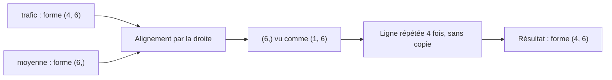

## Introduction

NumPy est la fondation de tout l'écosystème Python data science : Pandas, scikit-learn et de nombreuses autres bibliothèques utilisent ses tableaux (ndarray) en interne. Quand tu filtres un DataFrame ou que tu entraînes un modèle, c'est du code NumPy qui travaille en coulisses. Comprendre NumPy, c'est comprendre pourquoi certaines lignes de code s'exécutent en une milliseconde et d'autres en une minute.

Ce chapitre met en pratique avec du code les vecteurs et matrices déjà étudiés au cours Algèbre Linéaire, puis les applique à des questions de sécurité concrètes : quelles connexions dépassent un seuil, quel hôte génère un trafic anormal à quelle heure, quel nom de domaine ressemble à un domaine généré par un malware. À la fin, tu sauras créer et manipuler des tableaux, écrire du code vectorisé sans boucle, raisonner avec les axes et le broadcasting, et éviter les pièges classiques comme les débordements d'entiers ou les vues modifiées par erreur.

## Le tableau NumPy (ndarray)

### Créer ses premiers tableaux

Un `ndarray` (n-dimensional array) est une grille de valeurs de même type. Un tableau à une dimension correspond à un vecteur, un tableau à deux dimensions à une matrice.

```python
import numpy as np

# Un vecteur (rappel du cours Algèbre Linéaire, chapitre 1)
v = np.array([15, 2, 1])  # caractéristiques d'un email

# Une matrice (rappel du cours Algèbre Linéaire, chapitre 2)
M = np.array([
    [15, 2, 1],
    [2, 45, 0],
    [8, 12, 1]
])

print(v.shape)  # (3,) — un vecteur de 3 éléments
print(M.shape)  # (3, 3) — une matrice 3x3
print(v.dtype, M.ndim, M.size)
```

```text
(3,)
(3, 3)
int64 2 9
```

Quatre attributs décrivent tout tableau. `shape` donne la forme, c'est-à-dire le nombre d'éléments sur chaque dimension : `(3,)` pour un vecteur de trois éléments (la virgule indique un tuple à un seul élément), `(3, 3)` pour une matrice de trois lignes et trois colonnes. `ndim` donne le nombre de dimensions, `size` le nombre total d'éléments, et `dtype` le type commun à tous les éléments, ici des entiers sur 64 bits.

### Pourquoi un type unique change tout

<CehCallout>
Contrairement à une liste Python classique, un tableau NumPy stocke ses éléments de façon contiguë en mémoire et de type unique — cette contrainte, en apparence restrictive, est précisément ce qui permet des calculs des dizaines à des centaines de fois plus rapides que des boucles Python classiques sur de grands volumes de données.
</CehCallout>

Une liste Python ne contient pas directement des nombres : elle contient des pointeurs vers des objets Python dispersés en mémoire, chacun portant son propre type et son compteur de références. Un tableau NumPy de `float64`, lui, est un simple bloc d'octets où chaque valeur occupe exactement 8 octets, les unes à la suite des autres. Le processeur peut parcourir ce bloc sans aucune vérification de type et exploiter ses instructions SIMD, qui traitent plusieurs nombres en une seule instruction.

La différence se mesure aussi en mémoire. Un million de flottants occupe 8 Mo dans un tableau NumPy, contre environ 32 Mo dans une liste Python, en comptant la liste et les objets qu'elle référence.

Si tu mélanges des types à la création, NumPy choisit un type commun capable de tout représenter :

```python
print(np.array([1, 2.5, 3]).dtype)               # float64 : les entiers sont convertis
print(np.array(["10.0.0.5", "8.8.8.8"]).dtype)   # <U8 : chaînes Unicode de 8 caractères max
```

```text
float64
<U8
```

Les tableaux de chaînes existent, mais NumPy n'est pas fait pour le texte : pour des adresses IP ou des noms d'hôtes, Pandas (chapitre 3) sera bien plus adapté.

### Les fonctions de création utiles

```python
np.zeros(3)                     # [0. 0. 0.]
np.ones((2, 3), dtype=np.int32) # matrice 2x3 remplie de 1
np.arange(0, 24, 6)             # [ 0  6 12 18] : comme range(), mais en tableau
np.linspace(0, 1, 5)            # [0.   0.25 0.5  0.75 1.  ] : 5 points régulièrement espacés
np.arange(12).reshape(3, 4)     # 12 valeurs réorganisées en 3 lignes de 4 colonnes

rng = np.random.default_rng(42)          # générateur aléatoire moderne, avec graine
trafic = rng.integers(0, 100, size=(4, 6))
```

Pour l'aléatoire, utilise `np.random.default_rng(graine)` : c'est l'API recommandée depuis NumPy 1.17. Les anciens appels comme `np.random.seed()` puis `np.random.rand()` fonctionnent encore, mais reposent sur un état global partagé, source de résultats non reproductibles dans du code plus complexe. Fixer une graine permet à quelqu'un d'autre de retrouver exactement les mêmes nombres, donc les mêmes résultats.

## Le principe de la vectorisation

<WarningCallout>
Écrire une boucle Python explicite pour additionner deux vecteurs élément par élément fonctionne, mais devient extrêmement lent sur de grands tableaux (des millions de valeurs, comme un an de logs réseau) — la vectorisation NumPy remplace cette boucle explicite par une opération unique optimisée en code compilé.
</WarningCallout>

```python
# Sans vectorisation (lent sur de grands tableaux)
resultat = []
for i in range(len(v1)):
    resultat.append(v1[i] + v2[i])

# Avec vectorisation NumPy (rapide, lisible)
resultat = v1 + v2
```

La vectorisation consiste à exprimer une opération sur le tableau entier plutôt que sur chaque élément. Les opérateurs arithmétiques `+`, `-`, `*`, `/`, `**` et les comparaisons `>`, `==` s'appliquent élément par élément, et les fonctions comme `np.sqrt`, `np.log` ou `np.abs` aussi : on les appelle des ufuncs (fonctions universelles).

### Mesurer le gain

```python
import timeit
import numpy as np

rng = np.random.default_rng(0)
a, b = rng.random(1_000_000), rng.random(1_000_000)
la, lb = a.tolist(), b.tolist()          # mêmes données, en listes Python

def boucle():
    r = []
    for i in range(len(la)):
        r.append(la[i] + lb[i])
    return r

t_boucle = min(timeit.repeat(boucle, number=1, repeat=3))
t_vecto = min(timeit.repeat(lambda: a + b, number=1, repeat=3))
print(f"Boucle : {t_boucle*1000:.1f} ms | Vectorisé : {t_vecto*1000:.2f} ms | x{t_boucle/t_vecto:.0f}")
```

```text
Boucle : 122.0 ms | Vectorisé : 1.68 ms | x73
```

Sur un million de valeurs, la version vectorisée est ici environ 70 fois plus rapide, et l'écart grandit avec des opérations plus complexes. Les chiffres exacts dépendent de ta machine, mais l'ordre de grandeur reste le même. Retiens la règle pratique : dès que tu écris une boucle `for` sur les éléments d'un tableau NumPy, demande-toi s'il existe une opération vectorisée équivalente. Il y en a presque toujours une.

## Réaliser les opérations du cours Algèbre Linéaire avec NumPy

<CompareTable
  titleA="Opération (cours Algèbre Linéaire)"
  titleB="Code NumPy équivalent"
  rows={[
    { a: "Produit scalaire (ch.1)", b: "np.dot(v1, v2) ou v1 @ v2" },
    { a: "Norme d'un vecteur (ch.1, ch.6)", b: "np.linalg.norm(v)" },
    { a: "Multiplication matricielle (ch.2)", b: "A @ B ou np.matmul(A, B)" },
    { a: "Déterminant (ch.3)", b: "np.linalg.det(M)" },
    { a: "Inverse d'une matrice (ch.3)", b: "np.linalg.inv(M)" },
    { a: "Valeurs et vecteurs propres (ch.5)", b: "np.linalg.eig(M)" },
]}
/>

Vérifions ces correspondances sur des exemples chiffrés.

```python
v1 = np.array([2, 3, 1])
v2 = np.array([1, 0, 4])

print(v1 * v2)              # [2 0 4] : produit élément par élément
print(np.dot(v1, v2))       # 6 : 2*1 + 3*0 + 1*4
print(v1 @ v2)              # 6 : même résultat avec l'opérateur @
print(np.linalg.norm(v1))   # 3.7416... : racine de 2² + 3² + 1² = racine de 14
print(round(np.linalg.det(M), 2))   # 335.0
```

```text
[2 0 4]
6
6
3.7416573867739413
335.0
```

Attention à la différence entre `*` et `@`. L'étoile multiplie élément par élément ; l'arobase calcule le produit scalaire pour deux vecteurs et le produit matriciel pour deux matrices. Confondre les deux est l'une des erreurs les plus fréquentes, car le code s'exécute sans erreur et donne simplement un résultat faux.

Le déterminant de `M` vaut 335, donc non nul : la matrice est inversible et `np.linalg.inv(M)` renvoie son inverse. Pour les valeurs propres, `np.linalg.eig` fonctionne sur toute matrice carrée. Pour une matrice symétrique, comme une matrice de covariance, préfère `np.linalg.eigh`, plus stable numériquement, qui renvoie des valeurs réelles triées par ordre croissant :

```python
C = np.array([[2.0, 1.0],
              [1.0, 2.0]])          # matrice symétrique
valeurs, vecteurs = np.linalg.eigh(C)
print(valeurs)                     # [1. 3.]
```

Tu retrouveras ces valeurs propres dans le cours Machine Learning, au cœur de l'analyse en composantes principales.

<TipCallout>
Ce tableau de correspondance illustre concrètement pourquoi le cours Algèbre Linéaire n'était pas un détour théorique : chaque notion mathématique vue s'exprime en une seule ligne de code NumPy, directement réutilisable dans une analyse de sécurité réelle.
</TipCallout>

## Le slicing et le filtrage — sélectionner des données

### Le slicing

Le slicing (découpage) sélectionne une portion d'un tableau avec la syntaxe `début:fin:pas`, où la fin est exclue.

```python
connexions = np.array([12, 450, 8, 230, 15, 9, 600])

# Slicing : les 3 premières valeurs
print(connexions[:3])     # [ 12 450   8]
print(connexions[-2:])    # [  9 600] : les deux dernières
print(connexions[::2])    # [ 12   8  15 600] : un élément sur deux
```

### Le filtrage booléen

```python
# Filtrage booléen : connexions durant plus de 200 secondes (potentiellement suspectes)
masque = connexions > 200
print(masque)

suspectes = connexions[connexions > 200]
print(suspectes)  # [450 230 600]
```

```text
[False  True False  True False False  True]
[450 230 600]
```

Le filtrage se fait en deux temps. D'abord, la comparaison `connexions > 200` produit un masque, un tableau de booléens de même forme. Ensuite, indexer le tableau avec ce masque ne garde que les positions où le masque vaut `True`. Ici, trois connexions sur sept dépassent le seuil.

<CehCallout>
Le filtrage booléen NumPy (`connexions > 200`) est l'un des outils les plus utilisés en pratique pour isoler rapidement des observations suspectes selon un seuil — une opération vectorisée qui remplace élégamment une boucle avec condition explicite.
</CehCallout>

Un masque est aussi un outil de comptage, car `True` vaut 1 et `False` vaut 0 :

```python
print((connexions > 200).sum())    # 3 : nombre de connexions longues
print((connexions > 200).mean())   # 0.4285... : proportion (43 %)

# Combiner des conditions : & (et), | (ou), ~ (non), avec des parenthèses obligatoires
print(connexions[(connexions > 10) & (connexions < 300)])   # [ 12 230  15]

# Étiqueter chaque valeur sans boucle
print(np.where(connexions > 200, "suspect", "normal"))

# Tester l'appartenance à une liste : ports d'administration à distance
ports = np.array([22, 80, 443, 22, 3389, 22, 445])
print(np.isin(ports, [22, 3389, 445]))
print(np.unique(ports, return_counts=True))
```

```text
3
0.42857142857142855
[ 12 230  15]
['normal' 'suspect' 'normal' 'suspect' 'normal' 'normal' 'suspect']
[ True False False  True  True  True  True]
(array([  22,   80,  443,  445, 3389]), array([3, 1, 1, 1, 1]))
```

Les parenthèses autour de chaque condition sont indispensables : en Python, `&` a une priorité plus forte que `>`, donc `connexions > 10 & connexions < 300` serait évalué dans le mauvais ordre et lèverait une erreur. Les mots-clés `and` et `or` ne fonctionnent pas non plus sur des tableaux ; tu retrouveras la même règle avec Pandas.

## Les axes et le broadcasting

### Agréger selon un axe

Imaginons un tableau de trafic : quatre hôtes en lignes, six tranches horaires en colonnes, chaque cellule contenant un nombre de connexions.

```python
rng = np.random.default_rng(42)
trafic = rng.integers(0, 100, size=(4, 6))
print(trafic)
print(trafic.sum(axis=0))   # total par heure (on écrase les lignes)
print(trafic.sum(axis=1))   # total par hôte (on écrase les colonnes)
print(trafic[1, 2], trafic[:, 0], trafic[2])
```

```text
[[ 8 77 65 43 43 85]
 [ 8 69 20  9 52 97]
 [73 76 71 78 51 12]
 [83 45 50 37 18 92]]
[172 267 206 167 164 286]
[321 255 361 325]
20 [ 8  8 73 83] [73 76 71 78 51 12]
```

Le paramètre `axis` désigne la dimension qui disparaît dans le calcul. Avec `axis=0`, on additionne le long des lignes, et il reste une valeur par colonne, donc par heure. Avec `axis=1`, on additionne le long des colonnes, et il reste une valeur par ligne, donc par hôte. Pour l'indexation, `trafic[1, 2]` désigne la ligne 1 et la colonne 2, `trafic[:, 0]` toute la première colonne, et `trafic[2]` toute la troisième ligne.

### Le broadcasting

Le broadcasting (diffusion) permet de combiner des tableaux de formes différentes en « étirant » virtuellement le plus petit, sans copier de données. Le cas le plus simple est un tableau combiné avec un scalaire : `octets / 1024` divise chaque cellule. Plus utile, soustraire à chaque hôte la moyenne horaire de tous les hôtes :

```python
moyenne_par_heure = trafic.mean(axis=0)      # forme (6,)
ecarts = trafic - moyenne_par_heure          # (4, 6) - (6,) -> (4, 6)
print(moyenne_par_heure)
print(ecarts.round(1))
```

```text
[43.   66.75 51.5  41.75 41.   71.5 ]
[[-35.   10.2  13.5   1.2   2.   13.5]
 [-35.    2.2 -31.5 -32.8  11.   25.5]
 [ 30.    9.2  19.5  36.2  10.  -59.5]
 [ 40.  -21.8  -1.5  -4.8 -23.   20.5]]
```

La règle de compatibilité se lit en partant de la droite : deux dimensions sont compatibles si elles sont égales ou si l'une vaut 1. Ici, `(4, 6)` et `(6,)` sont compatibles, car les dernières dimensions valent 6 toutes les deux ; le vecteur de moyennes est réutilisé pour chacune des quatre lignes. On voit immédiatement que l'hôte 2 dépasse la moyenne de 36 connexions dans la quatrième tranche horaire.



## Applications en sécurité

### Détecter des valeurs extrêmes : z-score et z-score robuste

Le z-score mesure à combien d'écarts-types une valeur se trouve de la moyenne : `z = (x - moyenne) / écart-type`. Une règle courante considère comme anormale une valeur dont le z-score dépasse 3 en valeur absolue.

```python
connexions = np.array([12, 450, 8, 230, 15, 9, 600])
z = (connexions - connexions.mean()) / connexions.std()
print(z.round(2))
```

```text
[-0.78  1.14 -0.79  0.18 -0.76 -0.79  1.8 ]
```

Surprise : aucune valeur ne dépasse 3, pas même la connexion de 600 secondes. C'est l'effet de masquage. Les valeurs extrêmes gonflent elles-mêmes la moyenne (189 secondes) et l'écart-type (228,5 secondes), et deviennent ainsi moins visibles. Sur un petit échantillon contaminé, le z-score classique est un mauvais détecteur.

La solution est d'utiliser des statistiques robustes, peu sensibles aux extrêmes : la médiane à la place de la moyenne, et la MAD (Median Absolute Deviation, médiane des écarts absolus à la médiane) à la place de l'écart-type. Le z-score robuste vaut `0,6745 × (x - médiane) / MAD`, le facteur 0,6745 rendant l'échelle comparable à un z-score classique pour des données normales.

```python
mediane = np.median(connexions)                      # 15.0
mad = np.median(np.abs(connexions - mediane))        # 7.0
z_robuste = 0.6745 * (connexions - mediane) / mad
print(z_robuste.round(2))
```

```text
[-0.29 41.92 -0.67 20.72  0.   -0.58 56.37]
```

Cette fois, les trois connexions longues ressortent nettement, avec des scores de 20 à 56. Pas à pas pour la valeur 600 : l'écart à la médiane vaut 600 - 15 = 585, divisé par la MAD de 7 cela donne 83,6, multiplié par 0,6745 on obtient 56,4.

### Repérer des domaines générés par algorithme grâce à l'entropie

Certains malwares utilisent un DGA (Domain Generation Algorithm) pour fabriquer chaque jour des centaines de noms de domaine pseudo-aléatoires et joindre leur serveur de commande. Ces noms ont une signature : leurs caractères sont plus uniformément répartis que dans un mot humain. L'entropie de Shannon mesure cette dispersion : `H = - somme de p × log2(p)` sur chaque caractère distinct, où `p` est sa fréquence relative.

```python
def entropie(chaine: str) -> float:
    octets = np.frombuffer(chaine.encode(), dtype=np.uint8)   # chaîne -> tableau d'octets
    _, comptes = np.unique(octets, return_counts=True)        # occurrences de chaque caractère
    p = comptes / comptes.sum()                               # fréquences relatives
    return float(-(p * np.log2(p)).sum())

for domaine in ["google", "wikipedia", "xk7qz9vbt2mwp4hd", "a8f3kq0zx1v9"]:
    print(f"{domaine:<20} {entropie(domaine):.2f}")
```

```text
google               1.92
wikipedia            2.64
xk7qz9vbt2mwp4hd     4.00
a8f3kq0zx1v9         3.58
```

Le domaine de seize caractères tous différents atteint l'entropie maximale possible pour sa longueur, log2(16) = 4 bits. Calcul pas à pas pour « google » : g apparaît 2 fois, o 2 fois, l et e une fois chacun sur 6 caractères, donc H = -(2 × 2/6 × log2(2/6) + 2 × 1/6 × log2(1/6)), soit environ 1,92. L'entropie seule ne suffit pas pour conclure, car un nom court ou un sous-domaine de CDN peut aussi être aléatoire, mais c'est une caractéristique classique en entrée d'un modèle de détection de DGA, technique référencée par MITRE ATT&CK sous l'identifiant T1568.002.

<AttackDefenseTable rows={[
  { phase: "Commande et contrôle", attack: "Le malware génère des domaines pseudo-aléatoires (DGA, T1568.002) pour joindre son serveur sans adresse codée en dur", defense: "Calculer l'entropie et la longueur des domaines résolus dans les logs DNS, croiser avec l'âge du domaine et des listes de réputation" },
  { phase: "Exfiltration", attack: "Sessions longues ou volumineuses vers l'extérieur, parfois noyées dans le trafic HTTPS", defense: "Filtrage vectorisé par seuil, z-score robuste (médiane et MAD) sur la durée et le volume par hôte" },
  { phase: "Évasion de la détection", attack: "Rester juste sous les seuils fixes connus (low and slow)", defense: "Seuils relatifs à la référence de chaque hôte (broadcasting sur la moyenne par heure), corrélation de plusieurs signaux" },
]} />

## Erreurs fréquentes

### Les débordements d'entiers

Un entier NumPy a une taille fixe. S'il dépasse sa capacité, il « boucle » silencieusement, sans erreur :

```python
a = np.array([250, 10], dtype=np.uint8)   # entiers non signés sur 8 bits : 0 à 255
print(a + 10)                             # [ 4 20] : 260 est devenu 4 !
```

C'est piégeux avec des données lues en `uint8` (pixels, octets bruts d'un fichier) ou avec des compteurs d'octets en `int32` sur de gros volumes. Convertis vers un type plus large avec `astype(np.int64)` avant de calculer.

### Les vues modifiées par erreur

Un slice ne copie pas les données : il crée une vue sur le même bloc mémoire.

```python
connexions = np.array([12, 450, 8, 230, 15, 9, 600])
debut = connexions[:3]
debut[0] = 999
print(connexions)        # [999 450   8 230  15   9 600] : l'original a changé
```

Si tu veux modifier une portion sans toucher à l'original, écris `connexions[:3].copy()`. À l'inverse, l'indexation par masque booléen crée toujours une copie.

### Les autres pièges

- **Comparer des flottants avec `==`** : `0.1 + 0.2 == 0.3` vaut `False` à cause de la représentation binaire. Utilise `np.isclose`.
- **Ignorer les NaN** : `np.array([1.0, np.nan, 3.0]).mean()` renvoie `nan`. Les fonctions `np.nanmean`, `np.nansum` ou `np.nanmax` ignorent les valeurs manquantes.
- **Confondre `*` et `@`** : l'un multiplie élément par élément, l'autre fait un produit matriciel.
- **Oublier les parenthèses dans les masques combinés** : écris toujours `(a > 1) & (a < 5)`.

## Lab — Mise en pratique

**Environnement** : Python 3.12 ou plus récent avec NumPy installé (terminal Nyx Shell ou environnement local).

<Steps steps={[
  { title: "Créer un vecteur et une matrice NumPy", description: "Recrée le vecteur et la matrice d'exemple du chapitre et affiche leurs dimensions, leur nombre de dimensions et leur type. Vérifie que v.shape vaut (3,) et M.shape vaut (3, 3).", code: "import numpy as np\n\nv = np.array([15, 2, 1])\nM = np.array([\n    [15, 2, 1],\n    [2, 45, 0],\n    [8, 12, 1]\n])\n\nprint(v.shape, M.shape)\nprint(M.ndim, M.size, M.dtype)" },
  { title: "Calculer un produit scalaire, une norme et un déterminant", description: "Vérifie en code les calculs du cours Algèbre Linéaire. Calcule d'abord le produit scalaire à la main (2×1 + 3×0 + 1×4), puis compare avec NumPy. Observe la différence entre v1 * v2 et v1 @ v2.", code: "v1 = np.array([2, 3, 1])\nv2 = np.array([1, 0, 4])\n\nprint(v1 * v2)\nprint(np.dot(v1, v2), v1 @ v2)\nprint(np.linalg.norm(v1))\nprint(round(np.linalg.det(M), 2))" },
  { title: "Comparer boucle Python et vectorisation", description: "Additionne deux tableaux d'un million de valeurs avec une boucle explicite puis avec la vectorisation, et mesure le temps de chaque version. Note le facteur d'accélération obtenu sur ta machine.", code: "import timeit\n\nrng = np.random.default_rng(0)\na, b = rng.random(1_000_000), rng.random(1_000_000)\nla, lb = a.tolist(), b.tolist()\n\nt1 = timeit.timeit(lambda: [x + y for x, y in zip(la, lb)], number=3)\nt2 = timeit.timeit(lambda: a + b, number=3)\nprint(f'Boucle : {t1:.3f} s | Vectorise : {t2:.4f} s | x{t1/t2:.0f}')" },
  { title: "Filtrer des connexions suspectes", description: "Filtre les durées de connexion dépassant 300 secondes, puis compte-les et calcule leur proportion. Tu dois obtenir deux connexions, soit environ 29 %.", code: "connexions = np.array([12, 450, 8, 230, 15, 9, 600])\nsuspectes = connexions[connexions > 300]\nprint(suspectes)\nprint((connexions > 300).sum(), (connexions > 300).mean().round(2))\nprint(np.where(connexions > 300, 'suspect', 'normal'))" },
  { title: "Comparer z-score classique et z-score robuste", description: "Calcule les deux scores sur le même tableau. Observe qu'aucun z-score classique ne dépasse 3, alors que le z-score robuste fait ressortir clairement les connexions longues.", code: "z = (connexions - connexions.mean()) / connexions.std()\nmed = np.median(connexions)\nmad = np.median(np.abs(connexions - med))\nz_rob = 0.6745 * (connexions - med) / mad\nprint(z.round(2))\nprint(z_rob.round(2))" },
  { title: "Agréger un trafic par hôte et par heure", description: "Génère une matrice de trafic de 4 hôtes sur 6 heures, calcule les totaux par heure et par hôte, puis les écarts à la moyenne horaire par broadcasting. Identifie l'hôte et l'heure du plus grand écart positif avec np.unravel_index.", code: "rng = np.random.default_rng(42)\ntrafic = rng.integers(0, 100, size=(4, 6))\nprint(trafic.sum(axis=0), trafic.sum(axis=1))\necarts = trafic - trafic.mean(axis=0)\nhote, heure = np.unravel_index(ecarts.argmax(), ecarts.shape)\nprint(f'Hote {hote}, tranche {heure} : +{ecarts.max():.1f}')" },
  { title: "Calculer l'entropie de noms de domaine", description: "Écris la fonction d'entropie du chapitre et applique-la à une liste de domaines. Ajoute tes propres exemples et observe quels domaines dépassent 3,5 bits.", code: "def entropie(chaine):\n    octets = np.frombuffer(chaine.encode(), dtype=np.uint8)\n    _, comptes = np.unique(octets, return_counts=True)\n    p = comptes / comptes.sum()\n    return float(-(p * np.log2(p)).sum())\n\nfor d in ['google', 'wikipedia', 'xk7qz9vbt2mwp4hd', 'a8f3kq0zx1v9']:\n    print(f'{d:<20} {entropie(d):.2f}')" },
]} />

## À retenir

- Le tableau NumPy (ndarray) stocke des données de façon contiguë et typée, ce qui permet un calcul vectorisé bien plus rapide qu'une boucle Python classique.
- La vectorisation remplace une boucle explicite par une opération unique exécutée en code compilé ; le gain dépasse souvent un facteur 50.
- Chaque opération d'algèbre linéaire vue précédemment (produit scalaire, norme, déterminant, valeurs propres) s'exprime en une ligne de NumPy ; `*` multiplie élément par élément, `@` fait le produit matriciel.
- Le filtrage booléen isole des observations selon un seuil, et un masque permet aussi de compter avec `sum` et `mean`.
- Le paramètre `axis` indique la dimension qui disparaît dans une agrégation ; le broadcasting combine des tableaux de formes compatibles sans copie.
- Les statistiques robustes (médiane, MAD) détectent mieux les valeurs extrêmes que la moyenne et l'écart-type, qui sont eux-mêmes contaminés.
- Attention aux débordements d'entiers, aux vues partagées et aux NaN qui se propagent.

## Questions de révision

1. Pourquoi un tableau NumPy permet-il des calculs bien plus rapides qu'une boucle Python classique ?
2. Quelle fonction NumPy calcule le déterminant d'une matrice, et laquelle calcule ses valeurs et vecteurs propres ?
3. À quoi sert le filtrage booléen (`tableau[tableau > seuil]`) en analyse de sécurité, et comment l'utiliser pour compter des événements ?
4. Dans un tableau de trafic de forme (hôtes, heures), que calcule `trafic.sum(axis=0)` ?
5. Pourquoi peut-on soustraire un tableau de forme (6,) à un tableau de forme (4, 6) ?
6. Pourquoi le z-score classique n'a-t-il détecté aucune anomalie dans l'exemple des connexions, et en quoi la médiane et la MAD corrigent-elles ce problème ?
7. Pourquoi l'entropie d'un nom de domaine est-elle un indice utile, mais insuffisant à elle seule, pour repérer un domaine généré par un malware ?
