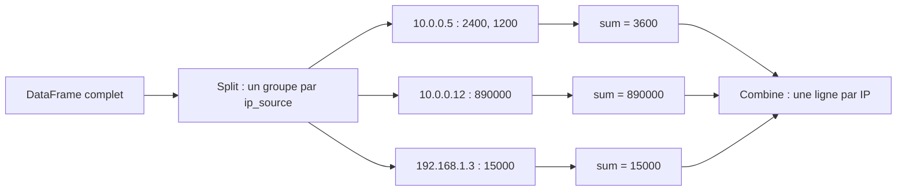

## Introduction

Si NumPy fournit le calcul vectorisé brut, Pandas ajoute une couche indispensable pour le travail quotidien en data science : des colonnes nommées, des types hétérogènes, et des opérations de haut niveau pensées pour l'analyse de données tabulaires — exactement la forme que prennent la plupart des logs et jeux de données de sécurité.

Un export de pare-feu, un journal d'authentification, une liste d'alertes de SIEM ou un inventaire de machines ont tous la même allure : des lignes qui représentent des événements ou des objets, et des colonnes qui décrivent leurs attributs. Pandas sait charger ces données en une ligne, poser des questions précises comme « quelles adresses IP ont échoué plus de dix fois à se connecter en SSH ? », et croiser le résultat avec une liste d'indicateurs de compromission.

À la fin de ce chapitre, tu sauras charger un fichier avec les bonnes options, sélectionner et filtrer des lignes et des colonnes, créer de nouvelles colonnes calculées, agréger par catégorie, joindre deux tables, et extraire des champs structurés à partir de lignes de logs brutes.

## Le DataFrame — une table de données nommée

### Construire et inspecter un DataFrame

```python
import pandas as pd

df = pd.DataFrame({
    "ip_source": ["10.0.0.5", "10.0.0.12", "10.0.0.5", "192.168.1.3"],
    "port": [443, 22, 80, 443],
    "duree_s": [12, 340, 8, 450],
    "octets": [2400, 890000, 1200, 15000]
})

print(df.head())        # les 5 premières lignes
print(df.dtypes)        # le type de chaque colonne
```

```text
     ip_source  port  duree_s  octets
0     10.0.0.5   443       12    2400
1    10.0.0.12    22      340  890000
2     10.0.0.5    80        8    1200
3  192.168.1.3   443      450   15000
ip_source      str
port         int64
duree_s      int64
octets       int64
dtype: object
```

Ce DataFrame contient quatre connexions réseau décrites par l'IP source, le port de destination, la durée en secondes (`duree_s`) et le volume en octets. La colonne de gauche, avec les nombres 0 à 3, est l'index : l'étiquette de chaque ligne. Par défaut c'est un simple compteur, mais on peut le remplacer par une colonne significative, comme un horodatage.

La sortie de `dtypes` montre le type de chaque colonne. Avec pandas 3, la colonne de texte apparaît avec le type `str`, un type dédié aux chaînes ; avec pandas 2, elle apparaît comme `object`. Le comportement est le même pour tout ce qui suit.

### Series et DataFrame

Un DataFrame est une collection de colonnes, et chaque colonne est une `Series` : un tableau NumPy à une dimension accompagné d'un index et d'un nom. Sélectionner une colonne avec des crochets renvoie une Series ; sélectionner une liste de colonnes renvoie un DataFrame.

```python
print(df["duree_s"])              # une Series
print(df[["ip_source", "octets"]])  # un DataFrame (notez les doubles crochets)
```

```text
0     12
1    340
2      8
3    450
Name: duree_s, dtype: int64
     ip_source  octets
0     10.0.0.5    2400
1    10.0.0.12  890000
2     10.0.0.5    1200
3  192.168.1.3   15000
```

### Charger des données réelles

<CehCallout>
Un DataFrame Pandas se charge presque toujours depuis un fichier réel plutôt que d'être construit à la main — `pd.read_csv("logs.csv")` ou `pd.read_json("logs.json")` transforment directement un export de logs en DataFrame exploitable, la première étape de toute analyse.
</CehCallout>

Les fonctions de lecture acceptent de nombreuses options. Quelques-unes changent tout sur de vrais fichiers :

```python
df = pd.read_csv(
    "connexions.csv",
    usecols=["timestamp", "ip_source", "port", "duree_s", "octets"],  # ne charger que l'utile
    dtype={"port": "Int64"},          # entier acceptant les valeurs manquantes
    parse_dates=["timestamp"],        # convertir directement en dates
    sep=",",                          # séparateur (";" pour beaucoup d'exports Excel français)
)

alertes = pd.read_json("alertes.jsonl", lines=True)   # un objet JSON par ligne (format NDJSON)
archive = pd.read_parquet("connexions.parquet")       # format colonnaire, compact et typé (PyArrow)
```

Le paramètre `lines=True` est indispensable pour les exports d'outils comme Suricata (fichier `eve.json`), Zeek en mode JSON ou la plupart des SIEM, qui écrivent un objet JSON par ligne. Le format Parquet, lui, conserve les types et compresse fortement : un mois de logs y occupe souvent plusieurs fois moins de place qu'en CSV et se recharge beaucoup plus vite.

## Filtrer et sélectionner des données

### Filtrer avec un masque booléen

```python
# Sélectionner une colonne
print(df["duree_s"])

# Filtrer les connexions longues (rappel du filtrage NumPy, chapitre 2)
longues = df[df["duree_s"] > 100]

# Filtrer sur plusieurs conditions
suspectes = df[(df["duree_s"] > 100) & (df["octets"] > 500000)]
print(suspectes)
```

```text
   ip_source  port  duree_s  octets
1  10.0.0.12    22      340  890000
```

Le principe est exactement celui des masques NumPy du chapitre 2 : `df["duree_s"] > 100` produit une Series de booléens, et `df[masque]` ne garde que les lignes à `True`. Ici, une seule connexion est à la fois longue et volumineuse : une session SSH de 340 secondes qui a transféré près de 900 Ko.

<WarningCallout>
En Pandas, les opérateurs logiques `&` (et) et `|` (ou) remplacent les mots-clés Python `and`/`or` pour combiner des conditions sur des colonnes entières — une erreur fréquente chez les débutants est d'utiliser `and`/`or`, qui ne fonctionnent pas correctement sur des séries de valeurs et lèvent une erreur.
</WarningCallout>

Si tu essaies quand même, voici le message que tu obtiendras :

```text
ValueError: The truth value of a Series is ambiguous. Use a.empty, a.item(), a.any() or a.all().
```

Python demande à `and` de réduire chaque côté à un seul booléen, ce qui n'a pas de sens pour une colonne de quatre valeurs. Les opérateurs `&`, `|` et `~` (non), eux, travaillent élément par élément. Et comme avec NumPy, chaque condition doit être entourée de parenthèses.

### loc et iloc : sélectionner lignes et colonnes ensemble

`loc` sélectionne par étiquette (noms d'index et de colonnes, ou masque booléen), `iloc` par position entière.

```python
# Lignes où le port vaut 443, colonnes ip_source et octets
print(df.loc[df["port"] == 443, ["ip_source", "octets"]])

# Lignes en positions 1 et 2, colonnes en positions 0 et 1 (fin exclue, comme en Python)
print(df.iloc[1:3, 0:2])
```

```text
     ip_source  octets
0     10.0.0.5    2400
3  192.168.1.3   15000
   ip_source  port
1  10.0.0.12    22
2   10.0.0.5    80
```

Pour modifier des valeurs, utilise toujours `loc` en une seule opération : `df.loc[df["port"] == 22, "service"] = "ssh"`. L'écriture enchaînée `df[df["port"] == 22]["service"] = "ssh"` ne modifie pas l'original : pandas 2 affichait un avertissement `SettingWithCopyWarning`, et avec le mode copy-on-write, activé par défaut depuis pandas 3, cette écriture n'a jamais aucun effet sur `df` et déclenche l'avertissement `ChainedAssignmentError`.

### Autres façons de filtrer

```python
# query : une condition écrite comme une chaîne, souvent plus lisible
print(df.query("duree_s > 100 and port != 22"))

# isin : appartenance à une liste de valeurs
admin = df[df["port"].isin([22, 3389, 5985])]

# Méthodes de texte via l'accesseur .str
internes = df[df["ip_source"].str.startswith("10.")]
```

Dans `query`, les mots `and` et `or` sont autorisés, car la chaîne est interprétée par Pandas et non par Python. L'accesseur `.str` donne accès à des méthodes de chaînes vectorisées : `contains`, `startswith`, `lower`, `split`, `extract`, que tu utiliseras plus bas pour parser des logs.

## Créer des colonnes calculées

Une nouvelle colonne se crée par simple affectation, avec une opération vectorisée. La méthode `assign` fait la même chose en renvoyant un nouveau DataFrame, ce qui permet d'enchaîner les opérations.

```python
df = df.assign(
    ko=lambda d: (d["octets"] / 1024).round(1),               # volume en kilo-octets
    debit=lambda d: (d["octets"] / d["duree_s"]).round(1),    # octets par seconde
)
print(df)
```

```text
     ip_source  port  duree_s  octets     ko   debit
0     10.0.0.5   443       12    2400    2.3   200.0
1    10.0.0.12    22      340  890000  869.1  2617.6
2     10.0.0.5    80        8    1200    1.2   150.0
3  192.168.1.3   443      450   15000   14.6    33.3
```

Le débit est une caractéristique dérivée souvent plus parlante que les colonnes brutes : la connexion SSH transfère plus de 2 600 octets par seconde, soit dix fois plus que les autres. Créer ce genre de variable à partir des colonnes existantes s'appelle le feature engineering, une étape que tu retrouveras au chapitre 7.

## Agréger des données avec groupby

<CehCallout>
`groupby` est l'opération Pandas la plus puissante pour l'analyse de sécurité : elle permet de répondre à des questions comme "quel est le volume total de données par IP source ?" ou "combien de connexions par port ?", en une seule ligne de code, sans écrire de boucle.
</CehCallout>

```python
# Volume total (octets) par IP source
par_ip = df.groupby("ip_source")["octets"].sum()
print(par_ip)

# Nombre de connexions par port, trié par fréquence décroissante
par_port = df["port"].value_counts()
print(par_port)
```

```text
ip_source
10.0.0.12      890000
10.0.0.5         3600
192.168.1.3     15000
Name: octets, dtype: int64
port
443    2
22     1
80     1
Name: count, dtype: int64
```

### Le principe split-apply-combine

`groupby` suit un schéma en trois temps. Il découpe d'abord les lignes en groupes selon la valeur d'une colonne (split), applique ensuite une fonction à chaque groupe (apply), puis rassemble les résultats dans une nouvelle table (combine). Ici, les deux connexions de `10.0.0.5` (2 400 et 1 200 octets) ont été additionnées pour donner 3 600.



### Plusieurs agrégations à la fois

L'agrégation nommée produit un tableau de synthèse lisible, une colonne par indicateur :

```python
synthese = df.groupby("ip_source").agg(
    nb=("port", "size"),              # nombre de connexions
    octets_total=("octets", "sum"),
    duree_max=("duree_s", "max"),
    ports=("port", "nunique"),        # nombre de ports distincts contactés
)
print(synthese)
```

```text
             nb  octets_total  duree_max  ports
ip_source                                      
10.0.0.12     1        890000        340      1
10.0.0.5      2          3600         12      2
192.168.1.3   1         15000        450      1
```

Le nombre de ports distincts par IP est un indicateur classique de balayage : une machine qui contacte des centaines de ports différents en quelques minutes effectue probablement un scan réseau.

## Trier et classer

```python
# Les connexions triées par volume décroissant
df_trie = df.sort_values("octets", ascending=False)

# Les 3 connexions avec le plus gros volume
top3 = df.nlargest(3, "octets")
print(top3[["ip_source", "port", "octets"]])
```

```text
     ip_source  port  octets
1    10.0.0.12    22  890000
3  192.168.1.3   443   15000
0     10.0.0.5   443    2400
```

<TipCallout>
`nlargest` et `nsmallest` sont plus efficaces et plus lisibles que trier l'ensemble du DataFrame puis prendre les premières lignes — un réflexe utile quand on ne s'intéresse qu'aux valeurs extrêmes d'un grand jeu de données, comme les plus gros volumes de trafic suspects.
</TipCallout>

## Cas pratique — détecter une attaque par force brute SSH

Mettons tout cela en œuvre sur un cas réel de défense : des lignes brutes d'un journal d'authentification Linux, comme celles produites par le démon `sshd`. Les adresses `203.0.113.0/24` et `198.51.100.0/24` sont des plages réservées à la documentation (RFC 5737), utilisées ici pour représenter des attaquants externes.

### Extraire des champs avec une expression régulière

```python
lignes = [
    "2026-11-02T03:14:07 sshd[2211]: Failed password for root from 203.0.113.45 port 52144 ssh2",
    "2026-11-02T03:14:09 sshd[2211]: Failed password for root from 203.0.113.45 port 52150 ssh2",
    "2026-11-02T03:14:12 sshd[2213]: Failed password for invalid user admin from 203.0.113.45 port 52162 ssh2",
    "2026-11-02T03:15:40 sshd[2217]: Failed password for invalid user oracle from 198.51.100.7 port 40022 ssh2",
    "2026-11-02T08:02:11 sshd[2301]: Accepted publickey for alice from 10.0.0.5 port 50110 ssh2",
    "2026-11-02T08:30:55 sshd[2320]: Failed password for bob from 10.0.0.12 port 50200 ssh2",
    "2026-11-02T08:31:02 sshd[2320]: Accepted password for bob from 10.0.0.12 port 50200 ssh2",
    "2026-11-02T09:12:45 sshd[2350]: Failed password for root from 203.0.113.45 port 53001 ssh2",
]
logs = pd.DataFrame({"ligne": lignes})

motif = (r"^(?P<horodatage>\S+) sshd\[\d+\]: (?P<resultat>Accepted|Failed) (?P<methode>\w+) "
         r"for (?:invalid user )?(?P<utilisateur>\S+) from (?P<ip>\S+) port (?P<port>\d+)")
ev = logs["ligne"].str.extract(motif)          # une colonne par groupe nommé
ev["horodatage"] = pd.to_datetime(ev["horodatage"])
ev["port"] = ev["port"].astype(int)
print(ev)
```

```text
           horodatage  resultat    methode utilisateur            ip   port
0 2026-11-02 03:14:07    Failed   password        root  203.0.113.45  52144
1 2026-11-02 03:14:09    Failed   password        root  203.0.113.45  52150
2 2026-11-02 03:14:12    Failed   password       admin  203.0.113.45  52162
3 2026-11-02 03:15:40    Failed   password      oracle  198.51.100.7  40022
4 2026-11-02 08:02:11  Accepted  publickey       alice      10.0.0.5  50110
5 2026-11-02 08:30:55    Failed   password         bob     10.0.0.12  50200
6 2026-11-02 08:31:02  Accepted   password         bob     10.0.0.12  50200
7 2026-11-02 09:12:45    Failed   password        root  203.0.113.45  53001
```

`str.extract` applique l'expression régulière à chaque ligne et crée une colonne par groupe nommé `(?P<nom>...)`. Le groupe non capturant `(?:invalid user )?` absorbe la mention « invalid user » quand elle est présente, pour que le nom d'utilisateur soit toujours au même endroit. Les lignes qui ne correspondent pas au motif donnent des valeurs manquantes, qu'il faut ensuite surveiller.

### Agréger les échecs par adresse IP

```python
echecs = (
    ev[ev["resultat"] == "Failed"]
    .groupby("ip")
    .agg(tentatives=("utilisateur", "size"),
         comptes_vises=("utilisateur", "nunique"),
         premiere=("horodatage", "min"),
         derniere=("horodatage", "max"))
    .sort_values("tentatives", ascending=False)
)
print(echecs)
```

```text
              tentatives  comptes_vises            premiere            derniere
ip                                                                             
203.0.113.45           4              2 2026-11-02 03:14:07 2026-11-02 09:12:45
10.0.0.12              1              1 2026-11-02 08:30:55 2026-11-02 08:30:55
198.51.100.7           1              1 2026-11-02 03:15:40 2026-11-02 03:15:40
```

L'adresse `203.0.113.45` cumule quatre échecs sur deux comptes, dont `root`, en pleine nuit. Sur un vrai serveur exposé, tu verrais des milliers de lignes de ce type par jour. À l'inverse, `10.0.0.12` échoue une fois puis réussit sept secondes plus tard : c'est le profil typique d'une faute de frappe.

### Enrichir avec une liste d'indicateurs de compromission

`merge` joint deux tables sur une colonne commune, comme une jointure SQL. Croisons nos résultats avec un flux de réputation d'adresses IP :

```python
ioc = pd.DataFrame({
    "ip": ["203.0.113.45", "192.0.2.99"],
    "categorie": ["bruteforce-ssh", "scanner"],
})
enrichi = echecs.reset_index().merge(ioc, on="ip", how="left")
print(enrichi[["ip", "tentatives", "comptes_vises", "categorie"]])

print(pd.crosstab(ev["ip"], ev["resultat"]))   # tableau croisé IP x résultat
```

```text
             ip  tentatives  comptes_vises       categorie
0  203.0.113.45           4              2  bruteforce-ssh
1     10.0.0.12           1              1             NaN
2  198.51.100.7           1              1             NaN
resultat      Accepted  Failed
ip                            
10.0.0.12            1       1
10.0.0.5             1       0
198.51.100.7         0       1
203.0.113.45         0       4
```

Le paramètre `how="left"` garde toutes les lignes de la table de gauche, même sans correspondance dans la liste d'IOC ; elles reçoivent alors `NaN`. Avec `how="inner"`, seules les IP présentes dans les deux tables seraient conservées. Le tableau croisé `crosstab` compte les combinaisons de deux colonnes : une IP qui n'a que des échecs et aucun succès est un signal fort.

<AttackDefenseTable rows={[
  { phase: "Accès initial", attack: "Force brute ou devinette de mots de passe SSH (MITRE ATT&CK T1110.001) sur des comptes courants comme root, admin ou oracle", defense: "groupby par IP sur les échecs, seuil de tentatives par fenêtre de temps, blocage automatique (fail2ban), authentification par clé uniquement" },
  { phase: "Pulvérisation de mots de passe", attack: "Password spraying (T1110.003) : un même mot de passe essayé sur de nombreux comptes, peu de tentatives par compte", defense: "Compter les comptes distincts visés par IP avec nunique plutôt que le seul nombre d'échecs" },
  { phase: "Accès réussi après échecs", attack: "Une série d'échecs suivie d'un succès depuis la même IP externe signale une compromission probable", defense: "crosstab IP x résultat, alerte prioritaire sur les IP externes ayant à la fois des échecs et un succès" },
]} />

## Erreurs fréquentes

- **Utiliser `and` et `or` sur des colonnes** : erreur « truth value of a Series is ambiguous ». Utilise `&`, `|`, `~` et des parenthèses.
- **L'affectation enchaînée** : `df[masque]["col"] = valeur` ne modifie pas `df`. Écris `df.loc[masque, "col"] = valeur`.
- **Oublier les doubles crochets** : `df["a", "b"]` lève une erreur ; pour plusieurs colonnes, il faut une liste, `df[["a", "b"]]`.
- **Oublier `reset_index()` après un `groupby`** : la colonne de regroupement devient l'index, et un `merge` sur cette colonne échoue tant qu'elle n'est pas redevenue une colonne ordinaire.
- **Se tromper de type de jointure** : un `merge` en `inner` fait disparaître silencieusement les lignes sans correspondance. Vérifie toujours le nombre de lignes avant et après une jointure.
- **Boucler sur les lignes avec `iterrows`** : c'est des centaines de fois plus lent qu'une opération vectorisée. Cherche d'abord une méthode comme `str`, `groupby`, `merge` ou `np.where`.

## Lab — Mise en pratique

**Environnement** : Python 3.12 ou plus récent avec pandas installé (terminal Nyx Shell ou environnement local).

<Steps steps={[
  { title: "Créer un DataFrame de connexions", description: "Recrée le DataFrame de connexions réseau de l'exemple du chapitre et inspecte sa forme et ses types.", code: "import pandas as pd\n\ndf = pd.DataFrame({\n    'ip_source': ['10.0.0.5', '10.0.0.12', '10.0.0.5', '192.168.1.3'],\n    'port': [443, 22, 80, 443],\n    'duree_s': [12, 340, 8, 450],\n    'octets': [2400, 890000, 1200, 15000]\n})\nprint(df.head())\nprint(df.shape)\nprint(df.dtypes)" },
  { title: "Filtrer les connexions volumineuses", description: "Filtre les connexions dont le volume dépasse 100 000 octets, puis celles qui sont à la fois longues et volumineuses. Essaie ensuite la version avec and pour observer l'erreur.", code: "volumineuses = df[df['octets'] > 100000]\nprint(volumineuses)\nprint(df[(df['duree_s'] > 100) & (df['octets'] > 500000)])" },
  { title: "Créer une colonne de débit", description: "Ajoute une colonne de débit en octets par seconde et repère la connexion au débit le plus élevé.", code: "df['debit'] = (df['octets'] / df['duree_s']).round(1)\nprint(df.sort_values('debit', ascending=False))" },
  { title: "Agréger le volume par IP source", description: "Utilise groupby pour calculer le volume total de données par IP source, puis identifie l'IP ayant transféré le plus de données.", code: "par_ip = df.groupby('ip_source')['octets'].sum()\nprint(par_ip.sort_values(ascending=False))\nprint(df['port'].value_counts())" },
  { title: "Identifier les connexions les plus volumineuses", description: "Utilise nlargest pour isoler les 2 connexions avec le plus gros volume.", code: "top2 = df.nlargest(2, 'octets')\nprint(top2)" },
  { title: "Parser un journal SSH", description: "Copie les huit lignes de log du cas pratique dans une liste lignes, puis extrais les champs avec str.extract. Vérifie qu'aucune ligne ne contient de valeur manquante.", code: "logs = pd.DataFrame({'ligne': lignes})\nmotif = r'^(?P<horodatage>\\S+) sshd\\[\\d+\\]: (?P<resultat>Accepted|Failed) (?P<methode>\\w+) for (?:invalid user )?(?P<utilisateur>\\S+) from (?P<ip>\\S+) port (?P<port>\\d+)'\nev = logs['ligne'].str.extract(motif)\nev['horodatage'] = pd.to_datetime(ev['horodatage'])\nprint(ev)\nprint(ev.isna().sum())" },
  { title: "Détecter la force brute et enrichir", description: "Agrège les échecs par IP avec le nombre de tentatives et de comptes visés, puis joins le résultat à une petite liste d'IOC. L'IP 203.0.113.45 doit ressortir en tête, étiquetée bruteforce-ssh.", code: "echecs = (ev[ev['resultat'] == 'Failed']\n          .groupby('ip')\n          .agg(tentatives=('utilisateur', 'size'), comptes_vises=('utilisateur', 'nunique'))\n          .sort_values('tentatives', ascending=False))\nioc = pd.DataFrame({'ip': ['203.0.113.45'], 'categorie': ['bruteforce-ssh']})\nprint(echecs.reset_index().merge(ioc, on='ip', how='left'))\nprint(pd.crosstab(ev['ip'], ev['resultat']))" },
]} />

## À retenir

- Un DataFrame Pandas structure des données tabulaires avec des colonnes nommées et typées, la forme naturelle de la plupart des logs de sécurité ; chaque colonne est une Series.
- `read_csv`, `read_json` (avec `lines=True` pour le JSON par ligne) et `read_parquet` transforment un export en DataFrame ; les options `usecols`, `dtype` et `parse_dates` évitent bien des problèmes.
- Le filtrage combine des conditions avec les opérateurs `&` et `|`, jamais `and`/`or` sur des colonnes entières ; `loc` sert à sélectionner et à modifier en une seule opération.
- `groupby` suit le schéma split-apply-combine et agrège (sommes, comptages, valeurs distinctes) par catégorie en une seule ligne.
- `nlargest` isole les valeurs extrêmes sans trier tout le DataFrame.
- `str.extract` transforme des lignes de logs brutes en colonnes, et `merge` enrichit un résultat avec une autre source, comme une liste d'IOC.

## Questions de révision

1. Pourquoi utilise-t-on `&` et `|` plutôt que `and`/`or` pour combiner des conditions sur des colonnes Pandas ?
2. Que permet de faire l'opération `groupby` en une seule ligne de code ? Décris les trois étapes du schéma split-apply-combine.
3. Pourquoi `nlargest` est-il préférable à un tri complet suivi d'une sélection des premières lignes ?
4. Quelle est la différence entre `loc` et `iloc` ? Pourquoi faut-il utiliser `loc` pour modifier des valeurs ?
5. Pourquoi compter le nombre de comptes distincts visés par une IP permet-il de repérer une pulvérisation de mots de passe que le seul nombre d'échecs manquerait ?
6. Que se passe-t-il pour les lignes sans correspondance lors d'un `merge` avec `how="left"`, puis avec `how="inner"` ?
7. Quel est l'intérêt de stocker un mois de logs au format Parquet plutôt qu'en CSV ?
